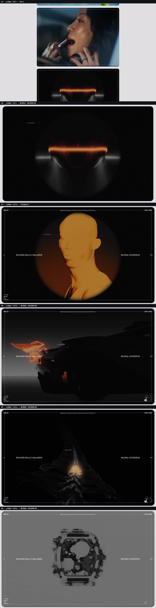
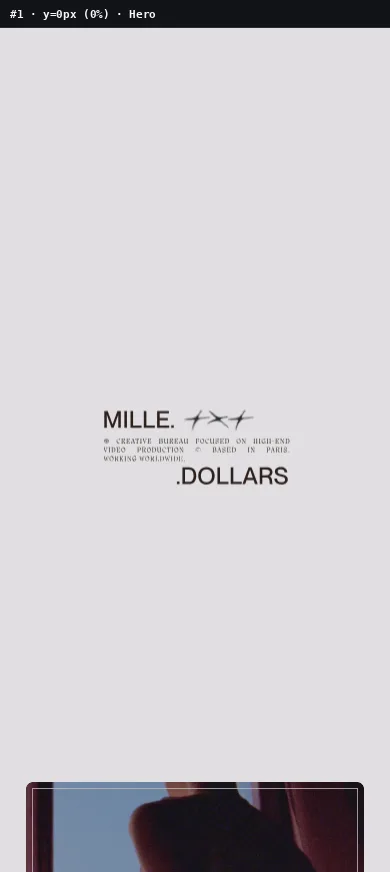

# UI Design System & Master Generation Blueprint: milledollars-fr

> **MilleDollars** (https://milledollars.fr/) — Creative bureau focused on high-end video production. Working worldwide.





---

## 1. Executive Visual Persona & Design Archetype

- **Brand Essence & Persona**: **MilleDollars** (`https://milledollars.fr/`). Creative bureau focused on high-end video production. Working worldwide.
- **Capture Provenance**: Live browser capture (`tier1_fast`, HTTP `200`, captured `2026-11-24`).
- **Visual Archetype**: **Light-Gallery WebGL / Canvas Interactive Experience (`#e0dee1` / `#00adef`)**.
- **Anti-AI-Slop Differentiators**:
  - **Live-Computed Chromatic Polarity**: Anchors the viewport in `#e0dee1` (live computed `body` `background-color` (`computed_styles.json`)) paired with `#000000` primary typography and `#00adef` accents.
  - **Grounded Typographic Hierarchy**: Uses `ABCDiatype` across display (`MilleDollars`) and body copy, paired with `Inconsolata` for monospace/code.
  - **Calibrated Spatial Grid & Motion**: Combines `1200px` container bounds (`gap: 4px`, padding `1.25rem`) with `cubic-bezier(.55,.085,.68,.53)` easing and Lenis Smooth Scroll (`data-lenis`), Three.js / WebGL Canvas Pipeline.

---

## 2. Spatial Architecture & Modular Grid Mathematics

### Viewport Allocation & Container Geometry
- **Captured Journey Filmstrips**: Desktop `1280×4968px` (`assets/desktop-journey.webp`, `6` keyframes up to `y=0px` / doc `900px`), Mobile `390×872px` (`assets/mobile-journey.webp`, `1` keyframes).
- **Master Container Bounds**: `1200px` (non-`@media` desktop container stylesheet rule).
- **Canvas Lateral Padding & Spacing**: `1.25rem` lateral canvas padding with `4px` grid gap.
- **Border Radius Scale**: `50%`, `.625rem`, `.5rem`, `.4rem`.

### Responsive Breakpoint Architecture
- **Desktop Layout**: Multi-column CSS Grid / Flexbox layout at `1440px` (`max-width: 1200px`, `gap: 4px`).
- **Mobile Layout**: Single-column vertical stack at `390px` viewport width with `1.25rem` horizontal padding.
- **Extracted CSS Media Queries**: `@media (max-width:768px)`, `@media (min-width:768px)`, `@media (max-width:768px)and (max-width:768px)`, `@media (max-width:639px)`.

---

## 3. Color System, Materiality & Atmospheric Lighting

### Semantic Palette & Source Grounding
| Semantic Role | Ground-Truth Value | Extracted Live / CSS Source |
|---|---|---|
| **Primary Canvas Substrate** | `#e0dee1` | live computed `body` `background-color` (`computed_styles.json`) |
| **Primary Typography Ink** | `#000000` | live computed `header` `color` (`computed_styles.json`) |
| **Elevated Surface / Card Substrate** | `#ffffff` | `var(--cc-bg)` in `:root` |
| **Interactive Accent / Highlight** | `#00adef` | `areLink_module_shareButton__cb9... { color: #00adef }` |
| **Secondary / Muted Copy** | `#5e6266` | `var(--cc-secondary-color)` in `:root` |
| **Structural Hairline Border** | `#ffffff` | `var(--accent-border-color)` in `:root` |

### Sanitized Root CSS Variables (`ui-ux.md` Ground Truth)
| Variable Name | Extracted Value | Semantic Role |
|---|---|---|
| `--ease-in-quad` | `cubic-bezier(.55,.085,.68,.53)` | Motion / Easing Token |
| `--ease-in-cubic` | `cubic-bezier(.55,.055,.675,.19)` | Motion / Easing Token |
| `--ease-in-quart` | `cubic-bezier(.895,.03,.685,.22)` | Motion / Easing Token |
| `--ease-in-quint` | `cubic-bezier(.755,.05,.855,.06)` | Motion / Easing Token |
| `--ease-in-expo` | `cubic-bezier(.95,.05,.795,.035)` | Motion / Easing Token |
| `--ease-in-circ` | `cubic-bezier(.6,.04,.98,.335)` | Motion / Easing Token |
| `--ease-out-quad` | `cubic-bezier(.25,.46,.45,.94)` | Motion / Easing Token |
| `--ease-out-cubic` | `cubic-bezier(.215,.61,.355,1)` | Motion / Easing Token |
| `--ease-out-quart` | `cubic-bezier(.165,.84,.44,1)` | Motion / Easing Token |
| `--ease-out-quint` | `cubic-bezier(.23,1,.32,1)` | Motion / Easing Token |
| `--ease-out-expo` | `cubic-bezier(.19,1,.22,1)` | Motion / Easing Token |
| `--ease-out-circ` | `cubic-bezier(.075,.82,.165,1)` | Motion / Easing Token |
| `--ease-in-out-quad` | `cubic-bezier(.455,.03,.515,.955)` | Motion / Easing Token |
| `--ease-in-out-cubic` | `cubic-bezier(.645,.045,.355,1)` | Motion / Easing Token |
| `--ease-in-out-quart` | `cubic-bezier(.77,0,.175,1)` | Motion / Easing Token |
| `--ease-in-out-quint` | `cubic-bezier(.86,0,.07,1)` | Motion / Easing Token |

---

## 4. Typographic Scale & Editorial Hierarchy

### Font Family Stacks
- **Display Typography**: `ABCDiatype`.
- **Primary Body Stack**: `ABCDiatype`.
- **Technical / Metadata Stack**: `Inconsolata`.

### Typographic Scale & Rules (Live Computed & Stylesheet Grounded)
- **Hero Display (`H1`)**: live computed `h1` (`font-size: 16px`, `line-height: 24px`, `font-weight: 400`).
- **Section Heading (`H2`)**: live computed `h2` (`font-size: 18px`, `line-height: 18px`, `font-weight: 400`).
- **Body Copy**: live computed `body` (`font-size: 16px`, `line-height: 24px`, `font-weight: 400`).
- **Metadata & Navigation Labels**: live computed `nav/a` (`font-size: 16px`, `line-height: 24px`, `font-weight: 400`).

---

## 5. Choreographed Motion & Interaction Physics

### Primary Easing Curves
- **Extracted Timing Functions**: `cubic-bezier(.55,.085,.68,.53)`, `cubic-bezier(.19,1,.22,1)`, `cubic-bezier(.38,.005,.215,1)`.

### Per-Element Transition & Choreography Rules
- **Selector `.a-lines_inner`**: `transition: transform .26s cubic-bezier(.55,.085,.68,.53) var(--delay-out,0s)` extracted from `milledollars-fr` stylesheet.
- **Selector `.a-lines.-instant .a-lines_inner`**: `transition: 0s` extracted from `milledollars-fr` stylesheet.
- **Selector `-inview .a-lines.-controlled .a-l...`**: `transition: 1.5s` extracted from `milledollars-fr` stylesheet.
- **Extracted Easing Curve (`cubic-bezier(.55,.085,.68,.53)`)**: Governs interactive state transitions across `<header.c-header>` and `<section.sr-only:nth(2)>`.
- **Runtime Interaction Engine**: Integrates Lenis Smooth Scroll (`data-lenis`), Three.js / WebGL Canvas Pipeline with `prefers-reduced-motion: reduce` fallback guards.
### Measured Runtime Scroll & Interaction Telemetry (`behavioral_journey_v2`)
- **Scroll Driver Mode**: `wheel` (max document height `900px`, deepest scrollY reached `0px` across `6` desktop keyframes).
- **Detected Scroll / Motion Libraries**: `Lenis`, `WebGL/Canvas`.
- **Route Transition Architecture**: First internal navigation (`/works`) measured as `SPA` in `3063ms`.

---

## 6. Component Wireframe & Structural DOM Map

### Visual Layout Schematic — Desktop (`1440px`, Grounded in `dom.html` & Landmark Bounding Boxes)
```
┌────────────────────────────────────────────────────────────────────────┐
│ DESKTOP VIEWPORT (1440px) — MilleDollars                               │
│ ====================================================================== │
│ [ <header.c-header> (1440x64px)       | Home · Works · Info · Contac ] │
│ ---------------------------------------------------------------------- │
│ | HERO STAGE: <section.sr-only> (w=1440px)                           | │
│ | H1: MilleDollars                                                   | │
│ | Substrate: #e0dee1 | Ink: #000000 | Accent: #00adef                | │
│ ---------------------------------------------------------------------- │
│ | SHOWCASE GRID (<section.sr-only:nth(2)>) max-w: 1200px             | │
│ | +------------------------------+  +------------------------------+ | │
│ | | The Dazzling Division        |  | Ultimate Shield              | | │
│ | +------------------------------+  +------------------------------+ | │
│ ---------------------------------------------------------------------- │
│ | DETAIL MODULE (<section.sr-only:nth(3)>) — Eternal Snow            | │
│ ---------------------------------------------------------------------- │
│ [ FOOTER (<footer.c-preloader-) | https://milledollars.fr/             │
└────────────────────────────────────────────────────────────────────────┘
```

### Visual Layout Schematic — Mobile Reflow (`390px`)
```
┌────────────────────────────────────────────────────────────────────────┐
│ MOBILE VIEWPORT REFLOW (390px) — Single-Column Stack (gap: 4px)        │
│ ====================================================================== │
│ [ HEADER BAR (<header.c-header>       ) | Compact Menu (390px)         │
│ ---------------------------------------------------------------------- │
│ | HERO STAGE (<section.sr-only>) — 390px Vertical Lead               | │
│ | H1: MilleDollars                                                   | │
│ ---------------------------------------------------------------------- │
│ | SHOWCASE STACK (<section.sr-only:nth(2) — 1-Col Stack              | │
│ | [ Item 1: The Dazzling Division                                  ] | │
│ | [ Item 2: Ultimate Shield                                        ] | │
│ ---------------------------------------------------------------------- │
│ | DETAIL STACK (<section.sr-only:nth(3)>) — 1-Col (Eternal Snow)     | │
│ ---------------------------------------------------------------------- │
│ [ FOOTER (<footer.c-preloader-) | Stacked 390px Colophon               │
└────────────────────────────────────────────────────────────────────────┘
```

### Granular DOM Region Breakdown
1. **Brand Header & Navigation Bar (<header.c-header> — `milledollars-fr`)**:
   - Landmark `<header class="c-header">` (`1440x64px`) hosting `MilleDollars` navigation (`Home · Works · Info · Contact`), DOM attributes (`data-hid="prismic-preview"`, `data-hid="jsonld-seo"`, `data-symbol="logo"`, `data-symbol="logo-mille"`), and stylesheet rule `.a-mask-lines_inner-mask { margin-bottom:-.2lh }`.
2. **Hero Stage & Focal Lead (<section.sr-only> — `MilleDollars`)**:
   - Landmark `<section class="sr-only">` presenting display lead `MilleDollars` and copy excerpt *"Creative bureau focused on high-end video production. Working wor"* over `#e0dee1` canvas and `#000000` ink.
3. **Primary Showcase & Content Grid (<section.sr-only:nth(2)> — `The Dazzling Division`)**:
   - Landmark `<section class="sr-only">` rendering section `The Dazzling Division` with copy *"The Dazzling Division — Richard Mille (2026)"*, asset references (`fonts.googleapis.com`, `fonts.gstatic.com`, `prismic.min.js`, `css2`), and grid rule `.a-lines { --appear-y:var(--y,120%) }`.
4. **Interactive Detail & Feature Matrix (<section.sr-only:nth(3)> — `Ultimate Shield`)**:
   - Landmark `<section class="sr-only">` framing `Ultimate Shield` and `Eternal Snow` (*"Ultimate Shield — EviDenS de Beauté (2026)"*) with `#ffffff` surface cards, `#00adef` accents, and `.u-anim.is-inview .a-lines.-contr... { --appear-y:0 }`.
5. **Colophon & Global Directory Footer (<footer.c-preloader-logo-loop> — `https://milledollars.fr/`)**:
   - Landmark `<footer class="c-preloader-logo-loop">` anchoring `MilleDollars` footer links (`Home · Works · Info · Contact`), copy *"Eternal Snow — Richard Mille (2026)"*, and `#ffffff` structural dividers.
### Full Vertical Scroll Sequence (Desktop `1440×900` Keyframes)
- **Step 01** (`y=0px`, `0%`): Active landmark `Hero` · sticky/fixed elements: `11`
- **Step 02** (`y=0px`, `8%`): Active landmark `NEURAL OVERDRIVE` · sticky/fixed elements: `11`
- **Step 03** (`y=0px`, `17%`): Active landmark `Viewport` · sticky/fixed elements: `0`
- **Step 04** (`y=0px`, `25%`): Active landmark `NEURAL OVERDRIVE` · sticky/fixed elements: `10`
- **Step 05** (`y=0px`, `33%`): Active landmark `NEURAL OVERDRIVE` · sticky/fixed elements: `10`
- **Step 06** (`y=0px`, `42%`): Active landmark `NEURAL OVERDRIVE` · sticky/fixed elements: `10`

### Multi-Page Internal Route Map
- **Listing Route (`/works`)**: `https://milledollars.fr/works` — H1: `Works · MilleDollars`, scrollHeight `1536px`, transition `SPA` (`3063ms`)
- **Detail Route (`/works/the-dazzling-division`)**: `https://milledollars.fr/works/the-dazzling-division` — H1: `THE DAZZLING DIVISION`, scrollHeight `10747px`, transition `direct` (`1627ms`)
- **About Route (`/info`)**: `https://milledollars.fr/info` — H1: `WE CAPTURE THE ESSENCE OF YOUR BRAND THROUGH THE...`, scrollHeight `1021px`, transition `direct` (`4617ms`)

---

## 7. Master Zero-Shot AI Generation Prompt

```markdown
# Master Zero-Shot Frontend Generation Prompt: milledollars-fr (MilleDollars)

You are a principal frontend architect and design systems engineer. Build a complete, production-ready web application replicating the exact design system, DOM landmarks, typographic hierarchy, color tokens, and motion physics of `milledollars-fr` (**MilleDollars** — `https://milledollars.fr/`).

### 1. Visual Archetype & Anti-AI-Slop Mandates
- **Archetype**: Light-Gallery WebGL / Canvas Interactive Experience (`#e0dee1` / `#00adef`).
- **Identity & Domain Context**: Creative bureau focused on high-end video production. Working worldwide.
- **Primary Substrate**: `#e0dee1` (live computed `body` `background-color` (`computed_styles.json`)), **Primary Ink**: `#000000`, **Accent / Highlight**: `#00adef`.
- **Site-Specific Differentiators**:
  - **Live-Computed Chromatic Polarity**: Anchors the viewport in `#e0dee1` (live computed `body` `background-color` (`computed_styles.json`)) paired with `#000000` primary typography and `#00adef` accents.
  - **Grounded Typographic Hierarchy**: Uses `ABCDiatype` across display (`MilleDollars`) and body copy, paired with `Inconsolata` for monospace/code.
  - **Calibrated Spatial Grid & Motion**: Combines `1200px` container bounds (`gap: 4px`, padding `1.25rem`) with `cubic-bezier(.55,.085,.68,.53)` easing and Lenis Smooth Scroll (`data-lenis`), Three.js / WebGL Canvas Pipeline.

### 2. Ground-Truth CSS Variables (`:root` Token Contract)
Declare and consume these exact custom properties extracted from `milledollars-fr` in your global stylesheet:

:root {
  /* MilleDollars (milledollars-fr) — Live-Grounded CSS Variables */
  --ease-in-quad: cubic-bezier(.55,.085,.68,.53); /* Motion / Easing Token (milledollars-fr) */
  --ease-in-cubic: cubic-bezier(.55,.055,.675,.19); /* Motion / Easing Token (milledollars-fr) */
  --ease-in-quart: cubic-bezier(.895,.03,.685,.22); /* Motion / Easing Token (milledollars-fr) */
  --ease-in-quint: cubic-bezier(.755,.05,.855,.06); /* Motion / Easing Token (milledollars-fr) */
  --ease-in-expo: cubic-bezier(.95,.05,.795,.035); /* Motion / Easing Token (milledollars-fr) */
  --ease-in-circ: cubic-bezier(.6,.04,.98,.335); /* Motion / Easing Token (milledollars-fr) */
  --ease-out-quad: cubic-bezier(.25,.46,.45,.94); /* Motion / Easing Token (milledollars-fr) */
  --ease-out-cubic: cubic-bezier(.215,.61,.355,1); /* Motion / Easing Token (milledollars-fr) */
  --ease-out-quart: cubic-bezier(.165,.84,.44,1); /* Motion / Easing Token (milledollars-fr) */
  --ease-out-quint: cubic-bezier(.23,1,.32,1); /* Motion / Easing Token (milledollars-fr) */
  --ease-out-expo: cubic-bezier(.19,1,.22,1); /* Motion / Easing Token (milledollars-fr) */
  --ease-out-circ: cubic-bezier(.075,.82,.165,1); /* Motion / Easing Token (milledollars-fr) */
  --ease-in-out-quad: cubic-bezier(.455,.03,.515,.955); /* Motion / Easing Token (milledollars-fr) */
  --ease-in-out-cubic: cubic-bezier(.645,.045,.355,1); /* Motion / Easing Token (milledollars-fr) */
  --ease-in-out-quart: cubic-bezier(.77,0,.175,1); /* Motion / Easing Token (milledollars-fr) */
  --ease-in-out-quint: cubic-bezier(.86,0,.07,1); /* Motion / Easing Token (milledollars-fr) */
}

### 3. Semantic Color & Materiality Contract
Map every surface, ink, and border strictly to these source-grounded tokens:
- **Primary Canvas Substrate**: `#e0dee1` — grounded in live computed `body` `background-color` (`computed_styles.json`)
- **Primary Typography Ink**: `#000000` — grounded in live computed `header` `color` (`computed_styles.json`)
- **Elevated Surface / Card Substrate**: `#ffffff` — grounded in `var(--cc-bg)` in `:root`
- **Interactive Accent / Highlight**: `#00adef` — grounded in `areLink_module_shareButton__cb9... { color: #00adef }`
- **Secondary / Muted Copy**: `#5e6266` — grounded in `var(--cc-secondary-color)` in `:root`
- **Structural Hairline Border**: `#ffffff` — grounded in `var(--accent-border-color)` in `:root`

### 4. Spatial Grid, Container Bounds & Responsive Breakpoints
- **Desktop Viewport Reference**: `1280×4968px` (multi-frame vertical journey filmstrip (4968px), `1440px` standard desktop width).
- **Mobile Viewport Reference**: `390×872px` (full-page live capture (872px), `390px` standard mobile width).
- **Container Max-Width**: `1200px` (non-`@media` desktop container stylesheet rule)
- **Padding & Gutters**: `1.25rem` lateral canvas padding with `4px` grid gap
- **Desktop Grid**: Multi-column CSS Grid / Flexbox layout at `1440px` (`max-width: 1200px`, `gap: 4px`)
- **Mobile Adaptation**: Single-column vertical stack at `390px` viewport width with `1.25rem` horizontal padding
- **Media Queries**: `@media (max-width:768px)`, `@media (min-width:768px)`, `@media (max-width:768px)and (max-width:768px)`, `@media (max-width:639px)`
- **Corner Radii**: `50%`, `.625rem`, `.5rem`, `.4rem`

### 5. Typography & Editorial Scale Contract
- **Display Font Stack**: `ABCDiatype`
- **Body Font Stack**: `ABCDiatype`
- **Monospace / Technical Font Stack**: `Inconsolata`
- **H1 Display Rule**: live computed `h1` (`font-size: 16px`, `line-height: 24px`, `font-weight: 400`)
- **H2 Section Rule**: live computed `h2` (`font-size: 18px`, `line-height: 18px`, `font-weight: 400`)
- **Body Copy Rule**: live computed `body` (`font-size: 16px`, `line-height: 24px`, `font-weight: 400`)
- **Metadata & Index Rule**: live computed `nav/a` (`font-size: 16px`, `line-height: 24px`, `font-weight: 400`)

### 6. Component Hierarchy, Verbatim Copy & Real DOM Landmarks
Scaffold `milledollars-fr` (`MilleDollars`) with these exact structural regions, extracted copy, and CSS rules from `dom.html`:
1. **Brand Header & Navigation Bar (<header.c-header> — `milledollars-fr`)**:
   - DOM & Selectors: Landmark `<header class="c-header">` (`1440x64px`) hosting `MilleDollars` navigation (`Home · Works · Info · Contact`), DOM attributes (`data-hid="prismic-preview"`, `data-hid="jsonld-seo"`, `data-symbol="logo"`, `data-symbol="logo-mille"`), and stylesheet rule `.a-mask-lines_inner-mask { margin-bottom:-.2lh }`.
   - Responsive Contract: Header `Brand Header & Navigation Bar (<header.c-header> — `milledollars-fr`)` (`milledollars-fr`) adapts across `@media (max-width:768px)`, `@media (min-width:768px)`, `@media (max-width:768px)and (max-width:768px)`, `@media (max-width:639px)` with `cubic-bezier(.55,.085,.68,.53)`, `cubic-bezier(.19,1,.22,1)`, `cubic-bezier(.38,.005,.215,1)` transitions and links `Home · Works · Info · Contact`.
2. **Hero Stage & Focal Lead (<section.sr-only> — `MilleDollars`)**:
   - DOM & Selectors: Landmark `<section class="sr-only">` presenting display lead `MilleDollars` and copy excerpt *"Creative bureau focused on high-end video production. Working wor"* over `#e0dee1` canvas and `#000000` ink.
   - Responsive Contract: Hero stage (`1280×4968px` desktop / `390×872px` mobile) sets `#e0dee1` background with `#000000` headline `MilleDollars`.
3. **Primary Showcase & Content Grid (<section.sr-only:nth(2)> — `The Dazzling Division`)**:
   - DOM & Selectors: Landmark `<section class="sr-only">` rendering section `The Dazzling Division` with copy *"The Dazzling Division — Richard Mille (2026)"*, asset references (`fonts.googleapis.com`, `fonts.gstatic.com`, `prismic.min.js`, `css2`), and grid rule `.a-lines { --appear-y:var(--y,120%) }`.
   - Responsive Contract: Showcase grid `Primary Showcase & Content Grid (<section.sr-only:nth(2)> — `The Dazzling Division`)` applies Multi-column CSS Grid / Flexbox layout at `1440px` (`max-width: 1200px`, `gap: 4px`) on desktop and Single-column vertical stack at `390px` viewport width with `1.25rem` horizontal padding on mobile.
4. **Interactive Detail & Feature Matrix (<section.sr-only:nth(3)> — `Ultimate Shield`)**:
   - DOM & Selectors: Landmark `<section class="sr-only">` framing `Ultimate Shield` and `Eternal Snow` (*"Ultimate Shield — EviDenS de Beauté (2026)"*) with `#ffffff` surface cards, `#00adef` accents, and `.u-anim.is-inview .a-lines.-contr... { --appear-y:0 }`.
   - Responsive Contract: Detail module `Interactive Detail & Feature Matrix (<section.sr-only:nth(3)> — `Ultimate Shield`)` uses `50%`, `.625rem`, `.5rem`, `.4rem` radii, `#00adef` highlights, and assets (fonts.googleapis.com, fonts.gstatic.com, prismic.min.js).
5. **Colophon & Global Directory Footer (<footer.c-preloader-logo-loop> — `https://milledollars.fr/`)**:
   - DOM & Selectors: Landmark `<footer class="c-preloader-logo-loop">` anchoring `MilleDollars` footer links (`Home · Works · Info · Contact`), copy *"Eternal Snow — Richard Mille (2026)"*, and `#ffffff` structural dividers.
   - Responsive Contract: Footer `Colophon & Global Directory Footer (<footer.c-preloader-logo-loop> — `https://milledollars.fr/`)` aligns to `1200px` (non-`@media` desktop container stylesheet rule) with `1.25rem` lateral canvas padding with `4px` grid gap and attributes (data-hid="prismic-preview", data-hid="jsonld-seo", data-symbol="logo").

#### Verbatim DOM Copy Excerpts (`dom.html`)
- Copy Excerpt 1: *"Creative bureau focused on high-end video production. Working worldwide."*
- Copy Excerpt 2: *"The Dazzling Division — Richard Mille (2026)"*
- Copy Excerpt 3: *"Ultimate Shield — EviDenS de Beauté (2026)"*
- Copy Excerpt 4: *"Eternal Snow — Richard Mille (2026)"*

### 7. Motion, Extracted Stylesheet Rules & Interaction Choreography
- **Primary Easing Functions**: `cubic-bezier(.55,.085,.68,.53)`, `cubic-bezier(.19,1,.22,1)`, `cubic-bezier(.38,.005,.215,1)`
- **Extracted Stylesheet Rules (`milledollars-fr`)**:
- `.a-mask-lines_inner-mask { margin-bottom:-.2lh }`
- `.a-lines { --appear-y:var(--y,120%) }`
- `.u-anim.is-inview .a-lines.-contr... { --appear-y:0 }`
- `.a-lines.-instant .a-lines_inner { transition-duration:0s }`
- `.a-lines.-centered div { text-align:center!important }`
- **Per-Selector Transition Rules**:
- **Selector `.a-lines_inner`**: `transition: transform .26s cubic-bezier(.55,.085,.68,.53) var(--delay-out,0s)` extracted from `milledollars-fr` stylesheet.
- **Selector `.a-lines.-instant .a-lines_inner`**: `transition: 0s` extracted from `milledollars-fr` stylesheet.
- **Selector `-inview .a-lines.-controlled .a-l...`**: `transition: 1.5s` extracted from `milledollars-fr` stylesheet.
- **Extracted Easing Curve (`cubic-bezier(.55,.085,.68,.53)`)**: Governs interactive state transitions across `<header.c-header>` and `<section.sr-only:nth(2)>`.
- **Runtime Interaction Engine**: Integrates Lenis Smooth Scroll (`data-lenis`), Three.js / WebGL Canvas Pipeline with `prefers-reduced-motion: reduce` fallback guards.
### 7b. Full-Page Scroll Choreography, Interactive States & Multi-Page Routes
- **Scroll Mechanics**: Implement `wheel` vertical progression up to `900px` across 6 distinct viewport chapters using Lenis, WebGL/Canvas.
- **Vertical Chapter Sequence**: Hero (0%) -> NEURAL OVERDRIVE (8%) -> Viewport (17%) -> NEURAL OVERDRIVE (25%) -> NEURAL OVERDRIVE (33%) -> NEURAL OVERDRIVE (42%).
- **Multi-Page Routes**: Scaffold internal routes `/works` (listing, SPA), `/works/the-dazzling-division` (detail, direct), `/info` (about, direct) sharing the global header/footer shell and design tokens.

### 8. Technical Deliverables
- Implement in Next.js (App Router) with TypeScript and Tailwind CSS consuming the `:root` custom properties defined above for `milledollars-fr`.
- Reproduce both the `1440px` desktop architecture and `390px` mobile breakpoint transitions, preserving semantic HTML5 landmarks (`<header>`, `<nav>`, `<main>`, `<section>`, `<footer>`) and `prefers-reduced-motion` accessibility guards.
```
---

## 8. Full-Page Scroll Journey, Interactive States & Subpage Inventory

### Desktop Scroll Keyframes (`1440×900` WebP)
| Step | Scroll Y | Progress | Active Landmark / Section | Sticky/Fixed | Visual Asset |
| :---: | :---: | :---: | :--- | :---: | :--- |
| `#01` | `0px` | `0%` | Hero | `11` | [desktop-step-01.webp](assets/desktop-step-01.webp) |
| `#02` | `0px` | `8%` | NEURAL OVERDRIVE | `11` | [desktop-step-02.webp](assets/desktop-step-02.webp) |
| `#03` | `0px` | `17%` | Viewport | `0` | [desktop-step-03.webp](assets/desktop-step-03.webp) |
| `#04` | `0px` | `25%` | NEURAL OVERDRIVE | `10` | [desktop-step-04.webp](assets/desktop-step-04.webp) |
| `#05` | `0px` | `33%` | NEURAL OVERDRIVE | `10` | [desktop-step-05.webp](assets/desktop-step-05.webp) |
| `#06` | `0px` | `42%` | NEURAL OVERDRIVE | `10` | [desktop-step-06.webp](assets/desktop-step-06.webp) |

### Mobile Condensed Keyframes (`390×844` WebP)
| Step | Scroll Y | Progress | Active Landmark | Visual Asset |
| :---: | :---: | :---: | :--- | :--- |
| `#01` | `0px` | `0%` | Hero | [mobile-step-01.webp](assets/mobile-step-01.webp) |

### Internal Subpage Filmstrips (`1080px` Wide WebP)
| # | Template | Route URL | H1 / Title | Scroll Height | Transition | Filmstrip Asset |
| :-: | :---: | :--- | :--- | :---: | :---: | :--- |
| `1` | `listing` | `https://milledollars.fr/works` | Works · MilleDollars | `1536px` | `SPA` (`3063ms`) | [subpage-01-works.webp](assets/subpage-01-works.webp) |
| `2` | `detail` | `https://milledollars.fr/works/the-dazzling-division` | THE DAZZLING DIVISION | `10747px` | `direct` (`1627ms`) | [subpage-02-works-the-dazzling-division.webp](assets/subpage-02-works-the-dazzling-division.webp) |
| `3` | `about` | `https://milledollars.fr/info` | WE CAPTURE THE ESSENCE OF YOUR BRAND... | `1021px` | `direct` (`4617ms`) | [subpage-03-info.webp](assets/subpage-03-info.webp) |

