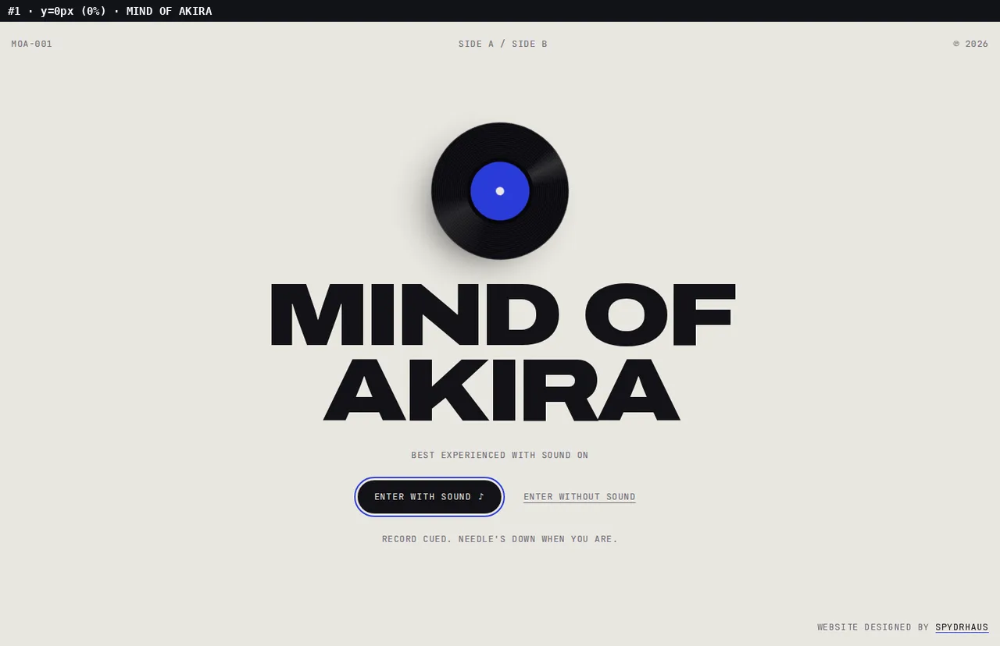
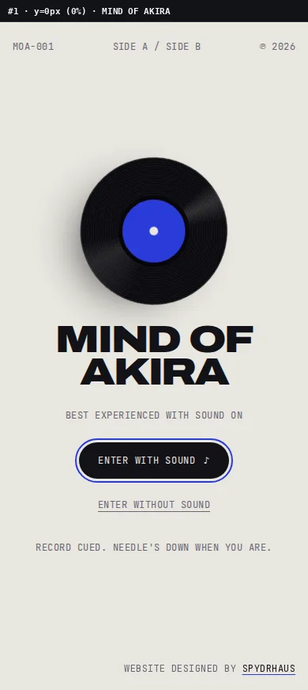

# UI Design System & Master Generation Blueprint: mindofakira-com

> **Mind of Akira** (http://mindofakira.com) — Mind of Akira: graphic designer working where streetwear, gaming culture and music meet. Branding, apparel, cover art, type and streaming...





---

## 1. Executive Visual Persona & Design Archetype

- **Brand Essence & Persona**: **Mind of Akira** (`http://mindofakira.com`). Mind of Akira: graphic designer working where streetwear, gaming culture and music meet. Branding, apparel, cover art, type and streaming...
- **Capture Provenance**: Live browser capture (`tier1_fast`, HTTP `200`, captured `2026-11-24`).
- **Visual Archetype**: **Light-Gallery WebGL / Canvas Interactive Experience (`#e9e7e1` / `#2bd96b`)**.
- **Anti-AI-Slop Differentiators**:
  - **Live-Computed Chromatic Polarity**: Anchors the viewport in `#e9e7e1` (live computed `body` `background-color` (`computed_styles.json`)) paired with `#131216` primary typography and `#2bd96b` accents.
  - **Grounded Typographic Hierarchy**: Uses `Archivo` across display (`MIND OF AKIRA`) and body copy, paired with `JetBrains Mono` for monospace/code.
  - **Calibrated Spatial Grid & Motion**: Combines `1440px` container bounds (`gap: 22px`, padding `16px`) with `cubic-bezier(.2,.7,.1,1)` easing and HTML5 `<canvas>` Interactive Viewport Surface.

---

## 2. Spatial Architecture & Modular Grid Mathematics

### Viewport Allocation & Container Geometry
- **Captured Journey Filmstrips**: Desktop `1280×828px` (`assets/desktop-journey.webp`, `1` keyframes up to `y=0px` / doc `24318px`), Mobile `390×872px` (`assets/mobile-journey.webp`, `1` keyframes).
- **Master Container Bounds**: `1440px` (full-bleed `100%` desktop stage measured on `1440px` viewport).
- **Canvas Lateral Padding & Spacing**: `16px` lateral canvas padding with `22px` grid gap.
- **Border Radius Scale**: `99px`, `50%`, `3px`, `10px`.

### Responsive Breakpoint Architecture
- **Desktop Layout**: Multi-column CSS Grid / Flexbox layout at `1440px` (`max-width: 1440px`, `gap: 22px`).
- **Mobile Layout**: Single-column vertical stack at `390px` viewport width with `16px` horizontal padding.
- **Extracted CSS Media Queries**: `@media (max-width: 760px)`, `@media (max-width: 480px)`, `@media (max-width: 800px)`, `@media (max-width: 560px)`.

---

## 3. Color System, Materiality & Atmospheric Lighting

### Semantic Palette & Source Grounding
| Semantic Role | Ground-Truth Value | Extracted Live / CSS Source |
|---|---|---|
| **Primary Canvas Substrate** | `#e9e7e1` | live computed `body` `background-color` (`computed_styles.json`) |
| **Primary Typography Ink** | `#131216` | live computed `h1` `color` (`computed_styles.json`) |
| **Elevated Surface / Card Substrate** | `#3ddc84` | `.dot { background: #3ddc84 }` |
| **Interactive Accent / Highlight** | `#2bd96b` | `.arc-hud #arcTarget { color: #2bd96b }` |
| **Secondary / Muted Copy** | `#8f8b98` | `var(--muted)` in `:root` |
| **Structural Hairline Border** | `#e9e8e1` | `var(--line)` in `:root` (`rgba(236, 235, 228, 0.14)`) |
| **Variable Token (`--bg`)** | `#0c0b0f` | `var(--bg)` in `:root` |
| **Variable Token (`--bg-2`)** | `#15131a` | `var(--bg-2)` in `:root` |
| **Variable Token (`--fg`)** | `#ecebe4` | `var(--fg)` in `:root` |
| **Variable Token (`--accent`)** | `#5b6bff` | `var(--accent)` in `:root` |
| **Variable Token (`--accent-ink`)** | `#f4f3ff` | `var(--accent-ink)` in `:root` |
| **Variable Token (`--vinyl`)** | `#050407` | `var(--vinyl)` in `:root` |

### Sanitized Root CSS Variables (`ui-ux.md` Ground Truth)
| Variable Name | Extracted Value | Semantic Role |
|---|---|---|
| `--bg` | `#0c0b0f` | Canvas / Surface Token |
| `--bg-2` | `#15131a` | Canvas / Surface Token |
| `--fg` | `#ecebe4` | Typography Ink Token |
| `--muted` | `#8f8b98` | Color / Atmospheric Token |
| `--line` | `rgba(236, 235, 228, 0.14)` | Color / Atmospheric Token |
| `--accent` | `#5b6bff` | Brand / Palette Token |
| `--accent-ink` | `#f4f3ff` | Typography Ink Token |
| `--vinyl` | `#050407` | Color / Atmospheric Token |
| `--f-display` | `"Archivo", "Arial Black", "Helvetica Neue", Arial, sans-serif` | Dimension / Scale Token |
| `--f-body` | `"Archivo", "Helvetica Neue", Arial, sans-serif` | Dimension / Scale Token |
| `--f-mono` | `"JetBrains Mono", ui-monospace, "SFMono-Regular", Menlo, monospace` | Typography / Scale Token |
| `--s-1` | `clamp(0.75rem, 0.7rem + 0.2vw, 0.8125rem)` | Dimension / Scale Token |
| `--s0` | `clamp(1rem, 0.95rem + 0.25vw, 1.125rem)` | Dimension / Scale Token |
| `--s1` | `clamp(1.375rem, 1.1rem + 1.2vw, 2rem)` | Dimension / Scale Token |
| `--s2` | `clamp(2rem, 1.3rem + 3.2vw, 4rem)` | Dimension / Scale Token |
| `--s3` | `clamp(3.2rem, 1rem + 10vw, 11rem)` | Dimension / Scale Token |

---

## 4. Typographic Scale & Editorial Hierarchy

### Font Family Stacks
- **Display Typography**: `Archivo`.
- **Primary Body Stack**: `Archivo`.
- **Technical / Metadata Stack**: `JetBrains Mono`.

### Typographic Scale & Rules (Live Computed & Stylesheet Grounded)
- **Hero Display (`H1`)**: live computed `h1` (`font-size: 128px`, `line-height: 108.8px`, `font-weight: 900`, `letter-spacing: -5.76px`); CSS variables `--f-display: "Archivo", "Arial Black", "Helvetica Neue", Arial, sans-serif`; rule `h1` (`font-size: var(--s1)`, `line-height: 1.15`, `letter-spacing: -0.01em`, `font-weight: 500`).
- **Section Heading (`H2`)**: live computed `h2` (`font-size: 216px`, `line-height: 177.12px`, `font-weight: 900`, `letter-spacing: -8.64px`); rule `h2` (`font-size: var(--s1)`, `letter-spacing: -0.01em`, `font-weight: 700`).
- **Body Copy**: live computed `body` (`font-size: 18px`, `line-height: 27px`, `font-weight: 400`); CSS variables `--f-body: "Archivo", "Helvetica Neue", Arial, sans-serif`; rule `body` (`font-size: var(--s0)`, `line-height: 1.5`).
- **Metadata & Navigation Labels**: live computed `nav/a` (`font-size: 18px`, `line-height: 27px`, `font-weight: 400`); CSS variables `--f-mono: "JetBrains Mono", ui-monospace, "SFMono-Regular", Menlo, monospace`; rule `.mono` (`font-size: var(--s-1)`, `letter-spacing: 0.04em`).

---

## 5. Choreographed Motion & Interaction Physics

### Primary Easing Curves
- **Extracted Timing Functions**: `cubic-bezier(.2,.7,.1,1)`, `cubic-bezier(.7,0,.2,1)`, `cubic-bezier(.3,1.6,.5,1)`.

### Per-Element Transition & Choreography Rules
- **Selector `body`**: `transition: background-color .5s var(--ease), color .5s var(--ease)` extracted from `mindofakira-com` stylesheet.
- **Selector `.gate`**: `transition: clip-path 1.1s cubic-bezier(.2,.7,.1,1)` extracted from `mindofakira-com` stylesheet.
- **Selector `.nav a::after`**: `transition: transform .4s var(--ease)` extracted from `mindofakira-com` stylesheet.
- **Extracted Easing Curve (`cubic-bezier(.2,.7,.1,1)`)**: Governs interactive state transitions across `<header.top>` and `<section.intro>`.
- **Runtime Interaction Engine**: Integrates HTML5 `<canvas>` Interactive Viewport Surface with `prefers-reduced-motion: reduce` fallback guards.
### Measured Runtime Scroll & Interaction Telemetry (`behavioral_journey_v2`)
- **Scroll Driver Mode**: `wheel` (max document height `24318px`, deepest scrollY reached `0px` across `1` desktop keyframes).
- **Detected Scroll / Motion Libraries**: `WebGL/Canvas`.
- **Hover Physics (`primary_cta` · `33⅓ RPM`)**: Computed transition `0s` / `ease` (no static color/transform shift captured at rest).

---

## 6. Component Wireframe & Structural DOM Map

### Visual Layout Schematic — Desktop (`1440px`, Grounded in `dom.html` & Landmark Bounding Boxes)
```
┌────────────────────────────────────────────────────────────────────────┐
│ DESKTOP VIEWPORT (1440px) — Mind of Akira                              │
│ ====================================================================== │
│ [ <header.top> (1440x68px)            | Work · About · Services · Co ] │
│ ---------------------------------------------------------------------- │
│ | HERO STAGE: <section.hero> (w=1440px)                              | │
│ | H1: MIND OF AKIRA                                                  | │
│ | Substrate: #e9e7e1 | Ink: #131216 | Accent: #2bd96b                | │
│ ---------------------------------------------------------------------- │
│ | SHOWCASE GRID (<section.intro>) max-w: 1440px                      | │
│ | +------------------------------+  +------------------------------+ | │
│ | | Visuals for streetwear, gami |  | Photoshop and Illustrator, c | | │
│ | +------------------------------+  +------------------------------+ | │
│ ---------------------------------------------------------------------- │
│ | DETAIL MODULE (<article.tape-note>) — Mind of Akira starts.        | │
│ ---------------------------------------------------------------------- │
│ [ FOOTER (<footer.foot>       ) | http://mindofakira.com               │
└────────────────────────────────────────────────────────────────────────┘
```

### Visual Layout Schematic — Mobile Reflow (`390px`)
```
┌────────────────────────────────────────────────────────────────────────┐
│ MOBILE VIEWPORT REFLOW (390px) — Single-Column Stack (gap: 22px)       │
│ ====================================================================== │
│ [ HEADER BAR (<header.top>            ) | Compact Menu (390px)         │
│ ---------------------------------------------------------------------- │
│ | HERO STAGE (<section.hero>) — 390px Vertical Lead                  | │
│ | H1: MIND OF AKIRA                                                  | │
│ ---------------------------------------------------------------------- │
│ | SHOWCASE STACK (<section.intro>) — 1-Col Stack                     | │
│ | [ Item 1: Visuals for streetwear, gaming and music that fee...   ] | │
│ | [ Item 2: Photoshop and Illustrator, cracked open.               ] | │
│ ---------------------------------------------------------------------- │
│ | DETAIL STACK (<article.tape-note>) — 1-Col (Mind of Akira star)    | │
│ ---------------------------------------------------------------------- │
│ [ FOOTER (<footer.foot>       ) | Stacked 390px Colophon               │
└────────────────────────────────────────────────────────────────────────┘
```

### Granular DOM Region Breakdown
1. **Brand Header & Navigation Bar (<header.top> — `mindofakira-com`)**:
   - Landmark `<header class="top">` (`1440x68px`) hosting `Mind of Akira` navigation (`Work · About · Services · Contact`), DOM attributes (`data-cursor="Play"`, `data-cursor="Enter"`, `data-cursor="Go"`, `data-cursor="Go"`), and stylesheet rule `after { box-sizing: border-box; }`.
2. **Hero Stage & Focal Lead (<section.hero> — `MIND OF AKIRA`)**:
   - Landmark `<section class="hero">` presenting display lead `MIND OF AKIRA` and copy excerpt *"MOA-001 SIDE A / SIDE B ℗ 2026"* over `#e9e7e1` canvas and `#131216` ink.
3. **Primary Showcase & Content Grid (<section.intro> — `Visuals for streetwear, gaming and`)**:
   - Landmark `<section class="intro wrap">` rendering section `Visuals for streetwear, gaming and music that fee...` with copy *"Available for projects"*, asset references (`favicon.svg`, `fonts.googleapis.com`, `fonts.gstatic.com`, `css2`), and grid rule `html { scroll-behavior: smooth; -webkit-text-size-adjust: 100%; }`.
4. **Interactive Detail & Feature Matrix (<article.tape-note> — `Photoshop and Illustrator, cracked`)**:
   - Landmark `<article class="tape-note">` framing `Photoshop and Illustrator, cracked open.` and `Mind of Akira starts.` (*"Groove pitch ≈ 0.1 mm"*) with `#3ddc84` surface cards, `#2bd96b` accents, and `canvas { max-width: 100%; display: block; }`.
5. **Colophon & Global Directory Footer (<footer.foot> — `http://mindofakira.com`)**:
   - Landmark `<footer class="foot wrap">` anchoring `Mind of Akira` footer links (`Work · About · Services · Contact`), copy *"Every groove is a waveform. Every Akira project starts the s"*, and `#e9e8e1` structural dividers.
### Full Vertical Scroll Sequence (Desktop `1440×900` Keyframes)
- **Step 01** (`y=0px`, `0%`): Active landmark `MIND OF AKIRA` · sticky/fixed elements: `3`

---

## 7. Master Zero-Shot AI Generation Prompt

```markdown
# Master Zero-Shot Frontend Generation Prompt: mindofakira-com (Mind of Akira)

You are a principal frontend architect and design systems engineer. Build a complete, production-ready web application replicating the exact design system, DOM landmarks, typographic hierarchy, color tokens, and motion physics of `mindofakira-com` (**Mind of Akira** — `http://mindofakira.com`).

### 1. Visual Archetype & Anti-AI-Slop Mandates
- **Archetype**: Light-Gallery WebGL / Canvas Interactive Experience (`#e9e7e1` / `#2bd96b`).
- **Identity & Domain Context**: Mind of Akira: graphic designer working where streetwear, gaming culture and music meet. Branding, apparel, cover art, type and streaming...
- **Primary Substrate**: `#e9e7e1` (live computed `body` `background-color` (`computed_styles.json`)), **Primary Ink**: `#131216`, **Accent / Highlight**: `#2bd96b`.
- **Site-Specific Differentiators**:
  - **Live-Computed Chromatic Polarity**: Anchors the viewport in `#e9e7e1` (live computed `body` `background-color` (`computed_styles.json`)) paired with `#131216` primary typography and `#2bd96b` accents.
  - **Grounded Typographic Hierarchy**: Uses `Archivo` across display (`MIND OF AKIRA`) and body copy, paired with `JetBrains Mono` for monospace/code.
  - **Calibrated Spatial Grid & Motion**: Combines `1440px` container bounds (`gap: 22px`, padding `16px`) with `cubic-bezier(.2,.7,.1,1)` easing and HTML5 `<canvas>` Interactive Viewport Surface.

### 2. Ground-Truth CSS Variables (`:root` Token Contract)
Declare and consume these exact custom properties extracted from `mindofakira-com` in your global stylesheet:

:root {
  /* Mind of Akira (mindofakira-com) — Live-Grounded CSS Variables */
  --bg: #0c0b0f; /* Canvas / Surface Token (mindofakira-com) */
  --bg-2: #15131a; /* Canvas / Surface Token (mindofakira-com) */
  --fg: #ecebe4; /* Typography Ink Token (mindofakira-com) */
  --muted: #8f8b98; /* Color / Atmospheric Token (mindofakira-com) */
  --line: rgba(236, 235, 228, 0.14); /* Color / Atmospheric Token (mindofakira-com) */
  --accent: #5b6bff; /* Brand / Palette Token (mindofakira-com) */
  --accent-ink: #f4f3ff; /* Typography Ink Token (mindofakira-com) */
  --vinyl: #050407; /* Color / Atmospheric Token (mindofakira-com) */
  --f-display: "Archivo", "Arial Black", "Helvetica Neue", Arial, sans-serif; /* Dimension / Scale Token (mindofakira-com) */
  --f-body: "Archivo", "Helvetica Neue", Arial, sans-serif; /* Dimension / Scale Token (mindofakira-com) */
  --f-mono: "JetBrains Mono", ui-monospace, "SFMono-Regular", Menlo, monospace; /* Typography / Scale Token (mindofakira-com) */
  --s-1: clamp(0.75rem, 0.7rem + 0.2vw, 0.8125rem); /* Dimension / Scale Token (mindofakira-com) */
  --s0: clamp(1rem, 0.95rem + 0.25vw, 1.125rem); /* Dimension / Scale Token (mindofakira-com) */
  --s1: clamp(1.375rem, 1.1rem + 1.2vw, 2rem); /* Dimension / Scale Token (mindofakira-com) */
  --s2: clamp(2rem, 1.3rem + 3.2vw, 4rem); /* Dimension / Scale Token (mindofakira-com) */
  --s3: clamp(3.2rem, 1rem + 10vw, 11rem); /* Dimension / Scale Token (mindofakira-com) */
}

### 3. Semantic Color & Materiality Contract
Map every surface, ink, and border strictly to these source-grounded tokens:
- **Primary Canvas Substrate**: `#e9e7e1` — grounded in live computed `body` `background-color` (`computed_styles.json`)
- **Primary Typography Ink**: `#131216` — grounded in live computed `h1` `color` (`computed_styles.json`)
- **Elevated Surface / Card Substrate**: `#3ddc84` — grounded in `.dot { background: #3ddc84 }`
- **Interactive Accent / Highlight**: `#2bd96b` — grounded in `.arc-hud #arcTarget { color: #2bd96b }`
- **Secondary / Muted Copy**: `#8f8b98` — grounded in `var(--muted)` in `:root`
- **Structural Hairline Border**: `#e9e8e1` — grounded in `var(--line)` in `:root` (`rgba(236, 235, 228, 0.14)`)
- **Variable Token (`--bg`)**: `#0c0b0f` — grounded in `var(--bg)` in `:root`
- **Variable Token (`--bg-2`)**: `#15131a` — grounded in `var(--bg-2)` in `:root`
- **Variable Token (`--fg`)**: `#ecebe4` — grounded in `var(--fg)` in `:root`
- **Variable Token (`--accent`)**: `#5b6bff` — grounded in `var(--accent)` in `:root`
- **Variable Token (`--accent-ink`)**: `#f4f3ff` — grounded in `var(--accent-ink)` in `:root`
- **Variable Token (`--vinyl`)**: `#050407` — grounded in `var(--vinyl)` in `:root`

### 4. Spatial Grid, Container Bounds & Responsive Breakpoints
- **Desktop Viewport Reference**: `1280×828px` (single-viewport 100vh live capture (900px), `1440px` standard desktop width).
- **Mobile Viewport Reference**: `390×872px` (full-page live capture (872px), `390px` standard mobile width).
- **Container Max-Width**: `1440px` (full-bleed `100%` desktop stage measured on `1440px` viewport)
- **Padding & Gutters**: `16px` lateral canvas padding with `22px` grid gap
- **Desktop Grid**: Multi-column CSS Grid / Flexbox layout at `1440px` (`max-width: 1440px`, `gap: 22px`)
- **Mobile Adaptation**: Single-column vertical stack at `390px` viewport width with `16px` horizontal padding
- **Media Queries**: `@media (max-width: 760px)`, `@media (max-width: 480px)`, `@media (max-width: 800px)`, `@media (max-width: 560px)`
- **Corner Radii**: `99px`, `50%`, `3px`, `10px`

### 5. Typography & Editorial Scale Contract
- **Display Font Stack**: `Archivo`
- **Body Font Stack**: `Archivo`
- **Monospace / Technical Font Stack**: `JetBrains Mono`
- **H1 Display Rule**: live computed `h1` (`font-size: 128px`, `line-height: 108.8px`, `font-weight: 900`, `letter-spacing: -5.76px`); CSS variables `--f-display: "Archivo", "Arial Black", "Helvetica Neue", Arial, sans-serif`; rule `h1` (`font-size: var(--s1)`, `line-height: 1.15`, `letter-spacing: -0.01em`, `font-weight: 500`)
- **H2 Section Rule**: live computed `h2` (`font-size: 216px`, `line-height: 177.12px`, `font-weight: 900`, `letter-spacing: -8.64px`); rule `h2` (`font-size: var(--s1)`, `letter-spacing: -0.01em`, `font-weight: 700`)
- **Body Copy Rule**: live computed `body` (`font-size: 18px`, `line-height: 27px`, `font-weight: 400`); CSS variables `--f-body: "Archivo", "Helvetica Neue", Arial, sans-serif`; rule `body` (`font-size: var(--s0)`, `line-height: 1.5`)
- **Metadata & Index Rule**: live computed `nav/a` (`font-size: 18px`, `line-height: 27px`, `font-weight: 400`); CSS variables `--f-mono: "JetBrains Mono", ui-monospace, "SFMono-Regular", Menlo, monospace`; rule `.mono` (`font-size: var(--s-1)`, `letter-spacing: 0.04em`)

### 6. Component Hierarchy, Verbatim Copy & Real DOM Landmarks
Scaffold `mindofakira-com` (`Mind of Akira`) with these exact structural regions, extracted copy, and CSS rules from `dom.html`:
1. **Brand Header & Navigation Bar (<header.top> — `mindofakira-com`)**:
   - DOM & Selectors: Landmark `<header class="top">` (`1440x68px`) hosting `Mind of Akira` navigation (`Work · About · Services · Contact`), DOM attributes (`data-cursor="Play"`, `data-cursor="Enter"`, `data-cursor="Go"`, `data-cursor="Go"`), and stylesheet rule `after { box-sizing: border-box; }`.
   - Responsive Contract: Header `Brand Header & Navigation Bar (<header.top> — `mindofakira-com`)` (`mindofakira-com`) adapts across `@media (max-width: 760px)`, `@media (max-width: 480px)`, `@media (max-width: 800px)`, `@media (max-width: 560px)` with `cubic-bezier(.2,.7,.1,1)`, `cubic-bezier(.7,0,.2,1)`, `cubic-bezier(.3,1.6,.5,1)` transitions and links `Work · About · Services · Contact`.
2. **Hero Stage & Focal Lead (<section.hero> — `MIND OF AKIRA`)**:
   - DOM & Selectors: Landmark `<section class="hero">` presenting display lead `MIND OF AKIRA` and copy excerpt *"MOA-001 SIDE A / SIDE B ℗ 2026"* over `#e9e7e1` canvas and `#131216` ink.
   - Responsive Contract: Hero stage (`1280×828px` desktop / `390×872px` mobile) sets `#e9e7e1` background with `#131216` headline `MIND OF AKIRA`.
3. **Primary Showcase & Content Grid (<section.intro> — `Visuals for streetwear, gaming and`)**:
   - DOM & Selectors: Landmark `<section class="intro wrap">` rendering section `Visuals for streetwear, gaming and music that fee...` with copy *"Available for projects"*, asset references (`favicon.svg`, `fonts.googleapis.com`, `fonts.gstatic.com`, `css2`), and grid rule `html { scroll-behavior: smooth; -webkit-text-size-adjust: 100%; }`.
   - Responsive Contract: Showcase grid `Primary Showcase & Content Grid (<section.intro> — `Visuals for streetwear, gaming and`)` applies Multi-column CSS Grid / Flexbox layout at `1440px` (`max-width: 1440px`, `gap: 22px`) on desktop and Single-column vertical stack at `390px` viewport width with `16px` horizontal padding on mobile.
4. **Interactive Detail & Feature Matrix (<article.tape-note> — `Photoshop and Illustrator, cracked`)**:
   - DOM & Selectors: Landmark `<article class="tape-note">` framing `Photoshop and Illustrator, cracked open.` and `Mind of Akira starts.` (*"Groove pitch ≈ 0.1 mm"*) with `#3ddc84` surface cards, `#2bd96b` accents, and `canvas { max-width: 100%; display: block; }`.
   - Responsive Contract: Detail module `Interactive Detail & Feature Matrix (<article.tape-note> — `Photoshop and Illustrator, cracked`)` uses `99px`, `50%`, `3px`, `10px` radii, `#2bd96b` highlights, and assets (favicon.svg, fonts.googleapis.com, fonts.gstatic.com).
5. **Colophon & Global Directory Footer (<footer.foot> — `http://mindofakira.com`)**:
   - DOM & Selectors: Landmark `<footer class="foot wrap">` anchoring `Mind of Akira` footer links (`Work · About · Services · Contact`), copy *"Every groove is a waveform. Every Akira project starts the s"*, and `#e9e8e1` structural dividers.
   - Responsive Contract: Footer `Colophon & Global Directory Footer (<footer.foot> — `http://mindofakira.com`)` aligns to `1440px` (full-bleed `100%` desktop stage measured on `1440px` viewport) with `16px` lateral canvas padding with `22px` grid gap and attributes (data-cursor="Play", data-cursor="Enter", data-cursor="Go").

#### Verbatim DOM Copy Excerpts (`dom.html`)
- Copy Excerpt 1: *"MOA-001 SIDE A / SIDE B ℗ 2026"*
- Copy Excerpt 2: *"Available for projects"*
- Copy Excerpt 3: *"Groove pitch ≈ 0.1 mm"*
- Copy Excerpt 4: *"Every groove is a waveform. Every Akira project starts the same way: needle down,..."*

### 7. Motion, Extracted Stylesheet Rules & Interaction Choreography
- **Primary Easing Functions**: `cubic-bezier(.2,.7,.1,1)`, `cubic-bezier(.7,0,.2,1)`, `cubic-bezier(.3,1.6,.5,1)`
- **Extracted Stylesheet Rules (`mindofakira-com`)**:
- `after { box-sizing: border-box; }`
- `html { scroll-behavior: smooth; -webkit-text-size-adjust: 100%; }`
- `canvas { max-width: 100%; display: block; }`
- `button { font: inherit; color: inherit; }`
- `selection { background: var(--accent); color: var(--accent-ink); }`
- **Per-Selector Transition Rules**:
- **Selector `body`**: `transition: background-color .5s var(--ease), color .5s var(--ease)` extracted from `mindofakira-com` stylesheet.
- **Selector `.gate`**: `transition: clip-path 1.1s cubic-bezier(.2,.7,.1,1)` extracted from `mindofakira-com` stylesheet.
- **Selector `.nav a::after`**: `transition: transform .4s var(--ease)` extracted from `mindofakira-com` stylesheet.
- **Extracted Easing Curve (`cubic-bezier(.2,.7,.1,1)`)**: Governs interactive state transitions across `<header.top>` and `<section.intro>`.
- **Runtime Interaction Engine**: Integrates HTML5 `<canvas>` Interactive Viewport Surface with `prefers-reduced-motion: reduce` fallback guards.
### 7b. Full-Page Scroll Choreography, Interactive States & Multi-Page Routes
- **Scroll Mechanics**: Implement `wheel` vertical progression up to `24318px` across 1 distinct viewport chapters using WebGL/Canvas.
- **Vertical Chapter Sequence**: MIND OF AKIRA (0%).

### 8. Technical Deliverables
- Implement in Next.js (App Router) with TypeScript and Tailwind CSS consuming the `:root` custom properties defined above for `mindofakira-com`.
- Reproduce both the `1440px` desktop architecture and `390px` mobile breakpoint transitions, preserving semantic HTML5 landmarks (`<header>`, `<nav>`, `<main>`, `<section>`, `<footer>`) and `prefers-reduced-motion` accessibility guards.
```
---

## 8. Full-Page Scroll Journey, Interactive States & Subpage Inventory

### Desktop Scroll Keyframes (`1440×900` WebP)
| Step | Scroll Y | Progress | Active Landmark / Section | Sticky/Fixed | Visual Asset |
| :---: | :---: | :---: | :--- | :---: | :--- |
| `#01` | `0px` | `0%` | MIND OF AKIRA | `3` | [desktop-step-01.webp](assets/desktop-step-01.webp) |

### Mobile Condensed Keyframes (`390×844` WebP)
| Step | Scroll Y | Progress | Active Landmark | Visual Asset |
| :---: | :---: | :---: | :--- | :--- |
| `#01` | `0px` | `0%` | MIND OF AKIRA | [mobile-step-01.webp](assets/mobile-step-01.webp) |

