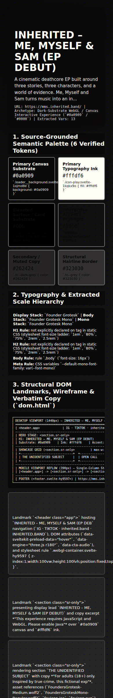

# UI Design System & Master Generation Blueprint: mms-inherited-band

> **INHERITED – ME, MYSELF & SAM (EP DEBUT)** (https://mms.inherited.band/) — A cinematic deathcore EP built around three stories, three characters, and a world of evidence. Me, Myself and Sam turns music into an in...


---

## 1. Executive Visual Persona & Design Archetype

- **Brand Essence & Persona**: **INHERITED – ME, MYSELF & SAM (EP DEBUT)** (`https://mms.inherited.band/`). A cinematic deathcore EP built around three stories, three characters, and a world of evidence. Me, Myself and Sam turns music into an in...
- **Visual Archetype**: **Dark-Substrate WebGL / Canvas Interactive Experience (`#0a0909` / `#0000`)**.
- **Anti-AI-Slop Differentiators**:
  - **Source-Grounded Chromatic Polarity**: Anchors the viewport in `#0a0909` (`.loader__background.svelte-1ojmd8e { background: #0a0909 }`) paired with `#fffdf6` primary typography and `#0000` accents.
  - **Extracted Typographic Hierarchy**: Pairs `Founder Grotesk` for display copy (`INHERITED – ME, MYSELF & SAM (EP DEB`) with `Founder Grotesk Mono` and `Founder Grotesk Mono`.
  - **Calibrated Spatial Grid & Motion**: Combines `40rem` container bounds (`gap: 1.5rem`, padding `2rem`) with `cubic-bezier(.25,.46,.45,.94)` easing and Three.js / WebGL Canvas Pipeline.

---

## 2. Spatial Architecture & Modular Grid Mathematics



### Viewport Allocation & Container Geometry
- **Captured Viewport Dimensions**: Desktop `1440×2400px` (`assets/desktop.png`, capped at 2400px multi-section capture), Mobile `390×2400px` (`assets/mobile.png`, capped at 2400px multi-section capture).
- **Master Container Bounds**: `40rem` extracted from `mms-inherited-band` stylesheet.
- **Canvas Lateral Padding & Spacing**: `2rem` lateral canvas padding with `1.5rem` grid gap.
- **Border Radius Scale**: `0px` (sharp unrounded corners).

### Responsive Breakpoint Architecture
- **Desktop Layout**: Multi-column CSS Grid / Flexbox layout at `1440px` (`max-width: 40rem`, `gap: 1.5rem`).
- **Mobile Layout**: Single-column vertical stack at `390px` viewport width with `2rem` horizontal padding.
- **Extracted CSS Media Queries**: `@media (width>=64em)`, `@media (width>=40rem)`, `@media (width>=48rem)`, `@media (width>=64rem)`.

---

## 3. Color System, Materiality & Atmospheric Lighting

### Semantic Palette & Source Grounding
| Semantic Role | Ground-Truth Value | Extracted CSS Source / Selector |
|---|---|---|
| **Primary Canvas Substrate** | `#0a0909` | `.loader__background.svelte-1ojmd8e { background: #0a0909 }` |
| **Primary Typography Ink** | `#fffdf6` | `.icon-play.svelte-1kqkx9o { fill: #fffdf6 }` |
| **Elevated Surface / Card Substrate** | `#000` | `.video-modal.svelte-1rnt8or { background-color: #000 }` |
| **Interactive Accent / Highlight** | `#0000` | `textarea { background-color: #0000 }` |
| **Secondary / Muted Copy** | `#262424` | `.tc--dark-grey { color: #262424 }` |
| **Structural Hairline Border** | `#323030` | `.tc--grey { color: #323030 }` |

### Sanitized Root CSS Variables (`ui-ux.md` Ground Truth)
| Variable Name | Extracted Value | Semantic Role |
|---|---|---|
| `--spacing` | `.25rem` | Layout / Spatial Grid Token |
| `--default-transition-duration` | `.15s` | Motion / Easing Token |
| `--default-transition-timing-function` | `cubic-bezier(.4, 0, .2, 1)` | Motion / Easing Token |
| `--default-font-family` | `var(--font-sans)` | Typography / Scale Token |
| `--default-mono-font-family` | `var(--font-mono)` | Typography / Scale Token |
| `--bw` | `100vw` | Dimension / Scale Token |
| `--max-container` | `100vw` | Layout / Spatial Grid Token |
| `--outer-margin` | `24px` | Layout / Spatial Grid Token |
| `--grid-gap` | `0px` | Layout / Spatial Grid Token |
| `--grid-size` | `calc(var(--bw) - (var(--outer-margin) * 2))` | Layout / Spatial Grid Token |
| `--grid-max-size` | `calc(var(--max-container) - (var(--outer-margin) * 2))` | Layout / Spatial Grid Token |
| `--image-height` | `min(80vw / var(--image-ratio), 60lvh)` | Layout / Spatial Grid Token |
| `--progress` | `50%` | Dimension / Scale Token |
| `--tw-rotate-x` | `initial` | Design System Custom Token |
| `--mms-inherited-ba-bg` | `#0a0909` | Canvas Substrate (from `.loader__background.svelte-1ojmd8e { background: #0a0909 }`) |
| `--mms-inherited-ba-ink` | `#fffdf6` | Primary Typography Ink (stylesheet-derived) |

---

## 4. Typographic Scale & Editorial Hierarchy

### Font Family Stacks
- **Display Typography**: `Founder Grotesk`.
- **Primary Body Stack**: `Founder Grotesk Mono`.
- **Technical / Metadata Stack**: `Founder Grotesk Mono`.

### Typographic Scale & Rules (Extracted from Stylesheet & Variables)
- **Hero Display (`H1`)**: not explicitly declared on tag in static CSS (stylesheet font-size ladder: `1em`, `80%`, `75%`, `2rem`, `2.5rem`).
- **Section Heading (`H2`)**: not explicitly declared on tag in static CSS (stylesheet font-size ladder: `1em`, `80%`, `75%`, `2rem`, `2.5rem`).
- **Body Copy**: rule `,body` (`font-size: 16px`).
- **Metadata & Navigation Labels**: CSS variables `--default-mono-font-family: var(--font-mono)`.

---

## 5. Choreographed Motion & Interaction Physics

### Primary Easing Curves
- **Extracted Timing Functions**: `cubic-bezier(.25,.46,.45,.94)`, `cubic-bezier(.215,.61,.355,1)`, `cubic-bezier(.4,0,.2,1)`.

### Per-Element Transition & Choreography Rules
- **Selector `oader.svelte-1ojmd8e .loader__evi...`**: `transition: opacity .5s cubic-bezier(.25,.46,.45,.94) .75s` extracted from `mms-inherited-band` stylesheet.
- **Selector `.loader-layer--loading.svelte-1oj...`**: `transition: all .3s cubic-bezier(.25,.46,.45,.94)` extracted from `mms-inherited-band` stylesheet.
- **Selector `media (width>=64em)`**: `transition: opacity .3s cubic-bezier(.25,.46,.45,.94)` extracted from `mms-inherited-band` stylesheet.
- **Extracted Easing Curve (`cubic-bezier(.25,.46,.45,.94)`)**: Governs interactive state transitions across `<header.app>` and `<section.sr-only>`.
- **Runtime Interaction Engine**: Integrates Three.js / WebGL Canvas Pipeline with `prefers-reduced-motion: reduce` fallback guards.

---

## 6. Component Wireframe & Structural DOM Map

### Visual Layout Schematic (Grounded in `dom.html` — `1440px` Desktop & `390px` Mobile Reflow)
```
┌────────────────────────────────────────────────────────────────────────┐
│ DESKTOP VIEWPORT (1440px) — INHERITED – ME, MYSELF & SAM (EP DEBUT)    │
│ ====================================================================== │
│ [ <header.app>             | IG · TIKTOK · inherited.band · INHERIT ]  │
│ ---------------------------------------------------------------------- │
│ | HERO STAGE: <section.sr-only>                                    |   │
│ | H1: INHERITED – ME, MYSELF & SAM (EP DEBUT)                      |   │
│ | Substrate: #0a0909    | Ink: #fffdf6    | Accent: #0000          |   │
│ ---------------------------------------------------------------------- │
│ | SHOWCASE GRID (<section.sr-only>         ) max-w: 40rem          |   │
│ | +------------------------------+  +------------------------------+ | │
│ | | THE UNIDENTIFIED SUBJECT     |  | OPEN CALL                    | | │
│ | +------------------------------+  +------------------------------+ | │
│ ---------------------------------------------------------------------- │
│ | MOBILE VIEWPORT REFLOW (390px) — Single-Column Stack (gap: 1.5rem) | │
│ | [<header.app>] -> [<section.sr-only>] -> [<section.sr-only>] |       │
│ ---------------------------------------------------------------------- │
│ [ FOOTER (<footer.svelte-hy9597>) | https://mms.inherited.band/        │
└────────────────────────────────────────────────────────────────────────┘
```

### Granular DOM Region Breakdown
1. **Brand Header & Navigation Bar (<header.app> — `mms-inherited-band`)**:
   - Landmark `<header class="app">` hosting `INHERITED – ME, MYSELF & SAM (EP DEB` navigation (`IG · TIKTOK · inherited.band · INHERITED.BAND`), DOM attributes (`data-sveltekit-preload-data="hover"`, `data-engine="three.js r180"`, `data-cta-audio`), and stylesheet rule `.webgl-container.svelte-hy9597 { z-index:1;width:100vw;height:100lvh;position:fixed;top:0;left:0 }`.
2. **Hero Stage & Focal Lead (<section.sr-only> — `INHERITED – ME, MYSELF & SAM (EP D`)**:
   - Landmark `<section class="sr-only">` presenting display lead `INHERITED – ME, MYSELF & SAM (EP DEBUT)` and copy excerpt *"This experience requires JavaScript and WebGL. Please enable Java"* over `#0a0909` canvas and `#fffdf6` ink.
3. **Primary Showcase & Content Grid (<section.sr-only> — `THE UNIDENTIFIED SUBJECT`)**:
   - Landmark `<section class="sr-only">` rendering section `THE UNIDENTIFIED SUBJECT` with copy *"For adults (18+) only. Inspired by true crime, this fictional exp"*, asset references (`FoundersGrotesk-Medium.woff2`, `FoundersGroteskMono-Regular.woff2`, `favicon.ico`, `favicon.svg`), and grid rule `.webgl-container__canvas.svelte-h... { width:100%;height:100% }`.
4. **Interactive Detail & Feature Matrix (<section.sr-only> — `OPEN CALL`)**:
   - Landmark `<section class="sr-only">` framing `OPEN CALL` and `THE MODEL CITIZEN` (*"The individual may appear calm and approachable, often using a ve"*) with `#000` surface cards, `#0000` accents, and `.audio-ctas.svelte-186a61h { align-items:center;gap:1.5rem;margin-top:2rem;display:flex }`.
5. **Colophon & Global Directory Footer (<footer.svelte-hy9597> — `https://mms.inherited.band/`)**:
   - Landmark `<footer class="svelte-hy9597">` anchoring `INHERITED – ME, MYSELF & SAM (EP` footer links (`IG · TIKTOK · inherited.band · INHERITED.BAND`), copy *"Do not approach. If you recognize this individual, contact i"*, and `#323030` structural dividers.

---

## 7. Master Zero-Shot AI Generation Prompt

```markdown
# Master Zero-Shot Frontend Generation Prompt: mms-inherited-band (INHERITED – ME, MYSELF & SAM (EP DEBUT))

You are a principal frontend architect and design systems engineer. Build a complete, production-ready web application replicating the exact design system, DOM landmarks, typographic hierarchy, color tokens, and motion physics of `mms-inherited-band` (**INHERITED – ME, MYSELF & SAM (EP DEBUT)** — `https://mms.inherited.band/`).

### 1. Visual Archetype & Anti-AI-Slop Mandates
- **Archetype**: Dark-Substrate WebGL / Canvas Interactive Experience (`#0a0909` / `#0000`).
- **Identity & Domain Context**: A cinematic deathcore EP built around three stories, three characters, and a world of evidence. Me, Myself and Sam turns music into an in...
- **Primary Substrate**: `#0a0909` (`.loader__background.svelte-1ojmd8e { background: #0a0909 }`), **Primary Ink**: `#fffdf6`, **Accent / Highlight**: `#0000`.
- **Site-Specific Differentiators**:
  - **Source-Grounded Chromatic Polarity**: Anchors the viewport in `#0a0909` (`.loader__background.svelte-1ojmd8e { background: #0a0909 }`) paired with `#fffdf6` primary typography and `#0000` accents.
  - **Extracted Typographic Hierarchy**: Pairs `Founder Grotesk` for display copy (`INHERITED – ME, MYSELF & SAM (EP DEB`) with `Founder Grotesk Mono` and `Founder Grotesk Mono`.
  - **Calibrated Spatial Grid & Motion**: Combines `40rem` container bounds (`gap: 1.5rem`, padding `2rem`) with `cubic-bezier(.25,.46,.45,.94)` easing and Three.js / WebGL Canvas Pipeline.

### 2. Ground-Truth CSS Variables (`:root` Token Contract)
Declare and consume these exact custom properties extracted from `mms-inherited-band` in your global stylesheet:

:root {
  /* INHERITED – ME, MYSELF & SAM (EP DEBUT) (mms-inherited-band) — Ground-Truth Extracted CSS Variables */
  --spacing: .25rem; /* Layout / Spatial Grid Token (mms-inherited-band) */
  --default-transition-duration: .15s; /* Motion / Easing Token (mms-inherited-band) */
  --default-transition-timing-function: cubic-bezier(.4, 0, .2, 1); /* Motion / Easing Token (mms-inherited-band) */
  --default-font-family: var(--font-sans); /* Typography / Scale Token (mms-inherited-band) */
  --default-mono-font-family: var(--font-mono); /* Typography / Scale Token (mms-inherited-band) */
  --bw: 100vw; /* Dimension / Scale Token (mms-inherited-band) */
  --max-container: 100vw; /* Layout / Spatial Grid Token (mms-inherited-band) */
  --outer-margin: 24px; /* Layout / Spatial Grid Token (mms-inherited-band) */
  --grid-gap: 0px; /* Layout / Spatial Grid Token (mms-inherited-band) */
  --grid-size: calc(var(--bw) - (var(--outer-margin) * 2)); /* Layout / Spatial Grid Token (mms-inherited-band) */
  --grid-max-size: calc(var(--max-container) - (var(--outer-margin) * 2)); /* Layout / Spatial Grid Token (mms-inherited-band) */
  --image-height: min(80vw / var(--image-ratio), 60lvh); /* Layout / Spatial Grid Token (mms-inherited-band) */
  --progress: 50%; /* Dimension / Scale Token (mms-inherited-band) */
  --tw-rotate-x: initial; /* Design System Custom Token (mms-inherited-band) */
  --mms-inherited-ba-bg: #0a0909; /* Canvas Substrate (from `.loader__background.svelte-1ojmd8e { background: #0a0909 }`) (mms-inherited-band) */
  --mms-inherited-ba-ink: #fffdf6; /* Primary Typography Ink (stylesheet-derived) (mms-inherited-band) */
}

### 3. Semantic Color & Materiality Contract
Map every surface, ink, and border strictly to these source-grounded tokens:
- **Primary Canvas Substrate**: `#0a0909` — grounded in `.loader__background.svelte-1ojmd8e { background: #0a0909 }`
- **Primary Typography Ink**: `#fffdf6` — grounded in `.icon-play.svelte-1kqkx9o { fill: #fffdf6 }`
- **Elevated Surface / Card Substrate**: `#000` — grounded in `.video-modal.svelte-1rnt8or { background-color: #000 }`
- **Interactive Accent / Highlight**: `#0000` — grounded in `textarea { background-color: #0000 }`
- **Secondary / Muted Copy**: `#262424` — grounded in `.tc--dark-grey { color: #262424 }`
- **Structural Hairline Border**: `#323030` — grounded in `.tc--grey { color: #323030 }`

### 4. Spatial Grid, Container Bounds & Responsive Breakpoints
- **Desktop Viewport Reference**: `1440×2400px` (capped at 2400px multi-section capture, `1440px` standard desktop width).
- **Mobile Viewport Reference**: `390×2400px` (capped at 2400px multi-section capture, `390px` standard mobile width).
- **Container Max-Width**: `40rem` extracted from `mms-inherited-band` stylesheet
- **Padding & Gutters**: `2rem` lateral canvas padding with `1.5rem` grid gap
- **Desktop Grid**: Multi-column CSS Grid / Flexbox layout at `1440px` (`max-width: 40rem`, `gap: 1.5rem`)
- **Mobile Adaptation**: Single-column vertical stack at `390px` viewport width with `2rem` horizontal padding
- **Media Queries**: `@media (width>=64em)`, `@media (width>=40rem)`, `@media (width>=48rem)`, `@media (width>=64rem)`
- **Corner Radii**: `0px` (sharp unrounded corners)

### 5. Typography & Editorial Scale Contract
- **Display Font Stack**: `Founder Grotesk`
- **Body Font Stack**: `Founder Grotesk Mono`
- **Monospace / Technical Font Stack**: `Founder Grotesk Mono`
- **H1 Display Rule**: not explicitly declared on tag in static CSS (stylesheet font-size ladder: `1em`, `80%`, `75%`, `2rem`, `2.5rem`)
- **H2 Section Rule**: not explicitly declared on tag in static CSS (stylesheet font-size ladder: `1em`, `80%`, `75%`, `2rem`, `2.5rem`)
- **Body Copy Rule**: rule `,body` (`font-size: 16px`)
- **Metadata & Index Rule**: CSS variables `--default-mono-font-family: var(--font-mono)`

### 6. Component Hierarchy, Verbatim Copy & Real DOM Landmarks
Scaffold `mms-inherited-band` (`INHERITED – ME, MYSELF & SAM (EP DEBUT)`) with these exact structural regions, extracted copy, and CSS rules from `dom.html`:
1. **Brand Header & Navigation Bar (<header.app> — `mms-inherited-band`)**:
   - DOM & Selectors: Landmark `<header class="app">` hosting `INHERITED – ME, MYSELF & SAM (EP DEB` navigation (`IG · TIKTOK · inherited.band · INHERITED.BAND`), DOM attributes (`data-sveltekit-preload-data="hover"`, `data-engine="three.js r180"`, `data-cta-audio`), and stylesheet rule `.webgl-container.svelte-hy9597 { z-index:1;width:100vw;height:100lvh;position:fixed;top:0;left:0 }`.
   - Responsive Contract: Header `Brand Header & Navigation Bar (<header.app> — `mms-inherited-band`)` (`mms-inherited-band`) adapts across `@media (width>=64em)`, `@media (width>=40rem)`, `@media (width>=48rem)`, `@media (width>=64rem)` with `cubic-bezier(.25,.46,.45,.94)`, `cubic-bezier(.215,.61,.355,1)`, `cubic-bezier(.4,0,.2,1)` transitions and links `IG · TIKTOK · inherited.band · INHERITED.BAND`.
2. **Hero Stage & Focal Lead (<section.sr-only> — `INHERITED – ME, MYSELF & SAM (EP D`)**:
   - DOM & Selectors: Landmark `<section class="sr-only">` presenting display lead `INHERITED – ME, MYSELF & SAM (EP DEBUT)` and copy excerpt *"This experience requires JavaScript and WebGL. Please enable Java"* over `#0a0909` canvas and `#fffdf6` ink.
   - Responsive Contract: Hero stage (`1440×2400px` desktop / `390×2400px` mobile) sets `#0a0909` background with `#fffdf6` headline `INHERITED – ME, MYSELF & SAM (EP DEBUT)`.
3. **Primary Showcase & Content Grid (<section.sr-only> — `THE UNIDENTIFIED SUBJECT`)**:
   - DOM & Selectors: Landmark `<section class="sr-only">` rendering section `THE UNIDENTIFIED SUBJECT` with copy *"For adults (18+) only. Inspired by true crime, this fictional exp"*, asset references (`FoundersGrotesk-Medium.woff2`, `FoundersGroteskMono-Regular.woff2`, `favicon.ico`, `favicon.svg`), and grid rule `.webgl-container__canvas.svelte-h... { width:100%;height:100% }`.
   - Responsive Contract: Showcase grid `Primary Showcase & Content Grid (<section.sr-only> — `THE UNIDENTIFIED SUBJECT`)` applies Multi-column CSS Grid / Flexbox layout at `1440px` (`max-width: 40rem`, `gap: 1.5rem`) on desktop and Single-column vertical stack at `390px` viewport width with `2rem` horizontal padding on mobile.
4. **Interactive Detail & Feature Matrix (<section.sr-only> — `OPEN CALL`)**:
   - DOM & Selectors: Landmark `<section class="sr-only">` framing `OPEN CALL` and `THE MODEL CITIZEN` (*"The individual may appear calm and approachable, often using a ve"*) with `#000` surface cards, `#0000` accents, and `.audio-ctas.svelte-186a61h { align-items:center;gap:1.5rem;margin-top:2rem;display:flex }`.
   - Responsive Contract: Detail module `Interactive Detail & Feature Matrix (<section.sr-only> — `OPEN CALL`)` uses `0px` (sharp unrounded corners) radii, `#0000` highlights, and assets (FoundersGrotesk-Medium.woff2, FoundersGroteskMono-Regular.woff2, favicon.ico).
5. **Colophon & Global Directory Footer (<footer.svelte-hy9597> — `https://mms.inherited.band/`)**:
   - DOM & Selectors: Landmark `<footer class="svelte-hy9597">` anchoring `INHERITED – ME, MYSELF & SAM (EP` footer links (`IG · TIKTOK · inherited.band · INHERITED.BAND`), copy *"Do not approach. If you recognize this individual, contact i"*, and `#323030` structural dividers.
   - Responsive Contract: Footer `Colophon & Global Directory Footer (<footer.svelte-hy9597> — `https://mms.inherited.band/`)` aligns to `40rem` extracted from `mms-inherited-band` stylesheet with `2rem` lateral canvas padding with `1.5rem` grid gap and attributes (data-sveltekit-preload-data="hover", data-engine="three.js r180", data-cta-audio).

#### Verbatim DOM Copy Excerpts (`dom.html`)
- Copy Excerpt 1: *"This experience requires JavaScript and WebGL. Please enable JavaScript to continue."*
- Copy Excerpt 2: *"For adults (18+) only. Inspired by true crime, this fictional experience is intend..."*
- Copy Excerpt 3: *"The individual may appear calm and approachable, often using a vehicle to isolate..."*
- Copy Excerpt 4: *"Do not approach. If you recognize this individual, contact inherited.band ."*

### 7. Motion, Extracted Stylesheet Rules & Interaction Choreography
- **Primary Easing Functions**: `cubic-bezier(.25,.46,.45,.94)`, `cubic-bezier(.215,.61,.355,1)`, `cubic-bezier(.4,0,.2,1)`
- **Extracted Stylesheet Rules (`mms-inherited-band`)**:
- `.webgl-container.svelte-hy9597 { z-index:1;width:100vw;height:100lvh;position:fixed;top:0;left:0 }`
- `.webgl-container__canvas.svelte-h... { width:100%;height:100% }`
- `.audio-ctas.svelte-186a61h { align-items:center;gap:1.5rem;margin-top:2rem;display:flex }`
- `.loader.is-visible.svelte-1ojmd8e { pointer-events:auto }`
- `.loader__background.svelte-1ojmd8e { opacity:.5;background:0a0909;width:100%;height:100%;position:absolute;to... }`
- **Per-Selector Transition Rules**:
- **Selector `oader.svelte-1ojmd8e .loader__evi...`**: `transition: opacity .5s cubic-bezier(.25,.46,.45,.94) .75s` extracted from `mms-inherited-band` stylesheet.
- **Selector `.loader-layer--loading.svelte-1oj...`**: `transition: all .3s cubic-bezier(.25,.46,.45,.94)` extracted from `mms-inherited-band` stylesheet.
- **Selector `media (width>=64em)`**: `transition: opacity .3s cubic-bezier(.25,.46,.45,.94)` extracted from `mms-inherited-band` stylesheet.
- **Extracted Easing Curve (`cubic-bezier(.25,.46,.45,.94)`)**: Governs interactive state transitions across `<header.app>` and `<section.sr-only>`.
- **Runtime Interaction Engine**: Integrates Three.js / WebGL Canvas Pipeline with `prefers-reduced-motion: reduce` fallback guards.

### 8. Technical Deliverables
- Implement in Next.js (App Router) with TypeScript and Tailwind CSS consuming the `:root` custom properties defined above for `mms-inherited-band`.
- Reproduce both the `1440px` desktop architecture and `390px` mobile breakpoint transitions, preserving semantic HTML5 landmarks (`<header>`, `<nav>`, `<main>`, `<section>`, `<footer>`) and `prefers-reduced-motion` accessibility guards.
```
