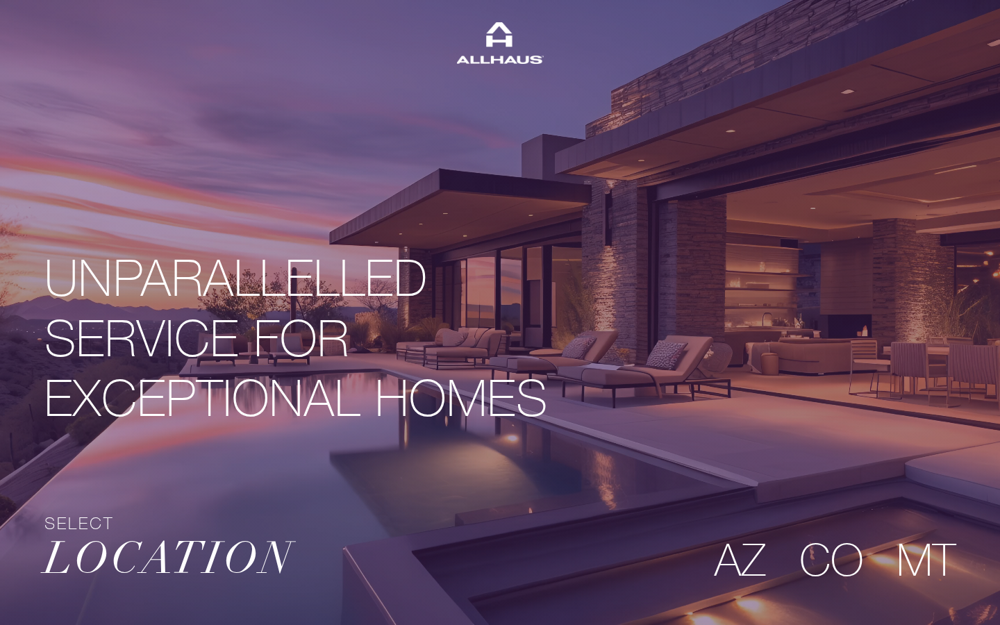
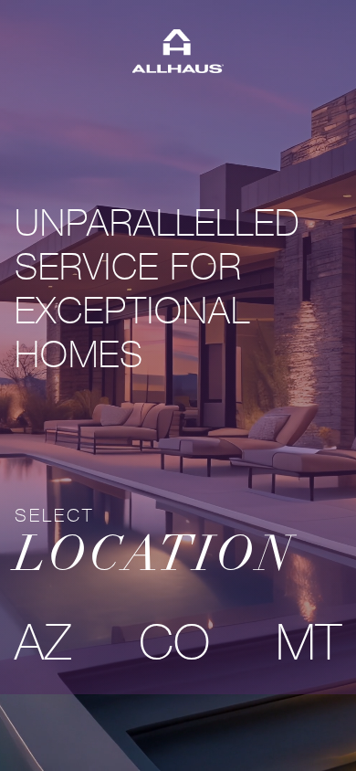

# UI Design System & Master Generation Blueprint: moderncraftaz-com

> **Select A Location · AllHaus** (https://moderncraftaz.com/) — Crafting exceptional residences with unmatched service in Arizona, Montana, and beyond.



---

## 1. Executive Visual Persona & Design Archetype

- **Brand Essence & Persona**: **Select A Location · AllHaus** (`https://moderncraftaz.com/`). Crafting exceptional residences with unmatched service in Arizona, Montana, and beyond.
- **Capture Provenance**: Live browser capture (`tier1_fast`, HTTP `200`, captured `2026-11-23`).
- **Visual Archetype**: **Light-Substrate Editorial & Modular Grid System (`#ffffff` canvas, `#404040` ink, `#0074db` accent)**.
- **Anti-AI-Slop Differentiators**:
  - **Live-Computed Chromatic Polarity**: Anchors the viewport in `#ffffff` (live computed `body` `background-color` (`computed_styles.json`)) paired with `#404040` primary typography and `#0074db` accents.
  - **Grounded Typographic Hierarchy**: Pairs `helveticaneue` for display copy (`UNPARALLELLED SERVICE FOR EXCEPTIONA`) with `helveticaneue` and not declared in live computed styles (uses primary stack / `ui-monospace`).
  - **Calibrated Spatial Grid & Motion**: Combines `1280px` container bounds (`gap: 3rem`, padding `20px`) with `cubic-bezier(0.455,0.03,0.515,0.955)` easing and GSAP Timeline & ScrollTrigger, Three.js / WebGL Canvas Pipeline.

---

## 2. Spatial Architecture & Modular Grid Mathematics



### Viewport Allocation & Container Geometry
- **Captured Viewport Dimensions**: Desktop `1440×900px` (`assets/desktop.png`, single-viewport 100vh live capture (900px)), Mobile `390×844px` (`assets/mobile.png`, single-viewport 100vh live capture (844px)).
- **Master Container Bounds**: `1280px` (non-`@media` desktop container stylesheet rule).
- **Canvas Lateral Padding & Spacing**: `20px` lateral canvas padding with `3rem` grid gap.
- **Border Radius Scale**: `50%`, `2px`, `100%`, `0px`.

### Responsive Breakpoint Architecture
- **Desktop Layout**: Multi-column CSS Grid / Flexbox layout at `1440px` (`max-width: 1280px`, `gap: 3rem`).
- **Mobile Layout**: Single-column vertical stack at `390px` viewport width with `20px` horizontal padding.
- **Extracted CSS Media Queries**: `@media screen and (max-width: 782px)`, `@media screen and (max-width: 600px)`, `@media (prefers-reduced-motion: reduce)`, `@media (max-width:479px)`.

---

## 3. Color System, Materiality & Atmospheric Lighting

### Semantic Palette & Source Grounding
| Semantic Role | Ground-Truth Value | Extracted Live / CSS Source |
|---|---|---|
| **Primary Canvas Substrate** | `#ffffff` | live computed `body` `background-color` (`computed_styles.json`) |
| **Primary Typography Ink** | `#404040` | live computed `body` `color` (`computed_styles.json`) |
| **Elevated Surface / Card Substrate** | `#dddddd` | `var(--wp-editor-canvas-background)` in `:root` |
| **Interactive Accent / Highlight** | `#0074db` | live computed `a` `color` (`computed_styles.json`) |
| **Secondary / Muted Copy** | `#0074db` | live computed `a` `color` (`computed_styles.json`) |
| **Structural Hairline Border** | `#00a0d2` | `.wpcf7 form .wpcf7-response-output { border: #00a0d2 }` |
| **Variable Token (`--wp-block-synced-color`)** | `#7a00df` | `var(--wp-block-synced-color)` in `:root` |
| **Variable Token (`--wp-admin-theme-color`)** | `#007cba` | `var(--wp-admin-theme-color)` in `:root` |
| **Variable Token (`--wp-admin-theme-color-darker-10`)** | `#006ba1` | `var(--wp-admin-theme-color-darker-10)` in `:root` |
| **Variable Token (`--wp-admin-theme-color-darker-20`)** | `#005a87` | `var(--wp-admin-theme-color-darker-20)` in `:root` |

### Sanitized Root CSS Variables (`ui-ux.md` Ground Truth)
| Variable Name | Extracted Value | Semantic Role |
|---|---|---|
| `--wp-block-synced-color` | `#7a00df` | Brand / Palette Token |
| `--wp-block-synced-color--rgb` | `122,0,223` | Brand / Palette Token |
| `--wp-bound-block-color` | `var(--wp-block-synced-color)` | Brand / Palette Token |
| `--wp-editor-canvas-background` | `#ddd` | Canvas / Surface Token |
| `--wp-admin-theme-color` | `#007cba` | Brand / Palette Token |
| `--wp-admin-theme-color--rgb` | `0,124,186` | Brand / Palette Token |
| `--wp-admin-theme-color-darker-10` | `#006ba1` | Canvas / Surface Token |
| `--wp-admin-theme-color-darker-10--rgb` | `0,107,160.5` | Canvas / Surface Token |
| `--wp-admin-theme-color-darker-20` | `#005a87` | Canvas / Surface Token |
| `--wp-admin-theme-color-darker-20--rgb` | `0,90,135` | Canvas / Surface Token |
| `--wp-admin-border-width-focus` | `2px` | Layout / Spatial Grid Token |
| `--wp-admin--admin-bar--position-offset` | `var(--wp-admin--admin-bar--height,0px)` | Dimension / Scale Token |
| `--wp--style--global--content-size` | `650px` | Layout / Spatial Grid Token |
| `--wp--style--global--wide-size` | `1200px` | Layout / Spatial Grid Token |
| `--wp--style--block-gap` | `1.5rem` | Layout / Spatial Grid Token |
| `--sk-size` | `40px` | Layout / Spatial Grid Token |

---

## 4. Typographic Scale & Editorial Hierarchy

### Font Family Stacks
- **Display Typography**: `helveticaneue`.
- **Primary Body Stack**: `helveticaneue`.
- **Technical / Metadata Stack**: not declared in live computed styles (uses primary stack / `ui-monospace`).

### Typographic Scale & Rules (Live Computed & Stylesheet Grounded)
- **Hero Display (`H1`)**: live computed `h1` (`font-size: 72px`, `line-height: 86.4px`, `font-weight: 200`, `letter-spacing: 1px`).
- **Section Heading (`H2`)**: observed font-size ladder: `72px`, `16px`, `1em`, `80%`, `75%`.
- **Body Copy**: live computed `body` (`font-size: 16px`, `line-height: 25.6px`, `font-weight: 400`); rule `body` (`font-size: 16px`).
- **Metadata & Navigation Labels**: live computed `nav/a` (`font-size: 16px`, `line-height: 25.6px`, `font-weight: 400`); rule `small` (`font-size: 80%`).

---

## 5. Choreographed Motion & Interaction Physics

### Primary Easing Curves
- **Extracted Timing Functions**: `cubic-bezier(0.455,0.03,0.515,0.955)`, `cubic-bezier(.84,.05,.31,.93)`, `cubic-bezier(.49,.78,.46,1.34)`.

### Per-Element Transition & Choreography Rules
- **Selector `-nav-menu .oxy-nav-menu-list li.m...`**: `transition: ease-in-out` extracted from `moderncraftaz-com` stylesheet.
- **Selector `.oxy-nav-menu .menu-item .sub-menu`**: `transition: ease-in-out` extracted from `moderncraftaz-com` stylesheet.
- **Selector `.sub-menu`**: `transition: 0s !important` extracted from `moderncraftaz-com` stylesheet.
- **Extracted Easing Curve (`cubic-bezier(0.455,0.03,0.515,0.955)`)**: Governs interactive state transitions across `<header.yoast-schema-graph>` and `<section.ct-section:nth(2)>`.
- **Runtime Interaction Engine**: Integrates GSAP Timeline & ScrollTrigger, Three.js / WebGL Canvas Pipeline, Swiper Touch Carousel Engine, Barba.js Page Transition Router with `prefers-reduced-motion: reduce` fallback guards.

---

## 6. Component Wireframe & Structural DOM Map

### Visual Layout Schematic — Desktop (`1440px`, Grounded in `dom.html` & Landmark Bounding Boxes)
```
┌────────────────────────────────────────────────────────────────────────┐
│ DESKTOP VIEWPORT (1440px) — Select A Location · AllHaus                │
│ ====================================================================== │
│ [ <header.yoast-schema-g (1440px)     | AZ AZ AZ · CO CO CO · MT MT  ] │
│ ---------------------------------------------------------------------- │
│ | HERO STAGE: <section.ct-section> (w=1440px)                        | │
│ | H1: UNPARALLELLED SERVICE FOR EXCEPTIONAL HOMES                    | │
│ | Substrate: #ffffff | Ink: #404040 | Accent: #0074db                | │
│ ---------------------------------------------------------------------- │
│ | SHOWCASE GRID (<section.ct-section:nth(2)) max-w: 1280px           | │
│ | +------------------------------+  +------------------------------+ | │
│ | | Unparallelled Service For Ex |  | moderncraftaz-com Interactiv | | │
│ | +------------------------------+  +------------------------------+ | │
│ ---------------------------------------------------------------------- │
│ | DETAIL MODULE (<section.ct-section:nth(3)) — moderncraftaz-com Arc | │
│ ---------------------------------------------------------------------- │
│ [ FOOTER (<footer.page>       ) | https://moderncraftaz.com/           │
└────────────────────────────────────────────────────────────────────────┘
```

### Visual Layout Schematic — Mobile Reflow (`390px`)
```
┌────────────────────────────────────────────────────────────────────────┐
│ MOBILE VIEWPORT REFLOW (390px) — Single-Column Stack (gap: 3rem)       │
│ ====================================================================== │
│ [ HEADER BAR (<header.yoast-schema-gra) | Compact Menu (390px)         │
│ ---------------------------------------------------------------------- │
│ | HERO STAGE (<section.ct-section>) — 390px Vertical Lead            | │
│ | H1: UNPARALLELLED SERVICE FOR EXCEPTIONAL HOMES                    | │
│ ---------------------------------------------------------------------- │
│ | SHOWCASE STACK (<section.ct-section:nt) — 1-Col Stack              | │
│ | [ Item 1: Unparallelled Service For Exceptional Homes            ] | │
│ | [ Item 2: moderncraftaz-com Interactive Matrix                   ] | │
│ ---------------------------------------------------------------------- │
│ | DETAIL STACK (<section.ct-section:nth() — 1-Col (moderncraftaz-com ) │
│ ---------------------------------------------------------------------- │
│ [ FOOTER (<footer.page>       ) | Stacked 390px Colophon               │
└────────────────────────────────────────────────────────────────────────┘
```

### Granular DOM Region Breakdown
1. **Brand Header & Navigation Bar (<header.yoast-schema-graph> — `moderncraftaz-com`)**:
   - Landmark `<header class="yoast-schema-graph">` (`1440px`) hosting `Select A Location · AllHaus` navigation (`AZ AZ AZ · CO CO CO · MT MT MT`), DOM attributes (`data-again="always_show"`, `data-wait="load"`, `data-wait-sec="2"`, `data-nosnippet`), and stylesheet rule `input { overflow: visible; }`.
2. **Hero Stage & Focal Lead (<section.ct-section> — `UNPARALLELLED SERVICE FOR EXCEPTIO`)**:
   - Landmark `<section class="ct-section">` presenting display lead `UNPARALLELLED SERVICE FOR EXCEPTIONAL HOMES` and copy excerpt *"Code Snippet ma-customfonts 3.4.2"* over `#ffffff` canvas and `#404040` ink.
3. **Primary Showcase & Content Grid (<section.ct-section:nth(2)> — `Unparallelled Service For Exceptio`)**:
   - Landmark `<section class="ct-section">` rendering section `Unparallelled Service For Exceptional Homes` with copy *"UNPARALLELLED SERVICE FOR EXCEPTIONAL HOMES"*, asset references (`recaptcha__en.js`, `cdn.jsdelivr.net`, `embed`, `ma-customfonts.css`), and grid rule `video { display: inline-block; }`.
4. **Interactive Detail & Feature Matrix (<section.ct-section:nth(3)> — `moderncraftaz-com Interactive Matr`)**:
   - Landmark `<section class="ct-section">` framing `moderncraftaz-com Interactive Matrix` and `moderncraftaz-com Archive & Directory` (*"Unparallelled Service For Exceptional Homes"*) with `#dddddd` surface cards, `#0074db` accents, and `sup { vertical-align: baseline; }`.
5. **Colophon & Global Directory Footer (<footer.page> — `https://moderncraftaz.com/`)**:
   - Landmark `<footer class="page">` anchoring `Select A Location · AllHaus` footer links (`AZ AZ AZ · CO CO CO · MT MT MT`), copy *"moderncraftaz-com Interactive Matrix"*, and `#00a0d2` structural dividers.

---

## 7. Master Zero-Shot AI Generation Prompt

```markdown
# Master Zero-Shot Frontend Generation Prompt: moderncraftaz-com (Select A Location · AllHaus)

You are a principal frontend architect and design systems engineer. Build a complete, production-ready web application replicating the exact design system, DOM landmarks, typographic hierarchy, color tokens, and motion physics of `moderncraftaz-com` (**Select A Location · AllHaus** — `https://moderncraftaz.com/`).

### 1. Visual Archetype & Anti-AI-Slop Mandates
- **Archetype**: Light-Substrate Editorial & Modular Grid System (`#ffffff` canvas, `#404040` ink, `#0074db` accent).
- **Identity & Domain Context**: Crafting exceptional residences with unmatched service in Arizona, Montana, and beyond.
- **Primary Substrate**: `#ffffff` (live computed `body` `background-color` (`computed_styles.json`)), **Primary Ink**: `#404040`, **Accent / Highlight**: `#0074db`.
- **Site-Specific Differentiators**:
  - **Live-Computed Chromatic Polarity**: Anchors the viewport in `#ffffff` (live computed `body` `background-color` (`computed_styles.json`)) paired with `#404040` primary typography and `#0074db` accents.
  - **Grounded Typographic Hierarchy**: Pairs `helveticaneue` for display copy (`UNPARALLELLED SERVICE FOR EXCEPTIONA`) with `helveticaneue` and not declared in live computed styles (uses primary stack / `ui-monospace`).
  - **Calibrated Spatial Grid & Motion**: Combines `1280px` container bounds (`gap: 3rem`, padding `20px`) with `cubic-bezier(0.455,0.03,0.515,0.955)` easing and GSAP Timeline & ScrollTrigger, Three.js / WebGL Canvas Pipeline.

### 2. Ground-Truth CSS Variables (`:root` Token Contract)
Declare and consume these exact custom properties extracted from `moderncraftaz-com` in your global stylesheet:

:root {
  /* Select A Location · AllHaus (moderncraftaz-com) — Live-Grounded CSS Variables */
  --wp-block-synced-color: #7a00df; /* Brand / Palette Token (moderncraftaz-com) */
  --wp-block-synced-color--rgb: 122,0,223; /* Brand / Palette Token (moderncraftaz-com) */
  --wp-bound-block-color: var(--wp-block-synced-color); /* Brand / Palette Token (moderncraftaz-com) */
  --wp-editor-canvas-background: #ddd; /* Canvas / Surface Token (moderncraftaz-com) */
  --wp-admin-theme-color: #007cba; /* Brand / Palette Token (moderncraftaz-com) */
  --wp-admin-theme-color--rgb: 0,124,186; /* Brand / Palette Token (moderncraftaz-com) */
  --wp-admin-theme-color-darker-10: #006ba1; /* Canvas / Surface Token (moderncraftaz-com) */
  --wp-admin-theme-color-darker-10--rgb: 0,107,160.5; /* Canvas / Surface Token (moderncraftaz-com) */
  --wp-admin-theme-color-darker-20: #005a87; /* Canvas / Surface Token (moderncraftaz-com) */
  --wp-admin-theme-color-darker-20--rgb: 0,90,135; /* Canvas / Surface Token (moderncraftaz-com) */
  --wp-admin-border-width-focus: 2px; /* Layout / Spatial Grid Token (moderncraftaz-com) */
  --wp-admin--admin-bar--position-offset: var(--wp-admin--admin-bar--height,0px); /* Dimension / Scale Token (moderncraftaz-com) */
  --wp--style--global--content-size: 650px; /* Layout / Spatial Grid Token (moderncraftaz-com) */
  --wp--style--global--wide-size: 1200px; /* Layout / Spatial Grid Token (moderncraftaz-com) */
  --wp--style--block-gap: 1.5rem; /* Layout / Spatial Grid Token (moderncraftaz-com) */
  --sk-size: 40px; /* Layout / Spatial Grid Token (moderncraftaz-com) */
}

### 3. Semantic Color & Materiality Contract
Map every surface, ink, and border strictly to these source-grounded tokens:
- **Primary Canvas Substrate**: `#ffffff` — grounded in live computed `body` `background-color` (`computed_styles.json`)
- **Primary Typography Ink**: `#404040` — grounded in live computed `body` `color` (`computed_styles.json`)
- **Elevated Surface / Card Substrate**: `#dddddd` — grounded in `var(--wp-editor-canvas-background)` in `:root`
- **Interactive Accent / Highlight**: `#0074db` — grounded in live computed `a` `color` (`computed_styles.json`)
- **Secondary / Muted Copy**: `#0074db` — grounded in live computed `a` `color` (`computed_styles.json`)
- **Structural Hairline Border**: `#00a0d2` — grounded in `.wpcf7 form .wpcf7-response-output { border: #00a0d2 }`
- **Variable Token (`--wp-block-synced-color`)**: `#7a00df` — grounded in `var(--wp-block-synced-color)` in `:root`
- **Variable Token (`--wp-admin-theme-color`)**: `#007cba` — grounded in `var(--wp-admin-theme-color)` in `:root`
- **Variable Token (`--wp-admin-theme-color-darker-10`)**: `#006ba1` — grounded in `var(--wp-admin-theme-color-darker-10)` in `:root`
- **Variable Token (`--wp-admin-theme-color-darker-20`)**: `#005a87` — grounded in `var(--wp-admin-theme-color-darker-20)` in `:root`

### 4. Spatial Grid, Container Bounds & Responsive Breakpoints
- **Desktop Viewport Reference**: `1440×900px` (single-viewport 100vh live capture (900px), `1440px` standard desktop width).
- **Mobile Viewport Reference**: `390×844px` (single-viewport 100vh live capture (844px), `390px` standard mobile width).
- **Container Max-Width**: `1280px` (non-`@media` desktop container stylesheet rule)
- **Padding & Gutters**: `20px` lateral canvas padding with `3rem` grid gap
- **Desktop Grid**: Multi-column CSS Grid / Flexbox layout at `1440px` (`max-width: 1280px`, `gap: 3rem`)
- **Mobile Adaptation**: Single-column vertical stack at `390px` viewport width with `20px` horizontal padding
- **Media Queries**: `@media screen and (max-width: 782px)`, `@media screen and (max-width: 600px)`, `@media (prefers-reduced-motion: reduce)`, `@media (max-width:479px)`
- **Corner Radii**: `50%`, `2px`, `100%`, `0px`

### 5. Typography & Editorial Scale Contract
- **Display Font Stack**: `helveticaneue`
- **Body Font Stack**: `helveticaneue`
- **Monospace / Technical Font Stack**: not declared in live computed styles (uses primary stack / `ui-monospace`)
- **H1 Display Rule**: live computed `h1` (`font-size: 72px`, `line-height: 86.4px`, `font-weight: 200`, `letter-spacing: 1px`)
- **H2 Section Rule**: observed font-size ladder: `72px`, `16px`, `1em`, `80%`, `75%`
- **Body Copy Rule**: live computed `body` (`font-size: 16px`, `line-height: 25.6px`, `font-weight: 400`); rule `body` (`font-size: 16px`)
- **Metadata & Index Rule**: live computed `nav/a` (`font-size: 16px`, `line-height: 25.6px`, `font-weight: 400`); rule `small` (`font-size: 80%`)

### 6. Component Hierarchy, Verbatim Copy & Real DOM Landmarks
Scaffold `moderncraftaz-com` (`Select A Location · AllHaus`) with these exact structural regions, extracted copy, and CSS rules from `dom.html`:
1. **Brand Header & Navigation Bar (<header.yoast-schema-graph> — `moderncraftaz-com`)**:
   - DOM & Selectors: Landmark `<header class="yoast-schema-graph">` (`1440px`) hosting `Select A Location · AllHaus` navigation (`AZ AZ AZ · CO CO CO · MT MT MT`), DOM attributes (`data-again="always_show"`, `data-wait="load"`, `data-wait-sec="2"`, `data-nosnippet`), and stylesheet rule `input { overflow: visible; }`.
   - Responsive Contract: Header `Brand Header & Navigation Bar (<header.yoast-schema-graph> — `moderncraftaz-com`)` (`moderncraftaz-com`) adapts across `@media screen and (max-width: 782px)`, `@media screen and (max-width: 600px)`, `@media (prefers-reduced-motion: reduce)`, `@media (max-width:479px)` with `cubic-bezier(0.455,0.03,0.515,0.955)`, `cubic-bezier(.84,.05,.31,.93)`, `cubic-bezier(.49,.78,.46,1.34)` transitions and links `AZ AZ AZ · CO CO CO · MT MT MT`.
2. **Hero Stage & Focal Lead (<section.ct-section> — `UNPARALLELLED SERVICE FOR EXCEPTIO`)**:
   - DOM & Selectors: Landmark `<section class="ct-section">` presenting display lead `UNPARALLELLED SERVICE FOR EXCEPTIONAL HOMES` and copy excerpt *"Code Snippet ma-customfonts 3.4.2"* over `#ffffff` canvas and `#404040` ink.
   - Responsive Contract: Hero stage (`1440×900px` desktop / `390×844px` mobile) sets `#ffffff` background with `#404040` headline `UNPARALLELLED SERVICE FOR EXCEPTIONAL HOMES`.
3. **Primary Showcase & Content Grid (<section.ct-section:nth(2)> — `Unparallelled Service For Exceptio`)**:
   - DOM & Selectors: Landmark `<section class="ct-section">` rendering section `Unparallelled Service For Exceptional Homes` with copy *"UNPARALLELLED SERVICE FOR EXCEPTIONAL HOMES"*, asset references (`recaptcha__en.js`, `cdn.jsdelivr.net`, `embed`, `ma-customfonts.css`), and grid rule `video { display: inline-block; }`.
   - Responsive Contract: Showcase grid `Primary Showcase & Content Grid (<section.ct-section:nth(2)> — `Unparallelled Service For Exceptio`)` applies Multi-column CSS Grid / Flexbox layout at `1440px` (`max-width: 1280px`, `gap: 3rem`) on desktop and Single-column vertical stack at `390px` viewport width with `20px` horizontal padding on mobile.
4. **Interactive Detail & Feature Matrix (<section.ct-section:nth(3)> — `moderncraftaz-com Interactive Matr`)**:
   - DOM & Selectors: Landmark `<section class="ct-section">` framing `moderncraftaz-com Interactive Matrix` and `moderncraftaz-com Archive & Directory` (*"Unparallelled Service For Exceptional Homes"*) with `#dddddd` surface cards, `#0074db` accents, and `sup { vertical-align: baseline; }`.
   - Responsive Contract: Detail module `Interactive Detail & Feature Matrix (<section.ct-section:nth(3)> — `moderncraftaz-com Interactive Matr`)` uses `50%`, `2px`, `100%`, `0px` radii, `#0074db` highlights, and assets (recaptcha__en.js, cdn.jsdelivr.net, embed).
5. **Colophon & Global Directory Footer (<footer.page> — `https://moderncraftaz.com/`)**:
   - DOM & Selectors: Landmark `<footer class="page">` anchoring `Select A Location · AllHaus` footer links (`AZ AZ AZ · CO CO CO · MT MT MT`), copy *"moderncraftaz-com Interactive Matrix"*, and `#00a0d2` structural dividers.
   - Responsive Contract: Footer `Colophon & Global Directory Footer (<footer.page> — `https://moderncraftaz.com/`)` aligns to `1280px` (non-`@media` desktop container stylesheet rule) with `20px` lateral canvas padding with `3rem` grid gap and attributes (data-again="always_show", data-wait="load", data-wait-sec="2").

#### Verbatim DOM Copy Excerpts (`dom.html`)
- Copy Excerpt 1: *"Code Snippet ma-customfonts 3.4.2"*

### 7. Motion, Extracted Stylesheet Rules & Interaction Choreography
- **Primary Easing Functions**: `cubic-bezier(0.455,0.03,0.515,0.955)`, `cubic-bezier(.84,.05,.31,.93)`, `cubic-bezier(.49,.78,.46,1.34)`
- **Extracted Stylesheet Rules (`moderncraftaz-com`)**:
- `input { overflow: visible; }`
- `video { display: inline-block; }`
- `sup { vertical-align: baseline; }`
- `legend { box-sizing: border-box; padding: 0; }`
- `html { line-height: 1.15; -ms-text-size-adjust: 100%; -webkit-text-size-adjust:... }`
- **Per-Selector Transition Rules**:
- **Selector `-nav-menu .oxy-nav-menu-list li.m...`**: `transition: ease-in-out` extracted from `moderncraftaz-com` stylesheet.
- **Selector `.oxy-nav-menu .menu-item .sub-menu`**: `transition: ease-in-out` extracted from `moderncraftaz-com` stylesheet.
- **Selector `.sub-menu`**: `transition: 0s !important` extracted from `moderncraftaz-com` stylesheet.
- **Extracted Easing Curve (`cubic-bezier(0.455,0.03,0.515,0.955)`)**: Governs interactive state transitions across `<header.yoast-schema-graph>` and `<section.ct-section:nth(2)>`.
- **Runtime Interaction Engine**: Integrates GSAP Timeline & ScrollTrigger, Three.js / WebGL Canvas Pipeline, Swiper Touch Carousel Engine, Barba.js Page Transition Router with `prefers-reduced-motion: reduce` fallback guards.

### 8. Technical Deliverables
- Implement in Next.js (App Router) with TypeScript and Tailwind CSS consuming the `:root` custom properties defined above for `moderncraftaz-com`.
- Reproduce both the `1440px` desktop architecture and `390px` mobile breakpoint transitions, preserving semantic HTML5 landmarks (`<header>`, `<nav>`, `<main>`, `<section>`, `<footer>`) and `prefers-reduced-motion` accessibility guards.
```
