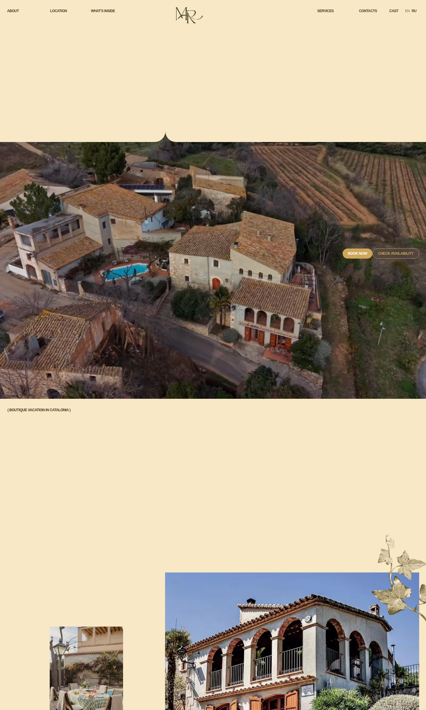
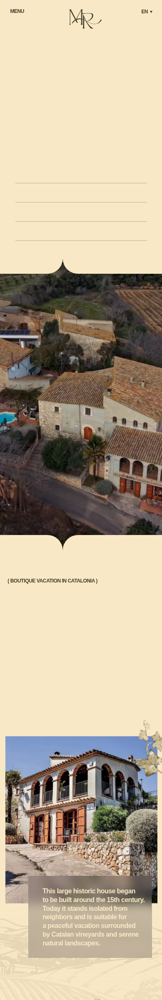

# UI Design System & Master Generation Blueprint: mont-rural-emblematica-agency

> **MontRural — Private Masia Among the Vineyards of Penedès** (https://mont-rural.emblematica.agency) — Rent a masia for a peaceful and cozy getaway just an hour's drive from Barcelona. Perfect for nature retreats, family gatherings, and int...



---

## 1. Executive Visual Persona & Design Archetype

- **Brand Essence & Persona**: **MontRural — Private Masia Among the Vineyards of Penedès** (`https://mont-rural.emblematica.agency`). Rent a masia for a peaceful and cozy getaway just an hour's drive from Barcelona. Perfect for nature retreats, family gatherings, and int...
- **Capture Provenance**: Live browser capture (`tier1_fast`, HTTP `200`, captured `2026-11-23`).
- **Visual Archetype**: **High-Contrast Obsidian / Atmospheric Design System (`#37482f` canvas, `#f8e8c5` ink, `#cfa65a` accent)**.
- **Anti-AI-Slop Differentiators**:
  - **Live-Computed Chromatic Polarity**: Anchors the viewport in `#37482f` (live computed `body` `background-color` (`computed_styles.json`)) paired with `#f8e8c5` primary typography and `#cfa65a` accents.
  - **Grounded Typographic Hierarchy**: Pairs `Playfair` for display copy (`MontRural — Private Masia Among the `) with `Arial)` and not declared in live computed styles (uses primary stack / `ui-monospace`).
  - **Calibrated Spatial Grid & Motion**: Combines `1240px` container bounds (`gap: 16px`, padding `20px`) with `cubic-bezier(.19,1,.22,1)` easing and Lenis Smooth Scroll (`data-lenis`), GSAP Timeline & ScrollTrigger.

---

## 2. Spatial Architecture & Modular Grid Mathematics



### Viewport Allocation & Container Geometry
- **Captured Viewport Dimensions**: Desktop `1440×2400px` (`assets/desktop.png`, clamped at 2400px live multi-section capture), Mobile `390×2400px` (`assets/mobile.png`, clamped at 2400px live multi-section capture).
- **Master Container Bounds**: `1240px` (non-`@media` desktop container stylesheet rule).
- **Canvas Lateral Padding & Spacing**: `20px` lateral canvas padding with `16px` grid gap.
- **Border Radius Scale**: `4px`, `6px`, `50%`, `30px`.

### Responsive Breakpoint Architecture
- **Desktop Layout**: Multi-column CSS Grid / Flexbox layout at `1440px` (`max-width: 1240px`, `gap: 16px`).
- **Mobile Layout**: Single-column vertical stack at `390px` viewport width with `20px` horizontal padding.
- **Extracted CSS Media Queries**: `@media screen and (max-width:980px)`, `@media screen and (max-width:1200px)`, `@media screen and (max-width:960px)`, `@media screen and (min-width:960px)`.

---

## 3. Color System, Materiality & Atmospheric Lighting

### Semantic Palette & Source Grounding
| Semantic Role | Ground-Truth Value | Extracted Live / CSS Source |
|---|---|---|
| **Primary Canvas Substrate** | `#37482f` | live computed `body` `background-color` (`computed_styles.json`) |
| **Primary Typography Ink** | `#f8e8c5` | live computed `a` `color` (`computed_styles.json`) |
| **Elevated Surface / Card Substrate** | `#293b21` | `.t_datepicker__day-cell:hover { background: #293b21 }` |
| **Interactive Accent / Highlight** | `#cfa65a` | `.tn-atom .tn-atom__button-text { color: #cfa65a }` |
| **Secondary / Muted Copy** | `#000000` | live computed `nav` `color` (`computed_styles.json`) |
| **Structural Hairline Border** | `#5f6d59` | `.t_datepicker__header { border-bottom: #5f6d59 }` |

### Sanitized Root CSS Variables (`ui-ux.md` Ground Truth)
| Variable Name | Extracted Value | Semantic Role |
|---|---|---|
| `--button-shadow` | `none` | Elevation / Border Token |
| `--button-content-gap` | `0` | Layout / Spatial Grid Token |
| `--size` | `20px` | Layout / Spatial Grid Token |
| `--border-width` | `2px` | Layout / Spatial Grid Token |
| `--border-radius` | `0` | Elevation / Border Token |
| `--check` | `calc(var(--size) - var(--border-width)*2)` | Design System Custom Token |
| `--line-height` | `1` | Typography / Scale Token |
| `--dot` | `calc(var(--size)/2)` | Design System Custom Token |
| `--offset-y` | `calc((1em*var(--line-height) - var(--size))/2)` | Dimension / Scale Token |
| `--t-headline-font` | `'Playfair',Arial,sans-serif` | Typography / Scale Token |
| `--t-text-font` | `'Arial',Arial,sans-serif` | Typography Ink Token |
| `--uc-typo-fontsize-Bi2HZBV1z` | `82px` | Typography / Scale Token |
| `--uc-typo-fontweight-Bi2HZBV1z` | `400` | Typography / Scale Token |
| `--uc-typo-letterspacing-Bi2HZBV1z` | `-6.5px` | Layout / Spatial Grid Token |
| `--uc-typo-fontfamily-Bi2HZBV1z` | `var(--t-headline-font,Arial)` | Typography / Scale Token |
| `--uc-typo-lineheight-Bi2HZBV1z` | `.9` | Layout / Spatial Grid Token |

---

## 4. Typographic Scale & Editorial Hierarchy

### Font Family Stacks
- **Display Typography**: `Playfair`.
- **Primary Body Stack**: `Arial)`.
- **Technical / Metadata Stack**: not declared in live computed styles (uses primary stack / `ui-monospace`).

### Typographic Scale & Rules (Live Computed & Stylesheet Grounded)
- **Hero Display (`H1`)**: observed font-size ladder: `16px`, `13.3333px`, `10px`, `13px`, `8px`.
- **Section Heading (`H2`)**: observed font-size ladder: `16px`, `13.3333px`, `10px`, `13px`, `8px`.
- **Body Copy**: live computed `body` (`font-size: 16px`, `line-height: normal`, `font-weight: 400`).
- **Metadata & Navigation Labels**: live computed `nav/a` (`font-size: 16px`, `line-height: normal`, `font-weight: 400`).

---

## 5. Choreographed Motion & Interaction Physics

### Primary Easing Curves
- **Extracted Timing Functions**: `cubic-bezier(.19,1,.22,1)`, `cubic-bezier(.22,.65,.2,1)`, `cubic-bezier(.22,1,.36,1)`.

### Per-Element Transition & Choreography Rules
- **Selector `.t_datepicker__day-cell`**: `transition: 0.2s` extracted from `mont-rural-emblematica-agency` stylesheet.
- **Selector `.t706__carticon-text`**: `transition: opacity .3s linear` extracted from `mont-rural-emblematica-agency` stylesheet.
- **Selector `.t706__carticon-imgwrap`**: `transition: -webkit-transform .2s ease-in-out` extracted from `mont-rural-emblematica-agency` stylesheet.
- **Extracted Easing Curve (`cubic-bezier(.19,1,.22,1)`)**: Governs interactive state transitions across `<nav.t450__menu>` and `<div.t-records_animated>`.
- **Runtime Interaction Engine**: Integrates Lenis Smooth Scroll (`data-lenis`), GSAP Timeline & ScrollTrigger, Swiper Touch Carousel Engine with `prefers-reduced-motion: reduce` fallback guards.

---

## 6. Component Wireframe & Structural DOM Map

### Visual Layout Schematic — Desktop (`1440px`, Grounded in `dom.html` & Landmark Bounding Boxes)
```
┌────────────────────────────────────────────────────────────────────────┐
│ DESKTOP VIEWPORT (1440px) — MontRural — Private Masia Among the Vineya │
│ ====================================================================== │
│ [ <nav.t450__menu> (180x151px)        | About · location · What's In ] │
│ ---------------------------------------------------------------------- │
│ | HERO STAGE: <div.t-records> (w=1440px)                             | │
│ | H1: MontRural — Private Masia Among the Vineyards of               | │
│ | Substrate: #37482f | Ink: #f8e8c5 | Accent: #cfa65a                | │
│ ---------------------------------------------------------------------- │
│ | SHOWCASE GRID (<div.t-records_animated>) max-w: 1240px             | │
│ | +------------------------------+  +------------------------------+ | │
│ | | Featured Work & Interactive  |  | Technical Architecture & Nar | | │
│ | +------------------------------+  +------------------------------+ | │
│ ---------------------------------------------------------------------- │
│ | DETAIL MODULE (<div.t-records__overflow-h) — Global Directory & Co | │
│ ---------------------------------------------------------------------- │
│ [ FOOTER (<footer.t-records__o) | https://mont-rural.emblematica.agen  │
└────────────────────────────────────────────────────────────────────────┘
```

### Visual Layout Schematic — Mobile Reflow (`390px`)
```
┌────────────────────────────────────────────────────────────────────────┐
│ MOBILE VIEWPORT REFLOW (390px) — Single-Column Stack (gap: 16px)       │
│ ====================================================================== │
│ [ HEADER BAR (<nav.t450__menu>        ) | Compact Menu (390px)         │
│ ---------------------------------------------------------------------- │
│ | HERO STAGE (<div.t-records>) — 390px Vertical Lead                 | │
│ | H1: MontRural — Private Masia Among the Vineyards of               | │
│ ---------------------------------------------------------------------- │
│ | SHOWCASE STACK (<div.t-records_animate) — 1-Col Stack              | │
│ | [ Item 1: Featured Work & Interactive Showcase                   ] | │
│ | [ Item 2: Technical Architecture & Narrative                     ] | │
│ ---------------------------------------------------------------------- │
│ | DETAIL STACK (<div.t-records__overflow) — 1-Col (Global Directory &) │
│ ---------------------------------------------------------------------- │
│ [ FOOTER (<footer.t-records__o) | Stacked 390px Colophon               │
└────────────────────────────────────────────────────────────────────────┘
```

### Granular DOM Region Breakdown
1. **Brand Header & Navigation Bar (<nav.t450__menu> — `mont-rural-emblematica-agency`)**:
   - Landmark `<nav class="t450__menu">` (`180x151px`) hosting `MontRural — Private Masia Among the ` navigation (`About · location · What's Inside · SERVICES · Contacts`), DOM attributes (`data-hook="blocks-collection-con..."`, `data-tilda-project-id="25144176"`, `data-tilda-page-id="139030856"`, `data-tilda-page-alias="en"`), and stylesheet rule `.t_datepicker__selected-day::after { display: none !important; content: none !important; }`.
2. **Hero Stage & Focal Lead (<div.t-records> — `MontRural — Private Masia Among th`)**:
   - Landmark `<div class="t-records t-records_animated">` presenting display lead `MontRural — Private Masia Among the Vineyards of` and copy excerpt *"CHECK AVAILABILITY"* over `#37482f` canvas and `#f8e8c5` ink.
3. **Primary Showcase & Content Grid (<div.t-records_animated> — `Featured Work & Interactive Showca`)**:
   - Landmark `<div class="t-records t-records_animated">` rendering section `Featured Work & Interactive Showcase` with copy *"R e n t a m a s i a f o r a p e a c e f u l a n d c o z y g e t a"*, asset references (`mont-rural.emblematica.agency`, `ws.tildacdn.com`, `static.tildacdn.com`, `Frame_1948756319.png`), and grid rule `.t_datepicker__header { background: transparent; border-bottom: 1px solid rgba(255,255,255,0.2); }`.
4. **Interactive Detail & Feature Matrix (<div.t-records__overflow-hidden> — `Technical Architecture & Narrative`)**:
   - Landmark `<div class="t-records t-records_animated">` framing `Technical Architecture & Narrative` and `Global Directory & Contact` (*"a n h o u r ' s d r i v e f r o m B a r c e l o n a . P e r f e c"*) with `#293b21` surface cards, `#cfa65a` accents, and `.t_datepicker__label span { color: 8F8637; font-weight: 500; }`.
5. **Colophon & Global Directory Footer (<footer.t-records__overflow-hidden> — `https://mont-rural.emblematica.agency`)**:
   - Landmark `<footer class="t-records__overflow-hidden">` anchoring `MontRural — Private Masia Among ` footer links (`About · location · What's Inside · SERVICES · Contacts`), copy *"B a r c e l o n a ."*, and `#5f6d59` structural dividers.

---

## 7. Master Zero-Shot AI Generation Prompt

```markdown
# Master Zero-Shot Frontend Generation Prompt: mont-rural-emblematica-agency (MontRural — Private Masia Among the Vineyards of Penedès)

You are a principal frontend architect and design systems engineer. Build a complete, production-ready web application replicating the exact design system, DOM landmarks, typographic hierarchy, color tokens, and motion physics of `mont-rural-emblematica-agency` (**MontRural — Private Masia Among the Vineyards of Penedès** — `https://mont-rural.emblematica.agency`).

### 1. Visual Archetype & Anti-AI-Slop Mandates
- **Archetype**: High-Contrast Obsidian / Atmospheric Design System (`#37482f` canvas, `#f8e8c5` ink, `#cfa65a` accent).
- **Identity & Domain Context**: Rent a masia for a peaceful and cozy getaway just an hour's drive from Barcelona. Perfect for nature retreats, family gatherings, and int...
- **Primary Substrate**: `#37482f` (live computed `body` `background-color` (`computed_styles.json`)), **Primary Ink**: `#f8e8c5`, **Accent / Highlight**: `#cfa65a`.
- **Site-Specific Differentiators**:
  - **Live-Computed Chromatic Polarity**: Anchors the viewport in `#37482f` (live computed `body` `background-color` (`computed_styles.json`)) paired with `#f8e8c5` primary typography and `#cfa65a` accents.
  - **Grounded Typographic Hierarchy**: Pairs `Playfair` for display copy (`MontRural — Private Masia Among the `) with `Arial)` and not declared in live computed styles (uses primary stack / `ui-monospace`).
  - **Calibrated Spatial Grid & Motion**: Combines `1240px` container bounds (`gap: 16px`, padding `20px`) with `cubic-bezier(.19,1,.22,1)` easing and Lenis Smooth Scroll (`data-lenis`), GSAP Timeline & ScrollTrigger.

### 2. Ground-Truth CSS Variables (`:root` Token Contract)
Declare and consume these exact custom properties extracted from `mont-rural-emblematica-agency` in your global stylesheet:

:root {
  /* MontRural — Private Masia Among the Vineyards of Penedès (mont-rural-emblematica-agency) — Live-Grounded CSS Variables */
  --button-shadow: none; /* Elevation / Border Token (mont-rural-emblematica-agency) */
  --button-content-gap: 0; /* Layout / Spatial Grid Token (mont-rural-emblematica-agency) */
  --size: 20px; /* Layout / Spatial Grid Token (mont-rural-emblematica-agency) */
  --border-width: 2px; /* Layout / Spatial Grid Token (mont-rural-emblematica-agency) */
  --border-radius: 0; /* Elevation / Border Token (mont-rural-emblematica-agency) */
  --check: calc(var(--size) - var(--border-width)*2); /* Design System Custom Token (mont-rural-emblematica-agency) */
  --line-height: 1; /* Typography / Scale Token (mont-rural-emblematica-agency) */
  --dot: calc(var(--size)/2); /* Design System Custom Token (mont-rural-emblematica-agency) */
  --offset-y: calc((1em*var(--line-height) - var(--size))/2); /* Dimension / Scale Token (mont-rural-emblematica-agency) */
  --t-headline-font: 'Playfair',Arial,sans-serif; /* Typography / Scale Token (mont-rural-emblematica-agency) */
  --t-text-font: 'Arial',Arial,sans-serif; /* Typography Ink Token (mont-rural-emblematica-agency) */
  --uc-typo-fontsize-Bi2HZBV1z: 82px; /* Typography / Scale Token (mont-rural-emblematica-agency) */
  --uc-typo-fontweight-Bi2HZBV1z: 400; /* Typography / Scale Token (mont-rural-emblematica-agency) */
  --uc-typo-letterspacing-Bi2HZBV1z: -6.5px; /* Layout / Spatial Grid Token (mont-rural-emblematica-agency) */
  --uc-typo-fontfamily-Bi2HZBV1z: var(--t-headline-font,Arial); /* Typography / Scale Token (mont-rural-emblematica-agency) */
  --uc-typo-lineheight-Bi2HZBV1z: .9; /* Layout / Spatial Grid Token (mont-rural-emblematica-agency) */
}

### 3. Semantic Color & Materiality Contract
Map every surface, ink, and border strictly to these source-grounded tokens:
- **Primary Canvas Substrate**: `#37482f` — grounded in live computed `body` `background-color` (`computed_styles.json`)
- **Primary Typography Ink**: `#f8e8c5` — grounded in live computed `a` `color` (`computed_styles.json`)
- **Elevated Surface / Card Substrate**: `#293b21` — grounded in `.t_datepicker__day-cell:hover { background: #293b21 }`
- **Interactive Accent / Highlight**: `#cfa65a` — grounded in `.tn-atom .tn-atom__button-text { color: #cfa65a }`
- **Secondary / Muted Copy**: `#000000` — grounded in live computed `nav` `color` (`computed_styles.json`)
- **Structural Hairline Border**: `#5f6d59` — grounded in `.t_datepicker__header { border-bottom: #5f6d59 }`

### 4. Spatial Grid, Container Bounds & Responsive Breakpoints
- **Desktop Viewport Reference**: `1440×2400px` (clamped at 2400px live multi-section capture, `1440px` standard desktop width).
- **Mobile Viewport Reference**: `390×2400px` (clamped at 2400px live multi-section capture, `390px` standard mobile width).
- **Container Max-Width**: `1240px` (non-`@media` desktop container stylesheet rule)
- **Padding & Gutters**: `20px` lateral canvas padding with `16px` grid gap
- **Desktop Grid**: Multi-column CSS Grid / Flexbox layout at `1440px` (`max-width: 1240px`, `gap: 16px`)
- **Mobile Adaptation**: Single-column vertical stack at `390px` viewport width with `20px` horizontal padding
- **Media Queries**: `@media screen and (max-width:980px)`, `@media screen and (max-width:1200px)`, `@media screen and (max-width:960px)`, `@media screen and (min-width:960px)`
- **Corner Radii**: `4px`, `6px`, `50%`, `30px`

### 5. Typography & Editorial Scale Contract
- **Display Font Stack**: `Playfair`
- **Body Font Stack**: `Arial)`
- **Monospace / Technical Font Stack**: not declared in live computed styles (uses primary stack / `ui-monospace`)
- **H1 Display Rule**: observed font-size ladder: `16px`, `13.3333px`, `10px`, `13px`, `8px`
- **H2 Section Rule**: observed font-size ladder: `16px`, `13.3333px`, `10px`, `13px`, `8px`
- **Body Copy Rule**: live computed `body` (`font-size: 16px`, `line-height: normal`, `font-weight: 400`)
- **Metadata & Index Rule**: live computed `nav/a` (`font-size: 16px`, `line-height: normal`, `font-weight: 400`)

### 6. Component Hierarchy, Verbatim Copy & Real DOM Landmarks
Scaffold `mont-rural-emblematica-agency` (`MontRural — Private Masia Among the Vineyards of Penedès`) with these exact structural regions, extracted copy, and CSS rules from `dom.html`:
1. **Brand Header & Navigation Bar (<nav.t450__menu> — `mont-rural-emblematica-agency`)**:
   - DOM & Selectors: Landmark `<nav class="t450__menu">` (`180x151px`) hosting `MontRural — Private Masia Among the ` navigation (`About · location · What's Inside · SERVICES · Contacts`), DOM attributes (`data-hook="blocks-collection-con..."`, `data-tilda-project-id="25144176"`, `data-tilda-page-id="139030856"`, `data-tilda-page-alias="en"`), and stylesheet rule `.t_datepicker__selected-day::after { display: none !important; content: none !important; }`.
   - Responsive Contract: Header `Brand Header & Navigation Bar (<nav.t450__menu> — `mont-rural-emblematica-agency`)` (`mont-rural-emblematica-agency`) adapts across `@media screen and (max-width:980px)`, `@media screen and (max-width:1200px)`, `@media screen and (max-width:960px)`, `@media screen and (min-width:960px)` with `cubic-bezier(.19,1,.22,1)`, `cubic-bezier(.22,.65,.2,1)`, `cubic-bezier(.22,1,.36,1)` transitions and links `About · location · What's Inside · SERVICES · Contacts`.
2. **Hero Stage & Focal Lead (<div.t-records> — `MontRural — Private Masia Among th`)**:
   - DOM & Selectors: Landmark `<div class="t-records t-records_animated">` presenting display lead `MontRural — Private Masia Among the Vineyards of` and copy excerpt *"CHECK AVAILABILITY"* over `#37482f` canvas and `#f8e8c5` ink.
   - Responsive Contract: Hero stage (`1440×2400px` desktop / `390×2400px` mobile) sets `#37482f` background with `#f8e8c5` headline `MontRural — Private Masia Among the Vineyards of`.
3. **Primary Showcase & Content Grid (<div.t-records_animated> — `Featured Work & Interactive Showca`)**:
   - DOM & Selectors: Landmark `<div class="t-records t-records_animated">` rendering section `Featured Work & Interactive Showcase` with copy *"R e n t a m a s i a f o r a p e a c e f u l a n d c o z y g e t a"*, asset references (`mont-rural.emblematica.agency`, `ws.tildacdn.com`, `static.tildacdn.com`, `Frame_1948756319.png`), and grid rule `.t_datepicker__header { background: transparent; border-bottom: 1px solid rgba(255,255,255,0.2); }`.
   - Responsive Contract: Showcase grid `Primary Showcase & Content Grid (<div.t-records_animated> — `Featured Work & Interactive Showca`)` applies Multi-column CSS Grid / Flexbox layout at `1440px` (`max-width: 1240px`, `gap: 16px`) on desktop and Single-column vertical stack at `390px` viewport width with `20px` horizontal padding on mobile.
4. **Interactive Detail & Feature Matrix (<div.t-records__overflow-hidden> — `Technical Architecture & Narrative`)**:
   - DOM & Selectors: Landmark `<div class="t-records t-records_animated">` framing `Technical Architecture & Narrative` and `Global Directory & Contact` (*"a n h o u r ' s d r i v e f r o m B a r c e l o n a . P e r f e c"*) with `#293b21` surface cards, `#cfa65a` accents, and `.t_datepicker__label span { color: 8F8637; font-weight: 500; }`.
   - Responsive Contract: Detail module `Interactive Detail & Feature Matrix (<div.t-records__overflow-hidden> — `Technical Architecture & Narrative`)` uses `4px`, `6px`, `50%`, `30px` radii, `#cfa65a` highlights, and assets (mont-rural.emblematica.agency, ws.tildacdn.com, static.tildacdn.com).
5. **Colophon & Global Directory Footer (<footer.t-records__overflow-hidden> — `https://mont-rural.emblematica.agency`)**:
   - DOM & Selectors: Landmark `<footer class="t-records__overflow-hidden">` anchoring `MontRural — Private Masia Among ` footer links (`About · location · What's Inside · SERVICES · Contacts`), copy *"B a r c e l o n a ."*, and `#5f6d59` structural dividers.
   - Responsive Contract: Footer `Colophon & Global Directory Footer (<footer.t-records__overflow-hidden> — `https://mont-rural.emblematica.agency`)` aligns to `1240px` (non-`@media` desktop container stylesheet rule) with `20px` lateral canvas padding with `16px` grid gap and attributes (data-hook="blocks-collection-con...", data-tilda-project-id="25144176", data-tilda-page-id="139030856").

#### Verbatim DOM Copy Excerpts (`dom.html`)
- Copy Excerpt 1: *"CHECK AVAILABILITY"*
- Copy Excerpt 2: *"R e n t a m a s i a f o r a p e a c e f u l a n d c o z y g e t a w a y j u s t"*
- Copy Excerpt 3: *"a n h o u r ' s d r i v e f r o m B a r c e l o n a . P e r f e c t f o r n a t u r e"*
- Copy Excerpt 4: *"B a r c e l o n a ."*

### 7. Motion, Extracted Stylesheet Rules & Interaction Choreography
- **Primary Easing Functions**: `cubic-bezier(.19,1,.22,1)`, `cubic-bezier(.22,.65,.2,1)`, `cubic-bezier(.22,1,.36,1)`
- **Extracted Stylesheet Rules (`mont-rural-emblematica-agency`)**:
- `.t_datepicker__selected-day::after { display: none !important; content: none !important; }`
- `.t_datepicker__header { background: transparent; border-bottom: 1px solid rgba(255,255,255,0.2); }`
- `.t_datepicker__label span { color: 8F8637; font-weight: 500; }`
- `.t_datepicker__arrow { filter: brightness(0) saturate(100%) invert(53%) sepia(20%) saturate(400... }`
- `.t_datepicker__arrow:hover { opacity: 1; }`
- **Per-Selector Transition Rules**:
- **Selector `.t_datepicker__day-cell`**: `transition: 0.2s` extracted from `mont-rural-emblematica-agency` stylesheet.
- **Selector `.t706__carticon-text`**: `transition: opacity .3s linear` extracted from `mont-rural-emblematica-agency` stylesheet.
- **Selector `.t706__carticon-imgwrap`**: `transition: -webkit-transform .2s ease-in-out` extracted from `mont-rural-emblematica-agency` stylesheet.
- **Extracted Easing Curve (`cubic-bezier(.19,1,.22,1)`)**: Governs interactive state transitions across `<nav.t450__menu>` and `<div.t-records_animated>`.
- **Runtime Interaction Engine**: Integrates Lenis Smooth Scroll (`data-lenis`), GSAP Timeline & ScrollTrigger, Swiper Touch Carousel Engine with `prefers-reduced-motion: reduce` fallback guards.

### 8. Technical Deliverables
- Implement in Next.js (App Router) with TypeScript and Tailwind CSS consuming the `:root` custom properties defined above for `mont-rural-emblematica-agency`.
- Reproduce both the `1440px` desktop architecture and `390px` mobile breakpoint transitions, preserving semantic HTML5 landmarks (`<header>`, `<nav>`, `<main>`, `<section>`, `<footer>`) and `prefers-reduced-motion` accessibility guards.
```
