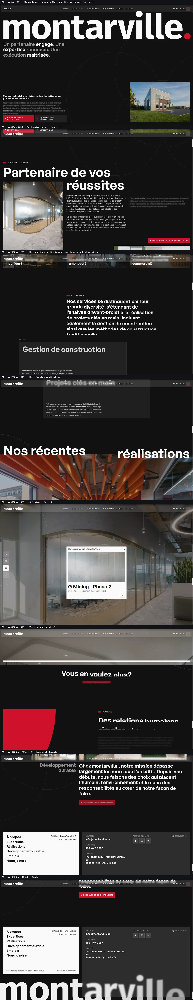
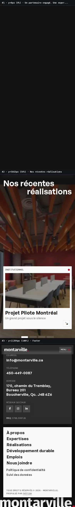

# UI Design System & Master Generation Blueprint: montarville-ca

> **montarville · Une approche globale et intégrée dans la gestion de vos pr...** (https://montarville.ca/) — Un partenaire engagé. Une expertise reconnue. Une exécution maîtrisée. - Une approche globale et intégrée dans la gestion de vos projets...





---

## 1. Executive Visual Persona & Design Archetype

- **Brand Essence & Persona**: **montarville · Une approche globale et intégrée dans la gestion de vos pr...** (`https://montarville.ca/`). Un partenaire engagé. Une expertise reconnue. Une exécution maîtrisée. - Une approche globale et intégrée dans la gestion de vos projets...
- **Capture Provenance**: Live browser capture (`tier1_fast`, HTTP `200`, captured `2026-11-24`).
- **Visual Archetype**: **High-Contrast Obsidian / Atmospheric Design System (`#121212` canvas, `#fafafa` ink, `#d0112b` accent)**.
- **Anti-AI-Slop Differentiators**:
  - **Live-Computed Chromatic Polarity**: Anchors the viewport in `#121212` (live computed `body` `background-color` (`computed_styles.json`)) paired with `#fafafa` primary typography and `#d0112b` accents.
  - **Grounded Typographic Hierarchy**: Uses `General Sans` across display (`Un partenaire engagé. Une expertise `) and body copy, paired with `Fira Sans` for monospace/code.
  - **Calibrated Spatial Grid & Motion**: Combines `1440px` container bounds (`gap: 1rem`, padding `1.5rem`) with `cubic-bezier(0.25,1,0.5,1)` easing and Lenis Smooth Scroll (`data-lenis`), Three.js / WebGL Canvas Pipeline.

---

## 2. Spatial Architecture & Modular Grid Mathematics

### Viewport Allocation & Container Geometry
- **Captured Journey Filmstrips**: Desktop `1280×6624px` (`assets/desktop-journey.webp`, `8` keyframes up to `y=10426px` / doc `11326px`), Mobile `390×2616px` (`assets/mobile-journey.webp`, `3` keyframes).
- **Master Container Bounds**: `1440px` (full-bleed `100%` desktop stage measured on `1440px` viewport).
- **Canvas Lateral Padding & Spacing**: `1.5rem` lateral canvas padding with `1rem` grid gap.
- **Border Radius Scale**: `2px`, `1px`, `50%`, `var(--border-radius)`.

### Responsive Breakpoint Architecture
- **Desktop Layout**: Multi-column CSS Grid / Flexbox layout at `1440px` (`max-width: 1440px`, `gap: 1rem`).
- **Mobile Layout**: Single-column vertical stack at `390px` viewport width with `1.5rem` horizontal padding.
- **Extracted CSS Media Queries**: `@media (min-width:1201px)`, `@media (max-width:1200px)`, `@media (max-width:750px)`, `@media (prefers-reduced-motion:reduce)`.

---

## 3. Color System, Materiality & Atmospheric Lighting

### Semantic Palette & Source Grounding
| Semantic Role | Ground-Truth Value | Extracted Live / CSS Source |
|---|---|---|
| **Primary Canvas Substrate** | `#121212` | live computed `body` `background-color` (`computed_styles.json`) |
| **Primary Typography Ink** | `#fafafa` | live computed `h1` `color` (`computed_styles.json`) |
| **Elevated Surface / Card Substrate** | `#d0112b` | live computed `button` `background-color` (`computed_styles.json`) |
| **Interactive Accent / Highlight** | `#d0112b` | live computed `button` `background-color` (`computed_styles.json`) |
| **Secondary / Muted Copy** | `#000000` | `var(--ff_wp_tracking_text_color)` in `:root` |
| **Structural Hairline Border** | `#090909` | `var(--ff_wp_tracking_border_color)` in `:root` (`rgb(0 0 0 / 50%)`) |
| **Variable Token (`--ff_wp_tracking_background_color`)** | `#ffffff` | `var(--ff_wp_tracking_background_color)` in `:root` |

### Sanitized Root CSS Variables (`ui-ux.md` Ground Truth)
| Variable Name | Extracted Value | Semantic Role |
|---|---|---|
| `--ff_wp_tracking_ease` | `cubic-bezier(0.25, 1, 0.5, 1)` | Typography / Scale Token |
| `--ff_wp_tracking_border_color` | `rgb(0 0 0 / 50%)` | Brand / Palette Token |
| `--ff_wp_tracking_background_color` | `#fff` | Canvas / Surface Token |
| `--ff_wp_tracking_text_color` | `#000` | Typography Ink Token |
| `--ff_wp_tracking_wrapper_padding` | `1.5rem` | Typography / Scale Token |
| `--ff_wp_tracking_dynamic-viewport-height` | `100vh` | Typography / Scale Token |
| `--fa-style-family-brands` | `"Font Awesome 6 Brands"` | Brand / Palette Token |
| `--fa-font-brands` | `normal 400 1em/1 "Font Awesome 6 Brands"` | Brand / Palette Token |
| `--fa-font-regular` | `normal 400 1em/1 "Font Awesome 6 Free"` | Typography / Scale Token |
| `--fa-style-family-classic` | `"Font Awesome 6 Free"` | Typography / Scale Token |
| `--fa-font-solid` | `normal 900 1em/1 "Font Awesome 6 Free"` | Typography / Scale Token |
| `--font-size-h1` | `calc(128 / var(--base-px, 18) * 1rem)` | Typography / Scale Token |
| `--font-size-h2-xl` | `calc(96 / var(--base-px, 18) * 1rem)` | Typography / Scale Token |
| `--font-size-h2` | `calc(72 / var(--base-px, 18) * 1rem)` | Typography / Scale Token |
| `--font-size-h3` | `calc(48 / var(--base-px, 18) * 1rem)` | Typography / Scale Token |
| `--font-size-h4` | `calc(32 / var(--base-px, 18) * 1rem)` | Typography / Scale Token |

---

## 4. Typographic Scale & Editorial Hierarchy

### Font Family Stacks
- **Display Typography**: `General Sans`.
- **Primary Body Stack**: `General Sans`.
- **Technical / Metadata Stack**: `Fira Sans`.

### Typographic Scale & Rules (Live Computed & Stylesheet Grounded)
- **Hero Display (`H1`)**: live computed `h1` (`font-size: 36px`, `line-height: 39.6px`, `font-weight: 600`); CSS variables `--font-size-h1: calc(128 / var(--base-px, 18) * 1rem)`; rule `h1` (`font-size: var(--font-size-h1)`, `line-height: 1em`, `font-weight: 600`).
- **Section Heading (`H2`)**: live computed `h2` (`font-size: 96px`, `line-height: 96px`, `font-weight: 600`); CSS variables `--font-size-h2-xl: calc(96 / var(--base-px, 18) * 1rem)`, `--font-size-h2: calc(72 / var(--base-px, 18) * 1rem)`; rule `h2` (`font-size: var(--font-size-h2-xl)`, `line-height: 1.02em`, `font-weight: 600`).
- **Body Copy**: live computed `body` (`font-size: 13.5px`, `line-height: 13.5px`, `font-weight: 400`); CSS variables `--font-size-body-lg: calc(24 / var(--base-px, 18) * 1rem)`, `--font-size-body: max(14px, calc(18 / var(--base-px, 18) * 1rem))`, `--font-size-body-sm: max(13px, calc(16 / var(--base-px, 18) * 1rem))`; rule `p` (`font-size: 1rem`).
- **Metadata & Navigation Labels**: live computed `nav/a` (`font-size: 13.5px`, `line-height: 13.5px`, `font-weight: 400`); CSS variables `--font-size-caption: max(12px, calc(14 / var(--base-px, 18) * 1rem))`.

---

## 5. Choreographed Motion & Interaction Physics

### Primary Easing Curves
- **Extracted Timing Functions**: `cubic-bezier(0.25,1,0.5,1)`, `cubic-bezier(.28,.84,.42,1)`, `cubic-bezier(.4,0,.6,1)`.

### Per-Element Transition & Choreography Rules
- **Selector `.ff-wp-tracking__overlay`**: `transition: all .3s var(--ff_wp_tracking_ease)` extracted from `montarville-ca` stylesheet.
- **Selector `.ff-wp-tracking__ctn`**: `transition: height .3s var(--ff_wp_tracking_ease)` extracted from `montarville-ca` stylesheet.
- **Selector `.ff-wp-tracking__scroll-zone`**: `transition: height .6s var(--ff_wp_tracking_ease),visibility .6s var(--ff_...` extracted from `montarville-ca` stylesheet.
- **Extracted Easing Curve (`cubic-bezier(0.25,1,0.5,1)`)**: Governs interactive state transitions across `<header.c-header>` and `<section.c-home-about>`.
- **Runtime Interaction Engine**: Integrates Lenis Smooth Scroll (`data-lenis`), Three.js / WebGL Canvas Pipeline, Swiper Touch Carousel Engine, Barba.js Page Transition Router with `prefers-reduced-motion: reduce` fallback guards.
### Measured Runtime Scroll & Interaction Telemetry (`behavioral_journey_v2`)
- **Scroll Driver Mode**: `native` (max document height `11326px`, deepest scrollY reached `10426px` across `8` desktop keyframes).
- **Detected Scroll / Motion Libraries**: `Lenis`, `GSAP/ScrollTrigger`.
- **Hover Physics (`primary_cta` · `DÉCOUVREZ NOS EXPERTISES`)**: `color`: `rgb(250, 250, 250)` -> `rgb(18, 18, 18)`; `backgroundColor`: `rgb(208, 17, 43)` -> `rgb(250, 250, 250)` (`transition-duration: 0.3s, 0.3s`, `timing: cubic-bezier(0.25, 1, 0.5, 1), cubic-bezier(0.25, 1, 0.5, 1)`).
- **Route Transition Architecture**: First internal navigation (`/expertises/gestion-de-construction/`) measured as `direct` in `607ms`.

---

## 6. Component Wireframe & Structural DOM Map

### Visual Layout Schematic — Desktop (`1440px`, Grounded in `dom.html` & Landmark Bounding Boxes)
```
┌────────────────────────────────────────────────────────────────────────┐
│ DESKTOP VIEWPORT (1440px) — montarville · Une approche globale et inté │
│ ====================================================================== │
│ [ <header.c-header> (1440x0px)        | À propos · Découvrir · Proje ] │
│ ---------------------------------------------------------------------- │
│ | HERO STAGE: <section.c-home-intro> (w=1440px)                      | │
│ | H1: Un partenaire engagé. Une expertise reconnue. Une...           | │
│ | Substrate: #121212 | Ink: #fafafa | Accent: #d0112b                | │
│ ---------------------------------------------------------------------- │
│ | SHOWCASE GRID (<section.c-home-about>) max-w: 1440px               | │
│ | +------------------------------+  +------------------------------+ | │
│ | | Un partenaire engagé . Une e |  | Partenaire de vos réussites  | | │
│ | +------------------------------+  +------------------------------+ | │
│ ---------------------------------------------------------------------- │
│ | DETAIL MODULE (<section.c-home-target>) — Vous êtes...             | │
│ ---------------------------------------------------------------------- │
│ [ FOOTER (<footer.c-footer>   ) | https://montarville.ca/              │
└────────────────────────────────────────────────────────────────────────┘
```

### Visual Layout Schematic — Mobile Reflow (`390px`)
```
┌────────────────────────────────────────────────────────────────────────┐
│ MOBILE VIEWPORT REFLOW (390px) — Single-Column Stack (gap: 1rem)       │
│ ====================================================================== │
│ [ HEADER BAR (<header.c-header>       ) | Compact Menu (390px)         │
│ ---------------------------------------------------------------------- │
│ | HERO STAGE (<section.c-home-intro>) — 390px Vertical Lead          | │
│ | H1: Un partenaire engagé. Une expertise reconnue. Une...           | │
│ ---------------------------------------------------------------------- │
│ | SHOWCASE STACK (<section.c-home-about>) — 1-Col Stack              | │
│ | [ Item 1: Un partenaire engagé . Une expertise reconnue. Un...   ] | │
│ | [ Item 2: Partenaire de vos réussites                            ] | │
│ ---------------------------------------------------------------------- │
│ | DETAIL STACK (<section.c-home-target>) — 1-Col (Vous êtes...)      | │
│ ---------------------------------------------------------------------- │
│ [ FOOTER (<footer.c-footer>   ) | Stacked 390px Colophon               │
└────────────────────────────────────────────────────────────────────────┘
```

### Granular DOM Region Breakdown
1. **Brand Header & Navigation Bar (<header.c-header> — `montarville-ca`)**:
   - Landmark `<header class="c-header">` (`1440x0px`) hosting `montarville · Une approche globale e` navigation (`À propos · Découvrir · Projets forfaitaires · Projets clés en main · Institutionnel`), DOM attributes (`data-browser="Chrome"`, `data-browser-version="131.0.0.0"`, `data-platform="Apple"`, `data-os="Mac OS"`), and stylesheet rule `.ff-wp-tracking h3 { font-size:1.6rem }`.
2. **Hero Stage & Focal Lead (<section.c-home-intro> — `Un partenaire engagé. Une expertis`)**:
   - Landmark `<section class="c-home-intro">` presenting display lead `Un partenaire engagé. Une expertise reconnue. Une...` and copy excerpt *"Du début à la fin, nous avons le souci de livrer un projet à la h"* over `#121212` canvas and `#fafafa` ink.
3. **Primary Showcase & Content Grid (<section.c-home-about> — `Un partenaire engagé . Une experti`)**:
   - Landmark `<section class="c-home-about">` rendering section `Un partenaire engagé . Une expertise reconnue. Un...` with copy *"Une approche globale et intégrée dans la gestion de vos projets d"*, asset references (`orphisme_photographie_20210816-_2...`, `favicon.ico`, `FiraSans-Bold.woff2`, `GeneralSans-Variable.woff2`), and grid rule `.ff-wp-tracking h4 { font-size:1.3rem }`.
4. **Interactive Detail & Feature Matrix (<section.c-home-target> — `Partenaire de vos réussites`)**:
   - Landmark `<section class="c-home-target">` framing `Partenaire de vos réussites` and `Vous êtes...` (*"Que vous soyez au stade de la planification, à la recherche d’un "*) with `#d0112b` surface cards, `#d0112b` accents, and `.ff-wp-tracking p { font-size:1rem;margin-top:1em }`.
5. **Colophon & Global Directory Footer (<footer.c-footer> — `https://montarville.ca/`)**:
   - Landmark `<footer class="c-footer">` anchoring `montarville · Une approche globa` footer links (`À propos · Découvrir · Projets forfaitaires · Projets clés en main · Institutionnel`), copy *"montarville . se distingue par sa capacité à offrir un servi"*, and `#090909` structural dividers.
### Full Vertical Scroll Sequence (Desktop `1440×900` Keyframes)
- **Step 01** (`y=0px`, `0%`): Active landmark `Un partenaire engagé. Une expertise reconnue. Une...` · sticky/fixed elements: `0`
- **Step 02** (`y=850px`, `8%`): Active landmark `Partenaire de vos réussites` · sticky/fixed elements: `0`
- **Step 03** (`y=2550px`, `24%`): Active landmark `Nos services se distinguent par leur grande diver...` · sticky/fixed elements: `0`
- **Step 04** (`y=4250px`, `41%`): Active landmark `Nos récentes réalisations` · sticky/fixed elements: `0`
- **Step 05** (`y=6800px`, `65%`): Active landmark `G Mining - Phase 2` · sticky/fixed elements: `1`
- **Step 06** (`y=8500px`, `82%`): Active landmark `Vous en voulez plus?` · sticky/fixed elements: `1`
- **Step 07** (`y=10200px`, `98%`): Active landmark `Développement durable` · sticky/fixed elements: `0`
- **Step 08** (`y=10426px`, `100%`): Active landmark `Footer` · sticky/fixed elements: `0`

### Multi-Page Internal Route Map
- **Detail Route (`/expertises/gestion-de-construction/`)**: `https://montarville.ca/expertises/gestion-de-construction/` — H1: `Gestion de construction`, scrollHeight `4144px`, transition `direct` (`607ms`)
- **Detail Route (`/expertises/projets-forfaitaires/`)**: `https://montarville.ca/expertises/projets-forfaitaires/` — H1: `Projets forfaitaires`, scrollHeight `3849px`, transition `direct` (`808ms`)
- **Detail Route (`/expertises/expertise-en-avant-projet/`)**: `https://montarville.ca/expertises/expertise-en-avant-projet/` — H1: `Expertise en avant- projet`, scrollHeight `3273px`, transition `direct` (`817ms`)

---

## 7. Master Zero-Shot AI Generation Prompt

```markdown
# Master Zero-Shot Frontend Generation Prompt: montarville-ca (montarville · Une approche globale et intégrée dans la gestion de vos pr...)

You are a principal frontend architect and design systems engineer. Build a complete, production-ready web application replicating the exact design system, DOM landmarks, typographic hierarchy, color tokens, and motion physics of `montarville-ca` (**montarville · Une approche globale et intégrée dans la gestion de vos pr...** — `https://montarville.ca/`).

### 1. Visual Archetype & Anti-AI-Slop Mandates
- **Archetype**: High-Contrast Obsidian / Atmospheric Design System (`#121212` canvas, `#fafafa` ink, `#d0112b` accent).
- **Identity & Domain Context**: Un partenaire engagé. Une expertise reconnue. Une exécution maîtrisée. - Une approche globale et intégrée dans la gestion de vos projets...
- **Primary Substrate**: `#121212` (live computed `body` `background-color` (`computed_styles.json`)), **Primary Ink**: `#fafafa`, **Accent / Highlight**: `#d0112b`.
- **Site-Specific Differentiators**:
  - **Live-Computed Chromatic Polarity**: Anchors the viewport in `#121212` (live computed `body` `background-color` (`computed_styles.json`)) paired with `#fafafa` primary typography and `#d0112b` accents.
  - **Grounded Typographic Hierarchy**: Uses `General Sans` across display (`Un partenaire engagé. Une expertise `) and body copy, paired with `Fira Sans` for monospace/code.
  - **Calibrated Spatial Grid & Motion**: Combines `1440px` container bounds (`gap: 1rem`, padding `1.5rem`) with `cubic-bezier(0.25,1,0.5,1)` easing and Lenis Smooth Scroll (`data-lenis`), Three.js / WebGL Canvas Pipeline.

### 2. Ground-Truth CSS Variables (`:root` Token Contract)
Declare and consume these exact custom properties extracted from `montarville-ca` in your global stylesheet:

:root {
  /* montarville · Une approche globale et intégrée dans la gestion de vos pr... (montarville-ca) — Live-Grounded CSS Variables */
  --ff_wp_tracking_ease: cubic-bezier(0.25, 1, 0.5, 1); /* Typography / Scale Token (montarville-ca) */
  --ff_wp_tracking_border_color: rgb(0 0 0 / 50%); /* Brand / Palette Token (montarville-ca) */
  --ff_wp_tracking_background_color: #fff; /* Canvas / Surface Token (montarville-ca) */
  --ff_wp_tracking_text_color: #000; /* Typography Ink Token (montarville-ca) */
  --ff_wp_tracking_wrapper_padding: 1.5rem; /* Typography / Scale Token (montarville-ca) */
  --ff_wp_tracking_dynamic-viewport-height: 100vh; /* Typography / Scale Token (montarville-ca) */
  --fa-style-family-brands: "Font Awesome 6 Brands"; /* Brand / Palette Token (montarville-ca) */
  --fa-font-brands: normal 400 1em/1 "Font Awesome 6 Brands"; /* Brand / Palette Token (montarville-ca) */
  --fa-font-regular: normal 400 1em/1 "Font Awesome 6 Free"; /* Typography / Scale Token (montarville-ca) */
  --fa-style-family-classic: "Font Awesome 6 Free"; /* Typography / Scale Token (montarville-ca) */
  --fa-font-solid: normal 900 1em/1 "Font Awesome 6 Free"; /* Typography / Scale Token (montarville-ca) */
  --font-size-h1: calc(128 / var(--base-px, 18) * 1rem); /* Typography / Scale Token (montarville-ca) */
  --font-size-h2-xl: calc(96 / var(--base-px, 18) * 1rem); /* Typography / Scale Token (montarville-ca) */
  --font-size-h2: calc(72 / var(--base-px, 18) * 1rem); /* Typography / Scale Token (montarville-ca) */
  --font-size-h3: calc(48 / var(--base-px, 18) * 1rem); /* Typography / Scale Token (montarville-ca) */
  --font-size-h4: calc(32 / var(--base-px, 18) * 1rem); /* Typography / Scale Token (montarville-ca) */
}

### 3. Semantic Color & Materiality Contract
Map every surface, ink, and border strictly to these source-grounded tokens:
- **Primary Canvas Substrate**: `#121212` — grounded in live computed `body` `background-color` (`computed_styles.json`)
- **Primary Typography Ink**: `#fafafa` — grounded in live computed `h1` `color` (`computed_styles.json`)
- **Elevated Surface / Card Substrate**: `#d0112b` — grounded in live computed `button` `background-color` (`computed_styles.json`)
- **Interactive Accent / Highlight**: `#d0112b` — grounded in live computed `button` `background-color` (`computed_styles.json`)
- **Secondary / Muted Copy**: `#000000` — grounded in `var(--ff_wp_tracking_text_color)` in `:root`
- **Structural Hairline Border**: `#090909` — grounded in `var(--ff_wp_tracking_border_color)` in `:root` (`rgb(0 0 0 / 50%)`)
- **Variable Token (`--ff_wp_tracking_background_color`)**: `#ffffff` — grounded in `var(--ff_wp_tracking_background_color)` in `:root`

### 4. Spatial Grid, Container Bounds & Responsive Breakpoints
- **Desktop Viewport Reference**: `1280×6624px` (multi-frame vertical journey filmstrip (6624px), `1440px` standard desktop width).
- **Mobile Viewport Reference**: `390×2616px` (multi-frame vertical journey filmstrip (2616px), `390px` standard mobile width).
- **Container Max-Width**: `1440px` (full-bleed `100%` desktop stage measured on `1440px` viewport)
- **Padding & Gutters**: `1.5rem` lateral canvas padding with `1rem` grid gap
- **Desktop Grid**: Multi-column CSS Grid / Flexbox layout at `1440px` (`max-width: 1440px`, `gap: 1rem`)
- **Mobile Adaptation**: Single-column vertical stack at `390px` viewport width with `1.5rem` horizontal padding
- **Media Queries**: `@media (min-width:1201px)`, `@media (max-width:1200px)`, `@media (max-width:750px)`, `@media (prefers-reduced-motion:reduce)`
- **Corner Radii**: `2px`, `1px`, `50%`, `var(--border-radius)`

### 5. Typography & Editorial Scale Contract
- **Display Font Stack**: `General Sans`
- **Body Font Stack**: `General Sans`
- **Monospace / Technical Font Stack**: `Fira Sans`
- **H1 Display Rule**: live computed `h1` (`font-size: 36px`, `line-height: 39.6px`, `font-weight: 600`); CSS variables `--font-size-h1: calc(128 / var(--base-px, 18) * 1rem)`; rule `h1` (`font-size: var(--font-size-h1)`, `line-height: 1em`, `font-weight: 600`)
- **H2 Section Rule**: live computed `h2` (`font-size: 96px`, `line-height: 96px`, `font-weight: 600`); CSS variables `--font-size-h2-xl: calc(96 / var(--base-px, 18) * 1rem)`, `--font-size-h2: calc(72 / var(--base-px, 18) * 1rem)`; rule `h2` (`font-size: var(--font-size-h2-xl)`, `line-height: 1.02em`, `font-weight: 600`)
- **Body Copy Rule**: live computed `body` (`font-size: 13.5px`, `line-height: 13.5px`, `font-weight: 400`); CSS variables `--font-size-body-lg: calc(24 / var(--base-px, 18) * 1rem)`, `--font-size-body: max(14px, calc(18 / var(--base-px, 18) * 1rem))`, `--font-size-body-sm: max(13px, calc(16 / var(--base-px, 18) * 1rem))`; rule `p` (`font-size: 1rem`)
- **Metadata & Index Rule**: live computed `nav/a` (`font-size: 13.5px`, `line-height: 13.5px`, `font-weight: 400`); CSS variables `--font-size-caption: max(12px, calc(14 / var(--base-px, 18) * 1rem))`

### 6. Component Hierarchy, Verbatim Copy & Real DOM Landmarks
Scaffold `montarville-ca` (`montarville · Une approche globale et intégrée dans la gestion de vos pr...`) with these exact structural regions, extracted copy, and CSS rules from `dom.html`:
1. **Brand Header & Navigation Bar (<header.c-header> — `montarville-ca`)**:
   - DOM & Selectors: Landmark `<header class="c-header">` (`1440x0px`) hosting `montarville · Une approche globale e` navigation (`À propos · Découvrir · Projets forfaitaires · Projets clés en main · Institutionnel`), DOM attributes (`data-browser="Chrome"`, `data-browser-version="131.0.0.0"`, `data-platform="Apple"`, `data-os="Mac OS"`), and stylesheet rule `.ff-wp-tracking h3 { font-size:1.6rem }`.
   - Responsive Contract: Header `Brand Header & Navigation Bar (<header.c-header> — `montarville-ca`)` (`montarville-ca`) adapts across `@media (min-width:1201px)`, `@media (max-width:1200px)`, `@media (max-width:750px)`, `@media (prefers-reduced-motion:reduce)` with `cubic-bezier(0.25,1,0.5,1)`, `cubic-bezier(.28,.84,.42,1)`, `cubic-bezier(.4,0,.6,1)` transitions and links `À propos · Découvrir · Projets forfaitaires · Projets clés en main · Institutionnel`.
2. **Hero Stage & Focal Lead (<section.c-home-intro> — `Un partenaire engagé. Une expertis`)**:
   - DOM & Selectors: Landmark `<section class="c-home-intro">` presenting display lead `Un partenaire engagé. Une expertise reconnue. Une...` and copy excerpt *"Du début à la fin, nous avons le souci de livrer un projet à la h"* over `#121212` canvas and `#fafafa` ink.
   - Responsive Contract: Hero stage (`1280×6624px` desktop / `390×2616px` mobile) sets `#121212` background with `#fafafa` headline `Un partenaire engagé. Une expertise reconnue. Une...`.
3. **Primary Showcase & Content Grid (<section.c-home-about> — `Un partenaire engagé . Une experti`)**:
   - DOM & Selectors: Landmark `<section class="c-home-about">` rendering section `Un partenaire engagé . Une expertise reconnue. Un...` with copy *"Une approche globale et intégrée dans la gestion de vos projets d"*, asset references (`orphisme_photographie_20210816-_2...`, `favicon.ico`, `FiraSans-Bold.woff2`, `GeneralSans-Variable.woff2`), and grid rule `.ff-wp-tracking h4 { font-size:1.3rem }`.
   - Responsive Contract: Showcase grid `Primary Showcase & Content Grid (<section.c-home-about> — `Un partenaire engagé . Une experti`)` applies Multi-column CSS Grid / Flexbox layout at `1440px` (`max-width: 1440px`, `gap: 1rem`) on desktop and Single-column vertical stack at `390px` viewport width with `1.5rem` horizontal padding on mobile.
4. **Interactive Detail & Feature Matrix (<section.c-home-target> — `Partenaire de vos réussites`)**:
   - DOM & Selectors: Landmark `<section class="c-home-target">` framing `Partenaire de vos réussites` and `Vous êtes...` (*"Que vous soyez au stade de la planification, à la recherche d’un "*) with `#d0112b` surface cards, `#d0112b` accents, and `.ff-wp-tracking p { font-size:1rem;margin-top:1em }`.
   - Responsive Contract: Detail module `Interactive Detail & Feature Matrix (<section.c-home-target> — `Partenaire de vos réussites`)` uses `2px`, `1px`, `50%`, `var(--border-radius)` radii, `#d0112b` highlights, and assets (orphisme_photographie_20210816-_2..., favicon.ico, FiraSans-Bold.woff2).
5. **Colophon & Global Directory Footer (<footer.c-footer> — `https://montarville.ca/`)**:
   - DOM & Selectors: Landmark `<footer class="c-footer">` anchoring `montarville · Une approche globa` footer links (`À propos · Découvrir · Projets forfaitaires · Projets clés en main · Institutionnel`), copy *"montarville . se distingue par sa capacité à offrir un servi"*, and `#090909` structural dividers.
   - Responsive Contract: Footer `Colophon & Global Directory Footer (<footer.c-footer> — `https://montarville.ca/`)` aligns to `1440px` (full-bleed `100%` desktop stage measured on `1440px` viewport) with `1.5rem` lateral canvas padding with `1rem` grid gap and attributes (data-browser="Chrome", data-browser-version="131.0.0.0", data-platform="Apple").

#### Verbatim DOM Copy Excerpts (`dom.html`)
- Copy Excerpt 1: *"Du début à la fin, nous avons le souci de livrer un projet à la hauteur de vos att..."*
- Copy Excerpt 2: *"Une approche globale et intégrée dans la gestion de vos projets de construction."*
- Copy Excerpt 3: *"Que vous soyez au stade de la planification, à la recherche d’un gestionnaire pour..."*
- Copy Excerpt 4: *"montarville . se distingue par sa capacité à offrir un service intégré, structuré..."*

### 7. Motion, Extracted Stylesheet Rules & Interaction Choreography
- **Primary Easing Functions**: `cubic-bezier(0.25,1,0.5,1)`, `cubic-bezier(.28,.84,.42,1)`, `cubic-bezier(.4,0,.6,1)`
- **Extracted Stylesheet Rules (`montarville-ca`)**:
- `.ff-wp-tracking h3 { font-size:1.6rem }`
- `.ff-wp-tracking h4 { font-size:1.3rem }`
- `.ff-wp-tracking p { font-size:1rem;margin-top:1em }`
- `.ff-wp-tracking::-webkit-scrollbar { display:none }`
- `.ff-wp-tracking a:visited { color:inherit;text-decoration:underline }`
- **Per-Selector Transition Rules**:
- **Selector `.ff-wp-tracking__overlay`**: `transition: all .3s var(--ff_wp_tracking_ease)` extracted from `montarville-ca` stylesheet.
- **Selector `.ff-wp-tracking__ctn`**: `transition: height .3s var(--ff_wp_tracking_ease)` extracted from `montarville-ca` stylesheet.
- **Selector `.ff-wp-tracking__scroll-zone`**: `transition: height .6s var(--ff_wp_tracking_ease),visibility .6s var(--ff_...` extracted from `montarville-ca` stylesheet.
- **Extracted Easing Curve (`cubic-bezier(0.25,1,0.5,1)`)**: Governs interactive state transitions across `<header.c-header>` and `<section.c-home-about>`.
- **Runtime Interaction Engine**: Integrates Lenis Smooth Scroll (`data-lenis`), Three.js / WebGL Canvas Pipeline, Swiper Touch Carousel Engine, Barba.js Page Transition Router with `prefers-reduced-motion: reduce` fallback guards.
### 7b. Full-Page Scroll Choreography, Interactive States & Multi-Page Routes
- **Scroll Mechanics**: Implement `native` vertical progression up to `11326px` across 8 distinct viewport chapters using Lenis, GSAP/ScrollTrigger.
- **Vertical Chapter Sequence**: Un partenaire engagé. Une e... (0%) -> Partenaire de vos réussites (8%) -> Nos services se distinguent... (24%) -> Nos récentes réalisations (41%) -> G Mining - Phase 2 (65%) -> Vous en voulez plus? (82%) -> Développement durable (98%) -> Footer (100%).
- **Hover Micro-Interaction (`primary_cta`)**: Animate `color, backgroundColor` with `0.3s, 0.3s cubic-bezier(0.25, 1, 0.5, 1), cubic-bezier(0.25, 1, 0.5, 1)`.
- **Multi-Page Routes**: Scaffold internal routes `/expertises/gestion-de-construction/` (detail, direct), `/expertises/projets-forfaitaires/` (detail, direct), `/expertises/expertise-en-avant-projet/` (detail, direct) sharing the global header/footer shell and design tokens.

### 8. Technical Deliverables
- Implement in Next.js (App Router) with TypeScript and Tailwind CSS consuming the `:root` custom properties defined above for `montarville-ca`.
- Reproduce both the `1440px` desktop architecture and `390px` mobile breakpoint transitions, preserving semantic HTML5 landmarks (`<header>`, `<nav>`, `<main>`, `<section>`, `<footer>`) and `prefers-reduced-motion` accessibility guards.
```
---

## 8. Full-Page Scroll Journey, Interactive States & Subpage Inventory

### Desktop Scroll Keyframes (`1440×900` WebP)
| Step | Scroll Y | Progress | Active Landmark / Section | Sticky/Fixed | Visual Asset |
| :---: | :---: | :---: | :--- | :---: | :--- |
| `#01` | `0px` | `0%` | Un partenaire engagé. Une expertise reconnue.... | `0` | [desktop-step-01.webp](assets/desktop-step-01.webp) |
| `#02` | `850px` | `8%` | Partenaire de vos réussites | `0` | [desktop-step-02.webp](assets/desktop-step-02.webp) |
| `#03` | `2550px` | `24%` | Nos services se distinguent par leur grande d... | `0` | [desktop-step-03.webp](assets/desktop-step-03.webp) |
| `#04` | `4250px` | `41%` | Nos récentes réalisations | `0` | [desktop-step-04.webp](assets/desktop-step-04.webp) |
| `#05` | `6800px` | `65%` | G Mining - Phase 2 | `1` | [desktop-step-05.webp](assets/desktop-step-05.webp) |
| `#06` | `8500px` | `82%` | Vous en voulez plus? | `1` | [desktop-step-06.webp](assets/desktop-step-06.webp) |
| `#07` | `10200px` | `98%` | Développement durable | `0` | [desktop-step-07.webp](assets/desktop-step-07.webp) |
| `#08` | `10426px` | `100%` | Footer | `0` | [desktop-step-08.webp](assets/desktop-step-08.webp) |

### Mobile Condensed Keyframes (`390×844` WebP)
| Step | Scroll Y | Progress | Active Landmark | Visual Asset |
| :---: | :---: | :---: | :--- | :--- |
| `#01` | `0px` | `0%` | Un partenaire engagé. Une expertise recon... | [mobile-step-01.webp](assets/mobile-step-01.webp) |
| `#02` | `5663px` | `50%` | Nos récentes réalisations | [mobile-step-02.webp](assets/mobile-step-02.webp) |
| `#03` | `11284px` | `100%` | Footer | [mobile-step-03.webp](assets/mobile-step-03.webp) |

### Internal Subpage Filmstrips (`1080px` Wide WebP)
| # | Template | Route URL | H1 / Title | Scroll Height | Transition | Filmstrip Asset |
| :-: | :---: | :--- | :--- | :---: | :---: | :--- |
| `1` | `detail` | `https://montarville.ca/expertises/gestion-de-construction/` | Gestion de construction | `4144px` | `direct` (`607ms`) | [subpage-01-expertises-gestion-de-construction.webp](assets/subpage-01-expertises-gestion-de-construction.webp) |
| `2` | `detail` | `https://montarville.ca/expertises/projets-forfaitaires/` | Projets forfaitaires | `3849px` | `direct` (`808ms`) | [subpage-02-expertises-projets-forfaitaires.webp](assets/subpage-02-expertises-projets-forfaitaires.webp) |
| `3` | `detail` | `https://montarville.ca/expertises/expertise-en-avant-projet/` | Expertise en avant- projet | `3273px` | `direct` (`817ms`) | [subpage-03-expertises-expertise-en-avant-projet.webp](assets/subpage-03-expertises-expertise-en-avant-projet.webp) |

