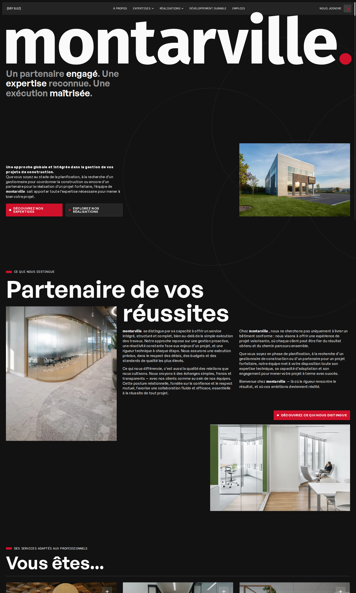

# UI Design System & Master Generation Blueprint: montarville-ca

> **montarville · Une approche globale et intégrée dans la gestion de vos pr...** (https://montarville.ca/) — Un partenaire engagé. Une expertise reconnue. Une exécution maîtrisée. - Une approche globale et intégrée dans la gestion de vos projets...



---

## 1. Executive Visual Persona & Design Archetype

- **Brand Essence & Persona**: **montarville · Une approche globale et intégrée dans la gestion de vos pr...** (`https://montarville.ca/`). Un partenaire engagé. Une expertise reconnue. Une exécution maîtrisée. - Une approche globale et intégrée dans la gestion de vos projets...
- **Visual Archetype**: **Light-Substrate Editorial & Modular Grid System (`#fff` canvas, `#000` ink, `#fafafa` accent)**.
- **Anti-AI-Slop Differentiators**:
  - **Source-Grounded Chromatic Polarity**: Anchors the viewport in `#fff` (`var(--ff_wp_tracking_background_color)` in `:root`) paired with `#000` primary typography and `#fafafa` accents.
  - **Extracted Typographic Hierarchy**: Pairs `General Sans` for display copy (`Un partenaire engagé . Une expertise`) with `Sono` and `Fira Sans`.
  - **Calibrated Spatial Grid & Motion**: Combines `50%` container bounds (`gap: 1rem`, padding `1.5rem`) with `cubic-bezier(.28,.84,.42,1)` easing and Lenis Smooth Scroll (`data-lenis`), Three.js / WebGL Canvas Pipeline.

---

## 2. Spatial Architecture & Modular Grid Mathematics


### Viewport Allocation & Container Geometry
- **Captured Viewport Dimensions**: Desktop `1440×11326px` (`assets/desktop.png`, full-page scroll capture), Mobile `390×2400px` (`assets/mobile.png`, capped at 2400px multi-section capture).
- **Master Container Bounds**: `50%` extracted from `montarville-ca` stylesheet.
- **Canvas Lateral Padding & Spacing**: `1.5rem` lateral canvas padding with `1rem` grid gap.
- **Border Radius Scale**: `2px`, `1px`, `50%`, `var(--border-radius)`.

### Responsive Breakpoint Architecture
- **Desktop Layout**: Multi-column CSS Grid / Flexbox layout at `1440px` (`max-width: 50%`, `gap: 1rem`).
- **Mobile Layout**: Single-column vertical stack at `390px` viewport width with `1.5rem` horizontal padding.
- **Extracted CSS Media Queries**: `@media (prefers-reduced-motion:reduce)`, `@media (min-width:1201px)`, `@media (max-width:1200px)`, `@media (max-width:750px)`.

---

## 3. Color System, Materiality & Atmospheric Lighting

### Semantic Palette & Source Grounding
| Semantic Role | Ground-Truth Value | Extracted CSS Source / Selector |
|---|---|---|
| **Primary Canvas Substrate** | `#fff` | `var(--ff_wp_tracking_background_color)` in `:root` |
| **Primary Typography Ink** | `#000` | `var(--ff_wp_tracking_text_color)` in `:root` |
| **Elevated Surface / Card Substrate** | `#191919` | `var(--color-bg)` in `:root` |
| **Interactive Accent / Highlight** | `#fafafa` | `var(--color-text)` in `:root` |
| **Secondary / Muted Copy** | `#d0112b` | `var(--ff_banner_bg_color)` in `:root` |
| **Structural Hairline Border** | `#121212` | `var(--color-link)` in `:root` |

### Sanitized Root CSS Variables (`ui-ux.md` Ground Truth)
| Variable Name | Extracted Value | Semantic Role |
|---|---|---|
| `--fa-animation-direction` | `reverse` | Motion / Easing Token |
| `--fa-style-family-brands` | `"Font Awesome 6 Brands"` | Brand / Palette Token |
| `--fa-font-brands` | `normal 400 1em/1 "Font Awesome 6 Brands"` | Brand / Palette Token |
| `--fa-font-regular` | `normal 400 1em/1 "Font Awesome 6 Free"` | Typography / Scale Token |
| `--fa-style-family-classic` | `"Font Awesome 6 Free"` | Typography / Scale Token |
| `--fa-font-solid` | `normal 900 1em/1 "Font Awesome 6 Free"` | Typography / Scale Token |
| `--ff_wp_tracking_ease` | `cubic-bezier(0.25, 1, 0.5, 1)` | Typography / Scale Token |
| `--ff_wp_tracking_border_color` | `rgb(0 0 0 / 50%)` | Brand / Palette Token |
| `--ff_wp_tracking_background_color` | `#fff` | Canvas / Surface Token |
| `--ff_wp_tracking_text_color` | `#000` | Typography Ink Token |
| `--ff_wp_tracking_wrapper_padding` | `1.5rem` | Typography / Scale Token |
| `--ff_wp_tracking_dynamic-viewport-height` | `100vh` | Typography / Scale Token |
| `--font-size-h1` | `calc(128 / var(--base-px, 18) * 1rem)` | Typography / Scale Token |
| `--font-size-h2-xl` | `calc(96 / var(--base-px, 18) * 1rem)` | Typography / Scale Token |
| `--font-size-h2` | `calc(72 / var(--base-px, 18) * 1rem)` | Typography / Scale Token |
| `--font-size-h3` | `calc(48 / var(--base-px, 18) * 1rem)` | Typography / Scale Token |

---

## 4. Typographic Scale & Editorial Hierarchy

### Font Family Stacks
- **Display Typography**: `General Sans`.
- **Primary Body Stack**: `Sono`.
- **Technical / Metadata Stack**: `Fira Sans`.

### Typographic Scale & Rules (Extracted from Stylesheet & Variables)
- **Hero Display (`H1`)**: CSS variables `--font-size-h1: calc(128 / var(--base-px, 18) * 1rem)`; rule `h1` (`font-size: var(--font-size-h1)`, `line-height: 1em`, `font-weight: 600`).
- **Section Heading (`H2`)**: CSS variables `--font-size-h2-xl: calc(96 / var(--base-px, 18) * 1rem)`, `--font-size-h2: calc(72 / var(--base-px, 18) * 1rem)`; rule `h2` (`font-size: var(--font-size-h2-xl)`, `line-height: 1.02em`, `font-weight: 600`).
- **Body Copy**: CSS variables `--font-size-body-lg: calc(24 / var(--base-px, 18) * 1rem)`, `--font-size-body: max(14px, calc(18 / var(--base-px, 18) * 1rem))`, `--font-size-body-sm: max(13px, calc(16 / var(--base-px, 18) * 1rem))`; rule `p` (`font-size: 1rem`).
- **Metadata & Navigation Labels**: CSS variables `--font-size-caption: max(12px, calc(14 / var(--base-px, 18) * 1rem))`.

---

## 5. Choreographed Motion & Interaction Physics

### Primary Easing Curves
- **Extracted Timing Functions**: `cubic-bezier(.28,.84,.42,1)`, `cubic-bezier(.4,0,.6,1)`, `cubic-bezier(0.25,1,0.5,1)`.

### Per-Element Transition & Choreography Rules
- **Selector `media (prefers-reduced-motion:red...`**: `transition: 0s` extracted from `montarville-ca` stylesheet.
- **Selector `.ff-wp-tracking__overlay`**: `transition: all .3s var(--ff_wp_tracking_ease)` extracted from `montarville-ca` stylesheet.
- **Selector `.ff-wp-tracking__ctn`**: `transition: height .3s var(--ff_wp_tracking_ease)` extracted from `montarville-ca` stylesheet.
- **Extracted Easing Curve (`cubic-bezier(.28,.84,.42,1)`)**: Governs interactive state transitions across `<header.c-header>` and `<section.c-home-about>`.
- **Runtime Interaction Engine**: Integrates Lenis Smooth Scroll (`data-lenis`), Three.js / WebGL Canvas Pipeline, Swiper Touch Carousel Engine, Barba.js Page Transition Router with `prefers-reduced-motion: reduce` fallback guards.

---

## 6. Component Wireframe & Structural DOM Map

### Visual Layout Schematic (Grounded in `dom.html` — `1440px` Desktop & `390px` Mobile Reflow)
```
┌────────────────────────────────────────────────────────────────────────┐
│ DESKTOP VIEWPORT (1440px) — montarville · Une approche globale et inté │
│ ====================================================================== │
│ [ <header.c-header>        | À propos · Découvrir · Projets forfait ]  │
│ ---------------------------------------------------------------------- │
│ | HERO STAGE: <section.c-home-intro>                               |   │
│ | H1: Un partenaire engagé . Une expertise reconnue. Un...         |   │
│ | Substrate: #fff       | Ink: #000       | Accent: #fafafa        |   │
│ ---------------------------------------------------------------------- │
│ | SHOWCASE GRID (<section.c-home-about>    ) max-w: 50%            |   │
│ | +------------------------------+  +------------------------------+ | │
│ | | Partenaire de vos réussites  |  | Vous êtes...                 | | │
│ | +------------------------------+  +------------------------------+ | │
│ ---------------------------------------------------------------------- │
│ | MOBILE VIEWPORT REFLOW (390px) — Single-Column Stack (gap: 1rem  ) | │
│ | [<header.c-header>] -> [<section.c-home-in] -> [<section.c-home-ab]  │
│ ---------------------------------------------------------------------- │
│ [ FOOTER (<footer.c-footer>     ) | https://montarville.ca/            │
└────────────────────────────────────────────────────────────────────────┘
```

### Granular DOM Region Breakdown
1. **Brand Header & Navigation Bar (<header.c-header> — `montarville-ca`)**:
   - Landmark `<header class="c-header">` hosting `montarville · Une approche globale e` navigation (`À propos · Découvrir · Projets forfaitaires · Projets clés en main · Institutionnel`), DOM attributes (`data-browser="Chrome"`, `data-browser-version="124.0.0.0"`, `data-platform="Apple"`, `data-os="Mac OS"`), and stylesheet rule `.fa { font-family:var(--fa-style-family,"Font Awesome 6 Free");font-weight:var... }`.
2. **Hero Stage & Focal Lead (<section.c-home-intro> — `Un partenaire engagé . Une experti`)**:
   - Landmark `<section class="c-home-intro">` presenting display lead `Un partenaire engagé . Une expertise reconnue. Un...` and copy excerpt *"Accéder au contenu principal"* over `#fff` canvas and `#000` ink.
3. **Primary Showcase & Content Grid (<section.c-home-about> — `Partenaire de vos réussites`)**:
   - Landmark `<section class="c-home-about">` rendering section `Partenaire de vos réussites` with copy *"Expertises Découvrir Gestion de construction Projets forfaitaires"*, asset references (`orphisme_photographie_20210816-_2...`, `favicon.ico`, `FiraSans-Bold.woff2`, `GeneralSans-Variable.woff2`), and grid rule `.fas { font-family:"Font Awesome 6 Free" }`.
4. **Interactive Detail & Feature Matrix (<section.c-home-target> — `Vous êtes...`)**:
   - Landmark `<section class="c-home-target">` framing `Vous êtes...` and `Architecte, designer, ou ingénieur?` (*"Gestion de construction"*) with `#191919` surface cards, `#fafafa` accents, and `.fab { font-family:"Font Awesome 6 Brands" }`.
5. **Colophon & Global Directory Footer (<footer.c-footer> — `https://montarville.ca/`)**:
   - Landmark `<footer class="c-footer">` anchoring `montarville · Une approche globa` footer links (`À propos · Découvrir · Projets forfaitaires · Projets clés en main · Institutionnel`), copy *"Projets forfaitaires"*, and `#121212` structural dividers.

---

## 7. Master Zero-Shot AI Generation Prompt

```markdown
# Master Zero-Shot Frontend Generation Prompt: montarville-ca (montarville · Une approche globale et intégrée dans la gestion de vos pr...)

You are a principal frontend architect and design systems engineer. Build a complete, production-ready web application replicating the exact design system, DOM landmarks, typographic hierarchy, color tokens, and motion physics of `montarville-ca` (**montarville · Une approche globale et intégrée dans la gestion de vos pr...** — `https://montarville.ca/`).

### 1. Visual Archetype & Anti-AI-Slop Mandates
- **Archetype**: Light-Substrate Editorial & Modular Grid System (`#fff` canvas, `#000` ink, `#fafafa` accent).
- **Identity & Domain Context**: Un partenaire engagé. Une expertise reconnue. Une exécution maîtrisée. - Une approche globale et intégrée dans la gestion de vos projets...
- **Primary Substrate**: `#fff` (`var(--ff_wp_tracking_background_color)` in `:root`), **Primary Ink**: `#000`, **Accent / Highlight**: `#fafafa`.
- **Site-Specific Differentiators**:
  - **Source-Grounded Chromatic Polarity**: Anchors the viewport in `#fff` (`var(--ff_wp_tracking_background_color)` in `:root`) paired with `#000` primary typography and `#fafafa` accents.
  - **Extracted Typographic Hierarchy**: Pairs `General Sans` for display copy (`Un partenaire engagé . Une expertise`) with `Sono` and `Fira Sans`.
  - **Calibrated Spatial Grid & Motion**: Combines `50%` container bounds (`gap: 1rem`, padding `1.5rem`) with `cubic-bezier(.28,.84,.42,1)` easing and Lenis Smooth Scroll (`data-lenis`), Three.js / WebGL Canvas Pipeline.

### 2. Ground-Truth CSS Variables (`:root` Token Contract)
Declare and consume these exact custom properties extracted from `montarville-ca` in your global stylesheet:

:root {
  /* montarville · Une approche globale et intégrée dans la gestion de vos pr... (montarville-ca) — Ground-Truth Extracted CSS Variables */
  --fa-animation-direction: reverse; /* Motion / Easing Token (montarville-ca) */
  --fa-style-family-brands: "Font Awesome 6 Brands"; /* Brand / Palette Token (montarville-ca) */
  --fa-font-brands: normal 400 1em/1 "Font Awesome 6 Brands"; /* Brand / Palette Token (montarville-ca) */
  --fa-font-regular: normal 400 1em/1 "Font Awesome 6 Free"; /* Typography / Scale Token (montarville-ca) */
  --fa-style-family-classic: "Font Awesome 6 Free"; /* Typography / Scale Token (montarville-ca) */
  --fa-font-solid: normal 900 1em/1 "Font Awesome 6 Free"; /* Typography / Scale Token (montarville-ca) */
  --ff_wp_tracking_ease: cubic-bezier(0.25, 1, 0.5, 1); /* Typography / Scale Token (montarville-ca) */
  --ff_wp_tracking_border_color: rgb(0 0 0 / 50%); /* Brand / Palette Token (montarville-ca) */
  --ff_wp_tracking_background_color: #fff; /* Canvas / Surface Token (montarville-ca) */
  --ff_wp_tracking_text_color: #000; /* Typography Ink Token (montarville-ca) */
  --ff_wp_tracking_wrapper_padding: 1.5rem; /* Typography / Scale Token (montarville-ca) */
  --ff_wp_tracking_dynamic-viewport-height: 100vh; /* Typography / Scale Token (montarville-ca) */
  --font-size-h1: calc(128 / var(--base-px, 18) * 1rem); /* Typography / Scale Token (montarville-ca) */
  --font-size-h2-xl: calc(96 / var(--base-px, 18) * 1rem); /* Typography / Scale Token (montarville-ca) */
  --font-size-h2: calc(72 / var(--base-px, 18) * 1rem); /* Typography / Scale Token (montarville-ca) */
  --font-size-h3: calc(48 / var(--base-px, 18) * 1rem); /* Typography / Scale Token (montarville-ca) */
}

### 3. Semantic Color & Materiality Contract
Map every surface, ink, and border strictly to these source-grounded tokens:
- **Primary Canvas Substrate**: `#fff` — grounded in `var(--ff_wp_tracking_background_color)` in `:root`
- **Primary Typography Ink**: `#000` — grounded in `var(--ff_wp_tracking_text_color)` in `:root`
- **Elevated Surface / Card Substrate**: `#191919` — grounded in `var(--color-bg)` in `:root`
- **Interactive Accent / Highlight**: `#fafafa` — grounded in `var(--color-text)` in `:root`
- **Secondary / Muted Copy**: `#d0112b` — grounded in `var(--ff_banner_bg_color)` in `:root`
- **Structural Hairline Border**: `#121212` — grounded in `var(--color-link)` in `:root`

### 4. Spatial Grid, Container Bounds & Responsive Breakpoints
- **Desktop Viewport Reference**: `1440×11326px` (full-page scroll capture, `1440px` standard desktop width).
- **Mobile Viewport Reference**: `390×2400px` (capped at 2400px multi-section capture, `390px` standard mobile width).
- **Container Max-Width**: `50%` extracted from `montarville-ca` stylesheet
- **Padding & Gutters**: `1.5rem` lateral canvas padding with `1rem` grid gap
- **Desktop Grid**: Multi-column CSS Grid / Flexbox layout at `1440px` (`max-width: 50%`, `gap: 1rem`)
- **Mobile Adaptation**: Single-column vertical stack at `390px` viewport width with `1.5rem` horizontal padding
- **Media Queries**: `@media (prefers-reduced-motion:reduce)`, `@media (min-width:1201px)`, `@media (max-width:1200px)`, `@media (max-width:750px)`
- **Corner Radii**: `2px`, `1px`, `50%`, `var(--border-radius)`

### 5. Typography & Editorial Scale Contract
- **Display Font Stack**: `General Sans`
- **Body Font Stack**: `Sono`
- **Monospace / Technical Font Stack**: `Fira Sans`
- **H1 Display Rule**: CSS variables `--font-size-h1: calc(128 / var(--base-px, 18) * 1rem)`; rule `h1` (`font-size: var(--font-size-h1)`, `line-height: 1em`, `font-weight: 600`)
- **H2 Section Rule**: CSS variables `--font-size-h2-xl: calc(96 / var(--base-px, 18) * 1rem)`, `--font-size-h2: calc(72 / var(--base-px, 18) * 1rem)`; rule `h2` (`font-size: var(--font-size-h2-xl)`, `line-height: 1.02em`, `font-weight: 600`)
- **Body Copy Rule**: CSS variables `--font-size-body-lg: calc(24 / var(--base-px, 18) * 1rem)`, `--font-size-body: max(14px, calc(18 / var(--base-px, 18) * 1rem))`, `--font-size-body-sm: max(13px, calc(16 / var(--base-px, 18) * 1rem))`; rule `p` (`font-size: 1rem`)
- **Metadata & Index Rule**: CSS variables `--font-size-caption: max(12px, calc(14 / var(--base-px, 18) * 1rem))`

### 6. Component Hierarchy, Verbatim Copy & Real DOM Landmarks
Scaffold `montarville-ca` (`montarville · Une approche globale et intégrée dans la gestion de vos pr...`) with these exact structural regions, extracted copy, and CSS rules from `dom.html`:
1. **Brand Header & Navigation Bar (<header.c-header> — `montarville-ca`)**:
   - DOM & Selectors: Landmark `<header class="c-header">` hosting `montarville · Une approche globale e` navigation (`À propos · Découvrir · Projets forfaitaires · Projets clés en main · Institutionnel`), DOM attributes (`data-browser="Chrome"`, `data-browser-version="124.0.0.0"`, `data-platform="Apple"`, `data-os="Mac OS"`), and stylesheet rule `.fa { font-family:var(--fa-style-family,"Font Awesome 6 Free");font-weight:var... }`.
   - Responsive Contract: Header `Brand Header & Navigation Bar (<header.c-header> — `montarville-ca`)` (`montarville-ca`) adapts across `@media (prefers-reduced-motion:reduce)`, `@media (min-width:1201px)`, `@media (max-width:1200px)`, `@media (max-width:750px)` with `cubic-bezier(.28,.84,.42,1)`, `cubic-bezier(.4,0,.6,1)`, `cubic-bezier(0.25,1,0.5,1)` transitions and links `À propos · Découvrir · Projets forfaitaires · Projets clés en main · Institutionnel`.
2. **Hero Stage & Focal Lead (<section.c-home-intro> — `Un partenaire engagé . Une experti`)**:
   - DOM & Selectors: Landmark `<section class="c-home-intro">` presenting display lead `Un partenaire engagé . Une expertise reconnue. Un...` and copy excerpt *"Accéder au contenu principal"* over `#fff` canvas and `#000` ink.
   - Responsive Contract: Hero stage (`1440×11326px` desktop / `390×2400px` mobile) sets `#fff` background with `#000` headline `Un partenaire engagé . Une expertise reconnue. Un...`.
3. **Primary Showcase & Content Grid (<section.c-home-about> — `Partenaire de vos réussites`)**:
   - DOM & Selectors: Landmark `<section class="c-home-about">` rendering section `Partenaire de vos réussites` with copy *"Expertises Découvrir Gestion de construction Projets forfaitaires"*, asset references (`orphisme_photographie_20210816-_2...`, `favicon.ico`, `FiraSans-Bold.woff2`, `GeneralSans-Variable.woff2`), and grid rule `.fas { font-family:"Font Awesome 6 Free" }`.
   - Responsive Contract: Showcase grid `Primary Showcase & Content Grid (<section.c-home-about> — `Partenaire de vos réussites`)` applies Multi-column CSS Grid / Flexbox layout at `1440px` (`max-width: 50%`, `gap: 1rem`) on desktop and Single-column vertical stack at `390px` viewport width with `1.5rem` horizontal padding on mobile.
4. **Interactive Detail & Feature Matrix (<section.c-home-target> — `Vous êtes...`)**:
   - DOM & Selectors: Landmark `<section class="c-home-target">` framing `Vous êtes...` and `Architecte, designer, ou ingénieur?` (*"Gestion de construction"*) with `#191919` surface cards, `#fafafa` accents, and `.fab { font-family:"Font Awesome 6 Brands" }`.
   - Responsive Contract: Detail module `Interactive Detail & Feature Matrix (<section.c-home-target> — `Vous êtes...`)` uses `2px`, `1px`, `50%`, `var(--border-radius)` radii, `#fafafa` highlights, and assets (orphisme_photographie_20210816-_2..., favicon.ico, FiraSans-Bold.woff2).
5. **Colophon & Global Directory Footer (<footer.c-footer> — `https://montarville.ca/`)**:
   - DOM & Selectors: Landmark `<footer class="c-footer">` anchoring `montarville · Une approche globa` footer links (`À propos · Découvrir · Projets forfaitaires · Projets clés en main · Institutionnel`), copy *"Projets forfaitaires"*, and `#121212` structural dividers.
   - Responsive Contract: Footer `Colophon & Global Directory Footer (<footer.c-footer> — `https://montarville.ca/`)` aligns to `50%` extracted from `montarville-ca` stylesheet with `1.5rem` lateral canvas padding with `1rem` grid gap and attributes (data-browser="Chrome", data-browser-version="124.0.0.0", data-platform="Apple").

#### Verbatim DOM Copy Excerpts (`dom.html`)
- Copy Excerpt 1: *"Accéder au contenu principal"*
- Copy Excerpt 2: *"Expertises Découvrir Gestion de construction Projets forfaitaires Expertise en ava..."*
- Copy Excerpt 3: *"Gestion de construction"*
- Copy Excerpt 4: *"Projets forfaitaires"*

### 7. Motion, Extracted Stylesheet Rules & Interaction Choreography
- **Primary Easing Functions**: `cubic-bezier(.28,.84,.42,1)`, `cubic-bezier(.4,0,.6,1)`, `cubic-bezier(0.25,1,0.5,1)`
- **Extracted Stylesheet Rules (`montarville-ca`)**:
- `.fa { font-family:var(--fa-style-family,"Font Awesome 6 Free");font-weight:var... }`
- `.fas { font-family:"Font Awesome 6 Free" }`
- `.fab { font-family:"Font Awesome 6 Brands" }`
- `.fa-1x { font-size:1em }`
- `.fa-2x { font-size:2em }`
- **Per-Selector Transition Rules**:
- **Selector `media (prefers-reduced-motion:red...`**: `transition: 0s` extracted from `montarville-ca` stylesheet.
- **Selector `.ff-wp-tracking__overlay`**: `transition: all .3s var(--ff_wp_tracking_ease)` extracted from `montarville-ca` stylesheet.
- **Selector `.ff-wp-tracking__ctn`**: `transition: height .3s var(--ff_wp_tracking_ease)` extracted from `montarville-ca` stylesheet.
- **Extracted Easing Curve (`cubic-bezier(.28,.84,.42,1)`)**: Governs interactive state transitions across `<header.c-header>` and `<section.c-home-about>`.
- **Runtime Interaction Engine**: Integrates Lenis Smooth Scroll (`data-lenis`), Three.js / WebGL Canvas Pipeline, Swiper Touch Carousel Engine, Barba.js Page Transition Router with `prefers-reduced-motion: reduce` fallback guards.

### 8. Technical Deliverables
- Implement in Next.js (App Router) with TypeScript and Tailwind CSS consuming the `:root` custom properties defined above for `montarville-ca`.
- Reproduce both the `1440px` desktop architecture and `390px` mobile breakpoint transitions, preserving semantic HTML5 landmarks (`<header>`, `<nav>`, `<main>`, `<section>`, `<footer>`) and `prefers-reduced-motion` accessibility guards.
```
