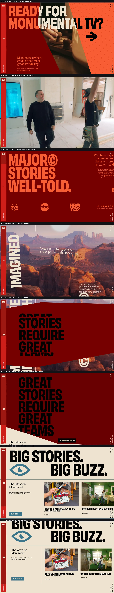
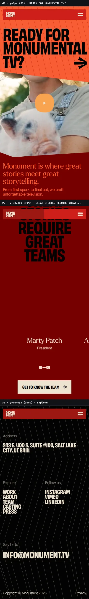

# UI Design System & Master Generation Blueprint: monument-tv

> **Homepage - Monument** (https://monument.tv/) — Monument is an independent creative production company specializing in unscripted television, documentary, and reality tv. We deliver inn...





---

## 1. Executive Visual Persona & Design Archetype

- **Brand Essence & Persona**: **Homepage - Monument** (`https://monument.tv/`). Monument is an independent creative production company specializing in unscripted television, documentary, and reality tv. We deliver inn...
- **Capture Provenance**: Live browser capture (`tier1_fast`, HTTP `200`, captured `2026-11-24`).
- **Visual Archetype**: **Dark-Substrate WebGL / Canvas Interactive Experience (`#760000` / `#3b758b`)**.
- **Anti-AI-Slop Differentiators**:
  - **Live-Computed Chromatic Polarity**: Anchors the viewport in `#760000` (live computed `body` `background-color` (`computed_styles.json`)) paired with `#eee3d1` primary typography and `#3b758b` accents.
  - **Grounded Typographic Hierarchy**: Pairs `obviously-narrow` for display copy (`READY FOR MONUMENTAL TV?`) with `neue-haas-grotesk-text`.
  - **Calibrated Spatial Grid & Motion**: Combines `1263px` container bounds (`gap: 12px`, padding `var(--global-padding)`) with `cubic-bezier(.45,0,.55,1)` easing and Lenis Smooth Scroll (`data-lenis`), Swiper Touch Carousel Engine.

---

## 2. Spatial Architecture & Modular Grid Mathematics

### Viewport Allocation & Container Geometry
- **Captured Journey Filmstrips**: Desktop `1280×6624px` (`assets/desktop-journey.webp`, `8` keyframes up to `y=14400px` / doc `17145px`), Mobile `390×2616px` (`assets/mobile-journey.webp`, `3` keyframes).
- **Master Container Bounds**: `1263px` (measured widest bounded `<section>` landmark width on `1440px` desktop).
- **Canvas Lateral Padding & Spacing**: `var(--global-padding)` lateral canvas padding with `12px` grid gap.
- **Border Radius Scale**: `50%`, `9999px`.

### Responsive Breakpoint Architecture
- **Desktop Layout**: Multi-column CSS Grid / Flexbox layout at `1440px` (`max-width: 1263px`, `gap: 12px`).
- **Mobile Layout**: Single-column vertical stack at `390px` viewport width with `var(--global-padding)` horizontal padding.
- **Extracted CSS Media Queries**: `@media (min-width:1025px)`, `@media (min-width:600px)`, `@media (max-width:599px)`, `@media (max-width:1024px)`.

---

## 3. Color System, Materiality & Atmospheric Lighting

### Semantic Palette & Source Grounding
| Semantic Role | Ground-Truth Value | Extracted Live / CSS Source |
|---|---|---|
| **Primary Canvas Substrate** | `#760000` | live computed `body` `background-color` (`computed_styles.json`) |
| **Primary Typography Ink** | `#eee3d1` | live computed `h1` `color` (`computed_styles.json`) |
| **Elevated Surface / Card Substrate** | `#3b758b` | live computed `button` `background-color` (`computed_styles.json`) |
| **Interactive Accent / Highlight** | `#3b758b` | live computed `button` `background-color` (`computed_styles.json`) |
| **Secondary / Muted Copy** | `#f85e34` | live computed `p` `color` (`computed_styles.json`) |
| **Structural Hairline Border** | `#6d0303` | `.cookieconsent ul li { border: #6d0303 }` |
| **Variable Token (`--black`)** | `#020202` | `var(--black)` in `:root` |
| **Variable Token (`--thunderbird`)** | `#ce1f1a` | `var(--thunderbird)` in `:root` |
| **Variable Token (`--tan-hide`)** | `#f8a351` | `var(--tan-hide)` in `:root` |
| **Variable Token (`--piper`)** | `#bd6623` | `var(--piper)` in `:root` |

### Sanitized Root CSS Variables (`ui-ux.md` Ground Truth)
| Variable Name | Extracted Value | Semantic Role |
|---|---|---|
| `--japanese-maple` | `#760000` | Color / Atmospheric Token |
| `--aths-special` | `#eee3d1` | Color / Atmospheric Token |
| `--flamingo` | `#f85e34` | Color / Atmospheric Token |
| `--font-size` | `2.25rem` | Typography / Scale Token |
| `--black` | `#020202` | Canvas / Surface Token |
| `--thunderbird` | `#ce1f1a` | Color / Atmospheric Token |
| `--ming` | `#3b758b` | Color / Atmospheric Token |
| `--tan-hide` | `#f8a351` | Color / Atmospheric Token |
| `--piper` | `#bd6623` | Color / Atmospheric Token |
| `--underline-width` | `0%` | Layout / Spatial Grid Token |
| `--hover-duration` | `0.3s` | Motion / Easing Token |
| `--box-padding` | `3rem` | Layout / Spatial Grid Token |
| `--global-padding` | `0.75rem` | Layout / Spatial Grid Token |
| `--pin-spacing` | `2.25` | Layout / Spatial Grid Token |
| `--pin` | `0` | Design System Custom Token |
| `--line-height` | `1` | Typography / Scale Token |

---

## 4. Typographic Scale & Editorial Hierarchy

### Font Family Stacks
- **Display Typography**: `obviously-narrow`.
- **Primary Body Stack**: `neue-haas-grotesk-text`.
- **Technical / Metadata Stack**: not declared in live computed styles (uses primary stack / `ui-monospace`).

### Typographic Scale & Rules (Live Computed & Stylesheet Grounded)
- **Hero Display (`H1`)**: live computed `h1` (`font-size: 180px`, `line-height: 153px`, `font-weight: 470`, `letter-spacing: -3.6px`).
- **Section Heading (`H2`)**: live computed `h2` (`font-size: 193.5px`, `line-height: 164.475px`, `font-weight: 400`, `letter-spacing: -3.87px`); rule `h2` (`font-size: 2rem`, `line-height: 1`, `letter-spacing: -.02em`, `font-weight: 500`).
- **Body Copy**: live computed `body` (`font-size: 12px`, `line-height: normal`, `font-weight: 400`); rule `p` (`font-size: 0.75rem`).
- **Metadata & Navigation Labels**: live computed `nav/a` (`font-size: 27px`, `line-height: 22.95px`, `font-weight: 470`, `letter-spacing: -0.54px`); CSS variables `--letter-spacing: 0`.

---

## 5. Choreographed Motion & Interaction Physics

### Primary Easing Curves
- **Extracted Timing Functions**: `cubic-bezier(.45,0,.55,1)`, `cubic-bezier(.5,1,.89,1)`, `cubic-bezier(.11,0,.5,0)`.

### Per-Element Transition & Choreography Rules
- **Selector `.underline-hover>span`**: `transition: background-size .5s cubic-bezier(.45,0,.55,1)` extracted from `monument-tv` stylesheet.
- **Selector `input:-webkit-autofill:hover`**: `transition: all 5000s ease-in-out 0s!important` extracted from `monument-tv` stylesheet.
- **Selector `.underline-hover>span`**: `transition: background-size .5s cubic-bezier(.45,0,.55,1)` extracted from `monument-tv` stylesheet.
- **Extracted Easing Curve (`cubic-bezier(.45,0,.55,1)`)**: Governs interactive state transitions across `<header.no-scrollbar>` and `<article.hero__content__texts>`.
- **Runtime Interaction Engine**: Integrates Lenis Smooth Scroll (`data-lenis`), Swiper Touch Carousel Engine, HTML5 `<canvas>` Interactive Viewport Surface with `prefers-reduced-motion: reduce` fallback guards.
### Measured Runtime Scroll & Interaction Telemetry (`behavioral_journey_v2`)
- **Scroll Driver Mode**: `native` (max document height `17145px`, deepest scrollY reached `14400px` across `8` desktop keyframes).
- **Detected Scroll / Motion Libraries**: `Lenis`, `WebGL/Canvas`.
- **Hover Physics (`first_card` · `Monument is where great stories m...`)**: Computed transition `0s` / `ease` (no static color/transform shift captured at rest).
- **Route Transition Architecture**: First internal navigation (`/work/`) measured as `direct` in `1116ms`.

---

## 6. Component Wireframe & Structural DOM Map

### Visual Layout Schematic — Desktop (`1440px`, Grounded in `dom.html` & Landmark Bounding Boxes)
```
┌────────────────────────────────────────────────────────────────────────┐
│ DESKTOP VIEWPORT (1440px) — Homepage - Monument                        │
│ ====================================================================== │
│ [ <header.no-scrollbar> (1440px)      | Work · About · Team · Castin ] │
│ ---------------------------------------------------------------------- │
│ | HERO STAGE: <section.hero> (w=1440px)                              | │
│ | H1: READY FOR MONUMENTAL TV?                                       | │
│ | Substrate: #760000 | Ink: #eee3d1 | Accent: #3b758b                | │
│ ---------------------------------------------------------------------- │
│ | SHOWCASE GRID (<article.hero__content__te) max-w: 1263px           | │
│ | +------------------------------+  +------------------------------+ | │
│ | | Ready for monumental tv?     |  | Monument is where great stor | | │
│ | +------------------------------+  +------------------------------+ | │
│ ---------------------------------------------------------------------- │
│ | DETAIL MODULE (<section.clients>) — Major stories well-to          | │
│ ---------------------------------------------------------------------- │
│ [ FOOTER (<footer.footer>     ) | https://monument.tv/                 │
└────────────────────────────────────────────────────────────────────────┘
```

### Visual Layout Schematic — Mobile Reflow (`390px`)
```
┌────────────────────────────────────────────────────────────────────────┐
│ MOBILE VIEWPORT REFLOW (390px) — Single-Column Stack (gap: 12px)       │
│ ====================================================================== │
│ [ HEADER BAR (<header.no-scrollbar>   ) | Compact Menu (390px)         │
│ ---------------------------------------------------------------------- │
│ | HERO STAGE (<section.hero>) — 390px Vertical Lead                  | │
│ | H1: READY FOR MONUMENTAL TV?                                       | │
│ ---------------------------------------------------------------------- │
│ | SHOWCASE STACK (<article.hero__content) — 1-Col Stack              | │
│ | [ Item 1: Ready for monumental tv?                               ] | │
│ | [ Item 2: Monument is where great stories meet great storyt...   ] | │
│ ---------------------------------------------------------------------- │
│ | DETAIL STACK (<section.clients>) — 1-Col (Major stories well)      | │
│ ---------------------------------------------------------------------- │
│ [ FOOTER (<footer.footer>     ) | Stacked 390px Colophon               │
└────────────────────────────────────────────────────────────────────────┘
```

### Granular DOM Region Breakdown
1. **Brand Header & Navigation Bar (<header.no-scrollbar> — `monument-tv`)**:
   - Landmark `<header class="no-scrollbar">` (`1440px`) hosting `Homepage - Monument` navigation (`Work · About · Team · Casting · Press`), DOM attributes (`data-parent`, `data-template="homepage"`, `data-component="navbar"`, `data-component="vector-grid"`), and stylesheet rule `before { box-sizing:inherit;-webkit-tap-highlight-color:rgba(0,0,0,0) }`.
2. **Hero Stage & Focal Lead (<section.hero> — `READY FOR MONUMENTAL TV?`)**:
   - Landmark `<section class="hero sticky-root">` presenting display lead `READY FOR MONUMENTAL TV?` and copy excerpt *"From first spark to final cut, we craft unforgettable television."* over `#760000` canvas and `#eee3d1` ink.
3. **Primary Showcase & Content Grid (<article.hero__content__texts> — `Ready for monumental tv?`)**:
   - Landmark `<article class="hero__content__texts">` rendering section `Ready for monumental tv?` with copy *"From script to screen, we believe storytelling isn’t just an art—"*, asset references (`essential.css`, `breeze-prefetch-links.min.js`, `common.js`, `vendors-common.js`), and grid rule `video { height:auto;max-width:100% }`.
4. **Interactive Detail & Feature Matrix (<section.clients> — `Monument is where great stories me`)**:
   - Landmark `<section class="clients sticky-root">` framing `Monument is where great stories meet great storyt...` and `Major stories well-told.` (*"Utah isn’t just where we live — it’s how we think. Its contrast, "*) with `#3b758b` surface cards, `#3b758b` accents, and `.main-preloader { font-size:1.375rem;font-size:var(--font-size,1.375rem);padding:var(--box... }`.
5. **Colophon & Global Directory Footer (<footer.footer> — `https://monument.tv/`)**:
   - Landmark `<footer class="footer sticky-root">` anchoring `Homepage - Monument` footer links (`Work · About · Team · Casting · Press`), copy *"1 Marty Patch President"*, and `#6d0303` structural dividers.
### Full Vertical Scroll Sequence (Desktop `1440×900` Keyframes)
- **Step 01** (`y=0px`, `0%`): Active landmark `READY FOR MONUMENTAL TV?` · sticky/fixed elements: `4`
- **Step 02** (`y=1125px`, `7%`): Active landmark `MAJOR STORIES WELL-TOLD.` · sticky/fixed elements: `6`
- **Step 03** (`y=2681px`, `17%`): Active landmark `MAJOR STORIES WELL-TOLD.` · sticky/fixed elements: `6`
- **Step 04** (`y=6800px`, `42%`): Active landmark `IMAGINED IN UTAH` · sticky/fixed elements: `5`
- **Step 05** (`y=8507px`, `52%`): Active landmark `IMAGINED IN UTAH` · sticky/fixed elements: `5`
- **Step 06** (`y=11900px`, `73%`): Active landmark `GREAT STORIES REQUIRE GREAT TEAMS` · sticky/fixed elements: `3`
- **Step 07** (`y=13610px`, `84%`): Active landmark `BIG STORIES. BIG BUZZ.` · sticky/fixed elements: `3`
- **Step 08** (`y=14400px`, `89%`): Active landmark `The latest on Monument` · sticky/fixed elements: `1`

### Multi-Page Internal Route Map
- **Listing Route (`/work/`)**: `https://monument.tv/work/` — H1: `READY FOR UNFORGETTABLE TV?`, scrollHeight `11683px`, transition `direct` (`1116ms`)
- **About Route (`/about/`)**: `https://monument.tv/about/` — H1: `About - Monument`, scrollHeight `12558px`, transition `direct` (`1054ms`)
- **About Route (`/team/`)**: `https://monument.tv/team/` — H1: `Team - Monument`, scrollHeight `12398px`, transition `direct` (`987ms`)

---

## 7. Master Zero-Shot AI Generation Prompt

```markdown
# Master Zero-Shot Frontend Generation Prompt: monument-tv (Homepage - Monument)

You are a principal frontend architect and design systems engineer. Build a complete, production-ready web application replicating the exact design system, DOM landmarks, typographic hierarchy, color tokens, and motion physics of `monument-tv` (**Homepage - Monument** — `https://monument.tv/`).

### 1. Visual Archetype & Anti-AI-Slop Mandates
- **Archetype**: Dark-Substrate WebGL / Canvas Interactive Experience (`#760000` / `#3b758b`).
- **Identity & Domain Context**: Monument is an independent creative production company specializing in unscripted television, documentary, and reality tv. We deliver inn...
- **Primary Substrate**: `#760000` (live computed `body` `background-color` (`computed_styles.json`)), **Primary Ink**: `#eee3d1`, **Accent / Highlight**: `#3b758b`.
- **Site-Specific Differentiators**:
  - **Live-Computed Chromatic Polarity**: Anchors the viewport in `#760000` (live computed `body` `background-color` (`computed_styles.json`)) paired with `#eee3d1` primary typography and `#3b758b` accents.
  - **Grounded Typographic Hierarchy**: Pairs `obviously-narrow` for display copy (`READY FOR MONUMENTAL TV?`) with `neue-haas-grotesk-text`.
  - **Calibrated Spatial Grid & Motion**: Combines `1263px` container bounds (`gap: 12px`, padding `var(--global-padding)`) with `cubic-bezier(.45,0,.55,1)` easing and Lenis Smooth Scroll (`data-lenis`), Swiper Touch Carousel Engine.

### 2. Ground-Truth CSS Variables (`:root` Token Contract)
Declare and consume these exact custom properties extracted from `monument-tv` in your global stylesheet:

:root {
  /* Homepage - Monument (monument-tv) — Live-Grounded CSS Variables */
  --japanese-maple: #760000; /* Color / Atmospheric Token (monument-tv) */
  --aths-special: #eee3d1; /* Color / Atmospheric Token (monument-tv) */
  --flamingo: #f85e34; /* Color / Atmospheric Token (monument-tv) */
  --font-size: 2.25rem; /* Typography / Scale Token (monument-tv) */
  --black: #020202; /* Canvas / Surface Token (monument-tv) */
  --thunderbird: #ce1f1a; /* Color / Atmospheric Token (monument-tv) */
  --ming: #3b758b; /* Color / Atmospheric Token (monument-tv) */
  --tan-hide: #f8a351; /* Color / Atmospheric Token (monument-tv) */
  --piper: #bd6623; /* Color / Atmospheric Token (monument-tv) */
  --underline-width: 0%; /* Layout / Spatial Grid Token (monument-tv) */
  --hover-duration: 0.3s; /* Motion / Easing Token (monument-tv) */
  --box-padding: 3rem; /* Layout / Spatial Grid Token (monument-tv) */
  --global-padding: 0.75rem; /* Layout / Spatial Grid Token (monument-tv) */
  --pin-spacing: 2.25; /* Layout / Spatial Grid Token (monument-tv) */
  --pin: 0; /* Design System Custom Token (monument-tv) */
  --line-height: 1; /* Typography / Scale Token (monument-tv) */
}

### 3. Semantic Color & Materiality Contract
Map every surface, ink, and border strictly to these source-grounded tokens:
- **Primary Canvas Substrate**: `#760000` — grounded in live computed `body` `background-color` (`computed_styles.json`)
- **Primary Typography Ink**: `#eee3d1` — grounded in live computed `h1` `color` (`computed_styles.json`)
- **Elevated Surface / Card Substrate**: `#3b758b` — grounded in live computed `button` `background-color` (`computed_styles.json`)
- **Interactive Accent / Highlight**: `#3b758b` — grounded in live computed `button` `background-color` (`computed_styles.json`)
- **Secondary / Muted Copy**: `#f85e34` — grounded in live computed `p` `color` (`computed_styles.json`)
- **Structural Hairline Border**: `#6d0303` — grounded in `.cookieconsent ul li { border: #6d0303 }`
- **Variable Token (`--black`)**: `#020202` — grounded in `var(--black)` in `:root`
- **Variable Token (`--thunderbird`)**: `#ce1f1a` — grounded in `var(--thunderbird)` in `:root`
- **Variable Token (`--tan-hide`)**: `#f8a351` — grounded in `var(--tan-hide)` in `:root`
- **Variable Token (`--piper`)**: `#bd6623` — grounded in `var(--piper)` in `:root`

### 4. Spatial Grid, Container Bounds & Responsive Breakpoints
- **Desktop Viewport Reference**: `1280×6624px` (multi-frame vertical journey filmstrip (6624px), `1440px` standard desktop width).
- **Mobile Viewport Reference**: `390×2616px` (multi-frame vertical journey filmstrip (2616px), `390px` standard mobile width).
- **Container Max-Width**: `1263px` (measured widest bounded `<section>` landmark width on `1440px` desktop)
- **Padding & Gutters**: `var(--global-padding)` lateral canvas padding with `12px` grid gap
- **Desktop Grid**: Multi-column CSS Grid / Flexbox layout at `1440px` (`max-width: 1263px`, `gap: 12px`)
- **Mobile Adaptation**: Single-column vertical stack at `390px` viewport width with `var(--global-padding)` horizontal padding
- **Media Queries**: `@media (min-width:1025px)`, `@media (min-width:600px)`, `@media (max-width:599px)`, `@media (max-width:1024px)`
- **Corner Radii**: `50%`, `9999px`

### 5. Typography & Editorial Scale Contract
- **Display Font Stack**: `obviously-narrow`
- **Body Font Stack**: `neue-haas-grotesk-text`
- **Monospace / Technical Font Stack**: not declared in live computed styles (uses primary stack / `ui-monospace`)
- **H1 Display Rule**: live computed `h1` (`font-size: 180px`, `line-height: 153px`, `font-weight: 470`, `letter-spacing: -3.6px`)
- **H2 Section Rule**: live computed `h2` (`font-size: 193.5px`, `line-height: 164.475px`, `font-weight: 400`, `letter-spacing: -3.87px`); rule `h2` (`font-size: 2rem`, `line-height: 1`, `letter-spacing: -.02em`, `font-weight: 500`)
- **Body Copy Rule**: live computed `body` (`font-size: 12px`, `line-height: normal`, `font-weight: 400`); rule `p` (`font-size: 0.75rem`)
- **Metadata & Index Rule**: live computed `nav/a` (`font-size: 27px`, `line-height: 22.95px`, `font-weight: 470`, `letter-spacing: -0.54px`); CSS variables `--letter-spacing: 0`

### 6. Component Hierarchy, Verbatim Copy & Real DOM Landmarks
Scaffold `monument-tv` (`Homepage - Monument`) with these exact structural regions, extracted copy, and CSS rules from `dom.html`:
1. **Brand Header & Navigation Bar (<header.no-scrollbar> — `monument-tv`)**:
   - DOM & Selectors: Landmark `<header class="no-scrollbar">` (`1440px`) hosting `Homepage - Monument` navigation (`Work · About · Team · Casting · Press`), DOM attributes (`data-parent`, `data-template="homepage"`, `data-component="navbar"`, `data-component="vector-grid"`), and stylesheet rule `before { box-sizing:inherit;-webkit-tap-highlight-color:rgba(0,0,0,0) }`.
   - Responsive Contract: Header `Brand Header & Navigation Bar (<header.no-scrollbar> — `monument-tv`)` (`monument-tv`) adapts across `@media (min-width:1025px)`, `@media (min-width:600px)`, `@media (max-width:599px)`, `@media (max-width:1024px)` with `cubic-bezier(.45,0,.55,1)`, `cubic-bezier(.5,1,.89,1)`, `cubic-bezier(.11,0,.5,0)` transitions and links `Work · About · Team · Casting · Press`.
2. **Hero Stage & Focal Lead (<section.hero> — `READY FOR MONUMENTAL TV?`)**:
   - DOM & Selectors: Landmark `<section class="hero sticky-root">` presenting display lead `READY FOR MONUMENTAL TV?` and copy excerpt *"From first spark to final cut, we craft unforgettable television."* over `#760000` canvas and `#eee3d1` ink.
   - Responsive Contract: Hero stage (`1280×6624px` desktop / `390×2616px` mobile) sets `#760000` background with `#eee3d1` headline `READY FOR MONUMENTAL TV?`.
3. **Primary Showcase & Content Grid (<article.hero__content__texts> — `Ready for monumental tv?`)**:
   - DOM & Selectors: Landmark `<article class="hero__content__texts">` rendering section `Ready for monumental tv?` with copy *"From script to screen, we believe storytelling isn’t just an art—"*, asset references (`essential.css`, `breeze-prefetch-links.min.js`, `common.js`, `vendors-common.js`), and grid rule `video { height:auto;max-width:100% }`.
   - Responsive Contract: Showcase grid `Primary Showcase & Content Grid (<article.hero__content__texts> — `Ready for monumental tv?`)` applies Multi-column CSS Grid / Flexbox layout at `1440px` (`max-width: 1263px`, `gap: 12px`) on desktop and Single-column vertical stack at `390px` viewport width with `var(--global-padding)` horizontal padding on mobile.
4. **Interactive Detail & Feature Matrix (<section.clients> — `Monument is where great stories me`)**:
   - DOM & Selectors: Landmark `<section class="clients sticky-root">` framing `Monument is where great stories meet great storyt...` and `Major stories well-told.` (*"Utah isn’t just where we live — it’s how we think. Its contrast, "*) with `#3b758b` surface cards, `#3b758b` accents, and `.main-preloader { font-size:1.375rem;font-size:var(--font-size,1.375rem);padding:var(--box... }`.
   - Responsive Contract: Detail module `Interactive Detail & Feature Matrix (<section.clients> — `Monument is where great stories me`)` uses `50%`, `9999px` radii, `#3b758b` highlights, and assets (essential.css, breeze-prefetch-links.min.js, common.js).
5. **Colophon & Global Directory Footer (<footer.footer> — `https://monument.tv/`)**:
   - DOM & Selectors: Landmark `<footer class="footer sticky-root">` anchoring `Homepage - Monument` footer links (`Work · About · Team · Casting · Press`), copy *"1 Marty Patch President"*, and `#6d0303` structural dividers.
   - Responsive Contract: Footer `Colophon & Global Directory Footer (<footer.footer> — `https://monument.tv/`)` aligns to `1263px` (measured widest bounded `<section>` landmark width on `1440px` desktop) with `var(--global-padding)` lateral canvas padding with `12px` grid gap and attributes (data-parent, data-template="homepage", data-component="navbar").

#### Verbatim DOM Copy Excerpts (`dom.html`)
- Copy Excerpt 1: *"From first spark to final cut, we craft unforgettable television."*
- Copy Excerpt 2: *"From script to screen, we believe storytelling isn’t just an art—it’s a force that..."*
- Copy Excerpt 3: *"Utah isn’t just where we live — it’s how we think. Its contrast, beauty, and grit..."*
- Copy Excerpt 4: *"1 Marty Patch President"*

### 7. Motion, Extracted Stylesheet Rules & Interaction Choreography
- **Primary Easing Functions**: `cubic-bezier(.45,0,.55,1)`, `cubic-bezier(.5,1,.89,1)`, `cubic-bezier(.11,0,.5,0)`
- **Extracted Stylesheet Rules (`monument-tv`)**:
- `before { box-sizing:inherit;-webkit-tap-highlight-color:rgba(0,0,0,0) }`
- `video { height:auto;max-width:100% }`
- `.main-preloader { font-size:1.375rem;font-size:var(--font-size,1.375rem);padding:var(--box... }`
- `.main-preloader__content { flex-direction:row;height:100% }`
- `.main-preloader__logo { height:16.875rem;width:29.875rem }`
- **Per-Selector Transition Rules**:
- **Selector `.underline-hover>span`**: `transition: background-size .5s cubic-bezier(.45,0,.55,1)` extracted from `monument-tv` stylesheet.
- **Selector `input:-webkit-autofill:hover`**: `transition: all 5000s ease-in-out 0s!important` extracted from `monument-tv` stylesheet.
- **Selector `.underline-hover>span`**: `transition: background-size .5s cubic-bezier(.45,0,.55,1)` extracted from `monument-tv` stylesheet.
- **Extracted Easing Curve (`cubic-bezier(.45,0,.55,1)`)**: Governs interactive state transitions across `<header.no-scrollbar>` and `<article.hero__content__texts>`.
- **Runtime Interaction Engine**: Integrates Lenis Smooth Scroll (`data-lenis`), Swiper Touch Carousel Engine, HTML5 `<canvas>` Interactive Viewport Surface with `prefers-reduced-motion: reduce` fallback guards.
### 7b. Full-Page Scroll Choreography, Interactive States & Multi-Page Routes
- **Scroll Mechanics**: Implement `native` vertical progression up to `17145px` across 8 distinct viewport chapters using Lenis, WebGL/Canvas.
- **Vertical Chapter Sequence**: READY FOR MONUMENTAL TV? (0%) -> MAJOR STORIES WELL-TOLD. (7%) -> MAJOR STORIES WELL-TOLD. (17%) -> IMAGINED IN UTAH (42%) -> IMAGINED IN UTAH (52%) -> GREAT STORIES REQUIRE GREAT... (73%) -> BIG STORIES. BIG BUZZ. (84%) -> The latest on Monument (89%).
- **Multi-Page Routes**: Scaffold internal routes `/work/` (listing, direct), `/about/` (about, direct), `/team/` (about, direct) sharing the global header/footer shell and design tokens.

### 8. Technical Deliverables
- Implement in Next.js (App Router) with TypeScript and Tailwind CSS consuming the `:root` custom properties defined above for `monument-tv`.
- Reproduce both the `1440px` desktop architecture and `390px` mobile breakpoint transitions, preserving semantic HTML5 landmarks (`<header>`, `<nav>`, `<main>`, `<section>`, `<footer>`) and `prefers-reduced-motion` accessibility guards.
```
---

## 8. Full-Page Scroll Journey, Interactive States & Subpage Inventory

### Desktop Scroll Keyframes (`1440×900` WebP)
| Step | Scroll Y | Progress | Active Landmark / Section | Sticky/Fixed | Visual Asset |
| :---: | :---: | :---: | :--- | :---: | :--- |
| `#01` | `0px` | `0%` | READY FOR MONUMENTAL TV? | `4` | [desktop-step-01.webp](assets/desktop-step-01.webp) |
| `#02` | `1125px` | `7%` | MAJOR STORIES WELL-TOLD. | `6` | [desktop-step-02.webp](assets/desktop-step-02.webp) |
| `#03` | `2681px` | `17%` | MAJOR STORIES WELL-TOLD. | `6` | [desktop-step-03.webp](assets/desktop-step-03.webp) |
| `#04` | `6800px` | `42%` | IMAGINED IN UTAH | `5` | [desktop-step-04.webp](assets/desktop-step-04.webp) |
| `#05` | `8507px` | `52%` | IMAGINED IN UTAH | `5` | [desktop-step-05.webp](assets/desktop-step-05.webp) |
| `#06` | `11900px` | `73%` | GREAT STORIES REQUIRE GREAT TEAMS | `3` | [desktop-step-06.webp](assets/desktop-step-06.webp) |
| `#07` | `13610px` | `84%` | BIG STORIES. BIG BUZZ. | `3` | [desktop-step-07.webp](assets/desktop-step-07.webp) |
| `#08` | `14400px` | `89%` | The latest on Monument | `1` | [desktop-step-08.webp](assets/desktop-step-08.webp) |

### Mobile Condensed Keyframes (`390×844` WebP)
| Step | Scroll Y | Progress | Active Landmark | Visual Asset |
| :---: | :---: | :---: | :--- | :--- |
| `#01` | `0px` | `0%` | READY FOR MONUMENTAL TV? | [mobile-step-01.webp](assets/mobile-step-01.webp) |
| `#02` | `3823px` | `50%` | GREAT STORIES REQUIRE GREAT TEAMS | [mobile-step-02.webp](assets/mobile-step-02.webp) |
| `#03` | `7646px` | `100%` | Explore | [mobile-step-03.webp](assets/mobile-step-03.webp) |

### Internal Subpage Filmstrips (`1080px` Wide WebP)
| # | Template | Route URL | H1 / Title | Scroll Height | Transition | Filmstrip Asset |
| :-: | :---: | :--- | :--- | :---: | :---: | :--- |
| `1` | `listing` | `https://monument.tv/work/` | READY FOR UNFORGETTABLE TV? | `11683px` | `direct` (`1116ms`) | [subpage-01-work.webp](assets/subpage-01-work.webp) |
| `2` | `about` | `https://monument.tv/about/` | About - Monument | `12558px` | `direct` (`1054ms`) | [subpage-02-about.webp](assets/subpage-02-about.webp) |
| `3` | `about` | `https://monument.tv/team/` | Team - Monument | `12398px` | `direct` (`987ms`) | [subpage-03-team.webp](assets/subpage-03-team.webp) |

