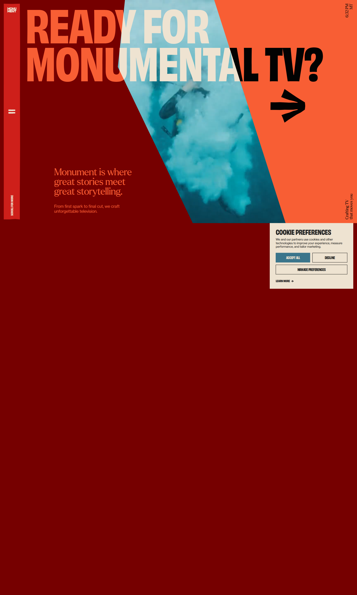
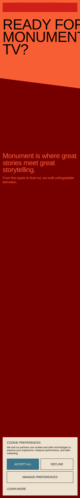

# UI Design System & Master Generation Blueprint: monument-tv

> **Homepage - Monument** (https://monument.tv/) — Monument is an independent creative production company specializing in unscripted television, documentary, and reality tv. We deliver inn...



---

## 1. Executive Visual Persona & Design Archetype

- **Brand Essence & Persona**: **Homepage - Monument** (`https://monument.tv/`). Monument is an independent creative production company specializing in unscripted television, documentary, and reality tv. We deliver inn...
- **Visual Archetype**: **Dark-Substrate WebGL / Canvas Interactive Experience (`#760000` / `#020202`)**.
- **Anti-AI-Slop Differentiators**:
  - **Source-Grounded Chromatic Polarity**: Anchors the viewport in `#760000` (`var(--japanese-maple)` in `:root`) paired with `#eee3d1` primary typography and `#020202` accents.
  - **Extracted Typographic Hierarchy**: Pairs `neue-haas-grotesk-text` for display copy (`Thank you for reaching out`) with `obviously-narrow` and not declared in static CSS (uses primary stack / `ui-monospace`).
  - **Calibrated Spatial Grid & Motion**: Combines `33.75rem` container bounds (`gap: 7.5rem`, padding `var(--global-padding)`) with `cubic-bezier(.45,0,.55,1)` easing and Lenis Smooth Scroll (`data-lenis`), Swiper Touch Carousel Engine.

---

## 2. Spatial Architecture & Modular Grid Mathematics



### Viewport Allocation & Container Geometry
- **Captured Viewport Dimensions**: Desktop `1440×16722px` (`assets/desktop.png`, full-page scroll capture), Mobile `390×2400px` (`assets/mobile.png`, capped at 2400px multi-section capture).
- **Master Container Bounds**: `33.75rem` extracted from `monument-tv` stylesheet.
- **Canvas Lateral Padding & Spacing**: `var(--global-padding)` lateral canvas padding with `7.5rem` grid gap.
- **Border Radius Scale**: `50%`, `9999px`.

### Responsive Breakpoint Architecture
- **Desktop Layout**: Multi-column CSS Grid / Flexbox layout at `1440px` (`max-width: 33.75rem`, `gap: 7.5rem`).
- **Mobile Layout**: Single-column vertical stack at `390px` viewport width with `var(--global-padding)` horizontal padding.
- **Extracted CSS Media Queries**: `@media (min-width:1025px)`, `@media (min-width:600px)`, `@media (max-width:599px)`, `@media (max-width:1024px)`.

---

## 3. Color System, Materiality & Atmospheric Lighting

### Semantic Palette & Source Grounding
| Semantic Role | Ground-Truth Value | Extracted CSS Source / Selector |
|---|---|---|
| **Primary Canvas Substrate** | `#760000` | `var(--japanese-maple)` in `:root` |
| **Primary Typography Ink** | `#eee3d1` | `var(--aths-special)` in `:root` |
| **Elevated Surface / Card Substrate** | `#f85e34` | `var(--flamingo)` in `:root` |
| **Interactive Accent / Highlight** | `#020202` | `var(--black)` in `:root` |
| **Secondary / Muted Copy** | `#ce1f1a` | `var(--thunderbird)` in `:root` |
| **Structural Hairline Border** | `#3b758b` | `var(--ming)` in `:root` |

### Sanitized Root CSS Variables (`ui-ux.md` Ground Truth)
| Variable Name | Extracted Value | Semantic Role |
|---|---|---|
| `--underline-width` | `0%` | Layout / Spatial Grid Token |
| `--hover-duration` | `0.3s` | Motion / Easing Token |
| `--japanese-maple` | `#760000` | Color / Atmospheric Token |
| `--aths-special` | `#eee3d1` | Color / Atmospheric Token |
| `--flamingo` | `#f85e34` | Color / Atmospheric Token |
| `--box-padding` | `3rem` | Layout / Spatial Grid Token |
| `--global-padding` | `0.75rem` | Layout / Spatial Grid Token |
| `--font-size` | `1.5rem` | Typography / Scale Token |
| `--pin-spacing` | `2.25` | Layout / Spatial Grid Token |
| `--pin` | `0` | Design System Custom Token |
| `--line-height` | `1` | Typography / Scale Token |
| `--padding` | `0.625rem` | Layout / Spatial Grid Token |
| `--clip-right` | `100%` | Dimension / Scale Token |
| `--clip-left` | `100%` | Dimension / Scale Token |
| `--dheight` | `calc(var(--dvh) + 1px)` | Layout / Spatial Grid Token |
| `--text-transform` | `normal` | Typography Ink Token |

---

## 4. Typographic Scale & Editorial Hierarchy

### Font Family Stacks
- **Display Typography**: `neue-haas-grotesk-text`.
- **Primary Body Stack**: `obviously-narrow`.
- **Technical / Metadata Stack**: not declared in static CSS (uses primary stack / `ui-monospace`).

### Typographic Scale & Rules (Extracted from Stylesheet & Variables)
- **Hero Display (`H1`)**: not explicitly declared on tag in static CSS (stylesheet font-size ladder: `100%`, `1rem`, `1.375rem`, `4.2666666667vw`, `2.0833333333vw`).
- **Section Heading (`H2`)**: rule `h2` (`font-size: 2rem`, `line-height: 1`, `letter-spacing: -.02em`, `font-weight: 500`).
- **Body Copy**: rule `p` (`font-size: 0.75rem`).
- **Metadata & Navigation Labels**: CSS variables `--letter-spacing: 0`.

---

## 5. Choreographed Motion & Interaction Physics

### Primary Easing Curves
- **Extracted Timing Functions**: `cubic-bezier(.45,0,.55,1)`, `cubic-bezier(.5,1,.89,1)`, `cubic-bezier(.11,0,.5,0)`.

### Per-Element Transition & Choreography Rules
- **Selector `.underline-hover>span`**: `transition: background-size .5s cubic-bezier(.45,0,.55,1)` extracted from `monument-tv` stylesheet.
- **Selector `input:-webkit-autofill:hover`**: `transition: all 5000s ease-in-out 0s!important` extracted from `monument-tv` stylesheet.
- **Selector `.underline-hover>span`**: `transition: background-size .5s cubic-bezier(.45,0,.55,1)` extracted from `monument-tv` stylesheet.
- **Extracted Easing Curve (`cubic-bezier(.45,0,.55,1)`)**: Governs interactive state transitions across `<header.no-scrollbar>` and `<section.cookieconsent__module>`.
- **Runtime Interaction Engine**: Integrates Lenis Smooth Scroll (`data-lenis`), Swiper Touch Carousel Engine, HTML5 `<canvas>` Interactive Viewport Surface with `prefers-reduced-motion: reduce` fallback guards.

---

## 6. Component Wireframe & Structural DOM Map

### Visual Layout Schematic (Grounded in `dom.html` — `1440px` Desktop & `390px` Mobile Reflow)
```
┌────────────────────────────────────────────────────────────────────────┐
│ DESKTOP VIEWPORT (1440px) — Homepage - Monument                        │
│ ====================================================================== │
│ [ <header.no-scrollbar>    | Work · About · Team · Casting · Press  ]  │
│ ---------------------------------------------------------------------- │
│ | HERO STAGE: <section.cookieconsent>                              |   │
│ | H1: Thank you for reaching out                                   |   │
│ | Substrate: #760000    | Ink: #eee3d1    | Accent: #020202        |   │
│ ---------------------------------------------------------------------- │
│ | SHOWCASE GRID (<section.cookieconsent__mo) max-w: 33.75rem       |   │
│ | +------------------------------+  +------------------------------+ | │
│ | | Pitch us your idea. We’re ea |  | We're looking forward to hea | | │
│ | +------------------------------+  +------------------------------+ | │
│ ---------------------------------------------------------------------- │
│ | MOBILE VIEWPORT REFLOW (390px) — Single-Column Stack (gap: 7.5rem) | │
│ | [<header.no-scrollb] -> [<section.cookiecon] -> [<section.cookiecon] │
│ ---------------------------------------------------------------------- │
│ [ FOOTER (<footer.footer>       ) | https://monument.tv/               │
└────────────────────────────────────────────────────────────────────────┘
```

### Granular DOM Region Breakdown
1. **Brand Header & Navigation Bar (<header.no-scrollbar> — `monument-tv`)**:
   - Landmark `<header class="no-scrollbar">` hosting `Homepage - Monument` navigation (`Work · About · Team · Casting · Press`), DOM attributes (`data-parent`, `data-template="homepage"`, `data-component="navbar"`, `data-component="vector-grid"`), and stylesheet rule `before { box-sizing:inherit;-webkit-tap-highlight-color:rgba(0,0,0,0) }`.
2. **Hero Stage & Focal Lead (<section.cookieconsent> — `Thank you for reaching out`)**:
   - Landmark `<section class="cookieconsent is-inview">` presenting display lead `Thank you for reaching out` and copy excerpt *"We and our partners use cookies and other technologies to improve"* over `#760000` canvas and `#eee3d1` ink.
3. **Primary Showcase & Content Grid (<section.cookieconsent__module> — `Pitch us your idea. We’re eager to`)**:
   - Landmark `<section class="cookieconsent__module cookieconsent__main">` rendering section `Pitch us your idea. We’re eager to hear` with copy *"Manage preferences"*, asset references (`essential.css`, `breeze-prefetch-links.min.js`, `common.js`, `vendors-common.js`), and grid rule `video { height:auto;max-width:100% }`.
4. **Interactive Detail & Feature Matrix (<section.cookieconsent__actions> — `We're looking forward to hearing f`)**:
   - Landmark `<section class="cookieconsent__actions">` framing `We're looking forward to hearing from you.` and `Broken. Beyond Repair?` (*"Essential Essential cookies enable basic functions and are necess"*) with `#f85e34` surface cards, `#020202` accents, and `.main-preloader { font-size:1.375rem;font-size:var(--font-size,1.375rem);padding:var(--box... }`.
5. **Colophon & Global Directory Footer (<footer.footer> — `https://monument.tv/`)**:
   - Landmark `<footer class="footer sticky-root">` anchoring `Homepage - Monument` footer links (`Work · About · Team · Casting · Press`), copy *"Essential cookies enable basic functions and are necessary f"*, and `#3b758b` structural dividers.

---

## 7. Master Zero-Shot AI Generation Prompt

```markdown
# Master Zero-Shot Frontend Generation Prompt: monument-tv (Homepage - Monument)

You are a principal frontend architect and design systems engineer. Build a complete, production-ready web application replicating the exact design system, DOM landmarks, typographic hierarchy, color tokens, and motion physics of `monument-tv` (**Homepage - Monument** — `https://monument.tv/`).

### 1. Visual Archetype & Anti-AI-Slop Mandates
- **Archetype**: Dark-Substrate WebGL / Canvas Interactive Experience (`#760000` / `#020202`).
- **Identity & Domain Context**: Monument is an independent creative production company specializing in unscripted television, documentary, and reality tv. We deliver inn...
- **Primary Substrate**: `#760000` (`var(--japanese-maple)` in `:root`), **Primary Ink**: `#eee3d1`, **Accent / Highlight**: `#020202`.
- **Site-Specific Differentiators**:
  - **Source-Grounded Chromatic Polarity**: Anchors the viewport in `#760000` (`var(--japanese-maple)` in `:root`) paired with `#eee3d1` primary typography and `#020202` accents.
  - **Extracted Typographic Hierarchy**: Pairs `neue-haas-grotesk-text` for display copy (`Thank you for reaching out`) with `obviously-narrow` and not declared in static CSS (uses primary stack / `ui-monospace`).
  - **Calibrated Spatial Grid & Motion**: Combines `33.75rem` container bounds (`gap: 7.5rem`, padding `var(--global-padding)`) with `cubic-bezier(.45,0,.55,1)` easing and Lenis Smooth Scroll (`data-lenis`), Swiper Touch Carousel Engine.

### 2. Ground-Truth CSS Variables (`:root` Token Contract)
Declare and consume these exact custom properties extracted from `monument-tv` in your global stylesheet:

:root {
  /* Homepage - Monument (monument-tv) — Ground-Truth Extracted CSS Variables */
  --underline-width: 0%; /* Layout / Spatial Grid Token (monument-tv) */
  --hover-duration: 0.3s; /* Motion / Easing Token (monument-tv) */
  --japanese-maple: #760000; /* Color / Atmospheric Token (monument-tv) */
  --aths-special: #eee3d1; /* Color / Atmospheric Token (monument-tv) */
  --flamingo: #f85e34; /* Color / Atmospheric Token (monument-tv) */
  --box-padding: 3rem; /* Layout / Spatial Grid Token (monument-tv) */
  --global-padding: 0.75rem; /* Layout / Spatial Grid Token (monument-tv) */
  --font-size: 1.5rem; /* Typography / Scale Token (monument-tv) */
  --pin-spacing: 2.25; /* Layout / Spatial Grid Token (monument-tv) */
  --pin: 0; /* Design System Custom Token (monument-tv) */
  --line-height: 1; /* Typography / Scale Token (monument-tv) */
  --padding: 0.625rem; /* Layout / Spatial Grid Token (monument-tv) */
  --clip-right: 100%; /* Dimension / Scale Token (monument-tv) */
  --clip-left: 100%; /* Dimension / Scale Token (monument-tv) */
  --dheight: calc(var(--dvh) + 1px); /* Layout / Spatial Grid Token (monument-tv) */
  --text-transform: normal; /* Typography Ink Token (monument-tv) */
}

### 3. Semantic Color & Materiality Contract
Map every surface, ink, and border strictly to these source-grounded tokens:
- **Primary Canvas Substrate**: `#760000` — grounded in `var(--japanese-maple)` in `:root`
- **Primary Typography Ink**: `#eee3d1` — grounded in `var(--aths-special)` in `:root`
- **Elevated Surface / Card Substrate**: `#f85e34` — grounded in `var(--flamingo)` in `:root`
- **Interactive Accent / Highlight**: `#020202` — grounded in `var(--black)` in `:root`
- **Secondary / Muted Copy**: `#ce1f1a` — grounded in `var(--thunderbird)` in `:root`
- **Structural Hairline Border**: `#3b758b` — grounded in `var(--ming)` in `:root`

### 4. Spatial Grid, Container Bounds & Responsive Breakpoints
- **Desktop Viewport Reference**: `1440×16722px` (full-page scroll capture, `1440px` standard desktop width).
- **Mobile Viewport Reference**: `390×2400px` (capped at 2400px multi-section capture, `390px` standard mobile width).
- **Container Max-Width**: `33.75rem` extracted from `monument-tv` stylesheet
- **Padding & Gutters**: `var(--global-padding)` lateral canvas padding with `7.5rem` grid gap
- **Desktop Grid**: Multi-column CSS Grid / Flexbox layout at `1440px` (`max-width: 33.75rem`, `gap: 7.5rem`)
- **Mobile Adaptation**: Single-column vertical stack at `390px` viewport width with `var(--global-padding)` horizontal padding
- **Media Queries**: `@media (min-width:1025px)`, `@media (min-width:600px)`, `@media (max-width:599px)`, `@media (max-width:1024px)`
- **Corner Radii**: `50%`, `9999px`

### 5. Typography & Editorial Scale Contract
- **Display Font Stack**: `neue-haas-grotesk-text`
- **Body Font Stack**: `obviously-narrow`
- **Monospace / Technical Font Stack**: not declared in static CSS (uses primary stack / `ui-monospace`)
- **H1 Display Rule**: not explicitly declared on tag in static CSS (stylesheet font-size ladder: `100%`, `1rem`, `1.375rem`, `4.2666666667vw`, `2.0833333333vw`)
- **H2 Section Rule**: rule `h2` (`font-size: 2rem`, `line-height: 1`, `letter-spacing: -.02em`, `font-weight: 500`)
- **Body Copy Rule**: rule `p` (`font-size: 0.75rem`)
- **Metadata & Index Rule**: CSS variables `--letter-spacing: 0`

### 6. Component Hierarchy, Verbatim Copy & Real DOM Landmarks
Scaffold `monument-tv` (`Homepage - Monument`) with these exact structural regions, extracted copy, and CSS rules from `dom.html`:
1. **Brand Header & Navigation Bar (<header.no-scrollbar> — `monument-tv`)**:
   - DOM & Selectors: Landmark `<header class="no-scrollbar">` hosting `Homepage - Monument` navigation (`Work · About · Team · Casting · Press`), DOM attributes (`data-parent`, `data-template="homepage"`, `data-component="navbar"`, `data-component="vector-grid"`), and stylesheet rule `before { box-sizing:inherit;-webkit-tap-highlight-color:rgba(0,0,0,0) }`.
   - Responsive Contract: Header `Brand Header & Navigation Bar (<header.no-scrollbar> — `monument-tv`)` (`monument-tv`) adapts across `@media (min-width:1025px)`, `@media (min-width:600px)`, `@media (max-width:599px)`, `@media (max-width:1024px)` with `cubic-bezier(.45,0,.55,1)`, `cubic-bezier(.5,1,.89,1)`, `cubic-bezier(.11,0,.5,0)` transitions and links `Work · About · Team · Casting · Press`.
2. **Hero Stage & Focal Lead (<section.cookieconsent> — `Thank you for reaching out`)**:
   - DOM & Selectors: Landmark `<section class="cookieconsent is-inview">` presenting display lead `Thank you for reaching out` and copy excerpt *"We and our partners use cookies and other technologies to improve"* over `#760000` canvas and `#eee3d1` ink.
   - Responsive Contract: Hero stage (`1440×16722px` desktop / `390×2400px` mobile) sets `#760000` background with `#eee3d1` headline `Thank you for reaching out`.
3. **Primary Showcase & Content Grid (<section.cookieconsent__module> — `Pitch us your idea. We’re eager to`)**:
   - DOM & Selectors: Landmark `<section class="cookieconsent__module cookieconsent__main">` rendering section `Pitch us your idea. We’re eager to hear` with copy *"Manage preferences"*, asset references (`essential.css`, `breeze-prefetch-links.min.js`, `common.js`, `vendors-common.js`), and grid rule `video { height:auto;max-width:100% }`.
   - Responsive Contract: Showcase grid `Primary Showcase & Content Grid (<section.cookieconsent__module> — `Pitch us your idea. We’re eager to`)` applies Multi-column CSS Grid / Flexbox layout at `1440px` (`max-width: 33.75rem`, `gap: 7.5rem`) on desktop and Single-column vertical stack at `390px` viewport width with `var(--global-padding)` horizontal padding on mobile.
4. **Interactive Detail & Feature Matrix (<section.cookieconsent__actions> — `We're looking forward to hearing f`)**:
   - DOM & Selectors: Landmark `<section class="cookieconsent__actions">` framing `We're looking forward to hearing from you.` and `Broken. Beyond Repair?` (*"Essential Essential cookies enable basic functions and are necess"*) with `#f85e34` surface cards, `#020202` accents, and `.main-preloader { font-size:1.375rem;font-size:var(--font-size,1.375rem);padding:var(--box... }`.
   - Responsive Contract: Detail module `Interactive Detail & Feature Matrix (<section.cookieconsent__actions> — `We're looking forward to hearing f`)` uses `50%`, `9999px` radii, `#020202` highlights, and assets (essential.css, breeze-prefetch-links.min.js, common.js).
5. **Colophon & Global Directory Footer (<footer.footer> — `https://monument.tv/`)**:
   - DOM & Selectors: Landmark `<footer class="footer sticky-root">` anchoring `Homepage - Monument` footer links (`Work · About · Team · Casting · Press`), copy *"Essential cookies enable basic functions and are necessary f"*, and `#3b758b` structural dividers.
   - Responsive Contract: Footer `Colophon & Global Directory Footer (<footer.footer> — `https://monument.tv/`)` aligns to `33.75rem` extracted from `monument-tv` stylesheet with `var(--global-padding)` lateral canvas padding with `7.5rem` grid gap and attributes (data-parent, data-template="homepage", data-component="navbar").

#### Verbatim DOM Copy Excerpts (`dom.html`)
- Copy Excerpt 1: *"We and our partners use cookies and other technologies to improve your experience,..."*
- Copy Excerpt 2: *"Manage preferences"*
- Copy Excerpt 3: *"Essential Essential cookies enable basic functions and are necessary for the prope..."*
- Copy Excerpt 4: *"Essential cookies enable basic functions and are necessary for the proper function..."*

### 7. Motion, Extracted Stylesheet Rules & Interaction Choreography
- **Primary Easing Functions**: `cubic-bezier(.45,0,.55,1)`, `cubic-bezier(.5,1,.89,1)`, `cubic-bezier(.11,0,.5,0)`
- **Extracted Stylesheet Rules (`monument-tv`)**:
- `before { box-sizing:inherit;-webkit-tap-highlight-color:rgba(0,0,0,0) }`
- `video { height:auto;max-width:100% }`
- `.main-preloader { font-size:1.375rem;font-size:var(--font-size,1.375rem);padding:var(--box... }`
- `.main-preloader__content { flex-direction:row;height:100% }`
- `.main-preloader__logo { height:16.875rem;width:29.875rem }`
- **Per-Selector Transition Rules**:
- **Selector `.underline-hover>span`**: `transition: background-size .5s cubic-bezier(.45,0,.55,1)` extracted from `monument-tv` stylesheet.
- **Selector `input:-webkit-autofill:hover`**: `transition: all 5000s ease-in-out 0s!important` extracted from `monument-tv` stylesheet.
- **Selector `.underline-hover>span`**: `transition: background-size .5s cubic-bezier(.45,0,.55,1)` extracted from `monument-tv` stylesheet.
- **Extracted Easing Curve (`cubic-bezier(.45,0,.55,1)`)**: Governs interactive state transitions across `<header.no-scrollbar>` and `<section.cookieconsent__module>`.
- **Runtime Interaction Engine**: Integrates Lenis Smooth Scroll (`data-lenis`), Swiper Touch Carousel Engine, HTML5 `<canvas>` Interactive Viewport Surface with `prefers-reduced-motion: reduce` fallback guards.

### 8. Technical Deliverables
- Implement in Next.js (App Router) with TypeScript and Tailwind CSS consuming the `:root` custom properties defined above for `monument-tv`.
- Reproduce both the `1440px` desktop architecture and `390px` mobile breakpoint transitions, preserving semantic HTML5 landmarks (`<header>`, `<nav>`, `<main>`, `<section>`, `<footer>`) and `prefers-reduced-motion` accessibility guards.
```
