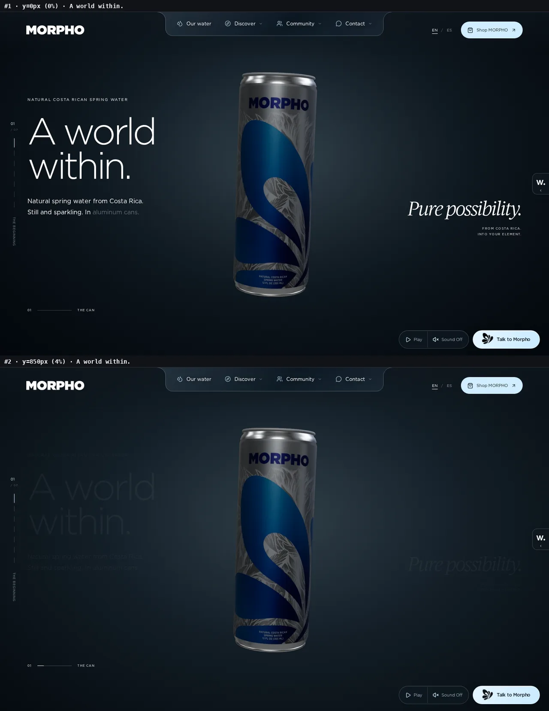
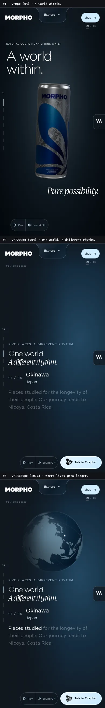

# UI Design System & Master Generation Blueprint: morphowater-com

> **MORPHO · Natural Spring Water from Costa Rica** (https://morphowater.com) — Discover MORPHO natural spring water from Costa Rica. Explore our source, still water in 12 oz aluminum cans, and our upcoming sparkling...





---

## 1. Executive Visual Persona & Design Archetype

- **Brand Essence & Persona**: **MORPHO · Natural Spring Water from Costa Rica** (`https://morphowater.com`). Discover MORPHO natural spring water from Costa Rica. Explore our source, still water in 12 oz aluminum cans, and our upcoming sparkling...
- **Capture Provenance**: Live browser capture (`tier1_fast`, HTTP `200`, captured `2026-11-24`).
- **Visual Archetype**: **High-Contrast Obsidian / Atmospheric Design System (`#101820` canvas, `#ffffff` ink, `#0000ff` accent)**.
- **Anti-AI-Slop Differentiators**:
  - **Live-Computed Chromatic Polarity**: Anchors the viewport in `#101820` (live computed `body` `background-color` (`computed_styles.json`)) paired with `#ffffff` primary typography and `#0000ff` accents.
  - **Grounded Typographic Hierarchy**: Uses `Gotham` across display (`A world within.`) and body copy.
  - **Calibrated Spatial Grid & Motion**: Combines `1000px` container bounds (`gap: 20px`, padding `69.1094px`) with `cubic-bezier(.16,1,.3,1)` easing.

---

## 2. Spatial Architecture & Modular Grid Mathematics

### Viewport Allocation & Container Geometry
- **Captured Journey Filmstrips**: Desktop `1280×1656px` (`assets/desktop-journey.webp`, `2` keyframes up to `y=850px` / doc `24479px`), Mobile `390×2616px` (`assets/mobile-journey.webp`, `3` keyframes).
- **Master Container Bounds**: `1000px` (non-`@media` desktop container stylesheet rule).
- **Canvas Lateral Padding & Spacing**: `69.1094px` lateral canvas padding with `20px` grid gap.
- **Border Radius Scale**: `999px`, `30px`, `50%`, `40px`.

### Responsive Breakpoint Architecture
- **Desktop Layout**: Multi-column CSS Grid / Flexbox layout at `1440px` (`max-width: 1000px`, `gap: 20px`).
- **Mobile Layout**: Single-column vertical stack at `390px` viewport width with `69.1094px` horizontal padding.
- **Extracted CSS Media Queries**: `@media (prefers-reduced-motion:no-preference)`, `@media (min-width:1600px)`, `@media (max-width:1100px)`, `@media (max-width:760px)`.

---

## 3. Color System, Materiality & Atmospheric Lighting

### Semantic Palette & Source Grounding
| Semantic Role | Ground-Truth Value | Extracted Live / CSS Source |
|---|---|---|
| **Primary Canvas Substrate** | `#101820` | live computed `body` `background-color` (`computed_styles.json`) |
| **Primary Typography Ink** | `#ffffff` | live computed `h1` `color` (`computed_styles.json`) |
| **Elevated Surface / Card Substrate** | `#000080` | `::selection { background: navy }` (`#000080`) |
| **Interactive Accent / Highlight** | `#0000ff` | `.flow-page button:focus-visible { color: blue }` (`#0000ff`) |
| **Secondary / Muted Copy** | `#6b7080` | `var(--muted)` in `:root` |
| **Structural Hairline Border** | `#2b363f` | `var(--menu-rule)` in `:root` (`d0edff24`) |
| **Variable Token (`--navy`)** | `#0a127b` | `var(--navy)` in `:root` |
| **Variable Token (`--ink`)** | `#20274a` | `var(--ink)` in `:root` |
| **Variable Token (`--paper`)** | `#faf9f6` | `var(--paper)` in `:root` |
| **Variable Token (`--line`)** | `#dbdddf` | `var(--line)` in `:root` |
| **Variable Token (`--brand-flight`)** | `#d0edff` | `var(--brand-flight)` in `:root` |
| **Variable Token (`--brand-blue`)** | `#0056d4` | `var(--brand-blue)` in `:root` |

### Sanitized Root CSS Variables (`ui-ux.md` Ground Truth)
| Variable Name | Extracted Value | Semantic Role |
|---|---|---|
| `--navy` | `#0a127b` | Layout / Spatial Grid Token |
| `--ink` | `#20274a` | Typography Ink Token |
| `--paper` | `#faf9f6` | Canvas / Surface Token |
| `--muted` | `#6b7080` | Color / Atmospheric Token |
| `--line` | `#dbdddF` | Color / Atmospheric Token |
| `--serif` | `Georgia,"Times New Roman",serif` | Typography / Scale Token |
| `--scroll` | `0px` | Dimension / Scale Token |
| `--brand-flight` | `#d0edff` | Canvas / Surface Token |
| `--brand-reserve` | `#0a127b` | Brand / Palette Token |
| `--brand-blue` | `#0056d4` | Brand / Palette Token |
| `--brand-purity` | `#ffffff` | Brand / Palette Token |
| `--brand-premium` | `#101820` | Brand / Palette Token |
| `--flow-serif` | `"Publico Headline",Georgia,serif` | Typography / Scale Token |
| `--brand-secondary` | `color-mix(in srgb,var(--brand-premium) 68%,white)` | Brand / Palette Token |
| `--brand-rule` | `color-mix(in srgb,var(--brand-premium) 20%,transparent)` | Brand / Palette Token |
| `--read-progress` | `0` | Design System Custom Token |

---

## 4. Typographic Scale & Editorial Hierarchy

### Font Family Stacks
- **Display Typography**: `Gotham`.
- **Primary Body Stack**: `Gotham`.
- **Technical / Metadata Stack**: not declared in live computed styles (uses primary stack / `ui-monospace`).

### Typographic Scale & Rules (Live Computed & Stylesheet Grounded)
- **Hero Display (`H1`)**: live computed `h1` (`font-size: 97.92px`, `line-height: 88.128px`, `font-weight: 300`, `letter-spacing: -6.3648px`); rule `h1` (`font-size: clamp(68px,7.6vw,120px)`, `line-height: 1.015`, `letter-spacing: -5px`).
- **Section Heading (`H2`)**: live computed `h2` (`font-size: 133.92px`, `line-height: 124.546px`, `font-weight: 400`, `letter-spacing: -7.3656px`); rule `h2` (`font-size: clamp(43px,4vw,62px)`).
- **Body Copy**: live computed `body` (`font-size: 16px`, `line-height: normal`, `font-weight: 400`); CSS variables `--body-reveal: 1`; rule `p` (`font-size: 11px`).
- **Metadata & Navigation Labels**: live computed `nav/a` (`font-size: 16px`, `line-height: normal`, `font-weight: 400`); rule `nav` (`font-size: 11px`).

---

## 5. Choreographed Motion & Interaction Physics

### Primary Easing Curves
- **Extracted Timing Functions**: `cubic-bezier(.16,1,.3,1)`, `cubic-bezier(.2,.8,.2,1)`, `cubic-bezier(.12,.55,.25,1)`.

### Per-Element Transition & Choreography Rules
- **Selector `.header`**: `transition: box-shadow .3s` extracted from `morphowater-com` stylesheet.
- **Selector `.nav-left a:after`**: `transition: transform .25s` extracted from `morphowater-com` stylesheet.
- **Selector `.header-shop`**: `transition: background .2s,color .2s` extracted from `morphowater-com` stylesheet.
- **Extracted Easing Curve (`cubic-bezier(.16,1,.3,1)`)**: Governs interactive state transitions across `<header.morpho-header>` and `<section.territory-journey>`.
- **State & Hover Choreography**: Opacity and transform transitions on `<section.flow-journey>` and `<section.territory-journey>` interactive targets.
### Measured Runtime Scroll & Interaction Telemetry (`behavioral_journey_v2`)
- **Scroll Driver Mode**: `native` (max document height `24479px`, deepest scrollY reached `850px` across `2` desktop keyframes).
- **Detected Scroll / Motion Libraries**: Native browser scroll / standard CSS transitions.
- **Nav / Drawer Probe**: Tested trigger `Discover` (diff `0.0`, below state-capture threshold).

---

## 6. Component Wireframe & Structural DOM Map

### Visual Layout Schematic — Desktop (`1440px`, Grounded in `dom.html` & Landmark Bounding Boxes)
```
┌────────────────────────────────────────────────────────────────────────┐
│ DESKTOP VIEWPORT (1440px) — MORPHO · Natural Spring Water from Costa R │
│ ====================================================================== │
│ [ <header.morpho-header> (1440x94px)  | The beginning · The MORPHO l ] │
│ ---------------------------------------------------------------------- │
│ | HERO STAGE: <section.flow-journey> (w=1440px)                      | │
│ | H1: A world within.                                                | │
│ | Substrate: #101820 | Ink: #ffffff | Accent: #0000ff                | │
│ ---------------------------------------------------------------------- │
│ | SHOWCASE GRID (<section.territory-journey) max-w: 1000px           | │
│ | +------------------------------+  +------------------------------+ | │
│ | | A small click. A world opens |  | Let the outside in.          | | │
│ | +------------------------------+  +------------------------------+ | │
│ ---------------------------------------------------------------------- │
│ | DETAIL MODULE (<article.territory-panel>) — Back to what matters.  | │
│ ---------------------------------------------------------------------- │
│ [ FOOTER (<footer.flow-footer>) | https://morphowater.com              │
└────────────────────────────────────────────────────────────────────────┘
```

### Visual Layout Schematic — Mobile Reflow (`390px`)
```
┌────────────────────────────────────────────────────────────────────────┐
│ MOBILE VIEWPORT REFLOW (390px) — Single-Column Stack (gap: 20px)       │
│ ====================================================================== │
│ [ HEADER BAR (<header.morpho-header>  ) | Compact Menu (390px)         │
│ ---------------------------------------------------------------------- │
│ | HERO STAGE (<section.flow-journey>) — 390px Vertical Lead          | │
│ | H1: A world within.                                                | │
│ ---------------------------------------------------------------------- │
│ | SHOWCASE STACK (<section.territory-jou) — 1-Col Stack              | │
│ | [ Item 1: A small click. A world opens.                          ] | │
│ | [ Item 2: Let the outside in.                                    ] | │
│ ---------------------------------------------------------------------- │
│ | DETAIL STACK (<article.territory-panel) — 1-Col (Back to what matte) │
│ ---------------------------------------------------------------------- │
│ [ FOOTER (<footer.flow-footer>) | Stacked 390px Colophon               │
└────────────────────────────────────────────────────────────────────────┘
```

### Granular DOM Region Breakdown
1. **Brand Header & Navigation Bar (<header.morpho-header> — `morphowater-com`)**:
   - Landmark `<header class="morpho-header">` (`1440x94px`) hosting `MORPHO · Natural Spring Water from C` navigation (`The beginning · The MORPHO life · Location · The Nicoya way · Inside MORPHO`), DOM attributes (`data-journey-critical`, `data-journey-styles`, `data-precedence="next"`, `data-precedence="next"`), and stylesheet rule `root { --navy:0a127b;--ink:20274a;--paper:faf9f6;--muted:6b7080;--line:dbdddF;-... }`.
2. **Hero Stage & Focal Lead (<section.flow-journey> — `A world within.`)**:
   - Landmark `<section class="flow-journey">` presenting display lead `A world within.` and copy excerpt *"NATURAL COSTA RICAN SPRING WATER"* over `#101820` canvas and `#ffffff` ink.
3. **Primary Showcase & Content Grid (<section.territory-journey> — `A small click. A world opens.`)**:
   - Landmark `<section class="territory-journey coastal-story">` rendering section `A small click. A world opens.` with copy *"Natural spring water from Costa Rica."*, asset references (`gotham-light-common.woff2`, `gotham-book-common.woff2`, `publico-headline-light-italic-com...`, `wordmark-white.webp`), and grid rule `html { scroll-behavior:smooth;scroll-padding-top:100px }`.
4. **Interactive Detail & Feature Matrix (<article.territory-panel> — `Let the outside in.`)**:
   - Landmark `<article class="territory-panel">` framing `Let the outside in.` and `Back to what matters.` (*"Still and sparkling. In aluminum cans."*) with `#000080` surface cards, `#0000ff` accents, and `button { color:inherit }`.
5. **Colophon & Global Directory Footer (<footer.flow-footer> — `https://morphowater.com`)**:
   - Landmark `<footer class="flow-footer morpho-footer">` anchoring `MORPHO · Natural Spring Water fr` footer links (`The beginning · The MORPHO life · Location · The Nicoya way · Inside MORPHO`), copy *"FROM COSTA RICA. INTO YOUR ELEMENT."*, and `#2b363f` structural dividers.
### Full Vertical Scroll Sequence (Desktop `1440×900` Keyframes)
- **Step 01** (`y=0px`, `0%`): Active landmark `A world within.` · sticky/fixed elements: `5`
- **Step 02** (`y=850px`, `4%`): Active landmark `A world within.` · sticky/fixed elements: `5`

---

## 7. Master Zero-Shot AI Generation Prompt

```markdown
# Master Zero-Shot Frontend Generation Prompt: morphowater-com (MORPHO · Natural Spring Water from Costa Rica)

You are a principal frontend architect and design systems engineer. Build a complete, production-ready web application replicating the exact design system, DOM landmarks, typographic hierarchy, color tokens, and motion physics of `morphowater-com` (**MORPHO · Natural Spring Water from Costa Rica** — `https://morphowater.com`).

### 1. Visual Archetype & Anti-AI-Slop Mandates
- **Archetype**: High-Contrast Obsidian / Atmospheric Design System (`#101820` canvas, `#ffffff` ink, `#0000ff` accent).
- **Identity & Domain Context**: Discover MORPHO natural spring water from Costa Rica. Explore our source, still water in 12 oz aluminum cans, and our upcoming sparkling...
- **Primary Substrate**: `#101820` (live computed `body` `background-color` (`computed_styles.json`)), **Primary Ink**: `#ffffff`, **Accent / Highlight**: `#0000ff`.
- **Site-Specific Differentiators**:
  - **Live-Computed Chromatic Polarity**: Anchors the viewport in `#101820` (live computed `body` `background-color` (`computed_styles.json`)) paired with `#ffffff` primary typography and `#0000ff` accents.
  - **Grounded Typographic Hierarchy**: Uses `Gotham` across display (`A world within.`) and body copy.
  - **Calibrated Spatial Grid & Motion**: Combines `1000px` container bounds (`gap: 20px`, padding `69.1094px`) with `cubic-bezier(.16,1,.3,1)` easing.

### 2. Ground-Truth CSS Variables (`:root` Token Contract)
Declare and consume these exact custom properties extracted from `morphowater-com` in your global stylesheet:

:root {
  /* MORPHO · Natural Spring Water from Costa Rica (morphowater-com) — Live-Grounded CSS Variables */
  --navy: #0a127b; /* Layout / Spatial Grid Token (morphowater-com) */
  --ink: #20274a; /* Typography Ink Token (morphowater-com) */
  --paper: #faf9f6; /* Canvas / Surface Token (morphowater-com) */
  --muted: #6b7080; /* Color / Atmospheric Token (morphowater-com) */
  --line: #dbdddF; /* Color / Atmospheric Token (morphowater-com) */
  --serif: Georgia,"Times New Roman",serif; /* Typography / Scale Token (morphowater-com) */
  --scroll: 0px; /* Dimension / Scale Token (morphowater-com) */
  --brand-flight: #d0edff; /* Canvas / Surface Token (morphowater-com) */
  --brand-reserve: #0a127b; /* Brand / Palette Token (morphowater-com) */
  --brand-blue: #0056d4; /* Brand / Palette Token (morphowater-com) */
  --brand-purity: #ffffff; /* Brand / Palette Token (morphowater-com) */
  --brand-premium: #101820; /* Brand / Palette Token (morphowater-com) */
  --flow-serif: "Publico Headline",Georgia,serif; /* Typography / Scale Token (morphowater-com) */
  --brand-secondary: color-mix(in srgb,var(--brand-premium) 68%,white); /* Brand / Palette Token (morphowater-com) */
  --brand-rule: color-mix(in srgb,var(--brand-premium) 20%,transparent); /* Brand / Palette Token (morphowater-com) */
  --read-progress: 0; /* Design System Custom Token (morphowater-com) */
}

### 3. Semantic Color & Materiality Contract
Map every surface, ink, and border strictly to these source-grounded tokens:
- **Primary Canvas Substrate**: `#101820` — grounded in live computed `body` `background-color` (`computed_styles.json`)
- **Primary Typography Ink**: `#ffffff` — grounded in live computed `h1` `color` (`computed_styles.json`)
- **Elevated Surface / Card Substrate**: `#000080` — grounded in `::selection { background: navy }` (`#000080`)
- **Interactive Accent / Highlight**: `#0000ff` — grounded in `.flow-page button:focus-visible { color: blue }` (`#0000ff`)
- **Secondary / Muted Copy**: `#6b7080` — grounded in `var(--muted)` in `:root`
- **Structural Hairline Border**: `#2b363f` — grounded in `var(--menu-rule)` in `:root` (`d0edff24`)
- **Variable Token (`--navy`)**: `#0a127b` — grounded in `var(--navy)` in `:root`
- **Variable Token (`--ink`)**: `#20274a` — grounded in `var(--ink)` in `:root`
- **Variable Token (`--paper`)**: `#faf9f6` — grounded in `var(--paper)` in `:root`
- **Variable Token (`--line`)**: `#dbdddf` — grounded in `var(--line)` in `:root`
- **Variable Token (`--brand-flight`)**: `#d0edff` — grounded in `var(--brand-flight)` in `:root`
- **Variable Token (`--brand-blue`)**: `#0056d4` — grounded in `var(--brand-blue)` in `:root`

### 4. Spatial Grid, Container Bounds & Responsive Breakpoints
- **Desktop Viewport Reference**: `1280×1656px` (full-page live capture (1656px), `1440px` standard desktop width).
- **Mobile Viewport Reference**: `390×2616px` (multi-frame vertical journey filmstrip (2616px), `390px` standard mobile width).
- **Container Max-Width**: `1000px` (non-`@media` desktop container stylesheet rule)
- **Padding & Gutters**: `69.1094px` lateral canvas padding with `20px` grid gap
- **Desktop Grid**: Multi-column CSS Grid / Flexbox layout at `1440px` (`max-width: 1000px`, `gap: 20px`)
- **Mobile Adaptation**: Single-column vertical stack at `390px` viewport width with `69.1094px` horizontal padding
- **Media Queries**: `@media (prefers-reduced-motion:no-preference)`, `@media (min-width:1600px)`, `@media (max-width:1100px)`, `@media (max-width:760px)`
- **Corner Radii**: `999px`, `30px`, `50%`, `40px`

### 5. Typography & Editorial Scale Contract
- **Display Font Stack**: `Gotham`
- **Body Font Stack**: `Gotham`
- **Monospace / Technical Font Stack**: not declared in live computed styles (uses primary stack / `ui-monospace`)
- **H1 Display Rule**: live computed `h1` (`font-size: 97.92px`, `line-height: 88.128px`, `font-weight: 300`, `letter-spacing: -6.3648px`); rule `h1` (`font-size: clamp(68px,7.6vw,120px)`, `line-height: 1.015`, `letter-spacing: -5px`)
- **H2 Section Rule**: live computed `h2` (`font-size: 133.92px`, `line-height: 124.546px`, `font-weight: 400`, `letter-spacing: -7.3656px`); rule `h2` (`font-size: clamp(43px,4vw,62px)`)
- **Body Copy Rule**: live computed `body` (`font-size: 16px`, `line-height: normal`, `font-weight: 400`); CSS variables `--body-reveal: 1`; rule `p` (`font-size: 11px`)
- **Metadata & Index Rule**: live computed `nav/a` (`font-size: 16px`, `line-height: normal`, `font-weight: 400`); rule `nav` (`font-size: 11px`)

### 6. Component Hierarchy, Verbatim Copy & Real DOM Landmarks
Scaffold `morphowater-com` (`MORPHO · Natural Spring Water from Costa Rica`) with these exact structural regions, extracted copy, and CSS rules from `dom.html`:
1. **Brand Header & Navigation Bar (<header.morpho-header> — `morphowater-com`)**:
   - DOM & Selectors: Landmark `<header class="morpho-header">` (`1440x94px`) hosting `MORPHO · Natural Spring Water from C` navigation (`The beginning · The MORPHO life · Location · The Nicoya way · Inside MORPHO`), DOM attributes (`data-journey-critical`, `data-journey-styles`, `data-precedence="next"`, `data-precedence="next"`), and stylesheet rule `root { --navy:0a127b;--ink:20274a;--paper:faf9f6;--muted:6b7080;--line:dbdddF;-... }`.
   - Responsive Contract: Header `Brand Header & Navigation Bar (<header.morpho-header> — `morphowater-com`)` (`morphowater-com`) adapts across `@media (prefers-reduced-motion:no-preference)`, `@media (min-width:1600px)`, `@media (max-width:1100px)`, `@media (max-width:760px)` with `cubic-bezier(.16,1,.3,1)`, `cubic-bezier(.2,.8,.2,1)`, `cubic-bezier(.12,.55,.25,1)` transitions and links `The beginning · The MORPHO life · Location · The Nicoya way · Inside MORPHO`.
2. **Hero Stage & Focal Lead (<section.flow-journey> — `A world within.`)**:
   - DOM & Selectors: Landmark `<section class="flow-journey">` presenting display lead `A world within.` and copy excerpt *"NATURAL COSTA RICAN SPRING WATER"* over `#101820` canvas and `#ffffff` ink.
   - Responsive Contract: Hero stage (`1280×1656px` desktop / `390×2616px` mobile) sets `#101820` background with `#ffffff` headline `A world within.`.
3. **Primary Showcase & Content Grid (<section.territory-journey> — `A small click. A world opens.`)**:
   - DOM & Selectors: Landmark `<section class="territory-journey coastal-story">` rendering section `A small click. A world opens.` with copy *"Natural spring water from Costa Rica."*, asset references (`gotham-light-common.woff2`, `gotham-book-common.woff2`, `publico-headline-light-italic-com...`, `wordmark-white.webp`), and grid rule `html { scroll-behavior:smooth;scroll-padding-top:100px }`.
   - Responsive Contract: Showcase grid `Primary Showcase & Content Grid (<section.territory-journey> — `A small click. A world opens.`)` applies Multi-column CSS Grid / Flexbox layout at `1440px` (`max-width: 1000px`, `gap: 20px`) on desktop and Single-column vertical stack at `390px` viewport width with `69.1094px` horizontal padding on mobile.
4. **Interactive Detail & Feature Matrix (<article.territory-panel> — `Let the outside in.`)**:
   - DOM & Selectors: Landmark `<article class="territory-panel">` framing `Let the outside in.` and `Back to what matters.` (*"Still and sparkling. In aluminum cans."*) with `#000080` surface cards, `#0000ff` accents, and `button { color:inherit }`.
   - Responsive Contract: Detail module `Interactive Detail & Feature Matrix (<article.territory-panel> — `Let the outside in.`)` uses `999px`, `30px`, `50%`, `40px` radii, `#0000ff` highlights, and assets (gotham-light-common.woff2, gotham-book-common.woff2, publico-headline-light-italic-com...).
5. **Colophon & Global Directory Footer (<footer.flow-footer> — `https://morphowater.com`)**:
   - DOM & Selectors: Landmark `<footer class="flow-footer morpho-footer">` anchoring `MORPHO · Natural Spring Water fr` footer links (`The beginning · The MORPHO life · Location · The Nicoya way · Inside MORPHO`), copy *"FROM COSTA RICA. INTO YOUR ELEMENT."*, and `#2b363f` structural dividers.
   - Responsive Contract: Footer `Colophon & Global Directory Footer (<footer.flow-footer> — `https://morphowater.com`)` aligns to `1000px` (non-`@media` desktop container stylesheet rule) with `69.1094px` lateral canvas padding with `20px` grid gap and attributes (data-journey-critical, data-journey-styles, data-precedence="next").

#### Verbatim DOM Copy Excerpts (`dom.html`)
- Copy Excerpt 1: *"NATURAL COSTA RICAN SPRING WATER"*
- Copy Excerpt 2: *"Natural spring water from Costa Rica."*
- Copy Excerpt 3: *"Still and sparkling. In aluminum cans."*
- Copy Excerpt 4: *"FROM COSTA RICA. INTO YOUR ELEMENT."*

### 7. Motion, Extracted Stylesheet Rules & Interaction Choreography
- **Primary Easing Functions**: `cubic-bezier(.16,1,.3,1)`, `cubic-bezier(.2,.8,.2,1)`, `cubic-bezier(.12,.55,.25,1)`
- **Extracted Stylesheet Rules (`morphowater-com`)**:
- `root { --navy:0a127b;--ink:20274a;--paper:faf9f6;--muted:6b7080;--line:dbdddF;-... }`
- `html { scroll-behavior:smooth;scroll-padding-top:100px }`
- `button { color:inherit }`
- `img { display:block;max-width:100% }`
- `button:focus-visible { outline:2px solid 3278fa;outline-offset:6px }`
- **Per-Selector Transition Rules**:
- **Selector `.header`**: `transition: box-shadow .3s` extracted from `morphowater-com` stylesheet.
- **Selector `.nav-left a:after`**: `transition: transform .25s` extracted from `morphowater-com` stylesheet.
- **Selector `.header-shop`**: `transition: background .2s,color .2s` extracted from `morphowater-com` stylesheet.
- **Extracted Easing Curve (`cubic-bezier(.16,1,.3,1)`)**: Governs interactive state transitions across `<header.morpho-header>` and `<section.territory-journey>`.
- **State & Hover Choreography**: Opacity and transform transitions on `<section.flow-journey>` and `<section.territory-journey>` interactive targets.
### 7b. Full-Page Scroll Choreography, Interactive States & Multi-Page Routes
- **Scroll Mechanics**: Implement `native` vertical progression up to `24479px` across 2 distinct viewport chapters.
- **Vertical Chapter Sequence**: A world within. (0%) -> A world within. (4%).

### 8. Technical Deliverables
- Implement in Next.js (App Router) with TypeScript and Tailwind CSS consuming the `:root` custom properties defined above for `morphowater-com`.
- Reproduce both the `1440px` desktop architecture and `390px` mobile breakpoint transitions, preserving semantic HTML5 landmarks (`<header>`, `<nav>`, `<main>`, `<section>`, `<footer>`) and `prefers-reduced-motion` accessibility guards.
```
---

## 8. Full-Page Scroll Journey, Interactive States & Subpage Inventory

### Desktop Scroll Keyframes (`1440×900` WebP)
| Step | Scroll Y | Progress | Active Landmark / Section | Sticky/Fixed | Visual Asset |
| :---: | :---: | :---: | :--- | :---: | :--- |
| `#01` | `0px` | `0%` | A world within. | `5` | [desktop-step-01.webp](assets/desktop-step-01.webp) |
| `#02` | `850px` | `4%` | A world within. | `5` | [desktop-step-02.webp](assets/desktop-step-02.webp) |

### Mobile Condensed Keyframes (`390×844` WebP)
| Step | Scroll Y | Progress | Active Landmark | Visual Asset |
| :---: | :---: | :---: | :--- | :--- |
| `#01` | `0px` | `0%` | A world within. | [mobile-step-01.webp](assets/mobile-step-01.webp) |
| `#02` | `7200px` | `50%` | One world. A different rhythm. | [mobile-step-02.webp](assets/mobile-step-02.webp) |
| `#03` | `13666px` | `100%` | Where lives grow longer. | [mobile-step-03.webp](assets/mobile-step-03.webp) |

