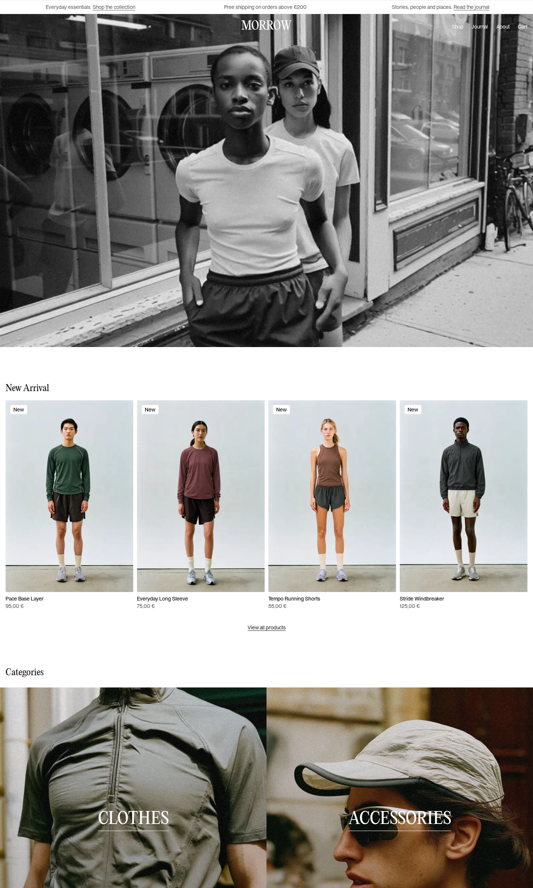

# UI Design System & Master Generation Blueprint: morrow-valerian-studio

> **MORROW (by Valerian Studio) · High-Craft Editorial Knitwear & Fashion Flagship** — An avant-garde fashion and knitwear digital flagship crafted by Valerian Studio, pairing crisp gallery white (`--color-white: #fff`) and neutral alabaster (`--color-neutral-50: #fafafa`) with deep espresso/charcoal ink (`--color-neutral-900: #171717`, `#030d07`), crimson/rose editorial accents (`#9f0712`, `#ff2357`), and a strict 12-column `h-svh` viewport grid.



---

## 1. Executive Visual Persona & Design Archetype

- **Brand Essence & Persona**: **MORROW (by Valerian Studio) · High-Craft Editorial Knitwear & Fashion Flagship**. An avant-garde fashion and knitwear digital flagship crafted by Valerian Studio, pairing crisp gallery white (`--color-white: #fff`) and neutral alabaster (`--color-neutral-50: #fafafa`) with deep espresso/charcoal ink (`--color-neutral-900: #171717`, `#030d07`), crimson/rose editorial accents (`#9f0712`, `#ff2357`), and a strict 12-column `h-svh` viewport grid.
- **Visual Archetype**: **Swiss-Editorial Fashion Scrollytelling & 12-Column Viewport Grid (`ppNeueMontreal` + `editorialNew`)**.
- **Anti-AI-Slop Differentiators**:
  1. **Signature Dual-Typeface Tension**: Pairs Neo-Grotesque `--font-pp-neue-montreal` (`"ppNeueMontreal"`) for geometric UI navigation with high-contrast serif `--font-editorial-new` (`"editorialNew"`) for poetic campaign headlines (`"Beyond the everyday."`, `"Same streets, new miles."`).
  2. **Full-Viewport 12-Column SVH Stage**: Hero and lookbook sections lock to `<section class="relative grid h-svh grid-cols-12 gap-x-gutter">` with overlapping grid-cell placement (`col-start-1 row-start-1`).
  3. **Three-Part Balanced Toolbar (`nav.site-nav-toolbar`)**: Uses `grid-cols-[1fr_auto_1fr]` so left navigation, centered `MORROW` brand mark, and right cart trigger remain mathematically centered at all viewport widths.
  4. **Quintic Ease-Out Choreography**: Smooth lookbook transitions driven by `cubic-bezier(.22,1,.36,1)` alongside reduced-motion accessibility guards.

---

## 2. Spatial Architecture & Modular Grid Mathematics


### Viewport Allocation & Container Geometry
- **Captured Full-Page Dimensions**: Desktop `1440×5154px` (`assets/desktop.png`), Mobile `390×6015px` (`assets/mobile.png`).
- **Master Container Bounds**: Full-bleed `100vw` with fluid `px-page` lateral margins and `gap-x-gutter` column gutters.
- **Canvas Lateral Padding & Spacing**: Custom `px-page` lateral padding token with `--spacing: .25rem` (4px) base unit.
- **Border Radius Scale**: `0px` sharp editorial edges on all lookbook photography and product cards.

### Responsive Breakpoint Architecture
- **Desktop Layout**: 12-column CSS Grid (`grid-cols-12 gap-x-gutter`), asymmetric `col-span-4` sidebar nav + `col-span-10` / `col-span-8` editorial plates.
- **Mobile Layout**: Collapses at `@media (max-width:400px)` and below `@media (min-width:48rem)` into `<nav class="site-mobile-menu-content px-page">` drawer.
- **Extracted CSS Media Queries**: `@media (max-width:400px)`, `@media (min-width:40rem)` (640px), `@media (min-width:48rem)` (768px), `@media (min-width:64rem)` (1024px).

---

## 3. Color System, Materiality & Atmospheric Lighting

### Semantic Palette & Source Grounding
| Semantic Role | Ground-Truth Value | Extracted CSS Source / Selector |
|---|---|---|
| Primary Gallery Canvas | `#ffffff` | `--color-white` (`main.bg-white`) |
| Secondary Porcelain Surface | `#fafafa` | `--color-neutral-50` (`:root`) |
| Tertiary Lookbook Surface | `#f5f5f5` | `--color-neutral-100` (`:root`) |
| Primary Charcoal Ink | `#171717` | `--color-neutral-900` (`:root`) |
| Deep Forest/Black Ink | `#030d07` | Extracted stylesheet dark tone (`#030d07` / `--color-black: #000`) |
| Secondary Muted Copy | `#737373` | `--color-neutral-500` (`:root`) |
| Subtle Label Gray | `#a1a1a1` | `--color-neutral-400` (`:root`) |
| Hairline Grid Divider | `#e5e5e5` | `--color-neutral-200` (`:root`) |
| Secondary Border Gray | `#d4d4d4` | `--color-neutral-300` (`:root`) |
| Crimson Campaign Accent | `#9f0712` | `--color-red-800` (`:root`) |
| Editorial Rose Highlight | `#ff2357` | `--color-rose-500` (`:root`) |

### Sanitized Root CSS Variables (`ui-ux.md` Ground Truth)
| Variable Name | Extracted Value | Semantic Role |
|---|---|---|
| `--font-pp-neue-montreal` | `"ppNeueMontreal", "ppNeueMontreal Fallback"` | Primary Neo-Grotesque UI & grid sans font |
| `--font-editorial-new` | `"editorialNew", "editorialNew Fallback"` | High-contrast editorial display serif font |
| `--font-sans` | `var(--font-pp-neue-montreal), Arial, sans-serif` | Default sans-serif font stack |
| `--color-white` | `#fff` | Primary canvas background |
| `--color-black` | `#000` | Pure black contrast token |
| `--color-neutral-50` | `#fafafa` | Porcelain soft background surface |
| `--color-neutral-100` | `#f5f5f5` | Product card backdrop surface |
| `--color-neutral-200` | `#e5e5e5` | 1px hairline border token |
| `--color-neutral-300` | `#d4d4d4` | Hover border divider token |
| `--color-neutral-400` | `#a1a1a1` | Muted index & size label ink |
| `--color-neutral-500` | `#737373` | Secondary editorial body ink |
| `--color-neutral-600` | `#525252` | Sub-heading ink |
| `--color-neutral-900` | `#171717` | Primary heading & garment title ink |
| `--color-red-800` | `#9f0712` | Deep crimson seasonal accent |
| `--color-rose-500` | `#ff2357` | Vibrant rose campaign highlight |
| `--spacing` | `.25rem` | Base 4px spatial unit |
| `--container-xs` | `20rem` | Mini cart / drawer container width (320px) |
| `--container-3xl` | `48rem` | Editorial narrative column max-width (768px) |
| `--text-xs` | `.75rem` | 12px micro-label size (`line-height: calc(1 / .75)`) |

---

## 4. Typographic Scale & Editorial Hierarchy

### Font Family Stacks
- **Display Typography**: `"editorialNew", "editorialNew Fallback", Georgia, serif` (`--font-editorial-new`).
- **Primary Body Stack**: `"ppNeueMontreal", "ppNeueMontreal Fallback", Arial, sans-serif` (`--font-pp-neue-montreal`).
- **Technical / Metadata Stack**: `ui-monospace, "SF Mono", monospace` (SKU codes, garment weights, collection indices).

### Typographic Scale & Rules
- **Hero Display (`H1`)**: `clamp(2.75rem, 6vw, 5.25rem)`, `font-family: var(--font-editorial-new)`, `font-weight: 400`, `line-height: 0.96`, `letter-spacing: -0.02em`.
- **Section Heading (`H2`)**: `clamp(1.5rem, 3.2vw, 2.75rem)`, `font-family: var(--font-pp-neue-montreal)` for `"FALL26’ KNITWEAR PORCELAIN"`, `"New Arrival"`, `"Categories"` and `var(--font-editorial-new)` for `"Beyond the everyday."`, `"Same streets, new miles."`.
- **Body Copy**: `0.9375rem (15px)`, `font-family: var(--font-sans)`, `line-height: 1.55`, `color: var(--color-neutral-600)`.
- **Metadata & Navigation Labels**: `var(--text-xs)` (`0.75rem`), `font-family: var(--font-pp-neue-montreal)`, `letter-spacing: 0.06em`, `text-transform: uppercase`.

---

## 5. Choreographed Motion & Interaction Physics

### Primary Easing Curves
- **Extracted Timing Functions**: `cubic-bezier(.22,1,.36,1)` (quintic ease-out) and `cubic-bezier(0, 0, .2, 1)`.

### Per-Element Transition & Choreography Rules
- `.shipping-banner-announcement` -> `transition: opacity .15s, transform .15s, visibility 0s linear .15s`
- `.site-nav:has(:focus-visible)` -> `transform: translateY(0)` reveal from `translateY(-100%)`
- `Lookbook & Card Image Reveals` -> `cubic-bezier(.22,1,.36,1)` over `500ms`
- `@media (prefers-reduced-motion:reduce)` -> `transition: none`

---

## 6. Component Wireframe & Structural DOM Map

### Visual Layout Schematic (Grounded in `dom.html`)
```
┌────────────────────────────────────────────────────────────────────────┐
│ <header class="site-nav col-start-1 row-start-1">                      │
│   <nav class="site-nav-toolbar grid grid-cols-[1fr_auto_1fr]">         │
│   [Shop / Collections]           MORROW           [Search / Cart (0)]  │
├────────────────────────────────────────────────────────────────────────┤
│ <section class="relative grid h-svh grid-cols-12 gap-x-gutter">        │
│   H2: FALL26’ KNITWEAR PORCELAIN  |  H2: Beyond the everyday.          │
├────────────────────────────────────────────────────────────────────────┤
│ <main class="relative z-10 bg-white"> (12-Column Asymmetric Lookbook)  │
│   <nav class="col-span-4"> H2: Categories  |  <div class="col-span-8"> │
│   H2: New Arrival  [ Knitwear Plate 01 ]  [ Porcelain Plate 02 ]       │
├────────────────────────────────────────────────────────────────────────┤
│ <section class="editorial-story"> H2: Same streets, new miles.         │
├────────────────────────────────────────────────────────────────────────┤
│ <header class="cart-header"> Slide-Over Cart Drawer (--container-xs 20 │
└────────────────────────────────────────────────────────────────────────┘
```

### Granular DOM Region Breakdown
1. **Tri-Balanced Navigation (`<header class="site-nav">` and `<nav class="site-nav-toolbar grid grid-cols-[1fr_auto_1fr]">`)**:
   - Overlays the hero stage at `col-start-1 row-start-1` with a 3-column symmetric toolbar (`1fr auto 1fr`), `.shipping-banner-announcement` top bar, and `<nav class="site-mobile-menu-content px-page">` mobile sheet.
2. **Full-Viewport SVH Hero (`<section class="relative grid h-svh grid-cols-12 gap-x-gutter">`)**:
   - 100svh 12-column stage featuring seasonal campaign `"FALL26’ KNITWEAR PORCELAIN"` in `--font-pp-neue-montreal` and `"Beyond the everyday."` in `--font-editorial-new`.
3. **Asymmetric Category & New Arrival Grid (`<main class="relative z-10 bg-white">`)**:
   - Splits into `<nav class="col-span-4 min-w-0 self-start">` (`H2: Categories`) and `<nav class="col-span-12 lg:col-span-10">` (`H2: New Arrival`) on `--color-neutral-50: #fafafa` and `--color-neutral-100: #f5f5f5` cards.
4. **Editorial Narrative Chapter (`H2: Same streets, new miles.`)**:
   - High-contrast lookbook diptych using `--font-editorial-new`, `--container-3xl: 48rem` measure, and `--color-red-800: #9f0712` / `--color-rose-500: #ff2357` editorial accents.
5. **Cart Drawer (`<header class="cart-header">`)**:
   - Slide-over commerce bag constrained to `--container-xs: 20rem` (`320px`) with `--color-neutral-200: #e5e5e5` hairline dividers.

---

## 7. Master Zero-Shot AI Generation Prompt

```markdown
# Master Zero-Shot Frontend Generation Prompt: morrow-valerian-studio (MORROW (by Valerian Studio) · High-Craft Editorial Knitwear & Fashion Flagship)

You are a principal frontend architect and design systems engineer. Build a complete, production-ready web application replicating the exact design system, DOM landmarks, typographic hierarchy, color tokens, and motion physics of `morrow-valerian-studio` (MORROW (by Valerian Studio) · High-Craft Editorial Knitwear & Fashion Flagship).

### 1. Visual Archetype & Anti-AI-Slop Mandates
- **Archetype**: Swiss-Editorial Fashion Scrollytelling & 12-Column Viewport Grid (`ppNeueMontreal` + `editorialNew`).
- **Primary Substrate**: `#ffffff` (`--color-white` (`main.bg-white`)), **Primary Ink**: `#171717`, **Accent / Highlight**: `#ff2357`.
- **Site-Specific Differentiators**:
  1. **Signature Dual-Typeface Tension**: Pairs Neo-Grotesque `--font-pp-neue-montreal` (`"ppNeueMontreal"`) for geometric UI navigation with high-contrast serif `--font-editorial-new` (`"editorialNew"`) for poetic campaign headlines (`"Beyond the everyday."`, `"Same streets, new miles."`).
  2. **Full-Viewport 12-Column SVH Stage**: Hero and lookbook sections lock to `<section class="relative grid h-svh grid-cols-12 gap-x-gutter">` with overlapping grid-cell placement (`col-start-1 row-start-1`).
  3. **Three-Part Balanced Toolbar (`nav.site-nav-toolbar`)**: Uses `grid-cols-[1fr_auto_1fr]` so left navigation, centered `MORROW` brand mark, and right cart trigger remain mathematically centered at all viewport widths.
  4. **Quintic Ease-Out Choreography**: Smooth lookbook transitions driven by `cubic-bezier(.22,1,.36,1)` alongside reduced-motion accessibility guards.

### 2. Ground-Truth CSS Variables (`:root` Token Contract)
Declare and consume these exact custom properties extracted from `morrow-valerian-studio` in your global stylesheet:

:root {
  /* MORROW (by Valerian Studio) · High-Craft Editorial Knitwear & Fashion Flagship — Ground-Truth Extracted CSS Variables */
  --font-pp-neue-montreal: "ppNeueMontreal", "ppNeueMontreal Fallback"; /* Primary Neo-Grotesque UI & grid sans font */
  --font-editorial-new: "editorialNew", "editorialNew Fallback"; /* High-contrast editorial display serif font */
  --font-sans: var(--font-pp-neue-montreal), Arial, sans-serif; /* Default sans-serif font stack */
  --color-white: #fff; /* Primary canvas background */
  --color-black: #000; /* Pure black contrast token */
  --color-neutral-50: #fafafa; /* Porcelain soft background surface */
  --color-neutral-100: #f5f5f5; /* Product card backdrop surface */
  --color-neutral-200: #e5e5e5; /* 1px hairline border token */
  --color-neutral-300: #d4d4d4; /* Hover border divider token */
  --color-neutral-400: #a1a1a1; /* Muted index & size label ink */
  --color-neutral-500: #737373; /* Secondary editorial body ink */
  --color-neutral-600: #525252; /* Sub-heading ink */
  --color-neutral-900: #171717; /* Primary heading & garment title ink */
  --color-red-800: #9f0712; /* Deep crimson seasonal accent */
  --color-rose-500: #ff2357; /* Vibrant rose campaign highlight */
  --spacing: .25rem; /* Base 4px spatial unit */
  --container-xs: 20rem; /* Mini cart / drawer container width (320px) */
  --container-3xl: 48rem; /* Editorial narrative column max-width (768px) */
  --text-xs: .75rem; /* 12px micro-label size (`line-height: calc(1 / .75)`) */
}

### 3. Semantic Color & Materiality Contract
Map every surface, ink, and border strictly to these source-grounded tokens:
- **Primary Gallery Canvas**: `#ffffff` — grounded in `--color-white` (`main.bg-white`)
- **Secondary Porcelain Surface**: `#fafafa` — grounded in `--color-neutral-50` (`:root`)
- **Tertiary Lookbook Surface**: `#f5f5f5` — grounded in `--color-neutral-100` (`:root`)
- **Primary Charcoal Ink**: `#171717` — grounded in `--color-neutral-900` (`:root`)
- **Deep Forest/Black Ink**: `#030d07` — grounded in Extracted stylesheet dark tone (`#030d07` / `--color-black: #000`)
- **Secondary Muted Copy**: `#737373` — grounded in `--color-neutral-500` (`:root`)
- **Subtle Label Gray**: `#a1a1a1` — grounded in `--color-neutral-400` (`:root`)
- **Hairline Grid Divider**: `#e5e5e5` — grounded in `--color-neutral-200` (`:root`)
- **Secondary Border Gray**: `#d4d4d4` — grounded in `--color-neutral-300` (`:root`)
- **Crimson Campaign Accent**: `#9f0712` — grounded in `--color-red-800` (`:root`)
- **Editorial Rose Highlight**: `#ff2357` — grounded in `--color-rose-500` (`:root`)

### 4. Spatial Grid, Container Bounds & Responsive Breakpoints
- **Desktop Viewport Reference**: `1440×5154px` full-page capture (`1440px` standard desktop width).
- **Mobile Viewport Reference**: `390×6015px` full-page capture (`390px` standard mobile width).
- **Container Max-Width**: Full-bleed `100vw` with fluid `px-page` lateral margins and `gap-x-gutter` column gutters
- **Padding & Gutters**: Custom `px-page` lateral padding token with `--spacing: .25rem` (4px) base unit
- **Desktop Grid**: 12-column CSS Grid (`grid-cols-12 gap-x-gutter`), asymmetric `col-span-4` sidebar nav + `col-span-10` / `col-span-8` editorial plates
- **Mobile Adaptation**: Collapses at `@media (max-width:400px)` and below `@media (min-width:48rem)` into `<nav class="site-mobile-menu-content px-page">` drawer
- **Media Queries**: `@media (max-width:400px)`, `@media (min-width:40rem)` (640px), `@media (min-width:48rem)` (768px), `@media (min-width:64rem)` (1024px)
- **Corner Radii**: `0px` sharp editorial edges on all lookbook photography and product cards

### 5. Typography & Editorial Scale Contract
- **Display Font Stack**: `"editorialNew", "editorialNew Fallback", Georgia, serif` (`--font-editorial-new`)
- **Body Font Stack**: `"ppNeueMontreal", "ppNeueMontreal Fallback", Arial, sans-serif` (`--font-pp-neue-montreal`)
- **Monospace / Technical Font Stack**: `ui-monospace, "SF Mono", monospace` (SKU codes, garment weights, collection indices)
- **H1 Display Rule**: `clamp(2.75rem, 6vw, 5.25rem)`, `font-family: var(--font-editorial-new)`, `font-weight: 400`, `line-height: 0.96`, `letter-spacing: -0.02em`
- **H2 Section Rule**: `clamp(1.5rem, 3.2vw, 2.75rem)`, `font-family: var(--font-pp-neue-montreal)` for `"FALL26’ KNITWEAR PORCELAIN"`, `"New Arrival"`, `"Categories"` and `var(--font-editorial-new)` for `"Beyond the everyday."`, `"Same streets, new miles."`
- **Body Copy Rule**: `0.9375rem (15px)`, `font-family: var(--font-sans)`, `line-height: 1.55`, `color: var(--color-neutral-600)`
- **Metadata & Index Rule**: `var(--text-xs)` (`0.75rem`), `font-family: var(--font-pp-neue-montreal)`, `letter-spacing: 0.06em`, `text-transform: uppercase`

### 6. Component Hierarchy & Real DOM Landmarks
Scaffold the interface with these exact structural regions and class selectors from `morrow-valerian-studio`:
1. **Tri-Balanced Navigation (`<header class="site-nav">` and `<nav class="site-nav-toolbar grid grid-cols-[1fr_auto_1fr]">`)**:
   - Architecture & Selectors: Overlays the hero stage at `col-start-1 row-start-1` with a 3-column symmetric toolbar (`1fr auto 1fr`), `.shipping-banner-announcement` top bar, and `<nav class="site-mobile-menu-content px-page">` mobile sheet.
   - Layout & State Contract: Sticky/fixed top header navigation adapting across `@media (max-width:400px)`, `@media (min-width:40rem)` (640px), `@media (min-width:48rem)` (768px), `@media (min-width:64rem)` (1024px) with `cubic-bezier(.22,1,.36,1)` (quintic ease-out) and `cubic-bezier(0, 0, .2, 1)` menu transitions.
2. **Full-Viewport SVH Hero (`<section class="relative grid h-svh grid-cols-12 gap-x-gutter">`)**:
   - Architecture & Selectors: 100svh 12-column stage featuring seasonal campaign `"FALL26’ KNITWEAR PORCELAIN"` in `--font-pp-neue-montreal` and `"Beyond the everyday."` in `--font-editorial-new`.
   - Layout & State Contract: Full-viewport hero stage (`1440px` desktop / `390px` mobile) pairing `#ffffff` substrate with `#171717` display typography (`H1`).
3. **Asymmetric Category & New Arrival Grid (`<main class="relative z-10 bg-white">`)**:
   - Architecture & Selectors: Splits into `<nav class="col-span-4 min-w-0 self-start">` (`H2: Categories`) and `<nav class="col-span-12 lg:col-span-10">` (`H2: New Arrival`) on `--color-neutral-50: #fafafa` and `--color-neutral-100: #f5f5f5` cards.
   - Layout & State Contract: Primary showcase grid executing 12-column CSS Grid (`grid-cols-12 gap-x-gutter`), asymmetric `col-span-4` sidebar nav + `col-span-10` / `col-span-8` editorial plates on desktop and Collapses at `@media (max-width:400px)` and below `@media (min-width:48rem)` into `<nav class="site-mobile-menu-content px-page">` drawer on mobile.
4. **Editorial Narrative Chapter (`H2: Same streets, new miles.`)**:
   - Architecture & Selectors: High-contrast lookbook diptych using `--font-editorial-new`, `--container-3xl: 48rem` measure, and `--color-red-800: #9f0712` / `--color-rose-500: #ff2357` editorial accents.
   - Layout & State Contract: Interactive specification & narrative module framed by `0px` sharp editorial edges on all lookbook photography and product cards and `#ff2357` highlights.
5. **Cart Drawer (`<header class="cart-header">`)**:
   - Architecture & Selectors: Slide-over commerce bag constrained to `--container-xs: 20rem` (`320px`) with `--color-neutral-200: #e5e5e5` hairline dividers.
   - Layout & State Contract: Footer directory and utility bar anchored to Full-bleed `100vw` with fluid `px-page` lateral margins and `gap-x-gutter` column gutters with Custom `px-page` lateral padding token with `--spacing: .25rem` (4px) base unit lateral gutters.

### 7. Motion & Interaction Choreography
- **Primary Easing Functions**: `cubic-bezier(.22,1,.36,1)` (quintic ease-out) and `cubic-bezier(0, 0, .2, 1)`
- **Per-Selector Transition Rules**:
- `.shipping-banner-announcement` -> `transition: opacity .15s, transform .15s, visibility 0s linear .15s`
- `.site-nav:has(:focus-visible)` -> `transform: translateY(0)` reveal from `translateY(-100%)`
- `Lookbook & Card Image Reveals` -> `cubic-bezier(.22,1,.36,1)` over `500ms`
- `@media (prefers-reduced-motion:reduce)` -> `transition: none`

### 8. Technical Deliverables
- Implement in Next.js (App Router) with TypeScript and Tailwind CSS consuming the `:root` custom properties defined above.
- Reproduce both the `1440px` desktop architecture and `390px` mobile breakpoint transitions, preserving semantic HTML5 landmarks (`<header>`, `<nav>`, `<main>`, `<section>`, `<footer>`) and `prefers-reduced-motion` accessibility guards.
```
