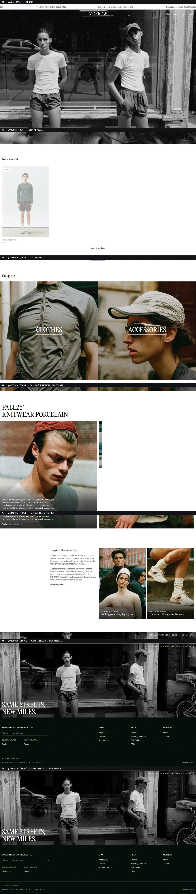
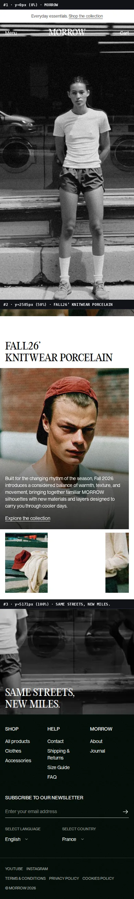

# UI Design System & Master Generation Blueprint: morrow-valerian-studio

> **MORROW** (https://morrow.valerian.studio) — FALL26’ KNITWEAR PORCELAIN





---

## 1. Executive Visual Persona & Design Archetype

- **Brand Essence & Persona**: **MORROW** (`https://morrow.valerian.studio`). FALL26’ KNITWEAR PORCELAIN
- **Capture Provenance**: Live browser capture (`tier1_fast`, HTTP `200`, captured `2026-11-24`).
- **Visual Archetype**: **Light-Substrate Editorial & Modular Grid System (`#ffffff` canvas, `#000000` ink, `#c4c4c4` accent)**.
- **Anti-AI-Slop Differentiators**:
  - **Live-Computed Chromatic Polarity**: Anchors the viewport in `#ffffff` (live computed `body` `background-color` (`computed_styles.json`)) paired with `#000000` primary typography and `#c4c4c4` accents.
  - **Grounded Typographic Hierarchy**: Pairs `editorialNew` for display copy (`Pace Base Layer`) with `ppNeueMontreal` and `SFMono-Regular`.
  - **Calibrated Spatial Grid & Motion**: Combines `96rem` container bounds (`gap: normal 10px`, padding `15px`) with `cubic-bezier(.4,0,.2,1)` easing and Lenis Smooth Scroll (`data-lenis`), Three.js / WebGL Canvas Pipeline.

---

## 2. Spatial Architecture & Modular Grid Mathematics

### Viewport Allocation & Container Geometry
- **Captured Journey Filmstrips**: Desktop `1280×5796px` (`assets/desktop-journey.webp`, `7` keyframes up to `y=4254px` / doc `5154px`), Mobile `390×2616px` (`assets/mobile-journey.webp`, `3` keyframes).
- **Master Container Bounds**: `96rem` (non-`@media` desktop container stylesheet rule).
- **Canvas Lateral Padding & Spacing**: `15px` lateral canvas padding with `normal 10px` grid gap.
- **Border Radius Scale**: `4px`, `.25rem`, `var(--radius-sm)`.

### Responsive Breakpoint Architecture
- **Desktop Layout**: Multi-column CSS Grid / Flexbox layout at `1440px` (`max-width: 96rem`, `gap: normal 10px`).
- **Mobile Layout**: Single-column vertical stack at `390px` viewport width with `15px` horizontal padding.
- **Extracted CSS Media Queries**: `@media (prefers-reduced-motion:no-preference)`, `@media (max-height:650px)`, `@media (min-width:64rem)`, `@media (prefers-reduced-motion:reduce)`.

---

## 3. Color System, Materiality & Atmospheric Lighting

### Semantic Palette & Source Grounding
| Semantic Role | Ground-Truth Value | Extracted Live / CSS Source |
|---|---|---|
| **Primary Canvas Substrate** | `#ffffff` | live computed `body` `background-color` (`computed_styles.json`) |
| **Primary Typography Ink** | `#000000` | live computed `h2` `color` (`computed_styles.json`) |
| **Elevated Surface / Card Substrate** | `#f5f5f5` | `.cart-item-image { background: #f5f5f5 }` |
| **Interactive Accent / Highlight** | `#c4c4c4` | `.cart-quantity button:disabled { color: #c4c4c4 }` |
| **Secondary / Muted Copy** | `#737373` | `.cart-item-size { color: #737373 }` |
| **Structural Hairline Border** | `#e5e5e5` | `.cart-header { border-bottom: #e5e5e5 }` |
| **Variable Token (`--color-red-800`)** | `#9f0712` | `var(--color-red-800)` in `:root` |
| **Variable Token (`--color-rose-500`)** | `#ff2357` | `var(--color-rose-500)` in `:root` |
| **Variable Token (`--color-neutral-50`)** | `#fafafa` | `var(--color-neutral-50)` in `:root` |
| **Variable Token (`--color-neutral-300`)** | `#d4d4d4` | `var(--color-neutral-300)` in `:root` |
| **Variable Token (`--color-neutral-400`)** | `#a1a1a1` | `var(--color-neutral-400)` in `:root` |
| **Variable Token (`--color-neutral-600`)** | `#525252` | `var(--color-neutral-600)` in `:root` |
| **Variable Token (`--color-neutral-900`)** | `#171717` | `var(--color-neutral-900)` in `:root` |

### Sanitized Root CSS Variables (`ui-ux.md` Ground Truth)
| Variable Name | Extracted Value | Semantic Role |
|---|---|---|
| `--hover-duration` | `.65s` | Motion / Easing Token |
| `--hover-easing` | `cubic-bezier(.4, 0, .2, 1)` | Motion / Easing Token |
| `--font-sans` | `var(--font-pp-neue-montreal), Arial, sans-serif` | Typography / Scale Token |
| `--color-red-800` | `#9f0712` | Brand / Palette Token |
| `--color-rose-500` | `#ff2357` | Brand / Palette Token |
| `--color-neutral-50` | `#fafafa` | Brand / Palette Token |
| `--color-neutral-100` | `#f5f5f5` | Brand / Palette Token |
| `--color-neutral-200` | `#e5e5e5` | Brand / Palette Token |
| `--color-neutral-300` | `#d4d4d4` | Brand / Palette Token |
| `--color-neutral-400` | `#a1a1a1` | Brand / Palette Token |
| `--color-neutral-500` | `#737373` | Brand / Palette Token |
| `--color-neutral-600` | `#525252` | Brand / Palette Token |
| `--color-neutral-900` | `#171717` | Brand / Palette Token |
| `--color-black` | `#000` | Canvas / Surface Token |
| `--color-white` | `#fff` | Canvas / Surface Token |
| `--spacing` | `.25rem` | Layout / Spatial Grid Token |

---

## 4. Typographic Scale & Editorial Hierarchy

### Font Family Stacks
- **Display Typography**: `editorialNew`.
- **Primary Body Stack**: `ppNeueMontreal`.
- **Technical / Metadata Stack**: `SFMono-Regular`.

### Typographic Scale & Rules (Live Computed & Stylesheet Grounded)
- **Hero Display (`H1`)**: CSS variables `--text-display: clamp(1.75rem, 3vw, 3rem)`, `--text-display--line-height: 1.2`.
- **Section Heading (`H2`)**: live computed `h2` (`font-size: 43.2px`, `line-height: 51.84px`, `font-weight: 500`); CSS variables `--text-2xl: 1.5rem`, `--text-2xl--line-height: calc(2 / 1.5)`.
- **Body Copy**: live computed `body` (`font-size: 16px`, `line-height: 24px`, `font-weight: 400`); CSS variables `--text-body: 14px`, `--text-body--line-height: calc(1.25 / .875)`.
- **Metadata & Navigation Labels**: live computed `nav/a` (`font-size: 16px`, `line-height: 24px`, `font-weight: 400`); CSS variables `--text-xs: .75rem`, `--text-xs--line-height: calc(1 / .75)`, `--default-mono-font-family: var(--font-mono)`.

---

## 5. Choreographed Motion & Interaction Physics

### Primary Easing Curves
- **Extracted Timing Functions**: `cubic-bezier(.4,0,.2,1)`, `cubic-bezier(.22,1,.36,1)`, `cubic-bezier(.4,0,1,1)`.

### Per-Element Transition & Choreography Rules
- **Selector `edia (prefers-reduced-motion:no-p...`**: `transition: transform var(--hover-duration) var(--hover-easing)` extracted from `morrow-valerian-studio` stylesheet.
- **Selector `.site-nav`**: `transition: transform .4s cubic-bezier(.4,0,.2,1),opacity .24s,backgroun...` extracted from `morrow-valerian-studio` stylesheet.
- **Selector `.site-nav:has(:focus-visible)`**: `transition: none` extracted from `morrow-valerian-studio` stylesheet.
- **Extracted Easing Curve (`cubic-bezier(.4,0,.2,1)`)**: Governs interactive state transitions across `<header.site-nav>` and `<section.grid-cols-12>`.
- **Runtime Interaction Engine**: Integrates Lenis Smooth Scroll (`data-lenis`), Three.js / WebGL Canvas Pipeline with `prefers-reduced-motion: reduce` fallback guards.
### Measured Runtime Scroll & Interaction Telemetry (`behavioral_journey_v2`)
- **Scroll Driver Mode**: `native` (max document height `5154px`, deepest scrollY reached `4254px` across `7` desktop keyframes).
- **Detected Scroll / Motion Libraries**: `Lenis`.
- **Hover Physics (`primary_cta` · `MORROW`)**: Computed transition `0s` / `ease` (no static color/transform shift captured at rest).
- **Route Transition Architecture**: First internal navigation (`/shop`) measured as `direct` in `1129ms`.

---

## 6. Component Wireframe & Structural DOM Map

### Visual Layout Schematic — Desktop (`1440px`, Grounded in `dom.html` & Landmark Bounding Boxes)
```
┌────────────────────────────────────────────────────────────────────────┐
│ DESKTOP VIEWPORT (1440px) — MORROW                                     │
│ ====================================================================== │
│ [ <header.site-nav> (1440x68px)       | MORROW · Shop · All products ] │
│ ---------------------------------------------------------------------- │
│ | HERO STAGE: <section.h-svh> (w=1440px)                             | │
│ | H1: Pace Base Layer                                                | │
│ | Substrate: #ffffff | Ink: #000000 | Accent: #c4c4c4                | │
│ ---------------------------------------------------------------------- │
│ | SHOWCASE GRID (<section.grid-cols-12>) max-w: 96rem                | │
│ | +------------------------------+  +------------------------------+ | │
│ | | Everyday Long Sleeve         |  | Tempo Running Shorts         | | │
│ | +------------------------------+  +------------------------------+ | │
│ ---------------------------------------------------------------------- │
│ | DETAIL MODULE (<article.group>) — Stride Windbreaker               | │
│ ---------------------------------------------------------------------- │
│ [ FOOTER (<footer.px-page>    ) | https://morrow.valerian.studio       │
└────────────────────────────────────────────────────────────────────────┘
```

### Visual Layout Schematic — Mobile Reflow (`390px`)
```
┌────────────────────────────────────────────────────────────────────────┐
│ MOBILE VIEWPORT REFLOW (390px) — Single-Column Stack (gap: normal 1)   │
│ ====================================================================== │
│ [ HEADER BAR (<header.site-nav>       ) | Compact Menu (390px)         │
│ ---------------------------------------------------------------------- │
│ | HERO STAGE (<section.h-svh>) — 390px Vertical Lead                 | │
│ | H1: Pace Base Layer                                                | │
│ ---------------------------------------------------------------------- │
│ | SHOWCASE STACK (<section.grid-cols-12>) — 1-Col Stack              | │
│ | [ Item 1: Everyday Long Sleeve                                   ] | │
│ | [ Item 2: Tempo Running Shorts                                   ] | │
│ ---------------------------------------------------------------------- │
│ | DETAIL STACK (<article.group>) — 1-Col (Stride Windbreaker)        | │
│ ---------------------------------------------------------------------- │
│ [ FOOTER (<footer.px-page>    ) | Stacked 390px Colophon               │
└────────────────────────────────────────────────────────────────────────┘
```

### Granular DOM Region Breakdown
1. **Brand Header & Navigation Bar (<header.site-nav> — `morrow-valerian-studio`)**:
   - Landmark `<header class="site-nav col-start-1">` (`1440x68px`) hosting `MORROW` navigation (`MORROW · Shop · All products · Clothes · Accessories`), DOM attributes (`data-precedence="next"`, `data-precedence="next"`, `data-precedence="next"`, `data-precedence="next"`), and stylesheet rule `.animated-underline-link { --hover-duration:.65s;--hover-easing:cubic-bezier(.4,0,.2,1) }`.
2. **Hero Stage & Focal Lead (<section.h-svh> — `Pace Base Layer`)**:
   - Landmark `<section class="h-svh grid-cols-12">` presenting display lead `Pace Base Layer` and copy excerpt *"KNITWEAR PORCELAIN"* over `#ffffff` canvas and `#000000` ink.
3. **Primary Showcase & Content Grid (<section.grid-cols-12> — `Everyday Long Sleeve`)**:
   - Landmark `<section class="grid-cols-12 gap-x-gutter">` rendering section `Everyday Long Sleeve` with copy *"Built for the changing rhythm of the season, Fall 2026 introduces"*, asset references (`3p45zkgyngvyk.css`, `19h1-_j7inwm4.css`, `376za7hcbsln-.css`, `2x1xg-ar74jvz.css`), and grid rule `.animated-underline-image { transition:transform var(--hover-duration) var(--hover-easing) }`.
4. **Interactive Detail & Feature Matrix (<article.group> — `Tempo Running Shorts`)**:
   - Landmark `<article class="group font-sans">` framing `Tempo Running Shorts` and `Stride Windbreaker` (*"Explore the collection"*) with `#f5f5f5` surface cards, `#c4c4c4` accents, and `focus-visible .animated-underline... { transform:scale(var(--hover-image-scale,1.02)) }`.
5. **Colophon & Global Directory Footer (<footer.px-page> — `https://morrow.valerian.studio`)**:
   - Landmark `<footer class="px-page font-sans">` anchoring `MORROW` footer links (`MORROW · Shop · All products · Clothes · Accessories`), copy *"Stories of people, places and the details that shape the way"*, and `#e5e5e5` structural dividers.
### Full Vertical Scroll Sequence (Desktop `1440×900` Keyframes)
- **Step 01** (`y=0px`, `0%`): Active landmark `MORROW` · sticky/fixed elements: `1`
- **Step 02** (`y=850px`, `20%`): Active landmark `New Arrival` · sticky/fixed elements: `0`
- **Step 03** (`y=1700px`, `40%`): Active landmark `Categories` · sticky/fixed elements: `0`
- **Step 04** (`y=2550px`, `60%`): Active landmark `FALL26’ KNITWEAR PORCELAIN` · sticky/fixed elements: `0`
- **Step 05** (`y=3400px`, `80%`): Active landmark `Beyond the everyday.` · sticky/fixed elements: `0`
- **Step 06** (`y=4250px`, `100%`): Active landmark `SAME STREETS, NEW MILES.` · sticky/fixed elements: `0`
- **Step 07** (`y=4254px`, `100%`): Active landmark `SAME STREETS, NEW MILES.` · sticky/fixed elements: `0`

### Multi-Page Internal Route Map
- **Listing Route (`/shop`)**: `https://morrow.valerian.studio/shop` — H1: `Shop`, scrollHeight `3846px`, transition `direct` (`1129ms`)
- **Detail Route (`/shop/clothes/pace-base-layer`)**: `https://morrow.valerian.studio/shop/clothes/pace-base-layer` — H1: `Pace Base Layer`, scrollHeight `2115px`, transition `direct` (`1187ms`)
- **About Route (`/about`)**: `https://morrow.valerian.studio/about` — H1: `Made for the everyday. Open to what comes next.`, scrollHeight `1868px`, transition `direct` (`504ms`)

---

## 7. Master Zero-Shot AI Generation Prompt

```markdown
# Master Zero-Shot Frontend Generation Prompt: morrow-valerian-studio (MORROW)

You are a principal frontend architect and design systems engineer. Build a complete, production-ready web application replicating the exact design system, DOM landmarks, typographic hierarchy, color tokens, and motion physics of `morrow-valerian-studio` (**MORROW** — `https://morrow.valerian.studio`).

### 1. Visual Archetype & Anti-AI-Slop Mandates
- **Archetype**: Light-Substrate Editorial & Modular Grid System (`#ffffff` canvas, `#000000` ink, `#c4c4c4` accent).
- **Identity & Domain Context**: FALL26’ KNITWEAR PORCELAIN
- **Primary Substrate**: `#ffffff` (live computed `body` `background-color` (`computed_styles.json`)), **Primary Ink**: `#000000`, **Accent / Highlight**: `#c4c4c4`.
- **Site-Specific Differentiators**:
  - **Live-Computed Chromatic Polarity**: Anchors the viewport in `#ffffff` (live computed `body` `background-color` (`computed_styles.json`)) paired with `#000000` primary typography and `#c4c4c4` accents.
  - **Grounded Typographic Hierarchy**: Pairs `editorialNew` for display copy (`Pace Base Layer`) with `ppNeueMontreal` and `SFMono-Regular`.
  - **Calibrated Spatial Grid & Motion**: Combines `96rem` container bounds (`gap: normal 10px`, padding `15px`) with `cubic-bezier(.4,0,.2,1)` easing and Lenis Smooth Scroll (`data-lenis`), Three.js / WebGL Canvas Pipeline.

### 2. Ground-Truth CSS Variables (`:root` Token Contract)
Declare and consume these exact custom properties extracted from `morrow-valerian-studio` in your global stylesheet:

:root {
  /* MORROW (morrow-valerian-studio) — Live-Grounded CSS Variables */
  --hover-duration: .65s; /* Motion / Easing Token (morrow-valerian-studio) */
  --hover-easing: cubic-bezier(.4, 0, .2, 1); /* Motion / Easing Token (morrow-valerian-studio) */
  --font-sans: var(--font-pp-neue-montreal), Arial, sans-serif; /* Typography / Scale Token (morrow-valerian-studio) */
  --color-red-800: #9f0712; /* Brand / Palette Token (morrow-valerian-studio) */
  --color-rose-500: #ff2357; /* Brand / Palette Token (morrow-valerian-studio) */
  --color-neutral-50: #fafafa; /* Brand / Palette Token (morrow-valerian-studio) */
  --color-neutral-100: #f5f5f5; /* Brand / Palette Token (morrow-valerian-studio) */
  --color-neutral-200: #e5e5e5; /* Brand / Palette Token (morrow-valerian-studio) */
  --color-neutral-300: #d4d4d4; /* Brand / Palette Token (morrow-valerian-studio) */
  --color-neutral-400: #a1a1a1; /* Brand / Palette Token (morrow-valerian-studio) */
  --color-neutral-500: #737373; /* Brand / Palette Token (morrow-valerian-studio) */
  --color-neutral-600: #525252; /* Brand / Palette Token (morrow-valerian-studio) */
  --color-neutral-900: #171717; /* Brand / Palette Token (morrow-valerian-studio) */
  --color-black: #000; /* Canvas / Surface Token (morrow-valerian-studio) */
  --color-white: #fff; /* Canvas / Surface Token (morrow-valerian-studio) */
  --spacing: .25rem; /* Layout / Spatial Grid Token (morrow-valerian-studio) */
}

### 3. Semantic Color & Materiality Contract
Map every surface, ink, and border strictly to these source-grounded tokens:
- **Primary Canvas Substrate**: `#ffffff` — grounded in live computed `body` `background-color` (`computed_styles.json`)
- **Primary Typography Ink**: `#000000` — grounded in live computed `h2` `color` (`computed_styles.json`)
- **Elevated Surface / Card Substrate**: `#f5f5f5` — grounded in `.cart-item-image { background: #f5f5f5 }`
- **Interactive Accent / Highlight**: `#c4c4c4` — grounded in `.cart-quantity button:disabled { color: #c4c4c4 }`
- **Secondary / Muted Copy**: `#737373` — grounded in `.cart-item-size { color: #737373 }`
- **Structural Hairline Border**: `#e5e5e5` — grounded in `.cart-header { border-bottom: #e5e5e5 }`
- **Variable Token (`--color-red-800`)**: `#9f0712` — grounded in `var(--color-red-800)` in `:root`
- **Variable Token (`--color-rose-500`)**: `#ff2357` — grounded in `var(--color-rose-500)` in `:root`
- **Variable Token (`--color-neutral-50`)**: `#fafafa` — grounded in `var(--color-neutral-50)` in `:root`
- **Variable Token (`--color-neutral-300`)**: `#d4d4d4` — grounded in `var(--color-neutral-300)` in `:root`
- **Variable Token (`--color-neutral-400`)**: `#a1a1a1` — grounded in `var(--color-neutral-400)` in `:root`
- **Variable Token (`--color-neutral-600`)**: `#525252` — grounded in `var(--color-neutral-600)` in `:root`
- **Variable Token (`--color-neutral-900`)**: `#171717` — grounded in `var(--color-neutral-900)` in `:root`

### 4. Spatial Grid, Container Bounds & Responsive Breakpoints
- **Desktop Viewport Reference**: `1280×5796px` (multi-frame vertical journey filmstrip (5796px), `1440px` standard desktop width).
- **Mobile Viewport Reference**: `390×2616px` (multi-frame vertical journey filmstrip (2616px), `390px` standard mobile width).
- **Container Max-Width**: `96rem` (non-`@media` desktop container stylesheet rule)
- **Padding & Gutters**: `15px` lateral canvas padding with `normal 10px` grid gap
- **Desktop Grid**: Multi-column CSS Grid / Flexbox layout at `1440px` (`max-width: 96rem`, `gap: normal 10px`)
- **Mobile Adaptation**: Single-column vertical stack at `390px` viewport width with `15px` horizontal padding
- **Media Queries**: `@media (prefers-reduced-motion:no-preference)`, `@media (max-height:650px)`, `@media (min-width:64rem)`, `@media (prefers-reduced-motion:reduce)`
- **Corner Radii**: `4px`, `.25rem`, `var(--radius-sm)`

### 5. Typography & Editorial Scale Contract
- **Display Font Stack**: `editorialNew`
- **Body Font Stack**: `ppNeueMontreal`
- **Monospace / Technical Font Stack**: `SFMono-Regular`
- **H1 Display Rule**: CSS variables `--text-display: clamp(1.75rem, 3vw, 3rem)`, `--text-display--line-height: 1.2`
- **H2 Section Rule**: live computed `h2` (`font-size: 43.2px`, `line-height: 51.84px`, `font-weight: 500`); CSS variables `--text-2xl: 1.5rem`, `--text-2xl--line-height: calc(2 / 1.5)`
- **Body Copy Rule**: live computed `body` (`font-size: 16px`, `line-height: 24px`, `font-weight: 400`); CSS variables `--text-body: 14px`, `--text-body--line-height: calc(1.25 / .875)`
- **Metadata & Index Rule**: live computed `nav/a` (`font-size: 16px`, `line-height: 24px`, `font-weight: 400`); CSS variables `--text-xs: .75rem`, `--text-xs--line-height: calc(1 / .75)`, `--default-mono-font-family: var(--font-mono)`

### 6. Component Hierarchy, Verbatim Copy & Real DOM Landmarks
Scaffold `morrow-valerian-studio` (`MORROW`) with these exact structural regions, extracted copy, and CSS rules from `dom.html`:
1. **Brand Header & Navigation Bar (<header.site-nav> — `morrow-valerian-studio`)**:
   - DOM & Selectors: Landmark `<header class="site-nav col-start-1">` (`1440x68px`) hosting `MORROW` navigation (`MORROW · Shop · All products · Clothes · Accessories`), DOM attributes (`data-precedence="next"`, `data-precedence="next"`, `data-precedence="next"`, `data-precedence="next"`), and stylesheet rule `.animated-underline-link { --hover-duration:.65s;--hover-easing:cubic-bezier(.4,0,.2,1) }`.
   - Responsive Contract: Header `Brand Header & Navigation Bar (<header.site-nav> — `morrow-valerian-studio`)` (`morrow-valerian-studio`) adapts across `@media (prefers-reduced-motion:no-preference)`, `@media (max-height:650px)`, `@media (min-width:64rem)`, `@media (prefers-reduced-motion:reduce)` with `cubic-bezier(.4,0,.2,1)`, `cubic-bezier(.22,1,.36,1)`, `cubic-bezier(.4,0,1,1)` transitions and links `MORROW · Shop · All products · Clothes · Accessories`.
2. **Hero Stage & Focal Lead (<section.h-svh> — `Pace Base Layer`)**:
   - DOM & Selectors: Landmark `<section class="h-svh grid-cols-12">` presenting display lead `Pace Base Layer` and copy excerpt *"KNITWEAR PORCELAIN"* over `#ffffff` canvas and `#000000` ink.
   - Responsive Contract: Hero stage (`1280×5796px` desktop / `390×2616px` mobile) sets `#ffffff` background with `#000000` headline `Pace Base Layer`.
3. **Primary Showcase & Content Grid (<section.grid-cols-12> — `Everyday Long Sleeve`)**:
   - DOM & Selectors: Landmark `<section class="grid-cols-12 gap-x-gutter">` rendering section `Everyday Long Sleeve` with copy *"Built for the changing rhythm of the season, Fall 2026 introduces"*, asset references (`3p45zkgyngvyk.css`, `19h1-_j7inwm4.css`, `376za7hcbsln-.css`, `2x1xg-ar74jvz.css`), and grid rule `.animated-underline-image { transition:transform var(--hover-duration) var(--hover-easing) }`.
   - Responsive Contract: Showcase grid `Primary Showcase & Content Grid (<section.grid-cols-12> — `Everyday Long Sleeve`)` applies Multi-column CSS Grid / Flexbox layout at `1440px` (`max-width: 96rem`, `gap: normal 10px`) on desktop and Single-column vertical stack at `390px` viewport width with `15px` horizontal padding on mobile.
4. **Interactive Detail & Feature Matrix (<article.group> — `Tempo Running Shorts`)**:
   - DOM & Selectors: Landmark `<article class="group font-sans">` framing `Tempo Running Shorts` and `Stride Windbreaker` (*"Explore the collection"*) with `#f5f5f5` surface cards, `#c4c4c4` accents, and `focus-visible .animated-underline... { transform:scale(var(--hover-image-scale,1.02)) }`.
   - Responsive Contract: Detail module `Interactive Detail & Feature Matrix (<article.group> — `Tempo Running Shorts`)` uses `4px`, `.25rem`, `var(--radius-sm)` radii, `#c4c4c4` highlights, and assets (3p45zkgyngvyk.css, 19h1-_j7inwm4.css, 376za7hcbsln-.css).
5. **Colophon & Global Directory Footer (<footer.px-page> — `https://morrow.valerian.studio`)**:
   - DOM & Selectors: Landmark `<footer class="px-page font-sans">` anchoring `MORROW` footer links (`MORROW · Shop · All products · Clothes · Accessories`), copy *"Stories of people, places and the details that shape the way"*, and `#e5e5e5` structural dividers.
   - Responsive Contract: Footer `Colophon & Global Directory Footer (<footer.px-page> — `https://morrow.valerian.studio`)` aligns to `96rem` (non-`@media` desktop container stylesheet rule) with `15px` lateral canvas padding with `normal 10px` grid gap and attributes (data-precedence="next", data-precedence="next", data-precedence="next").

#### Verbatim DOM Copy Excerpts (`dom.html`)
- Copy Excerpt 1: *"KNITWEAR PORCELAIN"*
- Copy Excerpt 2: *"Built for the changing rhythm of the season, Fall 2026 introduces a considered bal..."*
- Copy Excerpt 3: *"Explore the collection"*
- Copy Excerpt 4: *"Stories of people, places and the details that shape the way we move. From the fir..."*

### 7. Motion, Extracted Stylesheet Rules & Interaction Choreography
- **Primary Easing Functions**: `cubic-bezier(.4,0,.2,1)`, `cubic-bezier(.22,1,.36,1)`, `cubic-bezier(.4,0,1,1)`
- **Extracted Stylesheet Rules (`morrow-valerian-studio`)**:
- `.animated-underline-link { --hover-duration:.65s;--hover-easing:cubic-bezier(.4,0,.2,1) }`
- `.animated-underline-image { transition:transform var(--hover-duration) var(--hover-easing) }`
- `focus-visible .animated-underline... { transform:scale(var(--hover-image-scale,1.02)) }`
- `ne-link:hover .animated-underline... { transform:scale(var(--hover-image-scale,1.02)) }`
- `.site-nav-toolbar { min-height:60px }`
- **Per-Selector Transition Rules**:
- **Selector `edia (prefers-reduced-motion:no-p...`**: `transition: transform var(--hover-duration) var(--hover-easing)` extracted from `morrow-valerian-studio` stylesheet.
- **Selector `.site-nav`**: `transition: transform .4s cubic-bezier(.4,0,.2,1),opacity .24s,backgroun...` extracted from `morrow-valerian-studio` stylesheet.
- **Selector `.site-nav:has(:focus-visible)`**: `transition: none` extracted from `morrow-valerian-studio` stylesheet.
- **Extracted Easing Curve (`cubic-bezier(.4,0,.2,1)`)**: Governs interactive state transitions across `<header.site-nav>` and `<section.grid-cols-12>`.
- **Runtime Interaction Engine**: Integrates Lenis Smooth Scroll (`data-lenis`), Three.js / WebGL Canvas Pipeline with `prefers-reduced-motion: reduce` fallback guards.
### 7b. Full-Page Scroll Choreography, Interactive States & Multi-Page Routes
- **Scroll Mechanics**: Implement `native` vertical progression up to `5154px` across 7 distinct viewport chapters using Lenis.
- **Vertical Chapter Sequence**: MORROW (0%) -> New Arrival (20%) -> Categories (40%) -> FALL26’ KNITWEAR PORCELAIN (60%) -> Beyond the everyday. (80%) -> SAME STREETS, NEW MILES. (100%) -> SAME STREETS, NEW MILES. (100%).
- **Multi-Page Routes**: Scaffold internal routes `/shop` (listing, direct), `/shop/clothes/pace-base-layer` (detail, direct), `/about` (about, direct) sharing the global header/footer shell and design tokens.

### 8. Technical Deliverables
- Implement in Next.js (App Router) with TypeScript and Tailwind CSS consuming the `:root` custom properties defined above for `morrow-valerian-studio`.
- Reproduce both the `1440px` desktop architecture and `390px` mobile breakpoint transitions, preserving semantic HTML5 landmarks (`<header>`, `<nav>`, `<main>`, `<section>`, `<footer>`) and `prefers-reduced-motion` accessibility guards.
```
---

## 8. Full-Page Scroll Journey, Interactive States & Subpage Inventory

### Desktop Scroll Keyframes (`1440×900` WebP)
| Step | Scroll Y | Progress | Active Landmark / Section | Sticky/Fixed | Visual Asset |
| :---: | :---: | :---: | :--- | :---: | :--- |
| `#01` | `0px` | `0%` | MORROW | `1` | [desktop-step-01.webp](assets/desktop-step-01.webp) |
| `#02` | `850px` | `20%` | New Arrival | `0` | [desktop-step-02.webp](assets/desktop-step-02.webp) |
| `#03` | `1700px` | `40%` | Categories | `0` | [desktop-step-03.webp](assets/desktop-step-03.webp) |
| `#04` | `2550px` | `60%` | FALL26’ KNITWEAR PORCELAIN | `0` | [desktop-step-04.webp](assets/desktop-step-04.webp) |
| `#05` | `3400px` | `80%` | Beyond the everyday. | `0` | [desktop-step-05.webp](assets/desktop-step-05.webp) |
| `#06` | `4250px` | `100%` | SAME STREETS, NEW MILES. | `0` | [desktop-step-06.webp](assets/desktop-step-06.webp) |
| `#07` | `4254px` | `100%` | SAME STREETS, NEW MILES. | `0` | [desktop-step-07.webp](assets/desktop-step-07.webp) |

### Mobile Condensed Keyframes (`390×844` WebP)
| Step | Scroll Y | Progress | Active Landmark | Visual Asset |
| :---: | :---: | :---: | :--- | :--- |
| `#01` | `0px` | `0%` | MORROW | [mobile-step-01.webp](assets/mobile-step-01.webp) |
| `#02` | `2585px` | `50%` | FALL26’ KNITWEAR PORCELAIN | [mobile-step-02.webp](assets/mobile-step-02.webp) |
| `#03` | `5171px` | `100%` | SAME STREETS, NEW MILES. | [mobile-step-03.webp](assets/mobile-step-03.webp) |

### Internal Subpage Filmstrips (`1080px` Wide WebP)
| # | Template | Route URL | H1 / Title | Scroll Height | Transition | Filmstrip Asset |
| :-: | :---: | :--- | :--- | :---: | :---: | :--- |
| `1` | `listing` | `https://morrow.valerian.studio/shop` | Shop | `3846px` | `direct` (`1129ms`) | [subpage-01-shop.webp](assets/subpage-01-shop.webp) |
| `2` | `detail` | `https://morrow.valerian.studio/shop/clothes/pace-base-layer` | Pace Base Layer | `2115px` | `direct` (`1187ms`) | [subpage-02-shop-clothes-pace-base-layer.webp](assets/subpage-02-shop-clothes-pace-base-layer.webp) |
| `3` | `about` | `https://morrow.valerian.studio/about` | Made for the everyday. Open to what c... | `1868px` | `direct` (`504ms`) | [subpage-03-about.webp](assets/subpage-03-about.webp) |

