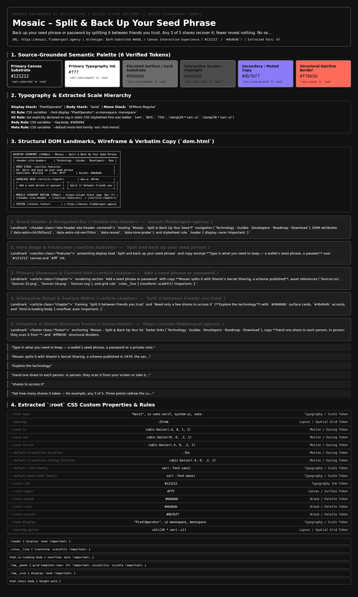
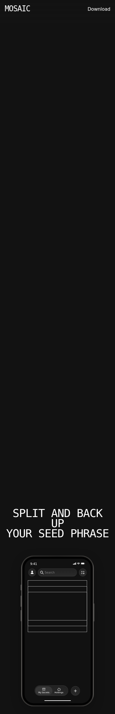

# UI Design System & Master Generation Blueprint: mosaic-flabbergast-agency

> **Mosaic – Split & Back Up Your Seed Phrase** (https://mosaic.flabbergast.agency) — Back up your seed phrase or password by splitting it between friends you trust. Any 3 of 5 shares recover it; fewer reveal nothing. No se...



---

## 1. Executive Visual Persona & Design Archetype

- **Brand Essence & Persona**: **Mosaic – Split & Back Up Your Seed Phrase** (`https://mosaic.flabbergast.agency`). Back up your seed phrase or password by splitting it between friends you trust. Any 3 of 5 shares recover it; fewer reveal nothing. No se...
- **Visual Archetype**: **Dark-Substrate WebGL / Canvas Interactive Experience (`#121212` / `#4b4b4b`)**.
- **Anti-AI-Slop Differentiators**:
  - **Source-Grounded Chromatic Polarity**: Anchors the viewport in `#121212` (`var(--color-ink)` in `:root`) paired with `#fff` primary typography and `#4b4b4b` accents.
  - **Extracted Typographic Hierarchy**: Pairs `PixelOperator` for display copy (`Split and back up your seed phrase`) with `Geist` and `SFMono-Regular`.
  - **Calibrated Spatial Grid & Motion**: Combines `40rem` container bounds (`gap: 0px (flush layout)`, padding `var(--edge)`) with `cubic-bezier(.4,0,1,1)` easing and Lenis Smooth Scroll (`data-lenis`), Three.js / WebGL Canvas Pipeline.

---

## 2. Spatial Architecture & Modular Grid Mathematics



### Viewport Allocation & Container Geometry
- **Captured Viewport Dimensions**: Desktop `1440×2400px` (`assets/desktop.png`, capped at 2400px multi-section capture), Mobile `390×2400px` (`assets/mobile.png`, capped at 2400px multi-section capture).
- **Master Container Bounds**: `40rem` extracted from `mosaic-flabbergast-agency` stylesheet.
- **Canvas Lateral Padding & Spacing**: `var(--edge)` lateral canvas padding with `0px (flush layout)` grid gap.
- **Border Radius Scale**: `.25rem`.

### Responsive Breakpoint Architecture
- **Desktop Layout**: Multi-column CSS Grid / Flexbox layout at `1440px` (`max-width: 40rem`, `gap: 0px (flush layout)`).
- **Mobile Layout**: Single-column vertical stack at `390px` viewport width with `var(--edge)` horizontal padding.
- **Extracted CSS Media Queries**: `@media (width>=40rem)`, `@media (width>=48rem)`, `@media (width>=64rem)`, `@media (width>=80rem)`.

---

## 3. Color System, Materiality & Atmospheric Lighting

### Semantic Palette & Source Grounding
| Semantic Role | Ground-Truth Value | Extracted CSS Source / Selector |
|---|---|---|
| **Primary Canvas Substrate** | `#121212` | `var(--color-ink)` in `:root` |
| **Primary Typography Ink** | `#fff` | `var(--color-paper)` in `:root` |
| **Elevated Surface / Card Substrate** | `#6b6b6b` | `var(--color-muted)` in `:root` |
| **Interactive Accent / Highlight** | `#4b4b4b` | `var(--color-rule)` in `:root` |
| **Secondary / Muted Copy** | `#8b7bf7` | `var(--color-accent)` in `:root` |
| **Structural Hairline Border** | `#ff6b5b` | `var(--noise)` in `:root` |

### Sanitized Root CSS Variables (`ui-ux.md` Ground Truth)
| Variable Name | Extracted Value | Semantic Role |
|---|---|---|
| `--font-sans` | `"Geist", ui-sans-serif, system-ui, sans-serif` | Typography / Scale Token |
| `--spacing` | `.25rem` | Layout / Spatial Grid Token |
| `--ease-in` | `cubic-bezier(.4, 0, 1, 1)` | Motion / Easing Token |
| `--ease-out` | `cubic-bezier(0, 0, .2, 1)` | Motion / Easing Token |
| `--ease-in-out` | `cubic-bezier(.4, 0, .2, 1)` | Motion / Easing Token |
| `--default-transition-duration` | `.15s` | Motion / Easing Token |
| `--default-transition-timing-function` | `cubic-bezier(.4, 0, .2, 1)` | Motion / Easing Token |
| `--default-font-family` | `var(--font-sans)` | Typography / Scale Token |
| `--default-mono-font-family` | `var(--font-mono)` | Typography / Scale Token |
| `--color-ink` | `#121212` | Typography Ink Token |
| `--color-paper` | `#fff` | Canvas / Surface Token |
| `--color-muted` | `#6b6b6b` | Brand / Palette Token |
| `--color-rule` | `#4b4b4b` | Brand / Palette Token |
| `--color-accent` | `#8b7bf7` | Brand / Palette Token |
| `--font-display` | `"PixelOperator", ui-monospace, monospace` | Typography / Scale Token |
| `--spacing-gutter` | `calc(20 * var(--u))` | Layout / Spatial Grid Token |

---

## 4. Typographic Scale & Editorial Hierarchy

### Font Family Stacks
- **Display Typography**: `PixelOperator`.
- **Primary Body Stack**: `Geist`.
- **Technical / Metadata Stack**: `SFMono-Regular`.

### Typographic Scale & Rules (Extracted from Stylesheet & Variables)
- **Hero Display (`H1`)**: CSS variables `--font-display: "PixelOperator", ui-monospace, monospace`.
- **Section Heading (`H2`)**: not explicitly declared on tag in static CSS (stylesheet font-size ladder: `1em`, `80%`, `75%`, `clamp(26 * var(--u)`, `clamp(36 * var(--u)`).
- **Body Copy**: CSS variables `--faq-body: #9d9d9d`.
- **Metadata & Navigation Labels**: CSS variables `--default-mono-font-family: var(--font-mono)`.

---

## 5. Choreographed Motion & Interaction Physics

### Primary Easing Curves
- **Extracted Timing Functions**: `cubic-bezier(.4,0,1,1)`, `cubic-bezier(0,0,.2,1)`, `cubic-bezier(.4,0,.2,1)`.

### Per-Element Transition & Choreography Rules
- **Selector `.lenis.lenis-autoToggle`**: `transition: 1ms` extracted from `mosaic-flabbergast-agency` stylesheet.
- **Selector `layer theme`**: `transition: .15s` extracted from `mosaic-flabbergast-agency` stylesheet.
- **Selector `.transition`**: `transition: var(--tw-ease,var(--default-transition-timing-function))` extracted from `mosaic-flabbergast-agency` stylesheet.
- **Extracted Easing Curve (`cubic-bezier(.4,0,1,1)`)**: Governs interactive state transitions across `<header.site-header>` and `<article.chapter>`.
- **Runtime Interaction Engine**: Integrates Lenis Smooth Scroll (`data-lenis`), Three.js / WebGL Canvas Pipeline with `prefers-reduced-motion: reduce` fallback guards.

---

## 6. Component Wireframe & Structural DOM Map

### Visual Layout Schematic (Grounded in `dom.html` — `1440px` Desktop & `390px` Mobile Reflow)
```
┌────────────────────────────────────────────────────────────────────────┐
│ DESKTOP VIEWPORT (1440px) — Mosaic – Split & Back Up Your Seed Phrase  │
│ ====================================================================== │
│ [ <header.site-header>     | Technology · Guides · Developers · Roa ]  │
│ ---------------------------------------------------------------------- │
│ | HERO STAGE: <section.features>                                   |   │
│ | H1: Split and back up your seed phrase                           |   │
│ | Substrate: #121212    | Ink: #fff       | Accent: #4b4b4b        |   │
│ ---------------------------------------------------------------------- │
│ | SHOWCASE GRID (<article.chapter>         ) max-w: 40rem          |   │
│ | +------------------------------+  +------------------------------+ | │
│ | | Add a seed phrase or passwor |  | Split it between friends you | | │
│ | +------------------------------+  +------------------------------+ | │
│ ---------------------------------------------------------------------- │
│ | MOBILE VIEWPORT REFLOW (390px) — Single-Column Stack (gap: 0px (f) | │
│ | [<header.site-heade] -> [<section.features>] -> [<article.chapter>]  │
│ ---------------------------------------------------------------------- │
│ [ FOOTER (<footer.footer>       ) | https://mosaic.flabbergast.agency  │
└────────────────────────────────────────────────────────────────────────┘
```

### Granular DOM Region Breakdown
1. **Brand Header & Navigation Bar (<header.site-header> — `mosaic-flabbergast-agency`)**:
   - Landmark `<header class="site-header site-header--centered">` hosting `Mosaic – Split & Back Up Your Seed P` navigation (`Technology · Guides · Developers · Roadmap · Download`), DOM attributes (`data-astro-cid-tfd3xvz2`, `data-astro-cid-nen7h5rs`, `data-reveal`, `data-tone-probe`), and stylesheet rule `.loader { display: none !important; }`.
2. **Hero Stage & Focal Lead (<section.features> — `Split and back up your seed phrase`)**:
   - Landmark `<section class="features">` presenting display lead `Split and back up your seed phrase` and copy excerpt *"Type in what you need to keep — a wallet’s seed phrase, a passwor"* over `#121212` canvas and `#fff` ink.
3. **Primary Showcase & Content Grid (<article.chapter> — `Add a seed phrase or password`)**:
   - Landmark `<article class="chapter">` rendering section `Add a seed phrase or password` with copy *"Mosaic splits it with Shamir’s Secret Sharing, a scheme published"*, asset references (`favicon.ico`, `favicon-32.png`, `favicon-16.png`, `favicon.svg`), and grid rule `.rules__line { transform: scaleY(1) !important; }`.
4. **Interactive Detail & Feature Matrix (<article.chapter> — `Split it between friends you trust`)**:
   - Landmark `<article class="chapter">` framing `Split it between friends you trust` and `Need only a few shares to access it` (*"Explore the technology"*) with `#6b6b6b` surface cards, `#4b4b4b` accents, and `html.is-loading body { overflow: auto !important; }`.
5. **Colophon & Global Directory Footer (<footer.footer> — `https://mosaic.flabbergast.agency`)**:
   - Landmark `<footer class="footer">` anchoring `Mosaic – Split & Back Up Your Se` footer links (`Technology · Guides · Developers · Roadmap · Download`), copy *"Hand one share to each person, in person: they scan it from "*, and `#ff6b5b` structural dividers.

---

## 7. Master Zero-Shot AI Generation Prompt

```markdown
# Master Zero-Shot Frontend Generation Prompt: mosaic-flabbergast-agency (Mosaic – Split & Back Up Your Seed Phrase)

You are a principal frontend architect and design systems engineer. Build a complete, production-ready web application replicating the exact design system, DOM landmarks, typographic hierarchy, color tokens, and motion physics of `mosaic-flabbergast-agency` (**Mosaic – Split & Back Up Your Seed Phrase** — `https://mosaic.flabbergast.agency`).

### 1. Visual Archetype & Anti-AI-Slop Mandates
- **Archetype**: Dark-Substrate WebGL / Canvas Interactive Experience (`#121212` / `#4b4b4b`).
- **Identity & Domain Context**: Back up your seed phrase or password by splitting it between friends you trust. Any 3 of 5 shares recover it; fewer reveal nothing. No se...
- **Primary Substrate**: `#121212` (`var(--color-ink)` in `:root`), **Primary Ink**: `#fff`, **Accent / Highlight**: `#4b4b4b`.
- **Site-Specific Differentiators**:
  - **Source-Grounded Chromatic Polarity**: Anchors the viewport in `#121212` (`var(--color-ink)` in `:root`) paired with `#fff` primary typography and `#4b4b4b` accents.
  - **Extracted Typographic Hierarchy**: Pairs `PixelOperator` for display copy (`Split and back up your seed phrase`) with `Geist` and `SFMono-Regular`.
  - **Calibrated Spatial Grid & Motion**: Combines `40rem` container bounds (`gap: 0px (flush layout)`, padding `var(--edge)`) with `cubic-bezier(.4,0,1,1)` easing and Lenis Smooth Scroll (`data-lenis`), Three.js / WebGL Canvas Pipeline.

### 2. Ground-Truth CSS Variables (`:root` Token Contract)
Declare and consume these exact custom properties extracted from `mosaic-flabbergast-agency` in your global stylesheet:

:root {
  /* Mosaic – Split & Back Up Your Seed Phrase (mosaic-flabbergast-agency) — Ground-Truth Extracted CSS Variables */
  --font-sans: "Geist", ui-sans-serif, system-ui, sans-serif; /* Typography / Scale Token (mosaic-flabbergast-agency) */
  --spacing: .25rem; /* Layout / Spatial Grid Token (mosaic-flabbergast-agency) */
  --ease-in: cubic-bezier(.4, 0, 1, 1); /* Motion / Easing Token (mosaic-flabbergast-agency) */
  --ease-out: cubic-bezier(0, 0, .2, 1); /* Motion / Easing Token (mosaic-flabbergast-agency) */
  --ease-in-out: cubic-bezier(.4, 0, .2, 1); /* Motion / Easing Token (mosaic-flabbergast-agency) */
  --default-transition-duration: .15s; /* Motion / Easing Token (mosaic-flabbergast-agency) */
  --default-transition-timing-function: cubic-bezier(.4, 0, .2, 1); /* Motion / Easing Token (mosaic-flabbergast-agency) */
  --default-font-family: var(--font-sans); /* Typography / Scale Token (mosaic-flabbergast-agency) */
  --default-mono-font-family: var(--font-mono); /* Typography / Scale Token (mosaic-flabbergast-agency) */
  --color-ink: #121212; /* Typography Ink Token (mosaic-flabbergast-agency) */
  --color-paper: #fff; /* Canvas / Surface Token (mosaic-flabbergast-agency) */
  --color-muted: #6b6b6b; /* Brand / Palette Token (mosaic-flabbergast-agency) */
  --color-rule: #4b4b4b; /* Brand / Palette Token (mosaic-flabbergast-agency) */
  --color-accent: #8b7bf7; /* Brand / Palette Token (mosaic-flabbergast-agency) */
  --font-display: "PixelOperator", ui-monospace, monospace; /* Typography / Scale Token (mosaic-flabbergast-agency) */
  --spacing-gutter: calc(20 * var(--u)); /* Layout / Spatial Grid Token (mosaic-flabbergast-agency) */
}

### 3. Semantic Color & Materiality Contract
Map every surface, ink, and border strictly to these source-grounded tokens:
- **Primary Canvas Substrate**: `#121212` — grounded in `var(--color-ink)` in `:root`
- **Primary Typography Ink**: `#fff` — grounded in `var(--color-paper)` in `:root`
- **Elevated Surface / Card Substrate**: `#6b6b6b` — grounded in `var(--color-muted)` in `:root`
- **Interactive Accent / Highlight**: `#4b4b4b` — grounded in `var(--color-rule)` in `:root`
- **Secondary / Muted Copy**: `#8b7bf7` — grounded in `var(--color-accent)` in `:root`
- **Structural Hairline Border**: `#ff6b5b` — grounded in `var(--noise)` in `:root`

### 4. Spatial Grid, Container Bounds & Responsive Breakpoints
- **Desktop Viewport Reference**: `1440×2400px` (capped at 2400px multi-section capture, `1440px` standard desktop width).
- **Mobile Viewport Reference**: `390×2400px` (capped at 2400px multi-section capture, `390px` standard mobile width).
- **Container Max-Width**: `40rem` extracted from `mosaic-flabbergast-agency` stylesheet
- **Padding & Gutters**: `var(--edge)` lateral canvas padding with `0px (flush layout)` grid gap
- **Desktop Grid**: Multi-column CSS Grid / Flexbox layout at `1440px` (`max-width: 40rem`, `gap: 0px (flush layout)`)
- **Mobile Adaptation**: Single-column vertical stack at `390px` viewport width with `var(--edge)` horizontal padding
- **Media Queries**: `@media (width>=40rem)`, `@media (width>=48rem)`, `@media (width>=64rem)`, `@media (width>=80rem)`
- **Corner Radii**: `.25rem`

### 5. Typography & Editorial Scale Contract
- **Display Font Stack**: `PixelOperator`
- **Body Font Stack**: `Geist`
- **Monospace / Technical Font Stack**: `SFMono-Regular`
- **H1 Display Rule**: CSS variables `--font-display: "PixelOperator", ui-monospace, monospace`
- **H2 Section Rule**: not explicitly declared on tag in static CSS (stylesheet font-size ladder: `1em`, `80%`, `75%`, `clamp(26 * var(--u)`, `clamp(36 * var(--u)`)
- **Body Copy Rule**: CSS variables `--faq-body: #121212`
- **Metadata & Index Rule**: CSS variables `--default-mono-font-family: var(--font-mono)`

### 6. Component Hierarchy, Verbatim Copy & Real DOM Landmarks
Scaffold `mosaic-flabbergast-agency` (`Mosaic – Split & Back Up Your Seed Phrase`) with these exact structural regions, extracted copy, and CSS rules from `dom.html`:
1. **Brand Header & Navigation Bar (<header.site-header> — `mosaic-flabbergast-agency`)**:
   - DOM & Selectors: Landmark `<header class="site-header site-header--centered">` hosting `Mosaic – Split & Back Up Your Seed P` navigation (`Technology · Guides · Developers · Roadmap · Download`), DOM attributes (`data-astro-cid-tfd3xvz2`, `data-astro-cid-nen7h5rs`, `data-reveal`, `data-tone-probe`), and stylesheet rule `.loader { display: none !important; }`.
   - Responsive Contract: Header `Brand Header & Navigation Bar (<header.site-header> — `mosaic-flabbergast-agency`)` (`mosaic-flabbergast-agency`) adapts across `@media (width>=40rem)`, `@media (width>=48rem)`, `@media (width>=64rem)`, `@media (width>=80rem)` with `cubic-bezier(.4,0,1,1)`, `cubic-bezier(0,0,.2,1)`, `cubic-bezier(.4,0,.2,1)` transitions and links `Technology · Guides · Developers · Roadmap · Download`.
2. **Hero Stage & Focal Lead (<section.features> — `Split and back up your seed phrase`)**:
   - DOM & Selectors: Landmark `<section class="features">` presenting display lead `Split and back up your seed phrase` and copy excerpt *"Type in what you need to keep — a wallet’s seed phrase, a passwor"* over `#121212` canvas and `#fff` ink.
   - Responsive Contract: Hero stage (`1440×2400px` desktop / `390×2400px` mobile) sets `#121212` background with `#fff` headline `Split and back up your seed phrase`.
3. **Primary Showcase & Content Grid (<article.chapter> — `Add a seed phrase or password`)**:
   - DOM & Selectors: Landmark `<article class="chapter">` rendering section `Add a seed phrase or password` with copy *"Mosaic splits it with Shamir’s Secret Sharing, a scheme published"*, asset references (`favicon.ico`, `favicon-32.png`, `favicon-16.png`, `favicon.svg`), and grid rule `.rules__line { transform: scaleY(1) !important; }`.
   - Responsive Contract: Showcase grid `Primary Showcase & Content Grid (<article.chapter> — `Add a seed phrase or password`)` applies Multi-column CSS Grid / Flexbox layout at `1440px` (`max-width: 40rem`, `gap: 0px (flush layout)`) on desktop and Single-column vertical stack at `390px` viewport width with `var(--edge)` horizontal padding on mobile.
4. **Interactive Detail & Feature Matrix (<article.chapter> — `Split it between friends you trust`)**:
   - DOM & Selectors: Landmark `<article class="chapter">` framing `Split it between friends you trust` and `Need only a few shares to access it` (*"Explore the technology"*) with `#6b6b6b` surface cards, `#4b4b4b` accents, and `html.is-loading body { overflow: auto !important; }`.
   - Responsive Contract: Detail module `Interactive Detail & Feature Matrix (<article.chapter> — `Split it between friends you trust`)` uses `.25rem` radii, `#4b4b4b` highlights, and assets (favicon.ico, favicon-32.png, favicon-16.png).
5. **Colophon & Global Directory Footer (<footer.footer> — `https://mosaic.flabbergast.agency`)**:
   - DOM & Selectors: Landmark `<footer class="footer">` anchoring `Mosaic – Split & Back Up Your Se` footer links (`Technology · Guides · Developers · Roadmap · Download`), copy *"Hand one share to each person, in person: they scan it from "*, and `#ff6b5b` structural dividers.
   - Responsive Contract: Footer `Colophon & Global Directory Footer (<footer.footer> — `https://mosaic.flabbergast.agency`)` aligns to `40rem` extracted from `mosaic-flabbergast-agency` stylesheet with `var(--edge)` lateral canvas padding with `0px (flush layout)` grid gap and attributes (data-astro-cid-tfd3xvz2, data-astro-cid-nen7h5rs, data-reveal).

#### Verbatim DOM Copy Excerpts (`dom.html`)
- Copy Excerpt 1: *"Type in what you need to keep — a wallet’s seed phrase, a password or a private note."*
- Copy Excerpt 2: *"Mosaic splits it with Shamir’s Secret Sharing, a scheme published in 1979: the sec..."*
- Copy Excerpt 3: *"Explore the technology"*
- Copy Excerpt 4: *"Hand one share to each person, in person: they scan it from your screen or take it..."*

### 7. Motion, Extracted Stylesheet Rules & Interaction Choreography
- **Primary Easing Functions**: `cubic-bezier(.4,0,1,1)`, `cubic-bezier(0,0,.2,1)`, `cubic-bezier(.4,0,.2,1)`
- **Extracted Stylesheet Rules (`mosaic-flabbergast-agency`)**:
- `.loader { display: none !important; }`
- `.rules__line { transform: scaleY(1) !important; }`
- `html.is-loading body { overflow: auto !important; }`
- `.faq__panel { grid-template-rows: 1fr !important; visibility: visible !important; }`
- `.faq__icon { display: none !important; }`
- **Per-Selector Transition Rules**:
- **Selector `.lenis.lenis-autoToggle`**: `transition: 1ms` extracted from `mosaic-flabbergast-agency` stylesheet.
- **Selector `layer theme`**: `transition: .15s` extracted from `mosaic-flabbergast-agency` stylesheet.
- **Selector `.transition`**: `transition: var(--tw-ease,var(--default-transition-timing-function))` extracted from `mosaic-flabbergast-agency` stylesheet.
- **Extracted Easing Curve (`cubic-bezier(.4,0,1,1)`)**: Governs interactive state transitions across `<header.site-header>` and `<article.chapter>`.
- **Runtime Interaction Engine**: Integrates Lenis Smooth Scroll (`data-lenis`), Three.js / WebGL Canvas Pipeline with `prefers-reduced-motion: reduce` fallback guards.

### 8. Technical Deliverables
- Implement in Next.js (App Router) with TypeScript and Tailwind CSS consuming the `:root` custom properties defined above for `mosaic-flabbergast-agency`.
- Reproduce both the `1440px` desktop architecture and `390px` mobile breakpoint transitions, preserving semantic HTML5 landmarks (`<header>`, `<nav>`, `<main>`, `<section>`, `<footer>`) and `prefers-reduced-motion` accessibility guards.
```
