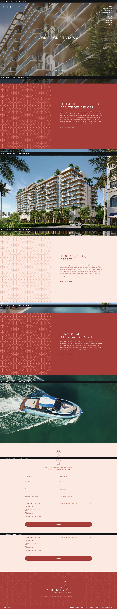
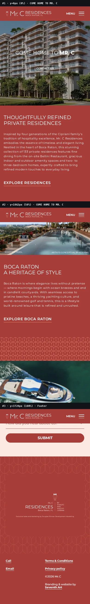

# UI Design System & Master Generation Blueprint: mrcresidencesbocaraton-com

> **Mr. C Residences Boca Raton · New Luxury Residences for Sale** (https://mrcresidencesbocaraton.com) — 133 impeccably designed two- and three-bedroom residences in Downtown Boca Raton, featuring elevated design and a lifestyle defined by Mr...





---

## 1. Executive Visual Persona & Design Archetype

- **Brand Essence & Persona**: **Mr. C Residences Boca Raton · New Luxury Residences for Sale** (`https://mrcresidencesbocaraton.com`). 133 impeccably designed two- and three-bedroom residences in Downtown Boca Raton, featuring elevated design and a lifestyle defined by Mr...
- **Capture Provenance**: Live browser capture (`tier1_fast`, HTTP `200`, captured `2026-11-24`).
- **Visual Archetype**: **High-Contrast Obsidian / Atmospheric Design System (`#a73c38` canvas, `#ffffff` ink, `#185abc` accent)**.
- **Anti-AI-Slop Differentiators**:
  - **Live-Computed Chromatic Polarity**: Anchors the viewport in `#a73c38` (live computed `section` `background-color` (`computed_styles.json`)) paired with `#ffffff` primary typography and `#185abc` accents.
  - **Grounded Typographic Hierarchy**: Pairs `Montserrat-Regular` for display copy (`COME HOME TO MR. C`) with `Montserrat-SemiBold`.
  - **Calibrated Spatial Grid & Motion**: Combines `1620px` container bounds (`gap: 40px`, padding `40px`) with `cubic-bezier(0.16,1,0.3,1)` easing and Three.js / WebGL Canvas Pipeline, Swiper Touch Carousel Engine.

---

## 2. Spatial Architecture & Modular Grid Mathematics

### Viewport Allocation & Container Geometry
- **Captured Journey Filmstrips**: Desktop `1280×6624px` (`assets/desktop-journey.webp`, `8` keyframes up to `y=6465px` / doc `7365px`), Mobile `390×2616px` (`assets/mobile-journey.webp`, `3` keyframes).
- **Master Container Bounds**: `1620px` (non-`@media` desktop container stylesheet rule).
- **Canvas Lateral Padding & Spacing**: `40px` lateral canvas padding with `40px` grid gap.
- **Border Radius Scale**: `50px`, `30px`, `1px`, `3px`.

### Responsive Breakpoint Architecture
- **Desktop Layout**: Multi-column CSS Grid / Flexbox layout at `1440px` (`max-width: 1620px`, `gap: 40px`).
- **Mobile Layout**: Single-column vertical stack at `390px` viewport width with `40px` horizontal padding.
- **Extracted CSS Media Queries**: `@media (max-width: 600px)`, `@media (max-width: 768px)`, `@media (max-width: 1080px)`, `@media (max-width: 1500px)`.

---

## 3. Color System, Materiality & Atmospheric Lighting

### Semantic Palette & Source Grounding
| Semantic Role | Ground-Truth Value | Extracted Live / CSS Source |
|---|---|---|
| **Primary Canvas Substrate** | `#a73c38` | live computed `section` `background-color` (`computed_styles.json`) |
| **Primary Typography Ink** | `#ffffff` | live computed `h1` `color` (`computed_styles.json`) |
| **Elevated Surface / Card Substrate** | `#000000` | `.hero_wrap .parallax_wrap .tint... { background: #000000 }` |
| **Interactive Accent / Highlight** | `#185abc` | `.rc-2fa-submit-button-holder bu... { background-color: #185abc }` |
| **Secondary / Muted Copy** | `#000000` | live computed `footer` `color` (`computed_styles.json`) |
| **Structural Hairline Border** | `#dddddd` | `var(--border-color)` in `:root` |
| **Variable Token (`--text-color`)** | `#111111` | `var(--text-color)` in `:root` |
| **Variable Token (`--head-bg-color`)** | `#d9edf7` | `var(--head-bg-color)` in `:root` |
| **Variable Token (`--even-bg-color`)** | `#f9f9f9` | `var(--even-bg-color)` in `:root` |
| **Variable Token (`--hover-bg-color`)** | `#f3f3f3` | `var(--hover-bg-color)` in `:root` |
| **Variable Token (`--head-active-bg-color`)** | `#049cdb` | `var(--head-active-bg-color)` in `:root` |

### Sanitized Root CSS Variables (`ui-ux.md` Ground Truth)
| Variable Name | Extracted Value | Semantic Role |
|---|---|---|
| `--text-color` | `#111` | Typography Ink Token |
| `--head-text-color` | `var(--text-color)` | Typography Ink Token |
| `--head-bg-color` | `#d9edf7` | Canvas / Surface Token |
| `--odd-text-color` | `var(--text-color)` | Typography Ink Token |
| `--odd-bg-color` | `#fff` | Canvas / Surface Token |
| `--even-text-color` | `var(--text-color)` | Typography Ink Token |
| `--even-bg-color` | `#f9f9f9` | Canvas / Surface Token |
| `--hover-text-color` | `var(--text-color)` | Typography Ink Token |
| `--hover-bg-color` | `#f3f3f3` | Canvas / Surface Token |
| `--border-color` | `#ddd` | Brand / Palette Token |
| `--padding` | `0.5rem` | Layout / Spatial Grid Token |
| `--head-active-bg-color` | `#049cdb` | Canvas / Surface Token |
| `--head-active-text-color` | `var(--head-text-color)` | Typography Ink Token |
| `--head-sort-arrow-color` | `var(--head-active-text-color)` | Brand / Palette Token |
| `--mrcresidencesboc-bg` | `#a73c38` | Canvas Substrate (from live computed `section` `background-color` (`computed_styles.json`)) |
| `--mrcresidencesboc-ink` | `#ffffff` | Primary Typography Ink (computed-derived) |

---

## 4. Typographic Scale & Editorial Hierarchy

### Font Family Stacks
- **Display Typography**: `Montserrat-Regular`.
- **Primary Body Stack**: `Montserrat-SemiBold`.
- **Technical / Metadata Stack**: not declared in live computed styles (uses primary stack / `ui-monospace`).

### Typographic Scale & Rules (Live Computed & Stylesheet Grounded)
- **Hero Display (`H1`)**: live computed `h1` (`font-size: 42px`, `line-height: 48.3px`, `font-weight: 400`); rule `h1` (`font-size: 2em`).
- **Section Heading (`H2`)**: rule `h2` (`font-size: 14px`, `line-height: 1.6em`).
- **Body Copy**: live computed `body` (`font-size: 16px`, `line-height: 18.4px`, `font-weight: 400`); rule `p` (`font-size: 11px`).
- **Metadata & Navigation Labels**: live computed `nav/a` (`font-size: 16px`, `line-height: 18.4px`, `font-weight: 400`); rule `small` (`font-size: 80%`).

---

## 5. Choreographed Motion & Interaction Physics

### Primary Easing Curves
- **Extracted Timing Functions**: `cubic-bezier(0.16,1,0.3,1)`, `cubic-bezier(.49,.78,.46,1.34)`.

### Per-Element Transition & Choreography Rules
- **Selector `.custom-combobox .cs-option`**: `transition: all 0.4s` extracted from `mrcresidencesbocaraton-com` stylesheet.
- **Selector `.bottom_image .footer-logo`**: `transition: 0.5s all` extracted from `mrcresidencesbocaraton-com` stylesheet.
- **Selector `footer .right a:after`**: `transition: transform 0.25s ease-out` extracted from `mrcresidencesbocaraton-com` stylesheet.
- **Extracted Easing Curve (`cubic-bezier(0.16,1,0.3,1)`)**: Governs interactive state transitions across `<header.large>` and `<section.full-width-image>`.
- **Runtime Interaction Engine**: Integrates Three.js / WebGL Canvas Pipeline, Swiper Touch Carousel Engine, Lottie Vector Animation Player, Barba.js Page Transition Router with `prefers-reduced-motion: reduce` fallback guards.
### Measured Runtime Scroll & Interaction Telemetry (`behavioral_journey_v2`)
- **Scroll Driver Mode**: `native` (max document height `7365px`, deepest scrollY reached `6465px` across `8` desktop keyframes).
- **Detected Scroll / Motion Libraries**: Native browser scroll / standard CSS transitions.
- **Hover Physics (`primary_cta` · `CONTACT US`)**: `color`: `rgb(255, 255, 255)` -> `rgb(15, 15, 15)`; `backgroundColor`: `rgba(0, 0, 0, 0)` -> `rgba(255, 255, 255, 0.94)` (`transition-duration: 0.5s`, `timing: ease`).
- **Route Transition Architecture**: First internal navigation (`/news/`) measured as `MPA` in `1593ms`.

---

## 6. Component Wireframe & Structural DOM Map

### Visual Layout Schematic — Desktop (`1440px`, Grounded in `dom.html` & Landmark Bounding Boxes)
```
┌────────────────────────────────────────────────────────────────────────┐
│ DESKTOP VIEWPORT (1440px) — Mr. C Residences Boca Raton · New Luxury R │
│ ====================================================================== │
│ [ <header.large> (1440x284px)         | Home · THE MR. C STORY · Res ] │
│ ---------------------------------------------------------------------- │
│ | HERO STAGE: <section.patern_text> (w=1440px)                       | │
│ | H1: COME HOME TO MR. C                                             | │
│ | Substrate: #a73c38 | Ink: #ffffff | Accent: #185abc                | │
│ ---------------------------------------------------------------------- │
│ | SHOWCASE GRID (<section.full-width-image>) max-w: 1620px           | │
│ | +------------------------------+  +------------------------------+ | │
│ | | Services & Amenities         |  | 2 Bedroom 2 Bedroom Plus Den | | │
│ | +------------------------------+  +------------------------------+ | │
│ ---------------------------------------------------------------------- │
│ | DETAIL MODULE (<section.light>) — 2 Bedroom Plus Den               | │
│ ---------------------------------------------------------------------- │
│ [ FOOTER (<footer.page>       ) | https://mrcresidencesbocaraton.com   │
└────────────────────────────────────────────────────────────────────────┘
```

### Visual Layout Schematic — Mobile Reflow (`390px`)
```
┌────────────────────────────────────────────────────────────────────────┐
│ MOBILE VIEWPORT REFLOW (390px) — Single-Column Stack (gap: 40px)       │
│ ====================================================================== │
│ [ HEADER BAR (<header.large>          ) | Compact Menu (390px)         │
│ ---------------------------------------------------------------------- │
│ | HERO STAGE (<section.patern_text>) — 390px Vertical Lead           | │
│ | H1: COME HOME TO MR. C                                             | │
│ ---------------------------------------------------------------------- │
│ | SHOWCASE STACK (<section.full-width-im) — 1-Col Stack              | │
│ | [ Item 1: Services & Amenities                                   ] | │
│ | [ Item 2: 2 Bedroom 2 Bedroom Plus Den 3 Bedroom 3 Bedroom       ] | │
│ ---------------------------------------------------------------------- │
│ | DETAIL STACK (<section.light>) — 1-Col (2 Bedroom Plus Den)        | │
│ ---------------------------------------------------------------------- │
│ [ FOOTER (<footer.page>       ) | Stacked 390px Colophon               │
└────────────────────────────────────────────────────────────────────────┘
```

### Granular DOM Region Breakdown
1. **Brand Header & Navigation Bar (<header.large> — `mrcresidencesbocaraton-com`)**:
   - Landmark `<header class="large">` (`1440x284px`) hosting `Mr. C Residences Boca Raton · New Lu` navigation (`Home · THE MR. C STORY · Residences · Services & Amenities · Neighborhood`), DOM attributes (`data-key="dss5024"`, `data-domain="stats-dss5024-serving..."`, `data-src="https://mrcresidences..."`, `data-src="https://mrcresidences..."`), and stylesheet rule `body { overscroll-behavior: none; }`.
2. **Hero Stage & Focal Lead (<section.patern_text> — `COME HOME TO MR. C`)**:
   - Landmark `<section class="patern_text dark">` presenting display lead `COME HOME TO MR. C` and copy excerpt *"Services & Amenities"* over `#a73c38` canvas and `#ffffff` ink.
3. **Primary Showcase & Content Grid (<section.full-width-image> — `Services & Amenities`)**:
   - Landmark `<section class="full-width-image">` rendering section `Services & Amenities` with copy *"2 Bedroom 2 Bedroom Plus Den 3 Bedroom 3 Bedroom Plus Den"*, asset references (`xmlrpc.php`, `oaiq.min.js`, `1839718990069567`, `fbevents.js`), and grid rule `strong { font-weight: bold; }`.
4. **Interactive Detail & Feature Matrix (<section.light> — `2 Bedroom 2 Bedroom Plus Den 3 Bed`)**:
   - Landmark `<section class="patern_text light">` framing `2 Bedroom 2 Bedroom Plus Den 3 Bedroom 3 Bedroom` and `2 Bedroom Plus Den` (*"2 Bedroom Plus Den"*) with `#000000` surface cards, `#185abc` accents, and `.has-bgr { background-size: cover; background-position: center center; background-r... }`.
5. **Colophon & Global Directory Footer (<footer.page> — `https://mrcresidencesbocaraton.com`)**:
   - Landmark `<footer class="page">` anchoring `Mr. C Residences Boca Raton · Ne` footer links (`Home · THE MR. C STORY · Residences · Services & Amenities · Neighborhood`), copy *"3 Bedroom Plus Den"*, and `#dddddd` structural dividers.
### Full Vertical Scroll Sequence (Desktop `1440×900` Keyframes)
- **Step 01** (`y=0px`, `0%`): Active landmark `COME HOME TO MR. C` · sticky/fixed elements: `2`
- **Step 02** (`y=850px`, `13%`): Active landmark `COME HOME TO MR. C` · sticky/fixed elements: `1`
- **Step 03** (`y=1700px`, `26%`): Active landmark `COME HOME TO MR. C` · sticky/fixed elements: `1`
- **Step 04** (`y=2550px`, `39%`): Active landmark `COME HOME TO MR. C` · sticky/fixed elements: `1`
- **Step 05** (`y=4250px`, `66%`): Active landmark `COME HOME TO MR. C` · sticky/fixed elements: `1`
- **Step 06** (`y=5100px`, `79%`): Active landmark `COME HOME TO MR. C` · sticky/fixed elements: `1`
- **Step 07** (`y=5950px`, `92%`): Active landmark `Section @ 92%` · sticky/fixed elements: `1`
- **Step 08** (`y=6465px`, `100%`): Active landmark `Footer` · sticky/fixed elements: `1`

### Multi-Page Internal Route Map
- **Listing Route (`/news/`)**: `https://mrcresidencesbocaraton.com/news/` — H1: `News`, scrollHeight `2710px`, transition `MPA` (`1593ms`)
- **About Route (`/team/`)**: `https://mrcresidencesbocaraton.com/team/` — H1: `DESIGN COLLABORATION`, scrollHeight `8101px`, transition `direct` (`666ms`)
- **About Route (`/contact/`)**: `https://mrcresidencesbocaraton.com/contact/` — H1: `CONTACT US`, scrollHeight `1783px`, transition `direct` (`315ms`)

---

## 7. Master Zero-Shot AI Generation Prompt

```markdown
# Master Zero-Shot Frontend Generation Prompt: mrcresidencesbocaraton-com (Mr. C Residences Boca Raton · New Luxury Residences for Sale)

You are a principal frontend architect and design systems engineer. Build a complete, production-ready web application replicating the exact design system, DOM landmarks, typographic hierarchy, color tokens, and motion physics of `mrcresidencesbocaraton-com` (**Mr. C Residences Boca Raton · New Luxury Residences for Sale** — `https://mrcresidencesbocaraton.com`).

### 1. Visual Archetype & Anti-AI-Slop Mandates
- **Archetype**: High-Contrast Obsidian / Atmospheric Design System (`#a73c38` canvas, `#ffffff` ink, `#185abc` accent).
- **Identity & Domain Context**: 133 impeccably designed two- and three-bedroom residences in Downtown Boca Raton, featuring elevated design and a lifestyle defined by Mr...
- **Primary Substrate**: `#a73c38` (live computed `section` `background-color` (`computed_styles.json`)), **Primary Ink**: `#ffffff`, **Accent / Highlight**: `#185abc`.
- **Site-Specific Differentiators**:
  - **Live-Computed Chromatic Polarity**: Anchors the viewport in `#a73c38` (live computed `section` `background-color` (`computed_styles.json`)) paired with `#ffffff` primary typography and `#185abc` accents.
  - **Grounded Typographic Hierarchy**: Pairs `Montserrat-Regular` for display copy (`COME HOME TO MR. C`) with `Montserrat-SemiBold`.
  - **Calibrated Spatial Grid & Motion**: Combines `1620px` container bounds (`gap: 40px`, padding `40px`) with `cubic-bezier(0.16,1,0.3,1)` easing and Three.js / WebGL Canvas Pipeline, Swiper Touch Carousel Engine.

### 2. Ground-Truth CSS Variables (`:root` Token Contract)
Declare and consume these exact custom properties extracted from `mrcresidencesbocaraton-com` in your global stylesheet:

:root {
  /* Mr. C Residences Boca Raton · New Luxury Residences for Sale (mrcresidencesbocaraton-com) — Live-Grounded CSS Variables */
  --text-color: #111; /* Typography Ink Token (mrcresidencesbocaraton-com) */
  --head-text-color: var(--text-color); /* Typography Ink Token (mrcresidencesbocaraton-com) */
  --head-bg-color: #d9edf7; /* Canvas / Surface Token (mrcresidencesbocaraton-com) */
  --odd-text-color: var(--text-color); /* Typography Ink Token (mrcresidencesbocaraton-com) */
  --odd-bg-color: #fff; /* Canvas / Surface Token (mrcresidencesbocaraton-com) */
  --even-text-color: var(--text-color); /* Typography Ink Token (mrcresidencesbocaraton-com) */
  --even-bg-color: #f9f9f9; /* Canvas / Surface Token (mrcresidencesbocaraton-com) */
  --hover-text-color: var(--text-color); /* Typography Ink Token (mrcresidencesbocaraton-com) */
  --hover-bg-color: #f3f3f3; /* Canvas / Surface Token (mrcresidencesbocaraton-com) */
  --border-color: #ddd; /* Brand / Palette Token (mrcresidencesbocaraton-com) */
  --padding: 0.5rem; /* Layout / Spatial Grid Token (mrcresidencesbocaraton-com) */
  --head-active-bg-color: #049cdb; /* Canvas / Surface Token (mrcresidencesbocaraton-com) */
  --head-active-text-color: var(--head-text-color); /* Typography Ink Token (mrcresidencesbocaraton-com) */
  --head-sort-arrow-color: var(--head-active-text-color); /* Brand / Palette Token (mrcresidencesbocaraton-com) */
  --mrcresidencesboc-bg: #a73c38; /* Canvas Substrate (from live computed `section` `background-color` (`computed_styles.json`)) (mrcresidencesbocaraton-com) */
  --mrcresidencesboc-ink: #ffffff; /* Primary Typography Ink (computed-derived) (mrcresidencesbocaraton-com) */
}

### 3. Semantic Color & Materiality Contract
Map every surface, ink, and border strictly to these source-grounded tokens:
- **Primary Canvas Substrate**: `#a73c38` — grounded in live computed `section` `background-color` (`computed_styles.json`)
- **Primary Typography Ink**: `#ffffff` — grounded in live computed `h1` `color` (`computed_styles.json`)
- **Elevated Surface / Card Substrate**: `#000000` — grounded in `.hero_wrap .parallax_wrap .tint... { background: #000000 }`
- **Interactive Accent / Highlight**: `#185abc` — grounded in `.rc-2fa-submit-button-holder bu... { background-color: #185abc }`
- **Secondary / Muted Copy**: `#000000` — grounded in live computed `footer` `color` (`computed_styles.json`)
- **Structural Hairline Border**: `#dddddd` — grounded in `var(--border-color)` in `:root`
- **Variable Token (`--text-color`)**: `#111111` — grounded in `var(--text-color)` in `:root`
- **Variable Token (`--head-bg-color`)**: `#d9edf7` — grounded in `var(--head-bg-color)` in `:root`
- **Variable Token (`--even-bg-color`)**: `#f9f9f9` — grounded in `var(--even-bg-color)` in `:root`
- **Variable Token (`--hover-bg-color`)**: `#f3f3f3` — grounded in `var(--hover-bg-color)` in `:root`
- **Variable Token (`--head-active-bg-color`)**: `#049cdb` — grounded in `var(--head-active-bg-color)` in `:root`

### 4. Spatial Grid, Container Bounds & Responsive Breakpoints
- **Desktop Viewport Reference**: `1280×6624px` (multi-frame vertical journey filmstrip (6624px), `1440px` standard desktop width).
- **Mobile Viewport Reference**: `390×2616px` (multi-frame vertical journey filmstrip (2616px), `390px` standard mobile width).
- **Container Max-Width**: `1620px` (non-`@media` desktop container stylesheet rule)
- **Padding & Gutters**: `40px` lateral canvas padding with `40px` grid gap
- **Desktop Grid**: Multi-column CSS Grid / Flexbox layout at `1440px` (`max-width: 1620px`, `gap: 40px`)
- **Mobile Adaptation**: Single-column vertical stack at `390px` viewport width with `40px` horizontal padding
- **Media Queries**: `@media (max-width: 600px)`, `@media (max-width: 768px)`, `@media (max-width: 1080px)`, `@media (max-width: 1500px)`
- **Corner Radii**: `50px`, `30px`, `1px`, `3px`

### 5. Typography & Editorial Scale Contract
- **Display Font Stack**: `Montserrat-Regular`
- **Body Font Stack**: `Montserrat-SemiBold`
- **Monospace / Technical Font Stack**: not declared in live computed styles (uses primary stack / `ui-monospace`)
- **H1 Display Rule**: live computed `h1` (`font-size: 42px`, `line-height: 48.3px`, `font-weight: 400`); rule `h1` (`font-size: 2em`)
- **H2 Section Rule**: rule `h2` (`font-size: 14px`, `line-height: 1.6em`)
- **Body Copy Rule**: live computed `body` (`font-size: 16px`, `line-height: 18.4px`, `font-weight: 400`); rule `p` (`font-size: 11px`)
- **Metadata & Index Rule**: live computed `nav/a` (`font-size: 16px`, `line-height: 18.4px`, `font-weight: 400`); rule `small` (`font-size: 80%`)

### 6. Component Hierarchy, Verbatim Copy & Real DOM Landmarks
Scaffold `mrcresidencesbocaraton-com` (`Mr. C Residences Boca Raton · New Luxury Residences for Sale`) with these exact structural regions, extracted copy, and CSS rules from `dom.html`:
1. **Brand Header & Navigation Bar (<header.large> — `mrcresidencesbocaraton-com`)**:
   - DOM & Selectors: Landmark `<header class="large">` (`1440x284px`) hosting `Mr. C Residences Boca Raton · New Lu` navigation (`Home · THE MR. C STORY · Residences · Services & Amenities · Neighborhood`), DOM attributes (`data-key="dss5024"`, `data-domain="stats-dss5024-serving..."`, `data-src="https://mrcresidences..."`, `data-src="https://mrcresidences..."`), and stylesheet rule `body { overscroll-behavior: none; }`.
   - Responsive Contract: Header `Brand Header & Navigation Bar (<header.large> — `mrcresidencesbocaraton-com`)` (`mrcresidencesbocaraton-com`) adapts across `@media (max-width: 600px)`, `@media (max-width: 768px)`, `@media (max-width: 1080px)`, `@media (max-width: 1500px)` with `cubic-bezier(0.16,1,0.3,1)`, `cubic-bezier(.49,.78,.46,1.34)` transitions and links `Home · THE MR. C STORY · Residences · Services & Amenities · Neighborhood`.
2. **Hero Stage & Focal Lead (<section.patern_text> — `COME HOME TO MR. C`)**:
   - DOM & Selectors: Landmark `<section class="patern_text dark">` presenting display lead `COME HOME TO MR. C` and copy excerpt *"Services & Amenities"* over `#a73c38` canvas and `#ffffff` ink.
   - Responsive Contract: Hero stage (`1280×6624px` desktop / `390×2616px` mobile) sets `#a73c38` background with `#ffffff` headline `COME HOME TO MR. C`.
3. **Primary Showcase & Content Grid (<section.full-width-image> — `Services & Amenities`)**:
   - DOM & Selectors: Landmark `<section class="full-width-image">` rendering section `Services & Amenities` with copy *"2 Bedroom 2 Bedroom Plus Den 3 Bedroom 3 Bedroom Plus Den"*, asset references (`xmlrpc.php`, `oaiq.min.js`, `1839718990069567`, `fbevents.js`), and grid rule `strong { font-weight: bold; }`.
   - Responsive Contract: Showcase grid `Primary Showcase & Content Grid (<section.full-width-image> — `Services & Amenities`)` applies Multi-column CSS Grid / Flexbox layout at `1440px` (`max-width: 1620px`, `gap: 40px`) on desktop and Single-column vertical stack at `390px` viewport width with `40px` horizontal padding on mobile.
4. **Interactive Detail & Feature Matrix (<section.light> — `2 Bedroom 2 Bedroom Plus Den 3 Bed`)**:
   - DOM & Selectors: Landmark `<section class="patern_text light">` framing `2 Bedroom 2 Bedroom Plus Den 3 Bedroom 3 Bedroom` and `2 Bedroom Plus Den` (*"2 Bedroom Plus Den"*) with `#000000` surface cards, `#185abc` accents, and `.has-bgr { background-size: cover; background-position: center center; background-r... }`.
   - Responsive Contract: Detail module `Interactive Detail & Feature Matrix (<section.light> — `2 Bedroom 2 Bedroom Plus Den 3 Bed`)` uses `50px`, `30px`, `1px`, `3px` radii, `#185abc` highlights, and assets (xmlrpc.php, oaiq.min.js, 1839718990069567).
5. **Colophon & Global Directory Footer (<footer.page> — `https://mrcresidencesbocaraton.com`)**:
   - DOM & Selectors: Landmark `<footer class="page">` anchoring `Mr. C Residences Boca Raton · Ne` footer links (`Home · THE MR. C STORY · Residences · Services & Amenities · Neighborhood`), copy *"3 Bedroom Plus Den"*, and `#dddddd` structural dividers.
   - Responsive Contract: Footer `Colophon & Global Directory Footer (<footer.page> — `https://mrcresidencesbocaraton.com`)` aligns to `1620px` (non-`@media` desktop container stylesheet rule) with `40px` lateral canvas padding with `40px` grid gap and attributes (data-key="dss5024", data-domain="stats-dss5024-serving...", data-src="https://mrcresidences...").

#### Verbatim DOM Copy Excerpts (`dom.html`)
- Copy Excerpt 1: *"Services & Amenities"*
- Copy Excerpt 2: *"2 Bedroom 2 Bedroom Plus Den 3 Bedroom 3 Bedroom Plus Den"*
- Copy Excerpt 3: *"2 Bedroom Plus Den"*
- Copy Excerpt 4: *"3 Bedroom Plus Den"*

### 7. Motion, Extracted Stylesheet Rules & Interaction Choreography
- **Primary Easing Functions**: `cubic-bezier(0.16,1,0.3,1)`, `cubic-bezier(.49,.78,.46,1.34)`
- **Extracted Stylesheet Rules (`mrcresidencesbocaraton-com`)**:
- `body { overscroll-behavior: none; }`
- `strong { font-weight: bold; }`
- `.has-bgr { background-size: cover; background-position: center center; background-r... }`
- `.clearfix { zoom: 1; }`
- `.clearfix:after { content: "\0020"; display: block; height: 0; overflow: hidden; }`
- **Per-Selector Transition Rules**:
- **Selector `.custom-combobox .cs-option`**: `transition: all 0.4s` extracted from `mrcresidencesbocaraton-com` stylesheet.
- **Selector `.bottom_image .footer-logo`**: `transition: 0.5s all` extracted from `mrcresidencesbocaraton-com` stylesheet.
- **Selector `footer .right a:after`**: `transition: transform 0.25s ease-out` extracted from `mrcresidencesbocaraton-com` stylesheet.
- **Extracted Easing Curve (`cubic-bezier(0.16,1,0.3,1)`)**: Governs interactive state transitions across `<header.large>` and `<section.full-width-image>`.
- **Runtime Interaction Engine**: Integrates Three.js / WebGL Canvas Pipeline, Swiper Touch Carousel Engine, Lottie Vector Animation Player, Barba.js Page Transition Router with `prefers-reduced-motion: reduce` fallback guards.
### 7b. Full-Page Scroll Choreography, Interactive States & Multi-Page Routes
- **Scroll Mechanics**: Implement `native` vertical progression up to `7365px` across 8 distinct viewport chapters.
- **Vertical Chapter Sequence**: COME HOME TO MR. C (0%) -> COME HOME TO MR. C (13%) -> COME HOME TO MR. C (26%) -> COME HOME TO MR. C (39%) -> COME HOME TO MR. C (66%) -> COME HOME TO MR. C (79%) -> Section @ 92% (92%) -> Footer (100%).
- **Hover Micro-Interaction (`primary_cta`)**: Animate `color, backgroundColor` with `0.5s ease`.
- **Multi-Page Routes**: Scaffold internal routes `/news/` (listing, MPA), `/team/` (about, direct), `/contact/` (about, direct) sharing the global header/footer shell and design tokens.

### 8. Technical Deliverables
- Implement in Next.js (App Router) with TypeScript and Tailwind CSS consuming the `:root` custom properties defined above for `mrcresidencesbocaraton-com`.
- Reproduce both the `1440px` desktop architecture and `390px` mobile breakpoint transitions, preserving semantic HTML5 landmarks (`<header>`, `<nav>`, `<main>`, `<section>`, `<footer>`) and `prefers-reduced-motion` accessibility guards.
```
---

## 8. Full-Page Scroll Journey, Interactive States & Subpage Inventory

### Desktop Scroll Keyframes (`1440×900` WebP)
| Step | Scroll Y | Progress | Active Landmark / Section | Sticky/Fixed | Visual Asset |
| :---: | :---: | :---: | :--- | :---: | :--- |
| `#01` | `0px` | `0%` | COME HOME TO MR. C | `2` | [desktop-step-01.webp](assets/desktop-step-01.webp) |
| `#02` | `850px` | `13%` | COME HOME TO MR. C | `1` | [desktop-step-02.webp](assets/desktop-step-02.webp) |
| `#03` | `1700px` | `26%` | COME HOME TO MR. C | `1` | [desktop-step-03.webp](assets/desktop-step-03.webp) |
| `#04` | `2550px` | `39%` | COME HOME TO MR. C | `1` | [desktop-step-04.webp](assets/desktop-step-04.webp) |
| `#05` | `4250px` | `66%` | COME HOME TO MR. C | `1` | [desktop-step-05.webp](assets/desktop-step-05.webp) |
| `#06` | `5100px` | `79%` | COME HOME TO MR. C | `1` | [desktop-step-06.webp](assets/desktop-step-06.webp) |
| `#07` | `5950px` | `92%` | Section @ 92% | `1` | [desktop-step-07.webp](assets/desktop-step-07.webp) |
| `#08` | `6465px` | `100%` | Footer | `1` | [desktop-step-08.webp](assets/desktop-step-08.webp) |

### Mobile Condensed Keyframes (`390×844` WebP)
| Step | Scroll Y | Progress | Active Landmark | Visual Asset |
| :---: | :---: | :---: | :--- | :--- |
| `#01` | `0px` | `0%` | COME HOME TO MR. C | [mobile-step-01.webp](assets/mobile-step-01.webp) |
| `#02` | `1862px` | `50%` | COME HOME TO MR. C | [mobile-step-02.webp](assets/mobile-step-02.webp) |
| `#03` | `3724px` | `100%` | Footer | [mobile-step-03.webp](assets/mobile-step-03.webp) |

### Internal Subpage Filmstrips (`1080px` Wide WebP)
| # | Template | Route URL | H1 / Title | Scroll Height | Transition | Filmstrip Asset |
| :-: | :---: | :--- | :--- | :---: | :---: | :--- |
| `1` | `listing` | `https://mrcresidencesbocaraton.com/news/` | News | `2710px` | `MPA` (`1593ms`) | [subpage-01-news.webp](assets/subpage-01-news.webp) |
| `2` | `about` | `https://mrcresidencesbocaraton.com/team/` | DESIGN COLLABORATION | `8101px` | `direct` (`666ms`) | [subpage-02-team.webp](assets/subpage-02-team.webp) |
| `3` | `about` | `https://mrcresidencesbocaraton.com/contact/` | CONTACT US | `1783px` | `direct` (`315ms`) | [subpage-03-contact.webp](assets/subpage-03-contact.webp) |

