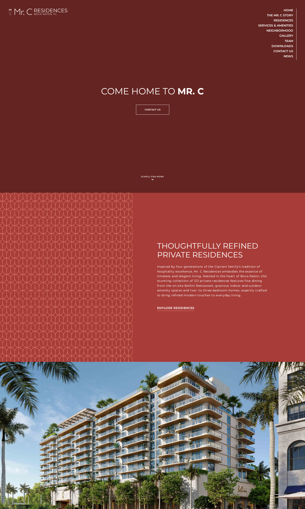
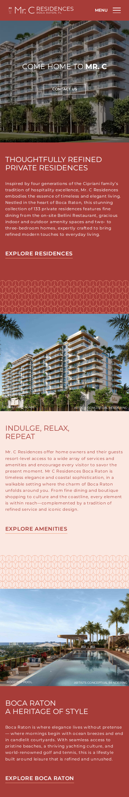

# UI Design System & Master Generation Blueprint: mrcresidencesbocaraton-com

> **Mr. C Residences Boca Raton · New Luxury Residences for Sale** (https://mrcresidencesbocaraton.com) — 133 impeccably designed two- and three-bedroom residences in Downtown Boca Raton, featuring elevated design and a lifestyle defined by Mr...



---

## 1. Executive Visual Persona & Design Archetype

- **Brand Essence & Persona**: **Mr. C Residences Boca Raton · New Luxury Residences for Sale** (`https://mrcresidencesbocaraton.com`). 133 impeccably designed two- and three-bedroom residences in Downtown Boca Raton, featuring elevated design and a lifestyle defined by Mr...
- **Visual Archetype**: **High-Contrast Obsidian / Atmospheric Design System (`#111` canvas, `#fff` ink, `#f9f9f9` accent)**.
- **Anti-AI-Slop Differentiators**:
  - **Source-Grounded Chromatic Polarity**: Anchors the viewport in `#111` (`var(--text-color)` in `:root`) paired with `#fff` primary typography and `#f9f9f9` accents.
  - **Extracted Typographic Hierarchy**: Pairs `Montserrat-Bold` for display copy (`COME HOME TO MR. C`) with `Montserrat-Medium` and not declared in static CSS (uses primary stack / `ui-monospace`).
  - **Calibrated Spatial Grid & Motion**: Combines `767px` container bounds (`gap: 4px`, padding `0.5rem`) with `cubic-bezier(0.16,1,0.3,1)` easing and Three.js / WebGL Canvas Pipeline, Swiper Touch Carousel Engine.

---

## 2. Spatial Architecture & Modular Grid Mathematics



### Viewport Allocation & Container Geometry
- **Captured Viewport Dimensions**: Desktop `1440×7365px` (`assets/desktop.png`, full-page scroll capture), Mobile `390×2400px` (`assets/mobile.png`, capped at 2400px multi-section capture).
- **Master Container Bounds**: `767px` extracted from `mrcresidencesbocaraton-com` stylesheet.
- **Canvas Lateral Padding & Spacing**: `0.5rem` lateral canvas padding with `4px` grid gap.
- **Border Radius Scale**: `2px`, `30px`, `50px`, `1px`.

### Responsive Breakpoint Architecture
- **Desktop Layout**: Multi-column CSS Grid / Flexbox layout at `1440px` (`max-width: 767px`, `gap: 4px`).
- **Mobile Layout**: Single-column vertical stack at `390px` viewport width with `0.5rem` horizontal padding.
- **Extracted CSS Media Queries**: `@media screen and (max-width:767px)`, `@media (max-width: 600px)`, `@media (max-width: 768px)`, `@media (max-width: 1080px)`.

---

## 3. Color System, Materiality & Atmospheric Lighting

### Semantic Palette & Source Grounding
| Semantic Role | Ground-Truth Value | Extracted CSS Source / Selector |
|---|---|---|
| **Primary Canvas Substrate** | `#111` | `var(--text-color)` in `:root` |
| **Primary Typography Ink** | `#d9edf7` | `var(--head-bg-color)` in `:root` |
| **Elevated Surface / Card Substrate** | `#fff` | `var(--odd-bg-color)` in `:root` |
| **Interactive Accent / Highlight** | `#f9f9f9` | `var(--even-bg-color)` in `:root` |
| **Secondary / Muted Copy** | `#f3f3f3` | `var(--hover-bg-color)` in `:root` |
| **Structural Hairline Border** | `#ddd` | `var(--border-color)` in `:root` |
| **Variable Token (`--head-active-bg-color`)** | `#049cdb` | `var(--head-active-bg-color)` in `:root` |

### Sanitized Root CSS Variables (`ui-ux.md` Ground Truth)
| Variable Name | Extracted Value | Semantic Role |
|---|---|---|
| `--text-color` | `#111` | Typography Ink Token |
| `--head-text-color` | `var(--text-color)` | Typography Ink Token |
| `--head-bg-color` | `#d9edf7` | Canvas / Surface Token |
| `--odd-text-color` | `var(--text-color)` | Typography Ink Token |
| `--odd-bg-color` | `#fff` | Canvas / Surface Token |
| `--even-text-color` | `var(--text-color)` | Typography Ink Token |
| `--even-bg-color` | `#f9f9f9` | Canvas / Surface Token |
| `--hover-text-color` | `var(--text-color)` | Typography Ink Token |
| `--hover-bg-color` | `#f3f3f3` | Canvas / Surface Token |
| `--border-color` | `#ddd` | Brand / Palette Token |
| `--padding` | `0.5rem` | Layout / Spatial Grid Token |
| `--head-active-bg-color` | `#049cdb` | Canvas / Surface Token |
| `--head-active-text-color` | `var(--head-text-color)` | Typography Ink Token |
| `--head-sort-arrow-color` | `var(--head-active-text-color)` | Brand / Palette Token |
| `--mrcresidencesboc-bg` | `#111` | Canvas Substrate (from `var(--text-color)` in `:root`) |
| `--mrcresidencesboc-ink` | `#fff` | Primary Typography Ink (stylesheet-derived) |

---

## 4. Typographic Scale & Editorial Hierarchy

### Font Family Stacks
- **Display Typography**: `Montserrat-Bold`.
- **Primary Body Stack**: `Montserrat-Medium`.
- **Technical / Metadata Stack**: not declared in static CSS (uses primary stack / `ui-monospace`).

### Typographic Scale & Rules (Extracted from Stylesheet & Variables)
- **Hero Display (`H1`)**: rule `h1` (`font-size: 2em`).
- **Section Heading (`H2`)**: rule `h2` (`font-size: 14px`, `line-height: 1.6em`).
- **Body Copy**: rule `p` (`font-size: 11px`).
- **Metadata & Navigation Labels**: rule `small` (`font-size: 80%`).

---

## 5. Choreographed Motion & Interaction Physics

### Primary Easing Curves
- **Extracted Timing Functions**: `cubic-bezier(0.16,1,0.3,1)`.

### Per-Element Transition & Choreography Rules
- **Selector `.custom-combobox .cs-option`**: `transition: all 0.4s` extracted from `mrcresidencesbocaraton-com` stylesheet.
- **Selector `.bottom_image .footer-logo`**: `transition: 0.5s all` extracted from `mrcresidencesbocaraton-com` stylesheet.
- **Selector `footer .right a:after`**: `transition: transform 0.25s ease-out` extracted from `mrcresidencesbocaraton-com` stylesheet.
- **Extracted Easing Curve (`cubic-bezier(0.16,1,0.3,1)`)**: Governs interactive state transitions across `<header.large>` and `<section.full-width-image>`.
- **Runtime Interaction Engine**: Integrates Three.js / WebGL Canvas Pipeline, Swiper Touch Carousel Engine, Lottie Vector Animation Player, Barba.js Page Transition Router with `prefers-reduced-motion: reduce` fallback guards.

---

## 6. Component Wireframe & Structural DOM Map

### Visual Layout Schematic (Grounded in `dom.html` — `1440px` Desktop & `390px` Mobile Reflow)
```
┌────────────────────────────────────────────────────────────────────────┐
│ DESKTOP VIEWPORT (1440px) — Mr. C Residences Boca Raton · New Luxury R │
│ ====================================================================== │
│ [ <header.large>           | Home · THE MR. C STORY · Residences ·  ]  │
│ ---------------------------------------------------------------------- │
│ | HERO STAGE: <section.patern_text>                                |   │
│ | H1: COME HOME TO MR. C                                           |   │
│ | Substrate: #111       | Ink: #fff       | Accent: #f9f9f9        |   │
│ ---------------------------------------------------------------------- │
│ | SHOWCASE GRID (<section.full-width-image>) max-w: 767px          |   │
│ | +------------------------------+  +------------------------------+ | │
│ | | Services & Amenities         |  | EXPLORE RESIDENCES           | | │
│ | +------------------------------+  +------------------------------+ | │
│ ---------------------------------------------------------------------- │
│ | MOBILE VIEWPORT REFLOW (390px) — Single-Column Stack (gap: 4px   ) | │
│ | [<header.large>] -> [<section.patern_te] -> [<section.full-widt] |   │
│ ---------------------------------------------------------------------- │
│ [ FOOTER (<footer.page>         ) | https://mrcresidencesbocaraton.com │
└────────────────────────────────────────────────────────────────────────┘
```

### Granular DOM Region Breakdown
1. **Brand Header & Navigation Bar (<header.large> — `mrcresidencesbocaraton-com`)**:
   - Landmark `<header class="large">` hosting `Mr. C Residences Boca Raton · New Lu` navigation (`Home · THE MR. C STORY · Residences · Services & Amenities · Neighborhood`), DOM attributes (`data-key="dss5024"`, `data-domain="stats-dss5024-serving..."`, `data-src="https://mrcresidences..."`, `data-src="https://mrcresidences..."`), and stylesheet rule `.tablepress>.row-hover>tr { content-visibility:auto }`.
2. **Hero Stage & Focal Lead (<section.patern_text> — `COME HOME TO MR. C`)**:
   - Landmark `<section class="patern_text dark">` presenting display lead `COME HOME TO MR. C` and copy excerpt *"Services & Amenities"* over `#111` canvas and `#fff` ink.
3. **Primary Showcase & Content Grid (<section.full-width-image> — `Services & Amenities`)**:
   - Landmark `<section class="full-width-image">` rendering section `Services & Amenities` with copy *"EXPLORE RESIDENCES"*, asset references (`xmlrpc.php`, `oaiq.min.js`, `1839718990069567`, `fbevents.js`), and grid rule `.tablepress img { border:none;margin:0;max-width:none;padding:0 }`.
4. **Interactive Detail & Feature Matrix (<section.patern_text> — `EXPLORE RESIDENCES`)**:
   - Landmark `<section class="patern_text light">` framing `EXPLORE RESIDENCES` and `EXPLORE BOCA RATON` (*"EXPLORE BOCA RATON"*) with `#fff` surface cards, `#f9f9f9` accents, and `.tablepress-table-description { clear:both;display:block }`.
5. **Colophon & Global Directory Footer (<footer.page> — `https://mrcresidencesbocaraton.com`)**:
   - Landmark `<footer class="page">` anchoring `Mr. C Residences Boca Raton · Ne` footer links (`Home · THE MR. C STORY · Residences · Services & Amenities · Neighborhood`), copy *"Antigua and Barbuda"*, and `#ddd` structural dividers.

---

## 7. Master Zero-Shot AI Generation Prompt

```markdown
# Master Zero-Shot Frontend Generation Prompt: mrcresidencesbocaraton-com (Mr. C Residences Boca Raton · New Luxury Residences for Sale)

You are a principal frontend architect and design systems engineer. Build a complete, production-ready web application replicating the exact design system, DOM landmarks, typographic hierarchy, color tokens, and motion physics of `mrcresidencesbocaraton-com` (**Mr. C Residences Boca Raton · New Luxury Residences for Sale** — `https://mrcresidencesbocaraton.com`).

### 1. Visual Archetype & Anti-AI-Slop Mandates
- **Archetype**: High-Contrast Obsidian / Atmospheric Design System (`#111` canvas, `#fff` ink, `#f9f9f9` accent).
- **Identity & Domain Context**: 133 impeccably designed two- and three-bedroom residences in Downtown Boca Raton, featuring elevated design and a lifestyle defined by Mr...
- **Primary Substrate**: `#111` (`var(--text-color)` in `:root`), **Primary Ink**: `#fff`, **Accent / Highlight**: `#f9f9f9`.
- **Site-Specific Differentiators**:
  - **Source-Grounded Chromatic Polarity**: Anchors the viewport in `#111` (`var(--text-color)` in `:root`) paired with `#fff` primary typography and `#f9f9f9` accents.
  - **Extracted Typographic Hierarchy**: Pairs `Montserrat-Bold` for display copy (`COME HOME TO MR. C`) with `Montserrat-Medium` and not declared in static CSS (uses primary stack / `ui-monospace`).
  - **Calibrated Spatial Grid & Motion**: Combines `767px` container bounds (`gap: 4px`, padding `0.5rem`) with `cubic-bezier(0.16,1,0.3,1)` easing and Three.js / WebGL Canvas Pipeline, Swiper Touch Carousel Engine.

### 2. Ground-Truth CSS Variables (`:root` Token Contract)
Declare and consume these exact custom properties extracted from `mrcresidencesbocaraton-com` in your global stylesheet:

:root {
  /* Mr. C Residences Boca Raton · New Luxury Residences for Sale (mrcresidencesbocaraton-com) — Ground-Truth Extracted CSS Variables */
  --text-color: #111; /* Typography Ink Token (mrcresidencesbocaraton-com) */
  --head-text-color: var(--text-color); /* Typography Ink Token (mrcresidencesbocaraton-com) */
  --head-bg-color: #d9edf7; /* Canvas / Surface Token (mrcresidencesbocaraton-com) */
  --odd-text-color: var(--text-color); /* Typography Ink Token (mrcresidencesbocaraton-com) */
  --odd-bg-color: #fff; /* Canvas / Surface Token (mrcresidencesbocaraton-com) */
  --even-text-color: var(--text-color); /* Typography Ink Token (mrcresidencesbocaraton-com) */
  --even-bg-color: #f9f9f9; /* Canvas / Surface Token (mrcresidencesbocaraton-com) */
  --hover-text-color: var(--text-color); /* Typography Ink Token (mrcresidencesbocaraton-com) */
  --hover-bg-color: #f3f3f3; /* Canvas / Surface Token (mrcresidencesbocaraton-com) */
  --border-color: #ddd; /* Brand / Palette Token (mrcresidencesbocaraton-com) */
  --padding: 0.5rem; /* Layout / Spatial Grid Token (mrcresidencesbocaraton-com) */
  --head-active-bg-color: #049cdb; /* Canvas / Surface Token (mrcresidencesbocaraton-com) */
  --head-active-text-color: var(--head-text-color); /* Typography Ink Token (mrcresidencesbocaraton-com) */
  --head-sort-arrow-color: var(--head-active-text-color); /* Brand / Palette Token (mrcresidencesbocaraton-com) */
  --mrcresidencesboc-bg: #111; /* Canvas Substrate (from `var(--text-color)` in `:root`) (mrcresidencesbocaraton-com) */
  --mrcresidencesboc-ink: #fff; /* Primary Typography Ink (stylesheet-derived) (mrcresidencesbocaraton-com) */
}

### 3. Semantic Color & Materiality Contract
Map every surface, ink, and border strictly to these source-grounded tokens:
- **Primary Canvas Substrate**: `#111` — grounded in `var(--text-color)` in `:root`
- **Primary Typography Ink**: `#d9edf7` — grounded in `var(--head-bg-color)` in `:root`
- **Elevated Surface / Card Substrate**: `#fff` — grounded in `var(--odd-bg-color)` in `:root`
- **Interactive Accent / Highlight**: `#f9f9f9` — grounded in `var(--even-bg-color)` in `:root`
- **Secondary / Muted Copy**: `#f3f3f3` — grounded in `var(--hover-bg-color)` in `:root`
- **Structural Hairline Border**: `#ddd` — grounded in `var(--border-color)` in `:root`
- **Variable Token (`--head-active-bg-color`)**: `#049cdb` — grounded in `var(--head-active-bg-color)` in `:root`

### 4. Spatial Grid, Container Bounds & Responsive Breakpoints
- **Desktop Viewport Reference**: `1440×7365px` (full-page scroll capture, `1440px` standard desktop width).
- **Mobile Viewport Reference**: `390×2400px` (capped at 2400px multi-section capture, `390px` standard mobile width).
- **Container Max-Width**: `767px` extracted from `mrcresidencesbocaraton-com` stylesheet
- **Padding & Gutters**: `0.5rem` lateral canvas padding with `4px` grid gap
- **Desktop Grid**: Multi-column CSS Grid / Flexbox layout at `1440px` (`max-width: 767px`, `gap: 4px`)
- **Mobile Adaptation**: Single-column vertical stack at `390px` viewport width with `0.5rem` horizontal padding
- **Media Queries**: `@media screen and (max-width:767px)`, `@media (max-width: 600px)`, `@media (max-width: 768px)`, `@media (max-width: 1080px)`
- **Corner Radii**: `2px`, `30px`, `50px`, `1px`

### 5. Typography & Editorial Scale Contract
- **Display Font Stack**: `Montserrat-Bold`
- **Body Font Stack**: `Montserrat-Medium`
- **Monospace / Technical Font Stack**: not declared in static CSS (uses primary stack / `ui-monospace`)
- **H1 Display Rule**: rule `h1` (`font-size: 2em`)
- **H2 Section Rule**: rule `h2` (`font-size: 14px`, `line-height: 1.6em`)
- **Body Copy Rule**: rule `p` (`font-size: 11px`)
- **Metadata & Index Rule**: rule `small` (`font-size: 80%`)

### 6. Component Hierarchy, Verbatim Copy & Real DOM Landmarks
Scaffold `mrcresidencesbocaraton-com` (`Mr. C Residences Boca Raton · New Luxury Residences for Sale`) with these exact structural regions, extracted copy, and CSS rules from `dom.html`:
1. **Brand Header & Navigation Bar (<header.large> — `mrcresidencesbocaraton-com`)**:
   - DOM & Selectors: Landmark `<header class="large">` hosting `Mr. C Residences Boca Raton · New Lu` navigation (`Home · THE MR. C STORY · Residences · Services & Amenities · Neighborhood`), DOM attributes (`data-key="dss5024"`, `data-domain="stats-dss5024-serving..."`, `data-src="https://mrcresidences..."`, `data-src="https://mrcresidences..."`), and stylesheet rule `.tablepress>.row-hover>tr { content-visibility:auto }`.
   - Responsive Contract: Header `Brand Header & Navigation Bar (<header.large> — `mrcresidencesbocaraton-com`)` (`mrcresidencesbocaraton-com`) adapts across `@media screen and (max-width:767px)`, `@media (max-width: 600px)`, `@media (max-width: 768px)`, `@media (max-width: 1080px)` with `cubic-bezier(0.16,1,0.3,1)` transitions and links `Home · THE MR. C STORY · Residences · Services & Amenities · Neighborhood`.
2. **Hero Stage & Focal Lead (<section.patern_text> — `COME HOME TO MR. C`)**:
   - DOM & Selectors: Landmark `<section class="patern_text dark">` presenting display lead `COME HOME TO MR. C` and copy excerpt *"Services & Amenities"* over `#111` canvas and `#fff` ink.
   - Responsive Contract: Hero stage (`1440×7365px` desktop / `390×2400px` mobile) sets `#111` background with `#fff` headline `COME HOME TO MR. C`.
3. **Primary Showcase & Content Grid (<section.full-width-image> — `Services & Amenities`)**:
   - DOM & Selectors: Landmark `<section class="full-width-image">` rendering section `Services & Amenities` with copy *"EXPLORE RESIDENCES"*, asset references (`xmlrpc.php`, `oaiq.min.js`, `1839718990069567`, `fbevents.js`), and grid rule `.tablepress img { border:none;margin:0;max-width:none;padding:0 }`.
   - Responsive Contract: Showcase grid `Primary Showcase & Content Grid (<section.full-width-image> — `Services & Amenities`)` applies Multi-column CSS Grid / Flexbox layout at `1440px` (`max-width: 767px`, `gap: 4px`) on desktop and Single-column vertical stack at `390px` viewport width with `0.5rem` horizontal padding on mobile.
4. **Interactive Detail & Feature Matrix (<section.patern_text> — `EXPLORE RESIDENCES`)**:
   - DOM & Selectors: Landmark `<section class="patern_text light">` framing `EXPLORE RESIDENCES` and `EXPLORE BOCA RATON` (*"EXPLORE BOCA RATON"*) with `#fff` surface cards, `#f9f9f9` accents, and `.tablepress-table-description { clear:both;display:block }`.
   - Responsive Contract: Detail module `Interactive Detail & Feature Matrix (<section.patern_text> — `EXPLORE RESIDENCES`)` uses `2px`, `30px`, `50px`, `1px` radii, `#f9f9f9` highlights, and assets (xmlrpc.php, oaiq.min.js, 1839718990069567).
5. **Colophon & Global Directory Footer (<footer.page> — `https://mrcresidencesbocaraton.com`)**:
   - DOM & Selectors: Landmark `<footer class="page">` anchoring `Mr. C Residences Boca Raton · Ne` footer links (`Home · THE MR. C STORY · Residences · Services & Amenities · Neighborhood`), copy *"Antigua and Barbuda"*, and `#ddd` structural dividers.
   - Responsive Contract: Footer `Colophon & Global Directory Footer (<footer.page> — `https://mrcresidencesbocaraton.com`)` aligns to `767px` extracted from `mrcresidencesbocaraton-com` stylesheet with `0.5rem` lateral canvas padding with `4px` grid gap and attributes (data-key="dss5024", data-domain="stats-dss5024-serving...", data-src="https://mrcresidences...").

#### Verbatim DOM Copy Excerpts (`dom.html`)
- Copy Excerpt 1: *"Services & Amenities"*
- Copy Excerpt 2: *"EXPLORE RESIDENCES"*
- Copy Excerpt 3: *"EXPLORE BOCA RATON"*
- Copy Excerpt 4: *"Antigua and Barbuda"*

### 7. Motion, Extracted Stylesheet Rules & Interaction Choreography
- **Primary Easing Functions**: `cubic-bezier(0.16,1,0.3,1)`
- **Extracted Stylesheet Rules (`mrcresidencesbocaraton-com`)**:
- `.tablepress>.row-hover>tr { content-visibility:auto }`
- `.tablepress img { border:none;margin:0;max-width:none;padding:0 }`
- `.tablepress-table-description { clear:both;display:block }`
- `.dt-scroll { width:100% }`
- `.dt-scroll .tablepress { width:100%!important }`
- **Per-Selector Transition Rules**:
- **Selector `.custom-combobox .cs-option`**: `transition: all 0.4s` extracted from `mrcresidencesbocaraton-com` stylesheet.
- **Selector `.bottom_image .footer-logo`**: `transition: 0.5s all` extracted from `mrcresidencesbocaraton-com` stylesheet.
- **Selector `footer .right a:after`**: `transition: transform 0.25s ease-out` extracted from `mrcresidencesbocaraton-com` stylesheet.
- **Extracted Easing Curve (`cubic-bezier(0.16,1,0.3,1)`)**: Governs interactive state transitions across `<header.large>` and `<section.full-width-image>`.
- **Runtime Interaction Engine**: Integrates Three.js / WebGL Canvas Pipeline, Swiper Touch Carousel Engine, Lottie Vector Animation Player, Barba.js Page Transition Router with `prefers-reduced-motion: reduce` fallback guards.

### 8. Technical Deliverables
- Implement in Next.js (App Router) with TypeScript and Tailwind CSS consuming the `:root` custom properties defined above for `mrcresidencesbocaraton-com`.
- Reproduce both the `1440px` desktop architecture and `390px` mobile breakpoint transitions, preserving semantic HTML5 landmarks (`<header>`, `<nav>`, `<main>`, `<section>`, `<footer>`) and `prefers-reduced-motion` accessibility guards.
```
