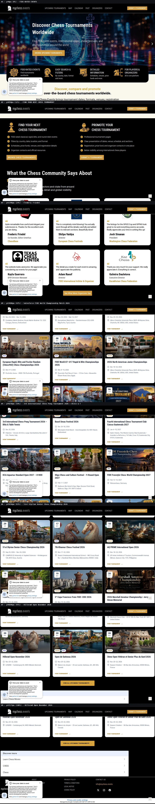
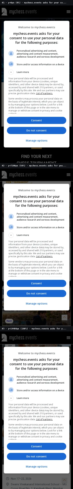

# UI Design System & Master Generation Blueprint: mychess-events

> **Find Chess Tournaments Worldwide · MyChess.Events** (https://mychess.events/) — Find chess tournaments worldwide. Explore FIDE-rated classical, rapid and blitz events, schedules, venues and registration details.





---

## 1. Executive Visual Persona & Design Archetype

- **Brand Essence & Persona**: **Find Chess Tournaments Worldwide · MyChess.Events** (`https://mychess.events/`). Find chess tournaments worldwide. Explore FIDE-rated classical, rapid and blitz events, schedules, venues and registration details.
- **Capture Provenance**: Live browser capture (`tier1_fast`, HTTP `200`, captured `2026-11-24`).
- **Visual Archetype**: **High-Contrast Obsidian / Atmospheric Design System (`#000000` canvas, `#ffffff` ink, `#0096ff` accent)**.
- **Anti-AI-Slop Differentiators**:
  - **Live-Computed Chromatic Polarity**: Anchors the viewport in `#000000` (live computed `body` `background-color` (`computed_styles.json`)) paired with `#ffffff` primary typography and `#0096ff` accents.
  - **Grounded Typographic Hierarchy**: Pairs `Open Sans` for display copy (`Manage your data`) with `Roboto`.
  - **Calibrated Spatial Grid & Motion**: Combines `1480px` container bounds (`gap: 20px`, padding `10px`) with `cubic-bezier(.58,.3,.005,1)` easing and Swiper Touch Carousel Engine, Lottie Vector Animation Player.

---

## 2. Spatial Architecture & Modular Grid Mathematics

### Viewport Allocation & Container Geometry
- **Captured Journey Filmstrips**: Desktop `1280×6624px` (`assets/desktop-journey.webp`, `8` keyframes up to `y=7173px` / doc `8073px`), Mobile `390×2616px` (`assets/mobile-journey.webp`, `3` keyframes).
- **Master Container Bounds**: `1480px` (non-`@media` desktop container stylesheet rule).
- **Canvas Lateral Padding & Spacing**: `10px` lateral canvas padding with `20px` grid gap.
- **Border Radius Scale**: `2px`, `13.6px`, `50px`, `50%`.

### Responsive Breakpoint Architecture
- **Desktop Layout**: Multi-column CSS Grid / Flexbox layout at `1440px` (`max-width: 1480px`, `gap: 20px`).
- **Mobile Layout**: Single-column vertical stack at `390px` viewport width with `10px` horizontal padding.
- **Extracted CSS Media Queries**: `@media (min-width:768px) and (max-width:921px)`, `@media (min-width:769px) and (max-width:921px)`, `@media (max-width:768px)`, `@media (max-width:992px)`.

---

## 3. Color System, Materiality & Atmospheric Lighting

### Semantic Palette & Source Grounding
| Semantic Role | Ground-Truth Value | Extracted Live / CSS Source |
|---|---|---|
| **Primary Canvas Substrate** | `#000000` | live computed `body` `background-color` (`computed_styles.json`) |
| **Primary Typography Ink** | `#ffffff` | live computed `h2` `color` (`computed_styles.json`) |
| **Elevated Surface / Card Substrate** | `#0b0b0b` | live computed `footer` `background-color` (`computed_styles.json`) |
| **Interactive Accent / Highlight** | `#0096ff` | `var(--wpem-primary-color)` in `:root` |
| **Secondary / Muted Copy** | `#7d7d7d` | `var(--tp-secondary-text-color)` in `:root` |
| **Structural Hairline Border** | `#333647` | `var(--tp-dark-stroke-color)` in `:root` |
| **Variable Token (`--ast-code-block-background`)** | `#eceff3` | `var(--ast-code-block-background)` in `:root` |
| **Variable Token (`--ast-comment-inputs-background`)** | `#f9fafb` | `var(--ast-comment-inputs-background)` in `:root` |

### Sanitized Root CSS Variables (`ui-ux.md` Ground Truth)
| Variable Name | Extracted Value | Semantic Role |
|---|---|---|
| `--ast-post-nav-space` | `0` | Layout / Spatial Grid Token |
| `--ast-container-default-xlg-padding` | `2.5em` | Layout / Spatial Grid Token |
| `--ast-container-default-lg-padding` | `2.5em` | Layout / Spatial Grid Token |
| `--ast-container-default-slg-padding` | `2em` | Layout / Spatial Grid Token |
| `--ast-container-default-md-padding` | `2.5em` | Layout / Spatial Grid Token |
| `--ast-container-default-sm-padding` | `2.5em` | Layout / Spatial Grid Token |
| `--ast-container-default-xs-padding` | `2.4em` | Layout / Spatial Grid Token |
| `--ast-container-default-xxs-padding` | `1.8em` | Layout / Spatial Grid Token |
| `--ast-code-block-background` | `#ECEFF3` | Canvas / Surface Token |
| `--ast-comment-inputs-background` | `#F9FAFB` | Canvas / Surface Token |
| `--ast-normal-container-width` | `1440px` | Layout / Spatial Grid Token |
| `--ast-narrow-container-width` | `750px` | Layout / Spatial Grid Token |
| `--ast-blog-title-font-weight` | `600` | Typography / Scale Token |
| `--ast-blog-meta-weight` | `600` | Design System Custom Token |
| `--ast-global-color-primary` | `var(--ast-global-color-5)` | Brand / Palette Token |
| `--ast-global-color-secondary` | `var(--ast-global-color-4)` | Brand / Palette Token |

---

## 4. Typographic Scale & Editorial Hierarchy

### Font Family Stacks
- **Display Typography**: `Open Sans`.
- **Primary Body Stack**: `Roboto`.
- **Technical / Metadata Stack**: not declared in live computed styles (uses primary stack / `ui-monospace`).

### Typographic Scale & Rules (Live Computed & Stylesheet Grounded)
- **Hero Display (`H1`)**: live computed `h1` (`font-size: 18px`, `line-height: normal`, `font-weight: 700`); CSS variables `--page-title-display: block`, `--display: flex`; rule `,h1` (`font-size: 2em`, `line-height: 1.2`).
- **Section Heading (`H2`)**: live computed `h2` (`font-size: 50px`, `line-height: 65px`, `font-weight: 600`); rule `,h2` (`font-size: 1.7em`, `line-height: 1.3`).
- **Body Copy**: live computed `body` (`font-size: 18px`, `line-height: 25.2px`, `font-weight: 400`); rule `p` (`font-size: 20px`, `line-height: 1.65`, `font-weight: 300`).
- **Metadata & Navigation Labels**: live computed `nav/a` (`font-size: 18px`, `line-height: 25.2px`, `font-weight: 400`); CSS variables `--ast-blog-meta-weight: 600`, `--rdp-caption-font-size: 18px`; rule `small` (`font-size: 13px`, `font-weight: 400`).

---

## 5. Choreographed Motion & Interaction Physics

### Primary Easing Curves
- **Extracted Timing Functions**: `cubic-bezier(.58,.3,.005,1)`, `cubic-bezier(.44,0,1,1)`, `cubic-bezier(.5,0,.5,1)`.

### Per-Element Transition & Choreography Rules
- **Selector `.site-title:hover a`**: `transition: all .2s linear` extracted from `mychess-events` stylesheet.
- **Selector `.main-header-menu>a`**: `transition: all .2s linear` extracted from `mychess-events` stylesheet.
- **Selector `.site-header .menu-link *`**: `transition: none` extracted from `mychess-events` stylesheet.
- **Extracted Easing Curve (`cubic-bezier(.58,.3,.005,1)`)**: Governs interactive state transitions across `<header.elementor>` and `<article.mced-home-card:nth(2)>`.
- **Runtime Interaction Engine**: Integrates Swiper Touch Carousel Engine, Lottie Vector Animation Player with `prefers-reduced-motion: reduce` fallback guards.
### Measured Runtime Scroll & Interaction Telemetry (`behavioral_journey_v2`)
- **Scroll Driver Mode**: `native` (max document height `8073px`, deepest scrollY reached `7173px` across `8` desktop keyframes).
- **Detected Scroll / Motion Libraries**: Native browser scroll / standard CSS transitions.
- **Route Transition Architecture**: First internal navigation (`/event/fide-world-junior-u20-championships-2026/`) measured as `direct` in `5386ms`.

---

## 6. Component Wireframe & Structural DOM Map

### Visual Layout Schematic — Desktop (`1440px`, Grounded in `dom.html` & Landmark Bounding Boxes)
```
┌────────────────────────────────────────────────────────────────────────┐
│ DESKTOP VIEWPORT (1440px) — Find Chess Tournaments Worldwide · MyChess │
│ ====================================================================== │
│ [ <header.elementor> (1440x90px)      | UPCOMING TOURNAMENTS · MAP · ] │
│ ---------------------------------------------------------------------- │
│ | HERO STAGE: <article.mced-home-card> (w=1440px)                    | │
│ | H1: Manage your data                                               | │
│ | Substrate: #000000 | Ink: #ffffff | Accent: #0096ff                | │
│ ---------------------------------------------------------------------- │
│ | SHOWCASE GRID (<article.mced-home-card:nt) max-w: 1480px           | │
│ | +------------------------------+  +------------------------------+ | │
│ | | Upcoming Featured Events     |  | FIDE World Junior U20 Champi | | │
│ | +------------------------------+  +------------------------------+ | │
│ ---------------------------------------------------------------------- │
│ | DETAIL MODULE (<article.mced-home-card:nt) — Jordan Aqaba Red Sea  | │
│ ---------------------------------------------------------------------- │
│ [ FOOTER (<footer.elementor>  ) | https://mychess.events/              │
└────────────────────────────────────────────────────────────────────────┘
```

### Visual Layout Schematic — Mobile Reflow (`390px`)
```
┌────────────────────────────────────────────────────────────────────────┐
│ MOBILE VIEWPORT REFLOW (390px) — Single-Column Stack (gap: 20px)       │
│ ====================================================================== │
│ [ HEADER BAR (<header.elementor>      ) | Compact Menu (390px)         │
│ ---------------------------------------------------------------------- │
│ | HERO STAGE (<article.mced-home-card>) — 390px Vertical Lead        | │
│ | H1: Manage your data                                               | │
│ ---------------------------------------------------------------------- │
│ | SHOWCASE STACK (<article.mced-home-car) — 1-Col Stack              | │
│ | [ Item 1: Upcoming Featured Events                               ] | │
│ | [ Item 2: FIDE World Junior U20 Championships 2026               ] | │
│ ---------------------------------------------------------------------- │
│ | DETAIL STACK (<article.mced-home-card:) — 1-Col (Jordan Aqaba Red S) │
│ ---------------------------------------------------------------------- │
│ [ FOOTER (<footer.elementor>  ) | Stacked 390px Colophon               │
└────────────────────────────────────────────────────────────────────────┘
```

### Granular DOM Region Breakdown
1. **Brand Header & Navigation Bar (<header.elementor> — `mychess-events`)**:
   - Landmark `<header class="elementor elementor-191">` (`1440x90px`) hosting `Find Chess Tournaments Worldwide · M` navigation (`UPCOMING TOURNAMENTS · MAP · Calendar · PAST · ORGANIZERS`), DOM attributes (`data-noptimize="1"`, `data-cfasync="false"`, `data-wpfc-render="false"`, `data-noptimize="1"`), and stylesheet rule `html { -webkit-text-size-adjust:100% }`.
2. **Hero Stage & Focal Lead (<article.mced-home-card> — `Manage your data`)**:
   - Landmark `<article class="mced-home-card">` presenting display lead `Manage your data` and copy excerpt *"Find tournaments worldwide"* over `#000000` canvas and `#ffffff` ink.
3. **Primary Showcase & Content Grid (<article.mced-home-card:nth(2)> — `Upcoming Featured Events`)**:
   - Landmark `<article class="mced-home-card">` rendering section `Upcoming Featured Events` with copy *"UPCOMING TOURNAMENTS"*, asset references (`show_ads_impl_fy2021.js`, `clarity.js`, `letmeallez.js`, `uwt.js`), and grid rule `progress { display:inline-block;vertical-align:baseline }`.
4. **Interactive Detail & Feature Matrix (<article.mced-home-card:nth(3)> — `FIDE World Junior U20 Championship`)**:
   - Landmark `<article class="mced-home-card">` framing `FIDE World Junior U20 Championships 2026` and `Jordan Aqaba Red Sea Chess Seminar Tournament 2026` (*"SUBMIT A TOURNAMENT"*) with `#0b0b0b` surface cards, `#0096ff` accents, and `a:visited { text-decoration:none }`.
5. **Colophon & Global Directory Footer (<footer.elementor> — `https://mychess.events/`)**:
   - Landmark `<footer class="elementor elementor-317">` anchoring `Find Chess Tournaments Worldwide` footer links (`UPCOMING TOURNAMENTS · MAP · Calendar · PAST · ORGANIZERS`), copy *"EASY SEARCH & FILTERS"*, and `#333647` structural dividers.
### Full Vertical Scroll Sequence (Desktop `1440×900` Keyframes)
- **Step 01** (`y=0px`, `0%`): Active landmark `FIDE-RATED EVENTS` · sticky/fixed elements: `1`
- **Step 02** (`y=850px`, `12%`): Active landmark `FIND YOUR NEXT CHESS TOURNAMENT` · sticky/fixed elements: `1`
- **Step 03** (`y=1700px`, `24%`): Active landmark `Frederic Friedel` · sticky/fixed elements: `1`
- **Step 04** (`y=3400px`, `47%`): Active landmark `Salesforce FIDE World Championship Match 2026` · sticky/fixed elements: `1`
- **Step 05** (`y=4250px`, `59%`): Active landmark `3rd International Chess Pong Tournament 2026 – Bl...` · sticky/fixed elements: `1`
- **Step 06** (`y=5950px`, `83%`): Active landmark `51st Styrian Senior Chess Championship 2026` · sticky/fixed elements: `1`
- **Step 07** (`y=6800px`, `95%`): Active landmark `Hillerød Open November 2026` · sticky/fixed elements: `1`
- **Step 08** (`y=7173px`, `100%`): Active landmark `Hillerød Open November 2026` · sticky/fixed elements: `1`

### Multi-Page Internal Route Map
- **Detail Route (`/event/fide-world-junior-u20-championships-2026/`)**: `https://mychess.events/event/fide-world-junior-u20-championships-2026/` — H1: `Manage your data`, scrollHeight `14950px`, transition `direct` (`5386ms`)
- **About Route (`/contact/`)**: `https://mychess.events/contact/` — H1: `How Can We Help?`, scrollHeight `1786px`, transition `direct` (`2475ms`)
- **Detail Route (`/event/jordan-aqaba-red-sea-chess-seminar-tournament-2026/`)**: `https://mychess.events/event/jordan-aqaba-red-sea-chess-seminar-tournament-2026/` — H1: `Manage your data`, scrollHeight `8132px`, transition `direct` (`5622ms`)

---

## 7. Master Zero-Shot AI Generation Prompt

```markdown
# Master Zero-Shot Frontend Generation Prompt: mychess-events (Find Chess Tournaments Worldwide · MyChess.Events)

You are a principal frontend architect and design systems engineer. Build a complete, production-ready web application replicating the exact design system, DOM landmarks, typographic hierarchy, color tokens, and motion physics of `mychess-events` (**Find Chess Tournaments Worldwide · MyChess.Events** — `https://mychess.events/`).

### 1. Visual Archetype & Anti-AI-Slop Mandates
- **Archetype**: High-Contrast Obsidian / Atmospheric Design System (`#000000` canvas, `#ffffff` ink, `#0096ff` accent).
- **Identity & Domain Context**: Find chess tournaments worldwide. Explore FIDE-rated classical, rapid and blitz events, schedules, venues and registration details.
- **Primary Substrate**: `#000000` (live computed `body` `background-color` (`computed_styles.json`)), **Primary Ink**: `#ffffff`, **Accent / Highlight**: `#0096ff`.
- **Site-Specific Differentiators**:
  - **Live-Computed Chromatic Polarity**: Anchors the viewport in `#000000` (live computed `body` `background-color` (`computed_styles.json`)) paired with `#ffffff` primary typography and `#0096ff` accents.
  - **Grounded Typographic Hierarchy**: Pairs `Open Sans` for display copy (`Manage your data`) with `Roboto`.
  - **Calibrated Spatial Grid & Motion**: Combines `1480px` container bounds (`gap: 20px`, padding `10px`) with `cubic-bezier(.58,.3,.005,1)` easing and Swiper Touch Carousel Engine, Lottie Vector Animation Player.

### 2. Ground-Truth CSS Variables (`:root` Token Contract)
Declare and consume these exact custom properties extracted from `mychess-events` in your global stylesheet:

:root {
  /* Find Chess Tournaments Worldwide · MyChess.Events (mychess-events) — Live-Grounded CSS Variables */
  --ast-post-nav-space: 0; /* Layout / Spatial Grid Token (mychess-events) */
  --ast-container-default-xlg-padding: 2.5em; /* Layout / Spatial Grid Token (mychess-events) */
  --ast-container-default-lg-padding: 2.5em; /* Layout / Spatial Grid Token (mychess-events) */
  --ast-container-default-slg-padding: 2em; /* Layout / Spatial Grid Token (mychess-events) */
  --ast-container-default-md-padding: 2.5em; /* Layout / Spatial Grid Token (mychess-events) */
  --ast-container-default-sm-padding: 2.5em; /* Layout / Spatial Grid Token (mychess-events) */
  --ast-container-default-xs-padding: 2.4em; /* Layout / Spatial Grid Token (mychess-events) */
  --ast-container-default-xxs-padding: 1.8em; /* Layout / Spatial Grid Token (mychess-events) */
  --ast-code-block-background: #ECEFF3; /* Canvas / Surface Token (mychess-events) */
  --ast-comment-inputs-background: #F9FAFB; /* Canvas / Surface Token (mychess-events) */
  --ast-normal-container-width: 1440px; /* Layout / Spatial Grid Token (mychess-events) */
  --ast-narrow-container-width: 750px; /* Layout / Spatial Grid Token (mychess-events) */
  --ast-blog-title-font-weight: 600; /* Typography / Scale Token (mychess-events) */
  --ast-blog-meta-weight: 600; /* Design System Custom Token (mychess-events) */
  --ast-global-color-primary: var(--ast-global-color-5); /* Brand / Palette Token (mychess-events) */
  --ast-global-color-secondary: var(--ast-global-color-4); /* Brand / Palette Token (mychess-events) */
}

### 3. Semantic Color & Materiality Contract
Map every surface, ink, and border strictly to these source-grounded tokens:
- **Primary Canvas Substrate**: `#000000` — grounded in live computed `body` `background-color` (`computed_styles.json`)
- **Primary Typography Ink**: `#ffffff` — grounded in live computed `h2` `color` (`computed_styles.json`)
- **Elevated Surface / Card Substrate**: `#0b0b0b` — grounded in live computed `footer` `background-color` (`computed_styles.json`)
- **Interactive Accent / Highlight**: `#0096ff` — grounded in `var(--wpem-primary-color)` in `:root`
- **Secondary / Muted Copy**: `#7d7d7d` — grounded in `var(--tp-secondary-text-color)` in `:root`
- **Structural Hairline Border**: `#333647` — grounded in `var(--tp-dark-stroke-color)` in `:root`
- **Variable Token (`--ast-code-block-background`)**: `#eceff3` — grounded in `var(--ast-code-block-background)` in `:root`
- **Variable Token (`--ast-comment-inputs-background`)**: `#f9fafb` — grounded in `var(--ast-comment-inputs-background)` in `:root`

### 4. Spatial Grid, Container Bounds & Responsive Breakpoints
- **Desktop Viewport Reference**: `1280×6624px` (multi-frame vertical journey filmstrip (6624px), `1440px` standard desktop width).
- **Mobile Viewport Reference**: `390×2616px` (multi-frame vertical journey filmstrip (2616px), `390px` standard mobile width).
- **Container Max-Width**: `1480px` (non-`@media` desktop container stylesheet rule)
- **Padding & Gutters**: `10px` lateral canvas padding with `20px` grid gap
- **Desktop Grid**: Multi-column CSS Grid / Flexbox layout at `1440px` (`max-width: 1480px`, `gap: 20px`)
- **Mobile Adaptation**: Single-column vertical stack at `390px` viewport width with `10px` horizontal padding
- **Media Queries**: `@media (min-width:768px) and (max-width:921px)`, `@media (min-width:769px) and (max-width:921px)`, `@media (max-width:768px)`, `@media (max-width:992px)`
- **Corner Radii**: `2px`, `13.6px`, `50px`, `50%`

### 5. Typography & Editorial Scale Contract
- **Display Font Stack**: `Open Sans`
- **Body Font Stack**: `Roboto`
- **Monospace / Technical Font Stack**: not declared in live computed styles (uses primary stack / `ui-monospace`)
- **H1 Display Rule**: live computed `h1` (`font-size: 18px`, `line-height: normal`, `font-weight: 700`); CSS variables `--page-title-display: block`, `--display: flex`; rule `,h1` (`font-size: 2em`, `line-height: 1.2`)
- **H2 Section Rule**: live computed `h2` (`font-size: 50px`, `line-height: 65px`, `font-weight: 600`); rule `,h2` (`font-size: 1.7em`, `line-height: 1.3`)
- **Body Copy Rule**: live computed `body` (`font-size: 18px`, `line-height: 25.2px`, `font-weight: 400`); rule `p` (`font-size: 20px`, `line-height: 1.65`, `font-weight: 300`)
- **Metadata & Index Rule**: live computed `nav/a` (`font-size: 18px`, `line-height: 25.2px`, `font-weight: 400`); CSS variables `--ast-blog-meta-weight: 600`, `--rdp-caption-font-size: 18px`; rule `small` (`font-size: 13px`, `font-weight: 400`)

### 6. Component Hierarchy, Verbatim Copy & Real DOM Landmarks
Scaffold `mychess-events` (`Find Chess Tournaments Worldwide · MyChess.Events`) with these exact structural regions, extracted copy, and CSS rules from `dom.html`:
1. **Brand Header & Navigation Bar (<header.elementor> — `mychess-events`)**:
   - DOM & Selectors: Landmark `<header class="elementor elementor-191">` (`1440x90px`) hosting `Find Chess Tournaments Worldwide · M` navigation (`UPCOMING TOURNAMENTS · MAP · Calendar · PAST · ORGANIZERS`), DOM attributes (`data-noptimize="1"`, `data-cfasync="false"`, `data-wpfc-render="false"`, `data-noptimize="1"`), and stylesheet rule `html { -webkit-text-size-adjust:100% }`.
   - Responsive Contract: Header `Brand Header & Navigation Bar (<header.elementor> — `mychess-events`)` (`mychess-events`) adapts across `@media (min-width:768px) and (max-width:921px)`, `@media (min-width:769px) and (max-width:921px)`, `@media (max-width:768px)`, `@media (max-width:992px)` with `cubic-bezier(.58,.3,.005,1)`, `cubic-bezier(.44,0,1,1)`, `cubic-bezier(.5,0,.5,1)` transitions and links `UPCOMING TOURNAMENTS · MAP · Calendar · PAST · ORGANIZERS`.
2. **Hero Stage & Focal Lead (<article.mced-home-card> — `Manage your data`)**:
   - DOM & Selectors: Landmark `<article class="mced-home-card">` presenting display lead `Manage your data` and copy excerpt *"Find tournaments worldwide"* over `#000000` canvas and `#ffffff` ink.
   - Responsive Contract: Hero stage (`1280×6624px` desktop / `390×2616px` mobile) sets `#000000` background with `#ffffff` headline `Manage your data`.
3. **Primary Showcase & Content Grid (<article.mced-home-card:nth(2)> — `Upcoming Featured Events`)**:
   - DOM & Selectors: Landmark `<article class="mced-home-card">` rendering section `Upcoming Featured Events` with copy *"UPCOMING TOURNAMENTS"*, asset references (`show_ads_impl_fy2021.js`, `clarity.js`, `letmeallez.js`, `uwt.js`), and grid rule `progress { display:inline-block;vertical-align:baseline }`.
   - Responsive Contract: Showcase grid `Primary Showcase & Content Grid (<article.mced-home-card:nth(2)> — `Upcoming Featured Events`)` applies Multi-column CSS Grid / Flexbox layout at `1440px` (`max-width: 1480px`, `gap: 20px`) on desktop and Single-column vertical stack at `390px` viewport width with `10px` horizontal padding on mobile.
4. **Interactive Detail & Feature Matrix (<article.mced-home-card:nth(3)> — `FIDE World Junior U20 Championship`)**:
   - DOM & Selectors: Landmark `<article class="mced-home-card">` framing `FIDE World Junior U20 Championships 2026` and `Jordan Aqaba Red Sea Chess Seminar Tournament 2026` (*"SUBMIT A TOURNAMENT"*) with `#0b0b0b` surface cards, `#0096ff` accents, and `a:visited { text-decoration:none }`.
   - Responsive Contract: Detail module `Interactive Detail & Feature Matrix (<article.mced-home-card:nth(3)> — `FIDE World Junior U20 Championship`)` uses `2px`, `13.6px`, `50px`, `50%` radii, `#0096ff` highlights, and assets (show_ads_impl_fy2021.js, clarity.js, letmeallez.js).
5. **Colophon & Global Directory Footer (<footer.elementor> — `https://mychess.events/`)**:
   - DOM & Selectors: Landmark `<footer class="elementor elementor-317">` anchoring `Find Chess Tournaments Worldwide` footer links (`UPCOMING TOURNAMENTS · MAP · Calendar · PAST · ORGANIZERS`), copy *"EASY SEARCH & FILTERS"*, and `#333647` structural dividers.
   - Responsive Contract: Footer `Colophon & Global Directory Footer (<footer.elementor> — `https://mychess.events/`)` aligns to `1480px` (non-`@media` desktop container stylesheet rule) with `10px` lateral canvas padding with `20px` grid gap and attributes (data-noptimize="1", data-cfasync="false", data-wpfc-render="false").

#### Verbatim DOM Copy Excerpts (`dom.html`)
- Copy Excerpt 1: *"Find tournaments worldwide"*
- Copy Excerpt 2: *"UPCOMING TOURNAMENTS"*
- Copy Excerpt 3: *"SUBMIT A TOURNAMENT"*
- Copy Excerpt 4: *"EASY SEARCH & FILTERS"*

### 7. Motion, Extracted Stylesheet Rules & Interaction Choreography
- **Primary Easing Functions**: `cubic-bezier(.58,.3,.005,1)`, `cubic-bezier(.44,0,1,1)`, `cubic-bezier(.5,0,.5,1)`
- **Extracted Stylesheet Rules (`mychess-events`)**:
- `html { -webkit-text-size-adjust:100% }`
- `progress { display:inline-block;vertical-align:baseline }`
- `a:visited { text-decoration:none }`
- `strong { font-weight:700 }`
- `dfn { font-style:italic }`
- **Per-Selector Transition Rules**:
- **Selector `.site-title:hover a`**: `transition: all .2s linear` extracted from `mychess-events` stylesheet.
- **Selector `.main-header-menu>a`**: `transition: all .2s linear` extracted from `mychess-events` stylesheet.
- **Selector `.site-header .menu-link *`**: `transition: none` extracted from `mychess-events` stylesheet.
- **Extracted Easing Curve (`cubic-bezier(.58,.3,.005,1)`)**: Governs interactive state transitions across `<header.elementor>` and `<article.mced-home-card:nth(2)>`.
- **Runtime Interaction Engine**: Integrates Swiper Touch Carousel Engine, Lottie Vector Animation Player with `prefers-reduced-motion: reduce` fallback guards.
### 7b. Full-Page Scroll Choreography, Interactive States & Multi-Page Routes
- **Scroll Mechanics**: Implement `native` vertical progression up to `8073px` across 8 distinct viewport chapters.
- **Vertical Chapter Sequence**: FIDE-RATED EVENTS (0%) -> FIND YOUR NEXT CHESS TOURNA... (12%) -> Frederic Friedel (24%) -> Salesforce FIDE World Champ... (47%) -> 3rd International Chess Pon... (59%) -> 51st Styrian Senior Chess C... (83%) -> Hillerød Open November 2026 (95%) -> Hillerød Open November 2026 (100%).
- **Multi-Page Routes**: Scaffold internal routes `/event/fide-world-junior-u20-championships-2026/` (detail, direct), `/contact/` (about, direct), `/event/jordan-aqaba-red-sea-chess-seminar-tournament-2026/` (detail, direct) sharing the global header/footer shell and design tokens.

### 8. Technical Deliverables
- Implement in Next.js (App Router) with TypeScript and Tailwind CSS consuming the `:root` custom properties defined above for `mychess-events`.
- Reproduce both the `1440px` desktop architecture and `390px` mobile breakpoint transitions, preserving semantic HTML5 landmarks (`<header>`, `<nav>`, `<main>`, `<section>`, `<footer>`) and `prefers-reduced-motion` accessibility guards.
```
---

## 8. Full-Page Scroll Journey, Interactive States & Subpage Inventory

### Desktop Scroll Keyframes (`1440×900` WebP)
| Step | Scroll Y | Progress | Active Landmark / Section | Sticky/Fixed | Visual Asset |
| :---: | :---: | :---: | :--- | :---: | :--- |
| `#01` | `0px` | `0%` | FIDE-RATED EVENTS | `1` | [desktop-step-01.webp](assets/desktop-step-01.webp) |
| `#02` | `850px` | `12%` | FIND YOUR NEXT CHESS TOURNAMENT | `1` | [desktop-step-02.webp](assets/desktop-step-02.webp) |
| `#03` | `1700px` | `24%` | Frederic Friedel | `1` | [desktop-step-03.webp](assets/desktop-step-03.webp) |
| `#04` | `3400px` | `47%` | Salesforce FIDE World Championship Match 2026 | `1` | [desktop-step-04.webp](assets/desktop-step-04.webp) |
| `#05` | `4250px` | `59%` | 3rd International Chess Pong Tournament 2026... | `1` | [desktop-step-05.webp](assets/desktop-step-05.webp) |
| `#06` | `5950px` | `83%` | 51st Styrian Senior Chess Championship 2026 | `1` | [desktop-step-06.webp](assets/desktop-step-06.webp) |
| `#07` | `6800px` | `95%` | Hillerød Open November 2026 | `1` | [desktop-step-07.webp](assets/desktop-step-07.webp) |
| `#08` | `7173px` | `100%` | Hillerød Open November 2026 | `1` | [desktop-step-08.webp](assets/desktop-step-08.webp) |

### Mobile Condensed Keyframes (`390×844` WebP)
| Step | Scroll Y | Progress | Active Landmark | Visual Asset |
| :---: | :---: | :---: | :--- | :--- |
| `#01` | `0px` | `0%` | mychess.events asks for your consent to u... | [mobile-step-01.webp](assets/mobile-step-01.webp) |
| `#02` | `7200px` | `50%` | mychess.events asks for your consent to u... | [mobile-step-02.webp](assets/mobile-step-02.webp) |
| `#03` | `14400px` | `100%` | mychess.events asks for your consent to u... | [mobile-step-03.webp](assets/mobile-step-03.webp) |

### Internal Subpage Filmstrips (`1080px` Wide WebP)
| # | Template | Route URL | H1 / Title | Scroll Height | Transition | Filmstrip Asset |
| :-: | :---: | :--- | :--- | :---: | :---: | :--- |
| `1` | `detail` | `https://mychess.events/event/fide-world-junior-u20-championships-2026/` | Manage your data | `14950px` | `direct` (`5386ms`) | [subpage-01-event-fide-world-junior-u20-champion.webp](assets/subpage-01-event-fide-world-junior-u20-champion.webp) |
| `2` | `about` | `https://mychess.events/contact/` | How Can We Help? | `1786px` | `direct` (`2475ms`) | [subpage-02-contact.webp](assets/subpage-02-contact.webp) |
| `3` | `detail` | `https://mychess.events/event/jordan-aqaba-red-sea-chess-seminar-tournament-2026/` | Manage your data | `8132px` | `direct` (`5622ms`) | [subpage-03-event-jordan-aqaba-red-sea-chess-sem.webp](assets/subpage-03-event-jordan-aqaba-red-sea-chess-sem.webp) |

