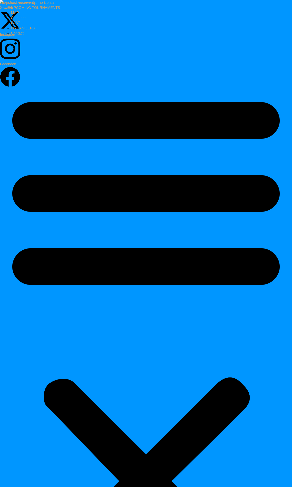

# UI Design System & Master Generation Blueprint: mychess-events

> **Find Chess Tournaments Worldwide · MyChess.Events** (https://mychess.events/) — Find chess tournaments worldwide. Explore FIDE-rated classical, rapid and blitz events, schedules, venues and registration details.



---

## 1. Executive Visual Persona & Design Archetype

- **Brand Essence & Persona**: **Find Chess Tournaments Worldwide · MyChess.Events** (`https://mychess.events/`). Find chess tournaments worldwide. Explore FIDE-rated classical, rapid and blitz events, schedules, venues and registration details.
- **Visual Archetype**: **Light-Substrate Editorial & Modular Grid System (`#0096ff` canvas, `#ffffff` ink, `#ffffff` accent)**.
- **Anti-AI-Slop Differentiators**:
  - **Source-Grounded Chromatic Polarity**: Anchors the viewport in `#0096ff` (`var(--wpem-primary-color)` in `:root`) paired with `#ffffff` primary typography and `#ffffff` accents.
  - **Extracted Typographic Hierarchy**: Pairs `Roboto` for display copy (`FIDE-RATED EVENTS`) with `Roboto Condensed` and not declared in static CSS (uses primary stack / `ui-monospace`).
  - **Calibrated Spatial Grid & Motion**: Combines `100px` container bounds (`gap: 6px`, padding `3px`) with `cubic-bezier(.44,0,1,1)` easing and Swiper Touch Carousel Engine, Lottie Vector Animation Player.

---

## 2. Spatial Architecture & Modular Grid Mathematics


### Viewport Allocation & Container Geometry
- **Captured Viewport Dimensions**: Desktop `1440×2400px` (`assets/desktop.png`, capped at 2400px multi-section capture), Mobile `390×2400px` (`assets/mobile.png`, capped at 2400px multi-section capture).
- **Master Container Bounds**: `100px` extracted from `mychess-events` stylesheet.
- **Canvas Lateral Padding & Spacing**: `3px` lateral canvas padding with `6px` grid gap.
- **Border Radius Scale**: `5px`, `3px`, `50%`, `4px`.

### Responsive Breakpoint Architecture
- **Desktop Layout**: Multi-column CSS Grid / Flexbox layout at `1440px` (`max-width: 100px`, `gap: 6px`).
- **Mobile Layout**: Single-column vertical stack at `390px` viewport width with `3px` horizontal padding.
- **Extracted CSS Media Queries**: `@media only screen and (-webkit-min-device-pixel-ratio:2),only s...`, `@media screen and (max-width:1024px)`, `@media screen and (max-width:992px)`, `@media only screen and (max-width:800px)`.

---

## 3. Color System, Materiality & Atmospheric Lighting

### Semantic Palette & Source Grounding
| Semantic Role | Ground-Truth Value | Extracted CSS Source / Selector |
|---|---|---|
| **Primary Canvas Substrate** | `#0096ff` | `var(--wpem-primary-color)` in `:root` |
| **Primary Typography Ink** | `#111111` | `var(--wpem-dark-color)` in `:root` |
| **Elevated Surface / Card Substrate** | `#555555` | `var(--wpem-gray-color)` in `:root` |
| **Interactive Accent / Highlight** | `#ffffff` | `var(--wpem-white-color)` in `:root` |
| **Secondary / Muted Copy** | `#e4e4e4` | `var(--wpem-gray-border-color)` in `:root` |
| **Structural Hairline Border** | `#f5f5f5` | `var(--wpem-gray-bg-color)` in `:root` |

### Sanitized Root CSS Variables (`ui-ux.md` Ground Truth)
| Variable Name | Extracted Value | Semantic Role |
|---|---|---|
| `--wpem-primary-color` | `#0096ff` | Brand / Palette Token |
| `--wpem-dark-color` | `#111111` | Canvas / Surface Token |
| `--wpem-gray-color` | `#555555` | Brand / Palette Token |
| `--wpem-white-color` | `#ffffff` | Canvas / Surface Token |
| `--wpem-gray-border-color` | `#e4e4e4` | Brand / Palette Token |
| `--wpem-gray-bg-color` | `#f5f5f5` | Canvas / Surface Token |
| `--direction-multiplier` | `1` | Design System Custom Token |
| `--flex-direction` | `initial` | Design System Custom Token |
| `--flex-wrap` | `initial` | Layout / Spatial Grid Token |
| `--justify-content` | `initial` | Design System Custom Token |
| `--align-items` | `initial` | Design System Custom Token |
| `--align-content` | `initial` | Design System Custom Token |
| `--gap` | `initial` | Layout / Spatial Grid Token |
| `--flex-basis` | `initial` | Design System Custom Token |
| `--flex-grow` | `initial` | Design System Custom Token |
| `--flex-shrink` | `initial` | Typography Ink Token |

---

## 4. Typographic Scale & Editorial Hierarchy

### Font Family Stacks
- **Display Typography**: `Roboto`.
- **Primary Body Stack**: `Roboto Condensed`.
- **Technical / Metadata Stack**: not declared in static CSS (uses primary stack / `ui-monospace`).

### Typographic Scale & Rules (Extracted from Stylesheet & Variables)
- **Hero Display (`H1`)**: CSS variables `--page-title-display: block`, `--display: flex`; rule `,h1` (`font-size: 2em`, `line-height: 1.2`).
- **Section Heading (`H2`)**: rule `,h2` (`font-size: 1.7em`, `line-height: 1.3`).
- **Body Copy**: rule `p` (`font-size: 14px`).
- **Metadata & Navigation Labels**: CSS variables `--ast-blog-meta-weight: 600`, `--srfm-color-input-label: var(--ast-global-color-2)`, `--rdp-caption-font-size: 18px`; rule `small` (`font-size: 13px`, `font-weight: 400`).

---

## 5. Choreographed Motion & Interaction Physics

### Primary Easing Curves
- **Extracted Timing Functions**: `cubic-bezier(.44,0,1,1)`, `cubic-bezier(.58,.3,.005,1)`, `cubic-bezier(.5,0,.5,1)`.

### Per-Element Transition & Choreography Rules
- **Selector `.wpem-main a`**: `transition: color .2s` extracted from `mychess-events` stylesheet.
- **Selector `.wpem-alert a`**: `transition: .2s` extracted from `mychess-events` stylesheet.
- **Selector `pagination ul.page-numbers li .pa...`**: `transition: .2s` extracted from `mychess-events` stylesheet.
- **Extracted Easing Curve (`cubic-bezier(.44,0,1,1)`)**: Governs interactive state transitions across `<header.elementor>` and `<article.mced-home-card>`.
- **Runtime Interaction Engine**: Integrates Swiper Touch Carousel Engine, Lottie Vector Animation Player with `prefers-reduced-motion: reduce` fallback guards.

---

## 6. Component Wireframe & Structural DOM Map

### Visual Layout Schematic (Grounded in `dom.html` — `1440px` Desktop & `390px` Mobile Reflow)
```
┌────────────────────────────────────────────────────────────────────────┐
│ DESKTOP VIEWPORT (1440px) — Find Chess Tournaments Worldwide · MyChess │
│ ====================================================================== │
│ [ <header.elementor>       | UPCOMING TOURNAMENTS · MAP · Calendar  ]  │
│ ---------------------------------------------------------------------- │
│ | HERO STAGE: <section.mced-home-events>                           |   │
│ | H1: FIDE-RATED EVENTS                                            |   │
│ | Substrate: #0096ff    | Ink: #ffffff    | Accent: #ffffff        |   │
│ ---------------------------------------------------------------------- │
│ | SHOWCASE GRID (<article.mced-home-card>  ) max-w: 100px          |   │
│ | +------------------------------+  +------------------------------+ | │
│ | | EASY SEARCH & FILTERS        |  | DETAILED INFORMATION         | | │
│ | +------------------------------+  +------------------------------+ | │
│ ---------------------------------------------------------------------- │
│ | MOBILE VIEWPORT REFLOW (390px) — Single-Column Stack (gap: 6px   ) | │
│ | [<header.elementor>] -> [<section.mced-home] -> [<article.mced-home] │
│ ---------------------------------------------------------------------- │
│ [ FOOTER (<footer.elementor>    ) | https://mychess.events/            │
└────────────────────────────────────────────────────────────────────────┘
```

### Granular DOM Region Breakdown
1. **Brand Header & Navigation Bar (<header.elementor> — `mychess-events`)**:
   - Landmark `<header class="elementor elementor-191">` hosting `Find Chess Tournaments Worldwide · M` navigation (`UPCOMING TOURNAMENTS · MAP · Calendar · PAST · ORGANIZERS`), DOM attributes (`data-noptimize="1"`, `data-cfasync="false"`, `data-wpfc-render="false"`, `data-noptimize="1"`), and stylesheet rule `.chosen-container a { cursor:pointer }`.
2. **Hero Stage & Focal Lead (<section.mced-home-events> — `FIDE-RATED EVENTS`)**:
   - Landmark `<section class="mced-home-events">` presenting display lead `FIDE-RATED EVENTS` and copy excerpt *"info@mychess.events"* over `#0096ff` canvas and `#ffffff` ink.
3. **Primary Showcase & Content Grid (<article.mced-home-card> — `EASY SEARCH & FILTERS`)**:
   - Landmark `<article class="mced-home-card">` rendering section `EASY SEARCH & FILTERS` with copy *"UPCOMING TOURNAMENTS"*, asset references (`clarity.js`, `show_ads_impl_fy2021.js`, `letmeallez.js`, `uwt.js`), and grid rule `chosen-container-single .chosen-d... { color:999 }`.
4. **Interactive Detail & Feature Matrix (<article.mced-home-card> — `DETAILED INFORMATION`)**:
   - Landmark `<article class="mced-home-card">` framing `DETAILED INFORMATION` and `FOR PLAYERS & ORGANIZERS` (*"SUBMIT A TOURNAMENT"*) with `#555555` surface cards, `#ffffff` accents, and `en-container-single .chosen-singl... { display:block;overflow:hidden;margin-right:26px;text-overflow:ellipsis;w... }`.
5. **Colophon & Global Directory Footer (<footer.elementor> — `https://mychess.events/`)**:
   - Landmark `<footer class="elementor elementor-317">` anchoring `Find Chess Tournaments Worldwide` footer links (`UPCOMING TOURNAMENTS · MAP · Calendar · PAST · ORGANIZERS`), copy *"BROWSE UPCOMING TOURNAMENTS"*, and `#f5f5f5` structural dividers.

---

## 7. Master Zero-Shot AI Generation Prompt

```markdown
# Master Zero-Shot Frontend Generation Prompt: mychess-events (Find Chess Tournaments Worldwide · MyChess.Events)

You are a principal frontend architect and design systems engineer. Build a complete, production-ready web application replicating the exact design system, DOM landmarks, typographic hierarchy, color tokens, and motion physics of `mychess-events` (**Find Chess Tournaments Worldwide · MyChess.Events** — `https://mychess.events/`).

### 1. Visual Archetype & Anti-AI-Slop Mandates
- **Archetype**: Light-Substrate Editorial & Modular Grid System (`#0096ff` canvas, `#ffffff` ink, `#ffffff` accent).
- **Identity & Domain Context**: Find chess tournaments worldwide. Explore FIDE-rated classical, rapid and blitz events, schedules, venues and registration details.
- **Primary Substrate**: `#0096ff` (`var(--wpem-primary-color)` in `:root`), **Primary Ink**: `#ffffff`, **Accent / Highlight**: `#ffffff`.
- **Site-Specific Differentiators**:
  - **Source-Grounded Chromatic Polarity**: Anchors the viewport in `#0096ff` (`var(--wpem-primary-color)` in `:root`) paired with `#ffffff` primary typography and `#ffffff` accents.
  - **Extracted Typographic Hierarchy**: Pairs `Roboto` for display copy (`FIDE-RATED EVENTS`) with `Roboto Condensed` and not declared in static CSS (uses primary stack / `ui-monospace`).
  - **Calibrated Spatial Grid & Motion**: Combines `100px` container bounds (`gap: 6px`, padding `3px`) with `cubic-bezier(.44,0,1,1)` easing and Swiper Touch Carousel Engine, Lottie Vector Animation Player.

### 2. Ground-Truth CSS Variables (`:root` Token Contract)
Declare and consume these exact custom properties extracted from `mychess-events` in your global stylesheet:

:root {
  /* Find Chess Tournaments Worldwide · MyChess.Events (mychess-events) — Ground-Truth Extracted CSS Variables */
  --wpem-primary-color: #0096ff; /* Brand / Palette Token (mychess-events) */
  --wpem-dark-color: #111111; /* Canvas / Surface Token (mychess-events) */
  --wpem-gray-color: #555555; /* Brand / Palette Token (mychess-events) */
  --wpem-white-color: #ffffff; /* Canvas / Surface Token (mychess-events) */
  --wpem-gray-border-color: #e4e4e4; /* Brand / Palette Token (mychess-events) */
  --wpem-gray-bg-color: #f5f5f5; /* Canvas / Surface Token (mychess-events) */
  --direction-multiplier: 1; /* Design System Custom Token (mychess-events) */
  --flex-direction: initial; /* Design System Custom Token (mychess-events) */
  --flex-wrap: initial; /* Layout / Spatial Grid Token (mychess-events) */
  --justify-content: initial; /* Design System Custom Token (mychess-events) */
  --align-items: initial; /* Design System Custom Token (mychess-events) */
  --align-content: initial; /* Design System Custom Token (mychess-events) */
  --gap: initial; /* Layout / Spatial Grid Token (mychess-events) */
  --flex-basis: initial; /* Design System Custom Token (mychess-events) */
  --flex-grow: initial; /* Design System Custom Token (mychess-events) */
  --flex-shrink: initial; /* Typography Ink Token (mychess-events) */
}

### 3. Semantic Color & Materiality Contract
Map every surface, ink, and border strictly to these source-grounded tokens:
- **Primary Canvas Substrate**: `#0096ff` — grounded in `var(--wpem-primary-color)` in `:root`
- **Primary Typography Ink**: `#111111` — grounded in `var(--wpem-dark-color)` in `:root`
- **Elevated Surface / Card Substrate**: `#555555` — grounded in `var(--wpem-gray-color)` in `:root`
- **Interactive Accent / Highlight**: `#ffffff` — grounded in `var(--wpem-white-color)` in `:root`
- **Secondary / Muted Copy**: `#e4e4e4` — grounded in `var(--wpem-gray-border-color)` in `:root`
- **Structural Hairline Border**: `#f5f5f5` — grounded in `var(--wpem-gray-bg-color)` in `:root`

### 4. Spatial Grid, Container Bounds & Responsive Breakpoints
- **Desktop Viewport Reference**: `1440×2400px` (capped at 2400px multi-section capture, `1440px` standard desktop width).
- **Mobile Viewport Reference**: `390×2400px` (capped at 2400px multi-section capture, `390px` standard mobile width).
- **Container Max-Width**: `100px` extracted from `mychess-events` stylesheet
- **Padding & Gutters**: `3px` lateral canvas padding with `6px` grid gap
- **Desktop Grid**: Multi-column CSS Grid / Flexbox layout at `1440px` (`max-width: 100px`, `gap: 6px`)
- **Mobile Adaptation**: Single-column vertical stack at `390px` viewport width with `3px` horizontal padding
- **Media Queries**: `@media only screen and (-webkit-min-device-pixel-ratio:2),only s...`, `@media screen and (max-width:1024px)`, `@media screen and (max-width:992px)`, `@media only screen and (max-width:800px)`
- **Corner Radii**: `5px`, `3px`, `50%`, `4px`

### 5. Typography & Editorial Scale Contract
- **Display Font Stack**: `Roboto`
- **Body Font Stack**: `Roboto Condensed`
- **Monospace / Technical Font Stack**: not declared in static CSS (uses primary stack / `ui-monospace`)
- **H1 Display Rule**: CSS variables `--page-title-display: block`, `--display: flex`; rule `,h1` (`font-size: 2em`, `line-height: 1.2`)
- **H2 Section Rule**: rule `,h2` (`font-size: 1.7em`, `line-height: 1.3`)
- **Body Copy Rule**: rule `p` (`font-size: 14px`)
- **Metadata & Index Rule**: CSS variables `--ast-blog-meta-weight: 600`, `--srfm-color-input-label: var(--ast-global-color-2)`, `--rdp-caption-font-size: 18px`; rule `small` (`font-size: 13px`, `font-weight: 400`)

### 6. Component Hierarchy, Verbatim Copy & Real DOM Landmarks
Scaffold `mychess-events` (`Find Chess Tournaments Worldwide · MyChess.Events`) with these exact structural regions, extracted copy, and CSS rules from `dom.html`:
1. **Brand Header & Navigation Bar (<header.elementor> — `mychess-events`)**:
   - DOM & Selectors: Landmark `<header class="elementor elementor-191">` hosting `Find Chess Tournaments Worldwide · M` navigation (`UPCOMING TOURNAMENTS · MAP · Calendar · PAST · ORGANIZERS`), DOM attributes (`data-noptimize="1"`, `data-cfasync="false"`, `data-wpfc-render="false"`, `data-noptimize="1"`), and stylesheet rule `.chosen-container a { cursor:pointer }`.
   - Responsive Contract: Header `Brand Header & Navigation Bar (<header.elementor> — `mychess-events`)` (`mychess-events`) adapts across `@media only screen and (-webkit-min-device-pixel-ratio:2),only s...`, `@media screen and (max-width:1024px)`, `@media screen and (max-width:992px)`, `@media only screen and (max-width:800px)` with `cubic-bezier(.44,0,1,1)`, `cubic-bezier(.58,.3,.005,1)`, `cubic-bezier(.5,0,.5,1)` transitions and links `UPCOMING TOURNAMENTS · MAP · Calendar · PAST · ORGANIZERS`.
2. **Hero Stage & Focal Lead (<section.mced-home-events> — `FIDE-RATED EVENTS`)**:
   - DOM & Selectors: Landmark `<section class="mced-home-events">` presenting display lead `FIDE-RATED EVENTS` and copy excerpt *"info@mychess.events"* over `#0096ff` canvas and `#ffffff` ink.
   - Responsive Contract: Hero stage (`1440×2400px` desktop / `390×2400px` mobile) sets `#0096ff` background with `#ffffff` headline `FIDE-RATED EVENTS`.
3. **Primary Showcase & Content Grid (<article.mced-home-card> — `EASY SEARCH & FILTERS`)**:
   - DOM & Selectors: Landmark `<article class="mced-home-card">` rendering section `EASY SEARCH & FILTERS` with copy *"UPCOMING TOURNAMENTS"*, asset references (`clarity.js`, `show_ads_impl_fy2021.js`, `letmeallez.js`, `uwt.js`), and grid rule `chosen-container-single .chosen-d... { color:999 }`.
   - Responsive Contract: Showcase grid `Primary Showcase & Content Grid (<article.mced-home-card> — `EASY SEARCH & FILTERS`)` applies Multi-column CSS Grid / Flexbox layout at `1440px` (`max-width: 100px`, `gap: 6px`) on desktop and Single-column vertical stack at `390px` viewport width with `3px` horizontal padding on mobile.
4. **Interactive Detail & Feature Matrix (<article.mced-home-card> — `DETAILED INFORMATION`)**:
   - DOM & Selectors: Landmark `<article class="mced-home-card">` framing `DETAILED INFORMATION` and `FOR PLAYERS & ORGANIZERS` (*"SUBMIT A TOURNAMENT"*) with `#555555` surface cards, `#ffffff` accents, and `en-container-single .chosen-singl... { display:block;overflow:hidden;margin-right:26px;text-overflow:ellipsis;w... }`.
   - Responsive Contract: Detail module `Interactive Detail & Feature Matrix (<article.mced-home-card> — `DETAILED INFORMATION`)` uses `5px`, `3px`, `50%`, `4px` radii, `#ffffff` highlights, and assets (clarity.js, show_ads_impl_fy2021.js, letmeallez.js).
5. **Colophon & Global Directory Footer (<footer.elementor> — `https://mychess.events/`)**:
   - DOM & Selectors: Landmark `<footer class="elementor elementor-317">` anchoring `Find Chess Tournaments Worldwide` footer links (`UPCOMING TOURNAMENTS · MAP · Calendar · PAST · ORGANIZERS`), copy *"BROWSE UPCOMING TOURNAMENTS"*, and `#f5f5f5` structural dividers.
   - Responsive Contract: Footer `Colophon & Global Directory Footer (<footer.elementor> — `https://mychess.events/`)` aligns to `100px` extracted from `mychess-events` stylesheet with `3px` lateral canvas padding with `6px` grid gap and attributes (data-noptimize="1", data-cfasync="false", data-wpfc-render="false").

#### Verbatim DOM Copy Excerpts (`dom.html`)
- Copy Excerpt 1: *"info@mychess.events"*
- Copy Excerpt 2: *"UPCOMING TOURNAMENTS"*
- Copy Excerpt 3: *"SUBMIT A TOURNAMENT"*
- Copy Excerpt 4: *"BROWSE UPCOMING TOURNAMENTS"*

### 7. Motion, Extracted Stylesheet Rules & Interaction Choreography
- **Primary Easing Functions**: `cubic-bezier(.44,0,1,1)`, `cubic-bezier(.58,.3,.005,1)`, `cubic-bezier(.5,0,.5,1)`
- **Extracted Stylesheet Rules (`mychess-events`)**:
- `.chosen-container a { cursor:pointer }`
- `chosen-container-single .chosen-d... { color:999 }`
- `en-container-single .chosen-singl... { display:block;overflow:hidden;margin-right:26px;text-overflow:ellipsis;w... }`
- `ingle .chosen-single-with-deselec... { margin-right:38px }`
- `osen-disabled .chosen-single abbr... { background-position:-42px -10px }`
- **Per-Selector Transition Rules**:
- **Selector `.wpem-main a`**: `transition: color .2s` extracted from `mychess-events` stylesheet.
- **Selector `.wpem-alert a`**: `transition: .2s` extracted from `mychess-events` stylesheet.
- **Selector `pagination ul.page-numbers li .pa...`**: `transition: .2s` extracted from `mychess-events` stylesheet.
- **Extracted Easing Curve (`cubic-bezier(.44,0,1,1)`)**: Governs interactive state transitions across `<header.elementor>` and `<article.mced-home-card>`.
- **Runtime Interaction Engine**: Integrates Swiper Touch Carousel Engine, Lottie Vector Animation Player with `prefers-reduced-motion: reduce` fallback guards.

### 8. Technical Deliverables
- Implement in Next.js (App Router) with TypeScript and Tailwind CSS consuming the `:root` custom properties defined above for `mychess-events`.
- Reproduce both the `1440px` desktop architecture and `390px` mobile breakpoint transitions, preserving semantic HTML5 landmarks (`<header>`, `<nav>`, `<main>`, `<section>`, `<footer>`) and `prefers-reduced-motion` accessibility guards.
```
