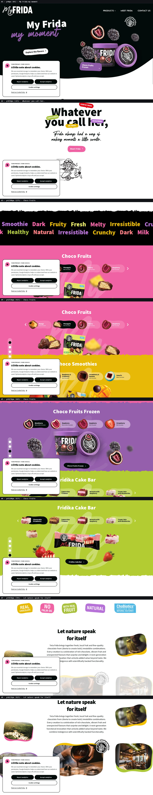
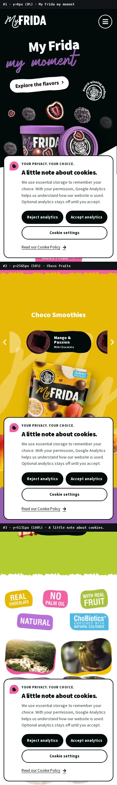

# UI Design System & Master Generation Blueprint: myfrida-com

> **My Frida · Chocolate-Covered Fruit, Smoothies & Cake Bars** (https://myfrida.com/) — Discover My Frida: real fruit wrapped in chocolate, fruity Choco Smoothies, frozen treats and layered Fridika Cake Bars. Find your favour...





---

## 1. Executive Visual Persona & Design Archetype

- **Brand Essence & Persona**: **My Frida · Chocolate-Covered Fruit, Smoothies & Cake Bars** (`https://myfrida.com/`). Discover My Frida: real fruit wrapped in chocolate, fruity Choco Smoothies, frozen treats and layered Fridika Cake Bars. Find your favour...
- **Capture Provenance**: Live browser capture (`tier1_fast`, HTTP `200`, captured `2026-11-24`).
- **Visual Archetype**: **Light-Substrate Editorial & Modular Grid System (`#ffffff` canvas, `#020a0a` ink, `#0d6efd` accent)**.
- **Anti-AI-Slop Differentiators**:
  - **Live-Computed Chromatic Polarity**: Anchors the viewport in `#ffffff` (live computed `body` `background-color` (`computed_styles.json`)) paired with `#020a0a` primary typography and `#0d6efd` accents.
  - **Grounded Typographic Hierarchy**: Uses `Source Sans Pro` across display (`My Frida my moment`) and body copy, paired with `SFMono-Regular` for monospace/code.
  - **Calibrated Spatial Grid & Motion**: Combines `1320px` container bounds (`gap: 48px`, padding `2rem`) with `cubic-bezier(0.22,1,0.36,1)` easing and Lenis Smooth Scroll (`data-lenis`), Three.js / WebGL Canvas Pipeline.

---

## 2. Spatial Architecture & Modular Grid Mathematics

### Viewport Allocation & Container Geometry
- **Captured Journey Filmstrips**: Desktop `1280×6624px` (`assets/desktop-journey.webp`, `8` keyframes up to `y=6218px` / doc `8501px`), Mobile `390×2616px` (`assets/mobile-journey.webp`, `3` keyframes).
- **Master Container Bounds**: `1320px` (non-`@media` desktop container stylesheet rule).
- **Canvas Lateral Padding & Spacing**: `2rem` lateral canvas padding with `48px` grid gap.
- **Border Radius Scale**: `0.375rem`, `.25rem`, `var(--bs-border-radius)`, `var(--bs-border-radius-sm)`.

### Responsive Breakpoint Architecture
- **Desktop Layout**: Multi-column CSS Grid / Flexbox layout at `1440px` (`max-width: 1320px`, `gap: 48px`).
- **Mobile Layout**: Single-column vertical stack at `390px` viewport width with `2rem` horizontal padding.
- **Extracted CSS Media Queries**: `@media (min-width:1200px)`, `@media (min-width:576px)`, `@media (min-width:768px)`, `@media (min-width:992px)`.

---

## 3. Color System, Materiality & Atmospheric Lighting

### Semantic Palette & Source Grounding
| Semantic Role | Ground-Truth Value | Extracted Live / CSS Source |
|---|---|---|
| **Primary Canvas Substrate** | `#ffffff` | live computed `body` `background-color` (`computed_styles.json`) |
| **Primary Typography Ink** | `#020a0a` | live computed `main` `color` (`computed_styles.json`) |
| **Elevated Surface / Card Substrate** | `#f8f9fa` | `var(--bs-tertiary-bg)` in `:root` |
| **Interactive Accent / Highlight** | `#0d6efd` | `var(--bs-primary)` in `:root` |
| **Secondary / Muted Copy** | `#6c757d` | `var(--bs-secondary)` in `:root` |
| **Structural Hairline Border** | `#9ec5fe` | `var(--bs-primary-border-subtle)` in `:root` |
| **Variable Token (`--bs-indigo`)** | `#6610f2` | `var(--bs-indigo)` in `:root` |
| **Variable Token (`--bs-purple`)** | `#6f42c1` | `var(--bs-purple)` in `:root` |
| **Variable Token (`--bs-pink`)** | `#d63384` | `var(--bs-pink)` in `:root` |
| **Variable Token (`--bs-red`)** | `#dc3545` | `var(--bs-red)` in `:root` |
| **Variable Token (`--bs-orange`)** | `#fd7e14` | `var(--bs-orange)` in `:root` |
| **Variable Token (`--bs-yellow`)** | `#ffc107` | `var(--bs-yellow)` in `:root` |
| **Variable Token (`--bs-green`)** | `#198754` | `var(--bs-green)` in `:root` |
| **Variable Token (`--bs-teal`)** | `#20c997` | `var(--bs-teal)` in `:root` |
| **Variable Token (`--bs-cyan`)** | `#0dcaf0` | `var(--bs-cyan)` in `:root` |
| **Variable Token (`--bs-black`)** | `#000000` | `var(--bs-black)` in `:root` |
| **Variable Token (`--bs-gray-dark`)** | `#343a40` | `var(--bs-gray-dark)` in `:root` |
| **Variable Token (`--bs-gray-200`)** | `#e9ecef` | `var(--bs-gray-200)` in `:root` |

### Sanitized Root CSS Variables (`ui-ux.md` Ground Truth)
| Variable Name | Extracted Value | Semantic Role |
|---|---|---|
| `--bs-blue` | `#0d6efd` | Color / Atmospheric Token |
| `--bs-indigo` | `#6610f2` | Color / Atmospheric Token |
| `--bs-purple` | `#6f42c1` | Color / Atmospheric Token |
| `--bs-pink` | `#d63384` | Typography Ink Token |
| `--bs-red` | `#dc3545` | Color / Atmospheric Token |
| `--bs-orange` | `#fd7e14` | Color / Atmospheric Token |
| `--bs-yellow` | `#ffc107` | Color / Atmospheric Token |
| `--bs-green` | `#198754` | Color / Atmospheric Token |
| `--bs-teal` | `#20c997` | Color / Atmospheric Token |
| `--bs-cyan` | `#0dcaf0` | Color / Atmospheric Token |
| `--bs-black` | `#000` | Canvas / Surface Token |
| `--bs-white` | `#fff` | Canvas / Surface Token |
| `--bs-gray` | `#6c757d` | Color / Atmospheric Token |
| `--bs-gray-dark` | `#343a40` | Canvas / Surface Token |
| `--bs-gray-100` | `#f8f9fa` | Color / Atmospheric Token |
| `--bs-gray-200` | `#e9ecef` | Color / Atmospheric Token |

---

## 4. Typographic Scale & Editorial Hierarchy

### Font Family Stacks
- **Display Typography**: `Source Sans Pro`.
- **Primary Body Stack**: `Source Sans Pro`.
- **Technical / Metadata Stack**: `SFMono-Regular`.

### Typographic Scale & Rules (Live Computed & Stylesheet Grounded)
- **Hero Display (`H1`)**: live computed `h1` (`font-size: 40px`, `line-height: 48px`, `font-weight: 900`); rule `,.h1` (`line-height: 1.2`, `font-weight: 500`).
- **Section Heading (`H2`)**: live computed `h2` (`font-size: 110.16px`, `line-height: 92.8649px`, `font-weight: 900`); rule `,.h2` (`font-size: calc(1.325rem + 0.9vw)`).
- **Body Copy**: live computed `body` (`font-size: 16px`, `line-height: 24px`, `font-weight: 400`); CSS variables `--bs-body-font-family: var(--bs-font-sans-serif)`, `--bs-body-font-size: 1rem`, `--bs-body-font-weight: 400`; rule `p` (`font-size: min(1vw,20px)`, `line-height: 1.2`, `font-weight: 400`).
- **Metadata & Navigation Labels**: live computed `nav/a` (`font-size: 16px`, `line-height: 24px`, `font-weight: 400`).

---

## 5. Choreographed Motion & Interaction Physics

### Primary Easing Curves
- **Extracted Timing Functions**: `cubic-bezier(0.22,1,0.36,1)`, `cubic-bezier(.22,1,.36,1)`, `cubic-bezier(0,0,0.2,1)`.

### Per-Element Transition & Choreography Rules
- **Selector `.widget_archive select`**: `transition: border-color .15s ease-in-out,box-shadow .15s ease-in-out` extracted from `myfrida-com` stylesheet.
- **Selector `widget_archive select::file-selec...`**: `transition: color .15s ease-in-out,background-color .15s ease-in-out,borde...` extracted from `myfrida-com` stylesheet.
- **Selector `.select2-selection`**: `transition: border-color .15s ease-in-out,box-shadow .15s ease-in-out` extracted from `myfrida-com` stylesheet.
- **Extracted Easing Curve (`cubic-bezier(0.22,1,0.36,1)`)**: Governs interactive state transitions across `<header.webp>` and `<section.tf-uvod>`.
- **Runtime Interaction Engine**: Integrates Lenis Smooth Scroll (`data-lenis`), Three.js / WebGL Canvas Pipeline with `prefers-reduced-motion: reduce` fallback guards.
### Measured Runtime Scroll & Interaction Telemetry (`behavioral_journey_v2`)
- **Scroll Driver Mode**: `native` (max document height `8501px`, deepest scrollY reached `6218px` across `8` desktop keyframes).
- **Detected Scroll / Motion Libraries**: `Lenis`.
- **Nav / Drawer Probe (`PRODUCTS`)**: Triggered visual change (pixel diff `143.727`, captured in `assets/state-nav.webp`); revealed links: Choco Fruits, Choco Smoothies, Choco Fruits Frozen, Fridika Cake Bar.
- **Hover Physics (`primary_cta` · `Choco Fruits Frozen ›`)**: `transform`: `none` -> `matrix(1, 0, 0, 1, 0, -...` (`transition-duration: 0.18s`, `timing: ease`).
- **Hover Physics (`first_card` · `Choco Fruits`)**: `opacity`: `1` -> `0` (`transition-duration: 0.25s`, `timing: ease`).
- **Interactive Control Probe (`tab` · `Mango — Milk Chocolate`)**: Triggered visual diff `5.288` (attr `false -> true`, captured in `assets/state-interactive.webp`).
- **Theme Toggle Probe**: Detected `Raspberry — Dark Chocolate` (no body background diff).
- **Route Transition Architecture**: First internal navigation (`/contact/`) measured as `MPA` in `1523ms`.

---

## 6. Component Wireframe & Structural DOM Map

### Visual Layout Schematic — Desktop (`1440px`, Grounded in `dom.html` & Landmark Bounding Boxes)
```
┌────────────────────────────────────────────────────────────────────────┐
│ DESKTOP VIEWPORT (1440px) — My Frida · Chocolate-Covered Fruit, Smooth │
│ ====================================================================== │
│ [ <header.webp> (1440x114px)          | Meet Frida · Contact us      ] │
│ ---------------------------------------------------------------------- │
│ | HERO STAGE: <section.tf-hero> (w=1440px)                           | │
│ | H1: My Frida my moment                                             | │
│ | Substrate: #ffffff | Ink: #020a0a | Accent: #0d6efd                | │
│ ---------------------------------------------------------------------- │
│ | SHOWCASE GRID (<section.tf-uvod>) max-w: 1320px                    | │
│ | +------------------------------+  +------------------------------+ | │
│ | | Whatever you call her,       |  | Choco Fruits                 | | │
│ | +------------------------------+  +------------------------------+ | │
│ ---------------------------------------------------------------------- │
│ | DETAIL MODULE (<section.tf-marquee>) — Choco Smoothies             | │
│ ---------------------------------------------------------------------- │
│ [ FOOTER (<footer.wp-singular>) | https://myfrida.com/                 │
└────────────────────────────────────────────────────────────────────────┘
```

### Visual Layout Schematic — Mobile Reflow (`390px`)
```
┌────────────────────────────────────────────────────────────────────────┐
│ MOBILE VIEWPORT REFLOW (390px) — Single-Column Stack (gap: 48px)       │
│ ====================================================================== │
│ [ HEADER BAR (<header.webp>           ) | Compact Menu (390px)         │
│ ---------------------------------------------------------------------- │
│ | HERO STAGE (<section.tf-hero>) — 390px Vertical Lead               | │
│ | H1: My Frida my moment                                             | │
│ ---------------------------------------------------------------------- │
│ | SHOWCASE STACK (<section.tf-uvod>) — 1-Col Stack                   | │
│ | [ Item 1: Whatever you call her,                                 ] | │
│ | [ Item 2: Choco Fruits                                           ] | │
│ ---------------------------------------------------------------------- │
│ | DETAIL STACK (<section.tf-marquee>) — 1-Col (Choco Smoothies)      | │
│ ---------------------------------------------------------------------- │
│ [ FOOTER (<footer.wp-singular>) | Stacked 390px Colophon               │
└────────────────────────────────────────────────────────────────────────┘
```

### Granular DOM Region Breakdown
1. **Brand Header & Navigation Bar (<header.webp> — `myfrida-com`)**:
   - Landmark `<header class="webp">` (`1440x114px`) hosting `My Frida · Chocolate-Covered Fruit, ` navigation (`Meet Frida · Contact us`), DOM attributes (`data-smush-preload`, `data-rocket-prefetch`, `data-rocket-preload`, `data-minify="1"`), and stylesheet rule `after { box-sizing:border-box }`.
2. **Hero Stage & Focal Lead (<section.tf-hero> — `My Frida my moment`)**:
   - Landmark `<section class="tf-hero">` presenting display lead `My Frida my moment` and copy excerpt *"Frida always had a way of making moments a little sweeter."* over `#ffffff` canvas and `#020a0a` ink.
3. **Primary Showcase & Content Grid (<section.tf-uvod> — `Whatever you call her,`)**:
   - Landmark `<section class="tf-uvod container-fluid">` rendering section `Whatever you call her,` with copy *"Choco Fruits Frozen ›"*, asset references (`myfrida-hero-frozen-1200.webp`, `b4751355.assetcdn.net`, `www.googletagmanager.com`, `myfrida-source-sans-pro-400-latin...`), and grid rule `.h1 { margin-top:0;margin-bottom:.5rem;font-weight:500;line-height:1.2;color:v... }`.
4. **Interactive Detail & Feature Matrix (<section.tf-marquee> — `Choco Fruits`)**:
   - Landmark `<section class="tf-marquee container-fluid">` framing `Choco Fruits` and `Choco Smoothies` (*"Frida always had a way of"*) with `#f8f9fa` surface cards, `#0d6efd` accents, and `.h2 { font-size:calc(1.325rem + 0.9vw) }`.
5. **Colophon & Global Directory Footer (<footer.wp-singular> — `https://myfrida.com/`)**:
   - Landmark `<footer class="wp-singular">` anchoring `My Frida · Chocolate-Covered Fru` footer links (`Meet Frida · Contact us`), copy *"making moments a little sweeter."*, and `#9ec5fe` structural dividers.
### Full Vertical Scroll Sequence (Desktop `1440×900` Keyframes)
- **Step 01** (`y=0px`, `0%`): Active landmark `My Frida my moment` · sticky/fixed elements: `0`
- **Step 02** (`y=850px`, `14%`): Active landmark `Whatever you call her,` · sticky/fixed elements: `0`
- **Step 03** (`y=1700px`, `27%`): Active landmark `Choco Fruits` · sticky/fixed elements: `2`
- **Step 04** (`y=2550px`, `41%`): Active landmark `Choco Fruits` · sticky/fixed elements: `3`
- **Step 05** (`y=4250px`, `68%`): Active landmark `Choco Fruits` · sticky/fixed elements: `5`
- **Step 06** (`y=5100px`, `67%`): Active landmark `Choco Fruits` · sticky/fixed elements: `5`
- **Step 07** (`y=5950px`, `78%`): Active landmark `Let nature speak for itself` · sticky/fixed elements: `0`
- **Step 08** (`y=6218px`, `82%`): Active landmark `Let nature speak for itself` · sticky/fixed elements: `0`

### Multi-Page Internal Route Map
- **About Route (`/contact/`)**: `https://myfrida.com/contact/` — H1: `Got chocolate thoughts?`, scrollHeight `3063px`, transition `MPA` (`1523ms`)
- **Other Route (`/meet-frida/`)**: `https://myfrida.com/meet-frida/` — H1: `Who is Tante Frida?`, scrollHeight `6791px`, transition `direct` (`2581ms`)
- **Other Route (`/choco-fruits/`)**: `https://myfrida.com/choco-fruits/` — H1: `Choco Fruits`, scrollHeight `7174px`, transition `direct` (`7575ms`)

---

## 7. Master Zero-Shot AI Generation Prompt

```markdown
# Master Zero-Shot Frontend Generation Prompt: myfrida-com (My Frida · Chocolate-Covered Fruit, Smoothies & Cake Bars)

You are a principal frontend architect and design systems engineer. Build a complete, production-ready web application replicating the exact design system, DOM landmarks, typographic hierarchy, color tokens, and motion physics of `myfrida-com` (**My Frida · Chocolate-Covered Fruit, Smoothies & Cake Bars** — `https://myfrida.com/`).

### 1. Visual Archetype & Anti-AI-Slop Mandates
- **Archetype**: Light-Substrate Editorial & Modular Grid System (`#ffffff` canvas, `#020a0a` ink, `#0d6efd` accent).
- **Identity & Domain Context**: Discover My Frida: real fruit wrapped in chocolate, fruity Choco Smoothies, frozen treats and layered Fridika Cake Bars. Find your favour...
- **Primary Substrate**: `#ffffff` (live computed `body` `background-color` (`computed_styles.json`)), **Primary Ink**: `#020a0a`, **Accent / Highlight**: `#0d6efd`.
- **Site-Specific Differentiators**:
  - **Live-Computed Chromatic Polarity**: Anchors the viewport in `#ffffff` (live computed `body` `background-color` (`computed_styles.json`)) paired with `#020a0a` primary typography and `#0d6efd` accents.
  - **Grounded Typographic Hierarchy**: Uses `Source Sans Pro` across display (`My Frida my moment`) and body copy, paired with `SFMono-Regular` for monospace/code.
  - **Calibrated Spatial Grid & Motion**: Combines `1320px` container bounds (`gap: 48px`, padding `2rem`) with `cubic-bezier(0.22,1,0.36,1)` easing and Lenis Smooth Scroll (`data-lenis`), Three.js / WebGL Canvas Pipeline.

### 2. Ground-Truth CSS Variables (`:root` Token Contract)
Declare and consume these exact custom properties extracted from `myfrida-com` in your global stylesheet:

:root {
  /* My Frida · Chocolate-Covered Fruit, Smoothies & Cake Bars (myfrida-com) — Live-Grounded CSS Variables */
  --bs-blue: #0d6efd; /* Color / Atmospheric Token (myfrida-com) */
  --bs-indigo: #6610f2; /* Color / Atmospheric Token (myfrida-com) */
  --bs-purple: #6f42c1; /* Color / Atmospheric Token (myfrida-com) */
  --bs-pink: #d63384; /* Typography Ink Token (myfrida-com) */
  --bs-red: #dc3545; /* Color / Atmospheric Token (myfrida-com) */
  --bs-orange: #fd7e14; /* Color / Atmospheric Token (myfrida-com) */
  --bs-yellow: #ffc107; /* Color / Atmospheric Token (myfrida-com) */
  --bs-green: #198754; /* Color / Atmospheric Token (myfrida-com) */
  --bs-teal: #20c997; /* Color / Atmospheric Token (myfrida-com) */
  --bs-cyan: #0dcaf0; /* Color / Atmospheric Token (myfrida-com) */
  --bs-black: #000; /* Canvas / Surface Token (myfrida-com) */
  --bs-white: #fff; /* Canvas / Surface Token (myfrida-com) */
  --bs-gray: #6c757d; /* Color / Atmospheric Token (myfrida-com) */
  --bs-gray-dark: #343a40; /* Canvas / Surface Token (myfrida-com) */
  --bs-gray-100: #f8f9fa; /* Color / Atmospheric Token (myfrida-com) */
  --bs-gray-200: #e9ecef; /* Color / Atmospheric Token (myfrida-com) */
}

### 3. Semantic Color & Materiality Contract
Map every surface, ink, and border strictly to these source-grounded tokens:
- **Primary Canvas Substrate**: `#ffffff` — grounded in live computed `body` `background-color` (`computed_styles.json`)
- **Primary Typography Ink**: `#020a0a` — grounded in live computed `main` `color` (`computed_styles.json`)
- **Elevated Surface / Card Substrate**: `#f8f9fa` — grounded in `var(--bs-tertiary-bg)` in `:root`
- **Interactive Accent / Highlight**: `#0d6efd` — grounded in `var(--bs-primary)` in `:root`
- **Secondary / Muted Copy**: `#6c757d` — grounded in `var(--bs-secondary)` in `:root`
- **Structural Hairline Border**: `#9ec5fe` — grounded in `var(--bs-primary-border-subtle)` in `:root`
- **Variable Token (`--bs-indigo`)**: `#6610f2` — grounded in `var(--bs-indigo)` in `:root`
- **Variable Token (`--bs-purple`)**: `#6f42c1` — grounded in `var(--bs-purple)` in `:root`
- **Variable Token (`--bs-pink`)**: `#d63384` — grounded in `var(--bs-pink)` in `:root`
- **Variable Token (`--bs-red`)**: `#dc3545` — grounded in `var(--bs-red)` in `:root`
- **Variable Token (`--bs-orange`)**: `#fd7e14` — grounded in `var(--bs-orange)` in `:root`
- **Variable Token (`--bs-yellow`)**: `#ffc107` — grounded in `var(--bs-yellow)` in `:root`
- **Variable Token (`--bs-green`)**: `#198754` — grounded in `var(--bs-green)` in `:root`
- **Variable Token (`--bs-teal`)**: `#20c997` — grounded in `var(--bs-teal)` in `:root`
- **Variable Token (`--bs-cyan`)**: `#0dcaf0` — grounded in `var(--bs-cyan)` in `:root`
- **Variable Token (`--bs-black`)**: `#000000` — grounded in `var(--bs-black)` in `:root`
- **Variable Token (`--bs-gray-dark`)**: `#343a40` — grounded in `var(--bs-gray-dark)` in `:root`
- **Variable Token (`--bs-gray-200`)**: `#e9ecef` — grounded in `var(--bs-gray-200)` in `:root`

### 4. Spatial Grid, Container Bounds & Responsive Breakpoints
- **Desktop Viewport Reference**: `1280×6624px` (multi-frame vertical journey filmstrip (6624px), `1440px` standard desktop width).
- **Mobile Viewport Reference**: `390×2616px` (multi-frame vertical journey filmstrip (2616px), `390px` standard mobile width).
- **Container Max-Width**: `1320px` (non-`@media` desktop container stylesheet rule)
- **Padding & Gutters**: `2rem` lateral canvas padding with `48px` grid gap
- **Desktop Grid**: Multi-column CSS Grid / Flexbox layout at `1440px` (`max-width: 1320px`, `gap: 48px`)
- **Mobile Adaptation**: Single-column vertical stack at `390px` viewport width with `2rem` horizontal padding
- **Media Queries**: `@media (min-width:1200px)`, `@media (min-width:576px)`, `@media (min-width:768px)`, `@media (min-width:992px)`
- **Corner Radii**: `0.375rem`, `.25rem`, `var(--bs-border-radius)`, `var(--bs-border-radius-sm)`

### 5. Typography & Editorial Scale Contract
- **Display Font Stack**: `Source Sans Pro`
- **Body Font Stack**: `Source Sans Pro`
- **Monospace / Technical Font Stack**: `SFMono-Regular`
- **H1 Display Rule**: live computed `h1` (`font-size: 40px`, `line-height: 48px`, `font-weight: 900`); rule `,.h1` (`line-height: 1.2`, `font-weight: 500`)
- **H2 Section Rule**: live computed `h2` (`font-size: 110.16px`, `line-height: 92.8649px`, `font-weight: 900`); rule `,.h2` (`font-size: calc(1.325rem + 0.9vw)`)
- **Body Copy Rule**: live computed `body` (`font-size: 16px`, `line-height: 24px`, `font-weight: 400`); CSS variables `--bs-body-font-family: var(--bs-font-sans-serif)`, `--bs-body-font-size: 1rem`, `--bs-body-font-weight: 400`; rule `p` (`font-size: min(1vw,20px)`, `line-height: 1.2`, `font-weight: 400`)
- **Metadata & Index Rule**: live computed `nav/a` (`font-size: 16px`, `line-height: 24px`, `font-weight: 400`)

### 6. Component Hierarchy, Verbatim Copy & Real DOM Landmarks
Scaffold `myfrida-com` (`My Frida · Chocolate-Covered Fruit, Smoothies & Cake Bars`) with these exact structural regions, extracted copy, and CSS rules from `dom.html`:
1. **Brand Header & Navigation Bar (<header.webp> — `myfrida-com`)**:
   - DOM & Selectors: Landmark `<header class="webp">` (`1440x114px`) hosting `My Frida · Chocolate-Covered Fruit, ` navigation (`Meet Frida · Contact us`), DOM attributes (`data-smush-preload`, `data-rocket-prefetch`, `data-rocket-preload`, `data-minify="1"`), and stylesheet rule `after { box-sizing:border-box }`.
   - Responsive Contract: Header `Brand Header & Navigation Bar (<header.webp> — `myfrida-com`)` (`myfrida-com`) adapts across `@media (min-width:1200px)`, `@media (min-width:576px)`, `@media (min-width:768px)`, `@media (min-width:992px)` with `cubic-bezier(0.22,1,0.36,1)`, `cubic-bezier(.22,1,.36,1)`, `cubic-bezier(0,0,0.2,1)` transitions and links `Meet Frida · Contact us`.
2. **Hero Stage & Focal Lead (<section.tf-hero> — `My Frida my moment`)**:
   - DOM & Selectors: Landmark `<section class="tf-hero">` presenting display lead `My Frida my moment` and copy excerpt *"Frida always had a way of making moments a little sweeter."* over `#ffffff` canvas and `#020a0a` ink.
   - Responsive Contract: Hero stage (`1280×6624px` desktop / `390×2616px` mobile) sets `#ffffff` background with `#020a0a` headline `My Frida my moment`.
3. **Primary Showcase & Content Grid (<section.tf-uvod> — `Whatever you call her,`)**:
   - DOM & Selectors: Landmark `<section class="tf-uvod container-fluid">` rendering section `Whatever you call her,` with copy *"Choco Fruits Frozen ›"*, asset references (`myfrida-hero-frozen-1200.webp`, `b4751355.assetcdn.net`, `www.googletagmanager.com`, `myfrida-source-sans-pro-400-latin...`), and grid rule `.h1 { margin-top:0;margin-bottom:.5rem;font-weight:500;line-height:1.2;color:v... }`.
   - Responsive Contract: Showcase grid `Primary Showcase & Content Grid (<section.tf-uvod> — `Whatever you call her,`)` applies Multi-column CSS Grid / Flexbox layout at `1440px` (`max-width: 1320px`, `gap: 48px`) on desktop and Single-column vertical stack at `390px` viewport width with `2rem` horizontal padding on mobile.
4. **Interactive Detail & Feature Matrix (<section.tf-marquee> — `Choco Fruits`)**:
   - DOM & Selectors: Landmark `<section class="tf-marquee container-fluid">` framing `Choco Fruits` and `Choco Smoothies` (*"Frida always had a way of"*) with `#f8f9fa` surface cards, `#0d6efd` accents, and `.h2 { font-size:calc(1.325rem + 0.9vw) }`.
   - Responsive Contract: Detail module `Interactive Detail & Feature Matrix (<section.tf-marquee> — `Choco Fruits`)` uses `0.375rem`, `.25rem`, `var(--bs-border-radius)`, `var(--bs-border-radius-sm)` radii, `#0d6efd` highlights, and assets (myfrida-hero-frozen-1200.webp, b4751355.assetcdn.net, www.googletagmanager.com).
5. **Colophon & Global Directory Footer (<footer.wp-singular> — `https://myfrida.com/`)**:
   - DOM & Selectors: Landmark `<footer class="wp-singular">` anchoring `My Frida · Chocolate-Covered Fru` footer links (`Meet Frida · Contact us`), copy *"making moments a little sweeter."*, and `#9ec5fe` structural dividers.
   - Responsive Contract: Footer `Colophon & Global Directory Footer (<footer.wp-singular> — `https://myfrida.com/`)` aligns to `1320px` (non-`@media` desktop container stylesheet rule) with `2rem` lateral canvas padding with `48px` grid gap and attributes (data-smush-preload, data-rocket-prefetch, data-rocket-preload).

#### Verbatim DOM Copy Excerpts (`dom.html`)
- Copy Excerpt 1: *"Frida always had a way of making moments a little sweeter."*
- Copy Excerpt 2: *"Choco Fruits Frozen ›"*
- Copy Excerpt 3: *"Frida always had a way of"*
- Copy Excerpt 4: *"making moments a little sweeter."*

### 7. Motion, Extracted Stylesheet Rules & Interaction Choreography
- **Primary Easing Functions**: `cubic-bezier(0.22,1,0.36,1)`, `cubic-bezier(.22,1,.36,1)`, `cubic-bezier(0,0,0.2,1)`
- **Extracted Stylesheet Rules (`myfrida-com`)**:
- `after { box-sizing:border-box }`
- `.h1 { margin-top:0;margin-bottom:.5rem;font-weight:500;line-height:1.2;color:v... }`
- `.h2 { font-size:calc(1.325rem + 0.9vw) }`
- `.h3 { font-size:calc(1.3rem + 0.6vw) }`
- `.h4 { font-size:calc(1.275rem + 0.3vw) }`
- **Per-Selector Transition Rules**:
- **Selector `.widget_archive select`**: `transition: border-color .15s ease-in-out,box-shadow .15s ease-in-out` extracted from `myfrida-com` stylesheet.
- **Selector `widget_archive select::file-selec...`**: `transition: color .15s ease-in-out,background-color .15s ease-in-out,borde...` extracted from `myfrida-com` stylesheet.
- **Selector `.select2-selection`**: `transition: border-color .15s ease-in-out,box-shadow .15s ease-in-out` extracted from `myfrida-com` stylesheet.
- **Extracted Easing Curve (`cubic-bezier(0.22,1,0.36,1)`)**: Governs interactive state transitions across `<header.webp>` and `<section.tf-uvod>`.
- **Runtime Interaction Engine**: Integrates Lenis Smooth Scroll (`data-lenis`), Three.js / WebGL Canvas Pipeline with `prefers-reduced-motion: reduce` fallback guards.
### 7b. Full-Page Scroll Choreography, Interactive States & Multi-Page Routes
- **Scroll Mechanics**: Implement `native` vertical progression up to `8501px` across 8 distinct viewport chapters using Lenis.
- **Vertical Chapter Sequence**: My Frida my moment (0%) -> Whatever you call her, (14%) -> Choco Fruits (27%) -> Choco Fruits (41%) -> Choco Fruits (68%) -> Choco Fruits (67%) -> Let nature speak for itself (78%) -> Let nature speak for itself (82%).
- **Navigation Drawer / Menu State**: Replicate interactive menu toggle (`PRODUCTS`) with Escape-to-close keyboard handling.
- **Hover Micro-Interaction (`primary_cta`)**: Animate `transform` with `0.18s ease`.
- **Hover Micro-Interaction (`first_card`)**: Animate `opacity` with `0.25s ease`.
- **Multi-Page Routes**: Scaffold internal routes `/contact/` (about, MPA), `/meet-frida/` (other, direct), `/choco-fruits/` (other, direct) sharing the global header/footer shell and design tokens.

### 8. Technical Deliverables
- Implement in Next.js (App Router) with TypeScript and Tailwind CSS consuming the `:root` custom properties defined above for `myfrida-com`.
- Reproduce both the `1440px` desktop architecture and `390px` mobile breakpoint transitions, preserving semantic HTML5 landmarks (`<header>`, `<nav>`, `<main>`, `<section>`, `<footer>`) and `prefers-reduced-motion` accessibility guards.
```
---

## 8. Full-Page Scroll Journey, Interactive States & Subpage Inventory

### Desktop Scroll Keyframes (`1440×900` WebP)
| Step | Scroll Y | Progress | Active Landmark / Section | Sticky/Fixed | Visual Asset |
| :---: | :---: | :---: | :--- | :---: | :--- |
| `#01` | `0px` | `0%` | My Frida my moment | `0` | [desktop-step-01.webp](assets/desktop-step-01.webp) |
| `#02` | `850px` | `14%` | Whatever you call her, | `0` | [desktop-step-02.webp](assets/desktop-step-02.webp) |
| `#03` | `1700px` | `27%` | Choco Fruits | `2` | [desktop-step-03.webp](assets/desktop-step-03.webp) |
| `#04` | `2550px` | `41%` | Choco Fruits | `3` | [desktop-step-04.webp](assets/desktop-step-04.webp) |
| `#05` | `4250px` | `68%` | Choco Fruits | `5` | [desktop-step-05.webp](assets/desktop-step-05.webp) |
| `#06` | `5100px` | `67%` | Choco Fruits | `5` | [desktop-step-06.webp](assets/desktop-step-06.webp) |
| `#07` | `5950px` | `78%` | Let nature speak for itself | `0` | [desktop-step-07.webp](assets/desktop-step-07.webp) |
| `#08` | `6218px` | `82%` | Let nature speak for itself | `0` | [desktop-step-08.webp](assets/desktop-step-08.webp) |

### Mobile Condensed Keyframes (`390×844` WebP)
| Step | Scroll Y | Progress | Active Landmark | Visual Asset |
| :---: | :---: | :---: | :--- | :--- |
| `#01` | `0px` | `0%` | My Frida my moment | [mobile-step-01.webp](assets/mobile-step-01.webp) |
| `#02` | `2565px` | `50%` | Choco Fruits | [mobile-step-02.webp](assets/mobile-step-02.webp) |
| `#03` | `5131px` | `100%` | A little note about cookies. | [mobile-step-03.webp](assets/mobile-step-03.webp) |

### Interactive UI State Captures (`1440×900` WebP)
| State Type | Trigger / Observation | Visual Asset |
| :--- | :--- | :--- |
| `nav_menu` | Nav/Menu opened (`PRODUCTS`, diff `143.727`) | [state-nav.webp](assets/state-nav.webp) |
| `interactive_control` | Control `tab` (`Mango — Milk Chocolate`, diff `5.288`) | [state-interactive.webp](assets/state-interactive.webp) |

### Internal Subpage Filmstrips (`1080px` Wide WebP)
| # | Template | Route URL | H1 / Title | Scroll Height | Transition | Filmstrip Asset |
| :-: | :---: | :--- | :--- | :---: | :---: | :--- |
| `1` | `about` | `https://myfrida.com/contact/` | Got chocolate thoughts? | `3063px` | `MPA` (`1523ms`) | [subpage-01-contact.webp](assets/subpage-01-contact.webp) |
| `2` | `other` | `https://myfrida.com/meet-frida/` | Who is Tante Frida? | `6791px` | `direct` (`2581ms`) | [subpage-02-meet-frida.webp](assets/subpage-02-meet-frida.webp) |
| `3` | `other` | `https://myfrida.com/choco-fruits/` | Choco Fruits | `7174px` | `direct` (`7575ms`) | [subpage-03-choco-fruits.webp](assets/subpage-03-choco-fruits.webp) |

