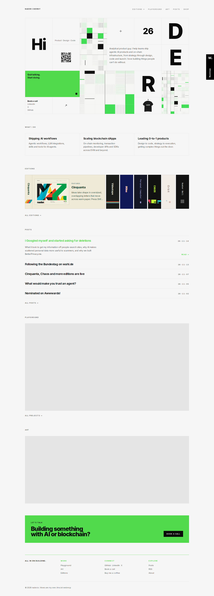

# UI Design System & Master Generation Blueprint: nader-io

> **Nader Cserny** (https://nader.io) — Product leader specializing in agentic AI systems and blockchain tools. Founder, builder, and advisor, from strategy to shipped code.



---

## 1. Executive Visual Persona & Design Archetype

- **Brand Essence & Persona**: **Nader Cserny** (`https://nader.io`). Product leader specializing in agentic AI systems and blockchain tools. Founder, builder, and advisor, from strategy to shipped code.
- **Visual Archetype**: **Light-Substrate Editorial & Modular Grid System (`#fff` canvas, `#0a0a0a` ink, `#1a1a1a` accent)**.
- **Anti-AI-Slop Differentiators**:
  - **Source-Grounded Chromatic Polarity**: Anchors the viewport in `#fff` (`var(--color-white)` in `:root`) paired with `#0a0a0a` primary typography and `#1a1a1a` accents.
  - **Extracted Typographic Hierarchy**: Pairs `Inter-1977dbd7896d9b1f` for display copy (`Hi, I’m Nader. Hi I’m Nader`) with `Inter-1977dbd7896d9b1f fallback: Arial` and `JetBrains Mono-7037818b06159deb`.
  - **Calibrated Spatial Grid & Motion**: Combines `34ch` container bounds (`gap: 1px`, padding `1rem`) with `cubic-bezier(.22,1,.36,1)` easing.

---

## 2. Spatial Architecture & Modular Grid Mathematics


### Viewport Allocation & Container Geometry
- **Captured Viewport Dimensions**: Desktop `1440×4000px` (`assets/desktop.png`, full-page scroll capture), Mobile `390×2400px` (`assets/mobile.png`, capped at 2400px multi-section capture).
- **Master Container Bounds**: `34ch` extracted from `nader-io` stylesheet.
- **Canvas Lateral Padding & Spacing**: `1rem` lateral canvas padding with `1px` grid gap.
- **Border Radius Scale**: `3px`, `50%`, `16px`, `20px`.

### Responsive Breakpoint Architecture
- **Desktop Layout**: Multi-column CSS Grid / Flexbox layout at `1440px` (`max-width: 34ch`, `gap: 1px`).
- **Mobile Layout**: Single-column vertical stack at `390px` viewport width with `1rem` horizontal padding.
- **Extracted CSS Media Queries**: `@media (width>=768px)`, `@media (width<40rem)`, `@media (width>=48rem)`, `@media (prefers-reduced-motion:reduce)`.

---

## 3. Color System, Materiality & Atmospheric Lighting

### Semantic Palette & Source Grounding
| Semantic Role | Ground-Truth Value | Extracted CSS Source / Selector |
|---|---|---|
| **Primary Canvas Substrate** | `#fff` | `var(--color-white)` in `:root` |
| **Primary Typography Ink** | `#f6f6f6` | `var(--color-surface)` in `:root` |
| **Elevated Surface / Card Substrate** | `#0a0a0a` | `var(--color-ink)` in `:root` |
| **Interactive Accent / Highlight** | `#1a1a1a` | `var(--color-prose)` in `:root` |
| **Secondary / Muted Copy** | `#666` | `var(--color-muted)` in `:root` |
| **Structural Hairline Border** | `#8a8a8a` | `var(--color-faint)` in `:root` |

### Sanitized Root CSS Variables (`ui-ux.md` Ground Truth)
| Variable Name | Extracted Value | Semantic Role |
|---|---|---|
| `--rule` | `var(--color-rule)` | Design System Custom Token |
| `--signal` | `var(--color-accent)` | Design System Custom Token |
| `--paper` | `var(--color-surface)` | Canvas / Surface Token |
| `--font-sans` | `var(--font-inter)` | Typography / Scale Token |
| `--font-mono` | `var(--font-jetbrains-mono)` | Typography / Scale Token |
| `--color-white` | `#fff` | Canvas / Surface Token |
| `--spacing` | `.25rem` | Layout / Spatial Grid Token |
| `--container-sm` | `24rem` | Layout / Spatial Grid Token |
| `--container-md` | `28rem` | Layout / Spatial Grid Token |
| `--container-xl` | `36rem` | Layout / Spatial Grid Token |
| `--container-2xl` | `42rem` | Layout / Spatial Grid Token |
| `--container-3xl` | `48rem` | Layout / Spatial Grid Token |
| `--container-6xl` | `72rem` | Layout / Spatial Grid Token |
| `--text-xs` | `.75rem` | Typography Ink Token |
| `--text-xs--line-height` | `calc(1 / .75)` | Typography Ink Token |
| `--text-sm` | `.875rem` | Typography Ink Token |

---

## 4. Typographic Scale & Editorial Hierarchy

### Font Family Stacks
- **Display Typography**: `Inter-1977dbd7896d9b1f`.
- **Primary Body Stack**: `Inter-1977dbd7896d9b1f fallback: Arial`.
- **Technical / Metadata Stack**: `JetBrains Mono-7037818b06159deb`.

### Typographic Scale & Rules (Extracted from Stylesheet & Variables)
- **Hero Display (`H1`)**: CSS variables `--text-display: clamp(3.25rem, 11vw, 6.5rem)`, `--text-display--line-height: .95`, `--text-display--letter-spacing: -.04em`; rule `h1` (`font-size: clamp(40px,5.5vw,70px)`, `line-height: 1.1`, `letter-spacing: -.04em`, `font-weight: 400`).
- **Section Heading (`H2`)**: CSS variables `--text-2xl: 1.5rem`, `--text-2xl--line-height: calc(2 / 1.5)`; rule `h2` (`font-size: .8125rem`, `line-height: 1.35`).
- **Body Copy**: CSS variables `--text-base: 1rem`, `--text-base--line-height: calc(1.5 / 1)`; rule `p` (`font-size: .9375rem`).
- **Metadata & Navigation Labels**: CSS variables `--font-mono: var(--font-jetbrains-mono)`, `--text-xs: .75rem`, `--text-xs--line-height: calc(1 / .75)`.

---

## 5. Choreographed Motion & Interaction Physics

### Primary Easing Curves
- **Extracted Timing Functions**: `cubic-bezier(.22,1,.36,1)`, `cubic-bezier(.45,0,.55,1)`, `cubic-bezier(0,0,.2,1)`.

### Per-Element Transition & Choreography Rules
- **Selector `.home-js [data-reveal] .home-cell`**: `transition: opacity .5s cubic-bezier(.22,1,.36,1),transform .5s cubic-bezi...` extracted from `nader-io` stylesheet.
- **Selector `.home-cycle__word[data-astro-cid-...`**: `transition: opacity .18s,transform .18s` extracted from `nader-io` stylesheet.
- **Selector `.home-tilt[data-astro-cid-lcdefpme]`**: `transition: transform .26s cubic-bezier(.22,1,.36,1)` extracted from `nader-io` stylesheet.
- **Extracted Easing Curve (`cubic-bezier(.22,1,.36,1)`)**: Governs interactive state transitions across `<header.site-header>` and `<section.home-section>`.
- **State & Hover Choreography**: Opacity and transform transitions on `<section.home-hero>` and `<section.home-section>` interactive targets.

---

## 6. Component Wireframe & Structural DOM Map

### Visual Layout Schematic (Grounded in `dom.html` — `1440px` Desktop & `390px` Mobile Reflow)
```
┌────────────────────────────────────────────────────────────────────────┐
│ DESKTOP VIEWPORT (1440px) — Nader Cserny                               │
│ ====================================================================== │
│ [ <header.site-header>     | Poster Live · Chaos Edition · Cinquant ]  │
│ ---------------------------------------------------------------------- │
│ | HERO STAGE: <section.home-hero>                                  |   │
│ | H1: Hi, I’m Nader. Hi I’m Nader                                  |   │
│ | Substrate: #fff       | Ink: #0a0a0a    | Accent: #1a1a1a        |   │
│ ---------------------------------------------------------------------- │
│ | SHOWCASE GRID (<section.home-section>    ) max-w: 34ch           |   │
│ | +------------------------------+  +------------------------------+ | │
│ | | Shipping AI workflows        |  | Scaling blockchain dApps     | | │
│ | +------------------------------+  +------------------------------+ | │
│ ---------------------------------------------------------------------- │
│ | MOBILE VIEWPORT REFLOW (390px) — Single-Column Stack (gap: 1px   ) | │
│ | [<header.site-heade] -> [<section.home-hero] -> [<section.home-sect] │
│ ---------------------------------------------------------------------- │
│ [ FOOTER (<footer.site-footer>  ) | https://nader.io                   │
└────────────────────────────────────────────────────────────────────────┘
```

### Granular DOM Region Breakdown
1. **Brand Header & Navigation Bar (<header.site-header> — `nader-io`)**:
   - Landmark `<header class="site-header relative">` hosting `Nader Cserny` navigation (`Poster Live · Chaos Edition · Cinquanta Edition · Circles Edition · Number Wall Edition`), DOM attributes (`data-site="nader.io"`, `data-edition-menu`, `data-astro-cid-ylg3fdu2`, `data-astro-cid-lcdefpme`), and stylesheet rule `body.home-page .site-header { margin-bottom:0;padding-bottom:1.5rem }`.
2. **Hero Stage & Focal Lead (<section.home-hero> — `Hi, I’m Nader. Hi I’m Nader`)**:
   - Landmark `<section class="home-hero">` presenting display lead `Hi, I’m Nader. Hi I’m Nader` and copy excerpt *"Editions Poster Live Chaos Edition Cinquanta Edition Circles Edit"* over `#fff` canvas and `#0a0a0a` ink.
3. **Primary Showcase & Content Grid (<section.home-section> — `Shipping AI workflows`)**:
   - Landmark `<section class="home-section">` rendering section `Shipping AI workflows` with copy *"Number Wall Edition"*, asset references (`favicon.svg`, `favicon.png`, `apple-touch-icon.png`, `site.webmanifest`), and grid rule `body.home-page main { padding-top:1.5rem }`.
4. **Interactive Detail & Feature Matrix (<article.home-cap> — `Scaling blockchain dApps`)**:
   - Landmark `<article class="home-cap">` framing `Scaling blockchain dApps` and `Leading 0-to-1 products` (*"Personal Computer Edition"*) with `#0a0a0a` surface cards, `#1a1a1a` accents, and `body.home-page .site-footer { margin-top:4rem }`.
5. **Colophon & Global Directory Footer (<footer.site-footer> — `https://nader.io`)**:
   - Landmark `<footer class="site-footer mt-20">` anchoring `Nader Cserny` footer links (`Poster Live · Chaos Edition · Cinquanta Edition · Circles Edition · Number Wall Edition`), copy *"Monochrome Edition"*, and `#8a8a8a` structural dividers.

---

## 7. Master Zero-Shot AI Generation Prompt

```markdown
# Master Zero-Shot Frontend Generation Prompt: nader-io (Nader Cserny)

You are a principal frontend architect and design systems engineer. Build a complete, production-ready web application replicating the exact design system, DOM landmarks, typographic hierarchy, color tokens, and motion physics of `nader-io` (**Nader Cserny** — `https://nader.io`).

### 1. Visual Archetype & Anti-AI-Slop Mandates
- **Archetype**: Light-Substrate Editorial & Modular Grid System (`#fff` canvas, `#0a0a0a` ink, `#1a1a1a` accent).
- **Identity & Domain Context**: Product leader specializing in agentic AI systems and blockchain tools. Founder, builder, and advisor, from strategy to shipped code.
- **Primary Substrate**: `#fff` (`var(--color-white)` in `:root`), **Primary Ink**: `#0a0a0a`, **Accent / Highlight**: `#1a1a1a`.
- **Site-Specific Differentiators**:
  - **Source-Grounded Chromatic Polarity**: Anchors the viewport in `#fff` (`var(--color-white)` in `:root`) paired with `#0a0a0a` primary typography and `#1a1a1a` accents.
  - **Extracted Typographic Hierarchy**: Pairs `Inter-1977dbd7896d9b1f` for display copy (`Hi, I’m Nader. Hi I’m Nader`) with `Inter-1977dbd7896d9b1f fallback: Arial` and `JetBrains Mono-7037818b06159deb`.
  - **Calibrated Spatial Grid & Motion**: Combines `34ch` container bounds (`gap: 1px`, padding `1rem`) with `cubic-bezier(.22,1,.36,1)` easing.

### 2. Ground-Truth CSS Variables (`:root` Token Contract)
Declare and consume these exact custom properties extracted from `nader-io` in your global stylesheet:

:root {
  /* Nader Cserny (nader-io) — Ground-Truth Extracted CSS Variables */
  --rule: var(--color-rule); /* Design System Custom Token (nader-io) */
  --signal: var(--color-accent); /* Design System Custom Token (nader-io) */
  --paper: var(--color-surface); /* Canvas / Surface Token (nader-io) */
  --font-sans: var(--font-inter); /* Typography / Scale Token (nader-io) */
  --font-mono: var(--font-jetbrains-mono); /* Typography / Scale Token (nader-io) */
  --color-white: #fff; /* Canvas / Surface Token (nader-io) */
  --spacing: .25rem; /* Layout / Spatial Grid Token (nader-io) */
  --container-sm: 24rem; /* Layout / Spatial Grid Token (nader-io) */
  --container-md: 28rem; /* Layout / Spatial Grid Token (nader-io) */
  --container-xl: 36rem; /* Layout / Spatial Grid Token (nader-io) */
  --container-2xl: 42rem; /* Layout / Spatial Grid Token (nader-io) */
  --container-3xl: 48rem; /* Layout / Spatial Grid Token (nader-io) */
  --container-6xl: 72rem; /* Layout / Spatial Grid Token (nader-io) */
  --text-xs: .75rem; /* Typography Ink Token (nader-io) */
  --text-xs--line-height: calc(1 / .75); /* Typography Ink Token (nader-io) */
  --text-sm: .875rem; /* Typography Ink Token (nader-io) */
}

### 3. Semantic Color & Materiality Contract
Map every surface, ink, and border strictly to these source-grounded tokens:
- **Primary Canvas Substrate**: `#fff` — grounded in `var(--color-white)` in `:root`
- **Primary Typography Ink**: `#f6f6f6` — grounded in `var(--color-surface)` in `:root`
- **Elevated Surface / Card Substrate**: `#0a0a0a` — grounded in `var(--color-ink)` in `:root`
- **Interactive Accent / Highlight**: `#1a1a1a` — grounded in `var(--color-prose)` in `:root`
- **Secondary / Muted Copy**: `#666` — grounded in `var(--color-muted)` in `:root`
- **Structural Hairline Border**: `#8a8a8a` — grounded in `var(--color-faint)` in `:root`

### 4. Spatial Grid, Container Bounds & Responsive Breakpoints
- **Desktop Viewport Reference**: `1440×4000px` (full-page scroll capture, `1440px` standard desktop width).
- **Mobile Viewport Reference**: `390×2400px` (capped at 2400px multi-section capture, `390px` standard mobile width).
- **Container Max-Width**: `34ch` extracted from `nader-io` stylesheet
- **Padding & Gutters**: `1rem` lateral canvas padding with `1px` grid gap
- **Desktop Grid**: Multi-column CSS Grid / Flexbox layout at `1440px` (`max-width: 34ch`, `gap: 1px`)
- **Mobile Adaptation**: Single-column vertical stack at `390px` viewport width with `1rem` horizontal padding
- **Media Queries**: `@media (width>=768px)`, `@media (width<40rem)`, `@media (width>=48rem)`, `@media (prefers-reduced-motion:reduce)`
- **Corner Radii**: `3px`, `50%`, `16px`, `20px`

### 5. Typography & Editorial Scale Contract
- **Display Font Stack**: `Inter-1977dbd7896d9b1f`
- **Body Font Stack**: `Inter-1977dbd7896d9b1f fallback: Arial`
- **Monospace / Technical Font Stack**: `JetBrains Mono-7037818b06159deb`
- **H1 Display Rule**: CSS variables `--text-display: clamp(3.25rem, 11vw, 6.5rem)`, `--text-display--line-height: .95`, `--text-display--letter-spacing: -.04em`; rule `h1` (`font-size: clamp(40px,5.5vw,70px)`, `line-height: 1.1`, `letter-spacing: -.04em`, `font-weight: 400`)
- **H2 Section Rule**: CSS variables `--text-2xl: 1.5rem`, `--text-2xl--line-height: calc(2 / 1.5)`; rule `h2` (`font-size: .8125rem`, `line-height: 1.35`)
- **Body Copy Rule**: CSS variables `--text-base: 1rem`, `--text-base--line-height: calc(1.5 / 1)`; rule `p` (`font-size: .9375rem`)
- **Metadata & Index Rule**: CSS variables `--font-mono: var(--font-jetbrains-mono)`, `--text-xs: .75rem`, `--text-xs--line-height: calc(1 / .75)`

### 6. Component Hierarchy, Verbatim Copy & Real DOM Landmarks
Scaffold `nader-io` (`Nader Cserny`) with these exact structural regions, extracted copy, and CSS rules from `dom.html`:
1. **Brand Header & Navigation Bar (<header.site-header> — `nader-io`)**:
   - DOM & Selectors: Landmark `<header class="site-header relative">` hosting `Nader Cserny` navigation (`Poster Live · Chaos Edition · Cinquanta Edition · Circles Edition · Number Wall Edition`), DOM attributes (`data-site="nader.io"`, `data-edition-menu`, `data-astro-cid-ylg3fdu2`, `data-astro-cid-lcdefpme`), and stylesheet rule `body.home-page .site-header { margin-bottom:0;padding-bottom:1.5rem }`.
   - Responsive Contract: Header `Brand Header & Navigation Bar (<header.site-header> — `nader-io`)` (`nader-io`) adapts across `@media (width>=768px)`, `@media (width<40rem)`, `@media (width>=48rem)`, `@media (prefers-reduced-motion:reduce)` with `cubic-bezier(.22,1,.36,1)`, `cubic-bezier(.45,0,.55,1)`, `cubic-bezier(0,0,.2,1)` transitions and links `Poster Live · Chaos Edition · Cinquanta Edition · Circles Edition · Number Wall Edition`.
2. **Hero Stage & Focal Lead (<section.home-hero> — `Hi, I’m Nader. Hi I’m Nader`)**:
   - DOM & Selectors: Landmark `<section class="home-hero">` presenting display lead `Hi, I’m Nader. Hi I’m Nader` and copy excerpt *"Editions Poster Live Chaos Edition Cinquanta Edition Circles Edit"* over `#fff` canvas and `#0a0a0a` ink.
   - Responsive Contract: Hero stage (`1440×4000px` desktop / `390×2400px` mobile) sets `#fff` background with `#0a0a0a` headline `Hi, I’m Nader. Hi I’m Nader`.
3. **Primary Showcase & Content Grid (<section.home-section> — `Shipping AI workflows`)**:
   - DOM & Selectors: Landmark `<section class="home-section">` rendering section `Shipping AI workflows` with copy *"Number Wall Edition"*, asset references (`favicon.svg`, `favicon.png`, `apple-touch-icon.png`, `site.webmanifest`), and grid rule `body.home-page main { padding-top:1.5rem }`.
   - Responsive Contract: Showcase grid `Primary Showcase & Content Grid (<section.home-section> — `Shipping AI workflows`)` applies Multi-column CSS Grid / Flexbox layout at `1440px` (`max-width: 34ch`, `gap: 1px`) on desktop and Single-column vertical stack at `390px` viewport width with `1rem` horizontal padding on mobile.
4. **Interactive Detail & Feature Matrix (<article.home-cap> — `Scaling blockchain dApps`)**:
   - DOM & Selectors: Landmark `<article class="home-cap">` framing `Scaling blockchain dApps` and `Leading 0-to-1 products` (*"Personal Computer Edition"*) with `#0a0a0a` surface cards, `#1a1a1a` accents, and `body.home-page .site-footer { margin-top:4rem }`.
   - Responsive Contract: Detail module `Interactive Detail & Feature Matrix (<article.home-cap> — `Scaling blockchain dApps`)` uses `3px`, `50%`, `16px`, `20px` radii, `#1a1a1a` highlights, and assets (favicon.svg, favicon.png, apple-touch-icon.png).
5. **Colophon & Global Directory Footer (<footer.site-footer> — `https://nader.io`)**:
   - DOM & Selectors: Landmark `<footer class="site-footer mt-20">` anchoring `Nader Cserny` footer links (`Poster Live · Chaos Edition · Cinquanta Edition · Circles Edition · Number Wall Edition`), copy *"Monochrome Edition"*, and `#8a8a8a` structural dividers.
   - Responsive Contract: Footer `Colophon & Global Directory Footer (<footer.site-footer> — `https://nader.io`)` aligns to `34ch` extracted from `nader-io` stylesheet with `1rem` lateral canvas padding with `1px` grid gap and attributes (data-site="nader.io", data-edition-menu, data-astro-cid-ylg3fdu2).

#### Verbatim DOM Copy Excerpts (`dom.html`)
- Copy Excerpt 1: *"Editions Poster Live Chaos Edition Cinquanta Edition Circles Edition Number Wall E..."*
- Copy Excerpt 2: *"Number Wall Edition"*
- Copy Excerpt 3: *"Personal Computer Edition"*
- Copy Excerpt 4: *"Monochrome Edition"*

### 7. Motion, Extracted Stylesheet Rules & Interaction Choreography
- **Primary Easing Functions**: `cubic-bezier(.22,1,.36,1)`, `cubic-bezier(.45,0,.55,1)`, `cubic-bezier(0,0,.2,1)`
- **Extracted Stylesheet Rules (`nader-io`)**:
- `body.home-page .site-header { margin-bottom:0;padding-bottom:1.5rem }`
- `body.home-page main { padding-top:1.5rem }`
- `body.home-page .site-footer { margin-top:4rem }`
- `.home-confetti { z-index:60;pointer-events:none;position:fixed;inset:0 }`
- `.is-in .home-cell { opacity:1;transform:none }`
- **Per-Selector Transition Rules**:
- **Selector `.home-js [data-reveal] .home-cell`**: `transition: opacity .5s cubic-bezier(.22,1,.36,1),transform .5s cubic-bezi...` extracted from `nader-io` stylesheet.
- **Selector `.home-cycle__word[data-astro-cid-...`**: `transition: opacity .18s,transform .18s` extracted from `nader-io` stylesheet.
- **Selector `.home-tilt[data-astro-cid-lcdefpme]`**: `transition: transform .26s cubic-bezier(.22,1,.36,1)` extracted from `nader-io` stylesheet.
- **Extracted Easing Curve (`cubic-bezier(.22,1,.36,1)`)**: Governs interactive state transitions across `<header.site-header>` and `<section.home-section>`.
- **State & Hover Choreography**: Opacity and transform transitions on `<section.home-hero>` and `<section.home-section>` interactive targets.

### 8. Technical Deliverables
- Implement in Next.js (App Router) with TypeScript and Tailwind CSS consuming the `:root` custom properties defined above for `nader-io`.
- Reproduce both the `1440px` desktop architecture and `390px` mobile breakpoint transitions, preserving semantic HTML5 landmarks (`<header>`, `<nav>`, `<main>`, `<section>`, `<footer>`) and `prefers-reduced-motion` accessibility guards.
```
