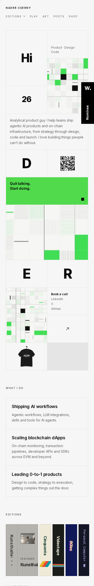

# UI Design System & Master Generation Blueprint: nader-io

> **Nader Cserny** (https://nader.io) — Product leader specializing in agentic AI systems and blockchain tools. Founder, builder, and advisor, from strategy to shipped code.


---

## 1. Executive Visual Persona & Design Archetype

- **Brand Essence & Persona**: **Nader Cserny** (`https://nader.io`). Product leader specializing in agentic AI systems and blockchain tools. Founder, builder, and advisor, from strategy to shipped code.
- **Capture Provenance**: Live browser capture (`tier1_fast`, HTTP `200`, captured `2026-11-23`).
- **Visual Archetype**: **Light-Substrate Editorial & Modular Grid System (`#f6f6f6` canvas, `#0a0a0a` ink, `#ef4025` accent)**.
- **Anti-AI-Slop Differentiators**:
  - **Live-Computed Chromatic Polarity**: Anchors the viewport in `#f6f6f6` (live computed `body` `background-color` (`computed_styles.json`)) paired with `#0a0a0a` primary typography and `#ef4025` accents.
  - **Grounded Typographic Hierarchy**: Pairs `Inter-1977dbd7896d9b1f` for display copy (`Hi, I’m Nader. Hi I’m Nader`) with `Inter-1977dbd7896d9b1f` and `JetBrains Mono-7037818b06159deb`.
  - **Calibrated Spatial Grid & Motion**: Combines `1104px` container bounds (`gap: 12px`, padding `.375rem`) with `cubic-bezier(0,0,.2,1)` easing.

---

## 2. Spatial Architecture & Modular Grid Mathematics



### Viewport Allocation & Container Geometry
- **Captured Viewport Dimensions**: Desktop `1440×2400px` (`assets/desktop.png`, clamped at 2400px live multi-section capture), Mobile `390×2400px` (`assets/mobile.png`, clamped at 2400px live multi-section capture).
- **Master Container Bounds**: `1104px` (measured `<main>` bounding box width within `1440px` desktop viewport).
- **Canvas Lateral Padding & Spacing**: `.375rem` lateral canvas padding with `12px` grid gap.
- **Border Radius Scale**: `3px`, `50%`, `16px`, `20px`.

### Responsive Breakpoint Architecture
- **Desktop Layout**: Multi-column CSS Grid / Flexbox layout at `1440px` (`max-width: 1104px`, `gap: 12px`).
- **Mobile Layout**: Single-column vertical stack at `390px` viewport width with `.375rem` horizontal padding.
- **Extracted CSS Media Queries**: `@media (width<40rem)`, `@media (width>=48rem)`, `@media (prefers-reduced-motion:reduce)`, `@media (width<=767px)`.

---

## 3. Color System, Materiality & Atmospheric Lighting

### Semantic Palette & Source Grounding
| Semantic Role | Ground-Truth Value | Extracted Live / CSS Source |
|---|---|---|
| **Primary Canvas Substrate** | `#f6f6f6` | live computed `body` `background-color` (`computed_styles.json`) |
| **Primary Typography Ink** | `#0a0a0a` | live computed `h1` `color` (`computed_styles.json`) |
| **Elevated Surface / Card Substrate** | `#ffffff` | `var(--menu-surface)` in `:root` |
| **Interactive Accent / Highlight** | `#ef4025` | `.pc-face-buttons button { background: #ef4025 }` |
| **Secondary / Muted Copy** | `#8a8a8a` | live computed `button` `color` (`computed_styles.json`) |
| **Structural Hairline Border** | `#e5e5e5` | `var(--color-rule)` in `:root` |

### Sanitized Root CSS Variables (`ui-ux.md` Ground Truth)
| Variable Name | Extracted Value | Semantic Role |
|---|---|---|
| `--font-sans` | `var(--font-inter)` | Typography / Scale Token |
| `--font-mono` | `var(--font-jetbrains-mono)` | Typography / Scale Token |
| `--color-white` | `#fff` | Canvas / Surface Token |
| `--spacing` | `.25rem` | Layout / Spatial Grid Token |
| `--container-sm` | `24rem` | Layout / Spatial Grid Token |
| `--container-md` | `28rem` | Layout / Spatial Grid Token |
| `--container-xl` | `36rem` | Layout / Spatial Grid Token |
| `--container-2xl` | `42rem` | Layout / Spatial Grid Token |
| `--container-3xl` | `48rem` | Layout / Spatial Grid Token |
| `--container-6xl` | `72rem` | Layout / Spatial Grid Token |
| `--text-xs` | `.75rem` | Typography Ink Token |
| `--text-xs--line-height` | `calc(1 / .75)` | Typography Ink Token |
| `--text-sm` | `.875rem` | Typography Ink Token |
| `--text-sm--line-height` | `calc(1.25 / .875)` | Typography Ink Token |
| `--text-base` | `1rem` | Typography Ink Token |
| `--text-base--line-height` | `calc(1.5 / 1)` | Typography Ink Token |

---

## 4. Typographic Scale & Editorial Hierarchy

### Font Family Stacks
- **Display Typography**: `Inter-1977dbd7896d9b1f`.
- **Primary Body Stack**: `Inter-1977dbd7896d9b1f`.
- **Technical / Metadata Stack**: `JetBrains Mono-7037818b06159deb`.

### Typographic Scale & Rules (Live Computed & Stylesheet Grounded)
- **Hero Display (`H1`)**: live computed `h1` (`font-size: 52px`, `line-height: 54.6px`, `font-weight: 800`, `letter-spacing: -1.82px`); CSS variables `--text-display: clamp(3.25rem, 11vw, 6.5rem)`, `--text-display--line-height: .95`, `--text-display--letter-spacing: -.04em`; rule `h1` (`font-size: clamp(40px,5.5vw,70px)`, `line-height: 1.1`, `letter-spacing: -.04em`, `font-weight: 400`).
- **Section Heading (`H2`)**: live computed `h3 (primary section heading)` (`font-size: 72px`, `line-height: 70.56px`, `font-weight: 800`, `letter-spacing: -3.24px`); CSS variables `--text-2xl: 1.5rem`, `--text-2xl--line-height: calc(2 / 1.5)`; rule `h2` (`font-size: .8125rem`, `line-height: 1.35`).
- **Body Copy**: live computed `body` (`font-size: 16px`, `line-height: 24px`, `font-weight: 400`); CSS variables `--text-base: 1rem`, `--text-base--line-height: calc(1.5 / 1)`; rule `p` (`font-size: .9375rem`).
- **Metadata & Navigation Labels**: live computed `nav/a` (`font-size: 16px`, `line-height: 24px`, `font-weight: 400`); CSS variables `--font-mono: var(--font-jetbrains-mono)`, `--text-xs: .75rem`, `--text-xs--line-height: calc(1 / .75)`.

---

## 5. Choreographed Motion & Interaction Physics

### Primary Easing Curves
- **Extracted Timing Functions**: `cubic-bezier(0,0,.2,1)`, `cubic-bezier(.4,0,.2,1)`, `cubic-bezier(.22,1,.36,1)`.

### Per-Element Transition & Choreography Rules
- **Selector `tion-menu__trigger[data-astro-cid...`**: `transition: color .15s,border-color .15s` extracted from `nader-io` stylesheet.
- **Selector `tion-menu__chevron[data-astro-cid...`**: `transition: transform .2s` extracted from `nader-io` stylesheet.
- **Selector `edition-menu__item[data-astro-cid...`**: `transition: background-color .15s,color .15s` extracted from `nader-io` stylesheet.
- **Extracted Easing Curve (`cubic-bezier(0,0,.2,1)`)**: Governs interactive state transitions across `<header.site-header>` and `<section.home-section>`.
- **State & Hover Choreography**: Opacity and transform transitions on `<section.home-hero>` and `<section.home-section>` interactive targets.

---

## 6. Component Wireframe & Structural DOM Map

### Visual Layout Schematic — Desktop (`1440px`, Grounded in `dom.html` & Landmark Bounding Boxes)
```
┌────────────────────────────────────────────────────────────────────────┐
│ DESKTOP VIEWPORT (1440px) — Nader Cserny                               │
│ ====================================================================== │
│ [ <header.site-header> (1104x48px)    | Poster Live · Quiet Edition  ] │
│ ---------------------------------------------------------------------- │
│ | HERO STAGE: <section.home-hero> (w=1104px)                         | │
│ | H1: Hi, I’m Nader. Hi I’m Nader                                    | │
│ | Substrate: #f6f6f6 | Ink: #0a0a0a | Accent: #ef4025                | │
│ ---------------------------------------------------------------------- │
│ | SHOWCASE GRID (<section.home-section>) max-w: 1104px               | │
│ | +------------------------------+  +------------------------------+ | │
│ | | Shipping AI workflows        |  | Scaling blockchain dApps     | | │
│ | +------------------------------+  +------------------------------+ | │
│ ---------------------------------------------------------------------- │
│ | DETAIL MODULE (<article.home-cap>) — Leading 0-to-1 produc         | │
│ ---------------------------------------------------------------------- │
│ [ FOOTER (<footer.site-footer>) | https://nader.io                     │
└────────────────────────────────────────────────────────────────────────┘
```

### Visual Layout Schematic — Mobile Reflow (`390px`)
```
┌────────────────────────────────────────────────────────────────────────┐
│ MOBILE VIEWPORT REFLOW (390px) — Single-Column Stack (gap: 12px)       │
│ ====================================================================== │
│ [ HEADER BAR (<header.site-header>    ) | Compact Menu (390px)         │
│ ---------------------------------------------------------------------- │
│ | HERO STAGE (<section.home-hero>) — 390px Vertical Lead             | │
│ | H1: Hi, I’m Nader. Hi I’m Nader                                    | │
│ ---------------------------------------------------------------------- │
│ | SHOWCASE STACK (<section.home-section>) — 1-Col Stack              | │
│ | [ Item 1: Shipping AI workflows                                  ] | │
│ | [ Item 2: Scaling blockchain dApps                               ] | │
│ ---------------------------------------------------------------------- │
│ | DETAIL STACK (<article.home-cap>) — 1-Col (Leading 0-to-1 pro)     | │
│ ---------------------------------------------------------------------- │
│ [ FOOTER (<footer.site-footer>) | Stacked 390px Colophon               │
└────────────────────────────────────────────────────────────────────────┘
```

### Granular DOM Region Breakdown
1. **Brand Header & Navigation Bar (<header.site-header> — `nader-io`)**:
   - Landmark `<header class="site-header mb-12">` (`1104x48px`) hosting `Nader Cserny` navigation (`Poster Live · Quiet Edition · Kunsthalle Edition · Chaos Edition · Cinquanta Edition`), DOM attributes (`data-site="nader.io"`, `data-edition-menu`, `data-astro-cid-ylg3fdu2`, `data-astro-cid-lcdefpme`), and stylesheet rule `focus-visible { background-color:color-mix(in srgb, var(--menu-ink,var(--color-ink)) 8%,... }`.
2. **Hero Stage & Focal Lead (<section.home-hero> — `Hi, I’m Nader. Hi I’m Nader`)**:
   - Landmark `<section class="home-hero">` presenting display lead `Hi, I’m Nader. Hi I’m Nader` and copy excerpt *"Product · Design · Code"* over `#f6f6f6` canvas and `#0a0a0a` ink.
3. **Primary Showcase & Content Grid (<section.home-section> — `Shipping AI workflows`)**:
   - Landmark `<section class="home-section">` rendering section `Shipping AI workflows` with copy *"Analytical product guy. I help teams ship agentic AI products and"*, asset references (`favicon.svg`, `favicon.png`, `apple-touch-icon.png`, `site.webmanifest`), and grid rule `hover { color:var(--color-accent) }`.
4. **Interactive Detail & Feature Matrix (<article.home-cap> — `Scaling blockchain dApps`)**:
   - Landmark `<article class="home-cap">` framing `Scaling blockchain dApps` and `Leading 0-to-1 products` (*"Quit talking. Start doing."*) with `#ffffff` surface cards, `#ef4025` accents, and `backdrop { box-sizing:border-box;border:0 solid;margin:0;padding:0 }`.
5. **Colophon & Global Directory Footer (<footer.site-footer> — `https://nader.io`)**:
   - Landmark `<footer class="site-footer mt-20">` anchoring `Nader Cserny` footer links (`Poster Live · Quiet Edition · Kunsthalle Edition · Chaos Edition · Cinquanta Edition`), copy *"Agentic workflows, LLM integrations, skills and tools for AI"*, and `#e5e5e5` structural dividers.

---

## 7. Master Zero-Shot AI Generation Prompt

```markdown
# Master Zero-Shot Frontend Generation Prompt: nader-io (Nader Cserny)

You are a principal frontend architect and design systems engineer. Build a complete, production-ready web application replicating the exact design system, DOM landmarks, typographic hierarchy, color tokens, and motion physics of `nader-io` (**Nader Cserny** — `https://nader.io`).

### 1. Visual Archetype & Anti-AI-Slop Mandates
- **Archetype**: Light-Substrate Editorial & Modular Grid System (`#f6f6f6` canvas, `#0a0a0a` ink, `#ef4025` accent).
- **Identity & Domain Context**: Product leader specializing in agentic AI systems and blockchain tools. Founder, builder, and advisor, from strategy to shipped code.
- **Primary Substrate**: `#f6f6f6` (live computed `body` `background-color` (`computed_styles.json`)), **Primary Ink**: `#0a0a0a`, **Accent / Highlight**: `#ef4025`.
- **Site-Specific Differentiators**:
  - **Live-Computed Chromatic Polarity**: Anchors the viewport in `#f6f6f6` (live computed `body` `background-color` (`computed_styles.json`)) paired with `#0a0a0a` primary typography and `#ef4025` accents.
  - **Grounded Typographic Hierarchy**: Pairs `Inter-1977dbd7896d9b1f` for display copy (`Hi, I’m Nader. Hi I’m Nader`) with `Inter-1977dbd7896d9b1f` and `JetBrains Mono-7037818b06159deb`.
  - **Calibrated Spatial Grid & Motion**: Combines `1104px` container bounds (`gap: 12px`, padding `.375rem`) with `cubic-bezier(0,0,.2,1)` easing.

### 2. Ground-Truth CSS Variables (`:root` Token Contract)
Declare and consume these exact custom properties extracted from `nader-io` in your global stylesheet:

:root {
  /* Nader Cserny (nader-io) — Live-Grounded CSS Variables */
  --font-sans: var(--font-inter); /* Typography / Scale Token (nader-io) */
  --font-mono: var(--font-jetbrains-mono); /* Typography / Scale Token (nader-io) */
  --color-white: #fff; /* Canvas / Surface Token (nader-io) */
  --spacing: .25rem; /* Layout / Spatial Grid Token (nader-io) */
  --container-sm: 24rem; /* Layout / Spatial Grid Token (nader-io) */
  --container-md: 28rem; /* Layout / Spatial Grid Token (nader-io) */
  --container-xl: 36rem; /* Layout / Spatial Grid Token (nader-io) */
  --container-2xl: 42rem; /* Layout / Spatial Grid Token (nader-io) */
  --container-3xl: 48rem; /* Layout / Spatial Grid Token (nader-io) */
  --container-6xl: 72rem; /* Layout / Spatial Grid Token (nader-io) */
  --text-xs: .75rem; /* Typography Ink Token (nader-io) */
  --text-xs--line-height: calc(1 / .75); /* Typography Ink Token (nader-io) */
  --text-sm: .875rem; /* Typography Ink Token (nader-io) */
  --text-sm--line-height: calc(1.25 / .875); /* Typography Ink Token (nader-io) */
  --text-base: 1rem; /* Typography Ink Token (nader-io) */
  --text-base--line-height: calc(1.5 / 1); /* Typography Ink Token (nader-io) */
}

### 3. Semantic Color & Materiality Contract
Map every surface, ink, and border strictly to these source-grounded tokens:
- **Primary Canvas Substrate**: `#f6f6f6` — grounded in live computed `body` `background-color` (`computed_styles.json`)
- **Primary Typography Ink**: `#0a0a0a` — grounded in live computed `h1` `color` (`computed_styles.json`)
- **Elevated Surface / Card Substrate**: `#ffffff` — grounded in `var(--menu-surface)` in `:root`
- **Interactive Accent / Highlight**: `#ef4025` — grounded in `.pc-face-buttons button { background: #ef4025 }`
- **Secondary / Muted Copy**: `#8a8a8a` — grounded in live computed `button` `color` (`computed_styles.json`)
- **Structural Hairline Border**: `#e5e5e5` — grounded in `var(--color-rule)` in `:root`

### 4. Spatial Grid, Container Bounds & Responsive Breakpoints
- **Desktop Viewport Reference**: `1440×2400px` (clamped at 2400px live multi-section capture, `1440px` standard desktop width).
- **Mobile Viewport Reference**: `390×2400px` (clamped at 2400px live multi-section capture, `390px` standard mobile width).
- **Container Max-Width**: `1104px` (measured `<main>` bounding box width within `1440px` desktop viewport)
- **Padding & Gutters**: `.375rem` lateral canvas padding with `12px` grid gap
- **Desktop Grid**: Multi-column CSS Grid / Flexbox layout at `1440px` (`max-width: 1104px`, `gap: 12px`)
- **Mobile Adaptation**: Single-column vertical stack at `390px` viewport width with `.375rem` horizontal padding
- **Media Queries**: `@media (width<40rem)`, `@media (width>=48rem)`, `@media (prefers-reduced-motion:reduce)`, `@media (width<=767px)`
- **Corner Radii**: `3px`, `50%`, `16px`, `20px`

### 5. Typography & Editorial Scale Contract
- **Display Font Stack**: `Inter-1977dbd7896d9b1f`
- **Body Font Stack**: `Inter-1977dbd7896d9b1f`
- **Monospace / Technical Font Stack**: `JetBrains Mono-7037818b06159deb`
- **H1 Display Rule**: live computed `h1` (`font-size: 52px`, `line-height: 54.6px`, `font-weight: 800`, `letter-spacing: -1.82px`); CSS variables `--text-display: clamp(3.25rem, 11vw, 6.5rem)`, `--text-display--line-height: .95`, `--text-display--letter-spacing: -.04em`; rule `h1` (`font-size: clamp(40px,5.5vw,70px)`, `line-height: 1.1`, `letter-spacing: -.04em`, `font-weight: 400`)
- **H2 Section Rule**: live computed `h3 (primary section heading)` (`font-size: 72px`, `line-height: 70.56px`, `font-weight: 800`, `letter-spacing: -3.24px`); CSS variables `--text-2xl: 1.5rem`, `--text-2xl--line-height: calc(2 / 1.5)`; rule `h2` (`font-size: .8125rem`, `line-height: 1.35`)
- **Body Copy Rule**: live computed `body` (`font-size: 16px`, `line-height: 24px`, `font-weight: 400`); CSS variables `--text-base: 1rem`, `--text-base--line-height: calc(1.5 / 1)`; rule `p` (`font-size: .9375rem`)
- **Metadata & Index Rule**: live computed `nav/a` (`font-size: 16px`, `line-height: 24px`, `font-weight: 400`); CSS variables `--font-mono: var(--font-jetbrains-mono)`, `--text-xs: .75rem`, `--text-xs--line-height: calc(1 / .75)`

### 6. Component Hierarchy, Verbatim Copy & Real DOM Landmarks
Scaffold `nader-io` (`Nader Cserny`) with these exact structural regions, extracted copy, and CSS rules from `dom.html`:
1. **Brand Header & Navigation Bar (<header.site-header> — `nader-io`)**:
   - DOM & Selectors: Landmark `<header class="site-header mb-12">` (`1104x48px`) hosting `Nader Cserny` navigation (`Poster Live · Quiet Edition · Kunsthalle Edition · Chaos Edition · Cinquanta Edition`), DOM attributes (`data-site="nader.io"`, `data-edition-menu`, `data-astro-cid-ylg3fdu2`, `data-astro-cid-lcdefpme`), and stylesheet rule `focus-visible { background-color:color-mix(in srgb, var(--menu-ink,var(--color-ink)) 8%,... }`.
   - Responsive Contract: Header `Brand Header & Navigation Bar (<header.site-header> — `nader-io`)` (`nader-io`) adapts across `@media (width<40rem)`, `@media (width>=48rem)`, `@media (prefers-reduced-motion:reduce)`, `@media (width<=767px)` with `cubic-bezier(0,0,.2,1)`, `cubic-bezier(.4,0,.2,1)`, `cubic-bezier(.22,1,.36,1)` transitions and links `Poster Live · Quiet Edition · Kunsthalle Edition · Chaos Edition · Cinquanta Edition`.
2. **Hero Stage & Focal Lead (<section.home-hero> — `Hi, I’m Nader. Hi I’m Nader`)**:
   - DOM & Selectors: Landmark `<section class="home-hero">` presenting display lead `Hi, I’m Nader. Hi I’m Nader` and copy excerpt *"Product · Design · Code"* over `#f6f6f6` canvas and `#0a0a0a` ink.
   - Responsive Contract: Hero stage (`1440×2400px` desktop / `390×2400px` mobile) sets `#f6f6f6` background with `#0a0a0a` headline `Hi, I’m Nader. Hi I’m Nader`.
3. **Primary Showcase & Content Grid (<section.home-section> — `Shipping AI workflows`)**:
   - DOM & Selectors: Landmark `<section class="home-section">` rendering section `Shipping AI workflows` with copy *"Analytical product guy. I help teams ship agentic AI products and"*, asset references (`favicon.svg`, `favicon.png`, `apple-touch-icon.png`, `site.webmanifest`), and grid rule `hover { color:var(--color-accent) }`.
   - Responsive Contract: Showcase grid `Primary Showcase & Content Grid (<section.home-section> — `Shipping AI workflows`)` applies Multi-column CSS Grid / Flexbox layout at `1440px` (`max-width: 1104px`, `gap: 12px`) on desktop and Single-column vertical stack at `390px` viewport width with `.375rem` horizontal padding on mobile.
4. **Interactive Detail & Feature Matrix (<article.home-cap> — `Scaling blockchain dApps`)**:
   - DOM & Selectors: Landmark `<article class="home-cap">` framing `Scaling blockchain dApps` and `Leading 0-to-1 products` (*"Quit talking. Start doing."*) with `#ffffff` surface cards, `#ef4025` accents, and `backdrop { box-sizing:border-box;border:0 solid;margin:0;padding:0 }`.
   - Responsive Contract: Detail module `Interactive Detail & Feature Matrix (<article.home-cap> — `Scaling blockchain dApps`)` uses `3px`, `50%`, `16px`, `20px` radii, `#ef4025` highlights, and assets (favicon.svg, favicon.png, apple-touch-icon.png).
5. **Colophon & Global Directory Footer (<footer.site-footer> — `https://nader.io`)**:
   - DOM & Selectors: Landmark `<footer class="site-footer mt-20">` anchoring `Nader Cserny` footer links (`Poster Live · Quiet Edition · Kunsthalle Edition · Chaos Edition · Cinquanta Edition`), copy *"Agentic workflows, LLM integrations, skills and tools for AI"*, and `#e5e5e5` structural dividers.
   - Responsive Contract: Footer `Colophon & Global Directory Footer (<footer.site-footer> — `https://nader.io`)` aligns to `1104px` (measured `<main>` bounding box width within `1440px` desktop viewport) with `.375rem` lateral canvas padding with `12px` grid gap and attributes (data-site="nader.io", data-edition-menu, data-astro-cid-ylg3fdu2).

#### Verbatim DOM Copy Excerpts (`dom.html`)
- Copy Excerpt 1: *"Product · Design · Code"*
- Copy Excerpt 2: *"Analytical product guy. I help teams ship agentic AI products and on-chain infrast..."*
- Copy Excerpt 3: *"Quit talking. Start doing."*
- Copy Excerpt 4: *"Agentic workflows, LLM integrations, skills and tools for AI agents."*

### 7. Motion, Extracted Stylesheet Rules & Interaction Choreography
- **Primary Easing Functions**: `cubic-bezier(0,0,.2,1)`, `cubic-bezier(.4,0,.2,1)`, `cubic-bezier(.22,1,.36,1)`
- **Extracted Stylesheet Rules (`nader-io`)**:
- `focus-visible { background-color:color-mix(in srgb, var(--menu-ink,var(--color-ink)) 8%,... }`
- `hover { color:var(--color-accent) }`
- `backdrop { box-sizing:border-box;border:0 solid;margin:0;padding:0 }`
- `file-selector-button { box-sizing:border-box;border:0 solid;margin:0;padding:0 }`
- `strong { font-weight:bolder }`
- **Per-Selector Transition Rules**:
- **Selector `tion-menu__trigger[data-astro-cid...`**: `transition: color .15s,border-color .15s` extracted from `nader-io` stylesheet.
- **Selector `tion-menu__chevron[data-astro-cid...`**: `transition: transform .2s` extracted from `nader-io` stylesheet.
- **Selector `edition-menu__item[data-astro-cid...`**: `transition: background-color .15s,color .15s` extracted from `nader-io` stylesheet.
- **Extracted Easing Curve (`cubic-bezier(0,0,.2,1)`)**: Governs interactive state transitions across `<header.site-header>` and `<section.home-section>`.
- **State & Hover Choreography**: Opacity and transform transitions on `<section.home-hero>` and `<section.home-section>` interactive targets.

### 8. Technical Deliverables
- Implement in Next.js (App Router) with TypeScript and Tailwind CSS consuming the `:root` custom properties defined above for `nader-io`.
- Reproduce both the `1440px` desktop architecture and `390px` mobile breakpoint transitions, preserving semantic HTML5 landmarks (`<header>`, `<nav>`, `<main>`, `<section>`, `<footer>`) and `prefers-reduced-motion` accessibility guards.
```
