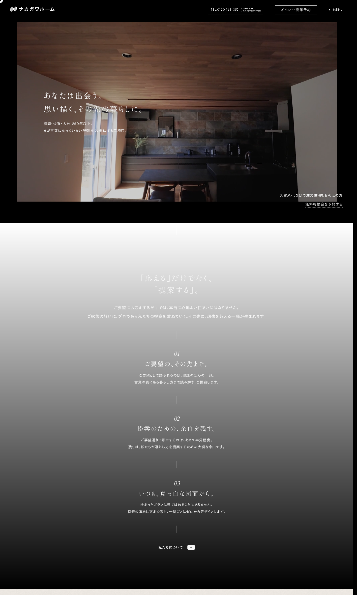
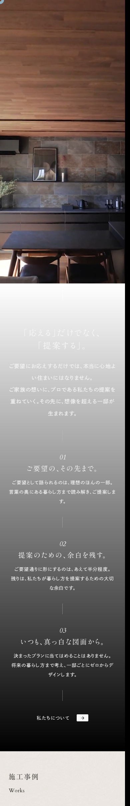

# UI Design System & Master Generation Blueprint: nakagawa-corp-com

> **久留米・うきはで注文住宅を建てるなら株式会社ナカガワ（ナカガワホーム）** (https://nakagawa-corp.com/) — 【1963年創業、久留米・うきはで60年以上】株式会社ナカガワ(本社:福岡県久留米市)は、真っ白な図面から一邸ずつ設計する完全自由設計の工務店です。注文住宅・分譲住宅・土地探しまで、暮らしに合わせてご提案します。



---

## 1. Executive Visual Persona & Design Archetype

- **Brand Essence & Persona**: **久留米・うきはで注文住宅を建てるなら株式会社ナカガワ（ナカガワホーム）** (`https://nakagawa-corp.com/`). 【1963年創業、久留米・うきはで60年以上】株式会社ナカガワ(本社:福岡県久留米市)は、真っ白な図面から一邸ずつ設計する完全自由設計の工務店です。注文住宅・分譲住宅・土地探しまで、暮らしに合わせてご提案します。
- **Capture Provenance**: Live browser capture (`tier1_fast`, HTTP `200`, captured `2026-11-23`).
- **Visual Archetype**: **Light-Substrate Editorial & Modular Grid System (`#ffffff` canvas, `#202020` ink, `#333333` accent)**.
- **Anti-AI-Slop Differentiators**:
  - **Live-Computed Chromatic Polarity**: Anchors the viewport in `#ffffff` (live computed `body` `background-color` (`computed_styles.json`)) paired with `#202020` primary typography and `#333333` accents.
  - **Grounded Typographic Hierarchy**: Pairs `Shuei KakuGo Gin M` for display copy (`あなたは出会う。 思い描く、その先の暮らしに。`) with `Shuei KakuGo Gin M` and not declared in live computed styles (uses primary stack / `ui-monospace`).
  - **Calibrated Spatial Grid & Motion**: Combines `89.5rem` container bounds (`gap: 24px`, padding `1.5rem`) with `cubic-bezier(0.4,0,0.2,1)` easing.

---

## 2. Spatial Architecture & Modular Grid Mathematics



### Viewport Allocation & Container Geometry
- **Captured Viewport Dimensions**: Desktop `1440×2400px` (`assets/desktop.png`, clamped at 2400px live multi-section capture), Mobile `390×2400px` (`assets/mobile.png`, clamped at 2400px live multi-section capture).
- **Master Container Bounds**: `89.5rem` (non-`@media` desktop container stylesheet rule).
- **Canvas Lateral Padding & Spacing**: `1.5rem` lateral canvas padding with `24px` grid gap.
- **Border Radius Scale**: `50%`, `var(--leap-project-radius-default)`, `var(--leap-project-radius-none)`, `var(--leap-project-radius-max)`.

### Responsive Breakpoint Architecture
- **Desktop Layout**: Multi-column CSS Grid / Flexbox layout at `1440px` (`max-width: 89.5rem`, `gap: 24px`).
- **Mobile Layout**: Single-column vertical stack at `390px` viewport width with `1.5rem` horizontal padding.
- **Extracted CSS Media Queries**: `@media screen and (max-width: 767px)`, `@media screen and (min-width: 768px)`, `@media screen and (max-width: 47.9375em)`, `@media screen and (max-width: 67.5em)`.

---

## 3. Color System, Materiality & Atmospheric Lighting

### Semantic Palette & Source Grounding
| Semantic Role | Ground-Truth Value | Extracted Live / CSS Source |
|---|---|---|
| **Primary Canvas Substrate** | `#ffffff` | live computed `body` `background-color` (`computed_styles.json`) |
| **Primary Typography Ink** | `#202020` | live computed `a` `color` (`computed_styles.json`) |
| **Elevated Surface / Card Substrate** | `#f7f7f4` | `var(--leap-project-bg)` in `:root` |
| **Interactive Accent / Highlight** | `#333333` | live computed `button` `background-color` (`computed_styles.json`) |
| **Secondary / Muted Copy** | `#ad8a72` | `var(--clr-secondary-default)` in `:root` |
| **Structural Hairline Border** | `#cccccc` | `hr { border-top: #cccccc }` |
| **Variable Token (`--leap-project-main`)** | `#0073aa` | `var(--leap-project-main)` in `:root` |
| **Variable Token (`--leap-project-text-primary`)** | `#404044` | `var(--leap-project-text-primary)` in `:root` |
| **Variable Token (`--leap-project-mono-01`)** | `#f2f2f2` | `var(--leap-project-mono-01)` in `:root` |
| **Variable Token (`--leap-project-mono-02`)** | `#babdc4` | `var(--leap-project-mono-02)` in `:root` |

### Sanitized Root CSS Variables (`ui-ux.md` Ground Truth)
| Variable Name | Extracted Value | Semantic Role |
|---|---|---|
| `--leap-project-main` | `var(--clr-primary-default, #0073aa)` | Color / Atmospheric Token |
| `--leap-project-text-primary` | `var(--clr-text-primary, #404044)` | Typography Ink Token |
| `--leap-project-wh` | `var(--clr-wht, #fff)` | Color / Atmospheric Token |
| `--leap-project-bg` | `var(--clr-bg-01, #F7F7F4)` | Canvas / Surface Token |
| `--leap-project-mono-01` | `var(--clr-mono-01, #F2F2F2)` | Typography / Scale Token |
| `--leap-project-mono-02` | `var(--clr-mono-03, #BABDC4)` | Typography / Scale Token |
| `--leap-project-bold` | `var(--font-weight-bold, 600)` | Design System Custom Token |
| `--leap-project-radius-none` | `0` | Elevation / Border Token |
| `--leap-project-radius-default` | `var(--border-radius-primary, .5rem)` | Elevation / Border Token |
| `--leap-project-radius-max` | `var(--border-radius-max, 100vmax)` | Elevation / Border Token |
| `--fz` | `16` | Design System Custom Token |
| `--rem` | `calc(1 / var(--fz) * 1rem)` | Dimension / Scale Token |
| `--header-hgt` | `96` | Layout / Spatial Grid Token |
| `--header-hgt-fx` | `80` | Layout / Spatial Grid Token |
| `--inner-xs` | `720` | Design System Custom Token |
| `--inner-sm` | `1080` | Design System Custom Token |

---

## 4. Typographic Scale & Editorial Hierarchy

### Font Family Stacks
- **Display Typography**: `Shuei KakuGo Gin M`.
- **Primary Body Stack**: `Shuei KakuGo Gin M`.
- **Technical / Metadata Stack**: not declared in live computed styles (uses primary stack / `ui-monospace`).

### Typographic Scale & Rules (Live Computed & Stylesheet Grounded)
- **Hero Display (`H1`)**: live computed `h1` (`font-size: 14.1667px`, `line-height: 19.8333px`, `font-weight: 700`, `letter-spacing: 1.13333px`); CSS variables `--font-en-display: "Cardo", serif`, `--display-lg: 160`, `--display-md: 120`.
- **Section Heading (`H2`)**: live computed `h2` (`font-size: 30px`, `line-height: 48px`, `font-weight: 400`, `letter-spacing: 4.5px`).
- **Body Copy**: live computed `body` (`font-size: 14.1667px`, `line-height: 28.3333px`, `font-weight: 400`, `letter-spacing: 1.13333px`); rule `body` (`line-height: 1`).
- **Metadata & Navigation Labels**: live computed `nav/a` (`font-size: 14.1667px`, `line-height: 28.3333px`, `font-weight: 400`, `letter-spacing: 1.13333px`); rule `small` (`font-size: max(12px, 0.875rem)`).

---

## 5. Choreographed Motion & Interaction Physics

### Primary Easing Curves
- **Extracted Timing Functions**: `cubic-bezier(0.4,0,0.2,1)`, `cubic-bezier(0.77,0,0.18,1)`.

### Per-Element Transition & Choreography Rules
- **Selector `:hover`**: `transition: var(--transit-default)` extracted from `nakagawa-corp-com` stylesheet.
- **Selector `svg`**: `transition: var(--transit-default)` extracted from `nakagawa-corp-com` stylesheet.
- **Selector `dia (prefers-reduced-motion: no-p...`**: `transition: opacity 0.6s ease-out, translate 0.6s ease-out` extracted from `nakagawa-corp-com` stylesheet.
- **Extracted Easing Curve (`cubic-bezier(0.4,0,0.2,1)`)**: Governs interactive state transitions across `<header.header>` and `<section.home-works>`.
- **State & Hover Choreography**: Opacity and transform transitions on `<section.home-intro>` and `<section.home-works>` interactive targets.

---

## 6. Component Wireframe & Structural DOM Map

### Visual Layout Schematic — Desktop (`1440px`, Grounded in `dom.html` & Landmark Bounding Boxes)
```
┌────────────────────────────────────────────────────────────────────────┐
│ DESKTOP VIEWPORT (1440px) — 久留米・うきはで注文住宅を建てるなら株式会社ナカガワ（ナカガワホーム）        │
│ ====================================================================== │
│ [ <header.header> (1425x80px)         | ナカガワホームの家づくり · 私たちについて · 快適な ] │
│ ---------------------------------------------------------------------- │
│ | HERO STAGE: <section.home-intro> (w=1425px)                        | │
│ | H1: あなたは出会う。 思い描く、その先の暮らしに。                                        | │
│ | Substrate: #ffffff | Ink: #202020 | Accent: #333333                | │
│ ---------------------------------------------------------------------- │
│ | SHOWCASE GRID (<section.home-works>) max-w: 89.5rem                | │
│ | +------------------------------+  +------------------------------+ | │
│ | | 「応える」だけでなく、 「提案する」。          |  | 提案のための、余白を残す。                | | │
│ | +------------------------------+  +------------------------------+ | │
│ ---------------------------------------------------------------------- │
│ | DETAIL MODULE (<section.home-event>) — いつも、真っ白な図面から。               | │
│ ---------------------------------------------------------------------- │
│ [ FOOTER (<footer.footer>     ) | https://nakagawa-corp.com/           │
└────────────────────────────────────────────────────────────────────────┘
```

### Visual Layout Schematic — Mobile Reflow (`390px`)
```
┌────────────────────────────────────────────────────────────────────────┐
│ MOBILE VIEWPORT REFLOW (390px) — Single-Column Stack (gap: 24px)       │
│ ====================================================================== │
│ [ HEADER BAR (<header.header>         ) | Compact Menu (390px)         │
│ ---------------------------------------------------------------------- │
│ | HERO STAGE (<section.home-intro>) — 390px Vertical Lead            | │
│ | H1: あなたは出会う。 思い描く、その先の暮らしに。                                        | │
│ ---------------------------------------------------------------------- │
│ | SHOWCASE STACK (<section.home-works>) — 1-Col Stack                | │
│ | [ Item 1: 「応える」だけでなく、 「提案する」。                                    ] | │
│ | [ Item 2: 提案のための、余白を残す。                                          ] | │
│ ---------------------------------------------------------------------- │
│ | DETAIL STACK (<section.home-event>) — 1-Col (いつも、真っ白な図面から。)        | │
│ ---------------------------------------------------------------------- │
│ [ FOOTER (<footer.footer>     ) | Stacked 390px Colophon               │
└────────────────────────────────────────────────────────────────────────┘
```

### Granular DOM Region Breakdown
1. **Brand Header & Navigation Bar (<header.header> — `nakagawa-corp-com`)**:
   - Landmark `<header class="header header-main">` (`1425x80px`) hosting `久留米・うきはで注文住宅を建てるなら株式会社ナカガワ（ナカガワホーム）` navigation (`ナカガワホームの家づくり · 私たちについて · 快適な住まいづくり · 徹底したこだわり · 家づくりの流れ・アフターサポート`), DOM attributes (`data-js-parallax`, `data-speed="-0.08"`, `data-speed="0.05"`, `data-speed="-0.12"`), and stylesheet rule `.leap_table thead th { background-color: var(--leap-project-main); color: var(--leap-project-wh); }`.
2. **Hero Stage & Focal Lead (<section.home-intro> — `あなたは出会う。 思い描く、その先の暮らしに。`)**:
   - Landmark `<section class="home-intro">` presenting display lead `あなたは出会う。 思い描く、その先の暮らしに。` and copy excerpt *"あなたは出会う。 思い描く、その先の暮らしに。"* over `#ffffff` canvas and `#202020` ink.
3. **Primary Showcase & Content Grid (<section.home-works> — `「応える」だけでなく、 「提案する」。`)**:
   - Landmark `<section class="home-works">` rendering section `「応える」だけでなく、 「提案する」。` with copy *"福岡・佐賀・大分で60年以上。 まだ言葉になっていない理想まで、形にする工務店。"*, asset references (`gtm.js`, `embed`, `front.css`, `style.css`), and grid rule `.box--ttl { font-size: var(--font-size-heading6); font-family: var(--font-jp-heading); }`.
4. **Interactive Detail & Feature Matrix (<section.home-event> — `提案のための、余白を残す。`)**:
   - Landmark `<section class="home-event section_pdg-md-top">` framing `提案のための、余白を残す。` and `いつも、真っ白な図面から。` (*"ご要望にお応えするだけでは、本当に心地よい住まいにはなりません。 ご家族の想いに、プロである私たちの提案を重ねていく。その先に、想"*) with `#f7f7f4` surface cards, `#333333` accents, and `.leap_box.leap_box-01 { padding: 1rem 1.5rem; }`.
5. **Colophon & Global Directory Footer (<footer.footer> — `https://nakagawa-corp.com/`)**:
   - Landmark `<footer class="footer">` anchoring `久留米・うきはで注文住宅を建てるなら株式会社ナカガワ（ナカガワホ` footer links (`ナカガワホームの家づくり · 私たちについて · 快適な住まいづくり · 徹底したこだわり · 家づくりの流れ・アフターサポート`), copy *"ご要望として語られるのは、理想のほんの一部。 言葉の奥にある暮らし方まで読み解き、ご提案します。"*, and `#cccccc` structural dividers.

---

## 7. Master Zero-Shot AI Generation Prompt

```markdown
# Master Zero-Shot Frontend Generation Prompt: nakagawa-corp-com (久留米・うきはで注文住宅を建てるなら株式会社ナカガワ（ナカガワホーム）)

You are a principal frontend architect and design systems engineer. Build a complete, production-ready web application replicating the exact design system, DOM landmarks, typographic hierarchy, color tokens, and motion physics of `nakagawa-corp-com` (**久留米・うきはで注文住宅を建てるなら株式会社ナカガワ（ナカガワホーム）** — `https://nakagawa-corp.com/`).

### 1. Visual Archetype & Anti-AI-Slop Mandates
- **Archetype**: Light-Substrate Editorial & Modular Grid System (`#ffffff` canvas, `#202020` ink, `#333333` accent).
- **Identity & Domain Context**: 【1963年創業、久留米・うきはで60年以上】株式会社ナカガワ(本社:福岡県久留米市)は、真っ白な図面から一邸ずつ設計する完全自由設計の工務店です。注文住宅・分譲住宅・土地探しまで、暮らしに合わせてご提案します。
- **Primary Substrate**: `#ffffff` (live computed `body` `background-color` (`computed_styles.json`)), **Primary Ink**: `#202020`, **Accent / Highlight**: `#333333`.
- **Site-Specific Differentiators**:
  - **Live-Computed Chromatic Polarity**: Anchors the viewport in `#ffffff` (live computed `body` `background-color` (`computed_styles.json`)) paired with `#202020` primary typography and `#333333` accents.
  - **Grounded Typographic Hierarchy**: Pairs `Shuei KakuGo Gin M` for display copy (`あなたは出会う。 思い描く、その先の暮らしに。`) with `Shuei KakuGo Gin M` and not declared in live computed styles (uses primary stack / `ui-monospace`).
  - **Calibrated Spatial Grid & Motion**: Combines `89.5rem` container bounds (`gap: 24px`, padding `1.5rem`) with `cubic-bezier(0.4,0,0.2,1)` easing.

### 2. Ground-Truth CSS Variables (`:root` Token Contract)
Declare and consume these exact custom properties extracted from `nakagawa-corp-com` in your global stylesheet:

:root {
  /* 久留米・うきはで注文住宅を建てるなら株式会社ナカガワ（ナカガワホーム） (nakagawa-corp-com) — Live-Grounded CSS Variables */
  --leap-project-main: var(--clr-primary-default, #0073aa); /* Color / Atmospheric Token (nakagawa-corp-com) */
  --leap-project-text-primary: var(--clr-text-primary, #404044); /* Typography Ink Token (nakagawa-corp-com) */
  --leap-project-wh: var(--clr-wht, #fff); /* Color / Atmospheric Token (nakagawa-corp-com) */
  --leap-project-bg: var(--clr-bg-01, #F7F7F4); /* Canvas / Surface Token (nakagawa-corp-com) */
  --leap-project-mono-01: var(--clr-mono-01, #F2F2F2); /* Typography / Scale Token (nakagawa-corp-com) */
  --leap-project-mono-02: var(--clr-mono-03, #BABDC4); /* Typography / Scale Token (nakagawa-corp-com) */
  --leap-project-bold: var(--font-weight-bold, 600); /* Design System Custom Token (nakagawa-corp-com) */
  --leap-project-radius-none: 0; /* Elevation / Border Token (nakagawa-corp-com) */
  --leap-project-radius-default: var(--border-radius-primary, .5rem); /* Elevation / Border Token (nakagawa-corp-com) */
  --leap-project-radius-max: var(--border-radius-max, 100vmax); /* Elevation / Border Token (nakagawa-corp-com) */
  --fz: 16; /* Design System Custom Token (nakagawa-corp-com) */
  --rem: calc(1 / var(--fz) * 1rem); /* Dimension / Scale Token (nakagawa-corp-com) */
  --header-hgt: 96; /* Layout / Spatial Grid Token (nakagawa-corp-com) */
  --header-hgt-fx: 80; /* Layout / Spatial Grid Token (nakagawa-corp-com) */
  --inner-xs: 720; /* Design System Custom Token (nakagawa-corp-com) */
  --inner-sm: 1080; /* Design System Custom Token (nakagawa-corp-com) */
}

### 3. Semantic Color & Materiality Contract
Map every surface, ink, and border strictly to these source-grounded tokens:
- **Primary Canvas Substrate**: `#ffffff` — grounded in live computed `body` `background-color` (`computed_styles.json`)
- **Primary Typography Ink**: `#202020` — grounded in live computed `a` `color` (`computed_styles.json`)
- **Elevated Surface / Card Substrate**: `#f7f7f4` — grounded in `var(--leap-project-bg)` in `:root`
- **Interactive Accent / Highlight**: `#333333` — grounded in live computed `button` `background-color` (`computed_styles.json`)
- **Secondary / Muted Copy**: `#ad8a72` — grounded in `var(--clr-secondary-default)` in `:root`
- **Structural Hairline Border**: `#cccccc` — grounded in `hr { border-top: #cccccc }`
- **Variable Token (`--leap-project-main`)**: `#0073aa` — grounded in `var(--leap-project-main)` in `:root`
- **Variable Token (`--leap-project-text-primary`)**: `#404044` — grounded in `var(--leap-project-text-primary)` in `:root`
- **Variable Token (`--leap-project-mono-01`)**: `#f2f2f2` — grounded in `var(--leap-project-mono-01)` in `:root`
- **Variable Token (`--leap-project-mono-02`)**: `#babdc4` — grounded in `var(--leap-project-mono-02)` in `:root`

### 4. Spatial Grid, Container Bounds & Responsive Breakpoints
- **Desktop Viewport Reference**: `1440×2400px` (clamped at 2400px live multi-section capture, `1440px` standard desktop width).
- **Mobile Viewport Reference**: `390×2400px` (clamped at 2400px live multi-section capture, `390px` standard mobile width).
- **Container Max-Width**: `89.5rem` (non-`@media` desktop container stylesheet rule)
- **Padding & Gutters**: `1.5rem` lateral canvas padding with `24px` grid gap
- **Desktop Grid**: Multi-column CSS Grid / Flexbox layout at `1440px` (`max-width: 89.5rem`, `gap: 24px`)
- **Mobile Adaptation**: Single-column vertical stack at `390px` viewport width with `1.5rem` horizontal padding
- **Media Queries**: `@media screen and (max-width: 767px)`, `@media screen and (min-width: 768px)`, `@media screen and (max-width: 47.9375em)`, `@media screen and (max-width: 67.5em)`
- **Corner Radii**: `50%`, `var(--leap-project-radius-default)`, `var(--leap-project-radius-none)`, `var(--leap-project-radius-max)`

### 5. Typography & Editorial Scale Contract
- **Display Font Stack**: `Shuei KakuGo Gin M`
- **Body Font Stack**: `Shuei KakuGo Gin M`
- **Monospace / Technical Font Stack**: not declared in live computed styles (uses primary stack / `ui-monospace`)
- **H1 Display Rule**: live computed `h1` (`font-size: 14.1667px`, `line-height: 19.8333px`, `font-weight: 700`, `letter-spacing: 1.13333px`); CSS variables `--font-en-display: "Cardo", serif`, `--display-lg: 160`, `--display-md: 120`
- **H2 Section Rule**: live computed `h2` (`font-size: 30px`, `line-height: 48px`, `font-weight: 400`, `letter-spacing: 4.5px`)
- **Body Copy Rule**: live computed `body` (`font-size: 14.1667px`, `line-height: 28.3333px`, `font-weight: 400`, `letter-spacing: 1.13333px`); rule `body` (`line-height: 1`)
- **Metadata & Index Rule**: live computed `nav/a` (`font-size: 14.1667px`, `line-height: 28.3333px`, `font-weight: 400`, `letter-spacing: 1.13333px`); rule `small` (`font-size: max(12px, 0.875rem)`)

### 6. Component Hierarchy, Verbatim Copy & Real DOM Landmarks
Scaffold `nakagawa-corp-com` (`久留米・うきはで注文住宅を建てるなら株式会社ナカガワ（ナカガワホーム）`) with these exact structural regions, extracted copy, and CSS rules from `dom.html`:
1. **Brand Header & Navigation Bar (<header.header> — `nakagawa-corp-com`)**:
   - DOM & Selectors: Landmark `<header class="header header-main">` (`1425x80px`) hosting `久留米・うきはで注文住宅を建てるなら株式会社ナカガワ（ナカガワホーム）` navigation (`ナカガワホームの家づくり · 私たちについて · 快適な住まいづくり · 徹底したこだわり · 家づくりの流れ・アフターサポート`), DOM attributes (`data-js-parallax`, `data-speed="-0.08"`, `data-speed="0.05"`, `data-speed="-0.12"`), and stylesheet rule `.leap_table thead th { background-color: var(--leap-project-main); color: var(--leap-project-wh); }`.
   - Responsive Contract: Header `Brand Header & Navigation Bar (<header.header> — `nakagawa-corp-com`)` (`nakagawa-corp-com`) adapts across `@media screen and (max-width: 767px)`, `@media screen and (min-width: 768px)`, `@media screen and (max-width: 47.9375em)`, `@media screen and (max-width: 67.5em)` with `cubic-bezier(0.4,0,0.2,1)`, `cubic-bezier(0.77,0,0.18,1)` transitions and links `ナカガワホームの家づくり · 私たちについて · 快適な住まいづくり · 徹底したこだわり · 家づくりの流れ・アフターサポート`.
2. **Hero Stage & Focal Lead (<section.home-intro> — `あなたは出会う。 思い描く、その先の暮らしに。`)**:
   - DOM & Selectors: Landmark `<section class="home-intro">` presenting display lead `あなたは出会う。 思い描く、その先の暮らしに。` and copy excerpt *"あなたは出会う。 思い描く、その先の暮らしに。"* over `#ffffff` canvas and `#202020` ink.
   - Responsive Contract: Hero stage (`1440×2400px` desktop / `390×2400px` mobile) sets `#ffffff` background with `#202020` headline `あなたは出会う。 思い描く、その先の暮らしに。`.
3. **Primary Showcase & Content Grid (<section.home-works> — `「応える」だけでなく、 「提案する」。`)**:
   - DOM & Selectors: Landmark `<section class="home-works">` rendering section `「応える」だけでなく、 「提案する」。` with copy *"福岡・佐賀・大分で60年以上。 まだ言葉になっていない理想まで、形にする工務店。"*, asset references (`gtm.js`, `embed`, `front.css`, `style.css`), and grid rule `.box--ttl { font-size: var(--font-size-heading6); font-family: var(--font-jp-heading); }`.
   - Responsive Contract: Showcase grid `Primary Showcase & Content Grid (<section.home-works> — `「応える」だけでなく、 「提案する」。`)` applies Multi-column CSS Grid / Flexbox layout at `1440px` (`max-width: 89.5rem`, `gap: 24px`) on desktop and Single-column vertical stack at `390px` viewport width with `1.5rem` horizontal padding on mobile.
4. **Interactive Detail & Feature Matrix (<section.home-event> — `提案のための、余白を残す。`)**:
   - DOM & Selectors: Landmark `<section class="home-event section_pdg-md-top">` framing `提案のための、余白を残す。` and `いつも、真っ白な図面から。` (*"ご要望にお応えするだけでは、本当に心地よい住まいにはなりません。 ご家族の想いに、プロである私たちの提案を重ねていく。その先に、想"*) with `#f7f7f4` surface cards, `#333333` accents, and `.leap_box.leap_box-01 { padding: 1rem 1.5rem; }`.
   - Responsive Contract: Detail module `Interactive Detail & Feature Matrix (<section.home-event> — `提案のための、余白を残す。`)` uses `50%`, `var(--leap-project-radius-default)`, `var(--leap-project-radius-none)`, `var(--leap-project-radius-max)` radii, `#333333` highlights, and assets (gtm.js, embed, front.css).
5. **Colophon & Global Directory Footer (<footer.footer> — `https://nakagawa-corp.com/`)**:
   - DOM & Selectors: Landmark `<footer class="footer">` anchoring `久留米・うきはで注文住宅を建てるなら株式会社ナカガワ（ナカガワホ` footer links (`ナカガワホームの家づくり · 私たちについて · 快適な住まいづくり · 徹底したこだわり · 家づくりの流れ・アフターサポート`), copy *"ご要望として語られるのは、理想のほんの一部。 言葉の奥にある暮らし方まで読み解き、ご提案します。"*, and `#cccccc` structural dividers.
   - Responsive Contract: Footer `Colophon & Global Directory Footer (<footer.footer> — `https://nakagawa-corp.com/`)` aligns to `89.5rem` (non-`@media` desktop container stylesheet rule) with `1.5rem` lateral canvas padding with `24px` grid gap and attributes (data-js-parallax, data-speed="-0.08", data-speed="0.05").

#### Verbatim DOM Copy Excerpts (`dom.html`)
- Copy Excerpt 1: *"あなたは出会う。 思い描く、その先の暮らしに。"*
- Copy Excerpt 2: *"福岡・佐賀・大分で60年以上。 まだ言葉になっていない理想まで、形にする工務店。"*
- Copy Excerpt 3: *"ご要望にお応えするだけでは、本当に心地よい住まいにはなりません。 ご家族の想いに、プロである私たちの提案を重ねていく。その先に、想像を超える一邸が生まれます。"*
- Copy Excerpt 4: *"ご要望として語られるのは、理想のほんの一部。 言葉の奥にある暮らし方まで読み解き、ご提案します。"*

### 7. Motion, Extracted Stylesheet Rules & Interaction Choreography
- **Primary Easing Functions**: `cubic-bezier(0.4,0,0.2,1)`, `cubic-bezier(0.77,0,0.18,1)`
- **Extracted Stylesheet Rules (`nakagawa-corp-com`)**:
- `.leap_table thead th { background-color: var(--leap-project-main); color: var(--leap-project-wh); }`
- `.box--ttl { font-size: var(--font-size-heading6); font-family: var(--font-jp-heading); }`
- `.leap_box.leap_box-01 { padding: 1rem 1.5rem; }`
- `.leap_box.leap_box-02 { padding: 1rem 1.5rem; }`
- `.leap_box.leap_box-02-2 { padding: 1rem 1.5rem; }`
- **Per-Selector Transition Rules**:
- **Selector `:hover`**: `transition: var(--transit-default)` extracted from `nakagawa-corp-com` stylesheet.
- **Selector `svg`**: `transition: var(--transit-default)` extracted from `nakagawa-corp-com` stylesheet.
- **Selector `dia (prefers-reduced-motion: no-p...`**: `transition: opacity 0.6s ease-out, translate 0.6s ease-out` extracted from `nakagawa-corp-com` stylesheet.
- **Extracted Easing Curve (`cubic-bezier(0.4,0,0.2,1)`)**: Governs interactive state transitions across `<header.header>` and `<section.home-works>`.
- **State & Hover Choreography**: Opacity and transform transitions on `<section.home-intro>` and `<section.home-works>` interactive targets.

### 8. Technical Deliverables
- Implement in Next.js (App Router) with TypeScript and Tailwind CSS consuming the `:root` custom properties defined above for `nakagawa-corp-com`.
- Reproduce both the `1440px` desktop architecture and `390px` mobile breakpoint transitions, preserving semantic HTML5 landmarks (`<header>`, `<nav>`, `<main>`, `<section>`, `<footer>`) and `prefers-reduced-motion` accessibility guards.
```
