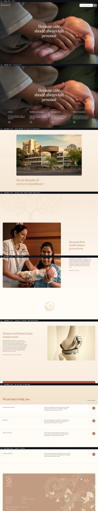
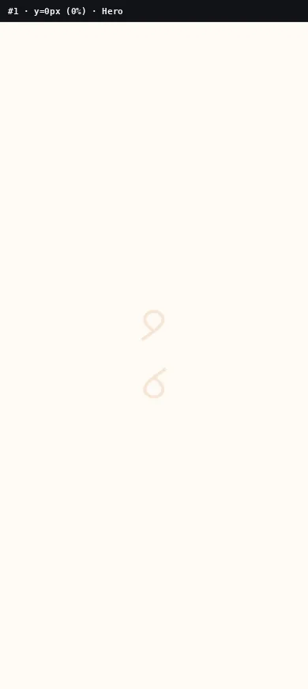

# UI Design System & Master Generation Blueprint: namaha-healthcare

> **Namaha Healthcare** (https://namaha.healthcare) — With over seventy years in healthcare, the Kapadia family has nurtured a legacy built on trust, compassion, and clinical integrity.





---

## 1. Executive Visual Persona & Design Archetype

- **Brand Essence & Persona**: **Namaha Healthcare** (`https://namaha.healthcare`). With over seventy years in healthcare, the Kapadia family has nurtured a legacy built on trust, compassion, and clinical integrity.
- **Final Redirected URL**: [https://www.namaha.healthcare/](https://www.namaha.healthcare/)
- **Capture Provenance**: Live browser capture (`tier1_fast`, HTTP `200`, captured `2026-11-24`).
- **Visual Archetype**: **Light-Substrate Editorial & Modular Grid System (`#fffbf6` canvas, `#0000ee` ink, `#0082f3` accent)**.
- **Anti-AI-Slop Differentiators**:
  - **Live-Computed Chromatic Polarity**: Anchors the viewport in `#fffbf6` (live computed `body` `background-color` (`computed_styles.json`)) paired with `#0000ee` primary typography and `#0082f3` accents.
  - **Grounded Typographic Hierarchy**: Pairs `Victorserif 50` for display copy (`Namaha Healthcare`) with `Helvetica Neue`.
  - **Calibrated Spatial Grid & Motion**: Combines `1411px` container bounds (`gap: 7px`, padding `5px`) with `cubic-bezier(.645,.045,.355,1)` easing and GSAP Timeline & ScrollTrigger, Three.js / WebGL Canvas Pipeline.

---

## 2. Spatial Architecture & Modular Grid Mathematics

### Viewport Allocation & Container Geometry
- **Captured Journey Filmstrips**: Desktop `1280×6624px` (`assets/desktop-journey.webp`, `8` keyframes up to `y=9313px` / doc `10366px`), Mobile `390×872px` (`assets/mobile-journey.webp`, `1` keyframes).
- **Master Container Bounds**: `1411px` (measured widest bounded `<section>` landmark width on `1440px` desktop).
- **Canvas Lateral Padding & Spacing**: `5px` lateral canvas padding with `7px` grid gap.
- **Border Radius Scale**: `3px`, `100%`, `50%`, `12px`.

### Responsive Breakpoint Architecture
- **Desktop Layout**: Multi-column CSS Grid / Flexbox layout at `1440px` (`max-width: 1411px`, `gap: 7px`).
- **Mobile Layout**: Single-column vertical stack at `390px` viewport width with `5px` horizontal padding.
- **Extracted CSS Media Queries**: `@media screen and (max-width: 991px)`, `@media screen and (max-width: 767px)`, `@media screen and (max-width: 479px)`, `@media (min-width: 768px)`.

---

## 3. Color System, Materiality & Atmospheric Lighting

### Semantic Palette & Source Grounding
| Semantic Role | Ground-Truth Value | Extracted Live / CSS Source |
|---|---|---|
| **Primary Canvas Substrate** | `#fffbf6` | live computed `body` `background-color` (`computed_styles.json`) |
| **Primary Typography Ink** | `#0000ee` | live computed `a` `color` (`computed_styles.json`) |
| **Elevated Surface / Card Substrate** | `#ffffff` | `.slick-loading .slick-list { background: #ffffff }` |
| **Interactive Accent / Highlight** | `#0082f3` | `.w-dropdown-link.w--current { color: #0082f3 }` |
| **Secondary / Muted Copy** | `#a05941` | live computed `h2` `color` (`computed_styles.json`) |
| **Structural Hairline Border** | `#e2e2e2` | `blockquote { border-left: #e2e2e2 }` |

### Sanitized Root CSS Variables (`ui-ux.md` Ground Truth)
| Variable Name | Extracted Value | Semantic Role |
|---|---|---|
| `--namaha-healthcar-bg` | `#fffbf6` | Canvas Substrate (from live computed `body` `background-color` (`computed_styles.json`)) |
| `--namaha-healthcar-ink` | `#0000ee` | Primary Typography Ink (computed-derived) |
| `--namaha-healthcar-surface` | `#ffffff` | Surface Substrate (computed-derived) |
| `--namaha-healthcar-accent` | `#0082f3` | Interactive Accent (computed-derived) |
| `--namaha-healthcar-muted` | `#a05941` | Secondary Ink (computed-derived) |
| `--namaha-healthcar-border` | `#e2e2e2` | Structural Border (computed-derived) |
| `--namaha-healthcar-container` | `1411px` | Container Bound (computed-derived) |
| `--namaha-healthcar-gap` | `7px` | Grid Gutter (computed-derived) |
| `--namaha-healthcar-pad` | `5px` | Lateral Padding (computed-derived) |
| `--namaha-healthcar-ease` | `cubic-bezier(.645,.045,.355,1)` | Primary Easing Function |
| `--namaha-healthcar-radius` | `3px` | Corner Radius (computed-derived) |
| `--namaha-healthcar-fs-base` | `42px` | Observed Font Size Token |

---

## 4. Typographic Scale & Editorial Hierarchy

### Font Family Stacks
- **Display Typography**: `Victorserif 50`.
- **Primary Body Stack**: `Helvetica Neue`.
- **Technical / Metadata Stack**: not declared in live computed styles (uses primary stack / `ui-monospace`).

### Typographic Scale & Rules (Live Computed & Stylesheet Grounded)
- **Hero Display (`H1`)**: rule `h1` (`font-size: 2em`).
- **Section Heading (`H2`)**: live computed `h2` (`font-size: 42px`, `line-height: 46.2px`, `font-weight: 500`, `letter-spacing: -0.924px`); rule `h2` (`font-size: 32px`, `line-height: 36px`).
- **Body Copy**: live computed `body` (`font-size: 14px`, `line-height: 20px`, `font-weight: 400`); rule `body` (`font-size: 14px`, `line-height: 20px`).
- **Metadata & Navigation Labels**: live computed `nav/a` (`font-size: 14px`, `line-height: 20px`, `font-weight: 400`); rule `small` (`font-size: 80%`).

---

## 5. Choreographed Motion & Interaction Physics

### Primary Easing Curves
- **Extracted Timing Functions**: `cubic-bezier(.645,.045,.355,1)`, `cubic-bezier(0.445,0.05,0.55,0.95)`.

### Per-Element Transition & Choreography Rules
- **Selector `.w-webflow-badge > img`**: `transition: unset` extracted from `namaha-healthcare` stylesheet.
- **Selector `.w-slider-dot`**: `transition: background-color .1s, color .1s` extracted from `namaha-healthcare` stylesheet.
- **Selector `.w-lightbox-control`**: `transition: all .3s` extracted from `namaha-healthcare` stylesheet.
- **Extracted Easing Curve (`cubic-bezier(.645,.045,.355,1)`)**: Governs interactive state transitions across `<header.w-mod-js>` and `<section.header>`.
- **Runtime Interaction Engine**: Integrates GSAP Timeline & ScrollTrigger, Three.js / WebGL Canvas Pipeline, Swiper Touch Carousel Engine with `prefers-reduced-motion: reduce` fallback guards.
### Measured Runtime Scroll & Interaction Telemetry (`behavioral_journey_v2`)
- **Scroll Driver Mode**: `native` (max document height `10366px`, deepest scrollY reached `9313px` across `8` desktop keyframes).
- **Detected Scroll / Motion Libraries**: `GSAP/ScrollTrigger`.
- **Interactive Control Probe (`carousel_next` · `Next`)**: Triggered visual diff `46.53` (attr ` -> `, captured in `assets/state-interactive.webp`).
- **Route Transition Architecture**: First internal navigation (`/team`) measured as `direct` in `269ms`.

---

## 6. Component Wireframe & Structural DOM Map

### Visual Layout Schematic — Desktop (`1440px`, Grounded in `dom.html` & Landmark Bounding Boxes)
```
┌────────────────────────────────────────────────────────────────────────┐
│ DESKTOP VIEWPORT (1440px) — Namaha Healthcare                          │
│ ====================================================================== │
│ [ <header.w-mod-js> (1440px)          | 1 Our Philosophy · 2 Our Tea ] │
│ ---------------------------------------------------------------------- │
│ | HERO STAGE: <section.headersection> (w=1440px)                     | │
│ | H1: Namaha Healthcare                                              | │
│ | Substrate: #fffbf6 | Ink: #0000ee | Accent: #0082f3                | │
│ ---------------------------------------------------------------------- │
│ | SHOWCASE GRID (<section.header>) max-w: 1411px                     | │
│ | +------------------------------+  +------------------------------+ | │
│ | | Featured Work & Interactive  |  | Technical Architecture & Nar | | │
│ | +------------------------------+  +------------------------------+ | │
│ ---------------------------------------------------------------------- │
│ | DETAIL MODULE (<section.hero_section>) — Global Directory & Co     | │
│ ---------------------------------------------------------------------- │
│ [ FOOTER (<footer.wf-active>  ) | https://namaha.healthcare            │
└────────────────────────────────────────────────────────────────────────┘
```

### Visual Layout Schematic — Mobile Reflow (`390px`)
```
┌────────────────────────────────────────────────────────────────────────┐
│ MOBILE VIEWPORT REFLOW (390px) — Single-Column Stack (gap: 7px)        │
│ ====================================================================== │
│ [ HEADER BAR (<header.w-mod-js>       ) | Compact Menu (390px)         │
│ ---------------------------------------------------------------------- │
│ | HERO STAGE (<section.headersection>) — 390px Vertical Lead         | │
│ | H1: Namaha Healthcare                                              | │
│ ---------------------------------------------------------------------- │
│ | SHOWCASE STACK (<section.header>) — 1-Col Stack                    | │
│ | [ Item 1: Featured Work & Interactive Showcase                   ] | │
│ | [ Item 2: Technical Architecture & Narrative                     ] | │
│ ---------------------------------------------------------------------- │
│ | DETAIL STACK (<section.hero_section>) — 1-Col (Global Directory &) | │
│ ---------------------------------------------------------------------- │
│ [ FOOTER (<footer.wf-active>  ) | Stacked 390px Colophon               │
└────────────────────────────────────────────────────────────────────────┘
```

### Granular DOM Region Breakdown
1. **Brand Header & Navigation Bar (<header.w-mod-js> — `namaha-healthcare`)**:
   - Landmark `<header class="w-mod-js">` (`1440px`) hosting `Namaha Healthcare` navigation (`1 Our Philosophy · 2 Our Team · 3 Departments · 5 Our Facilities · 6 Guides`), DOM attributes (`data-wf-domain="www.namaha.healthcare"`, `data-wf-page="68949db83756970449601627"`, `data-wf-site="68949db8375697044960161c"`, `data-w-id="2086974e-b9c8-7268-e0..."`), and stylesheet rule `.slick-list { position: relative; display: block; overflow: hidden; margin: 0; padding... }`.
2. **Hero Stage & Focal Lead (<section.headersection> — `Namaha Healthcare`)**:
   - Landmark `<section class="headersection scrolled-over">` presenting display lead `Namaha Healthcare` and copy excerpt *"Our lines are available 24/7. Reach out to us to get in touch wit"* over `#fffbf6` canvas and `#0000ee` ink.
3. **Primary Showcase & Content Grid (<section.header> — `Featured Work & Interactive Showca`)**:
   - Landmark `<section class="header">` rendering section `Featured Work & Interactive Showcase` with copy *"Your well-being matters to us. We are here to assist you with car"*, asset references (`cdn.prod.website-files.com`, `namaha-v2.webflow.shared.a69184c8...`, `fonts.googleapis.com`, `fonts.gstatic.com`), and grid rule `.slick-list:focus { outline: none; }`.
4. **Interactive Detail & Feature Matrix (<section.hero_section> — `Technical Architecture & Narrative`)**:
   - Landmark `<section class="hero_section gsapherosection">` framing `Technical Architecture & Narrative` and `Global Directory & Contact` (*"Women are at the centre of family and relationships. At Namaha, w"*) with `#ffffff` surface cards, `#0082f3` accents, and `.slick-list.dragging { cursor: pointer; cursor: hand; }`.
5. **Colophon & Global Directory Footer (<footer.wf-active> — `https://namaha.healthcare`)**:
   - Landmark `<footer class="wf-active">` anchoring `Namaha Healthcare` footer links (`1 Our Philosophy · 2 Our Team · 3 Departments · 5 Our Facilities · 6 Guides`), copy *"Consult with the best specialists in every field. We assure "*, and `#e2e2e2` structural dividers.
### Full Vertical Scroll Sequence (Desktop `1440×900` Keyframes)
- **Step 01** (`y=0px`, `0%`): Active landmark `Hero` · sticky/fixed elements: `2`
- **Step 02** (`y=850px`, `9%`): Active landmark `Section @ 9%` · sticky/fixed elements: `1`
- **Step 03** (`y=2550px`, `27%`): Active landmark `Seven decades of service in healthcare` · sticky/fixed elements: `0`
- **Step 04** (`y=4250px`, `45%`): Active landmark `Because their health shapes generations` · sticky/fixed elements: `0`
- **Step 05** (`y=5100px`, `54%`): Active landmark `Section @ 54%` · sticky/fixed elements: `0`
- **Step 06** (`y=6800px`, `72%`): Active landmark `Pioneers in Robotic Knee Replacement` · sticky/fixed elements: `0`
- **Step 07** (`y=8500px`, `90%`): Active landmark `We are here to help you.` · sticky/fixed elements: `0`
- **Step 08** (`y=9313px`, `98%`): Active landmark `Footer / Bottom` · sticky/fixed elements: `0`

### Multi-Page Internal Route Map
- **About Route (`/team`)**: `https://www.namaha.healthcare/team` — H1: `Team`, scrollHeight `10158px`, transition `direct` (`269ms`)
- **Other Route (`/philosophy`)**: `https://www.namaha.healthcare/philosophy` — H1: `Philosophy`, scrollHeight `8518px`, transition `direct` (`1227ms`)
- **Other Route (`/departments`)**: `https://www.namaha.healthcare/departments` — H1: `Departments`, scrollHeight `7082px`, transition `direct` (`318ms`)

---

## 7. Master Zero-Shot AI Generation Prompt

```markdown
# Master Zero-Shot Frontend Generation Prompt: namaha-healthcare (Namaha Healthcare)

You are a principal frontend architect and design systems engineer. Build a complete, production-ready web application replicating the exact design system, DOM landmarks, typographic hierarchy, color tokens, and motion physics of `namaha-healthcare` (**Namaha Healthcare** — `https://namaha.healthcare`).

### 1. Visual Archetype & Anti-AI-Slop Mandates
- **Archetype**: Light-Substrate Editorial & Modular Grid System (`#fffbf6` canvas, `#0000ee` ink, `#0082f3` accent).
- **Identity & Domain Context**: With over seventy years in healthcare, the Kapadia family has nurtured a legacy built on trust, compassion, and clinical integrity.
- **Primary Substrate**: `#fffbf6` (live computed `body` `background-color` (`computed_styles.json`)), **Primary Ink**: `#0000ee`, **Accent / Highlight**: `#0082f3`.
- **Site-Specific Differentiators**:
  - **Live-Computed Chromatic Polarity**: Anchors the viewport in `#fffbf6` (live computed `body` `background-color` (`computed_styles.json`)) paired with `#0000ee` primary typography and `#0082f3` accents.
  - **Grounded Typographic Hierarchy**: Pairs `Victorserif 50` for display copy (`Namaha Healthcare`) with `Helvetica Neue`.
  - **Calibrated Spatial Grid & Motion**: Combines `1411px` container bounds (`gap: 7px`, padding `5px`) with `cubic-bezier(.645,.045,.355,1)` easing and GSAP Timeline & ScrollTrigger, Three.js / WebGL Canvas Pipeline.

### 2. Ground-Truth CSS Variables (`:root` Token Contract)
Declare and consume these exact custom properties extracted from `namaha-healthcare` in your global stylesheet:

:root {
  /* Namaha Healthcare (namaha-healthcare) — Live-Grounded CSS Variables */
  --namaha-healthcar-bg: #fffbf6; /* Canvas Substrate (from live computed `body` `background-color` (`computed_styles.json`)) (namaha-healthcare) */
  --namaha-healthcar-ink: #0000ee; /* Primary Typography Ink (computed-derived) (namaha-healthcare) */
  --namaha-healthcar-surface: #ffffff; /* Surface Substrate (computed-derived) (namaha-healthcare) */
  --namaha-healthcar-accent: #0082f3; /* Interactive Accent (computed-derived) (namaha-healthcare) */
  --namaha-healthcar-muted: #a05941; /* Secondary Ink (computed-derived) (namaha-healthcare) */
  --namaha-healthcar-border: #e2e2e2; /* Structural Border (computed-derived) (namaha-healthcare) */
  --namaha-healthcar-container: 1411px; /* Container Bound (computed-derived) (namaha-healthcare) */
  --namaha-healthcar-gap: 7px; /* Grid Gutter (computed-derived) (namaha-healthcare) */
  --namaha-healthcar-pad: 5px; /* Lateral Padding (computed-derived) (namaha-healthcare) */
  --namaha-healthcar-ease: cubic-bezier(.645,.045,.355,1); /* Primary Easing Function (namaha-healthcare) */
  --namaha-healthcar-radius: 3px; /* Corner Radius (computed-derived) (namaha-healthcare) */
  --namaha-healthcar-fs-base: 42px; /* Observed Font Size Token (namaha-healthcare) */
}

### 3. Semantic Color & Materiality Contract
Map every surface, ink, and border strictly to these source-grounded tokens:
- **Primary Canvas Substrate**: `#fffbf6` — grounded in live computed `body` `background-color` (`computed_styles.json`)
- **Primary Typography Ink**: `#0000ee` — grounded in live computed `a` `color` (`computed_styles.json`)
- **Elevated Surface / Card Substrate**: `#ffffff` — grounded in `.slick-loading .slick-list { background: #ffffff }`
- **Interactive Accent / Highlight**: `#0082f3` — grounded in `.w-dropdown-link.w--current { color: #0082f3 }`
- **Secondary / Muted Copy**: `#a05941` — grounded in live computed `h2` `color` (`computed_styles.json`)
- **Structural Hairline Border**: `#e2e2e2` — grounded in `blockquote { border-left: #e2e2e2 }`

### 4. Spatial Grid, Container Bounds & Responsive Breakpoints
- **Desktop Viewport Reference**: `1280×6624px` (multi-frame vertical journey filmstrip (6624px), `1440px` standard desktop width).
- **Mobile Viewport Reference**: `390×872px` (full-page live capture (872px), `390px` standard mobile width).
- **Container Max-Width**: `1411px` (measured widest bounded `<section>` landmark width on `1440px` desktop)
- **Padding & Gutters**: `5px` lateral canvas padding with `7px` grid gap
- **Desktop Grid**: Multi-column CSS Grid / Flexbox layout at `1440px` (`max-width: 1411px`, `gap: 7px`)
- **Mobile Adaptation**: Single-column vertical stack at `390px` viewport width with `5px` horizontal padding
- **Media Queries**: `@media screen and (max-width: 991px)`, `@media screen and (max-width: 767px)`, `@media screen and (max-width: 479px)`, `@media (min-width: 768px)`
- **Corner Radii**: `3px`, `100%`, `50%`, `12px`

### 5. Typography & Editorial Scale Contract
- **Display Font Stack**: `Victorserif 50`
- **Body Font Stack**: `Helvetica Neue`
- **Monospace / Technical Font Stack**: not declared in live computed styles (uses primary stack / `ui-monospace`)
- **H1 Display Rule**: rule `h1` (`font-size: 2em`)
- **H2 Section Rule**: live computed `h2` (`font-size: 42px`, `line-height: 46.2px`, `font-weight: 500`, `letter-spacing: -0.924px`); rule `h2` (`font-size: 32px`, `line-height: 36px`)
- **Body Copy Rule**: live computed `body` (`font-size: 14px`, `line-height: 20px`, `font-weight: 400`); rule `body` (`font-size: 14px`, `line-height: 20px`)
- **Metadata & Index Rule**: live computed `nav/a` (`font-size: 14px`, `line-height: 20px`, `font-weight: 400`); rule `small` (`font-size: 80%`)

### 6. Component Hierarchy, Verbatim Copy & Real DOM Landmarks
Scaffold `namaha-healthcare` (`Namaha Healthcare`) with these exact structural regions, extracted copy, and CSS rules from `dom.html`:
1. **Brand Header & Navigation Bar (<header.w-mod-js> — `namaha-healthcare`)**:
   - DOM & Selectors: Landmark `<header class="w-mod-js">` (`1440px`) hosting `Namaha Healthcare` navigation (`1 Our Philosophy · 2 Our Team · 3 Departments · 5 Our Facilities · 6 Guides`), DOM attributes (`data-wf-domain="www.namaha.healthcare"`, `data-wf-page="68949db83756970449601627"`, `data-wf-site="68949db8375697044960161c"`, `data-w-id="2086974e-b9c8-7268-e0..."`), and stylesheet rule `.slick-list { position: relative; display: block; overflow: hidden; margin: 0; padding... }`.
   - Responsive Contract: Header `Brand Header & Navigation Bar (<header.w-mod-js> — `namaha-healthcare`)` (`namaha-healthcare`) adapts across `@media screen and (max-width: 991px)`, `@media screen and (max-width: 767px)`, `@media screen and (max-width: 479px)`, `@media (min-width: 768px)` with `cubic-bezier(.645,.045,.355,1)`, `cubic-bezier(0.445,0.05,0.55,0.95)` transitions and links `1 Our Philosophy · 2 Our Team · 3 Departments · 5 Our Facilities · 6 Guides`.
2. **Hero Stage & Focal Lead (<section.headersection> — `Namaha Healthcare`)**:
   - DOM & Selectors: Landmark `<section class="headersection scrolled-over">` presenting display lead `Namaha Healthcare` and copy excerpt *"Our lines are available 24/7. Reach out to us to get in touch wit"* over `#fffbf6` canvas and `#0000ee` ink.
   - Responsive Contract: Hero stage (`1280×6624px` desktop / `390×872px` mobile) sets `#fffbf6` background with `#0000ee` headline `Namaha Healthcare`.
3. **Primary Showcase & Content Grid (<section.header> — `Featured Work & Interactive Showca`)**:
   - DOM & Selectors: Landmark `<section class="header">` rendering section `Featured Work & Interactive Showcase` with copy *"Your well-being matters to us. We are here to assist you with car"*, asset references (`cdn.prod.website-files.com`, `namaha-v2.webflow.shared.a69184c8...`, `fonts.googleapis.com`, `fonts.gstatic.com`), and grid rule `.slick-list:focus { outline: none; }`.
   - Responsive Contract: Showcase grid `Primary Showcase & Content Grid (<section.header> — `Featured Work & Interactive Showca`)` applies Multi-column CSS Grid / Flexbox layout at `1440px` (`max-width: 1411px`, `gap: 7px`) on desktop and Single-column vertical stack at `390px` viewport width with `5px` horizontal padding on mobile.
4. **Interactive Detail & Feature Matrix (<section.hero_section> — `Technical Architecture & Narrative`)**:
   - DOM & Selectors: Landmark `<section class="hero_section gsapherosection">` framing `Technical Architecture & Narrative` and `Global Directory & Contact` (*"Women are at the centre of family and relationships. At Namaha, w"*) with `#ffffff` surface cards, `#0082f3` accents, and `.slick-list.dragging { cursor: pointer; cursor: hand; }`.
   - Responsive Contract: Detail module `Interactive Detail & Feature Matrix (<section.hero_section> — `Technical Architecture & Narrative`)` uses `3px`, `100%`, `50%`, `12px` radii, `#0082f3` highlights, and assets (cdn.prod.website-files.com, namaha-v2.webflow.shared.a69184c8..., fonts.googleapis.com).
5. **Colophon & Global Directory Footer (<footer.wf-active> — `https://namaha.healthcare`)**:
   - DOM & Selectors: Landmark `<footer class="wf-active">` anchoring `Namaha Healthcare` footer links (`1 Our Philosophy · 2 Our Team · 3 Departments · 5 Our Facilities · 6 Guides`), copy *"Consult with the best specialists in every field. We assure "*, and `#e2e2e2` structural dividers.
   - Responsive Contract: Footer `Colophon & Global Directory Footer (<footer.wf-active> — `https://namaha.healthcare`)` aligns to `1411px` (measured widest bounded `<section>` landmark width on `1440px` desktop) with `5px` lateral canvas padding with `7px` grid gap and attributes (data-wf-domain="www.namaha.healthcare", data-wf-page="68949db83756970449601627", data-wf-site="68949db8375697044960161c").

#### Verbatim DOM Copy Excerpts (`dom.html`)
- Copy Excerpt 1: *"Our lines are available 24/7. Reach out to us to get in touch with a healthcare pr..."*
- Copy Excerpt 2: *"Your well-being matters to us. We are here to assist you with care and be your tru..."*
- Copy Excerpt 3: *"Women are at the centre of family and relationships. At Namaha, we prioritize thei..."*
- Copy Excerpt 4: *"Consult with the best specialists in every field. We assure you world-class facili..."*

### 7. Motion, Extracted Stylesheet Rules & Interaction Choreography
- **Primary Easing Functions**: `cubic-bezier(.645,.045,.355,1)`, `cubic-bezier(0.445,0.05,0.55,0.95)`
- **Extracted Stylesheet Rules (`namaha-healthcare`)**:
- `.slick-list { position: relative; display: block; overflow: hidden; margin: 0; padding... }`
- `.slick-list:focus { outline: none; }`
- `.slick-list.dragging { cursor: pointer; cursor: hand; }`
- `.slick-track { position: relative; top: 0; left: 0; display: block; margin-left: auto;... }`
- `.slick-track:after { display: table; content: ''; }`
- **Per-Selector Transition Rules**:
- **Selector `.w-webflow-badge > img`**: `transition: unset` extracted from `namaha-healthcare` stylesheet.
- **Selector `.w-slider-dot`**: `transition: background-color .1s, color .1s` extracted from `namaha-healthcare` stylesheet.
- **Selector `.w-lightbox-control`**: `transition: all .3s` extracted from `namaha-healthcare` stylesheet.
- **Extracted Easing Curve (`cubic-bezier(.645,.045,.355,1)`)**: Governs interactive state transitions across `<header.w-mod-js>` and `<section.header>`.
- **Runtime Interaction Engine**: Integrates GSAP Timeline & ScrollTrigger, Three.js / WebGL Canvas Pipeline, Swiper Touch Carousel Engine with `prefers-reduced-motion: reduce` fallback guards.
### 7b. Full-Page Scroll Choreography, Interactive States & Multi-Page Routes
- **Scroll Mechanics**: Implement `native` vertical progression up to `10366px` across 8 distinct viewport chapters using GSAP/ScrollTrigger.
- **Vertical Chapter Sequence**: Hero (0%) -> Section @ 9% (9%) -> Seven decades of service in... (27%) -> Because their health shapes... (45%) -> Section @ 54% (54%) -> Pioneers in Robotic Knee Re... (72%) -> We are here to help you. (90%) -> Footer / Bottom (98%).
- **Multi-Page Routes**: Scaffold internal routes `/team` (about, direct), `/philosophy` (other, direct), `/departments` (other, direct) sharing the global header/footer shell and design tokens.

### 8. Technical Deliverables
- Implement in Next.js (App Router) with TypeScript and Tailwind CSS consuming the `:root` custom properties defined above for `namaha-healthcare`.
- Reproduce both the `1440px` desktop architecture and `390px` mobile breakpoint transitions, preserving semantic HTML5 landmarks (`<header>`, `<nav>`, `<main>`, `<section>`, `<footer>`) and `prefers-reduced-motion` accessibility guards.
```
---

## 8. Full-Page Scroll Journey, Interactive States & Subpage Inventory

### Desktop Scroll Keyframes (`1440×900` WebP)
| Step | Scroll Y | Progress | Active Landmark / Section | Sticky/Fixed | Visual Asset |
| :---: | :---: | :---: | :--- | :---: | :--- |
| `#01` | `0px` | `0%` | Hero | `2` | [desktop-step-01.webp](assets/desktop-step-01.webp) |
| `#02` | `850px` | `9%` | Section @ 9% | `1` | [desktop-step-02.webp](assets/desktop-step-02.webp) |
| `#03` | `2550px` | `27%` | Seven decades of service in healthcare | `0` | [desktop-step-03.webp](assets/desktop-step-03.webp) |
| `#04` | `4250px` | `45%` | Because their health shapes generations | `0` | [desktop-step-04.webp](assets/desktop-step-04.webp) |
| `#05` | `5100px` | `54%` | Section @ 54% | `0` | [desktop-step-05.webp](assets/desktop-step-05.webp) |
| `#06` | `6800px` | `72%` | Pioneers in Robotic Knee Replacement | `0` | [desktop-step-06.webp](assets/desktop-step-06.webp) |
| `#07` | `8500px` | `90%` | We are here to help you. | `0` | [desktop-step-07.webp](assets/desktop-step-07.webp) |
| `#08` | `9313px` | `98%` | Footer / Bottom | `0` | [desktop-step-08.webp](assets/desktop-step-08.webp) |

### Mobile Condensed Keyframes (`390×844` WebP)
| Step | Scroll Y | Progress | Active Landmark | Visual Asset |
| :---: | :---: | :---: | :--- | :--- |
| `#01` | `0px` | `0%` | Hero | [mobile-step-01.webp](assets/mobile-step-01.webp) |

### Interactive UI State Captures (`1440×900` WebP)
| State Type | Trigger / Observation | Visual Asset |
| :--- | :--- | :--- |
| `interactive_control` | Control `carousel_next` (`Next`, diff `46.53`) | [state-interactive.webp](assets/state-interactive.webp) |

### Internal Subpage Filmstrips (`1080px` Wide WebP)
| # | Template | Route URL | H1 / Title | Scroll Height | Transition | Filmstrip Asset |
| :-: | :---: | :--- | :--- | :---: | :---: | :--- |
| `1` | `about` | `https://www.namaha.healthcare/team` | Team | `10158px` | `direct` (`269ms`) | [subpage-01-team.webp](assets/subpage-01-team.webp) |
| `2` | `other` | `https://www.namaha.healthcare/philosophy` | Philosophy | `8518px` | `direct` (`1227ms`) | [subpage-02-philosophy.webp](assets/subpage-02-philosophy.webp) |
| `3` | `other` | `https://www.namaha.healthcare/departments` | Departments | `7082px` | `direct` (`318ms`) | [subpage-03-departments.webp](assets/subpage-03-departments.webp) |

