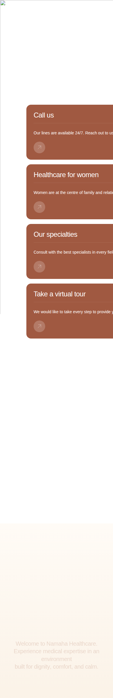

# UI Design System & Master Generation Blueprint: namaha-healthcare

> **Namaha Healthcare** (https://namaha.healthcare) — With over seventy years in healthcare, the Kapadia family has nurtured a legacy built on trust, compassion, and clinical integrity.


---

## 1. Executive Visual Persona & Design Archetype

- **Brand Essence & Persona**: **Namaha Healthcare** (`https://namaha.healthcare`). With over seventy years in healthcare, the Kapadia family has nurtured a legacy built on trust, compassion, and clinical integrity.
- **Visual Archetype**: **Light-Substrate Editorial & Modular Grid System (`#fff` canvas, `#000000` ink, `#0000` accent)**.
- **Anti-AI-Slop Differentiators**:
  - **Source-Grounded Chromatic Polarity**: Anchors the viewport in `#fff` (`.slick-loading .slick-list { background: #fff }`) paired with `#000000` primary typography and `#0000` accents.
  - **Extracted Typographic Hierarchy**: Pairs `Geist` for display copy (`S e v e n d e c a d e s o f s e r v `) with `Victorserif 50` and not declared in static CSS (uses primary stack / `ui-monospace`).
  - **Calibrated Spatial Grid & Motion**: Combines `940px` container bounds (`gap: 7px`, padding `5px`) with `cubic-bezier(.645,.045,.355,1)` easing and GSAP Timeline & ScrollTrigger, Three.js / WebGL Canvas Pipeline.

---

## 2. Spatial Architecture & Modular Grid Mathematics



### Viewport Allocation & Container Geometry
- **Captured Viewport Dimensions**: Desktop `1440×10213px` (`assets/desktop.png`, full-page scroll capture), Mobile `390×2400px` (`assets/mobile.png`, capped at 2400px multi-section capture).
- **Master Container Bounds**: `940px` extracted from `namaha-healthcare` stylesheet.
- **Canvas Lateral Padding & Spacing**: `5px` lateral canvas padding with `7px` grid gap.
- **Border Radius Scale**: `3px`, `100%`, `50%`, `12px`.

### Responsive Breakpoint Architecture
- **Desktop Layout**: Multi-column CSS Grid / Flexbox layout at `1440px` (`max-width: 940px`, `gap: 7px`).
- **Mobile Layout**: Single-column vertical stack at `390px` viewport width with `5px` horizontal padding.
- **Extracted CSS Media Queries**: `@media screen and (max-width: 991px)`, `@media screen and (max-width: 767px)`, `@media screen and (max-width: 479px)`, `@media (min-width: 768px)`.

---

## 3. Color System, Materiality & Atmospheric Lighting

### Semantic Palette & Source Grounding
| Semantic Role | Ground-Truth Value | Extracted CSS Source / Selector |
|---|---|---|
| **Primary Canvas Substrate** | `#fff` | `.slick-loading .slick-list { background: #fff }` |
| **Primary Typography Ink** | `#ffffff` | `.slick-next:before { color: white }` (`#ffffff`) |
| **Elevated Surface / Card Substrate** | `#000000` | `.slick-dots li.slick-active but... { color: black }` (`#000000`) |
| **Interactive Accent / Highlight** | `#0000` | `a { background-color: #0000 }` |
| **Secondary / Muted Copy** | `#000` | `mark { color: #000 }` |
| **Structural Hairline Border** | `#ff0` | `mark { background: #ff0 }` |

### Sanitized Root CSS Variables (`ui-ux.md` Ground Truth)
| Variable Name | Extracted Value | Semantic Role |
|---|---|---|
| `--namaha-healthcar-bg` | `#fff` | Canvas Substrate (from `.slick-loading .slick-list { background: #fff }`) |
| `--namaha-healthcar-ink` | `#000000` | Primary Typography Ink (stylesheet-derived) |
| `--namaha-healthcar-surface` | `#000000` | Surface Substrate (stylesheet-derived) |
| `--namaha-healthcar-accent` | `#0000` | Interactive Accent (stylesheet-derived) |
| `--namaha-healthcar-muted` | `#000` | Secondary Ink (stylesheet-derived) |
| `--namaha-healthcar-border` | `#ff0` | Structural Border (stylesheet-derived) |
| `--namaha-healthcar-container` | `940px` | Container Bound (stylesheet-derived) |
| `--namaha-healthcar-gap` | `7px` | Grid Gutter (stylesheet-derived) |
| `--namaha-healthcar-pad` | `5px` | Lateral Padding (stylesheet-derived) |
| `--namaha-healthcar-ease` | `cubic-bezier(.645,.045,.355,1)` | Primary Easing Function |
| `--namaha-healthcar-radius` | `3px` | Corner Radius (stylesheet-derived) |
| `--namaha-healthcar-fs-base` | `20px` | Observed Font Size Token |

---

## 4. Typographic Scale & Editorial Hierarchy

### Font Family Stacks
- **Display Typography**: `Geist`.
- **Primary Body Stack**: `Victorserif 50`.
- **Technical / Metadata Stack**: not declared in static CSS (uses primary stack / `ui-monospace`).

### Typographic Scale & Rules (Extracted from Stylesheet & Variables)
- **Hero Display (`H1`)**: rule `h1` (`font-size: 2em`).
- **Section Heading (`H2`)**: rule `h2` (`font-size: 32px`, `line-height: 36px`).
- **Body Copy**: rule `body` (`font-size: 14px`, `line-height: 20px`).
- **Metadata & Navigation Labels**: rule `small` (`font-size: 80%`).

---

## 5. Choreographed Motion & Interaction Physics

### Primary Easing Curves
- **Extracted Timing Functions**: `cubic-bezier(.645,.045,.355,1)`, `cubic-bezier(0.445,0.05,0.55,0.95)`.

### Per-Element Transition & Choreography Rules
- **Selector `.w-webflow-badge > img`**: `transition: unset` extracted from `namaha-healthcare` stylesheet.
- **Selector `.w-slider-dot`**: `transition: background-color .1s, color .1s` extracted from `namaha-healthcare` stylesheet.
- **Selector `.w-lightbox-control`**: `transition: all .3s` extracted from `namaha-healthcare` stylesheet.
- **Extracted Easing Curve (`cubic-bezier(.645,.045,.355,1)`)**: Governs interactive state transitions across `<header.w-mod-js>` and `<section.header>`.
- **Runtime Interaction Engine**: Integrates GSAP Timeline & ScrollTrigger, Three.js / WebGL Canvas Pipeline, Swiper Touch Carousel Engine with `prefers-reduced-motion: reduce` fallback guards.

---

## 6. Component Wireframe & Structural DOM Map

### Visual Layout Schematic (Grounded in `dom.html` — `1440px` Desktop & `390px` Mobile Reflow)
```
┌────────────────────────────────────────────────────────────────────────┐
│ DESKTOP VIEWPORT (1440px) — Namaha Healthcare                          │
│ ====================================================================== │
│ [ <header.w-mod-js>        | 1 Our Philosophy · 2 Our Team · 3 Depa ]  │
│ ---------------------------------------------------------------------- │
│ | HERO STAGE: <section.headersection>                              |   │
│ | H1: S e v e n d e c a d e s o f s e r v i c e i n h e...         |   │
│ | Substrate: #fff       | Ink: #000000    | Accent: #0000          |   │
│ ---------------------------------------------------------------------- │
│ | SHOWCASE GRID (<section.header>          ) max-w: 940px          |   │
│ | +------------------------------+  +------------------------------+ | │
│ | | B e c a u s e t h e i r h e  |  | Specialty Departments        | | │
│ | +------------------------------+  +------------------------------+ | │
│ ---------------------------------------------------------------------- │
│ | MOBILE VIEWPORT REFLOW (390px) — Single-Column Stack (gap: 7px   ) | │
│ | [<header.w-mod-js>] -> [<section.headersec] -> [<section.header>] |  │
│ ---------------------------------------------------------------------- │
│ [ FOOTER (<footer.wf-geist-n6-ac) | https://namaha.healthcare          │
└────────────────────────────────────────────────────────────────────────┘
```

### Granular DOM Region Breakdown
1. **Brand Header & Navigation Bar (<header.w-mod-js> — `namaha-healthcare`)**:
   - Landmark `<header class="w-mod-js">` hosting `Namaha Healthcare` navigation (`1 Our Philosophy · 2 Our Team · 3 Departments · 5 Our Facilities · 6 Guides`), DOM attributes (`data-wf-domain="www.namaha.healthcare"`, `data-wf-page="68949db83756970449601627"`, `data-wf-site="68949db8375697044960161c"`, `data-w-id="2086974e-b9c8-7268-e0..."`), and stylesheet rule `.slick-loading .slick-list { background: fff url('./ajax-loader.gif') center center no-repeat; }`.
2. **Hero Stage & Focal Lead (<section.headersection> — `S e v e n d e c a d e s o f s e r `)**:
   - Landmark `<section class="headersection scrolled-over">` presenting display lead `S e v e n d e c a d e s o f s e r v i c e i n h e...` and copy excerpt *"4 Specialised healthcare for women"* over `#fff` canvas and `#000000` ink.
3. **Primary Showcase & Content Grid (<section.header> — `B e c a u s e t h e i r h e a l t `)**:
   - Landmark `<section class="header">` rendering section `B e c a u s e t h e i r h e a l t h s h a p e s g...` with copy *"Your well-being matters to us. We are here to assist you with car"*, asset references (`cdn.prod.website-files.com`, `namaha-v2.webflow.shared.a69184c8...`, `fonts.googleapis.com`, `fonts.gstatic.com`), and grid rule `.slick-next:focus { color: transparent; outline: none; background: transparent; }`.
4. **Interactive Detail & Feature Matrix (<section.hero_section> — `Specialty Departments`)**:
   - Landmark `<section class="hero_section gsapherosection">` framing `Specialty Departments` and `P i o n e e r s i n R o b o t i c K n e e R e p l...` (*"CALL TO BOOK (+91 22) 6123 6123"*) with `#000000` surface cards, `#0000` accents, and `.slick-next:focus:before { opacity: 1; }`.
5. **Colophon & Global Directory Footer (<footer.wf-geist-n6-active> — `https://namaha.healthcare`)**:
   - Landmark `<footer class="wf-geist-n6-active">` anchoring `Namaha Healthcare` footer links (`1 Our Philosophy · 2 Our Team · 3 Departments · 5 Our Facilities · 6 Guides`), copy *"Call us Our lines are available 24/7. Reach out to us to get"*, and `#ff0` structural dividers.

---

## 7. Master Zero-Shot AI Generation Prompt

```markdown
# Master Zero-Shot Frontend Generation Prompt: namaha-healthcare (Namaha Healthcare)

You are a principal frontend architect and design systems engineer. Build a complete, production-ready web application replicating the exact design system, DOM landmarks, typographic hierarchy, color tokens, and motion physics of `namaha-healthcare` (**Namaha Healthcare** — `https://namaha.healthcare`).

### 1. Visual Archetype & Anti-AI-Slop Mandates
- **Archetype**: Light-Substrate Editorial & Modular Grid System (`#fff` canvas, `#000000` ink, `#0000` accent).
- **Identity & Domain Context**: With over seventy years in healthcare, the Kapadia family has nurtured a legacy built on trust, compassion, and clinical integrity.
- **Primary Substrate**: `#fff` (`.slick-loading .slick-list { background: #fff }`), **Primary Ink**: `#000000`, **Accent / Highlight**: `#0000`.
- **Site-Specific Differentiators**:
  - **Source-Grounded Chromatic Polarity**: Anchors the viewport in `#fff` (`.slick-loading .slick-list { background: #fff }`) paired with `#000000` primary typography and `#0000` accents.
  - **Extracted Typographic Hierarchy**: Pairs `Geist` for display copy (`S e v e n d e c a d e s o f s e r v `) with `Victorserif 50` and not declared in static CSS (uses primary stack / `ui-monospace`).
  - **Calibrated Spatial Grid & Motion**: Combines `940px` container bounds (`gap: 7px`, padding `5px`) with `cubic-bezier(.645,.045,.355,1)` easing and GSAP Timeline & ScrollTrigger, Three.js / WebGL Canvas Pipeline.

### 2. Ground-Truth CSS Variables (`:root` Token Contract)
Declare and consume these exact custom properties extracted from `namaha-healthcare` in your global stylesheet:

:root {
  /* Namaha Healthcare (namaha-healthcare) — Ground-Truth Extracted CSS Variables */
  --namaha-healthcar-bg: #fff; /* Canvas Substrate (from `.slick-loading .slick-list { background: #fff }`) (namaha-healthcare) */
  --namaha-healthcar-ink: #000000; /* Primary Typography Ink (stylesheet-derived) (namaha-healthcare) */
  --namaha-healthcar-surface: #000000; /* Surface Substrate (stylesheet-derived) (namaha-healthcare) */
  --namaha-healthcar-accent: #0000; /* Interactive Accent (stylesheet-derived) (namaha-healthcare) */
  --namaha-healthcar-muted: #000; /* Secondary Ink (stylesheet-derived) (namaha-healthcare) */
  --namaha-healthcar-border: #ff0; /* Structural Border (stylesheet-derived) (namaha-healthcare) */
  --namaha-healthcar-container: 940px; /* Container Bound (stylesheet-derived) (namaha-healthcare) */
  --namaha-healthcar-gap: 7px; /* Grid Gutter (stylesheet-derived) (namaha-healthcare) */
  --namaha-healthcar-pad: 5px; /* Lateral Padding (stylesheet-derived) (namaha-healthcare) */
  --namaha-healthcar-ease: cubic-bezier(.645,.045,.355,1); /* Primary Easing Function (namaha-healthcare) */
  --namaha-healthcar-radius: 3px; /* Corner Radius (stylesheet-derived) (namaha-healthcare) */
  --namaha-healthcar-fs-base: 20px; /* Observed Font Size Token (namaha-healthcare) */
}

### 3. Semantic Color & Materiality Contract
Map every surface, ink, and border strictly to these source-grounded tokens:
- **Primary Canvas Substrate**: `#fff` — grounded in `.slick-loading .slick-list { background: #fff }`
- **Primary Typography Ink**: `#ffffff` — grounded in `.slick-next:before { color: white }` (`#ffffff`)
- **Elevated Surface / Card Substrate**: `#000000` — grounded in `.slick-dots li.slick-active but... { color: black }` (`#000000`)
- **Interactive Accent / Highlight**: `#0000` — grounded in `a { background-color: #0000 }`
- **Secondary / Muted Copy**: `#000` — grounded in `mark { color: #000 }`
- **Structural Hairline Border**: `#ff0` — grounded in `mark { background: #ff0 }`

### 4. Spatial Grid, Container Bounds & Responsive Breakpoints
- **Desktop Viewport Reference**: `1440×10213px` (full-page scroll capture, `1440px` standard desktop width).
- **Mobile Viewport Reference**: `390×2400px` (capped at 2400px multi-section capture, `390px` standard mobile width).
- **Container Max-Width**: `940px` extracted from `namaha-healthcare` stylesheet
- **Padding & Gutters**: `5px` lateral canvas padding with `7px` grid gap
- **Desktop Grid**: Multi-column CSS Grid / Flexbox layout at `1440px` (`max-width: 940px`, `gap: 7px`)
- **Mobile Adaptation**: Single-column vertical stack at `390px` viewport width with `5px` horizontal padding
- **Media Queries**: `@media screen and (max-width: 991px)`, `@media screen and (max-width: 767px)`, `@media screen and (max-width: 479px)`, `@media (min-width: 768px)`
- **Corner Radii**: `3px`, `100%`, `50%`, `12px`

### 5. Typography & Editorial Scale Contract
- **Display Font Stack**: `Geist`
- **Body Font Stack**: `Victorserif 50`
- **Monospace / Technical Font Stack**: not declared in static CSS (uses primary stack / `ui-monospace`)
- **H1 Display Rule**: rule `h1` (`font-size: 2em`)
- **H2 Section Rule**: rule `h2` (`font-size: 32px`, `line-height: 36px`)
- **Body Copy Rule**: rule `body` (`font-size: 14px`, `line-height: 20px`)
- **Metadata & Index Rule**: rule `small` (`font-size: 80%`)

### 6. Component Hierarchy, Verbatim Copy & Real DOM Landmarks
Scaffold `namaha-healthcare` (`Namaha Healthcare`) with these exact structural regions, extracted copy, and CSS rules from `dom.html`:
1. **Brand Header & Navigation Bar (<header.w-mod-js> — `namaha-healthcare`)**:
   - DOM & Selectors: Landmark `<header class="w-mod-js">` hosting `Namaha Healthcare` navigation (`1 Our Philosophy · 2 Our Team · 3 Departments · 5 Our Facilities · 6 Guides`), DOM attributes (`data-wf-domain="www.namaha.healthcare"`, `data-wf-page="68949db83756970449601627"`, `data-wf-site="68949db8375697044960161c"`, `data-w-id="2086974e-b9c8-7268-e0..."`), and stylesheet rule `.slick-loading .slick-list { background: fff url('./ajax-loader.gif') center center no-repeat; }`.
   - Responsive Contract: Header `Brand Header & Navigation Bar (<header.w-mod-js> — `namaha-healthcare`)` (`namaha-healthcare`) adapts across `@media screen and (max-width: 991px)`, `@media screen and (max-width: 767px)`, `@media screen and (max-width: 479px)`, `@media (min-width: 768px)` with `cubic-bezier(.645,.045,.355,1)`, `cubic-bezier(0.445,0.05,0.55,0.95)` transitions and links `1 Our Philosophy · 2 Our Team · 3 Departments · 5 Our Facilities · 6 Guides`.
2. **Hero Stage & Focal Lead (<section.headersection> — `S e v e n d e c a d e s o f s e r `)**:
   - DOM & Selectors: Landmark `<section class="headersection scrolled-over">` presenting display lead `S e v e n d e c a d e s o f s e r v i c e i n h e...` and copy excerpt *"4 Specialised healthcare for women"* over `#fff` canvas and `#000000` ink.
   - Responsive Contract: Hero stage (`1440×10213px` desktop / `390×2400px` mobile) sets `#fff` background with `#000000` headline `S e v e n d e c a d e s o f s e r v i c e i n h e...`.
3. **Primary Showcase & Content Grid (<section.header> — `B e c a u s e t h e i r h e a l t `)**:
   - DOM & Selectors: Landmark `<section class="header">` rendering section `B e c a u s e t h e i r h e a l t h s h a p e s g...` with copy *"Your well-being matters to us. We are here to assist you with car"*, asset references (`cdn.prod.website-files.com`, `namaha-v2.webflow.shared.a69184c8...`, `fonts.googleapis.com`, `fonts.gstatic.com`), and grid rule `.slick-next:focus { color: transparent; outline: none; background: transparent; }`.
   - Responsive Contract: Showcase grid `Primary Showcase & Content Grid (<section.header> — `B e c a u s e t h e i r h e a l t `)` applies Multi-column CSS Grid / Flexbox layout at `1440px` (`max-width: 940px`, `gap: 7px`) on desktop and Single-column vertical stack at `390px` viewport width with `5px` horizontal padding on mobile.
4. **Interactive Detail & Feature Matrix (<section.hero_section> — `Specialty Departments`)**:
   - DOM & Selectors: Landmark `<section class="hero_section gsapherosection">` framing `Specialty Departments` and `P i o n e e r s i n R o b o t i c K n e e R e p l...` (*"CALL TO BOOK (+91 22) 6123 6123"*) with `#000000` surface cards, `#0000` accents, and `.slick-next:focus:before { opacity: 1; }`.
   - Responsive Contract: Detail module `Interactive Detail & Feature Matrix (<section.hero_section> — `Specialty Departments`)` uses `3px`, `100%`, `50%`, `12px` radii, `#0000` highlights, and assets (cdn.prod.website-files.com, namaha-v2.webflow.shared.a69184c8..., fonts.googleapis.com).
5. **Colophon & Global Directory Footer (<footer.wf-geist-n6-active> — `https://namaha.healthcare`)**:
   - DOM & Selectors: Landmark `<footer class="wf-geist-n6-active">` anchoring `Namaha Healthcare` footer links (`1 Our Philosophy · 2 Our Team · 3 Departments · 5 Our Facilities · 6 Guides`), copy *"Call us Our lines are available 24/7. Reach out to us to get"*, and `#ff0` structural dividers.
   - Responsive Contract: Footer `Colophon & Global Directory Footer (<footer.wf-geist-n6-active> — `https://namaha.healthcare`)` aligns to `940px` extracted from `namaha-healthcare` stylesheet with `5px` lateral canvas padding with `7px` grid gap and attributes (data-wf-domain="www.namaha.healthcare", data-wf-page="68949db83756970449601627", data-wf-site="68949db8375697044960161c").

#### Verbatim DOM Copy Excerpts (`dom.html`)
- Copy Excerpt 1: *"4 Specialised healthcare for women"*
- Copy Excerpt 2: *"Your well-being matters to us. We are here to assist you with care and be your tru..."*
- Copy Excerpt 3: *"CALL TO BOOK (+91 22) 6123 6123"*
- Copy Excerpt 4: *"Call us Our lines are available 24/7. Reach out to us to get in touch with a healt..."*

### 7. Motion, Extracted Stylesheet Rules & Interaction Choreography
- **Primary Easing Functions**: `cubic-bezier(.645,.045,.355,1)`, `cubic-bezier(0.445,0.05,0.55,0.95)`
- **Extracted Stylesheet Rules (`namaha-healthcare`)**:
- `.slick-loading .slick-list { background: fff url('./ajax-loader.gif') center center no-repeat; }`
- `.slick-next:focus { color: transparent; outline: none; background: transparent; }`
- `.slick-next:focus:before { opacity: 1; }`
- `.slick-next.slick-disabled:before { opacity: .25; }`
- `.slick-prev { left: -25px; }`
- **Per-Selector Transition Rules**:
- **Selector `.w-webflow-badge > img`**: `transition: unset` extracted from `namaha-healthcare` stylesheet.
- **Selector `.w-slider-dot`**: `transition: background-color .1s, color .1s` extracted from `namaha-healthcare` stylesheet.
- **Selector `.w-lightbox-control`**: `transition: all .3s` extracted from `namaha-healthcare` stylesheet.
- **Extracted Easing Curve (`cubic-bezier(.645,.045,.355,1)`)**: Governs interactive state transitions across `<header.w-mod-js>` and `<section.header>`.
- **Runtime Interaction Engine**: Integrates GSAP Timeline & ScrollTrigger, Three.js / WebGL Canvas Pipeline, Swiper Touch Carousel Engine with `prefers-reduced-motion: reduce` fallback guards.

### 8. Technical Deliverables
- Implement in Next.js (App Router) with TypeScript and Tailwind CSS consuming the `:root` custom properties defined above for `namaha-healthcare`.
- Reproduce both the `1440px` desktop architecture and `390px` mobile breakpoint transitions, preserving semantic HTML5 landmarks (`<header>`, `<nav>`, `<main>`, `<section>`, `<footer>`) and `prefers-reduced-motion` accessibility guards.
```
