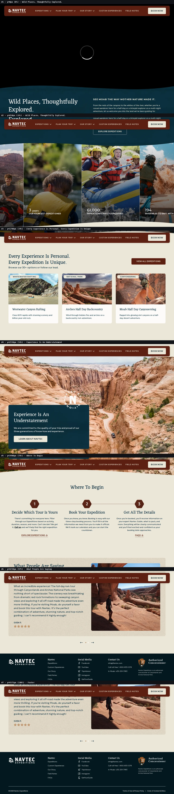
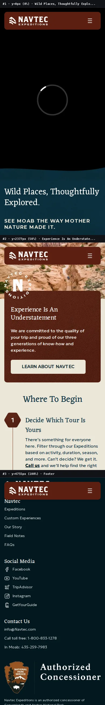

# UI Design System & Master Generation Blueprint: navtec-com

> **Moab Adventure Tours · Navtec Expeditions Since 1896** (https://navtec.com/) — Explore Moab's canyons with expert guides. Rafting, 4x4 tours, canyoneering & hiking in Arches & Canyonlands. Family-owned since 1896. Bo...





---

## 1. Executive Visual Persona & Design Archetype

- **Brand Essence & Persona**: **Moab Adventure Tours · Navtec Expeditions Since 1896** (`https://navtec.com/`). Explore Moab's canyons with expert guides. Rafting, 4x4 tours, canyoneering & hiking in Arches & Canyonlands. Family-owned since 1896. Bo...
- **Capture Provenance**: Live browser capture (`tier1_fast`, HTTP `200`, captured `2026-11-24`).
- **Visual Archetype**: **Light-Substrate Editorial & Modular Grid System (`#ebe6d8` canvas, `#0000ee` ink, `#ff0000` accent)**.
- **Anti-AI-Slop Differentiators**:
  - **Live-Computed Chromatic Polarity**: Anchors the viewport in `#ebe6d8` (live computed `body` `background-color` (`computed_styles.json`)) paired with `#0000ee` primary typography and `#ff0000` accents.
  - **Grounded Typographic Hierarchy**: Pairs `Eczar` for display copy (`Wild Places, Thoughtfully Explored.`) with `Geologica` and `IBM Plex Mono`.
  - **Calibrated Spatial Grid & Motion**: Combines `92rem` container bounds (`gap: 16px`, padding `9px`) with `cubic-bezier(0.45,0.45,0.4,1)` easing and Three.js / WebGL Canvas Pipeline, Swiper Touch Carousel Engine.

---

## 2. Spatial Architecture & Modular Grid Mathematics

### Viewport Allocation & Container Geometry
- **Captured Journey Filmstrips**: Desktop `1280×5796px` (`assets/desktop-journey.webp`, `7` keyframes up to `y=4373px` / doc `5273px`), Mobile `390×2616px` (`assets/mobile-journey.webp`, `3` keyframes).
- **Master Container Bounds**: `92rem` (non-`@media` desktop container stylesheet rule).
- **Canvas Lateral Padding & Spacing**: `9px` lateral canvas padding with `16px` grid gap.
- **Border Radius Scale**: `3px`, `100%`, `50%`, `.6rem`.

### Responsive Breakpoint Architecture
- **Desktop Layout**: Multi-column CSS Grid / Flexbox layout at `1440px` (`max-width: 92rem`, `gap: 16px`).
- **Mobile Layout**: Single-column vertical stack at `390px` viewport width with `9px` horizontal padding.
- **Extracted CSS Media Queries**: `@media screen and (max-width:991px)`, `@media screen and (max-width:767px)`, `@media screen and (max-width:479px)`, `@media (min-width:768px)`.

---

## 3. Color System, Materiality & Atmospheric Lighting

### Semantic Palette & Source Grounding
| Semantic Role | Ground-Truth Value | Extracted Live / CSS Source |
|---|---|---|
| **Primary Canvas Substrate** | `#ebe6d8` | live computed `body` `background-color` (`computed_styles.json`) |
| **Primary Typography Ink** | `#0000ee` | live computed `a` `color` (`computed_styles.json`) |
| **Elevated Surface / Card Substrate** | `#ffff00` | `mark { background: #ffff00 }` |
| **Interactive Accent / Highlight** | `#ff0000` | `.list-steps-content-block a:hover { color: red }` (`#ff0000`) |
| **Secondary / Muted Copy** | `#062c3c` | live computed `body` `color` (`computed_styles.json`) |
| **Structural Hairline Border** | `#e2e2e2` | `blockquote { border-left: #e2e2e2 }` |

### Sanitized Root CSS Variables (`ui-ux.md` Ground Truth)
| Variable Name | Extracted Value | Semantic Role |
|---|---|---|
| `--_base-styles---body--background` | `var(--sand)` | Canvas / Surface Token |
| `--_base-styles---body--font-family` | `var(--_fonts---font-base)` | Typography / Scale Token |
| `--_base-styles---body--font-color` | `var(--deep-teal)` | Brand / Palette Token |
| `--_base-styles---typography--font-size-base` | `1.8rem` | Typography / Scale Token |
| `--_base-styles---typography--line-height` | `1.5em` | Typography / Scale Token |
| `--_base-styles---typography--font-weight` | `400` | Typography / Scale Token |
| `--_base-styles---typography--letter-spacing` | `0em` | Typography / Scale Token |
| `--_headings---h1--font-family` | `var(--_fonts---font-headings)` | Typography Ink Token |
| `--_headings---h1--font-size` | `5.2rem` | Typography Ink Token |
| `--_headings---h1--line-height` | `1.25em` | Typography Ink Token |
| `--_headings---h1--font-weight` | `400` | Typography Ink Token |
| `--_headings---h1--letter-spacing` | `0em` | Typography Ink Token |
| `--_headings---h2--font-family` | `var(--_fonts---font-headings)` | Typography Ink Token |
| `--_headings---h2--font-size` | `4rem` | Typography Ink Token |
| `--_headings---h2--line-height` | `1.25em` | Typography Ink Token |
| `--_headings---h2--font-weight` | `400` | Typography Ink Token |

---

## 4. Typographic Scale & Editorial Hierarchy

### Font Family Stacks
- **Display Typography**: `Eczar`.
- **Primary Body Stack**: `Geologica`.
- **Technical / Metadata Stack**: `IBM Plex Mono`.

### Typographic Scale & Rules (Live Computed & Stylesheet Grounded)
- **Hero Display (`H1`)**: live computed `h1` (`font-size: 52px`, `line-height: 65px`, `font-weight: 400`); CSS variables `--_headings---h1--font-family: var(--_fonts---font-headings)`, `--_headings---h1--font-size: 5.2rem`, `--_headings---h1--line-height: 1.25em`.
- **Section Heading (`H2`)**: live computed `h2` (`font-size: 40px`, `line-height: 50px`, `font-weight: 400`); CSS variables `--_headings---h2--font-family: var(--_fonts---font-headings)`, `--_headings---h2--font-size: 4rem`, `--_headings---h2--line-height: 1.25em`.
- **Body Copy**: live computed `body` (`font-size: 18px`, `line-height: 27px`, `font-weight: 400`); CSS variables `--_base-styles---body--background: var(--sand)`, `--_base-styles---body--font-family: var(--_fonts---font-base)`, `--_base-styles---typography--font-size-base: 1.8rem`; rule `p` (`font-size: var(--_base-styles---typograp...`, `line-height: var(--_base-styles---...`).
- **Metadata & Navigation Labels**: live computed `nav/a` (`font-size: 18px`, `line-height: 27px`, `font-weight: 400`); CSS variables `--_base-styles---typography--letter-spacing: 0em`, `--_headings---h1--letter-spacing: 0em`, `--_headings---h2--letter-spacing: 0em`.

---

## 5. Choreographed Motion & Interaction Physics

### Primary Easing Curves
- **Extracted Timing Functions**: `cubic-bezier(0.45,0.45,0.4,1)`.

### Per-Element Transition & Choreography Rules
- **Selector `.w-webflow-badge>img`**: `transition: unset` extracted from `navtec-com` stylesheet.
- **Selector `.w-slider-dot`**: `transition: background-color .1s,color .1s` extracted from `navtec-com` stylesheet.
- **Selector `.w-lightbox-control`**: `transition: all .3s` extracted from `navtec-com` stylesheet.
- **Extracted Easing Curve (`cubic-bezier(0.45,0.45,0.4,1)`)**: Governs interactive state transitions across `<nav.nav>` and `<section.section>`.
- **Runtime Interaction Engine**: Integrates Three.js / WebGL Canvas Pipeline, Swiper Touch Carousel Engine, Framer Motion Layout Physics with `prefers-reduced-motion: reduce` fallback guards.
### Measured Runtime Scroll & Interaction Telemetry (`behavioral_journey_v2`)
- **Scroll Driver Mode**: `native` (max document height `5273px`, deepest scrollY reached `4373px` across `7` desktop keyframes).
- **Detected Scroll / Motion Libraries**: Native browser scroll / standard CSS transitions.
- **Hover Physics (`primary_cta` · `BOOK NOW`)**: `color`: `rgb(3, 24, 32)` -> `rgb(235, 230, 216)`; `backgroundColor`: `rgb(235, 230, 216)` -> `rgb(91, 31, 17)` (`transition-duration: 0.3s, 0.3s, 0.3s`, `timing: linear, linear, linear`).
- **Route Transition Architecture**: First internal navigation (`/expeditions/moab-full-day-canyoneering`) measured as `direct` in `3364ms`.

---

## 6. Component Wireframe & Structural DOM Map

### Visual Layout Schematic — Desktop (`1440px`, Grounded in `dom.html` & Landmark Bounding Boxes)
```
┌────────────────────────────────────────────────────────────────────────┐
│ DESKTOP VIEWPORT (1440px) — Moab Adventure Tours · Navtec Expeditions  │
│ ====================================================================== │
│ [ <nav.nav> (858x84px)                | Half Day · Full Day · 2-3 Da ] │
│ ---------------------------------------------------------------------- │
│ | HERO STAGE: <section.header> (w=1440px)                            | │
│ | H1: Wild Places, Thoughtfully Explored.                            | │
│ | Substrate: #ebe6d8 | Ink: #0000ee | Accent: #ff0000                | │
│ ---------------------------------------------------------------------- │
│ | SHOWCASE GRID (<section.section>) max-w: 92rem                     | │
│ | +------------------------------+  +------------------------------+ | │
│ | | Scramble through fins and po |  | Expeditions Browse Our Exped | | │
│ | +------------------------------+  +------------------------------+ | │
│ ---------------------------------------------------------------------- │
│ | DETAIL MODULE (<section.section-wave>) — Arches National Park      | │
│ ---------------------------------------------------------------------- │
│ [ FOOTER (<footer.footer>     ) | https://navtec.com/                  │
└────────────────────────────────────────────────────────────────────────┘
```

### Visual Layout Schematic — Mobile Reflow (`390px`)
```
┌────────────────────────────────────────────────────────────────────────┐
│ MOBILE VIEWPORT REFLOW (390px) — Single-Column Stack (gap: 16px)       │
│ ====================================================================== │
│ [ HEADER BAR (<nav.nav>               ) | Compact Menu (390px)         │
│ ---------------------------------------------------------------------- │
│ | HERO STAGE (<section.header>) — 390px Vertical Lead                | │
│ | H1: Wild Places, Thoughtfully Explored.                            | │
│ ---------------------------------------------------------------------- │
│ | SHOWCASE STACK (<section.section>) — 1-Col Stack                   | │
│ | [ Item 1: Scramble through fins and potholes to two dramat       ] | │
│ | [ Item 2: Expeditions Browse Our Expeditions by Duration H       ] | │
│ ---------------------------------------------------------------------- │
│ | DETAIL STACK (<section.section-wave>) — 1-Col (Arches National Pa) | │
│ ---------------------------------------------------------------------- │
│ [ FOOTER (<footer.footer>     ) | Stacked 390px Colophon               │
└────────────────────────────────────────────────────────────────────────┘
```

### Granular DOM Region Breakdown
1. **Brand Header & Navigation Bar (<nav.nav> — `navtec-com`)**:
   - Landmark `<nav class="nav">` (`858x84px`) hosting `Moab Adventure Tours · Navtec Expedi` navigation (`Half Day · Full Day · 2-3 Days · 4-6 Days · River & Rafting`), DOM attributes (`data-wf-domain="navtec.com"`, `data-wf-page="6a310f67244daebf3f62c77e"`, `data-wf-site="6a310f64244daebf3f62c717"`, `data-wf-intellimize-customer-id="117402178"`), and stylesheet rule `html { -webkit-text-size-adjust:100%;-ms-text-size-adjust:100%;font-family:sans... }`.
2. **Hero Stage & Focal Lead (<section.header> — `Wild Places, Thoughtfully Explored`)**:
   - Landmark `<section class="header">` presenting display lead `Wild Places, Thoughtfully Explored.` and copy excerpt *"Scramble through fins and potholes to two dramatic desert rappels"* over `#ebe6d8` canvas and `#0000ee` ink.
3. **Primary Showcase & Content Grid (<section.section> — `Scramble through fins and potholes`)**:
   - Landmark `<section class="section">` rendering section `Scramble through fins and potholes to two dramat` with copy *"Expeditions Browse Our Expeditions by Duration Half Day Full Day "*, asset references (`cdn.prod.website-files.com`, `navtec.webflow.shared.6acfbfa82.m...`, `fonts.googleapis.com`, `fonts.gstatic.com`), and grid rule `summary { display:block }`.
4. **Interactive Detail & Feature Matrix (<section.section-wave> — `Expeditions Browse Our Expeditions`)**:
   - Landmark `<section class="section-wave">` framing `Expeditions Browse Our Expeditions by Duration H` and `Arches National Park` (*"Arches National Park"*) with `#ffff00` surface cards, `#ff0000` accents, and `video { vertical-align:baseline;display:inline-block }`.
5. **Colophon & Global Directory Footer (<footer.footer> — `https://navtec.com/`)**:
   - Landmark `<footer class="footer">` anchoring `Moab Adventure Tours · Navtec Ex` footer links (`Half Day · Full Day · 2-3 Days · 4-6 Days · River & Rafting`), copy *"Canyonlands National Park"*, and `#e2e2e2` structural dividers.
### Full Vertical Scroll Sequence (Desktop `1440×900` Keyframes)
- **Step 01** (`y=0px`, `0%`): Active landmark `Wild Places, Thoughtfully Explored.` · sticky/fixed elements: `1`
- **Step 02** (`y=850px`, `19%`): Active landmark `Wild Places, Thoughtfully Explored.` · sticky/fixed elements: `1`
- **Step 03** (`y=1700px`, `39%`): Active landmark `Every Experience Is Personal. Every Expedition Is...` · sticky/fixed elements: `1`
- **Step 04** (`y=2550px`, `58%`): Active landmark `Experience Is An Understatement` · sticky/fixed elements: `1`
- **Step 05** (`y=3400px`, `78%`): Active landmark `Where To Begin` · sticky/fixed elements: `1`
- **Step 06** (`y=4250px`, `97%`): Active landmark `What People Are Saying` · sticky/fixed elements: `1`
- **Step 07** (`y=4373px`, `100%`): Active landmark `Footer` · sticky/fixed elements: `1`

### Multi-Page Internal Route Map
- **Detail Route (`/expeditions/moab-full-day-canyoneering`)**: `https://navtec.com/expeditions/moab-full-day-canyoneering` — H1: `Moab Full Day Canyoneering`, scrollHeight `2776px`, transition `direct` (`3364ms`)
- **Detail Route (`/expeditions/westwater-canyon-rafting`)**: `https://navtec.com/expeditions/westwater-canyon-rafting` — H1: `Westwater Canyon Rafting`, scrollHeight `3288px`, transition `direct` (`1246ms`)
- **Detail Route (`/expeditions/arches-half-day-backcountry`)**: `https://navtec.com/expeditions/arches-half-day-backcountry` — H1: `Arches Half Day Backcountry`, scrollHeight `3056px`, transition `direct` (`734ms`)

---

## 7. Master Zero-Shot AI Generation Prompt

```markdown
# Master Zero-Shot Frontend Generation Prompt: navtec-com (Moab Adventure Tours · Navtec Expeditions Since 1896)

You are a principal frontend architect and design systems engineer. Build a complete, production-ready web application replicating the exact design system, DOM landmarks, typographic hierarchy, color tokens, and motion physics of `navtec-com` (**Moab Adventure Tours · Navtec Expeditions Since 1896** — `https://navtec.com/`).

### 1. Visual Archetype & Anti-AI-Slop Mandates
- **Archetype**: Light-Substrate Editorial & Modular Grid System (`#ebe6d8` canvas, `#0000ee` ink, `#ff0000` accent).
- **Identity & Domain Context**: Explore Moab's canyons with expert guides. Rafting, 4x4 tours, canyoneering & hiking in Arches & Canyonlands. Family-owned since 1896. Bo...
- **Primary Substrate**: `#ebe6d8` (live computed `body` `background-color` (`computed_styles.json`)), **Primary Ink**: `#0000ee`, **Accent / Highlight**: `#ff0000`.
- **Site-Specific Differentiators**:
  - **Live-Computed Chromatic Polarity**: Anchors the viewport in `#ebe6d8` (live computed `body` `background-color` (`computed_styles.json`)) paired with `#0000ee` primary typography and `#ff0000` accents.
  - **Grounded Typographic Hierarchy**: Pairs `Eczar` for display copy (`Wild Places, Thoughtfully Explored.`) with `Geologica` and `IBM Plex Mono`.
  - **Calibrated Spatial Grid & Motion**: Combines `92rem` container bounds (`gap: 16px`, padding `9px`) with `cubic-bezier(0.45,0.45,0.4,1)` easing and Three.js / WebGL Canvas Pipeline, Swiper Touch Carousel Engine.

### 2. Ground-Truth CSS Variables (`:root` Token Contract)
Declare and consume these exact custom properties extracted from `navtec-com` in your global stylesheet:

:root {
  /* Moab Adventure Tours · Navtec Expeditions Since 1896 (navtec-com) — Live-Grounded CSS Variables */
  --_base-styles---body--background: var(--sand); /* Canvas / Surface Token (navtec-com) */
  --_base-styles---body--font-family: var(--_fonts---font-base); /* Typography / Scale Token (navtec-com) */
  --_base-styles---body--font-color: var(--deep-teal); /* Brand / Palette Token (navtec-com) */
  --_base-styles---typography--font-size-base: 1.8rem; /* Typography / Scale Token (navtec-com) */
  --_base-styles---typography--line-height: 1.5em; /* Typography / Scale Token (navtec-com) */
  --_base-styles---typography--font-weight: 400; /* Typography / Scale Token (navtec-com) */
  --_base-styles---typography--letter-spacing: 0em; /* Typography / Scale Token (navtec-com) */
  --_headings---h1--font-family: var(--_fonts---font-headings); /* Typography Ink Token (navtec-com) */
  --_headings---h1--font-size: 5.2rem; /* Typography Ink Token (navtec-com) */
  --_headings---h1--line-height: 1.25em; /* Typography Ink Token (navtec-com) */
  --_headings---h1--font-weight: 400; /* Typography Ink Token (navtec-com) */
  --_headings---h1--letter-spacing: 0em; /* Typography Ink Token (navtec-com) */
  --_headings---h2--font-family: var(--_fonts---font-headings); /* Typography Ink Token (navtec-com) */
  --_headings---h2--font-size: 4rem; /* Typography Ink Token (navtec-com) */
  --_headings---h2--line-height: 1.25em; /* Typography Ink Token (navtec-com) */
  --_headings---h2--font-weight: 400; /* Typography Ink Token (navtec-com) */
}

### 3. Semantic Color & Materiality Contract
Map every surface, ink, and border strictly to these source-grounded tokens:
- **Primary Canvas Substrate**: `#ebe6d8` — grounded in live computed `body` `background-color` (`computed_styles.json`)
- **Primary Typography Ink**: `#0000ee` — grounded in live computed `a` `color` (`computed_styles.json`)
- **Elevated Surface / Card Substrate**: `#ffff00` — grounded in `mark { background: #ffff00 }`
- **Interactive Accent / Highlight**: `#ff0000` — grounded in `.list-steps-content-block a:hover { color: red }` (`#ff0000`)
- **Secondary / Muted Copy**: `#062c3c` — grounded in live computed `body` `color` (`computed_styles.json`)
- **Structural Hairline Border**: `#e2e2e2` — grounded in `blockquote { border-left: #e2e2e2 }`

### 4. Spatial Grid, Container Bounds & Responsive Breakpoints
- **Desktop Viewport Reference**: `1280×5796px` (multi-frame vertical journey filmstrip (5796px), `1440px` standard desktop width).
- **Mobile Viewport Reference**: `390×2616px` (multi-frame vertical journey filmstrip (2616px), `390px` standard mobile width).
- **Container Max-Width**: `92rem` (non-`@media` desktop container stylesheet rule)
- **Padding & Gutters**: `9px` lateral canvas padding with `16px` grid gap
- **Desktop Grid**: Multi-column CSS Grid / Flexbox layout at `1440px` (`max-width: 92rem`, `gap: 16px`)
- **Mobile Adaptation**: Single-column vertical stack at `390px` viewport width with `9px` horizontal padding
- **Media Queries**: `@media screen and (max-width:991px)`, `@media screen and (max-width:767px)`, `@media screen and (max-width:479px)`, `@media (min-width:768px)`
- **Corner Radii**: `3px`, `100%`, `50%`, `.6rem`

### 5. Typography & Editorial Scale Contract
- **Display Font Stack**: `Eczar`
- **Body Font Stack**: `Geologica`
- **Monospace / Technical Font Stack**: `IBM Plex Mono`
- **H1 Display Rule**: live computed `h1` (`font-size: 52px`, `line-height: 65px`, `font-weight: 400`); CSS variables `--_headings---h1--font-family: var(--_fonts---font-headings)`, `--_headings---h1--font-size: 5.2rem`, `--_headings---h1--line-height: 1.25em`
- **H2 Section Rule**: live computed `h2` (`font-size: 40px`, `line-height: 50px`, `font-weight: 400`); CSS variables `--_headings---h2--font-family: var(--_fonts---font-headings)`, `--_headings---h2--font-size: 4rem`, `--_headings---h2--line-height: 1.25em`
- **Body Copy Rule**: live computed `body` (`font-size: 18px`, `line-height: 27px`, `font-weight: 400`); CSS variables `--_base-styles---body--background: var(--sand)`, `--_base-styles---body--font-family: var(--_fonts---font-base)`, `--_base-styles---typography--font-size-base: 1.8rem`; rule `p` (`font-size: var(--_base-styles---typograp...`, `line-height: var(--_base-styles---...`)
- **Metadata & Index Rule**: live computed `nav/a` (`font-size: 18px`, `line-height: 27px`, `font-weight: 400`); CSS variables `--_base-styles---typography--letter-spacing: 0em`, `--_headings---h1--letter-spacing: 0em`, `--_headings---h2--letter-spacing: 0em`

### 6. Component Hierarchy, Verbatim Copy & Real DOM Landmarks
Scaffold `navtec-com` (`Moab Adventure Tours · Navtec Expeditions Since 1896`) with these exact structural regions, extracted copy, and CSS rules from `dom.html`:
1. **Brand Header & Navigation Bar (<nav.nav> — `navtec-com`)**:
   - DOM & Selectors: Landmark `<nav class="nav">` (`858x84px`) hosting `Moab Adventure Tours · Navtec Expedi` navigation (`Half Day · Full Day · 2-3 Days · 4-6 Days · River & Rafting`), DOM attributes (`data-wf-domain="navtec.com"`, `data-wf-page="6a310f67244daebf3f62c77e"`, `data-wf-site="6a310f64244daebf3f62c717"`, `data-wf-intellimize-customer-id="117402178"`), and stylesheet rule `html { -webkit-text-size-adjust:100%;-ms-text-size-adjust:100%;font-family:sans... }`.
   - Responsive Contract: Header `Brand Header & Navigation Bar (<nav.nav> — `navtec-com`)` (`navtec-com`) adapts across `@media screen and (max-width:991px)`, `@media screen and (max-width:767px)`, `@media screen and (max-width:479px)`, `@media (min-width:768px)` with `cubic-bezier(0.45,0.45,0.4,1)` transitions and links `Half Day · Full Day · 2-3 Days · 4-6 Days · River & Rafting`.
2. **Hero Stage & Focal Lead (<section.header> — `Wild Places, Thoughtfully Explored`)**:
   - DOM & Selectors: Landmark `<section class="header">` presenting display lead `Wild Places, Thoughtfully Explored.` and copy excerpt *"Scramble through fins and potholes to two dramatic desert rappels"* over `#ebe6d8` canvas and `#0000ee` ink.
   - Responsive Contract: Hero stage (`1280×5796px` desktop / `390×2616px` mobile) sets `#ebe6d8` background with `#0000ee` headline `Wild Places, Thoughtfully Explored.`.
3. **Primary Showcase & Content Grid (<section.section> — `Scramble through fins and potholes`)**:
   - DOM & Selectors: Landmark `<section class="section">` rendering section `Scramble through fins and potholes to two dramat` with copy *"Expeditions Browse Our Expeditions by Duration Half Day Full Day "*, asset references (`cdn.prod.website-files.com`, `navtec.webflow.shared.6acfbfa82.m...`, `fonts.googleapis.com`, `fonts.gstatic.com`), and grid rule `summary { display:block }`.
   - Responsive Contract: Showcase grid `Primary Showcase & Content Grid (<section.section> — `Scramble through fins and potholes`)` applies Multi-column CSS Grid / Flexbox layout at `1440px` (`max-width: 92rem`, `gap: 16px`) on desktop and Single-column vertical stack at `390px` viewport width with `9px` horizontal padding on mobile.
4. **Interactive Detail & Feature Matrix (<section.section-wave> — `Expeditions Browse Our Expeditions`)**:
   - DOM & Selectors: Landmark `<section class="section-wave">` framing `Expeditions Browse Our Expeditions by Duration H` and `Arches National Park` (*"Arches National Park"*) with `#ffff00` surface cards, `#ff0000` accents, and `video { vertical-align:baseline;display:inline-block }`.
   - Responsive Contract: Detail module `Interactive Detail & Feature Matrix (<section.section-wave> — `Expeditions Browse Our Expeditions`)` uses `3px`, `100%`, `50%`, `.6rem` radii, `#ff0000` highlights, and assets (cdn.prod.website-files.com, navtec.webflow.shared.6acfbfa82.m..., fonts.googleapis.com).
5. **Colophon & Global Directory Footer (<footer.footer> — `https://navtec.com/`)**:
   - DOM & Selectors: Landmark `<footer class="footer">` anchoring `Moab Adventure Tours · Navtec Ex` footer links (`Half Day · Full Day · 2-3 Days · 4-6 Days · River & Rafting`), copy *"Canyonlands National Park"*, and `#e2e2e2` structural dividers.
   - Responsive Contract: Footer `Colophon & Global Directory Footer (<footer.footer> — `https://navtec.com/`)` aligns to `92rem` (non-`@media` desktop container stylesheet rule) with `9px` lateral canvas padding with `16px` grid gap and attributes (data-wf-domain="navtec.com", data-wf-page="6a310f67244daebf3f62c77e", data-wf-site="6a310f64244daebf3f62c717").

#### Verbatim DOM Copy Excerpts (`dom.html`)
- Copy Excerpt 1: *"Scramble through fins and potholes to two dramatic desert rappels."*
- Copy Excerpt 2: *"Expeditions Browse Our Expeditions by Duration Half Day Full Day 2-3 Days 4-6 Days..."*
- Copy Excerpt 3: *"Arches National Park"*
- Copy Excerpt 4: *"Canyonlands National Park"*

### 7. Motion, Extracted Stylesheet Rules & Interaction Choreography
- **Primary Easing Functions**: `cubic-bezier(0.45,0.45,0.4,1)`
- **Extracted Stylesheet Rules (`navtec-com`)**:
- `html { -webkit-text-size-adjust:100%;-ms-text-size-adjust:100%;font-family:sans... }`
- `summary { display:block }`
- `video { vertical-align:baseline;display:inline-block }`
- `template { display:none }`
- `strong { font-weight:700 }`
- **Per-Selector Transition Rules**:
- **Selector `.w-webflow-badge>img`**: `transition: unset` extracted from `navtec-com` stylesheet.
- **Selector `.w-slider-dot`**: `transition: background-color .1s,color .1s` extracted from `navtec-com` stylesheet.
- **Selector `.w-lightbox-control`**: `transition: all .3s` extracted from `navtec-com` stylesheet.
- **Extracted Easing Curve (`cubic-bezier(0.45,0.45,0.4,1)`)**: Governs interactive state transitions across `<nav.nav>` and `<section.section>`.
- **Runtime Interaction Engine**: Integrates Three.js / WebGL Canvas Pipeline, Swiper Touch Carousel Engine, Framer Motion Layout Physics with `prefers-reduced-motion: reduce` fallback guards.
### 7b. Full-Page Scroll Choreography, Interactive States & Multi-Page Routes
- **Scroll Mechanics**: Implement `native` vertical progression up to `5273px` across 7 distinct viewport chapters.
- **Vertical Chapter Sequence**: Wild Places, Thoughtfully E... (0%) -> Wild Places, Thoughtfully E... (19%) -> Every Experience Is Persona... (39%) -> Experience Is An Understate... (58%) -> Where To Begin (78%) -> What People Are Saying (97%) -> Footer (100%).
- **Hover Micro-Interaction (`primary_cta`)**: Animate `color, backgroundColor` with `0.3s, 0.3s, 0.3s linear, linear, linear`.
- **Multi-Page Routes**: Scaffold internal routes `/expeditions/moab-full-day-canyoneering` (detail, direct), `/expeditions/westwater-canyon-rafting` (detail, direct), `/expeditions/arches-half-day-backcountry` (detail, direct) sharing the global header/footer shell and design tokens.

### 8. Technical Deliverables
- Implement in Next.js (App Router) with TypeScript and Tailwind CSS consuming the `:root` custom properties defined above for `navtec-com`.
- Reproduce both the `1440px` desktop architecture and `390px` mobile breakpoint transitions, preserving semantic HTML5 landmarks (`<header>`, `<nav>`, `<main>`, `<section>`, `<footer>`) and `prefers-reduced-motion` accessibility guards.
```
---

## 8. Full-Page Scroll Journey, Interactive States & Subpage Inventory

### Desktop Scroll Keyframes (`1440×900` WebP)
| Step | Scroll Y | Progress | Active Landmark / Section | Sticky/Fixed | Visual Asset |
| :---: | :---: | :---: | :--- | :---: | :--- |
| `#01` | `0px` | `0%` | Wild Places, Thoughtfully Explored. | `1` | [desktop-step-01.webp](assets/desktop-step-01.webp) |
| `#02` | `850px` | `19%` | Wild Places, Thoughtfully Explored. | `1` | [desktop-step-02.webp](assets/desktop-step-02.webp) |
| `#03` | `1700px` | `39%` | Every Experience Is Personal. Every Expeditio... | `1` | [desktop-step-03.webp](assets/desktop-step-03.webp) |
| `#04` | `2550px` | `58%` | Experience Is An Understatement | `1` | [desktop-step-04.webp](assets/desktop-step-04.webp) |
| `#05` | `3400px` | `78%` | Where To Begin | `1` | [desktop-step-05.webp](assets/desktop-step-05.webp) |
| `#06` | `4250px` | `97%` | What People Are Saying | `1` | [desktop-step-06.webp](assets/desktop-step-06.webp) |
| `#07` | `4373px` | `100%` | Footer | `1` | [desktop-step-07.webp](assets/desktop-step-07.webp) |

### Mobile Condensed Keyframes (`390×844` WebP)
| Step | Scroll Y | Progress | Active Landmark | Visual Asset |
| :---: | :---: | :---: | :--- | :--- |
| `#01` | `0px` | `0%` | Wild Places, Thoughtfully Explored. | [mobile-step-01.webp](assets/mobile-step-01.webp) |
| `#02` | `2377px` | `50%` | Experience Is An Understatement | [mobile-step-02.webp](assets/mobile-step-02.webp) |
| `#03` | `4755px` | `100%` | Footer | [mobile-step-03.webp](assets/mobile-step-03.webp) |

### Internal Subpage Filmstrips (`1080px` Wide WebP)
| # | Template | Route URL | H1 / Title | Scroll Height | Transition | Filmstrip Asset |
| :-: | :---: | :--- | :--- | :---: | :---: | :--- |
| `1` | `detail` | `https://navtec.com/expeditions/moab-full-day-canyoneering` | Moab Full Day Canyoneering | `2776px` | `direct` (`3364ms`) | [subpage-01-expeditions-moab-full-day-canyoneeri.webp](assets/subpage-01-expeditions-moab-full-day-canyoneeri.webp) |
| `2` | `detail` | `https://navtec.com/expeditions/westwater-canyon-rafting` | Westwater Canyon Rafting | `3288px` | `direct` (`1246ms`) | [subpage-02-expeditions-westwater-canyon-rafting.webp](assets/subpage-02-expeditions-westwater-canyon-rafting.webp) |
| `3` | `detail` | `https://navtec.com/expeditions/arches-half-day-backcountry` | Arches Half Day Backcountry | `3056px` | `direct` (`734ms`) | [subpage-03-expeditions-arches-half-day-backcoun.webp](assets/subpage-03-expeditions-arches-half-day-backcoun.webp) |

