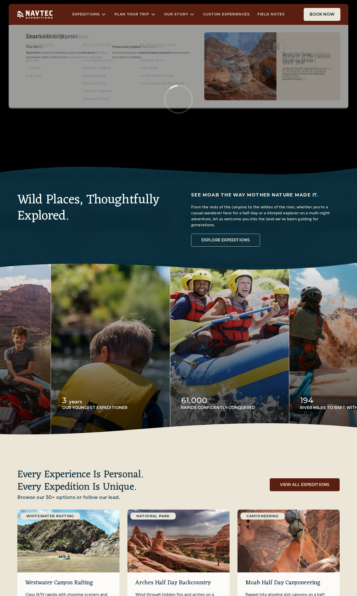
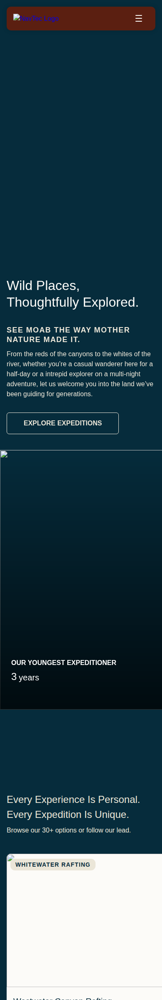

# UI Design System & Master Generation Blueprint: navtec-com

> **Moab Adventure Tours · Navtec Expeditions Since 1896** (https://navtec.com/) — Explore Moab's canyons with expert guides. Rafting, 4x4 tours, canyoneering & hiking in Arches & Canyonlands. Family-owned since 1896. Bo...



---

## 1. Executive Visual Persona & Design Archetype

- **Brand Essence & Persona**: **Moab Adventure Tours · Navtec Expeditions Since 1896** (`https://navtec.com/`). Explore Moab's canyons with expert guides. Rafting, 4x4 tours, canyoneering & hiking in Arches & Canyonlands. Family-owned since 1896. Bo...
- **Visual Archetype**: **High-Contrast Obsidian / Atmospheric Design System (`#062c3c` canvas, `#fcfbf8` ink, `#031820` accent)**.
- **Anti-AI-Slop Differentiators**:
  - **Source-Grounded Chromatic Polarity**: Anchors the viewport in `#062c3c` (`var(--deep-teal)` in `:root`) paired with `#fcfbf8` primary typography and `#031820` accents.
  - **Extracted Typographic Hierarchy**: Pairs `Eczar` for display copy (`Heading`) with `Geologica` and `IBM Plex Mono`.
  - **Calibrated Spatial Grid & Motion**: Combines `940px` container bounds (`gap: 16px`, padding `9px`) with `cubic-bezier(0.45,0.45,0.4,1)` easing and Three.js / WebGL Canvas Pipeline, Swiper Touch Carousel Engine.

---

## 2. Spatial Architecture & Modular Grid Mathematics



### Viewport Allocation & Container Geometry
- **Captured Viewport Dimensions**: Desktop `1440×5273px` (`assets/desktop.png`, full-page scroll capture), Mobile `390×2400px` (`assets/mobile.png`, capped at 2400px multi-section capture).
- **Master Container Bounds**: `940px` extracted from `navtec-com` stylesheet.
- **Canvas Lateral Padding & Spacing**: `9px` lateral canvas padding with `16px` grid gap.
- **Border Radius Scale**: `3px`, `100%`, `50%`, `.6rem`.

### Responsive Breakpoint Architecture
- **Desktop Layout**: Multi-column CSS Grid / Flexbox layout at `1440px` (`max-width: 940px`, `gap: 16px`).
- **Mobile Layout**: Single-column vertical stack at `390px` viewport width with `9px` horizontal padding.
- **Extracted CSS Media Queries**: `@media screen and (max-width:991px)`, `@media screen and (max-width:767px)`, `@media screen and (max-width:479px)`, `@media (min-width:768px)`.

---

## 3. Color System, Materiality & Atmospheric Lighting

### Semantic Palette & Source Grounding
| Semantic Role | Ground-Truth Value | Extracted CSS Source / Selector |
|---|---|---|
| **Primary Canvas Substrate** | `#062c3c` | `var(--deep-teal)` in `:root` |
| **Primary Typography Ink** | `#ebe6d8` | `var(--sand)` in `:root` |
| **Elevated Surface / Card Substrate** | `#5b1f11` | `var(--rust-red)` in `:root` |
| **Interactive Accent / Highlight** | `#031820` | `var(--dark-teal)` in `:root` |
| **Secondary / Muted Copy** | `#fcfbf8` | `var(--off-white)` in `:root` |
| **Structural Hairline Border** | `#8c5129` | `var(--warm-brown)` in `:root` |

### Sanitized Root CSS Variables (`ui-ux.md` Ground Truth)
| Variable Name | Extracted Value | Semantic Role |
|---|---|---|
| `--w-backdrop-animation` | `initial` | Motion / Easing Token |
| `--_base-styles---body--background` | `var(--sand)` | Canvas / Surface Token |
| `--_base-styles---body--font-family` | `var(--_fonts---font-base)` | Typography / Scale Token |
| `--_base-styles---body--font-color` | `var(--deep-teal)` | Brand / Palette Token |
| `--_base-styles---typography--font-size-base` | `1.8rem` | Typography / Scale Token |
| `--_base-styles---typography--line-height` | `1.5em` | Typography / Scale Token |
| `--_base-styles---typography--font-weight` | `400` | Typography / Scale Token |
| `--_base-styles---typography--letter-spacing` | `0em` | Typography / Scale Token |
| `--_headings---h1--font-family` | `var(--_fonts---font-headings)` | Typography Ink Token |
| `--_headings---h1--font-size` | `5.2rem` | Typography Ink Token |
| `--_headings---h1--line-height` | `1.25em` | Typography Ink Token |
| `--_headings---h1--font-weight` | `400` | Typography Ink Token |
| `--_headings---h1--letter-spacing` | `0em` | Typography Ink Token |
| `--_headings---h2--font-family` | `var(--_fonts---font-headings)` | Typography Ink Token |
| `--_headings---h2--font-size` | `4rem` | Typography Ink Token |
| `--_headings---h2--line-height` | `1.25em` | Typography Ink Token |

---

## 4. Typographic Scale & Editorial Hierarchy

### Font Family Stacks
- **Display Typography**: `Eczar`.
- **Primary Body Stack**: `Geologica`.
- **Technical / Metadata Stack**: `IBM Plex Mono`.

### Typographic Scale & Rules (Extracted from Stylesheet & Variables)
- **Hero Display (`H1`)**: CSS variables `--_headings---h1--font-family: var(--_fonts---font-headings)`, `--_headings---h1--font-size: 5.2rem`, `--_headings---h1--line-height: 1.25em`.
- **Section Heading (`H2`)**: CSS variables `--_headings---h2--font-family: var(--_fonts---font-headings)`, `--_headings---h2--font-size: 4rem`, `--_headings---h2--line-height: 1.25em`.
- **Body Copy**: CSS variables `--_base-styles---body--background: var(--sand)`, `--_base-styles---body--font-family: var(--_fonts---font-base)`, `--_base-styles---body--font-color: var(--deep-teal)`; rule `p` (`font-size: var(--_base-styles---typograp...`, `line-height: var(--_base-styles---...`).
- **Metadata & Navigation Labels**: CSS variables `--_base-styles---typography--letter-spacing: 0em`, `--_headings---h1--letter-spacing: 0em`, `--_headings---h2--letter-spacing: 0em`.

---

## 5. Choreographed Motion & Interaction Physics

### Primary Easing Curves
- **Extracted Timing Functions**: `cubic-bezier(0.45,0.45,0.4,1)`.

### Per-Element Transition & Choreography Rules
- **Selector `.w-webflow-badge>img`**: `transition: unset` extracted from `navtec-com` stylesheet.
- **Selector `.w-slider-dot`**: `transition: background-color .1s,color .1s` extracted from `navtec-com` stylesheet.
- **Selector `.w-lightbox-control`**: `transition: all .3s` extracted from `navtec-com` stylesheet.
- **Extracted Easing Curve (`cubic-bezier(0.45,0.45,0.4,1)`)**: Governs interactive state transitions across `<nav.nav>` and `<section.section>`.
- **Runtime Interaction Engine**: Integrates Three.js / WebGL Canvas Pipeline, Swiper Touch Carousel Engine, Framer Motion Layout Physics with `prefers-reduced-motion: reduce` fallback guards.

---

## 6. Component Wireframe & Structural DOM Map

### Visual Layout Schematic (Grounded in `dom.html` — `1440px` Desktop & `390px` Mobile Reflow)
```
┌────────────────────────────────────────────────────────────────────────┐
│ DESKTOP VIEWPORT (1440px) — Moab Adventure Tours · Navtec Expeditions  │
│ ====================================================================== │
│ [ <nav.nav>                | Half Day · Full Day · 2-3 Days · 4-6 D ]  │
│ ---------------------------------------------------------------------- │
│ | HERO STAGE: <section.header>                                     |   │
│ | H1: Heading                                                      |   │
│ | Substrate: #062c3c    | Ink: #fcfbf8    | Accent: #031820        |   │
│ ---------------------------------------------------------------------- │
│ | SHOWCASE GRID (<section.section>         ) max-w: 940px          |   │
│ | +------------------------------+  +------------------------------+ | │
│ | | Wild Places, Thoughtfully Ex |  | 71,000                       | | │
│ | +------------------------------+  +------------------------------+ | │
│ ---------------------------------------------------------------------- │
│ | MOBILE VIEWPORT REFLOW (390px) — Single-Column Stack (gap: 16px  ) | │
│ | [<nav.nav>] -> [<section.header>] -> [<section.section>] |           │
│ ---------------------------------------------------------------------- │
│ [ FOOTER (<footer.footer>       ) | https://navtec.com/                │
└────────────────────────────────────────────────────────────────────────┘
```

### Granular DOM Region Breakdown
1. **Brand Header & Navigation Bar (<nav.nav> — `navtec-com`)**:
   - Landmark `<nav class="nav">` hosting `Moab Adventure Tours · Navtec Expedi` navigation (`Half Day · Full Day · 2-3 Days · 4-6 Days · River & Rafting`), DOM attributes (`data-wf-domain="navtec.com"`, `data-wf-page="6a310f67244daebf3f62c77e"`, `data-wf-site="6a310f64244daebf3f62c717"`, `data-wf-intellimize-customer-id="117402178"`), and stylesheet rule `html { -webkit-text-size-adjust:100%;-ms-text-size-adjust:100%;font-family:sans... }`.
2. **Hero Stage & Focal Lead (<section.header> — `Heading`)**:
   - Landmark `<section class="header">` presenting display lead `Heading` and copy excerpt *"Expeditions Browse Our Expeditions by Duration Half Day Full Day "* over `#062c3c` canvas and `#fcfbf8` ink.
3. **Primary Showcase & Content Grid (<section.section> — `Wild Places, Thoughtfully Explored`)**:
   - Landmark `<section class="section">` rendering section `Wild Places, Thoughtfully Explored.` with copy *"Arches National Park"*, asset references (`cdn.prod.website-files.com`, `navtec.webflow.shared.6acfbfa82.m...`, `fonts.googleapis.com`, `fonts.gstatic.com`), and grid rule `summary { display:block }`.
4. **Interactive Detail & Feature Matrix (<section.section-wave> — `71,000`)**:
   - Landmark `<section class="section-wave">` framing `71,000` and `61,000` (*"Canyonlands National Park"*) with `#5b1f11` surface cards, `#031820` accents, and `video { vertical-align:baseline;display:inline-block }`.
5. **Colophon & Global Directory Footer (<footer.footer> — `https://navtec.com/`)**:
   - Landmark `<footer class="footer">` anchoring `Moab Adventure Tours · Navtec Ex` footer links (`Half Day · Full Day · 2-3 Days · 4-6 Days · River & Rafting`), copy *"Moab Full Day Canyoneering Scramble through fins and pothole"*, and `#8c5129` structural dividers.

---

## 7. Master Zero-Shot AI Generation Prompt

```markdown
# Master Zero-Shot Frontend Generation Prompt: navtec-com (Moab Adventure Tours · Navtec Expeditions Since 1896)

You are a principal frontend architect and design systems engineer. Build a complete, production-ready web application replicating the exact design system, DOM landmarks, typographic hierarchy, color tokens, and motion physics of `navtec-com` (**Moab Adventure Tours · Navtec Expeditions Since 1896** — `https://navtec.com/`).

### 1. Visual Archetype & Anti-AI-Slop Mandates
- **Archetype**: High-Contrast Obsidian / Atmospheric Design System (`#062c3c` canvas, `#fcfbf8` ink, `#031820` accent).
- **Identity & Domain Context**: Explore Moab's canyons with expert guides. Rafting, 4x4 tours, canyoneering & hiking in Arches & Canyonlands. Family-owned since 1896. Bo...
- **Primary Substrate**: `#062c3c` (`var(--deep-teal)` in `:root`), **Primary Ink**: `#fcfbf8`, **Accent / Highlight**: `#031820`.
- **Site-Specific Differentiators**:
  - **Source-Grounded Chromatic Polarity**: Anchors the viewport in `#062c3c` (`var(--deep-teal)` in `:root`) paired with `#fcfbf8` primary typography and `#031820` accents.
  - **Extracted Typographic Hierarchy**: Pairs `Eczar` for display copy (`Heading`) with `Geologica` and `IBM Plex Mono`.
  - **Calibrated Spatial Grid & Motion**: Combines `940px` container bounds (`gap: 16px`, padding `9px`) with `cubic-bezier(0.45,0.45,0.4,1)` easing and Three.js / WebGL Canvas Pipeline, Swiper Touch Carousel Engine.

### 2. Ground-Truth CSS Variables (`:root` Token Contract)
Declare and consume these exact custom properties extracted from `navtec-com` in your global stylesheet:

:root {
  /* Moab Adventure Tours · Navtec Expeditions Since 1896 (navtec-com) — Ground-Truth Extracted CSS Variables */
  --w-backdrop-animation: initial; /* Motion / Easing Token (navtec-com) */
  --_base-styles---body--background: var(--sand); /* Canvas / Surface Token (navtec-com) */
  --_base-styles---body--font-family: var(--_fonts---font-base); /* Typography / Scale Token (navtec-com) */
  --_base-styles---body--font-color: var(--deep-teal); /* Brand / Palette Token (navtec-com) */
  --_base-styles---typography--font-size-base: 1.8rem; /* Typography / Scale Token (navtec-com) */
  --_base-styles---typography--line-height: 1.5em; /* Typography / Scale Token (navtec-com) */
  --_base-styles---typography--font-weight: 400; /* Typography / Scale Token (navtec-com) */
  --_base-styles---typography--letter-spacing: 0em; /* Typography / Scale Token (navtec-com) */
  --_headings---h1--font-family: var(--_fonts---font-headings); /* Typography Ink Token (navtec-com) */
  --_headings---h1--font-size: 5.2rem; /* Typography Ink Token (navtec-com) */
  --_headings---h1--line-height: 1.25em; /* Typography Ink Token (navtec-com) */
  --_headings---h1--font-weight: 400; /* Typography Ink Token (navtec-com) */
  --_headings---h1--letter-spacing: 0em; /* Typography Ink Token (navtec-com) */
  --_headings---h2--font-family: var(--_fonts---font-headings); /* Typography Ink Token (navtec-com) */
  --_headings---h2--font-size: 4rem; /* Typography Ink Token (navtec-com) */
  --_headings---h2--line-height: 1.25em; /* Typography Ink Token (navtec-com) */
}

### 3. Semantic Color & Materiality Contract
Map every surface, ink, and border strictly to these source-grounded tokens:
- **Primary Canvas Substrate**: `#062c3c` — grounded in `var(--deep-teal)` in `:root`
- **Primary Typography Ink**: `#ebe6d8` — grounded in `var(--sand)` in `:root`
- **Elevated Surface / Card Substrate**: `#5b1f11` — grounded in `var(--rust-red)` in `:root`
- **Interactive Accent / Highlight**: `#031820` — grounded in `var(--dark-teal)` in `:root`
- **Secondary / Muted Copy**: `#fcfbf8` — grounded in `var(--off-white)` in `:root`
- **Structural Hairline Border**: `#8c5129` — grounded in `var(--warm-brown)` in `:root`

### 4. Spatial Grid, Container Bounds & Responsive Breakpoints
- **Desktop Viewport Reference**: `1440×5273px` (full-page scroll capture, `1440px` standard desktop width).
- **Mobile Viewport Reference**: `390×2400px` (capped at 2400px multi-section capture, `390px` standard mobile width).
- **Container Max-Width**: `940px` extracted from `navtec-com` stylesheet
- **Padding & Gutters**: `9px` lateral canvas padding with `16px` grid gap
- **Desktop Grid**: Multi-column CSS Grid / Flexbox layout at `1440px` (`max-width: 940px`, `gap: 16px`)
- **Mobile Adaptation**: Single-column vertical stack at `390px` viewport width with `9px` horizontal padding
- **Media Queries**: `@media screen and (max-width:991px)`, `@media screen and (max-width:767px)`, `@media screen and (max-width:479px)`, `@media (min-width:768px)`
- **Corner Radii**: `3px`, `100%`, `50%`, `.6rem`

### 5. Typography & Editorial Scale Contract
- **Display Font Stack**: `Eczar`
- **Body Font Stack**: `Geologica`
- **Monospace / Technical Font Stack**: `IBM Plex Mono`
- **H1 Display Rule**: CSS variables `--_headings---h1--font-family: var(--_fonts---font-headings)`, `--_headings---h1--font-size: 5.2rem`, `--_headings---h1--line-height: 1.25em`
- **H2 Section Rule**: CSS variables `--_headings---h2--font-family: var(--_fonts---font-headings)`, `--_headings---h2--font-size: 4rem`, `--_headings---h2--line-height: 1.25em`
- **Body Copy Rule**: CSS variables `--_base-styles---body--background: var(--sand)`, `--_base-styles---body--font-family: var(--_fonts---font-base)`, `--_base-styles---body--font-color: var(--deep-teal)`; rule `p` (`font-size: var(--_base-styles---typograp...`, `line-height: var(--_base-styles---...`)
- **Metadata & Index Rule**: CSS variables `--_base-styles---typography--letter-spacing: 0em`, `--_headings---h1--letter-spacing: 0em`, `--_headings---h2--letter-spacing: 0em`

### 6. Component Hierarchy, Verbatim Copy & Real DOM Landmarks
Scaffold `navtec-com` (`Moab Adventure Tours · Navtec Expeditions Since 1896`) with these exact structural regions, extracted copy, and CSS rules from `dom.html`:
1. **Brand Header & Navigation Bar (<nav.nav> — `navtec-com`)**:
   - DOM & Selectors: Landmark `<nav class="nav">` hosting `Moab Adventure Tours · Navtec Expedi` navigation (`Half Day · Full Day · 2-3 Days · 4-6 Days · River & Rafting`), DOM attributes (`data-wf-domain="navtec.com"`, `data-wf-page="6a310f67244daebf3f62c77e"`, `data-wf-site="6a310f64244daebf3f62c717"`, `data-wf-intellimize-customer-id="117402178"`), and stylesheet rule `html { -webkit-text-size-adjust:100%;-ms-text-size-adjust:100%;font-family:sans... }`.
   - Responsive Contract: Header `Brand Header & Navigation Bar (<nav.nav> — `navtec-com`)` (`navtec-com`) adapts across `@media screen and (max-width:991px)`, `@media screen and (max-width:767px)`, `@media screen and (max-width:479px)`, `@media (min-width:768px)` with `cubic-bezier(0.45,0.45,0.4,1)` transitions and links `Half Day · Full Day · 2-3 Days · 4-6 Days · River & Rafting`.
2. **Hero Stage & Focal Lead (<section.header> — `Heading`)**:
   - DOM & Selectors: Landmark `<section class="header">` presenting display lead `Heading` and copy excerpt *"Expeditions Browse Our Expeditions by Duration Half Day Full Day "* over `#062c3c` canvas and `#fcfbf8` ink.
   - Responsive Contract: Hero stage (`1440×5273px` desktop / `390×2400px` mobile) sets `#062c3c` background with `#fcfbf8` headline `Heading`.
3. **Primary Showcase & Content Grid (<section.section> — `Wild Places, Thoughtfully Explored`)**:
   - DOM & Selectors: Landmark `<section class="section">` rendering section `Wild Places, Thoughtfully Explored.` with copy *"Arches National Park"*, asset references (`cdn.prod.website-files.com`, `navtec.webflow.shared.6acfbfa82.m...`, `fonts.googleapis.com`, `fonts.gstatic.com`), and grid rule `summary { display:block }`.
   - Responsive Contract: Showcase grid `Primary Showcase & Content Grid (<section.section> — `Wild Places, Thoughtfully Explored`)` applies Multi-column CSS Grid / Flexbox layout at `1440px` (`max-width: 940px`, `gap: 16px`) on desktop and Single-column vertical stack at `390px` viewport width with `9px` horizontal padding on mobile.
4. **Interactive Detail & Feature Matrix (<section.section-wave> — `71,000`)**:
   - DOM & Selectors: Landmark `<section class="section-wave">` framing `71,000` and `61,000` (*"Canyonlands National Park"*) with `#5b1f11` surface cards, `#031820` accents, and `video { vertical-align:baseline;display:inline-block }`.
   - Responsive Contract: Detail module `Interactive Detail & Feature Matrix (<section.section-wave> — `71,000`)` uses `3px`, `100%`, `50%`, `.6rem` radii, `#031820` highlights, and assets (cdn.prod.website-files.com, navtec.webflow.shared.6acfbfa82.m..., fonts.googleapis.com).
5. **Colophon & Global Directory Footer (<footer.footer> — `https://navtec.com/`)**:
   - DOM & Selectors: Landmark `<footer class="footer">` anchoring `Moab Adventure Tours · Navtec Ex` footer links (`Half Day · Full Day · 2-3 Days · 4-6 Days · River & Rafting`), copy *"Moab Full Day Canyoneering Scramble through fins and pothole"*, and `#8c5129` structural dividers.
   - Responsive Contract: Footer `Colophon & Global Directory Footer (<footer.footer> — `https://navtec.com/`)` aligns to `940px` extracted from `navtec-com` stylesheet with `9px` lateral canvas padding with `16px` grid gap and attributes (data-wf-domain="navtec.com", data-wf-page="6a310f67244daebf3f62c77e", data-wf-site="6a310f64244daebf3f62c717").

#### Verbatim DOM Copy Excerpts (`dom.html`)
- Copy Excerpt 1: *"Expeditions Browse Our Expeditions by Duration Half Day Full Day 2-3 Days 4-6 Days..."*
- Copy Excerpt 2: *"Arches National Park"*
- Copy Excerpt 3: *"Canyonlands National Park"*
- Copy Excerpt 4: *"Moab Full Day Canyoneering Scramble through fins and potholes to two dramatic dese..."*

### 7. Motion, Extracted Stylesheet Rules & Interaction Choreography
- **Primary Easing Functions**: `cubic-bezier(0.45,0.45,0.4,1)`
- **Extracted Stylesheet Rules (`navtec-com`)**:
- `html { -webkit-text-size-adjust:100%;-ms-text-size-adjust:100%;font-family:sans... }`
- `summary { display:block }`
- `video { vertical-align:baseline;display:inline-block }`
- `template { display:none }`
- `strong { font-weight:700 }`
- **Per-Selector Transition Rules**:
- **Selector `.w-webflow-badge>img`**: `transition: unset` extracted from `navtec-com` stylesheet.
- **Selector `.w-slider-dot`**: `transition: background-color .1s,color .1s` extracted from `navtec-com` stylesheet.
- **Selector `.w-lightbox-control`**: `transition: all .3s` extracted from `navtec-com` stylesheet.
- **Extracted Easing Curve (`cubic-bezier(0.45,0.45,0.4,1)`)**: Governs interactive state transitions across `<nav.nav>` and `<section.section>`.
- **Runtime Interaction Engine**: Integrates Three.js / WebGL Canvas Pipeline, Swiper Touch Carousel Engine, Framer Motion Layout Physics with `prefers-reduced-motion: reduce` fallback guards.

### 8. Technical Deliverables
- Implement in Next.js (App Router) with TypeScript and Tailwind CSS consuming the `:root` custom properties defined above for `navtec-com`.
- Reproduce both the `1440px` desktop architecture and `390px` mobile breakpoint transitions, preserving semantic HTML5 landmarks (`<header>`, `<nav>`, `<main>`, `<section>`, `<footer>`) and `prefers-reduced-motion` accessibility guards.
```
