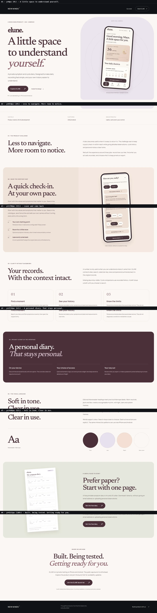
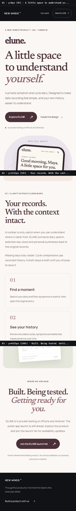

# UI Design System & Master Generation Blueprint: newminds-studio_concept-elune

> **ELUNE — A Private Symptom Diary · New Minds Product Case** (https://newminds.studio/concept-elune) — Inside ELUNE by New Minds: a calm daily check-in, a searchable symptom diary and privacy by design. Explore the iOS and Android product i...





---

## 1. Executive Visual Persona & Design Archetype

- **Brand Essence & Persona**: **ELUNE — A Private Symptom Diary · New Minds Product Case** (`https://newminds.studio/concept-elune`). Inside ELUNE by New Minds: a calm daily check-in, a searchable symptom diary and privacy by design. Explore the iOS and Android product i...
- **Capture Provenance**: Live browser capture (`tier1_fast`, HTTP `200`, captured `2026-11-24`).
- **Visual Archetype**: **Light-Substrate Editorial & Modular Grid System (`#faf7f3` canvas, `#4b303a` ink, `#d8ff65` accent)**.
- **Anti-AI-Slop Differentiators**:
  - **Live-Computed Chromatic Polarity**: Anchors the viewport in `#faf7f3` (live computed `body` `background-color` (`computed_styles.json`)) paired with `#4b303a` primary typography and `#d8ff65` accents.
  - **Grounded Typographic Hierarchy**: Pairs `EluneSerif` for display copy (`A little space to understand yoursel`) with `EluneSans` and `DM Mono`.
  - **Calibrated Spatial Grid & Motion**: Combines `1440px` container bounds (`gap: 24px`, padding `72px`) with `cubic-bezier(.2,.65,.2,1)` easing and Three.js / WebGL Canvas Pipeline.

---

## 2. Spatial Architecture & Modular Grid Mathematics

### Viewport Allocation & Container Geometry
- **Captured Journey Filmstrips**: Desktop `1280×4968px` (`assets/desktop-journey.webp`, `6` keyframes up to `y=4163px` / doc `5063px`), Mobile `390×2616px` (`assets/mobile-journey.webp`, `3` keyframes).
- **Master Container Bounds**: `1440px` (live computed `main` `max-width`).
- **Canvas Lateral Padding & Spacing**: `72px` lateral canvas padding with `24px` grid gap.
- **Border Radius Scale**: `100px`, `50%`, `160px`, `40px`.

### Responsive Breakpoint Architecture
- **Desktop Layout**: Multi-column CSS Grid / Flexbox layout at `1440px` (`max-width: 1440px`, `gap: 24px`).
- **Mobile Layout**: Single-column vertical stack at `390px` viewport width with `72px` horizontal padding.
- **Extracted CSS Media Queries**: `@media (min-width:1500px)`, `@media (max-width:960px)`, `@media (max-width:640px)`, `@media (prefers-reduced-motion:reduce)`.

---

## 3. Color System, Materiality & Atmospheric Lighting

### Semantic Palette & Source Grounding
| Semantic Role | Ground-Truth Value | Extracted Live / CSS Source |
|---|---|---|
| **Primary Canvas Substrate** | `#faf7f3` | live computed `body` `background-color` (`computed_styles.json`) |
| **Primary Typography Ink** | `#4b303a` | live computed `h1` `color` (`computed_styles.json`) |
| **Elevated Surface / Card Substrate** | `#e6e0ef` | live computed `a` `background-color` (`computed_styles.json`) |
| **Interactive Accent / Highlight** | `#d8ff65` | `.button-primary { background: #d8ff65 }` |
| **Secondary / Muted Copy** | `#a3a4ad` | `var(--muted)` in `:root` |
| **Structural Hairline Border** | `#e6ddd7` | `var(--ec-line)` in `:root` |
| **Variable Token (`--ec-muted`)** | `#74666b` | `var(--ec-muted)` in `:root` |
| **Variable Token (`--bg`)** | `#07080b` | `var(--bg)` in `:root` |
| **Variable Token (`--bg-soft`)** | `#0d0f14` | `var(--bg-soft)` in `:root` |
| **Variable Token (`--panel-solid`)** | `#11131a` | `var(--panel-solid)` in `:root` |
| **Variable Token (`--text`)** | `#f5f3ef` | `var(--text)` in `:root` |
| **Variable Token (`--muted-2`)** | `#6d707b` | `var(--muted-2)` in `:root` |
| **Variable Token (`--violet`)** | `#a88cff` | `var(--violet)` in `:root` |
| **Variable Token (`--cyan`)** | `#78e7ff` | `var(--cyan)` in `:root` |

### Sanitized Root CSS Variables (`ui-ux.md` Ground Truth)
| Variable Name | Extracted Value | Semantic Role |
|---|---|---|
| `--ec-ink` | `#4b303a` | Typography Ink Token |
| `--ec-muted` | `#74666b` | Color / Atmospheric Token |
| `--ec-paper` | `#faf7f3` | Canvas / Surface Token |
| `--ec-line` | `#e6ddd7` | Color / Atmospheric Token |
| `--bg` | `#07080b` | Canvas / Surface Token |
| `--bg-soft` | `#0d0f14` | Canvas / Surface Token |
| `--panel` | `rgba(18, 20, 27, 0.72)` | Color / Atmospheric Token |
| `--panel-solid` | `#11131a` | Color / Atmospheric Token |
| `--line` | `rgba(255, 255, 255, 0.12)` | Color / Atmospheric Token |
| `--line-strong` | `rgba(255, 255, 255, 0.2)` | Color / Atmospheric Token |
| `--text` | `#f5f3ef` | Typography Ink Token |
| `--muted` | `#a3a4ad` | Color / Atmospheric Token |
| `--muted-2` | `#6d707b` | Color / Atmospheric Token |
| `--acid` | `#d8ff65` | Color / Atmospheric Token |
| `--violet` | `#a88cff` | Color / Atmospheric Token |
| `--cyan` | `#78e7ff` | Color / Atmospheric Token |

---

## 4. Typographic Scale & Editorial Hierarchy

### Font Family Stacks
- **Display Typography**: `EluneSerif`.
- **Primary Body Stack**: `EluneSans`.
- **Technical / Metadata Stack**: `DM Mono`.

### Typographic Scale & Rules (Live Computed & Stylesheet Grounded)
- **Hero Display (`H1`)**: live computed `h1` (`font-size: 99px`, `line-height: 100.98px`, `font-weight: 400`, `letter-spacing: -4.455px`); rule `h1` (`font-size: clamp(60px,6.9vw,99px)`).
- **Section Heading (`H2`)**: live computed `h2` (`font-size: 63.36px`, `line-height: 64.6272px`, `font-weight: 400`, `letter-spacing: -2.8512px`); rule `h2` (`line-height: 1.02`, `letter-spacing: -.045em`, `font-weight: 400`).
- **Body Copy**: live computed `body` (`font-size: 16px`, `line-height: 28px`, `font-weight: 400`); rule `p` (`font-size: 12px`, `line-height: 1.7`).
- **Metadata & Navigation Labels**: live computed `nav/a` (`font-size: 12px`, `line-height: 21px`, `font-weight: 400`); CSS variables `--mono: "DM Mono", ui-monospace, SFMono-Regular, Menlo, Monaco, Consolas, monospace`; rule `nav` (`font-size: 12px`).

---

## 5. Choreographed Motion & Interaction Physics

### Primary Easing Curves
- **Extracted Timing Functions**: `cubic-bezier(.2,.65,.2,1)`, `cubic-bezier(.2,.8,.2,1)`, `cubic-bezier(.16,1,.3,1)`.

### Per-Element Transition & Choreography Rules
- **Selector `.ec-button`**: `transition: background .15s` extracted from `newminds-studio_concept-elune` stylesheet.
- **Selector `media(prefers-reduced-motion:reduce)`**: `transition: none` extracted from `newminds-studio_concept-elune` stylesheet.
- **Selector `.skip-link`**: `transition: top 0.2s ease` extracted from `newminds-studio_concept-elune` stylesheet.
- **Extracted Easing Curve (`cubic-bezier(.2,.65,.2,1)`)**: Governs interactive state transitions across `<header.ec-header>` and `<section.ec-section>`.
- **Runtime Interaction Engine**: Integrates Three.js / WebGL Canvas Pipeline with `prefers-reduced-motion: reduce` fallback guards.
### Measured Runtime Scroll & Interaction Telemetry (`behavioral_journey_v2`)
- **Scroll Driver Mode**: `native` (max document height `5063px`, deepest scrollY reached `4163px` across `6` desktop keyframes).
- **Detected Scroll / Motion Libraries**: Native browser scroll / standard CSS transitions.
- **Hover Physics (`primary_cta` · `Explore ELUNE ↗`)**: `backgroundColor`: `rgb(75, 48, 58)` -> `rgb(106, 73, 86)` (`transition-duration: 0.15s`, `timing: ease`).
- **Route Transition Architecture**: First internal navigation (`/`) measured as `MPA` in `1062ms`.

---

## 6. Component Wireframe & Structural DOM Map

### Visual Layout Schematic — Desktop (`1440px`, Grounded in `dom.html` & Landmark Bounding Boxes)
```
┌────────────────────────────────────────────────────────────────────────┐
│ DESKTOP VIEWPORT (1440px) — ELUNE — A Private Symptom Diary · New Mind │
│ ====================================================================== │
│ [ <header.ec-header> (1440x96px)      | Our work · Meet ELUNE ↗      ] │
│ ---------------------------------------------------------------------- │
│ | HERO STAGE: <section.ec-hero> (w=1440px)                           | │
│ | H1: A little space to understand yourself.                         | │
│ | Substrate: #faf7f3 | Ink: #4b303a | Accent: #d8ff65                | │
│ ---------------------------------------------------------------------- │
│ | SHOWCASE GRID (<section.ec-section>) max-w: 1440px                 | │
│ | +------------------------------+  +------------------------------+ | │
│ | | Less to navigate. More room  |  | A quick check-in. At your ow | | │
│ | +------------------------------+  +------------------------------+ | │
│ ---------------------------------------------------------------------- │
│ | DETAIL MODULE (<section.ec-feature>) — Your own starting poi       | │
│ ---------------------------------------------------------------------- │
│ [ FOOTER (<footer.ec-footer>  ) | https://newminds.studio/concept-elu  │
└────────────────────────────────────────────────────────────────────────┘
```

### Visual Layout Schematic — Mobile Reflow (`390px`)
```
┌────────────────────────────────────────────────────────────────────────┐
│ MOBILE VIEWPORT REFLOW (390px) — Single-Column Stack (gap: 24px)       │
│ ====================================================================== │
│ [ HEADER BAR (<header.ec-header>      ) | Compact Menu (390px)         │
│ ---------------------------------------------------------------------- │
│ | HERO STAGE (<section.ec-hero>) — 390px Vertical Lead               | │
│ | H1: A little space to understand yourself.                         | │
│ ---------------------------------------------------------------------- │
│ | SHOWCASE STACK (<section.ec-section>) — 1-Col Stack                | │
│ | [ Item 1: Less to navigate. More room to notice.                 ] | │
│ | [ Item 2: A quick check-in. At your own pace.                    ] | │
│ ---------------------------------------------------------------------- │
│ | DETAIL STACK (<section.ec-feature>) — 1-Col (Your own starting )   | │
│ ---------------------------------------------------------------------- │
│ [ FOOTER (<footer.ec-footer>  ) | Stacked 390px Colophon               │
└────────────────────────────────────────────────────────────────────────┘
```

### Granular DOM Region Breakdown
1. **Brand Header & Navigation Bar (<header.ec-header> — `newminds-studio_concept-elune`)**:
   - Landmark `<header class="ec-header">` (`1440x96px`) hosting `ELUNE — A Private Symptom Diary · Ne` navigation (`Our work · Meet ELUNE ↗`), DOM attributes (`data-target="newminds-studio_concept-elune"`), and stylesheet rule `font-face { font-family:EluneSerif;src:url('/elune-newsreader.ttf') format('truetype... }`.
2. **Hero Stage & Focal Lead (<section.ec-hero> — `A little space to understand yours`)**:
   - Landmark `<section class="ec-hero">` presenting display lead `A little space to understand yourself.` and copy excerpt *"A NEW MINDS PRODUCT / iOS + ANDROID"* over `#faf7f3` canvas and `#4b303a` ink.
3. **Primary Showcase & Content Grid (<section.ec-section> — `Less to navigate. More room to not`)**:
   - Landmark `<section class="ec-section ec-opening">` rendering section `Less to navigate. More room to notice.` with copy *"A private symptom and cycle diary. Designed to make daily recordi"*, asset references (`concept-elune`, `elune-product-case.css`, `elune-product-today.jpg (ELUNE Today screen with a cycle overv...)`, `elune-product-symptoms.jpg (ELUNE check-in with optional intensit...)`), and grid rule `.elune-case a { color:inherit;text-decoration:none }`.
4. **Interactive Detail & Feature Matrix (<section.ec-feature> — `A quick check-in. At your own pace`)**:
   - Landmark `<section class="ec-feature ec-feature-warm">` framing `A quick check-in. At your own pace.` and `Your own starting point` (*"In private testing on iPhone and Android."*) with `#e6e0ef` surface cards, `#d8ff65` accents, and `.elune-case a:focus-visible { outline:3px solid 6c4960;outline-offset:5px }`.
5. **Colophon & Global Directory Footer (<footer.ec-footer> — `https://newminds.studio/concept-elune`)**:
   - Landmark `<footer class="ec-footer">` anchoring `ELUNE — A Private Symptom Diary ` footer links (`Our work · Meet ELUNE ↗`), copy *"Actual product interface · Example records"*, and `#e6ddd7` structural dividers.
### Full Vertical Scroll Sequence (Desktop `1440×900` Keyframes)
- **Step 01** (`y=0px`, `0%`): Active landmark `A little space to understand yourself.` · sticky/fixed elements: `0`
- **Step 02** (`y=850px`, `20%`): Active landmark `Less to navigate. More room to notice.` · sticky/fixed elements: `0`
- **Step 03** (`y=1700px`, `41%`): Active landmark `Leave and come back` · sticky/fixed elements: `0`
- **Step 04** (`y=2550px`, `61%`): Active landmark `A personal diary. That stays personal.` · sticky/fixed elements: `0`
- **Step 05** (`y=3400px`, `82%`): Active landmark `Soft in tone. Clear in use.` · sticky/fixed elements: `0`
- **Step 06** (`y=4163px`, `100%`): Active landmark `Built. Being tested. Getting ready for you.` · sticky/fixed elements: `0`

### Multi-Page Internal Route Map
- **Other Route (`/`)**: `https://newminds.studio/` — H1: `Web experiences that think.`, scrollHeight `16866px`, transition `MPA` (`1062ms`)
- **Other Route (`/concepts`)**: `https://newminds.studio/concepts` — H1: `A little further. A lot more possible.`, scrollHeight `5155px`, transition `direct` (`299ms`)

---

## 7. Master Zero-Shot AI Generation Prompt

```markdown
# Master Zero-Shot Frontend Generation Prompt: newminds-studio_concept-elune (ELUNE — A Private Symptom Diary · New Minds Product Case)

You are a principal frontend architect and design systems engineer. Build a complete, production-ready web application replicating the exact design system, DOM landmarks, typographic hierarchy, color tokens, and motion physics of `newminds-studio_concept-elune` (**ELUNE — A Private Symptom Diary · New Minds Product Case** — `https://newminds.studio/concept-elune`).

### 1. Visual Archetype & Anti-AI-Slop Mandates
- **Archetype**: Light-Substrate Editorial & Modular Grid System (`#faf7f3` canvas, `#4b303a` ink, `#d8ff65` accent).
- **Identity & Domain Context**: Inside ELUNE by New Minds: a calm daily check-in, a searchable symptom diary and privacy by design. Explore the iOS and Android product i...
- **Primary Substrate**: `#faf7f3` (live computed `body` `background-color` (`computed_styles.json`)), **Primary Ink**: `#4b303a`, **Accent / Highlight**: `#d8ff65`.
- **Site-Specific Differentiators**:
  - **Live-Computed Chromatic Polarity**: Anchors the viewport in `#faf7f3` (live computed `body` `background-color` (`computed_styles.json`)) paired with `#4b303a` primary typography and `#d8ff65` accents.
  - **Grounded Typographic Hierarchy**: Pairs `EluneSerif` for display copy (`A little space to understand yoursel`) with `EluneSans` and `DM Mono`.
  - **Calibrated Spatial Grid & Motion**: Combines `1440px` container bounds (`gap: 24px`, padding `72px`) with `cubic-bezier(.2,.65,.2,1)` easing and Three.js / WebGL Canvas Pipeline.

### 2. Ground-Truth CSS Variables (`:root` Token Contract)
Declare and consume these exact custom properties extracted from `newminds-studio_concept-elune` in your global stylesheet:

:root {
  /* ELUNE — A Private Symptom Diary · New Minds Product Case (newminds-studio_concept-elune) — Live-Grounded CSS Variables */
  --ec-ink: #4b303a; /* Typography Ink Token (newminds-studio_concept-elune) */
  --ec-muted: #74666b; /* Color / Atmospheric Token (newminds-studio_concept-elune) */
  --ec-paper: #faf7f3; /* Canvas / Surface Token (newminds-studio_concept-elune) */
  --ec-line: #e6ddd7; /* Color / Atmospheric Token (newminds-studio_concept-elune) */
  --bg: #07080b; /* Canvas / Surface Token (newminds-studio_concept-elune) */
  --bg-soft: #0d0f14; /* Canvas / Surface Token (newminds-studio_concept-elune) */
  --panel: rgba(18, 20, 27, 0.72); /* Color / Atmospheric Token (newminds-studio_concept-elune) */
  --panel-solid: #11131a; /* Color / Atmospheric Token (newminds-studio_concept-elune) */
  --line: rgba(255, 255, 255, 0.12); /* Color / Atmospheric Token (newminds-studio_concept-elune) */
  --line-strong: rgba(255, 255, 255, 0.2); /* Color / Atmospheric Token (newminds-studio_concept-elune) */
  --text: #f5f3ef; /* Typography Ink Token (newminds-studio_concept-elune) */
  --muted: #a3a4ad; /* Color / Atmospheric Token (newminds-studio_concept-elune) */
  --muted-2: #6d707b; /* Color / Atmospheric Token (newminds-studio_concept-elune) */
  --acid: #d8ff65; /* Color / Atmospheric Token (newminds-studio_concept-elune) */
  --violet: #a88cff; /* Color / Atmospheric Token (newminds-studio_concept-elune) */
  --cyan: #78e7ff; /* Color / Atmospheric Token (newminds-studio_concept-elune) */
}

### 3. Semantic Color & Materiality Contract
Map every surface, ink, and border strictly to these source-grounded tokens:
- **Primary Canvas Substrate**: `#faf7f3` — grounded in live computed `body` `background-color` (`computed_styles.json`)
- **Primary Typography Ink**: `#4b303a` — grounded in live computed `h1` `color` (`computed_styles.json`)
- **Elevated Surface / Card Substrate**: `#e6e0ef` — grounded in live computed `a` `background-color` (`computed_styles.json`)
- **Interactive Accent / Highlight**: `#d8ff65` — grounded in `.button-primary { background: #d8ff65 }`
- **Secondary / Muted Copy**: `#a3a4ad` — grounded in `var(--muted)` in `:root`
- **Structural Hairline Border**: `#e6ddd7` — grounded in `var(--ec-line)` in `:root`
- **Variable Token (`--ec-muted`)**: `#74666b` — grounded in `var(--ec-muted)` in `:root`
- **Variable Token (`--bg`)**: `#07080b` — grounded in `var(--bg)` in `:root`
- **Variable Token (`--bg-soft`)**: `#0d0f14` — grounded in `var(--bg-soft)` in `:root`
- **Variable Token (`--panel-solid`)**: `#11131a` — grounded in `var(--panel-solid)` in `:root`
- **Variable Token (`--text`)**: `#f5f3ef` — grounded in `var(--text)` in `:root`
- **Variable Token (`--muted-2`)**: `#6d707b` — grounded in `var(--muted-2)` in `:root`
- **Variable Token (`--violet`)**: `#a88cff` — grounded in `var(--violet)` in `:root`
- **Variable Token (`--cyan`)**: `#78e7ff` — grounded in `var(--cyan)` in `:root`

### 4. Spatial Grid, Container Bounds & Responsive Breakpoints
- **Desktop Viewport Reference**: `1280×4968px` (multi-frame vertical journey filmstrip (4968px), `1440px` standard desktop width).
- **Mobile Viewport Reference**: `390×2616px` (multi-frame vertical journey filmstrip (2616px), `390px` standard mobile width).
- **Container Max-Width**: `1440px` (live computed `main` `max-width`)
- **Padding & Gutters**: `72px` lateral canvas padding with `24px` grid gap
- **Desktop Grid**: Multi-column CSS Grid / Flexbox layout at `1440px` (`max-width: 1440px`, `gap: 24px`)
- **Mobile Adaptation**: Single-column vertical stack at `390px` viewport width with `72px` horizontal padding
- **Media Queries**: `@media (min-width:1500px)`, `@media (max-width:960px)`, `@media (max-width:640px)`, `@media (prefers-reduced-motion:reduce)`
- **Corner Radii**: `100px`, `50%`, `160px`, `40px`

### 5. Typography & Editorial Scale Contract
- **Display Font Stack**: `EluneSerif`
- **Body Font Stack**: `EluneSans`
- **Monospace / Technical Font Stack**: `DM Mono`
- **H1 Display Rule**: live computed `h1` (`font-size: 99px`, `line-height: 100.98px`, `font-weight: 400`, `letter-spacing: -4.455px`); rule `h1` (`font-size: clamp(60px,6.9vw,99px)`)
- **H2 Section Rule**: live computed `h2` (`font-size: 63.36px`, `line-height: 64.6272px`, `font-weight: 400`, `letter-spacing: -2.8512px`); rule `h2` (`line-height: 1.02`, `letter-spacing: -.045em`, `font-weight: 400`)
- **Body Copy Rule**: live computed `body` (`font-size: 16px`, `line-height: 28px`, `font-weight: 400`); rule `p` (`font-size: 12px`, `line-height: 1.7`)
- **Metadata & Index Rule**: live computed `nav/a` (`font-size: 12px`, `line-height: 21px`, `font-weight: 400`); CSS variables `--mono: "DM Mono", ui-monospace, SFMono-Regular, Menlo, Monaco, Consolas, monospace`; rule `nav` (`font-size: 12px`)

### 6. Component Hierarchy, Verbatim Copy & Real DOM Landmarks
Scaffold `newminds-studio_concept-elune` (`ELUNE — A Private Symptom Diary · New Minds Product Case`) with these exact structural regions, extracted copy, and CSS rules from `dom.html`:
1. **Brand Header & Navigation Bar (<header.ec-header> — `newminds-studio_concept-elune`)**:
   - DOM & Selectors: Landmark `<header class="ec-header">` (`1440x96px`) hosting `ELUNE — A Private Symptom Diary · Ne` navigation (`Our work · Meet ELUNE ↗`), DOM attributes (`data-target="newminds-studio_concept-elune"`), and stylesheet rule `font-face { font-family:EluneSerif;src:url('/elune-newsreader.ttf') format('truetype... }`.
   - Responsive Contract: Header `Brand Header & Navigation Bar (<header.ec-header> — `newminds-studio_concept-elune`)` (`newminds-studio_concept-elune`) adapts across `@media (min-width:1500px)`, `@media (max-width:960px)`, `@media (max-width:640px)`, `@media (prefers-reduced-motion:reduce)` with `cubic-bezier(.2,.65,.2,1)`, `cubic-bezier(.2,.8,.2,1)`, `cubic-bezier(.16,1,.3,1)` transitions and links `Our work · Meet ELUNE ↗`.
2. **Hero Stage & Focal Lead (<section.ec-hero> — `A little space to understand yours`)**:
   - DOM & Selectors: Landmark `<section class="ec-hero">` presenting display lead `A little space to understand yourself.` and copy excerpt *"A NEW MINDS PRODUCT / iOS + ANDROID"* over `#faf7f3` canvas and `#4b303a` ink.
   - Responsive Contract: Hero stage (`1280×4968px` desktop / `390×2616px` mobile) sets `#faf7f3` background with `#4b303a` headline `A little space to understand yourself.`.
3. **Primary Showcase & Content Grid (<section.ec-section> — `Less to navigate. More room to not`)**:
   - DOM & Selectors: Landmark `<section class="ec-section ec-opening">` rendering section `Less to navigate. More room to notice.` with copy *"A private symptom and cycle diary. Designed to make daily recordi"*, asset references (`concept-elune`, `elune-product-case.css`, `elune-product-today.jpg (ELUNE Today screen with a cycle overv...)`, `elune-product-symptoms.jpg (ELUNE check-in with optional intensit...)`), and grid rule `.elune-case a { color:inherit;text-decoration:none }`.
   - Responsive Contract: Showcase grid `Primary Showcase & Content Grid (<section.ec-section> — `Less to navigate. More room to not`)` applies Multi-column CSS Grid / Flexbox layout at `1440px` (`max-width: 1440px`, `gap: 24px`) on desktop and Single-column vertical stack at `390px` viewport width with `72px` horizontal padding on mobile.
4. **Interactive Detail & Feature Matrix (<section.ec-feature> — `A quick check-in. At your own pace`)**:
   - DOM & Selectors: Landmark `<section class="ec-feature ec-feature-warm">` framing `A quick check-in. At your own pace.` and `Your own starting point` (*"In private testing on iPhone and Android."*) with `#e6e0ef` surface cards, `#d8ff65` accents, and `.elune-case a:focus-visible { outline:3px solid 6c4960;outline-offset:5px }`.
   - Responsive Contract: Detail module `Interactive Detail & Feature Matrix (<section.ec-feature> — `A quick check-in. At your own pace`)` uses `100px`, `50%`, `160px`, `40px` radii, `#d8ff65` highlights, and assets (concept-elune, elune-product-case.css, elune-product-today.jpg (ELUNE Today screen with a cycle overv...)).
5. **Colophon & Global Directory Footer (<footer.ec-footer> — `https://newminds.studio/concept-elune`)**:
   - DOM & Selectors: Landmark `<footer class="ec-footer">` anchoring `ELUNE — A Private Symptom Diary ` footer links (`Our work · Meet ELUNE ↗`), copy *"Actual product interface · Example records"*, and `#e6ddd7` structural dividers.
   - Responsive Contract: Footer `Colophon & Global Directory Footer (<footer.ec-footer> — `https://newminds.studio/concept-elune`)` aligns to `1440px` (live computed `main` `max-width`) with `72px` lateral canvas padding with `24px` grid gap and attributes (newminds-studio_concept-elune).

#### Verbatim DOM Copy Excerpts (`dom.html`)
- Copy Excerpt 1: *"A NEW MINDS PRODUCT / iOS + ANDROID"*
- Copy Excerpt 2: *"A private symptom and cycle diary. Designed to make daily recording feel simple, a..."*
- Copy Excerpt 3: *"In private testing on iPhone and Android."*
- Copy Excerpt 4: *"Actual product interface · Example records"*

### 7. Motion, Extracted Stylesheet Rules & Interaction Choreography
- **Primary Easing Functions**: `cubic-bezier(.2,.65,.2,1)`, `cubic-bezier(.2,.8,.2,1)`, `cubic-bezier(.16,1,.3,1)`
- **Extracted Stylesheet Rules (`newminds-studio_concept-elune`)**:
- `font-face { font-family:EluneSerif;src:url('/elune-newsreader.ttf') format('truetype... }`
- `.elune-case a { color:inherit;text-decoration:none }`
- `.elune-case a:focus-visible { outline:3px solid 6c4960;outline-offset:5px }`
- `.elune-case img { max-width:100%;height:auto;display:block }`
- `.elune-case h2 { font-family:EluneSerif,Georgia,serif;font-weight:400;letter-spacing:-.04... }`
- **Per-Selector Transition Rules**:
- **Selector `.ec-button`**: `transition: background .15s` extracted from `newminds-studio_concept-elune` stylesheet.
- **Selector `media(prefers-reduced-motion:reduce)`**: `transition: none` extracted from `newminds-studio_concept-elune` stylesheet.
- **Selector `.skip-link`**: `transition: top 0.2s ease` extracted from `newminds-studio_concept-elune` stylesheet.
- **Extracted Easing Curve (`cubic-bezier(.2,.65,.2,1)`)**: Governs interactive state transitions across `<header.ec-header>` and `<section.ec-section>`.
- **Runtime Interaction Engine**: Integrates Three.js / WebGL Canvas Pipeline with `prefers-reduced-motion: reduce` fallback guards.
### 7b. Full-Page Scroll Choreography, Interactive States & Multi-Page Routes
- **Scroll Mechanics**: Implement `native` vertical progression up to `5063px` across 6 distinct viewport chapters.
- **Vertical Chapter Sequence**: A little space to understan... (0%) -> Less to navigate. More room... (20%) -> Leave and come back (41%) -> A personal diary. That stay... (61%) -> Soft in tone. Clear in use. (82%) -> Built. Being tested. Gettin... (100%).
- **Hover Micro-Interaction (`primary_cta`)**: Animate `backgroundColor` with `0.15s ease`.
- **Multi-Page Routes**: Scaffold internal routes `/` (other, MPA), `/concepts` (other, direct) sharing the global header/footer shell and design tokens.

### 8. Technical Deliverables
- Implement in Next.js (App Router) with TypeScript and Tailwind CSS consuming the `:root` custom properties defined above for `newminds-studio_concept-elune`.
- Reproduce both the `1440px` desktop architecture and `390px` mobile breakpoint transitions, preserving semantic HTML5 landmarks (`<header>`, `<nav>`, `<main>`, `<section>`, `<footer>`) and `prefers-reduced-motion` accessibility guards.
```
---

## 8. Full-Page Scroll Journey, Interactive States & Subpage Inventory

### Desktop Scroll Keyframes (`1440×900` WebP)
| Step | Scroll Y | Progress | Active Landmark / Section | Sticky/Fixed | Visual Asset |
| :---: | :---: | :---: | :--- | :---: | :--- |
| `#01` | `0px` | `0%` | A little space to understand yourself. | `0` | [desktop-step-01.webp](assets/desktop-step-01.webp) |
| `#02` | `850px` | `20%` | Less to navigate. More room to notice. | `0` | [desktop-step-02.webp](assets/desktop-step-02.webp) |
| `#03` | `1700px` | `41%` | Leave and come back | `0` | [desktop-step-03.webp](assets/desktop-step-03.webp) |
| `#04` | `2550px` | `61%` | A personal diary. That stays personal. | `0` | [desktop-step-04.webp](assets/desktop-step-04.webp) |
| `#05` | `3400px` | `82%` | Soft in tone. Clear in use. | `0` | [desktop-step-05.webp](assets/desktop-step-05.webp) |
| `#06` | `4163px` | `100%` | Built. Being tested. Getting ready for you. | `0` | [desktop-step-06.webp](assets/desktop-step-06.webp) |

### Mobile Condensed Keyframes (`390×844` WebP)
| Step | Scroll Y | Progress | Active Landmark | Visual Asset |
| :---: | :---: | :---: | :--- | :--- |
| `#01` | `0px` | `0%` | A little space to understand yourself. | [mobile-step-01.webp](assets/mobile-step-01.webp) |
| `#02` | `3212px` | `50%` | Your records. With the context intact. | [mobile-step-02.webp](assets/mobile-step-02.webp) |
| `#03` | `6425px` | `100%` | Built. Being tested. Getting ready for you. | [mobile-step-03.webp](assets/mobile-step-03.webp) |

### Internal Subpage Filmstrips (`1080px` Wide WebP)
| # | Template | Route URL | H1 / Title | Scroll Height | Transition | Filmstrip Asset |
| :-: | :---: | :--- | :--- | :---: | :---: | :--- |
| `1` | `other` | `https://newminds.studio/` | Web experiences that think. | `16866px` | `MPA` (`1062ms`) | [subpage-01-page.webp](assets/subpage-01-page.webp) |
| `2` | `other` | `https://newminds.studio/concepts` | A little further. A lot more possible. | `5155px` | `direct` (`299ms`) | [subpage-02-concepts.webp](assets/subpage-02-concepts.webp) |

