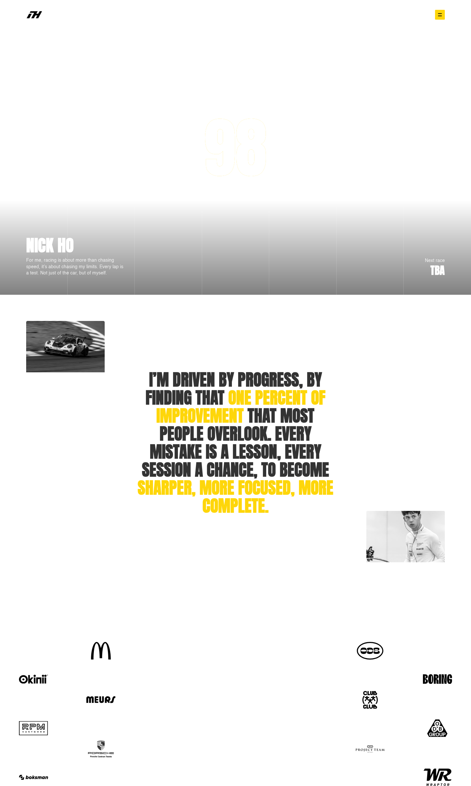
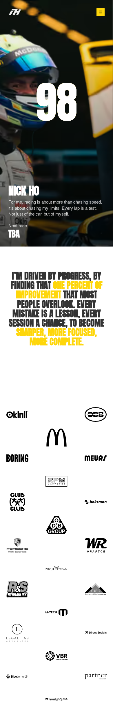

# UI Design System & Master Generation Blueprint: nickho-motorsports-nl

> **Nick Ho - Dutch Racing Driver · Porsche Carrera Cup** (https://nickho-motorsports.nl/) — 21-year-old racing driver from Rotterdam competing in Porsche Carrera Cup Deutschland. 17 career podiums, 14 circuits raced. Follow my mo...



---

## 1. Executive Visual Persona & Design Archetype

- **Brand Essence & Persona**: **Nick Ho - Dutch Racing Driver · Porsche Carrera Cup** (`https://nickho-motorsports.nl/`). 21-year-old racing driver from Rotterdam competing in Porsche Carrera Cup Deutschland. 17 career podiums, 14 circuits raced. Follow my mo...
- **Capture Provenance**: Live browser capture (`tier1_fast`, HTTP `200`, captured `2026-11-23`).
- **Visual Archetype**: **Light-Gallery WebGL / Canvas Interactive Experience (`#ffffff` / `#fed60a`)**.
- **Anti-AI-Slop Differentiators**:
  - **Live-Computed Chromatic Polarity**: Anchors the viewport in `#ffffff` (live computed `body` `background-color` (`computed_styles.json`)) paired with `#000000` primary typography and `#fed60a` accents.
  - **Grounded Typographic Hierarchy**: Pairs `Anton` for display copy (`NICK HO`) with `.875rem` and not declared in live computed styles (uses primary stack / `ui-monospace`).
  - **Calibrated Spatial Grid & Motion**: Combines `1440px` container bounds (`gap: 16px`, padding `9px`) with `cubic-bezier(.7,0,.3,1)` easing and Lenis Smooth Scroll (`data-lenis`), GSAP Timeline & ScrollTrigger.

---

## 2. Spatial Architecture & Modular Grid Mathematics



### Viewport Allocation & Container Geometry
- **Captured Viewport Dimensions**: Desktop `1440×2400px` (`assets/desktop.png`, clamped at 2400px live multi-section capture), Mobile `390×2400px` (`assets/mobile.png`, clamped at 2400px live multi-section capture).
- **Master Container Bounds**: `1440px` (full-bleed `100%` desktop stage measured on `1440px` viewport).
- **Canvas Lateral Padding & Spacing**: `9px` lateral canvas padding with `16px` grid gap.
- **Border Radius Scale**: `3px`, `100%`, `50%`, `62.5rem`.

### Responsive Breakpoint Architecture
- **Desktop Layout**: Multi-column CSS Grid / Flexbox layout at `1440px` (`max-width: 1440px`, `gap: 16px`).
- **Mobile Layout**: Single-column vertical stack at `390px` viewport width with `9px` horizontal padding.
- **Extracted CSS Media Queries**: `@media screen and (max-width: 991px)`, `@media screen and (max-width: 767px)`, `@media screen and (max-width: 479px)`, `@media (min-width: 768px)`.

---

## 3. Color System, Materiality & Atmospheric Lighting

### Semantic Palette & Source Grounding
| Semantic Role | Ground-Truth Value | Extracted Live / CSS Source |
|---|---|---|
| **Primary Canvas Substrate** | `#ffffff` | live computed `body` `background-color` (`computed_styles.json`) |
| **Primary Typography Ink** | `#000000` | live computed `button` `color` (`computed_styles.json`) |
| **Elevated Surface / Card Substrate** | `#ffff00` | `mark { background: #ffff00 }` |
| **Interactive Accent / Highlight** | `#fed60a` | `var(--_colors---primary--100)` in `:root` |
| **Secondary / Muted Copy** | `#333333` | live computed `nav` `color` (`computed_styles.json`) |
| **Structural Hairline Border** | `#e2e2e2` | `blockquote { border-left: #e2e2e2 }` |

### Sanitized Root CSS Variables (`ui-ux.md` Ground Truth)
| Variable Name | Extracted Value | Semantic Role |
|---|---|---|
| `--_typography---fonts--primary-font` | `Helvetica, Arial, sans-serif` | Brand / Palette Token |
| `--_colors---black--80` | `#333` | Canvas / Surface Token |
| `--_typography---line-height--body` | `1.4` | Typography / Scale Token |
| `--_typography---heading-size--xlarge` | `10rem` | Typography Ink Token |
| `--_typography---line-height--heading` | `1` | Typography Ink Token |
| `--_typography---heading-size--large` | `3.125rem` | Typography Ink Token |
| `--_typography---heading-size--medium` | `2rem` | Typography Ink Token |
| `--_typography---heading-size--small` | `2rem` | Typography Ink Token |
| `--_typography---heading-size--xsmall` | `1.625rem` | Typography Ink Token |
| `--_typography---body-size--regular` | `1rem` | Layout / Spatial Grid Token |
| `--_typography---body-size--small` | `.875rem` | Layout / Spatial Grid Token |
| `--_typography---body-size--large` | `1.25rem` | Layout / Spatial Grid Token |
| `--_typography---fonts--heading-font` | `Anton, Arial, sans-serif` | Typography Ink Token |
| `--_colors---black--100` | `black` | Canvas / Surface Token |
| `--_colors---white--100` | `white` | Canvas / Surface Token |
| `--_typography---rich-text--h1` | `6rem` | Typography Ink Token |

---

## 4. Typographic Scale & Editorial Hierarchy

### Font Family Stacks
- **Display Typography**: `Anton`.
- **Primary Body Stack**: `.875rem`.
- **Technical / Metadata Stack**: not declared in live computed styles (uses primary stack / `ui-monospace`).

### Typographic Scale & Rules (Live Computed & Stylesheet Grounded)
- **Hero Display (`H1`)**: live computed `h1` (`font-size: 50px`, `line-height: 55px`, `font-weight: 600`); CSS variables `--_typography---rich-text--h1: 6rem`; rule `h1` (`font-size: 2em`).
- **Section Heading (`H2`)**: live computed `h2` (`font-size: 50px`, `line-height: 55px`, `font-weight: 600`); CSS variables `--_typography---rich-text--h2: 4rem`; rule `h2` (`font-size: 32px`, `line-height: 36px`).
- **Body Copy**: live computed `body` (`font-size: 16px`, `line-height: 22.4px`, `font-weight: 400`); CSS variables `--_typography---line-height--body: 1.4`, `--_typography---body-size--regular: 1rem`, `--_typography---body-size--small: .875rem`; rule `body` (`font-size: 14px`, `line-height: 20px`).
- **Metadata & Navigation Labels**: live computed `nav/a` (`font-size: 16px`, `line-height: 22.4px`, `font-weight: 400`); CSS variables `--_typography---heading-size--small: 2rem`, `--_typography---heading-size--xsmall: 1.625rem`, `--_typography---body-size--small: .875rem`; rule `small` (`font-size: 80%`).

---

## 5. Choreographed Motion & Interaction Physics

### Primary Easing Curves
- **Extracted Timing Functions**: `cubic-bezier(.7,0,.3,1)`, `cubic-bezier(.9,0,.1,1)`, `cubic-bezier(0.4,0,0.2,1)`.

### Per-Element Transition & Choreography Rules
- **Selector `.w-webflow-badge > img`**: `transition: unset` extracted from `nickho-motorsports-nl` stylesheet.
- **Selector `.w-slider-dot`**: `transition: background-color .1s, color .1s` extracted from `nickho-motorsports-nl` stylesheet.
- **Selector `.w-lightbox-control`**: `transition: all .3s` extracted from `nickho-motorsports-nl` stylesheet.
- **Extracted Easing Curve (`cubic-bezier(.7,0,.3,1)`)**: Governs interactive state transitions across `<nav.bold-nav-full>` and `<section.section_about>`.
- **Runtime Interaction Engine**: Integrates Lenis Smooth Scroll (`data-lenis`), GSAP Timeline & ScrollTrigger, Three.js / WebGL Canvas Pipeline, Swiper Touch Carousel Engine with `prefers-reduced-motion: reduce` fallback guards.

---

## 6. Component Wireframe & Structural DOM Map

### Visual Layout Schematic — Desktop (`1440px`, Grounded in `dom.html` & Landmark Bounding Boxes)
```
┌────────────────────────────────────────────────────────────────────────┐
│ DESKTOP VIEWPORT (1440px) — Nick Ho - Dutch Racing Driver · Porsche Ca │
│ ====================================================================== │
│ [ <nav.bold-nav-full> (1440x0px)      | About · History · Gallery ·  ] │
│ ---------------------------------------------------------------------- │
│ | HERO STAGE: <section.section_hero> (w=1440px)                      | │
│ | H1: NICK HO                                                        | │
│ | Substrate: #ffffff | Ink: #000000 | Accent: #fed60a                | │
│ ---------------------------------------------------------------------- │
│ | SHOWCASE GRID (<section.section_about>) max-w: 1440px              | │
│ | +------------------------------+  +------------------------------+ | │
│ | | Nick Ho                      |  | S o u n d o n S o u n d o n  | | │
│ | +------------------------------+  +------------------------------+ | │
│ ---------------------------------------------------------------------- │
│ | DETAIL MODULE (<section.section_agenda>) — I n s t a g r a m I n   | │
│ ---------------------------------------------------------------------- │
│ [ FOOTER (<footer.w-embed>    ) | https://nickho-motorsports.nl/       │
└────────────────────────────────────────────────────────────────────────┘
```

### Visual Layout Schematic — Mobile Reflow (`390px`)
```
┌────────────────────────────────────────────────────────────────────────┐
│ MOBILE VIEWPORT REFLOW (390px) — Single-Column Stack (gap: 16px)       │
│ ====================================================================== │
│ [ HEADER BAR (<nav.bold-nav-full>     ) | Compact Menu (390px)         │
│ ---------------------------------------------------------------------- │
│ | HERO STAGE (<section.section_hero>) — 390px Vertical Lead          | │
│ | H1: NICK HO                                                        | │
│ ---------------------------------------------------------------------- │
│ | SHOWCASE STACK (<section.section_about) — 1-Col Stack              | │
│ | [ Item 1: Nick Ho                                                ] | │
│ | [ Item 2: S o u n d o n S o u n d o n                            ] | │
│ ---------------------------------------------------------------------- │
│ | DETAIL STACK (<section.section_agenda>) — 1-Col (I n s t a g r a m ) │
│ ---------------------------------------------------------------------- │
│ [ FOOTER (<footer.w-embed>    ) | Stacked 390px Colophon               │
└────────────────────────────────────────────────────────────────────────┘
```

### Granular DOM Region Breakdown
1. **Brand Header & Navigation Bar (<nav.bold-nav-full> — `nickho-motorsports-nl`)**:
   - Landmark `<nav class="bold-nav-full">` (`1440x0px`) hosting `Nick Ho - Dutch Racing Driver · Pors` navigation (`About · History · Gallery · Calendar · Contact`), DOM attributes (`data-wf-domain="nickho-motorsports.nl"`, `data-wf-page="6a422333c15d8477da5a843f"`, `data-wf-site="6a422333c15d8477da5a8443"`, `data-grab-cursor`), and stylesheet rule `html { -webkit-text-size-adjust: 100%; -ms-text-size-adjust: 100%; font-family:... }`.
2. **Hero Stage & Focal Lead (<section.section_hero> — `NICK HO`)**:
   - Landmark `<section class="section_hero">` presenting display lead `NICK HO` and copy excerpt *"S e e m o r e S e e m o r e"* over `#ffffff` canvas and `#000000` ink.
3. **Primary Showcase & Content Grid (<section.section_about> — `Nick Ho`)**:
   - Landmark `<section class="section_about">` rendering section `Nick Ho` with copy *"S o u n d o n S o u n d o n"*, asset references (`cdn.prod.website-files.com`, `nick-ho.webflow.shared.f23fd3a71.css`, `6a423f0c4a28dcd7702058a2_nick-ho-...`, `6a423f14a90180269b9bab31_nick-ho-...`), and grid rule `body { margin: 0; }`.
4. **Interactive Detail & Feature Matrix (<section.section_agenda> — `S o u n d o n S o u n d o n`)**:
   - Landmark `<section class="section_agenda">` framing `S o u n d o n S o u n d o n` and `I n s t a g r a m I n s t a g r a m` (*"I n s t a g r a m I n s t a g r a m"*) with `#ffff00` surface cards, `#fed60a` accents, and `summary { display: block; }`.
5. **Colophon & Global Directory Footer (<footer.w-embed> — `https://nickho-motorsports.nl/`)**:
   - Landmark `<footer class="w-embed">` anchoring `Nick Ho - Dutch Racing Driver · ` footer links (`About · History · Gallery · Calendar · Contact`), copy *"L i n k e d I n L i n k e d I n"*, and `#e2e2e2` structural dividers.

---

## 7. Master Zero-Shot AI Generation Prompt

```markdown
# Master Zero-Shot Frontend Generation Prompt: nickho-motorsports-nl (Nick Ho - Dutch Racing Driver · Porsche Carrera Cup)

You are a principal frontend architect and design systems engineer. Build a complete, production-ready web application replicating the exact design system, DOM landmarks, typographic hierarchy, color tokens, and motion physics of `nickho-motorsports-nl` (**Nick Ho - Dutch Racing Driver · Porsche Carrera Cup** — `https://nickho-motorsports.nl/`).

### 1. Visual Archetype & Anti-AI-Slop Mandates
- **Archetype**: Light-Gallery WebGL / Canvas Interactive Experience (`#ffffff` / `#fed60a`).
- **Identity & Domain Context**: 21-year-old racing driver from Rotterdam competing in Porsche Carrera Cup Deutschland. 17 career podiums, 14 circuits raced. Follow my mo...
- **Primary Substrate**: `#ffffff` (live computed `body` `background-color` (`computed_styles.json`)), **Primary Ink**: `#000000`, **Accent / Highlight**: `#fed60a`.
- **Site-Specific Differentiators**:
  - **Live-Computed Chromatic Polarity**: Anchors the viewport in `#ffffff` (live computed `body` `background-color` (`computed_styles.json`)) paired with `#000000` primary typography and `#fed60a` accents.
  - **Grounded Typographic Hierarchy**: Pairs `Anton` for display copy (`NICK HO`) with `.875rem` and not declared in live computed styles (uses primary stack / `ui-monospace`).
  - **Calibrated Spatial Grid & Motion**: Combines `1440px` container bounds (`gap: 16px`, padding `9px`) with `cubic-bezier(.7,0,.3,1)` easing and Lenis Smooth Scroll (`data-lenis`), GSAP Timeline & ScrollTrigger.

### 2. Ground-Truth CSS Variables (`:root` Token Contract)
Declare and consume these exact custom properties extracted from `nickho-motorsports-nl` in your global stylesheet:

:root {
  /* Nick Ho - Dutch Racing Driver · Porsche Carrera Cup (nickho-motorsports-nl) — Live-Grounded CSS Variables */
  --_typography---fonts--primary-font: Helvetica, Arial, sans-serif; /* Brand / Palette Token (nickho-motorsports-nl) */
  --_colors---black--80: #333; /* Canvas / Surface Token (nickho-motorsports-nl) */
  --_typography---line-height--body: 1.4; /* Typography / Scale Token (nickho-motorsports-nl) */
  --_typography---heading-size--xlarge: 10rem; /* Typography Ink Token (nickho-motorsports-nl) */
  --_typography---line-height--heading: 1; /* Typography Ink Token (nickho-motorsports-nl) */
  --_typography---heading-size--large: 3.125rem; /* Typography Ink Token (nickho-motorsports-nl) */
  --_typography---heading-size--medium: 2rem; /* Typography Ink Token (nickho-motorsports-nl) */
  --_typography---heading-size--small: 2rem; /* Typography Ink Token (nickho-motorsports-nl) */
  --_typography---heading-size--xsmall: 1.625rem; /* Typography Ink Token (nickho-motorsports-nl) */
  --_typography---body-size--regular: 1rem; /* Layout / Spatial Grid Token (nickho-motorsports-nl) */
  --_typography---body-size--small: .875rem; /* Layout / Spatial Grid Token (nickho-motorsports-nl) */
  --_typography---body-size--large: 1.25rem; /* Layout / Spatial Grid Token (nickho-motorsports-nl) */
  --_typography---fonts--heading-font: Anton, Arial, sans-serif; /* Typography Ink Token (nickho-motorsports-nl) */
  --_colors---black--100: black; /* Canvas / Surface Token (nickho-motorsports-nl) */
  --_colors---white--100: white; /* Canvas / Surface Token (nickho-motorsports-nl) */
  --_typography---rich-text--h1: 6rem; /* Typography Ink Token (nickho-motorsports-nl) */
}

### 3. Semantic Color & Materiality Contract
Map every surface, ink, and border strictly to these source-grounded tokens:
- **Primary Canvas Substrate**: `#ffffff` — grounded in live computed `body` `background-color` (`computed_styles.json`)
- **Primary Typography Ink**: `#000000` — grounded in live computed `button` `color` (`computed_styles.json`)
- **Elevated Surface / Card Substrate**: `#ffff00` — grounded in `mark { background: #ffff00 }`
- **Interactive Accent / Highlight**: `#fed60a` — grounded in `var(--_colors---primary--100)` in `:root`
- **Secondary / Muted Copy**: `#333333` — grounded in live computed `nav` `color` (`computed_styles.json`)
- **Structural Hairline Border**: `#e2e2e2` — grounded in `blockquote { border-left: #e2e2e2 }`

### 4. Spatial Grid, Container Bounds & Responsive Breakpoints
- **Desktop Viewport Reference**: `1440×2400px` (clamped at 2400px live multi-section capture, `1440px` standard desktop width).
- **Mobile Viewport Reference**: `390×2400px` (clamped at 2400px live multi-section capture, `390px` standard mobile width).
- **Container Max-Width**: `1440px` (full-bleed `100%` desktop stage measured on `1440px` viewport)
- **Padding & Gutters**: `9px` lateral canvas padding with `16px` grid gap
- **Desktop Grid**: Multi-column CSS Grid / Flexbox layout at `1440px` (`max-width: 1440px`, `gap: 16px`)
- **Mobile Adaptation**: Single-column vertical stack at `390px` viewport width with `9px` horizontal padding
- **Media Queries**: `@media screen and (max-width: 991px)`, `@media screen and (max-width: 767px)`, `@media screen and (max-width: 479px)`, `@media (min-width: 768px)`
- **Corner Radii**: `3px`, `100%`, `50%`, `62.5rem`

### 5. Typography & Editorial Scale Contract
- **Display Font Stack**: `Anton`
- **Body Font Stack**: `.875rem`
- **Monospace / Technical Font Stack**: not declared in live computed styles (uses primary stack / `ui-monospace`)
- **H1 Display Rule**: live computed `h1` (`font-size: 50px`, `line-height: 55px`, `font-weight: 600`); CSS variables `--_typography---rich-text--h1: 6rem`; rule `h1` (`font-size: 2em`)
- **H2 Section Rule**: live computed `h2` (`font-size: 50px`, `line-height: 55px`, `font-weight: 600`); CSS variables `--_typography---rich-text--h2: 4rem`; rule `h2` (`font-size: 32px`, `line-height: 36px`)
- **Body Copy Rule**: live computed `body` (`font-size: 16px`, `line-height: 22.4px`, `font-weight: 400`); CSS variables `--_typography---line-height--body: 1.4`, `--_typography---body-size--regular: 1rem`, `--_typography---body-size--small: .875rem`; rule `body` (`font-size: 14px`, `line-height: 20px`)
- **Metadata & Index Rule**: live computed `nav/a` (`font-size: 16px`, `line-height: 22.4px`, `font-weight: 400`); CSS variables `--_typography---heading-size--small: 2rem`, `--_typography---heading-size--xsmall: 1.625rem`, `--_typography---body-size--small: .875rem`; rule `small` (`font-size: 80%`)

### 6. Component Hierarchy, Verbatim Copy & Real DOM Landmarks
Scaffold `nickho-motorsports-nl` (`Nick Ho - Dutch Racing Driver · Porsche Carrera Cup`) with these exact structural regions, extracted copy, and CSS rules from `dom.html`:
1. **Brand Header & Navigation Bar (<nav.bold-nav-full> — `nickho-motorsports-nl`)**:
   - DOM & Selectors: Landmark `<nav class="bold-nav-full">` (`1440x0px`) hosting `Nick Ho - Dutch Racing Driver · Pors` navigation (`About · History · Gallery · Calendar · Contact`), DOM attributes (`data-wf-domain="nickho-motorsports.nl"`, `data-wf-page="6a422333c15d8477da5a843f"`, `data-wf-site="6a422333c15d8477da5a8443"`, `data-grab-cursor`), and stylesheet rule `html { -webkit-text-size-adjust: 100%; -ms-text-size-adjust: 100%; font-family:... }`.
   - Responsive Contract: Header `Brand Header & Navigation Bar (<nav.bold-nav-full> — `nickho-motorsports-nl`)` (`nickho-motorsports-nl`) adapts across `@media screen and (max-width: 991px)`, `@media screen and (max-width: 767px)`, `@media screen and (max-width: 479px)`, `@media (min-width: 768px)` with `cubic-bezier(.7,0,.3,1)`, `cubic-bezier(.9,0,.1,1)`, `cubic-bezier(0.4,0,0.2,1)` transitions and links `About · History · Gallery · Calendar · Contact`.
2. **Hero Stage & Focal Lead (<section.section_hero> — `NICK HO`)**:
   - DOM & Selectors: Landmark `<section class="section_hero">` presenting display lead `NICK HO` and copy excerpt *"S e e m o r e S e e m o r e"* over `#ffffff` canvas and `#000000` ink.
   - Responsive Contract: Hero stage (`1440×2400px` desktop / `390×2400px` mobile) sets `#ffffff` background with `#000000` headline `NICK HO`.
3. **Primary Showcase & Content Grid (<section.section_about> — `Nick Ho`)**:
   - DOM & Selectors: Landmark `<section class="section_about">` rendering section `Nick Ho` with copy *"S o u n d o n S o u n d o n"*, asset references (`cdn.prod.website-files.com`, `nick-ho.webflow.shared.f23fd3a71.css`, `6a423f0c4a28dcd7702058a2_nick-ho-...`, `6a423f14a90180269b9bab31_nick-ho-...`), and grid rule `body { margin: 0; }`.
   - Responsive Contract: Showcase grid `Primary Showcase & Content Grid (<section.section_about> — `Nick Ho`)` applies Multi-column CSS Grid / Flexbox layout at `1440px` (`max-width: 1440px`, `gap: 16px`) on desktop and Single-column vertical stack at `390px` viewport width with `9px` horizontal padding on mobile.
4. **Interactive Detail & Feature Matrix (<section.section_agenda> — `S o u n d o n S o u n d o n`)**:
   - DOM & Selectors: Landmark `<section class="section_agenda">` framing `S o u n d o n S o u n d o n` and `I n s t a g r a m I n s t a g r a m` (*"I n s t a g r a m I n s t a g r a m"*) with `#ffff00` surface cards, `#fed60a` accents, and `summary { display: block; }`.
   - Responsive Contract: Detail module `Interactive Detail & Feature Matrix (<section.section_agenda> — `S o u n d o n S o u n d o n`)` uses `3px`, `100%`, `50%`, `62.5rem` radii, `#fed60a` highlights, and assets (cdn.prod.website-files.com, nick-ho.webflow.shared.f23fd3a71.css, 6a423f0c4a28dcd7702058a2_nick-ho-...).
5. **Colophon & Global Directory Footer (<footer.w-embed> — `https://nickho-motorsports.nl/`)**:
   - DOM & Selectors: Landmark `<footer class="w-embed">` anchoring `Nick Ho - Dutch Racing Driver · ` footer links (`About · History · Gallery · Calendar · Contact`), copy *"L i n k e d I n L i n k e d I n"*, and `#e2e2e2` structural dividers.
   - Responsive Contract: Footer `Colophon & Global Directory Footer (<footer.w-embed> — `https://nickho-motorsports.nl/`)` aligns to `1440px` (full-bleed `100%` desktop stage measured on `1440px` viewport) with `9px` lateral canvas padding with `16px` grid gap and attributes (data-wf-domain="nickho-motorsports.nl", data-wf-page="6a422333c15d8477da5a843f", data-wf-site="6a422333c15d8477da5a8443").

#### Verbatim DOM Copy Excerpts (`dom.html`)
- Copy Excerpt 1: *"S e e m o r e S e e m o r e"*
- Copy Excerpt 2: *"S o u n d o n S o u n d o n"*
- Copy Excerpt 3: *"I n s t a g r a m I n s t a g r a m"*
- Copy Excerpt 4: *"L i n k e d I n L i n k e d I n"*

### 7. Motion, Extracted Stylesheet Rules & Interaction Choreography
- **Primary Easing Functions**: `cubic-bezier(.7,0,.3,1)`, `cubic-bezier(.9,0,.1,1)`, `cubic-bezier(0.4,0,0.2,1)`
- **Extracted Stylesheet Rules (`nickho-motorsports-nl`)**:
- `html { -webkit-text-size-adjust: 100%; -ms-text-size-adjust: 100%; font-family:... }`
- `body { margin: 0; }`
- `summary { display: block; }`
- `video { vertical-align: baseline; display: inline-block; }`
- `template { display: none; }`
- **Per-Selector Transition Rules**:
- **Selector `.w-webflow-badge > img`**: `transition: unset` extracted from `nickho-motorsports-nl` stylesheet.
- **Selector `.w-slider-dot`**: `transition: background-color .1s, color .1s` extracted from `nickho-motorsports-nl` stylesheet.
- **Selector `.w-lightbox-control`**: `transition: all .3s` extracted from `nickho-motorsports-nl` stylesheet.
- **Extracted Easing Curve (`cubic-bezier(.7,0,.3,1)`)**: Governs interactive state transitions across `<nav.bold-nav-full>` and `<section.section_about>`.
- **Runtime Interaction Engine**: Integrates Lenis Smooth Scroll (`data-lenis`), GSAP Timeline & ScrollTrigger, Three.js / WebGL Canvas Pipeline, Swiper Touch Carousel Engine with `prefers-reduced-motion: reduce` fallback guards.

### 8. Technical Deliverables
- Implement in Next.js (App Router) with TypeScript and Tailwind CSS consuming the `:root` custom properties defined above for `nickho-motorsports-nl`.
- Reproduce both the `1440px` desktop architecture and `390px` mobile breakpoint transitions, preserving semantic HTML5 landmarks (`<header>`, `<nav>`, `<main>`, `<section>`, `<footer>`) and `prefers-reduced-motion` accessibility guards.
```
