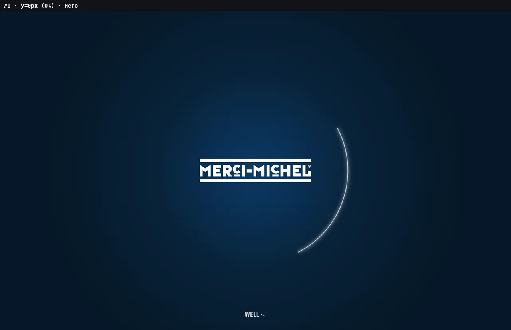
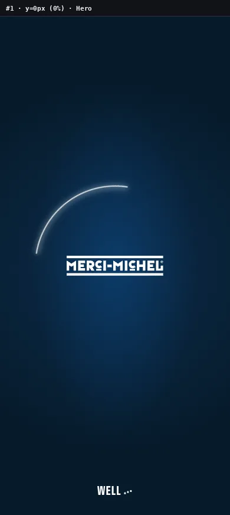

# UI Design System & Master Generation Blueprint: no-merci-michel-com

> **No Mercy Michel** (https://no.merci-michel.com) — You thought we were nice people...Step into the arena and fight! Spoiler: you'll lose.





---

## 1. Executive Visual Persona & Design Archetype

- **Brand Essence & Persona**: **No Mercy Michel** (`https://no.merci-michel.com`). You thought we were nice people...Step into the arena and fight! Spoiler: you'll lose.
- **Capture Provenance**: Live browser capture (`tier2_webgl`, HTTP `200`, captured `2026-11-24`).
- **Visual Archetype**: **Light-Gallery WebGL / Canvas Interactive Experience (`#3ea0f1` / `#ffffff`)**.
- **Anti-AI-Slop Differentiators**:
  - **Live-Computed Chromatic Polarity**: Anchors the viewport in `#3ea0f1` (live computed `html` `background-color` (`computed_styles.json`)) paired with `#000000` primary typography and `#ffffff` accents.
  - **Grounded Typographic Hierarchy**: Pairs `UnitedSansCondensed` for display copy (`No Mercy Michel`) with `UnitedSansRegular` and `Roboto Mono`.
  - **Calibrated Spatial Grid & Motion**: Combines `1440px` container bounds (`gap: 0px (flush layout)`, padding `6px`) with `cubic-bezier(.55,0,.1,1)` easing and Three.js / WebGL Canvas Pipeline.

---

## 2. Spatial Architecture & Modular Grid Mathematics

### Viewport Allocation & Container Geometry
- **Captured Journey Filmstrips**: Desktop `1280×828px` (`assets/desktop-journey.webp`, `1` keyframes up to `y=0px` / doc `900px`), Mobile `390×872px` (`assets/mobile-journey.webp`, `1` keyframes).
- **Master Container Bounds**: `1440px` (live computed `main` `max-width`).
- **Canvas Lateral Padding & Spacing**: `6px` lateral canvas padding with `0px (flush layout)` grid gap.
- **Border Radius Scale**: `0px 0px 20px`, `45px`, `48px`, `50%`.

### Responsive Breakpoint Architecture
- **Desktop Layout**: Multi-column CSS Grid / Flexbox layout at `1440px` (`max-width: 1440px`, `gap: 0px (flush layout)`).
- **Mobile Layout**: Single-column vertical stack at `390px` viewport width with `6px` horizontal padding.
- **Extracted CSS Media Queries**: `@media (min-width: 375px) and (max-width: 768px)`, `@media (min-width: 768px) and (max-width: 1440px)`, `@media (min-width: 1440px) and (max-width: 1900px)`, `@media (min-width: 1901px)`.

---

## 3. Color System, Materiality & Atmospheric Lighting

### Semantic Palette & Source Grounding
| Semantic Role | Ground-Truth Value | Extracted Live / CSS Source |
|---|---|---|
| **Primary Canvas Substrate** | `#3ea0f1` | live computed `html` `background-color` (`computed_styles.json`) |
| **Primary Typography Ink** | `#000000` | live computed `a` `color` (`computed_styles.json`) |
| **Elevated Surface / Card Substrate** | `#dfdfdf` | `#preloader .preloader-button .c... { background: #dfdfdf }` |
| **Interactive Accent / Highlight** | `#ffffff` | live computed `button` `color` (`computed_styles.json`) |
| **Secondary / Muted Copy** | `#555555` | live computed `main` `color` (`computed_styles.json`) |
| **Structural Hairline Border** | `#65b3f4` | `.marquee { stroke: #65b3f4 }` |

### Sanitized Root CSS Variables (`ui-ux.md` Ground Truth)
| Variable Name | Extracted Value | Semantic Role |
|---|---|---|
| `--base-text` | `calc((22px) * var(--h-demult, 1))` | Typography Ink Token |
| `--padding` | `calc(var(--base-text))` | Layout / Spatial Grid Token |
| `--btn-size` | `calc((195px) * var(--h-demult, 1))` | Layout / Spatial Grid Token |
| `--btn-size-shared` | `calc((195px) * var(--h-demult, 1))` | Layout / Spatial Grid Token |
| `--btn-circle` | `calc((70px) * var(--h-demult, 1))` | Dimension / Scale Token |
| `--name-size` | `calc((48px) * var(--h-demult, 1))` | Layout / Spatial Grid Token |
| `--size` | `calc(var(--name-size) * .35)` | Layout / Spatial Grid Token |
| `--top` | `94px` | Dimension / Scale Token |
| `--lb-padding` | `2.5em` | Layout / Spatial Grid Token |
| `--height` | `calc(100vh - 42px)` | Layout / Spatial Grid Token |
| `--leaderboardSize` | `calc((18px) * var(--h-demult, 1))` | Layout / Spatial Grid Token |
| `--circle-size` | `1.6em` | Layout / Spatial Grid Token |
| `--half-circle-size` | `calc(var(--circle-size) / 2)` | Layout / Spatial Grid Token |
| `--input-size` | `clamp(280px, 40vw, 380px)` | Layout / Spatial Grid Token |
| `--input-shift-x` | `calc(var(--input-size) * -1 + var(--btn-circle))` | Design System Custom Token |
| `--input-shift-y` | `calc(var(--btn-circle) * -.35)` | Design System Custom Token |

---

## 4. Typographic Scale & Editorial Hierarchy

### Font Family Stacks
- **Display Typography**: `UnitedSansCondensed`.
- **Primary Body Stack**: `UnitedSansRegular`.
- **Technical / Metadata Stack**: `Roboto Mono`.

### Typographic Scale & Rules (Live Computed & Stylesheet Grounded)
- **Hero Display (`H1`)**: rule `h1` (`font-size: 7vw`, `line-height: 1`, `font-weight: 900`).
- **Section Heading (`H2`)**: observed font-size ladder: `68px`, `22.4211px`, `10px`, `100%`, `var(--base-text)`.
- **Body Copy**: live computed `body` (`font-size: 68px`, `line-height: normal`, `font-weight: 100`); rule `p` (`font-size: 1.2vw`, `font-weight: 400`).
- **Metadata & Navigation Labels**: live computed `nav/a` (`font-size: 22.4211px`, `line-height: normal`, `font-weight: 100`).

---

## 5. Choreographed Motion & Interaction Physics

### Primary Easing Curves
- **Extracted Timing Functions**: `cubic-bezier(.55,0,.1,1)`, `cubic-bezier(.215,.61,.355,1)`, `cubic-bezier(.645,.045,.355,1)`.

### Per-Element Transition & Choreography Rules
- **Selector `.icon-star[data-v-402cbbe5]`**: `transition: transform .25s cubic-bezier(.55,0,.1,1)` extracted from `no-merci-michel-com` stylesheet.
- **Selector `erboard-close-button[data-v-b298e...`**: `transition: transform .2s cubic-bezier(.55,0,.1,1)` extracted from `no-merci-michel-com` stylesheet.
- **Selector `rboard-close-button[data-v-b298ed...`**: `transition: transform .2s cubic-bezier(.55,0,.1,1)` extracted from `no-merci-michel-com` stylesheet.
- **Extracted Easing Curve (`cubic-bezier(.55,0,.1,1)`)**: Governs interactive state transitions across `<header.desktop>` and `<main.ui:nth(2)>`.
- **Runtime Interaction Engine**: Integrates Three.js / WebGL Canvas Pipeline with `prefers-reduced-motion: reduce` fallback guards.
### Measured Runtime Scroll & Interaction Telemetry (`behavioral_journey_v2`)
- **Scroll Driver Mode**: `wheel` (max document height `900px`, deepest scrollY reached `0px` across `1` desktop keyframes).
- **Detected Scroll / Motion Libraries**: `WebGL/Canvas`.

---

## 6. Component Wireframe & Structural DOM Map

### Visual Layout Schematic — Desktop (`1440px`, Grounded in `dom.html` & Landmark Bounding Boxes)
```
┌────────────────────────────────────────────────────────────────────────┐
│ DESKTOP VIEWPORT (1440px) — No Mercy Michel                            │
│ ====================================================================== │
│ [ <header.desktop> (1440px)           | by                           ] │
│ ---------------------------------------------------------------------- │
│ | HERO STAGE: <main.ui> (w=1440px)                                   | │
│ | H1: No Mercy Michel                                                | │
│ | Substrate: #3ea0f1 | Ink: #000000 | Accent: #ffffff                | │
│ ---------------------------------------------------------------------- │
│ | SHOWCASE GRID (<main.ui:nth(2)>) max-w: 1440px                     | │
│ | +------------------------------+  +------------------------------+ | │
│ | | Featured Work & Interactive  |  | Technical Architecture & Nar | | │
│ | +------------------------------+  +------------------------------+ | │
│ ---------------------------------------------------------------------- │
│ | DETAIL MODULE (<main.ui:nth(3)>) — Global Directory & Co           | │
│ ---------------------------------------------------------------------- │
│ [ FOOTER (<footer.icons-sprite) | https://no.merci-michel.com          │
└────────────────────────────────────────────────────────────────────────┘
```

### Visual Layout Schematic — Mobile Reflow (`390px`)
```
┌────────────────────────────────────────────────────────────────────────┐
│ MOBILE VIEWPORT REFLOW (390px) — Single-Column Stack (gap: 0px (flu)   │
│ ====================================================================== │
│ [ HEADER BAR (<header.desktop>        ) | Compact Menu (390px)         │
│ ---------------------------------------------------------------------- │
│ | HERO STAGE (<main.ui>) — 390px Vertical Lead                       | │
│ | H1: No Mercy Michel                                                | │
│ ---------------------------------------------------------------------- │
│ | SHOWCASE STACK (<main.ui:nth(2)>) — 1-Col Stack                    | │
│ | [ Item 1: Featured Work & Interactive Showcase                   ] | │
│ | [ Item 2: Technical Architecture & Narrative                     ] | │
│ ---------------------------------------------------------------------- │
│ | DETAIL STACK (<main.ui:nth(3)>) — 1-Col (Global Directory &)       | │
│ ---------------------------------------------------------------------- │
│ [ FOOTER (<footer.icons-sprite) | Stacked 390px Colophon               │
└────────────────────────────────────────────────────────────────────────┘
```

### Granular DOM Region Breakdown
1. **Brand Header & Navigation Bar (<header.desktop> — `no-merci-michel-com`)**:
   - Landmark `<header class="desktop">` (`1440px`) hosting `No Mercy Michel` navigation (`by`), DOM attributes (`data-website-id="e07f52fc-c45c-4322-87..."`, `data-umami-event="Click - Preloader Button"`, `data-v-app`, `data-v-75f61e58`), and stylesheet rule `html { -webkit-tap-highlight-color:rgba(255,255,255,0);-webkit-touch-callout:no... }`.
2. **Hero Stage & Focal Lead (<main.ui> — `No Mercy Michel`)**:
   - Landmark `<main class="ui">` presenting display lead `No Mercy Michel` and copy excerpt *"FREE STICKERS — FREE STICKERS —"* over `#3ea0f1` canvas and `#000000` ink.
3. **Primary Showcase & Content Grid (<main.ui:nth(2)> — `Featured Work & Interactive Showca`)**:
   - Landmark `<main class="ui">` rendering section `Featured Work & Interactive Showcase` with copy *"Free stickers — Free stickers —"*, asset references (`script.js`, `favicon.ico`, `favicon_dark.svg`, `favicon_light.svg`), and grid rule `body { display:block }`.
4. **Interactive Detail & Feature Matrix (<main.ui:nth(3)> — `Technical Architecture & Narrative`)**:
   - Landmark `<main class="ui">` framing `Technical Architecture & Narrative` and `Global Directory & Contact` (*"Featured Work & Interactive Showcase"*) with `#dfdfdf` surface cards, `#ffffff` accents, and `after { box-sizing:border-box;touch-action:manipulation }`.
5. **Colophon & Global Directory Footer (<footer.icons-spritesheet> — `https://no.merci-michel.com`)**:
   - Landmark `<footer class="icons-spritesheet">` anchoring `No Mercy Michel` footer links (`by`), copy *"Technical Architecture & Narrative"*, and `#65b3f4` structural dividers.
### Full Vertical Scroll Sequence (Desktop `1440×900` Keyframes)
- **Step 01** (`y=0px`, `0%`): Active landmark `Hero` · sticky/fixed elements: `8`

---

## 7. Master Zero-Shot AI Generation Prompt

```markdown
# Master Zero-Shot Frontend Generation Prompt: no-merci-michel-com (No Mercy Michel)

You are a principal frontend architect and design systems engineer. Build a complete, production-ready web application replicating the exact design system, DOM landmarks, typographic hierarchy, color tokens, and motion physics of `no-merci-michel-com` (**No Mercy Michel** — `https://no.merci-michel.com`).

### 1. Visual Archetype & Anti-AI-Slop Mandates
- **Archetype**: Light-Gallery WebGL / Canvas Interactive Experience (`#3ea0f1` / `#ffffff`).
- **Identity & Domain Context**: You thought we were nice people...Step into the arena and fight! Spoiler: you'll lose.
- **Primary Substrate**: `#3ea0f1` (live computed `html` `background-color` (`computed_styles.json`)), **Primary Ink**: `#000000`, **Accent / Highlight**: `#ffffff`.
- **Site-Specific Differentiators**:
  - **Live-Computed Chromatic Polarity**: Anchors the viewport in `#3ea0f1` (live computed `html` `background-color` (`computed_styles.json`)) paired with `#000000` primary typography and `#ffffff` accents.
  - **Grounded Typographic Hierarchy**: Pairs `UnitedSansCondensed` for display copy (`No Mercy Michel`) with `UnitedSansRegular` and `Roboto Mono`.
  - **Calibrated Spatial Grid & Motion**: Combines `1440px` container bounds (`gap: 0px (flush layout)`, padding `6px`) with `cubic-bezier(.55,0,.1,1)` easing and Three.js / WebGL Canvas Pipeline.

### 2. Ground-Truth CSS Variables (`:root` Token Contract)
Declare and consume these exact custom properties extracted from `no-merci-michel-com` in your global stylesheet:

:root {
  /* No Mercy Michel (no-merci-michel-com) — Live-Grounded CSS Variables */
  --base-text: calc((22px) * var(--h-demult, 1)); /* Typography Ink Token (no-merci-michel-com) */
  --padding: calc(var(--base-text)); /* Layout / Spatial Grid Token (no-merci-michel-com) */
  --btn-size: calc((195px) * var(--h-demult, 1)); /* Layout / Spatial Grid Token (no-merci-michel-com) */
  --btn-size-shared: calc((195px) * var(--h-demult, 1)); /* Layout / Spatial Grid Token (no-merci-michel-com) */
  --btn-circle: calc((70px) * var(--h-demult, 1)); /* Dimension / Scale Token (no-merci-michel-com) */
  --name-size: calc((48px) * var(--h-demult, 1)); /* Layout / Spatial Grid Token (no-merci-michel-com) */
  --size: calc(var(--name-size) * .35); /* Layout / Spatial Grid Token (no-merci-michel-com) */
  --top: 94px; /* Dimension / Scale Token (no-merci-michel-com) */
  --lb-padding: 2.5em; /* Layout / Spatial Grid Token (no-merci-michel-com) */
  --height: calc(100vh - 42px); /* Layout / Spatial Grid Token (no-merci-michel-com) */
  --leaderboardSize: calc((18px) * var(--h-demult, 1)); /* Layout / Spatial Grid Token (no-merci-michel-com) */
  --circle-size: 1.6em; /* Layout / Spatial Grid Token (no-merci-michel-com) */
  --half-circle-size: calc(var(--circle-size) / 2); /* Layout / Spatial Grid Token (no-merci-michel-com) */
  --input-size: clamp(280px, 40vw, 380px); /* Layout / Spatial Grid Token (no-merci-michel-com) */
  --input-shift-x: calc(var(--input-size) * -1 + var(--btn-circle)); /* Design System Custom Token (no-merci-michel-com) */
  --input-shift-y: calc(var(--btn-circle) * -.35); /* Design System Custom Token (no-merci-michel-com) */
}

### 3. Semantic Color & Materiality Contract
Map every surface, ink, and border strictly to these source-grounded tokens:
- **Primary Canvas Substrate**: `#3ea0f1` — grounded in live computed `html` `background-color` (`computed_styles.json`)
- **Primary Typography Ink**: `#000000` — grounded in live computed `a` `color` (`computed_styles.json`)
- **Elevated Surface / Card Substrate**: `#dfdfdf` — grounded in `#preloader .preloader-button .c... { background: #dfdfdf }`
- **Interactive Accent / Highlight**: `#ffffff` — grounded in live computed `button` `color` (`computed_styles.json`)
- **Secondary / Muted Copy**: `#555555` — grounded in live computed `main` `color` (`computed_styles.json`)
- **Structural Hairline Border**: `#65b3f4` — grounded in `.marquee { stroke: #65b3f4 }`

### 4. Spatial Grid, Container Bounds & Responsive Breakpoints
- **Desktop Viewport Reference**: `1280×828px` (single-viewport 100vh live capture (900px), `1440px` standard desktop width).
- **Mobile Viewport Reference**: `390×872px` (full-page live capture (872px), `390px` standard mobile width).
- **Container Max-Width**: `1440px` (live computed `main` `max-width`)
- **Padding & Gutters**: `6px` lateral canvas padding with `0px (flush layout)` grid gap
- **Desktop Grid**: Multi-column CSS Grid / Flexbox layout at `1440px` (`max-width: 1440px`, `gap: 0px (flush layout)`)
- **Mobile Adaptation**: Single-column vertical stack at `390px` viewport width with `6px` horizontal padding
- **Media Queries**: `@media (min-width: 375px) and (max-width: 768px)`, `@media (min-width: 768px) and (max-width: 1440px)`, `@media (min-width: 1440px) and (max-width: 1900px)`, `@media (min-width: 1901px)`
- **Corner Radii**: `0px 0px 20px`, `45px`, `48px`, `50%`

### 5. Typography & Editorial Scale Contract
- **Display Font Stack**: `UnitedSansCondensed`
- **Body Font Stack**: `UnitedSansRegular`
- **Monospace / Technical Font Stack**: `Roboto Mono`
- **H1 Display Rule**: rule `h1` (`font-size: 7vw`, `line-height: 1`, `font-weight: 900`)
- **H2 Section Rule**: observed font-size ladder: `68px`, `22.4211px`, `10px`, `100%`, `var(--base-text)`
- **Body Copy Rule**: live computed `body` (`font-size: 68px`, `line-height: normal`, `font-weight: 100`); rule `p` (`font-size: 1.2vw`, `font-weight: 400`)
- **Metadata & Index Rule**: live computed `nav/a` (`font-size: 22.4211px`, `line-height: normal`, `font-weight: 100`)

### 6. Component Hierarchy, Verbatim Copy & Real DOM Landmarks
Scaffold `no-merci-michel-com` (`No Mercy Michel`) with these exact structural regions, extracted copy, and CSS rules from `dom.html`:
1. **Brand Header & Navigation Bar (<header.desktop> — `no-merci-michel-com`)**:
   - DOM & Selectors: Landmark `<header class="desktop">` (`1440px`) hosting `No Mercy Michel` navigation (`by`), DOM attributes (`data-website-id="e07f52fc-c45c-4322-87..."`, `data-umami-event="Click - Preloader Button"`, `data-v-app`, `data-v-75f61e58`), and stylesheet rule `html { -webkit-tap-highlight-color:rgba(255,255,255,0);-webkit-touch-callout:no... }`.
   - Responsive Contract: Header `Brand Header & Navigation Bar (<header.desktop> — `no-merci-michel-com`)` (`no-merci-michel-com`) adapts across `@media (min-width: 375px) and (max-width: 768px)`, `@media (min-width: 768px) and (max-width: 1440px)`, `@media (min-width: 1440px) and (max-width: 1900px)`, `@media (min-width: 1901px)` with `cubic-bezier(.55,0,.1,1)`, `cubic-bezier(.215,.61,.355,1)`, `cubic-bezier(.645,.045,.355,1)` transitions and links `by`.
2. **Hero Stage & Focal Lead (<main.ui> — `No Mercy Michel`)**:
   - DOM & Selectors: Landmark `<main class="ui">` presenting display lead `No Mercy Michel` and copy excerpt *"FREE STICKERS — FREE STICKERS —"* over `#3ea0f1` canvas and `#000000` ink.
   - Responsive Contract: Hero stage (`1280×828px` desktop / `390×872px` mobile) sets `#3ea0f1` background with `#000000` headline `No Mercy Michel`.
3. **Primary Showcase & Content Grid (<main.ui:nth(2)> — `Featured Work & Interactive Showca`)**:
   - DOM & Selectors: Landmark `<main class="ui">` rendering section `Featured Work & Interactive Showcase` with copy *"Free stickers — Free stickers —"*, asset references (`script.js`, `favicon.ico`, `favicon_dark.svg`, `favicon_light.svg`), and grid rule `body { display:block }`.
   - Responsive Contract: Showcase grid `Primary Showcase & Content Grid (<main.ui:nth(2)> — `Featured Work & Interactive Showca`)` applies Multi-column CSS Grid / Flexbox layout at `1440px` (`max-width: 1440px`, `gap: 0px (flush layout)`) on desktop and Single-column vertical stack at `390px` viewport width with `6px` horizontal padding on mobile.
4. **Interactive Detail & Feature Matrix (<main.ui:nth(3)> — `Technical Architecture & Narrative`)**:
   - DOM & Selectors: Landmark `<main class="ui">` framing `Technical Architecture & Narrative` and `Global Directory & Contact` (*"Featured Work & Interactive Showcase"*) with `#dfdfdf` surface cards, `#ffffff` accents, and `after { box-sizing:border-box;touch-action:manipulation }`.
   - Responsive Contract: Detail module `Interactive Detail & Feature Matrix (<main.ui:nth(3)> — `Technical Architecture & Narrative`)` uses `0px 0px 20px`, `45px`, `48px`, `50%` radii, `#ffffff` highlights, and assets (script.js, favicon.ico, favicon_dark.svg).
5. **Colophon & Global Directory Footer (<footer.icons-spritesheet> — `https://no.merci-michel.com`)**:
   - DOM & Selectors: Landmark `<footer class="icons-spritesheet">` anchoring `No Mercy Michel` footer links (`by`), copy *"Technical Architecture & Narrative"*, and `#65b3f4` structural dividers.
   - Responsive Contract: Footer `Colophon & Global Directory Footer (<footer.icons-spritesheet> — `https://no.merci-michel.com`)` aligns to `1440px` (live computed `main` `max-width`) with `6px` lateral canvas padding with `0px (flush layout)` grid gap and attributes (data-website-id="e07f52fc-c45c-4322-87...", data-umami-event="Click - Preloader Button", data-v-app).

#### Verbatim DOM Copy Excerpts (`dom.html`)
- Copy Excerpt 1: *"FREE STICKERS — FREE STICKERS —"*
- Copy Excerpt 2: *"Free stickers — Free stickers —"*

### 7. Motion, Extracted Stylesheet Rules & Interaction Choreography
- **Primary Easing Functions**: `cubic-bezier(.55,0,.1,1)`, `cubic-bezier(.215,.61,.355,1)`, `cubic-bezier(.645,.045,.355,1)`
- **Extracted Stylesheet Rules (`no-merci-michel-com`)**:
- `html { -webkit-tap-highlight-color:rgba(255,255,255,0);-webkit-touch-callout:no... }`
- `body { display:block }`
- `after { box-sizing:border-box;touch-action:manipulation }`
- `section { display:block }`
- `svg { max-width:100%;display:block }`
- **Per-Selector Transition Rules**:
- **Selector `.icon-star[data-v-402cbbe5]`**: `transition: transform .25s cubic-bezier(.55,0,.1,1)` extracted from `no-merci-michel-com` stylesheet.
- **Selector `erboard-close-button[data-v-b298e...`**: `transition: transform .2s cubic-bezier(.55,0,.1,1)` extracted from `no-merci-michel-com` stylesheet.
- **Selector `rboard-close-button[data-v-b298ed...`**: `transition: transform .2s cubic-bezier(.55,0,.1,1)` extracted from `no-merci-michel-com` stylesheet.
- **Extracted Easing Curve (`cubic-bezier(.55,0,.1,1)`)**: Governs interactive state transitions across `<header.desktop>` and `<main.ui:nth(2)>`.
- **Runtime Interaction Engine**: Integrates Three.js / WebGL Canvas Pipeline with `prefers-reduced-motion: reduce` fallback guards.
### 7b. Full-Page Scroll Choreography, Interactive States & Multi-Page Routes
- **Scroll Mechanics**: Implement `wheel` vertical progression up to `900px` across 1 distinct viewport chapters using WebGL/Canvas.
- **Vertical Chapter Sequence**: Hero (0%).

### 8. Technical Deliverables
- Implement in Next.js (App Router) with TypeScript and Tailwind CSS consuming the `:root` custom properties defined above for `no-merci-michel-com`.
- Reproduce both the `1440px` desktop architecture and `390px` mobile breakpoint transitions, preserving semantic HTML5 landmarks (`<header>`, `<nav>`, `<main>`, `<section>`, `<footer>`) and `prefers-reduced-motion` accessibility guards.
```
---

## 8. Full-Page Scroll Journey, Interactive States & Subpage Inventory

### Desktop Scroll Keyframes (`1440×900` WebP)
| Step | Scroll Y | Progress | Active Landmark / Section | Sticky/Fixed | Visual Asset |
| :---: | :---: | :---: | :--- | :---: | :--- |
| `#01` | `0px` | `0%` | Hero | `8` | [desktop-step-01.webp](assets/desktop-step-01.webp) |

### Mobile Condensed Keyframes (`390×844` WebP)
| Step | Scroll Y | Progress | Active Landmark | Visual Asset |
| :---: | :---: | :---: | :--- | :--- |
| `#01` | `0px` | `0%` | Hero | [mobile-step-01.webp](assets/mobile-step-01.webp) |

