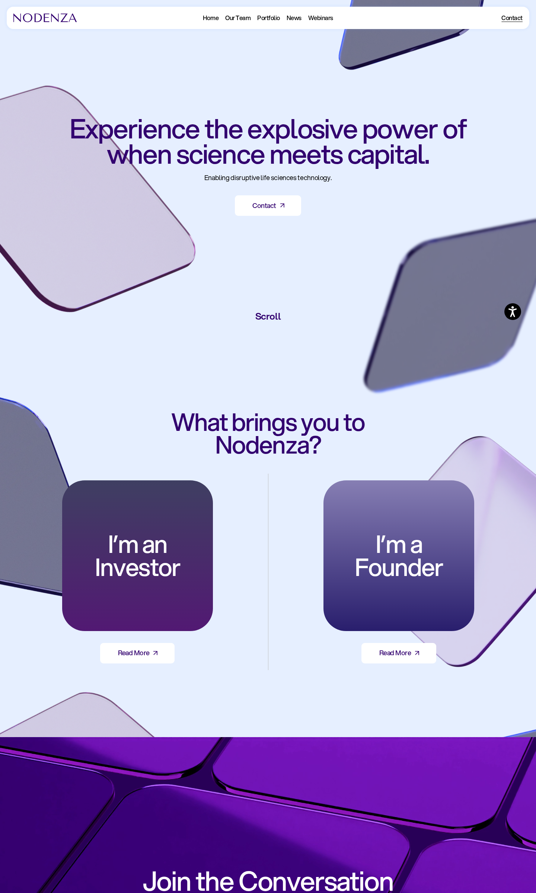

# UI Design System & Master Generation Blueprint: nodenza-com

> **Home · Nodenza** (https://nodenza.com/) — Nosenza invests globally in early-stage biotech, medtech, and healthcare companies advancing life sciences and improving patient outcomes.



---

## 1. Executive Visual Persona & Design Archetype

- **Brand Essence & Persona**: **Home · Nodenza** (`https://nodenza.com/`). Nosenza invests globally in early-stage biotech, medtech, and healthcare companies advancing life sciences and improving patient outcomes.
- **Capture Provenance**: Live browser capture (`tier1_fast`, HTTP `200`, captured `2026-11-23`).
- **Visual Archetype**: **Light-Substrate Editorial & Modular Grid System (`#e6efff` canvas, `#000000` ink, `#ffffff` accent)**.
- **Anti-AI-Slop Differentiators**:
  - **Live-Computed Chromatic Polarity**: Anchors the viewport in `#e6efff` (live computed `body` `background-color` (`computed_styles.json`)) paired with `#000000` primary typography and `#ffffff` accents.
  - **Grounded Typographic Hierarchy**: Pairs `Aspekta` for display copy (`Experience the explosive power of wh`) with `Aspekta` and not declared in live computed styles (uses primary stack / `ui-monospace`).
  - **Calibrated Spatial Grid & Motion**: Combines `1440px` container bounds (`gap: 20rem`, padding `var(--headroom-height)`) with `cubic-bezier(0.2,1,0.3,1)` easing and GSAP Timeline & ScrollTrigger, Swiper Touch Carousel Engine.

---

## 2. Spatial Architecture & Modular Grid Mathematics


### Viewport Allocation & Container Geometry
- **Captured Viewport Dimensions**: Desktop `1440×2400px` (`assets/desktop.png`, clamped at 2400px live multi-section capture), Mobile `390×2400px` (`assets/mobile.png`, clamped at 2400px live multi-section capture).
- **Master Container Bounds**: `1440px` (full-bleed `100%` desktop stage measured on `1440px` viewport).
- **Canvas Lateral Padding & Spacing**: `var(--headroom-height)` lateral canvas padding with `20rem` grid gap.
- **Border Radius Scale**: `50%`, `10rem`, `16rem`, `var(--br1)`.

### Responsive Breakpoint Architecture
- **Desktop Layout**: Multi-column CSS Grid / Flexbox layout at `1440px` (`max-width: 1440px`, `gap: 20rem`).
- **Mobile Layout**: Single-column vertical stack at `390px` viewport width with `var(--headroom-height)` horizontal padding.
- **Extracted CSS Media Queries**: `@media (min-width: 1024px)`, `@media (max-width: 1023.98px)`, `@media (min-width: 1920px)`, `@media (hover: hover) and (pointer: fine) and (min-width: 1024px)`.

---

## 3. Color System, Materiality & Atmospheric Lighting

### Semantic Palette & Source Grounding
| Semantic Role | Ground-Truth Value | Extracted Live / CSS Source |
|---|---|---|
| **Primary Canvas Substrate** | `#e6efff` | live computed `body` `background-color` (`computed_styles.json`) |
| **Primary Typography Ink** | `#000000` | live computed `body` `color` (`computed_styles.json`) |
| **Elevated Surface / Card Substrate** | `#ffffff` | live computed `button` `background-color` (`computed_styles.json`) |
| **Interactive Accent / Highlight** | `#ffffff` | live computed `button` `background-color` (`computed_styles.json`) |
| **Secondary / Muted Copy** | `#32006f` | live computed `h1` `color` (`computed_styles.json`) |
| **Structural Hairline Border** | `#00a0d2` | `.wpcf7 form .wpcf7-response-output { border: #00a0d2 }` |
| **Variable Token (`--c5`)** | `#ee0000` | `var(--c5)` in `:root` |
| **Variable Token (`--c7`)** | `#bfbfbf` | `var(--c7)` in `:root` |
| **Variable Token (`--c8`)** | `#5e5e5e` | `var(--c8)` in `:root` |

### Sanitized Root CSS Variables (`ui-ux.md` Ground Truth)
| Variable Name | Extracted Value | Semantic Role |
|---|---|---|
| `--app-height` | `100vh` | Layout / Spatial Grid Token |
| `--headroom-height` | `auto` | Layout / Spatial Grid Token |
| `--c0` | `#ffffff` | Color / Atmospheric Token |
| `--c1` | `#000000` | Color / Atmospheric Token |
| `--c2` | `#32006f` | Color / Atmospheric Token |
| `--c3` | `#e6efff` | Color / Atmospheric Token |
| `--c4` | `rgba(127, 173, 255, 0.2)` | Color / Atmospheric Token |
| `--c5` | `#ee0000` | Color / Atmospheric Token |
| `--c6` | `rgba(0, 0, 0, 0.7)` | Color / Atmospheric Token |
| `--c7` | `#bfbfbf` | Color / Atmospheric Token |
| `--c8` | `#5e5e5e` | Color / Atmospheric Token |
| `--wr` | `20rem` | Dimension / Scale Token |
| `--awr` | `calc(-1 * var(--wr))` | Design System Custom Token |
| `--gap` | `20rem` | Layout / Spatial Grid Token |
| `--sl` | `max(1px, 1rem)` | Dimension / Scale Token |
| `--br1` | `10rem` | Dimension / Scale Token |

---

## 4. Typographic Scale & Editorial Hierarchy

### Font Family Stacks
- **Display Typography**: `Aspekta`.
- **Primary Body Stack**: `Aspekta`.
- **Technical / Metadata Stack**: not declared in live computed styles (uses primary stack / `ui-monospace`).

### Typographic Scale & Rules (Live Computed & Stylesheet Grounded)
- **Hero Display (`H1`)**: live computed `h1` (`font-size: 72px`, `line-height: 68.4px`, `font-weight: 500`, `letter-spacing: -2.16px`); rule `.title` (`line-height: 0.95`, `letter-spacing: -0.03em`, `font-weight: 500`).
- **Section Heading (`H2`)**: live computed `h2` (`font-size: 64.8px`, `line-height: 61.56px`, `font-weight: 500`, `letter-spacing: -1.944px`); rule `h2` (`font-size: var(--f-b)`, `line-height: 1`, `font-weight: 600`).
- **Body Copy**: live computed `body` (`font-size: 18px`, `line-height: 21.6px`, `font-weight: 400`, `letter-spacing: -0.36px`); rule `p` (`font-size: var(--f-d)`, `line-height: 1.3`, `font-weight: 400`).
- **Metadata & Navigation Labels**: live computed `nav/a` (`font-size: 18px`, `line-height: 21.6px`, `font-weight: 400`, `letter-spacing: -0.36px`).

---

## 5. Choreographed Motion & Interaction Physics

### Primary Easing Curves
- **Extracted Timing Functions**: `cubic-bezier(0.2,1,0.3,1)`.

### Per-Element Transition & Choreography Rules
- **Selector `.preloader`**: `transition: all 0.25s 0.3s` extracted from `nodenza-com` stylesheet.
- **Selector `.loading .preloader`**: `transition: 0s` extracted from `nodenza-com` stylesheet.
- **Selector `.unload .preloader`**: `transition: 0.5s` extracted from `nodenza-com` stylesheet.
- **Extracted Easing Curve (`cubic-bezier(0.2,1,0.3,1)`)**: Governs interactive state transitions across `<header.hide-scrollbar>` and `<section.hero-snap__slide:nth(2)>`.
- **Runtime Interaction Engine**: Integrates GSAP Timeline & ScrollTrigger, Swiper Touch Carousel Engine with `prefers-reduced-motion: reduce` fallback guards.

---

## 6. Component Wireframe & Structural DOM Map

### Visual Layout Schematic — Desktop (`1440px`, Grounded in `dom.html` & Landmark Bounding Boxes)
```
┌────────────────────────────────────────────────────────────────────────┐
│ DESKTOP VIEWPORT (1440px) — Home · Nodenza                             │
│ ====================================================================== │
│ [ <header.hide-scrollbar (1440px)     | Home · Our Team · Portfolio  ] │
│ ---------------------------------------------------------------------- │
│ | HERO STAGE: <section.hero-snap__slide> (w=1440px)                  | │
│ | H1: Experience the explosive power of when science me...           | │
│ | Substrate: #e6efff | Ink: #000000 | Accent: #ffffff                | │
│ ---------------------------------------------------------------------- │
│ | SHOWCASE GRID (<section.hero-snap__slide:) max-w: 1440px           | │
│ | +------------------------------+  +------------------------------+ | │
│ | | Enabling disruptive life sci |  | Press Option+1 for screen-re | | │
│ | +------------------------------+  +------------------------------+ | │
│ ---------------------------------------------------------------------- │
│ | DETAIL MODULE (<section.hero-snap__slide:) — Established by a team | │
│ ---------------------------------------------------------------------- │
│ [ FOOTER (<footer.acsb-sr-aler) | https://nodenza.com/                 │
└────────────────────────────────────────────────────────────────────────┘
```

### Visual Layout Schematic — Mobile Reflow (`390px`)
```
┌────────────────────────────────────────────────────────────────────────┐
│ MOBILE VIEWPORT REFLOW (390px) — Single-Column Stack (gap: 20rem)      │
│ ====================================================================== │
│ [ HEADER BAR (<header.hide-scrollbar> ) | Compact Menu (390px)         │
│ ---------------------------------------------------------------------- │
│ | HERO STAGE (<section.hero-snap__slid) — 390px Vertical Lead        | │
│ | H1: Experience the explosive power of when science me...           | │
│ ---------------------------------------------------------------------- │
│ | SHOWCASE STACK (<section.hero-snap__sl) — 1-Col Stack              | │
│ | [ Item 1: Enabling disruptive life sciences technology.          ] | │
│ | [ Item 2: Press Option+1 for screen-reader mode, Option+0        ] | │
│ ---------------------------------------------------------------------- │
│ | DETAIL STACK (<section.hero-snap__slid) — 1-Col (Established by a t) │
│ ---------------------------------------------------------------------- │
│ [ FOOTER (<footer.acsb-sr-aler) | Stacked 390px Colophon               │
└────────────────────────────────────────────────────────────────────────┘
```

### Granular DOM Region Breakdown
1. **Brand Header & Navigation Bar (<header.hide-scrollbar> — `nodenza-com`)**:
   - Landmark `<header class="hide-scrollbar">` (`1440px`) hosting `Home · Nodenza` navigation (`Home · Our Team · Portfolio · News · Webinars`), DOM attributes (`data-acsb-sr-alert="true"`, `data-acsb-sr-only="true"`, `data-acsb-force-visible="true"`, `data-acsb`), and stylesheet rule `html { font-size: 0.0625vw; background-color: var(--c3); }`.
2. **Hero Stage & Focal Lead (<section.hero-snap__slide> — `Experience the explosive power of `)**:
   - Landmark `<section class="hero-snap__slide">` presenting display lead `Experience the explosive power of when science me...` and copy excerpt *"Enabling disruptive life sciences technology."* over `#e6efff` canvas and `#000000` ink.
3. **Primary Showcase & Content Grid (<section.hero-snap__slide:nth(2)> — `Enabling disruptive life sciences `)**:
   - Landmark `<section class="hero-snap__slide">` rendering section `Enabling disruptive life sciences technology.` with copy *"Press Option+1 for screen-reader mode, Option+0 to cancel"*, asset references (`embed`, `styles.css`, `style.css`, `main.css`), and grid rule `body { overflow-x: hidden; }`.
4. **Interactive Detail & Feature Matrix (<section.hero-snap__slide:nth(3)> — `Press Option+1 for screen-reader m`)**:
   - Landmark `<section class="hero-snap__slide">` framing `Press Option+1 for screen-reader mode, Option+0 ` and `Established by a team of experienced life scienc` (*"Established by a team of experienced life sciences entrepreneurs,"*) with `#ffffff` surface cards, `#ffffff` accents, and `.wrapper { width: 100%; margin: 0 auto; padding: 0 var(--wr); max-width: var(--mw); }`.
5. **Colophon & Global Directory Footer (<footer.acsb-sr-alert> — `https://nodenza.com/`)**:
   - Landmark `<footer class="acsb-sr-alert">` anchoring `Home · Nodenza` footer links (`Home · Our Team · Portfolio · News · Webinars`), copy *"We leverage our team’s 100+ years experience in the creation"*, and `#00a0d2` structural dividers.

---

## 7. Master Zero-Shot AI Generation Prompt

```markdown
# Master Zero-Shot Frontend Generation Prompt: nodenza-com (Home · Nodenza)

You are a principal frontend architect and design systems engineer. Build a complete, production-ready web application replicating the exact design system, DOM landmarks, typographic hierarchy, color tokens, and motion physics of `nodenza-com` (**Home · Nodenza** — `https://nodenza.com/`).

### 1. Visual Archetype & Anti-AI-Slop Mandates
- **Archetype**: Light-Substrate Editorial & Modular Grid System (`#e6efff` canvas, `#000000` ink, `#ffffff` accent).
- **Identity & Domain Context**: Nosenza invests globally in early-stage biotech, medtech, and healthcare companies advancing life sciences and improving patient outcomes.
- **Primary Substrate**: `#e6efff` (live computed `body` `background-color` (`computed_styles.json`)), **Primary Ink**: `#000000`, **Accent / Highlight**: `#ffffff`.
- **Site-Specific Differentiators**:
  - **Live-Computed Chromatic Polarity**: Anchors the viewport in `#e6efff` (live computed `body` `background-color` (`computed_styles.json`)) paired with `#000000` primary typography and `#ffffff` accents.
  - **Grounded Typographic Hierarchy**: Pairs `Aspekta` for display copy (`Experience the explosive power of wh`) with `Aspekta` and not declared in live computed styles (uses primary stack / `ui-monospace`).
  - **Calibrated Spatial Grid & Motion**: Combines `1440px` container bounds (`gap: 20rem`, padding `var(--headroom-height)`) with `cubic-bezier(0.2,1,0.3,1)` easing and GSAP Timeline & ScrollTrigger, Swiper Touch Carousel Engine.

### 2. Ground-Truth CSS Variables (`:root` Token Contract)
Declare and consume these exact custom properties extracted from `nodenza-com` in your global stylesheet:

:root {
  /* Home · Nodenza (nodenza-com) — Live-Grounded CSS Variables */
  --app-height: 100vh; /* Layout / Spatial Grid Token (nodenza-com) */
  --headroom-height: auto; /* Layout / Spatial Grid Token (nodenza-com) */
  --c0: #ffffff; /* Color / Atmospheric Token (nodenza-com) */
  --c1: #000000; /* Color / Atmospheric Token (nodenza-com) */
  --c2: #32006f; /* Color / Atmospheric Token (nodenza-com) */
  --c3: #e6efff; /* Color / Atmospheric Token (nodenza-com) */
  --c4: rgba(127, 173, 255, 0.2); /* Color / Atmospheric Token (nodenza-com) */
  --c5: #ee0000; /* Color / Atmospheric Token (nodenza-com) */
  --c6: rgba(0, 0, 0, 0.7); /* Color / Atmospheric Token (nodenza-com) */
  --c7: #bfbfbf; /* Color / Atmospheric Token (nodenza-com) */
  --c8: #5e5e5e; /* Color / Atmospheric Token (nodenza-com) */
  --wr: 20rem; /* Dimension / Scale Token (nodenza-com) */
  --awr: calc(-1 * var(--wr)); /* Design System Custom Token (nodenza-com) */
  --gap: 20rem; /* Layout / Spatial Grid Token (nodenza-com) */
  --sl: max(1px, 1rem); /* Dimension / Scale Token (nodenza-com) */
  --br1: 10rem; /* Dimension / Scale Token (nodenza-com) */
}

### 3. Semantic Color & Materiality Contract
Map every surface, ink, and border strictly to these source-grounded tokens:
- **Primary Canvas Substrate**: `#e6efff` — grounded in live computed `body` `background-color` (`computed_styles.json`)
- **Primary Typography Ink**: `#000000` — grounded in live computed `body` `color` (`computed_styles.json`)
- **Elevated Surface / Card Substrate**: `#ffffff` — grounded in live computed `button` `background-color` (`computed_styles.json`)
- **Interactive Accent / Highlight**: `#ffffff` — grounded in live computed `button` `background-color` (`computed_styles.json`)
- **Secondary / Muted Copy**: `#32006f` — grounded in live computed `h1` `color` (`computed_styles.json`)
- **Structural Hairline Border**: `#00a0d2` — grounded in `.wpcf7 form .wpcf7-response-output { border: #00a0d2 }`
- **Variable Token (`--c5`)**: `#ee0000` — grounded in `var(--c5)` in `:root`
- **Variable Token (`--c7`)**: `#bfbfbf` — grounded in `var(--c7)` in `:root`
- **Variable Token (`--c8`)**: `#5e5e5e` — grounded in `var(--c8)` in `:root`

### 4. Spatial Grid, Container Bounds & Responsive Breakpoints
- **Desktop Viewport Reference**: `1440×2400px` (clamped at 2400px live multi-section capture, `1440px` standard desktop width).
- **Mobile Viewport Reference**: `390×2400px` (clamped at 2400px live multi-section capture, `390px` standard mobile width).
- **Container Max-Width**: `1440px` (full-bleed `100%` desktop stage measured on `1440px` viewport)
- **Padding & Gutters**: `var(--headroom-height)` lateral canvas padding with `20rem` grid gap
- **Desktop Grid**: Multi-column CSS Grid / Flexbox layout at `1440px` (`max-width: 1440px`, `gap: 20rem`)
- **Mobile Adaptation**: Single-column vertical stack at `390px` viewport width with `var(--headroom-height)` horizontal padding
- **Media Queries**: `@media (min-width: 1024px)`, `@media (max-width: 1023.98px)`, `@media (min-width: 1920px)`, `@media (hover: hover) and (pointer: fine) and (min-width: 1024px)`
- **Corner Radii**: `50%`, `10rem`, `16rem`, `var(--br1)`

### 5. Typography & Editorial Scale Contract
- **Display Font Stack**: `Aspekta`
- **Body Font Stack**: `Aspekta`
- **Monospace / Technical Font Stack**: not declared in live computed styles (uses primary stack / `ui-monospace`)
- **H1 Display Rule**: live computed `h1` (`font-size: 72px`, `line-height: 68.4px`, `font-weight: 500`, `letter-spacing: -2.16px`); rule `.title` (`line-height: 0.95`, `letter-spacing: -0.03em`, `font-weight: 500`)
- **H2 Section Rule**: live computed `h2` (`font-size: 64.8px`, `line-height: 61.56px`, `font-weight: 500`, `letter-spacing: -1.944px`); rule `h2` (`font-size: var(--f-b)`, `line-height: 1`, `font-weight: 600`)
- **Body Copy Rule**: live computed `body` (`font-size: 18px`, `line-height: 21.6px`, `font-weight: 400`, `letter-spacing: -0.36px`); rule `p` (`font-size: var(--f-d)`, `line-height: 1.3`, `font-weight: 400`)
- **Metadata & Index Rule**: live computed `nav/a` (`font-size: 18px`, `line-height: 21.6px`, `font-weight: 400`, `letter-spacing: -0.36px`)

### 6. Component Hierarchy, Verbatim Copy & Real DOM Landmarks
Scaffold `nodenza-com` (`Home · Nodenza`) with these exact structural regions, extracted copy, and CSS rules from `dom.html`:
1. **Brand Header & Navigation Bar (<header.hide-scrollbar> — `nodenza-com`)**:
   - DOM & Selectors: Landmark `<header class="hide-scrollbar">` (`1440px`) hosting `Home · Nodenza` navigation (`Home · Our Team · Portfolio · News · Webinars`), DOM attributes (`data-acsb-sr-alert="true"`, `data-acsb-sr-only="true"`, `data-acsb-force-visible="true"`, `data-acsb`), and stylesheet rule `html { font-size: 0.0625vw; background-color: var(--c3); }`.
   - Responsive Contract: Header `Brand Header & Navigation Bar (<header.hide-scrollbar> — `nodenza-com`)` (`nodenza-com`) adapts across `@media (min-width: 1024px)`, `@media (max-width: 1023.98px)`, `@media (min-width: 1920px)`, `@media (hover: hover) and (pointer: fine) and (min-width: 1024px)` with `cubic-bezier(0.2,1,0.3,1)` transitions and links `Home · Our Team · Portfolio · News · Webinars`.
2. **Hero Stage & Focal Lead (<section.hero-snap__slide> — `Experience the explosive power of `)**:
   - DOM & Selectors: Landmark `<section class="hero-snap__slide">` presenting display lead `Experience the explosive power of when science me...` and copy excerpt *"Enabling disruptive life sciences technology."* over `#e6efff` canvas and `#000000` ink.
   - Responsive Contract: Hero stage (`1440×2400px` desktop / `390×2400px` mobile) sets `#e6efff` background with `#000000` headline `Experience the explosive power of when science me...`.
3. **Primary Showcase & Content Grid (<section.hero-snap__slide:nth(2)> — `Enabling disruptive life sciences `)**:
   - DOM & Selectors: Landmark `<section class="hero-snap__slide">` rendering section `Enabling disruptive life sciences technology.` with copy *"Press Option+1 for screen-reader mode, Option+0 to cancel"*, asset references (`embed`, `styles.css`, `style.css`, `main.css`), and grid rule `body { overflow-x: hidden; }`.
   - Responsive Contract: Showcase grid `Primary Showcase & Content Grid (<section.hero-snap__slide:nth(2)> — `Enabling disruptive life sciences `)` applies Multi-column CSS Grid / Flexbox layout at `1440px` (`max-width: 1440px`, `gap: 20rem`) on desktop and Single-column vertical stack at `390px` viewport width with `var(--headroom-height)` horizontal padding on mobile.
4. **Interactive Detail & Feature Matrix (<section.hero-snap__slide:nth(3)> — `Press Option+1 for screen-reader m`)**:
   - DOM & Selectors: Landmark `<section class="hero-snap__slide">` framing `Press Option+1 for screen-reader mode, Option+0 ` and `Established by a team of experienced life scienc` (*"Established by a team of experienced life sciences entrepreneurs,"*) with `#ffffff` surface cards, `#ffffff` accents, and `.wrapper { width: 100%; margin: 0 auto; padding: 0 var(--wr); max-width: var(--mw); }`.
   - Responsive Contract: Detail module `Interactive Detail & Feature Matrix (<section.hero-snap__slide:nth(3)> — `Press Option+1 for screen-reader m`)` uses `50%`, `10rem`, `16rem`, `var(--br1)` radii, `#ffffff` highlights, and assets (embed, styles.css, style.css).
5. **Colophon & Global Directory Footer (<footer.acsb-sr-alert> — `https://nodenza.com/`)**:
   - DOM & Selectors: Landmark `<footer class="acsb-sr-alert">` anchoring `Home · Nodenza` footer links (`Home · Our Team · Portfolio · News · Webinars`), copy *"We leverage our team’s 100+ years experience in the creation"*, and `#00a0d2` structural dividers.
   - Responsive Contract: Footer `Colophon & Global Directory Footer (<footer.acsb-sr-alert> — `https://nodenza.com/`)` aligns to `1440px` (full-bleed `100%` desktop stage measured on `1440px` viewport) with `var(--headroom-height)` lateral canvas padding with `20rem` grid gap and attributes (data-acsb-sr-alert="true", data-acsb-sr-only="true", data-acsb-force-visible="true").

#### Verbatim DOM Copy Excerpts (`dom.html`)
- Copy Excerpt 1: *"Enabling disruptive life sciences technology."*
- Copy Excerpt 2: *"Press Option+1 for screen-reader mode, Option+0 to cancel"*
- Copy Excerpt 3: *"Established by a team of experienced life sciences entrepreneurs, founders and lea..."*
- Copy Excerpt 4: *"We leverage our team’s 100+ years experience in the creation & delivery of therape..."*

### 7. Motion, Extracted Stylesheet Rules & Interaction Choreography
- **Primary Easing Functions**: `cubic-bezier(0.2,1,0.3,1)`
- **Extracted Stylesheet Rules (`nodenza-com`)**:
- `html { font-size: 0.0625vw; background-color: var(--c3); }`
- `body { overflow-x: hidden; }`
- `.wrapper { width: 100%; margin: 0 auto; padding: 0 var(--wr); max-width: var(--mw); }`
- `.loading { pointer-events: none; }`
- `.loading .preloader { transition-duration: 0s; opacity: 1; visibility: visible; }`
- **Per-Selector Transition Rules**:
- **Selector `.preloader`**: `transition: all 0.25s 0.3s` extracted from `nodenza-com` stylesheet.
- **Selector `.loading .preloader`**: `transition: 0s` extracted from `nodenza-com` stylesheet.
- **Selector `.unload .preloader`**: `transition: 0.5s` extracted from `nodenza-com` stylesheet.
- **Extracted Easing Curve (`cubic-bezier(0.2,1,0.3,1)`)**: Governs interactive state transitions across `<header.hide-scrollbar>` and `<section.hero-snap__slide:nth(2)>`.
- **Runtime Interaction Engine**: Integrates GSAP Timeline & ScrollTrigger, Swiper Touch Carousel Engine with `prefers-reduced-motion: reduce` fallback guards.

### 8. Technical Deliverables
- Implement in Next.js (App Router) with TypeScript and Tailwind CSS consuming the `:root` custom properties defined above for `nodenza-com`.
- Reproduce both the `1440px` desktop architecture and `390px` mobile breakpoint transitions, preserving semantic HTML5 landmarks (`<header>`, `<nav>`, `<main>`, `<section>`, `<footer>`) and `prefers-reduced-motion` accessibility guards.
```
