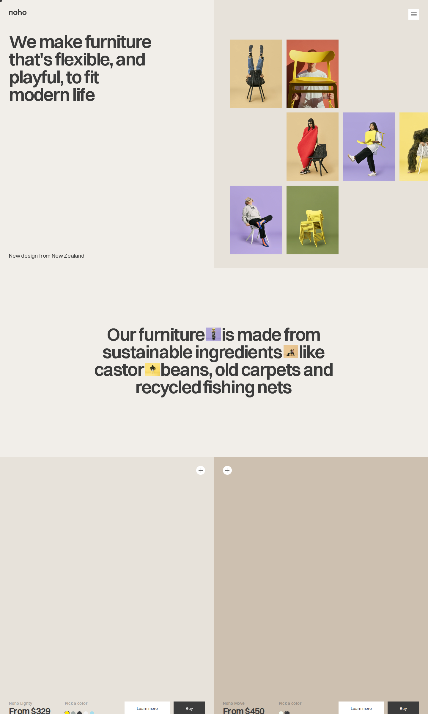
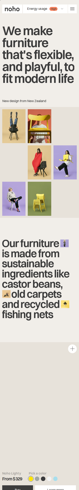

# UI Design System & Master Generation Blueprint: noho-ink

> **Noho** (https://noho.ink) — E n e r g y u s a g e E n e r g y u s a g e



---

## 1. Executive Visual Persona & Design Archetype

- **Brand Essence & Persona**: **Noho** (`https://noho.ink`). E n e r g y u s a g e E n e r g y u s a g e
- **Capture Provenance**: Live browser capture (`tier1_fast`, HTTP `200`, captured `2026-11-23`).
- **Visual Archetype**: **Light-Gallery WebGL / Canvas Interactive Experience (`#ffffff` / `#0082f3`)**.
- **Anti-AI-Slop Differentiators**:
  - **Live-Computed Chromatic Polarity**: Anchors the viewport in `#ffffff` (live computed `canvas-modal-luma` `background-color` (`computed_styles.json`)) paired with `#000000` primary typography and `#0082f3` accents.
  - **Grounded Typographic Hierarchy**: Pairs `Switzer` for display copy (`Noho`) with `Switzer Variable` and not declared in live computed styles (uses primary stack / `ui-monospace`).
  - **Calibrated Spatial Grid & Motion**: Combines `1440px` container bounds (`gap: .521vw`, padding `1.302vw`) with `cubic-bezier(0.25,0.1,0.25,1)` easing and Lenis Smooth Scroll (`data-lenis`), GSAP Timeline & ScrollTrigger.

---

## 2. Spatial Architecture & Modular Grid Mathematics



### Viewport Allocation & Container Geometry
- **Captured Viewport Dimensions**: Desktop `1440×2400px` (`assets/desktop.png`, clamped at 2400px live multi-section capture), Mobile `390×2400px` (`assets/mobile.png`, clamped at 2400px live multi-section capture).
- **Master Container Bounds**: `1440px` (full-bleed `100%` viewport stage).
- **Canvas Lateral Padding & Spacing**: `1.302vw` lateral canvas padding with `.521vw` grid gap.
- **Border Radius Scale**: `3px`, `100%`, `50%`, `50px`.

### Responsive Breakpoint Architecture
- **Desktop Layout**: Multi-column CSS Grid / Flexbox layout at `1440px` (`max-width: 1440px`, `gap: .521vw`).
- **Mobile Layout**: Single-column vertical stack at `390px` viewport width with `1.302vw` horizontal padding.
- **Extracted CSS Media Queries**: `@media screen and (min-width:480px)and (max-width:991px),screen...`, `@media screen and (max-width: 991px)`, `@media screen and (max-width: 767px)`, `@media screen and (max-width: 479px)`.

---

## 3. Color System, Materiality & Atmospheric Lighting

### Semantic Palette & Source Grounding
| Semantic Role | Ground-Truth Value | Extracted Live / CSS Source |
|---|---|---|
| **Primary Canvas Substrate** | `#ffffff` | live computed `canvas-modal-luma` `background-color` (`computed_styles.json`) |
| **Primary Typography Ink** | `#000000` | `mark { color: #000000 }` |
| **Elevated Surface / Card Substrate** | `#f1eee9` | `var(--bg-page)` in `:root` |
| **Interactive Accent / Highlight** | `#0082f3` | `.w-dropdown-link.w--current { color: #0082f3 }` |
| **Secondary / Muted Copy** | `#3c3c3c` | `var(--text-form-header-active)` in `:root` |
| **Structural Hairline Border** | `#e2e2e2` | `blockquote { border-left: #e2e2e2 }` |
| **Variable Token (`--bg-switch`)** | `#d7d1c7` | `var(--bg-switch)` in `:root` |
| **Variable Token (`--transperent`)** | `#0000` | `var(--transperent)` in `:root` |

### Sanitized Root CSS Variables (`ui-ux.md` Ground Truth)
| Variable Name | Extracted Value | Semantic Role |
|---|---|---|
| `--bg-page` | `#f1eee9` | Canvas / Surface Token |
| `--txt-main` | `#3c3c3c` | Color / Atmospheric Token |
| `--bg-form-element` | `white` | Canvas / Surface Token |
| `--raven-black-100` | `#3c3c3c` | Canvas / Surface Token |
| `--bg-switch` | `#d7d1c7` | Canvas / Surface Token |
| `--bg-inner-switch` | `white` | Canvas / Surface Token |
| `--bg-btn-pm` | `#3c3c3c` | Canvas / Surface Token |
| `--txt-btn-pm` | `white` | Design System Custom Token |
| `--bg-btn-sc` | `white` | Canvas / Surface Token |
| `--txt-btn-sc` | `#3c3c3c` | Color / Atmospheric Token |
| `--bg-btn-big` | `#3c3c3c` | Canvas / Surface Token |
| `--txt-btn-big` | `white` | Design System Custom Token |
| `--transperent` | `#0000` | Color / Atmospheric Token |
| `--raven-black-40` | `#3c3c3c66` | Canvas / Surface Token |
| `--offbeat` | `#d7d1c7` | Color / Atmospheric Token |
| `--white` | `white` | Canvas / Surface Token |

---

## 4. Typographic Scale & Editorial Hierarchy

### Font Family Stacks
- **Display Typography**: `Switzer`.
- **Primary Body Stack**: `Switzer Variable`.
- **Technical / Metadata Stack**: not declared in live computed styles (uses primary stack / `ui-monospace`).

### Typographic Scale & Rules (Live Computed & Stylesheet Grounded)
- **Hero Display (`H1`)**: rule `h1` (`font-size: 2em`).
- **Section Heading (`H2`)**: rule `h2` (`font-size: 32px`, `line-height: 36px`).
- **Body Copy**: rule `body` (`font-size: 14px`, `line-height: 20px`).
- **Metadata & Navigation Labels**: rule `small` (`font-size: 80%`).

---

## 5. Choreographed Motion & Interaction Physics

### Primary Easing Curves
- **Extracted Timing Functions**: `cubic-bezier(0.25,0.1,0.25,1)`.

### Per-Element Transition & Choreography Rules
- **Selector `.w-webflow-badge > img`**: `transition: unset` extracted from `noho-ink` stylesheet.
- **Selector `.w-slider-dot`**: `transition: background-color .1s, color .1s` extracted from `noho-ink` stylesheet.
- **Selector `.w-lightbox-control`**: `transition: all .3s` extracted from `noho-ink` stylesheet.
- **Standard CSS Easing (`cubic-bezier(0.25,0.1,0.25,1)`)**: Default timing curve (no custom `cubic-bezier()` declared in captured CSS).
- **Runtime Interaction Engine**: Integrates Lenis Smooth Scroll (`data-lenis`), GSAP Timeline & ScrollTrigger, HTML5 `<canvas>` Interactive Viewport Surface with `prefers-reduced-motion: reduce` fallback guards.

---

## 6. Component Wireframe & Structural DOM Map

### Visual Layout Schematic — Desktop (`1440px`, Grounded in `dom.html` & Landmark Bounding Boxes)
```
┌────────────────────────────────────────────────────────────────────────┐
│ DESKTOP VIEWPORT (1440px) — Noho                                       │
│ ====================================================================== │
│ [ <header.header> (1440px)            | A b o u t A b o u t · P r i  ] │
│ ---------------------------------------------------------------------- │
│ | HERO STAGE: <section.switch> (w=1440px)                            | │
│ | H1: Noho                                                           | │
│ | Substrate: #ffffff | Ink: #000000 | Accent: #0082f3                | │
│ ---------------------------------------------------------------------- │
│ | SHOWCASE GRID (<section.switch:nth(2)>) max-w: 1440px              | │
│ | +------------------------------+  +------------------------------+ | │
│ | | Featured Work & Interactive  |  | Technical Architecture & Nar | | │
│ | +------------------------------+  +------------------------------+ | │
│ ---------------------------------------------------------------------- │
│ | DETAIL MODULE (<section.hero-section-pare) — Global Directory & Co | │
│ ---------------------------------------------------------------------- │
│ [ FOOTER (<footer.footer-paren) | https://noho.ink                     │
└────────────────────────────────────────────────────────────────────────┘
```

### Visual Layout Schematic — Mobile Reflow (`390px`)
```
┌────────────────────────────────────────────────────────────────────────┐
│ MOBILE VIEWPORT REFLOW (390px) — Single-Column Stack (gap: .521vw)     │
│ ====================================================================== │
│ [ HEADER BAR (<header.header>         ) | Compact Menu (390px)         │
│ ---------------------------------------------------------------------- │
│ | HERO STAGE (<section.switch>) — 390px Vertical Lead                | │
│ | H1: Noho                                                           | │
│ ---------------------------------------------------------------------- │
│ | SHOWCASE STACK (<section.switch:nth(2)) — 1-Col Stack              | │
│ | [ Item 1: Featured Work & Interactive Showcase                   ] | │
│ | [ Item 2: Technical Architecture & Narrative                     ] | │
│ ---------------------------------------------------------------------- │
│ | DETAIL STACK (<section.hero-section-pa) — 1-Col (Global Directory &) │
│ ---------------------------------------------------------------------- │
│ [ FOOTER (<footer.footer-paren) | Stacked 390px Colophon               │
└────────────────────────────────────────────────────────────────────────┘
```

### Granular DOM Region Breakdown
1. **Brand Header & Navigation Bar (<header.header> — `noho-ink`)**:
   - Landmark `<header class="header section">` (`1440px`) hosting `Noho` navigation (`A b o u t A b o u t · P r i c e P r i c e · B l o g B l o g · F A Q F A Q · About`), DOM attributes (`data-wf-domain="noho-a7a5a8.webflow.io"`, `data-wf-page="667aaef1d0489a9d5183ef5d"`, `data-wf-site="667aaef1d0489a9d5183ef56"`, `data-wf-status="1"`), and stylesheet rule `.w-container { max-width:728px }`.
2. **Hero Stage & Focal Lead (<section.switch> — `Noho`)**:
   - Landmark `<section class="switch">` presenting display lead `Noho` and copy excerpt *"E n e r g y u s a g e E n e r g y u s a g e"* over `#ffffff` canvas and `#000000` ink.
3. **Primary Showcase & Content Grid (<section.switch:nth(2)> — `Featured Work & Interactive Showca`)**:
   - Landmark `<section class="switch">` rendering section `Featured Work & Interactive Showcase` with copy *"Dark mode and reduce animation options allow you to save about 35"*, asset references (`webflow.shared.min.css`, `6a4e44ce6ee465198645089f_favicon-...`, `6a4e444d307c1e077753f979_favicon-...`, `6a4e44ceccf875bb9d22c7cd_favicon-...`), and grid rule `.w-hidden-main { display:inherit!important }`.
4. **Interactive Detail & Feature Matrix (<section.hero-section-parent> — `Technical Architecture & Narrative`)**:
   - Landmark `<section class="hero-section-parent">` framing `Technical Architecture & Narrative` and `Global Directory & Contact` (*"Dark mode and reduce animation options allow you to save 35% of y"*) with `#f1eee9` surface cards, `#0082f3` accents, and `.w-hidden-medium { display:none!important }`.
5. **Colophon & Global Directory Footer (<footer.footer-parent> — `https://noho.ink`)**:
   - Landmark `<footer class="footer-parent">` anchoring `Noho` footer links (`A b o u t A b o u t · P r i c e P r i c e · B l o g B l o g · F A Q F A Q · About`), copy *"Using dark mode can save energy consumption on devices with "*, and `#e2e2e2` structural dividers.

---

## 7. Master Zero-Shot AI Generation Prompt

```markdown
# Master Zero-Shot Frontend Generation Prompt: noho-ink (Noho)

You are a principal frontend architect and design systems engineer. Build a complete, production-ready web application replicating the exact design system, DOM landmarks, typographic hierarchy, color tokens, and motion physics of `noho-ink` (**Noho** — `https://noho.ink`).

### 1. Visual Archetype & Anti-AI-Slop Mandates
- **Archetype**: Light-Gallery WebGL / Canvas Interactive Experience (`#ffffff` / `#0082f3`).
- **Identity & Domain Context**: E n e r g y u s a g e E n e r g y u s a g e
- **Primary Substrate**: `#ffffff` (live computed `canvas-modal-luma` `background-color` (`computed_styles.json`)), **Primary Ink**: `#000000`, **Accent / Highlight**: `#0082f3`.
- **Site-Specific Differentiators**:
  - **Live-Computed Chromatic Polarity**: Anchors the viewport in `#ffffff` (live computed `canvas-modal-luma` `background-color` (`computed_styles.json`)) paired with `#000000` primary typography and `#0082f3` accents.
  - **Grounded Typographic Hierarchy**: Pairs `Switzer` for display copy (`Noho`) with `Switzer Variable` and not declared in live computed styles (uses primary stack / `ui-monospace`).
  - **Calibrated Spatial Grid & Motion**: Combines `1440px` container bounds (`gap: .521vw`, padding `1.302vw`) with `cubic-bezier(0.25,0.1,0.25,1)` easing and Lenis Smooth Scroll (`data-lenis`), GSAP Timeline & ScrollTrigger.

### 2. Ground-Truth CSS Variables (`:root` Token Contract)
Declare and consume these exact custom properties extracted from `noho-ink` in your global stylesheet:

:root {
  /* Noho (noho-ink) — Live-Grounded CSS Variables */
  --bg-page: #f1eee9; /* Canvas / Surface Token (noho-ink) */
  --txt-main: #3c3c3c; /* Color / Atmospheric Token (noho-ink) */
  --bg-form-element: white; /* Canvas / Surface Token (noho-ink) */
  --raven-black-100: #3c3c3c; /* Canvas / Surface Token (noho-ink) */
  --bg-switch: #d7d1c7; /* Canvas / Surface Token (noho-ink) */
  --bg-inner-switch: white; /* Canvas / Surface Token (noho-ink) */
  --bg-btn-pm: #3c3c3c; /* Canvas / Surface Token (noho-ink) */
  --txt-btn-pm: white; /* Design System Custom Token (noho-ink) */
  --bg-btn-sc: white; /* Canvas / Surface Token (noho-ink) */
  --txt-btn-sc: #3c3c3c; /* Color / Atmospheric Token (noho-ink) */
  --bg-btn-big: #3c3c3c; /* Canvas / Surface Token (noho-ink) */
  --txt-btn-big: white; /* Design System Custom Token (noho-ink) */
  --transperent: #0000; /* Color / Atmospheric Token (noho-ink) */
  --raven-black-40: #3c3c3c66; /* Canvas / Surface Token (noho-ink) */
  --offbeat: #d7d1c7; /* Color / Atmospheric Token (noho-ink) */
  --white: white; /* Canvas / Surface Token (noho-ink) */
}

### 3. Semantic Color & Materiality Contract
Map every surface, ink, and border strictly to these source-grounded tokens:
- **Primary Canvas Substrate**: `#ffffff` — grounded in live computed `canvas-modal-luma` `background-color` (`computed_styles.json`)
- **Primary Typography Ink**: `#000000` — grounded in `mark { color: #000000 }`
- **Elevated Surface / Card Substrate**: `#f1eee9` — grounded in `var(--bg-page)` in `:root`
- **Interactive Accent / Highlight**: `#0082f3` — grounded in `.w-dropdown-link.w--current { color: #0082f3 }`
- **Secondary / Muted Copy**: `#3c3c3c` — grounded in `var(--text-form-header-active)` in `:root`
- **Structural Hairline Border**: `#e2e2e2` — grounded in `blockquote { border-left: #e2e2e2 }`
- **Variable Token (`--bg-switch`)**: `#d7d1c7` — grounded in `var(--bg-switch)` in `:root`
- **Variable Token (`--transperent`)**: `#0000` — grounded in `var(--transperent)` in `:root`

### 4. Spatial Grid, Container Bounds & Responsive Breakpoints
- **Desktop Viewport Reference**: `1440×2400px` (clamped at 2400px live multi-section capture, `1440px` standard desktop width).
- **Mobile Viewport Reference**: `390×2400px` (clamped at 2400px live multi-section capture, `390px` standard mobile width).
- **Container Max-Width**: `1440px` (full-bleed `100%` viewport stage)
- **Padding & Gutters**: `1.302vw` lateral canvas padding with `.521vw` grid gap
- **Desktop Grid**: Multi-column CSS Grid / Flexbox layout at `1440px` (`max-width: 1440px`, `gap: .521vw`)
- **Mobile Adaptation**: Single-column vertical stack at `390px` viewport width with `1.302vw` horizontal padding
- **Media Queries**: `@media screen and (min-width:480px)and (max-width:991px),screen...`, `@media screen and (max-width: 991px)`, `@media screen and (max-width: 767px)`, `@media screen and (max-width: 479px)`
- **Corner Radii**: `3px`, `100%`, `50%`, `50px`

### 5. Typography & Editorial Scale Contract
- **Display Font Stack**: `Switzer`
- **Body Font Stack**: `Switzer Variable`
- **Monospace / Technical Font Stack**: not declared in live computed styles (uses primary stack / `ui-monospace`)
- **H1 Display Rule**: rule `h1` (`font-size: 2em`)
- **H2 Section Rule**: rule `h2` (`font-size: 32px`, `line-height: 36px`)
- **Body Copy Rule**: rule `body` (`font-size: 14px`, `line-height: 20px`)
- **Metadata & Index Rule**: rule `small` (`font-size: 80%`)

### 6. Component Hierarchy, Verbatim Copy & Real DOM Landmarks
Scaffold `noho-ink` (`Noho`) with these exact structural regions, extracted copy, and CSS rules from `dom.html`:
1. **Brand Header & Navigation Bar (<header.header> — `noho-ink`)**:
   - DOM & Selectors: Landmark `<header class="header section">` (`1440px`) hosting `Noho` navigation (`A b o u t A b o u t · P r i c e P r i c e · B l o g B l o g · F A Q F A Q · About`), DOM attributes (`data-wf-domain="noho-a7a5a8.webflow.io"`, `data-wf-page="667aaef1d0489a9d5183ef5d"`, `data-wf-site="667aaef1d0489a9d5183ef56"`, `data-wf-status="1"`), and stylesheet rule `.w-container { max-width:728px }`.
   - Responsive Contract: Header `Brand Header & Navigation Bar (<header.header> — `noho-ink`)` (`noho-ink`) adapts across `@media screen and (min-width:480px)and (max-width:991px),screen...`, `@media screen and (max-width: 991px)`, `@media screen and (max-width: 767px)`, `@media screen and (max-width: 479px)` with `cubic-bezier(0.25,0.1,0.25,1)` transitions and links `A b o u t A b o u t · P r i c e P r i c e · B l o g B l o g · F A Q F A Q · About`.
2. **Hero Stage & Focal Lead (<section.switch> — `Noho`)**:
   - DOM & Selectors: Landmark `<section class="switch">` presenting display lead `Noho` and copy excerpt *"E n e r g y u s a g e E n e r g y u s a g e"* over `#ffffff` canvas and `#000000` ink.
   - Responsive Contract: Hero stage (`1440×2400px` desktop / `390×2400px` mobile) sets `#ffffff` background with `#000000` headline `Noho`.
3. **Primary Showcase & Content Grid (<section.switch:nth(2)> — `Featured Work & Interactive Showca`)**:
   - DOM & Selectors: Landmark `<section class="switch">` rendering section `Featured Work & Interactive Showcase` with copy *"Dark mode and reduce animation options allow you to save about 35"*, asset references (`webflow.shared.min.css`, `6a4e44ce6ee465198645089f_favicon-...`, `6a4e444d307c1e077753f979_favicon-...`, `6a4e44ceccf875bb9d22c7cd_favicon-...`), and grid rule `.w-hidden-main { display:inherit!important }`.
   - Responsive Contract: Showcase grid `Primary Showcase & Content Grid (<section.switch:nth(2)> — `Featured Work & Interactive Showca`)` applies Multi-column CSS Grid / Flexbox layout at `1440px` (`max-width: 1440px`, `gap: .521vw`) on desktop and Single-column vertical stack at `390px` viewport width with `1.302vw` horizontal padding on mobile.
4. **Interactive Detail & Feature Matrix (<section.hero-section-parent> — `Technical Architecture & Narrative`)**:
   - DOM & Selectors: Landmark `<section class="hero-section-parent">` framing `Technical Architecture & Narrative` and `Global Directory & Contact` (*"Dark mode and reduce animation options allow you to save 35% of y"*) with `#f1eee9` surface cards, `#0082f3` accents, and `.w-hidden-medium { display:none!important }`.
   - Responsive Contract: Detail module `Interactive Detail & Feature Matrix (<section.hero-section-parent> — `Technical Architecture & Narrative`)` uses `3px`, `100%`, `50%`, `50px` radii, `#0082f3` highlights, and assets (webflow.shared.min.css, 6a4e44ce6ee465198645089f_favicon-..., 6a4e444d307c1e077753f979_favicon-...).
5. **Colophon & Global Directory Footer (<footer.footer-parent> — `https://noho.ink`)**:
   - DOM & Selectors: Landmark `<footer class="footer-parent">` anchoring `Noho` footer links (`A b o u t A b o u t · P r i c e P r i c e · B l o g B l o g · F A Q F A Q · About`), copy *"Using dark mode can save energy consumption on devices with "*, and `#e2e2e2` structural dividers.
   - Responsive Contract: Footer `Colophon & Global Directory Footer (<footer.footer-parent> — `https://noho.ink`)` aligns to `1440px` (full-bleed `100%` viewport stage) with `1.302vw` lateral canvas padding with `.521vw` grid gap and attributes (data-wf-domain="noho-a7a5a8.webflow.io", data-wf-page="667aaef1d0489a9d5183ef5d", data-wf-site="667aaef1d0489a9d5183ef56").

#### Verbatim DOM Copy Excerpts (`dom.html`)
- Copy Excerpt 1: *"E n e r g y u s a g e E n e r g y u s a g e"*
- Copy Excerpt 2: *"Dark mode and reduce animation options allow you to save about 35% of your device..."*
- Copy Excerpt 3: *"Dark mode and reduce animation options allow you to save 35% of your device batter..."*
- Copy Excerpt 4: *"Using dark mode can save energy consumption on devices with OLED or AMOLED displays."*

### 7. Motion, Extracted Stylesheet Rules & Interaction Choreography
- **Primary Easing Functions**: `cubic-bezier(0.25,0.1,0.25,1)`
- **Extracted Stylesheet Rules (`noho-ink`)**:
- `.w-container { max-width:728px }`
- `.w-hidden-main { display:inherit!important }`
- `.w-hidden-medium { display:none!important }`
- `.w-col-medium-1 { width:8.33333% }`
- `.w-col-medium-2 { width:16.6667% }`
- **Per-Selector Transition Rules**:
- **Selector `.w-webflow-badge > img`**: `transition: unset` extracted from `noho-ink` stylesheet.
- **Selector `.w-slider-dot`**: `transition: background-color .1s, color .1s` extracted from `noho-ink` stylesheet.
- **Selector `.w-lightbox-control`**: `transition: all .3s` extracted from `noho-ink` stylesheet.
- **Standard CSS Easing (`cubic-bezier(0.25,0.1,0.25,1)`)**: Default timing curve (no custom `cubic-bezier()` declared in captured CSS).
- **Runtime Interaction Engine**: Integrates Lenis Smooth Scroll (`data-lenis`), GSAP Timeline & ScrollTrigger, HTML5 `<canvas>` Interactive Viewport Surface with `prefers-reduced-motion: reduce` fallback guards.

### 8. Technical Deliverables
- Implement in Next.js (App Router) with TypeScript and Tailwind CSS consuming the `:root` custom properties defined above for `noho-ink`.
- Reproduce both the `1440px` desktop architecture and `390px` mobile breakpoint transitions, preserving semantic HTML5 landmarks (`<header>`, `<nav>`, `<main>`, `<section>`, `<footer>`) and `prefers-reduced-motion` accessibility guards.
```
