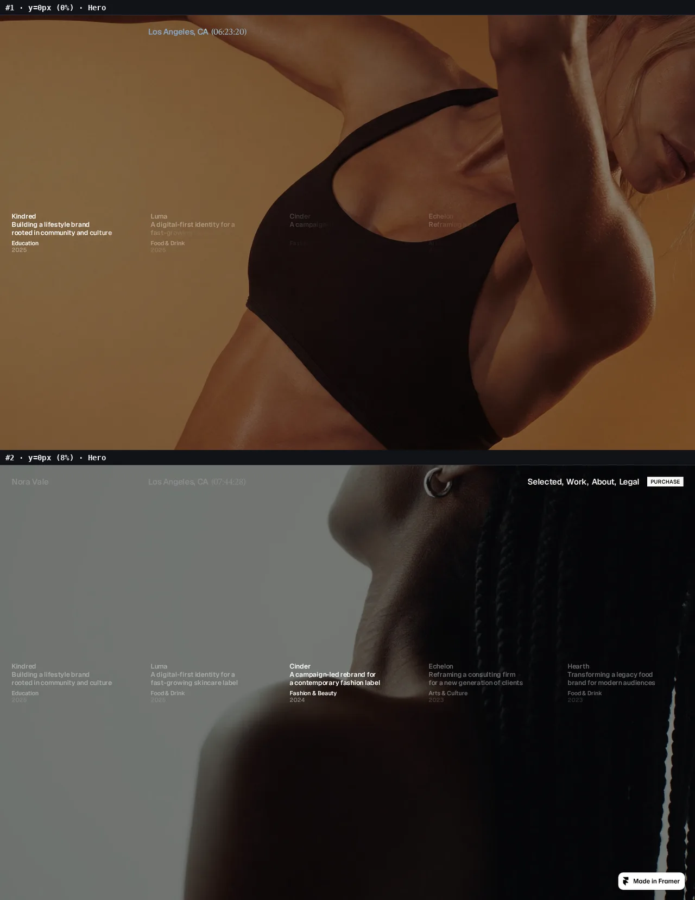
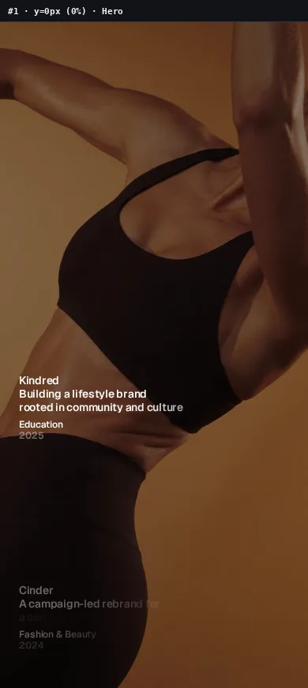

# UI Design System & Master Generation Blueprint: noravale-framer-website

> **Blankit – Ultimate Portfolio System for Framer** (https://noravale.framer.website/) — The ultimate portfolio system for Framer. Build premium portfolio websites with components, templates and design foundations.





---

## 1. Executive Visual Persona & Design Archetype

- **Brand Essence & Persona**: **Blankit – Ultimate Portfolio System for Framer** (`https://noravale.framer.website/`). The ultimate portfolio system for Framer. Build premium portfolio websites with components, templates and design foundations.
- **Capture Provenance**: Live browser capture (`tier1_fast`, HTTP `200`, captured `2026-11-24`).
- **Visual Archetype**: **High-Contrast Obsidian / Atmospheric Design System (`#000000` canvas, `#ffffff` ink, `#0000ee` accent)**.
- **Anti-AI-Slop Differentiators**:
  - **Live-Computed Chromatic Polarity**: Anchors the viewport in `#000000` (live computed `body` `background-color` (`computed_styles.json`)) paired with `#ffffff` primary typography and `#0000ee` accents.
  - **Grounded Typographic Hierarchy**: Pairs `Geist Variable` for display copy (`Blankit – Ultimate Portfolio System `) with `Hedvig Letters Serif`.
  - **Calibrated Spatial Grid & Motion**: Combines `1440px` container bounds (`gap: 10px`, padding `20px`) with `cubic-bezier(0.25,0.1,0.25,1)` easing and Lenis Smooth Scroll (`data-lenis`), Framer Motion Layout Physics.

---

## 2. Spatial Architecture & Modular Grid Mathematics

### Viewport Allocation & Container Geometry
- **Captured Journey Filmstrips**: Desktop `1280×1656px` (`assets/desktop-journey.webp`, `2` keyframes up to `y=0px` / doc `900px`), Mobile `390×872px` (`assets/mobile-journey.webp`, `1` keyframes).
- **Master Container Bounds**: `1440px` (full-bleed `100%` desktop stage measured on `1440px` viewport).
- **Canvas Lateral Padding & Spacing**: `20px` lateral canvas padding with `10px` grid gap.
- **Border Radius Scale**: `8px`, `15px`, `0px`.

### Responsive Breakpoint Architecture
- **Desktop Layout**: Multi-column CSS Grid / Flexbox layout at `1440px` (`max-width: 1440px`, `gap: 10px`).
- **Mobile Layout**: Single-column vertical stack at `390px` viewport width with `20px` horizontal padding.
- **Extracted CSS Media Queries**: `@media (min-width: 1200px)`, `@media (min-width: 810px) and (max-width: 1199.98px)`, `@media (max-width: 809.98px)`, `@media (max-width:809px) and (min-width:0)`.

---

## 3. Color System, Materiality & Atmospheric Lighting

### Semantic Palette & Source Grounding
| Semantic Role | Ground-Truth Value | Extracted Live / CSS Source |
|---|---|---|
| **Primary Canvas Substrate** | `#000000` | live computed `body` `background-color` (`computed_styles.json`) |
| **Primary Typography Ink** | `#ffffff` | live computed `p` `color` (`computed_styles.json`) |
| **Elevated Surface / Card Substrate** | `#999999` | `var(--selection-background-color)` in `:root` |
| **Interactive Accent / Highlight** | `#0000ee` | live computed `a` `color` (`computed_styles.json`) |
| **Secondary / Muted Copy** | `#0000ee` | live computed `a` `color` (`computed_styles.json`) |
| **Structural Hairline Border** | `#181818` | `var(--border-color)` in `:root` (`var(--token-41c38424-a6db-4bde-b2...`) |
| **Variable Token (`--token-658e57be-7dc2-47f6-a641-0a3d91f5f0a7`)** | `#292929` | `var(--token-658e57be-7dc2-47f6-a641-0a3d91f5f0a7)` in `:root` |
| **Variable Token (`--token-7454ffba-6ef4-4d38-9965-d502f06ebc49`)** | `#0000` | `var(--token-7454ffba-6ef4-4d38-9965-d502f06ebc49)` in `:root` |
| **Variable Token (`--token-fab8f350-6af4-4276-a121-46955910532e`)** | `#fafafa` | `var(--token-fab8f350-6af4-4276-a121-46955910532e)` in `:root` |
| **Variable Token (`--token-7edb6191-4ddd-4bbc-96d5-e5e591d6ed9b`)** | `#f2f2f2` | `var(--token-7edb6191-4ddd-4bbc-96d5-e5e591d6ed9b)` in `:root` |
| **Variable Token (`--token-5f666cb9-74f6-4b15-aaed-8cf125fa4837`)** | `#0d0d0d` | `var(--token-5f666cb9-74f6-4b15-aaed-8cf125fa4837)` in `:root` |
| **Variable Token (`--token-58ed9133-56c7-4c1c-83a9-d6e40daeeb72`)** | `#080808` | `var(--token-58ed9133-56c7-4c1c-83a9-d6e40daeeb72)` in `:root` |
| **Variable Token (`--token-68cbe2e9-85cc-47c7-aa5a-bac039f90af2`)** | `#757575` | `var(--token-68cbe2e9-85cc-47c7-aa5a-bac039f90af2)` in `:root` |

### Sanitized Root CSS Variables (`ui-ux.md` Ground Truth)
| Variable Name | Extracted Value | Semantic Role |
|---|---|---|
| `--token-835e5838-ad16-45ed-8524-d371a38640d4` | `#fff` | Color / Atmospheric Token |
| `--token-658e57be-7dc2-47f6-a641-0a3d91f5f0a7` | `#292929` | Color / Atmospheric Token |
| `--token-c9613b9a-ea67-4e25-b1ae-1822b810d41e` | `#fff` | Color / Atmospheric Token |
| `--token-7454ffba-6ef4-4d38-9965-d502f06ebc49` | `#0000` | Color / Atmospheric Token |
| `--token-fab8f350-6af4-4276-a121-46955910532e` | `#fafafa` | Color / Atmospheric Token |
| `--token-7edb6191-4ddd-4bbc-96d5-e5e591d6ed9b` | `#f2f2f2` | Color / Atmospheric Token |
| `--token-5f666cb9-74f6-4b15-aaed-8cf125fa4837` | `#0d0d0d` | Color / Atmospheric Token |
| `--token-c2a7bcb4-4b1e-42b6-859b-d5fb68f2e51c` | `#0d0d0d` | Color / Atmospheric Token |
| `--token-37582e93-848e-41c2-9a6a-be05b3cb724b` | `#000` | Color / Atmospheric Token |
| `--token-de44e4c4-2780-4f6a-920a-6573964b909b` | `#fff` | Color / Atmospheric Token |
| `--token-58ed9133-56c7-4c1c-83a9-d6e40daeeb72` | `#08080880` | Color / Atmospheric Token |
| `--token-43292462-1240-4872-bac6-680eed5be9b9` | `#000` | Color / Atmospheric Token |
| `--token-4f3e38f4-83ad-43b0-9e27-1d245f644e53` | `#000` | Color / Atmospheric Token |
| `--token-68cbe2e9-85cc-47c7-aa5a-bac039f90af2` | `#757575` | Color / Atmospheric Token |
| `--token-35adfe75-6afb-4a33-9225-016fa16ccba3` | `#000` | Color / Atmospheric Token |
| `--token-a0b6ff5f-d52f-4ed7-9c5e-cd9e56ee7714` | `#000` | Color / Atmospheric Token |

---

## 4. Typographic Scale & Editorial Hierarchy

### Font Family Stacks
- **Display Typography**: `Geist Variable`.
- **Primary Body Stack**: `Hedvig Letters Serif`.
- **Technical / Metadata Stack**: not declared in live computed styles (uses primary stack / `ui-monospace`).

### Typographic Scale & Rules (Live Computed & Stylesheet Grounded)
- **Hero Display (`H1`)**: observed font-size ladder: `12px`, `14px`, `var(--font-size)`, `var(--framer-font-size)`, `16px`.
- **Section Heading (`H2`)**: observed font-size ladder: `12px`, `14px`, `var(--font-size)`, `var(--framer-font-size)`, `16px`.
- **Body Copy**: live computed `body` (`font-size: 12px`, `line-height: normal`, `font-weight: 400`); rule `p` (`font-size: 14px`, `line-height: 17px`, `letter-spacing: -.02em`, `font-weight: 400`).
- **Metadata & Navigation Labels**: live computed `nav/a` (`font-size: 12px`, `line-height: normal`, `font-weight: 400`); CSS variables `--letter-spacing: var(--framer-letter-spacing)`.

---

## 5. Choreographed Motion & Interaction Physics

### Primary Easing Curves
- **Extracted Timing Functions**: `cubic-bezier(0.25,0.1,0.25,1)`.

### Per-Element Transition & Choreography Rules
- **Selector `#__framer-editorbar-label`**: `transition: opacity 0.4s ease-out` extracted from `noravale-framer-website` stylesheet.
- **Selector `.lenis.lenis-autoToggle`**: `transition: 1ms` extracted from `noravale-framer-website` stylesheet.
- **Standard CSS Easing (`cubic-bezier(0.25,0.1,0.25,1)`)**: Default timing curve (no custom `cubic-bezier()` declared in captured CSS).
- **Runtime Interaction Engine**: Integrates Lenis Smooth Scroll (`data-lenis`), Framer Motion Layout Physics with `prefers-reduced-motion: reduce` fallback guards.
### Measured Runtime Scroll & Interaction Telemetry (`behavioral_journey_v2`)
- **Scroll Driver Mode**: `wheel` (max document height `900px`, deepest scrollY reached `0px` across `2` desktop keyframes).
- **Detected Scroll / Motion Libraries**: `Lenis`, `Framer Motion`.
- **Route Transition Architecture**: First internal navigation (`/work/kindred`) measured as `SPA` in `1195ms`.

---

## 6. Component Wireframe & Structural DOM Map

### Visual Layout Schematic — Desktop (`1440px`, Grounded in `dom.html` & Landmark Bounding Boxes)
```
┌────────────────────────────────────────────────────────────────────────┐
│ DESKTOP VIEWPORT (1440px) — Blankit – Ultimate Portfolio System for Fr │
│ ====================================================================== │
│ [ <header.framer-ssi77> (1440px)      | Purchase                     ] │
│ ---------------------------------------------------------------------- │
│ | HERO STAGE: <main.framer-17y96vw> (w=1440px)                       | │
│ | H1: Blankit – Ultimate Portfolio System for Framer                 | │
│ | Substrate: #000000 | Ink: #ffffff | Accent: #0000ee                | │
│ ---------------------------------------------------------------------- │
│ | SHOWCASE GRID (<main.framer-17y96vw:nth(2) max-w: 1440px           | │
│ | +------------------------------+  +------------------------------+ | │
│ | | Featured Work & Interactive  |  | Technical Architecture & Nar | | │
│ | +------------------------------+  +------------------------------+ | │
│ ---------------------------------------------------------------------- │
│ | DETAIL MODULE (<main.framer-17y96vw:nth(3) — Global Directory & Co | │
│ ---------------------------------------------------------------------- │
│ [ FOOTER (<footer.framer-mbz2V) | https://noravale.framer.website/     │
└────────────────────────────────────────────────────────────────────────┘
```

### Visual Layout Schematic — Mobile Reflow (`390px`)
```
┌────────────────────────────────────────────────────────────────────────┐
│ MOBILE VIEWPORT REFLOW (390px) — Single-Column Stack (gap: 10px)       │
│ ====================================================================== │
│ [ HEADER BAR (<header.framer-ssi77>   ) | Compact Menu (390px)         │
│ ---------------------------------------------------------------------- │
│ | HERO STAGE (<main.framer-17y96vw>) — 390px Vertical Lead           | │
│ | H1: Blankit – Ultimate Portfolio System for Framer                 | │
│ ---------------------------------------------------------------------- │
│ | SHOWCASE STACK (<main.framer-17y96vw:n) — 1-Col Stack              | │
│ | [ Item 1: Featured Work & Interactive Showcase                   ] | │
│ | [ Item 2: Technical Architecture & Narrative                     ] | │
│ ---------------------------------------------------------------------- │
│ | DETAIL STACK (<main.framer-17y96vw:nth) — 1-Col (Global Directory &) │
│ ---------------------------------------------------------------------- │
│ [ FOOTER (<footer.framer-mbz2V) | Stacked 390px Colophon               │
└────────────────────────────────────────────────────────────────────────┘
```

### Granular DOM Region Breakdown
1. **Brand Header & Navigation Bar (<header.framer-ssi77> — `noravale-framer-website`)**:
   - Landmark `<header class="framer-ssi77">` (`1440px`) hosting `Blankit – Ultimate Portfolio System ` navigation (`Purchase`), DOM attributes (`data-framer-font-css`, `data-framer-breakpoint-css`, `data-framer-css-ssr-minified`, `data-framer-components="framer-lib-cursors-ho..."`), and stylesheet rule `.hidden-72rtr7 { display:none!important }`.
2. **Hero Stage & Focal Lead (<main.framer-17y96vw> — `Blankit – Ultimate Portfolio Syste`)**:
   - Landmark `<main class="framer-17y96vw">` presenting display lead `Blankit – Ultimate Portfolio System for Framer` and copy excerpt *"B u i l d i n g a l i f e s t y l e b r a n d r o o t e d i n c o"* over `#000000` canvas and `#ffffff` ink.
3. **Primary Showcase & Content Grid (<main.framer-17y96vw:nth(2)> — `Featured Work & Interactive Showca`)**:
   - Landmark `<main class="framer-17y96vw">` rendering section `Featured Work & Interactive Showcase` with copy *"A d i g i t a l - f i r s t i d e n t i t y f o r a f a s t - g r"*, asset references (`default-favicon-light.v1.png`, `default-favicon-dark.v1.png`, `default-touch-icon.v3.png`, `fonts.gstatic.com`), and grid rule `.hidden-1pgop7x { display:none!important }`.
4. **Interactive Detail & Feature Matrix (<main.framer-17y96vw:nth(3)> — `Technical Architecture & Narrative`)**:
   - Landmark `<main class="framer-17y96vw">` framing `Technical Architecture & Narrative` and `Global Directory & Contact` (*"d i g i t a l - f i r s t"*) with `#999999` surface cards, `#0000ee` accents, and `.hidden-ghtek5 { display:none!important }`.
5. **Colophon & Global Directory Footer (<footer.framer-mbz2V> — `https://noravale.framer.website/`)**:
   - Landmark `<footer class="framer-mbz2V">` anchoring `Blankit – Ultimate Portfolio Sys` footer links (`Purchase`), copy *"f a s t - g r o w i n g"*, and `#181818` structural dividers.
### Full Vertical Scroll Sequence (Desktop `1440×900` Keyframes)
- **Step 01** (`y=0px`, `0%`): Active landmark `Hero` · sticky/fixed elements: `2`
- **Step 02** (`y=0px`, `8%`): Active landmark `Hero` · sticky/fixed elements: `2`

### Multi-Page Internal Route Map
- **Detail Route (`/work/kindred`)**: `https://noravale.framer.website/work/kindred` — H1: `Blankit – Ultimate Portfolio System for Framer`, scrollHeight `900px`, transition `SPA` (`1195ms`)
- **Detail Route (`/work/luma`)**: `https://noravale.framer.website/work/luma` — H1: `Blankit – Ultimate Portfolio System for Framer`, scrollHeight `4921px`, transition `direct` (`906ms`)

---

## 7. Master Zero-Shot AI Generation Prompt

```markdown
# Master Zero-Shot Frontend Generation Prompt: noravale-framer-website (Blankit – Ultimate Portfolio System for Framer)

You are a principal frontend architect and design systems engineer. Build a complete, production-ready web application replicating the exact design system, DOM landmarks, typographic hierarchy, color tokens, and motion physics of `noravale-framer-website` (**Blankit – Ultimate Portfolio System for Framer** — `https://noravale.framer.website/`).

### 1. Visual Archetype & Anti-AI-Slop Mandates
- **Archetype**: High-Contrast Obsidian / Atmospheric Design System (`#000000` canvas, `#ffffff` ink, `#0000ee` accent).
- **Identity & Domain Context**: The ultimate portfolio system for Framer. Build premium portfolio websites with components, templates and design foundations.
- **Primary Substrate**: `#000000` (live computed `body` `background-color` (`computed_styles.json`)), **Primary Ink**: `#ffffff`, **Accent / Highlight**: `#0000ee`.
- **Site-Specific Differentiators**:
  - **Live-Computed Chromatic Polarity**: Anchors the viewport in `#000000` (live computed `body` `background-color` (`computed_styles.json`)) paired with `#ffffff` primary typography and `#0000ee` accents.
  - **Grounded Typographic Hierarchy**: Pairs `Geist Variable` for display copy (`Blankit – Ultimate Portfolio System `) with `Hedvig Letters Serif`.
  - **Calibrated Spatial Grid & Motion**: Combines `1440px` container bounds (`gap: 10px`, padding `20px`) with `cubic-bezier(0.25,0.1,0.25,1)` easing and Lenis Smooth Scroll (`data-lenis`), Framer Motion Layout Physics.

### 2. Ground-Truth CSS Variables (`:root` Token Contract)
Declare and consume these exact custom properties extracted from `noravale-framer-website` in your global stylesheet:

:root {
  /* Blankit – Ultimate Portfolio System for Framer (noravale-framer-website) — Live-Grounded CSS Variables */
  --token-835e5838-ad16-45ed-8524-d371a38640d4: #fff; /* Color / Atmospheric Token (noravale-framer-website) */
  --token-658e57be-7dc2-47f6-a641-0a3d91f5f0a7: #292929; /* Color / Atmospheric Token (noravale-framer-website) */
  --token-c9613b9a-ea67-4e25-b1ae-1822b810d41e: #fff; /* Color / Atmospheric Token (noravale-framer-website) */
  --token-7454ffba-6ef4-4d38-9965-d502f06ebc49: #0000; /* Color / Atmospheric Token (noravale-framer-website) */
  --token-fab8f350-6af4-4276-a121-46955910532e: #fafafa; /* Color / Atmospheric Token (noravale-framer-website) */
  --token-7edb6191-4ddd-4bbc-96d5-e5e591d6ed9b: #f2f2f2; /* Color / Atmospheric Token (noravale-framer-website) */
  --token-5f666cb9-74f6-4b15-aaed-8cf125fa4837: #0d0d0d; /* Color / Atmospheric Token (noravale-framer-website) */
  --token-c2a7bcb4-4b1e-42b6-859b-d5fb68f2e51c: #0d0d0d; /* Color / Atmospheric Token (noravale-framer-website) */
  --token-37582e93-848e-41c2-9a6a-be05b3cb724b: #000; /* Color / Atmospheric Token (noravale-framer-website) */
  --token-de44e4c4-2780-4f6a-920a-6573964b909b: #fff; /* Color / Atmospheric Token (noravale-framer-website) */
  --token-58ed9133-56c7-4c1c-83a9-d6e40daeeb72: #08080880; /* Color / Atmospheric Token (noravale-framer-website) */
  --token-43292462-1240-4872-bac6-680eed5be9b9: #000; /* Color / Atmospheric Token (noravale-framer-website) */
  --token-4f3e38f4-83ad-43b0-9e27-1d245f644e53: #000; /* Color / Atmospheric Token (noravale-framer-website) */
  --token-68cbe2e9-85cc-47c7-aa5a-bac039f90af2: #757575; /* Color / Atmospheric Token (noravale-framer-website) */
  --token-35adfe75-6afb-4a33-9225-016fa16ccba3: #000; /* Color / Atmospheric Token (noravale-framer-website) */
  --token-a0b6ff5f-d52f-4ed7-9c5e-cd9e56ee7714: #000; /* Color / Atmospheric Token (noravale-framer-website) */
}

### 3. Semantic Color & Materiality Contract
Map every surface, ink, and border strictly to these source-grounded tokens:
- **Primary Canvas Substrate**: `#000000` — grounded in live computed `body` `background-color` (`computed_styles.json`)
- **Primary Typography Ink**: `#ffffff` — grounded in live computed `p` `color` (`computed_styles.json`)
- **Elevated Surface / Card Substrate**: `#999999` — grounded in `var(--selection-background-color)` in `:root`
- **Interactive Accent / Highlight**: `#0000ee` — grounded in live computed `a` `color` (`computed_styles.json`)
- **Secondary / Muted Copy**: `#0000ee` — grounded in live computed `a` `color` (`computed_styles.json`)
- **Structural Hairline Border**: `#181818` — grounded in `var(--border-color)` in `:root` (`var(--token-41c38424-a6db-4bde-b2...`)
- **Variable Token (`--token-658e57be-7dc2-47f6-a641-0a3d91f5f0a7`)**: `#292929` — grounded in `var(--token-658e57be-7dc2-47f6-a641-0a3d91f5f0a7)` in `:root`
- **Variable Token (`--token-7454ffba-6ef4-4d38-9965-d502f06ebc49`)**: `#0000` — grounded in `var(--token-7454ffba-6ef4-4d38-9965-d502f06ebc49)` in `:root`
- **Variable Token (`--token-fab8f350-6af4-4276-a121-46955910532e`)**: `#fafafa` — grounded in `var(--token-fab8f350-6af4-4276-a121-46955910532e)` in `:root`
- **Variable Token (`--token-7edb6191-4ddd-4bbc-96d5-e5e591d6ed9b`)**: `#f2f2f2` — grounded in `var(--token-7edb6191-4ddd-4bbc-96d5-e5e591d6ed9b)` in `:root`
- **Variable Token (`--token-5f666cb9-74f6-4b15-aaed-8cf125fa4837`)**: `#0d0d0d` — grounded in `var(--token-5f666cb9-74f6-4b15-aaed-8cf125fa4837)` in `:root`
- **Variable Token (`--token-58ed9133-56c7-4c1c-83a9-d6e40daeeb72`)**: `#080808` — grounded in `var(--token-58ed9133-56c7-4c1c-83a9-d6e40daeeb72)` in `:root`
- **Variable Token (`--token-68cbe2e9-85cc-47c7-aa5a-bac039f90af2`)**: `#757575` — grounded in `var(--token-68cbe2e9-85cc-47c7-aa5a-bac039f90af2)` in `:root`

### 4. Spatial Grid, Container Bounds & Responsive Breakpoints
- **Desktop Viewport Reference**: `1280×1656px` (full-page live capture (1656px), `1440px` standard desktop width).
- **Mobile Viewport Reference**: `390×872px` (full-page live capture (872px), `390px` standard mobile width).
- **Container Max-Width**: `1440px` (full-bleed `100%` desktop stage measured on `1440px` viewport)
- **Padding & Gutters**: `20px` lateral canvas padding with `10px` grid gap
- **Desktop Grid**: Multi-column CSS Grid / Flexbox layout at `1440px` (`max-width: 1440px`, `gap: 10px`)
- **Mobile Adaptation**: Single-column vertical stack at `390px` viewport width with `20px` horizontal padding
- **Media Queries**: `@media (min-width: 1200px)`, `@media (min-width: 810px) and (max-width: 1199.98px)`, `@media (max-width: 809.98px)`, `@media (max-width:809px) and (min-width:0)`
- **Corner Radii**: `8px`, `15px`, `0px`

### 5. Typography & Editorial Scale Contract
- **Display Font Stack**: `Geist Variable`
- **Body Font Stack**: `Hedvig Letters Serif`
- **Monospace / Technical Font Stack**: not declared in live computed styles (uses primary stack / `ui-monospace`)
- **H1 Display Rule**: observed font-size ladder: `12px`, `14px`, `var(--font-size)`, `var(--framer-font-size)`, `16px`
- **H2 Section Rule**: observed font-size ladder: `12px`, `14px`, `var(--font-size)`, `var(--framer-font-size)`, `16px`
- **Body Copy Rule**: live computed `body` (`font-size: 12px`, `line-height: normal`, `font-weight: 400`); rule `p` (`font-size: 14px`, `line-height: 17px`, `letter-spacing: -.02em`, `font-weight: 400`)
- **Metadata & Index Rule**: live computed `nav/a` (`font-size: 12px`, `line-height: normal`, `font-weight: 400`); CSS variables `--letter-spacing: var(--framer-letter-spacing)`

### 6. Component Hierarchy, Verbatim Copy & Real DOM Landmarks
Scaffold `noravale-framer-website` (`Blankit – Ultimate Portfolio System for Framer`) with these exact structural regions, extracted copy, and CSS rules from `dom.html`:
1. **Brand Header & Navigation Bar (<header.framer-ssi77> — `noravale-framer-website`)**:
   - DOM & Selectors: Landmark `<header class="framer-ssi77">` (`1440px`) hosting `Blankit – Ultimate Portfolio System ` navigation (`Purchase`), DOM attributes (`data-framer-font-css`, `data-framer-breakpoint-css`, `data-framer-css-ssr-minified`, `data-framer-components="framer-lib-cursors-ho..."`), and stylesheet rule `.hidden-72rtr7 { display:none!important }`.
   - Responsive Contract: Header `Brand Header & Navigation Bar (<header.framer-ssi77> — `noravale-framer-website`)` (`noravale-framer-website`) adapts across `@media (min-width: 1200px)`, `@media (min-width: 810px) and (max-width: 1199.98px)`, `@media (max-width: 809.98px)`, `@media (max-width:809px) and (min-width:0)` with `cubic-bezier(0.25,0.1,0.25,1)` transitions and links `Purchase`.
2. **Hero Stage & Focal Lead (<main.framer-17y96vw> — `Blankit – Ultimate Portfolio Syste`)**:
   - DOM & Selectors: Landmark `<main class="framer-17y96vw">` presenting display lead `Blankit – Ultimate Portfolio System for Framer` and copy excerpt *"B u i l d i n g a l i f e s t y l e b r a n d r o o t e d i n c o"* over `#000000` canvas and `#ffffff` ink.
   - Responsive Contract: Hero stage (`1280×1656px` desktop / `390×872px` mobile) sets `#000000` background with `#ffffff` headline `Blankit – Ultimate Portfolio System for Framer`.
3. **Primary Showcase & Content Grid (<main.framer-17y96vw:nth(2)> — `Featured Work & Interactive Showca`)**:
   - DOM & Selectors: Landmark `<main class="framer-17y96vw">` rendering section `Featured Work & Interactive Showcase` with copy *"A d i g i t a l - f i r s t i d e n t i t y f o r a f a s t - g r"*, asset references (`default-favicon-light.v1.png`, `default-favicon-dark.v1.png`, `default-touch-icon.v3.png`, `fonts.gstatic.com`), and grid rule `.hidden-1pgop7x { display:none!important }`.
   - Responsive Contract: Showcase grid `Primary Showcase & Content Grid (<main.framer-17y96vw:nth(2)> — `Featured Work & Interactive Showca`)` applies Multi-column CSS Grid / Flexbox layout at `1440px` (`max-width: 1440px`, `gap: 10px`) on desktop and Single-column vertical stack at `390px` viewport width with `20px` horizontal padding on mobile.
4. **Interactive Detail & Feature Matrix (<main.framer-17y96vw:nth(3)> — `Technical Architecture & Narrative`)**:
   - DOM & Selectors: Landmark `<main class="framer-17y96vw">` framing `Technical Architecture & Narrative` and `Global Directory & Contact` (*"d i g i t a l - f i r s t"*) with `#999999` surface cards, `#0000ee` accents, and `.hidden-ghtek5 { display:none!important }`.
   - Responsive Contract: Detail module `Interactive Detail & Feature Matrix (<main.framer-17y96vw:nth(3)> — `Technical Architecture & Narrative`)` uses `8px`, `15px`, `0px` radii, `#0000ee` highlights, and assets (default-favicon-light.v1.png, default-favicon-dark.v1.png, default-touch-icon.v3.png).
5. **Colophon & Global Directory Footer (<footer.framer-mbz2V> — `https://noravale.framer.website/`)**:
   - DOM & Selectors: Landmark `<footer class="framer-mbz2V">` anchoring `Blankit – Ultimate Portfolio Sys` footer links (`Purchase`), copy *"f a s t - g r o w i n g"*, and `#181818` structural dividers.
   - Responsive Contract: Footer `Colophon & Global Directory Footer (<footer.framer-mbz2V> — `https://noravale.framer.website/`)` aligns to `1440px` (full-bleed `100%` desktop stage measured on `1440px` viewport) with `20px` lateral canvas padding with `10px` grid gap and attributes (data-framer-font-css, data-framer-breakpoint-css, data-framer-css-ssr-minified).

#### Verbatim DOM Copy Excerpts (`dom.html`)
- Copy Excerpt 1: *"B u i l d i n g a l i f e s t y l e b r a n d r o o t e d i n c o m m u n i t y a..."*
- Copy Excerpt 2: *"A d i g i t a l - f i r s t i d e n t i t y f o r a f a s t - g r o w i n g s k i..."*
- Copy Excerpt 3: *"d i g i t a l - f i r s t"*
- Copy Excerpt 4: *"f a s t - g r o w i n g"*

### 7. Motion, Extracted Stylesheet Rules & Interaction Choreography
- **Primary Easing Functions**: `cubic-bezier(0.25,0.1,0.25,1)`
- **Extracted Stylesheet Rules (`noravale-framer-website`)**:
- `.hidden-72rtr7 { display:none!important }`
- `.hidden-1pgop7x { display:none!important }`
- `.hidden-ghtek5 { display:none!important }`
- `.hidden-syqztt { display:none!important }`
- `.hidden-1dk4idb { display:none!important }`
- **Per-Selector Transition Rules**:
- **Selector `#__framer-editorbar-label`**: `transition: opacity 0.4s ease-out` extracted from `noravale-framer-website` stylesheet.
- **Selector `.lenis.lenis-autoToggle`**: `transition: 1ms` extracted from `noravale-framer-website` stylesheet.
- **Standard CSS Easing (`cubic-bezier(0.25,0.1,0.25,1)`)**: Default timing curve (no custom `cubic-bezier()` declared in captured CSS).
- **Runtime Interaction Engine**: Integrates Lenis Smooth Scroll (`data-lenis`), Framer Motion Layout Physics with `prefers-reduced-motion: reduce` fallback guards.
### 7b. Full-Page Scroll Choreography, Interactive States & Multi-Page Routes
- **Scroll Mechanics**: Implement `wheel` vertical progression up to `900px` across 2 distinct viewport chapters using Lenis, Framer Motion.
- **Vertical Chapter Sequence**: Hero (0%) -> Hero (8%).
- **Multi-Page Routes**: Scaffold internal routes `/work/kindred` (detail, SPA), `/work/luma` (detail, direct) sharing the global header/footer shell and design tokens.

### 8. Technical Deliverables
- Implement in Next.js (App Router) with TypeScript and Tailwind CSS consuming the `:root` custom properties defined above for `noravale-framer-website`.
- Reproduce both the `1440px` desktop architecture and `390px` mobile breakpoint transitions, preserving semantic HTML5 landmarks (`<header>`, `<nav>`, `<main>`, `<section>`, `<footer>`) and `prefers-reduced-motion` accessibility guards.
```
---

## 8. Full-Page Scroll Journey, Interactive States & Subpage Inventory

### Desktop Scroll Keyframes (`1440×900` WebP)
| Step | Scroll Y | Progress | Active Landmark / Section | Sticky/Fixed | Visual Asset |
| :---: | :---: | :---: | :--- | :---: | :--- |
| `#01` | `0px` | `0%` | Hero | `2` | [desktop-step-01.webp](assets/desktop-step-01.webp) |
| `#02` | `0px` | `8%` | Hero | `2` | [desktop-step-02.webp](assets/desktop-step-02.webp) |

### Mobile Condensed Keyframes (`390×844` WebP)
| Step | Scroll Y | Progress | Active Landmark | Visual Asset |
| :---: | :---: | :---: | :--- | :--- |
| `#01` | `0px` | `0%` | Hero | [mobile-step-01.webp](assets/mobile-step-01.webp) |

### Internal Subpage Filmstrips (`1080px` Wide WebP)
| # | Template | Route URL | H1 / Title | Scroll Height | Transition | Filmstrip Asset |
| :-: | :---: | :--- | :--- | :---: | :---: | :--- |
| `1` | `detail` | `https://noravale.framer.website/work/kindred` | Blankit – Ultimate Portfolio System f... | `900px` | `SPA` (`1195ms`) | [subpage-01-work-kindred.webp](assets/subpage-01-work-kindred.webp) |
| `2` | `detail` | `https://noravale.framer.website/work/luma` | Blankit – Ultimate Portfolio System f... | `4921px` | `direct` (`906ms`) | [subpage-02-work-luma.webp](assets/subpage-02-work-luma.webp) |

