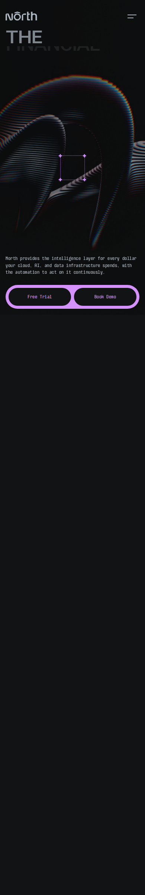

# UI Design System & Master Generation Blueprint: north-cloud

> **North.cloud · Take control of your cloud costs with AI-powered FinOps.** (https://north.cloud) — North is the financial operating system for cloud, AI, and data. Allocate spend, catch anomalies, and automate savings across AWS, Azure,...


---

## 1. Executive Visual Persona & Design Archetype

- **Brand Essence & Persona**: **North.cloud · Take control of your cloud costs with AI-powered FinOps.** (`https://north.cloud`). North is the financial operating system for cloud, AI, and data. Allocate spend, catch anomalies, and automate savings across AWS, Azure,...
- **Capture Provenance**: Live browser capture (`tier1_fast`, HTTP `200`, captured `2026-11-23`).
- **Visual Archetype**: **Dark-Substrate WebGL / Canvas Interactive Experience (`#121314` / `#b055e6`)**.
- **Anti-AI-Slop Differentiators**:
  - **Live-Computed Chromatic Polarity**: Anchors the viewport in `#121314` (live computed `body` `background-color` (`computed_styles.json`)) paired with `#afb8c2` primary typography and `#b055e6` accents.
  - **Grounded Typographic Hierarchy**: Pairs `Untitled Sans` for display copy (`THE FINANCIAL OPERATING SYSTEM FOR C`) with `Untitled Sans` and `Degrad Mono`.
  - **Calibrated Spatial Grid & Motion**: Combines `1920px` container bounds (`gap: var(--spacing-4)`, padding `var(--spacing-24)`) with `cubic-bezier(.4,0,.2,1)` easing and Lenis Smooth Scroll (`data-lenis`), Three.js / WebGL Canvas Pipeline.

---

## 2. Spatial Architecture & Modular Grid Mathematics



### Viewport Allocation & Container Geometry
- **Captured Viewport Dimensions**: Desktop `1440×2400px` (`assets/desktop.png`, clamped at 2400px live multi-section capture), Mobile `390×2400px` (`assets/mobile.png`, clamped at 2400px live multi-section capture).
- **Master Container Bounds**: `1920px` (non-`@media` desktop container stylesheet rule).
- **Canvas Lateral Padding & Spacing**: `var(--spacing-24)` lateral canvas padding with `var(--spacing-4)` grid gap.
- **Border Radius Scale**: `16px`, `10rem`, `50%`, `1.6rem`.

### Responsive Breakpoint Architecture
- **Desktop Layout**: Multi-column CSS Grid / Flexbox layout at `1440px` (`max-width: 1920px`, `gap: var(--spacing-4)`).
- **Mobile Layout**: Single-column vertical stack at `390px` viewport width with `var(--spacing-24)` horizontal padding.
- **Extracted CSS Media Queries**: `@media (max-width:749px)`, `@media (min-width:750px)`, `@media (min-width:1025px)`, `@media (min-width:1280px)`.

---

## 3. Color System, Materiality & Atmospheric Lighting

### Semantic Palette & Source Grounding
| Semantic Role | Ground-Truth Value | Extracted Live / CSS Source |
|---|---|---|
| **Primary Canvas Substrate** | `#121314` | live computed `body` `background-color` (`computed_styles.json`) |
| **Primary Typography Ink** | `#afb8c2` | live computed `h1` `color` (`computed_styles.json`) |
| **Elevated Surface / Card Substrate** | `#000000` | `.bg-black { background-color: black }` (`#000000`) |
| **Interactive Accent / Highlight** | `#b055e6` | `.comparison .button-content:las... { background: #b055e6 }` |
| **Secondary / Muted Copy** | `#5e6266` | `var(--cc-secondary-color)` in `:root` |
| **Structural Hairline Border** | `#d4dae0` | `var(--cc-btn-secondary-hover-border-color)` in `:root` |
| **Variable Token (`--cc-bg`)** | `#ffffff` | `var(--cc-bg)` in `:root` |
| **Variable Token (`--cc-primary-color`)** | `#2c2f31` | `var(--cc-primary-color)` in `:root` |
| **Variable Token (`--cc-btn-primary-bg`)** | `#30363c` | `var(--cc-btn-primary-bg)` in `:root` |
| **Variable Token (`--cc-btn-secondary-bg`)** | `#eaeff2` | `var(--cc-btn-secondary-bg)` in `:root` |

### Sanitized Root CSS Variables (`ui-ux.md` Ground Truth)
| Variable Name | Extracted Value | Semantic Role |
|---|---|---|
| `--cc-modal-border-radius` | `.5rem` | Elevation / Border Token |
| `--cc-btn-border-radius` | `.4rem` | Elevation / Border Token |
| `--cc-modal-transition-duration` | `.25s` | Motion / Easing Token |
| `--cc-link-color` | `var(--cc-btn-primary-bg)` | Typography Ink Token |
| `--cc-modal-margin` | `1rem` | Layout / Spatial Grid Token |
| `--cc-z-index` | `2147483647` | Elevation / Border Token |
| `--cc-bg` | `#fff` | Canvas / Surface Token |
| `--cc-primary-color` | `#2c2f31` | Brand / Palette Token |
| `--cc-secondary-color` | `#5e6266` | Brand / Palette Token |
| `--cc-btn-primary-bg` | `#30363c` | Canvas / Surface Token |
| `--cc-btn-primary-color` | `#fff` | Brand / Palette Token |
| `--cc-btn-primary-border-color` | `var(--cc-btn-primary-bg)` | Brand / Palette Token |
| `--cc-btn-primary-hover-bg` | `#000` | Canvas / Surface Token |
| `--cc-btn-primary-hover-color` | `#fff` | Brand / Palette Token |
| `--cc-btn-primary-hover-border-color` | `var(--cc-btn-primary-hover-bg)` | Brand / Palette Token |
| `--cc-btn-secondary-bg` | `#eaeff2` | Canvas / Surface Token |

---

## 4. Typographic Scale & Editorial Hierarchy

### Font Family Stacks
- **Display Typography**: `Untitled Sans`.
- **Primary Body Stack**: `Untitled Sans`.
- **Technical / Metadata Stack**: `Degrad Mono`.

### Typographic Scale & Rules (Live Computed & Stylesheet Grounded)
- **Hero Display (`H1`)**: live computed `h1` (`font-size: 96px`, `line-height: 88.32px`, `font-weight: 500`, `letter-spacing: -3.84px`).
- **Section Heading (`H2`)**: live computed `h2` (`font-size: 96px`, `line-height: 88.32px`, `font-weight: 500`, `letter-spacing: -3.84px`).
- **Body Copy**: live computed `body` (`font-size: 10px`, `line-height: normal`, `font-weight: 400`).
- **Metadata & Navigation Labels**: live computed `nav/a` (`font-size: 10px`, `line-height: normal`, `font-weight: 400`); CSS variables `--form-label-opacity: .6`.

---

## 5. Choreographed Motion & Interaction Physics

### Primary Easing Curves
- **Extracted Timing Functions**: `cubic-bezier(.4,0,.2,1)`.

### Per-Element Transition & Choreography Rules
- **Selector `layer theme`**: `transition: .15s` extracted from `north-cloud` stylesheet.
- **Selector `.transition`**: `transition: var(--tw-ease,var(--default-transition-timing-function))` extracted from `north-cloud` stylesheet.
- **Selector `#cc-main`**: `transition: .25s` extracted from `north-cloud` stylesheet.
- **Extracted Easing Curve (`cubic-bezier(.4,0,.2,1)`)**: Governs interactive state transitions across `<header.header>` and `<section.c-logoWall>`.
- **Runtime Interaction Engine**: Integrates Lenis Smooth Scroll (`data-lenis`), Three.js / WebGL Canvas Pipeline, Lottie Vector Animation Player with `prefers-reduced-motion: reduce` fallback guards.

---

## 6. Component Wireframe & Structural DOM Map

### Visual Layout Schematic — Desktop (`1440px`, Grounded in `dom.html` & Landmark Bounding Boxes)
```
┌────────────────────────────────────────────────────────────────────────┐
│ DESKTOP VIEWPORT (1440px) — North.cloud · Take control of your cloud c │
│ ====================================================================== │
│ [ <header.header> (1440x85px)         | Features · Manage · AI Agent ] │
│ ---------------------------------------------------------------------- │
│ | HERO STAGE: <section.c-heroHome> (w=1440px)                        | │
│ | H1: THE FINANCIAL OPERATING SYSTEM FOR CLOUD, AI, AND...           | │
│ | Substrate: #121314 | Ink: #afb8c2 | Accent: #b055e6                | │
│ ---------------------------------------------------------------------- │
│ | SHOWCASE GRID (<section.c-logoWall>) max-w: 1920px                 | │
│ | +------------------------------+  +------------------------------+ | │
│ | | The Financial Operating Syst |  | I n t e l l i g e n c e L a  | | │
│ | +------------------------------+  +------------------------------+ | │
│ ---------------------------------------------------------------------- │
│ | DETAIL MODULE (<section.c-layer>) — A u t o m a t i o n L          | │
│ ---------------------------------------------------------------------- │
│ [ FOOTER (<footer.c-footer>   ) | https://north.cloud                  │
└────────────────────────────────────────────────────────────────────────┘
```

### Visual Layout Schematic — Mobile Reflow (`390px`)
```
┌────────────────────────────────────────────────────────────────────────┐
│ MOBILE VIEWPORT REFLOW (390px) — Single-Column Stack (gap: var(--sp)   │
│ ====================================================================== │
│ [ HEADER BAR (<header.header>         ) | Compact Menu (390px)         │
│ ---------------------------------------------------------------------- │
│ | HERO STAGE (<section.c-heroHome>) — 390px Vertical Lead            | │
│ | H1: THE FINANCIAL OPERATING SYSTEM FOR CLOUD, AI, AND...           | │
│ ---------------------------------------------------------------------- │
│ | SHOWCASE STACK (<section.c-logoWall>) — 1-Col Stack                | │
│ | [ Item 1: The Financial Operating System For Cloud, AI, And...   ] | │
│ | [ Item 2: I n t e l l i g e n c e L a y e r                      ] | │
│ ---------------------------------------------------------------------- │
│ | DETAIL STACK (<section.c-layer>) — 1-Col (A u t o m a t i o )      | │
│ ---------------------------------------------------------------------- │
│ [ FOOTER (<footer.c-footer>   ) | Stacked 390px Colophon               │
└────────────────────────────────────────────────────────────────────────┘
```

### Granular DOM Region Breakdown
1. **Brand Header & Navigation Bar (<header.header> — `north-cloud`)**:
   - Landmark `<header class="header">` (`1440x85px`) hosting `North.cloud · Take control of your c` navigation (`Features · Manage · AI Agent · Coststreams · Analyze`), DOM attributes (`data-theme="black"`, `data-header`, `data-astro-cid-gxxacloy`, `data-dom="desktop-menu"`), and stylesheet rule `.pointer-events-none { pointer-events:none }`.
2. **Hero Stage & Focal Lead (<section.c-heroHome> — `THE FINANCIAL OPERATING SYSTEM FOR`)**:
   - Landmark `<section class="c-heroHome heroHome">` presenting display lead `THE FINANCIAL OPERATING SYSTEM FOR CLOUD, AI, AND...` and copy excerpt *"The Financial Operating System"* over `#121314` canvas and `#afb8c2` ink.
3. **Primary Showcase & Content Grid (<section.c-logoWall> — `The Financial Operating System For`)**:
   - Landmark `<section class="c-logoWall logoWall">` rendering section `The Financial Operating System For Cloud, AI, And...` with copy *"For Cloud, AI, And Data."*, asset references (`untitled-sans-regular.woff2`, `untitled-sans-medium.woff2`, `favicon.ico`, `favicon-180x180.png`), and grid rule `.collapse { visibility:collapse }`.
4. **Interactive Detail & Feature Matrix (<section.c-layer> — `I n t e l l i g e n c e L a y e r`)**:
   - Landmark `<section class="c-layer layer">` framing `I n t e l l i g e n c e L a y e r` and `A u t o m a t i o n L a y e r` (*"North provides the intelligence layer for every dollar your cloud"*) with `#000000` surface cards, `#b055e6` accents, and `.invisible { visibility:hidden }`.
5. **Colophon & Global Directory Footer (<footer.c-footer> — `https://north.cloud`)**:
   - Landmark `<footer class="c-footer footer">` anchoring `North.cloud · Take control of yo` footer links (`Features · Manage · AI Agent · Coststreams · Analyze`), copy *"C l o u d f i n a n c e"*, and `#d4dae0` structural dividers.

---

## 7. Master Zero-Shot AI Generation Prompt

```markdown
# Master Zero-Shot Frontend Generation Prompt: north-cloud (North.cloud · Take control of your cloud costs with AI-powered FinOps.)

You are a principal frontend architect and design systems engineer. Build a complete, production-ready web application replicating the exact design system, DOM landmarks, typographic hierarchy, color tokens, and motion physics of `north-cloud` (**North.cloud · Take control of your cloud costs with AI-powered FinOps.** — `https://north.cloud`).

### 1. Visual Archetype & Anti-AI-Slop Mandates
- **Archetype**: Dark-Substrate WebGL / Canvas Interactive Experience (`#121314` / `#b055e6`).
- **Identity & Domain Context**: North is the financial operating system for cloud, AI, and data. Allocate spend, catch anomalies, and automate savings across AWS, Azure,...
- **Primary Substrate**: `#121314` (live computed `body` `background-color` (`computed_styles.json`)), **Primary Ink**: `#afb8c2`, **Accent / Highlight**: `#b055e6`.
- **Site-Specific Differentiators**:
  - **Live-Computed Chromatic Polarity**: Anchors the viewport in `#121314` (live computed `body` `background-color` (`computed_styles.json`)) paired with `#afb8c2` primary typography and `#b055e6` accents.
  - **Grounded Typographic Hierarchy**: Pairs `Untitled Sans` for display copy (`THE FINANCIAL OPERATING SYSTEM FOR C`) with `Untitled Sans` and `Degrad Mono`.
  - **Calibrated Spatial Grid & Motion**: Combines `1920px` container bounds (`gap: var(--spacing-4)`, padding `var(--spacing-24)`) with `cubic-bezier(.4,0,.2,1)` easing and Lenis Smooth Scroll (`data-lenis`), Three.js / WebGL Canvas Pipeline.

### 2. Ground-Truth CSS Variables (`:root` Token Contract)
Declare and consume these exact custom properties extracted from `north-cloud` in your global stylesheet:

:root {
  /* North.cloud · Take control of your cloud costs with AI-powered FinOps. (north-cloud) — Live-Grounded CSS Variables */
  --cc-modal-border-radius: .5rem; /* Elevation / Border Token (north-cloud) */
  --cc-btn-border-radius: .4rem; /* Elevation / Border Token (north-cloud) */
  --cc-modal-transition-duration: .25s; /* Motion / Easing Token (north-cloud) */
  --cc-link-color: var(--cc-btn-primary-bg); /* Typography Ink Token (north-cloud) */
  --cc-modal-margin: 1rem; /* Layout / Spatial Grid Token (north-cloud) */
  --cc-z-index: 2147483647; /* Elevation / Border Token (north-cloud) */
  --cc-bg: #fff; /* Canvas / Surface Token (north-cloud) */
  --cc-primary-color: #2c2f31; /* Brand / Palette Token (north-cloud) */
  --cc-secondary-color: #5e6266; /* Brand / Palette Token (north-cloud) */
  --cc-btn-primary-bg: #30363c; /* Canvas / Surface Token (north-cloud) */
  --cc-btn-primary-color: #fff; /* Brand / Palette Token (north-cloud) */
  --cc-btn-primary-border-color: var(--cc-btn-primary-bg); /* Brand / Palette Token (north-cloud) */
  --cc-btn-primary-hover-bg: #000; /* Canvas / Surface Token (north-cloud) */
  --cc-btn-primary-hover-color: #fff; /* Brand / Palette Token (north-cloud) */
  --cc-btn-primary-hover-border-color: var(--cc-btn-primary-hover-bg); /* Brand / Palette Token (north-cloud) */
  --cc-btn-secondary-bg: #eaeff2; /* Canvas / Surface Token (north-cloud) */
}

### 3. Semantic Color & Materiality Contract
Map every surface, ink, and border strictly to these source-grounded tokens:
- **Primary Canvas Substrate**: `#121314` — grounded in live computed `body` `background-color` (`computed_styles.json`)
- **Primary Typography Ink**: `#afb8c2` — grounded in live computed `h1` `color` (`computed_styles.json`)
- **Elevated Surface / Card Substrate**: `#000000` — grounded in `.bg-black { background-color: black }` (`#000000`)
- **Interactive Accent / Highlight**: `#b055e6` — grounded in `.comparison .button-content:las... { background: #b055e6 }`
- **Secondary / Muted Copy**: `#5e6266` — grounded in `var(--cc-secondary-color)` in `:root`
- **Structural Hairline Border**: `#d4dae0` — grounded in `var(--cc-btn-secondary-hover-border-color)` in `:root`
- **Variable Token (`--cc-bg`)**: `#ffffff` — grounded in `var(--cc-bg)` in `:root`
- **Variable Token (`--cc-primary-color`)**: `#2c2f31` — grounded in `var(--cc-primary-color)` in `:root`
- **Variable Token (`--cc-btn-primary-bg`)**: `#30363c` — grounded in `var(--cc-btn-primary-bg)` in `:root`
- **Variable Token (`--cc-btn-secondary-bg`)**: `#eaeff2` — grounded in `var(--cc-btn-secondary-bg)` in `:root`

### 4. Spatial Grid, Container Bounds & Responsive Breakpoints
- **Desktop Viewport Reference**: `1440×2400px` (clamped at 2400px live multi-section capture, `1440px` standard desktop width).
- **Mobile Viewport Reference**: `390×2400px` (clamped at 2400px live multi-section capture, `390px` standard mobile width).
- **Container Max-Width**: `1920px` (non-`@media` desktop container stylesheet rule)
- **Padding & Gutters**: `var(--spacing-24)` lateral canvas padding with `var(--spacing-4)` grid gap
- **Desktop Grid**: Multi-column CSS Grid / Flexbox layout at `1440px` (`max-width: 1920px`, `gap: var(--spacing-4)`)
- **Mobile Adaptation**: Single-column vertical stack at `390px` viewport width with `var(--spacing-24)` horizontal padding
- **Media Queries**: `@media (max-width:749px)`, `@media (min-width:750px)`, `@media (min-width:1025px)`, `@media (min-width:1280px)`
- **Corner Radii**: `16px`, `10rem`, `50%`, `1.6rem`

### 5. Typography & Editorial Scale Contract
- **Display Font Stack**: `Untitled Sans`
- **Body Font Stack**: `Untitled Sans`
- **Monospace / Technical Font Stack**: `Degrad Mono`
- **H1 Display Rule**: live computed `h1` (`font-size: 96px`, `line-height: 88.32px`, `font-weight: 500`, `letter-spacing: -3.84px`)
- **H2 Section Rule**: live computed `h2` (`font-size: 96px`, `line-height: 88.32px`, `font-weight: 500`, `letter-spacing: -3.84px`)
- **Body Copy Rule**: live computed `body` (`font-size: 10px`, `line-height: normal`, `font-weight: 400`)
- **Metadata & Index Rule**: live computed `nav/a` (`font-size: 10px`, `line-height: normal`, `font-weight: 400`); CSS variables `--form-label-opacity: .6`

### 6. Component Hierarchy, Verbatim Copy & Real DOM Landmarks
Scaffold `north-cloud` (`North.cloud · Take control of your cloud costs with AI-powered FinOps.`) with these exact structural regions, extracted copy, and CSS rules from `dom.html`:
1. **Brand Header & Navigation Bar (<header.header> — `north-cloud`)**:
   - DOM & Selectors: Landmark `<header class="header">` (`1440x85px`) hosting `North.cloud · Take control of your c` navigation (`Features · Manage · AI Agent · Coststreams · Analyze`), DOM attributes (`data-theme="black"`, `data-header`, `data-astro-cid-gxxacloy`, `data-dom="desktop-menu"`), and stylesheet rule `.pointer-events-none { pointer-events:none }`.
   - Responsive Contract: Header `Brand Header & Navigation Bar (<header.header> — `north-cloud`)` (`north-cloud`) adapts across `@media (max-width:749px)`, `@media (min-width:750px)`, `@media (min-width:1025px)`, `@media (min-width:1280px)` with `cubic-bezier(.4,0,.2,1)` transitions and links `Features · Manage · AI Agent · Coststreams · Analyze`.
2. **Hero Stage & Focal Lead (<section.c-heroHome> — `THE FINANCIAL OPERATING SYSTEM FOR`)**:
   - DOM & Selectors: Landmark `<section class="c-heroHome heroHome">` presenting display lead `THE FINANCIAL OPERATING SYSTEM FOR CLOUD, AI, AND...` and copy excerpt *"The Financial Operating System"* over `#121314` canvas and `#afb8c2` ink.
   - Responsive Contract: Hero stage (`1440×2400px` desktop / `390×2400px` mobile) sets `#121314` background with `#afb8c2` headline `THE FINANCIAL OPERATING SYSTEM FOR CLOUD, AI, AND...`.
3. **Primary Showcase & Content Grid (<section.c-logoWall> — `The Financial Operating System For`)**:
   - DOM & Selectors: Landmark `<section class="c-logoWall logoWall">` rendering section `The Financial Operating System For Cloud, AI, And...` with copy *"For Cloud, AI, And Data."*, asset references (`untitled-sans-regular.woff2`, `untitled-sans-medium.woff2`, `favicon.ico`, `favicon-180x180.png`), and grid rule `.collapse { visibility:collapse }`.
   - Responsive Contract: Showcase grid `Primary Showcase & Content Grid (<section.c-logoWall> — `The Financial Operating System For`)` applies Multi-column CSS Grid / Flexbox layout at `1440px` (`max-width: 1920px`, `gap: var(--spacing-4)`) on desktop and Single-column vertical stack at `390px` viewport width with `var(--spacing-24)` horizontal padding on mobile.
4. **Interactive Detail & Feature Matrix (<section.c-layer> — `I n t e l l i g e n c e L a y e r`)**:
   - DOM & Selectors: Landmark `<section class="c-layer layer">` framing `I n t e l l i g e n c e L a y e r` and `A u t o m a t i o n L a y e r` (*"North provides the intelligence layer for every dollar your cloud"*) with `#000000` surface cards, `#b055e6` accents, and `.invisible { visibility:hidden }`.
   - Responsive Contract: Detail module `Interactive Detail & Feature Matrix (<section.c-layer> — `I n t e l l i g e n c e L a y e r`)` uses `16px`, `10rem`, `50%`, `1.6rem` radii, `#b055e6` highlights, and assets (untitled-sans-regular.woff2, untitled-sans-medium.woff2, favicon.ico).
5. **Colophon & Global Directory Footer (<footer.c-footer> — `https://north.cloud`)**:
   - DOM & Selectors: Landmark `<footer class="c-footer footer">` anchoring `North.cloud · Take control of yo` footer links (`Features · Manage · AI Agent · Coststreams · Analyze`), copy *"C l o u d f i n a n c e"*, and `#d4dae0` structural dividers.
   - Responsive Contract: Footer `Colophon & Global Directory Footer (<footer.c-footer> — `https://north.cloud`)` aligns to `1920px` (non-`@media` desktop container stylesheet rule) with `var(--spacing-24)` lateral canvas padding with `var(--spacing-4)` grid gap and attributes (data-theme="black", data-header, data-astro-cid-gxxacloy).

#### Verbatim DOM Copy Excerpts (`dom.html`)
- Copy Excerpt 1: *"The Financial Operating System"*
- Copy Excerpt 2: *"For Cloud, AI, And Data."*
- Copy Excerpt 3: *"North provides the intelligence layer for every dollar your cloud, AI, and data in..."*
- Copy Excerpt 4: *"C l o u d f i n a n c e"*

### 7. Motion, Extracted Stylesheet Rules & Interaction Choreography
- **Primary Easing Functions**: `cubic-bezier(.4,0,.2,1)`
- **Extracted Stylesheet Rules (`north-cloud`)**:
- `.pointer-events-none { pointer-events:none }`
- `.collapse { visibility:collapse }`
- `.invisible { visibility:hidden }`
- `.visible { visibility:visible }`
- `.absolute { position:absolute }`
- **Per-Selector Transition Rules**:
- **Selector `layer theme`**: `transition: .15s` extracted from `north-cloud` stylesheet.
- **Selector `.transition`**: `transition: var(--tw-ease,var(--default-transition-timing-function))` extracted from `north-cloud` stylesheet.
- **Selector `#cc-main`**: `transition: .25s` extracted from `north-cloud` stylesheet.
- **Extracted Easing Curve (`cubic-bezier(.4,0,.2,1)`)**: Governs interactive state transitions across `<header.header>` and `<section.c-logoWall>`.
- **Runtime Interaction Engine**: Integrates Lenis Smooth Scroll (`data-lenis`), Three.js / WebGL Canvas Pipeline, Lottie Vector Animation Player with `prefers-reduced-motion: reduce` fallback guards.

### 8. Technical Deliverables
- Implement in Next.js (App Router) with TypeScript and Tailwind CSS consuming the `:root` custom properties defined above for `north-cloud`.
- Reproduce both the `1440px` desktop architecture and `390px` mobile breakpoint transitions, preserving semantic HTML5 landmarks (`<header>`, `<nav>`, `<main>`, `<section>`, `<footer>`) and `prefers-reduced-motion` accessibility guards.
```
