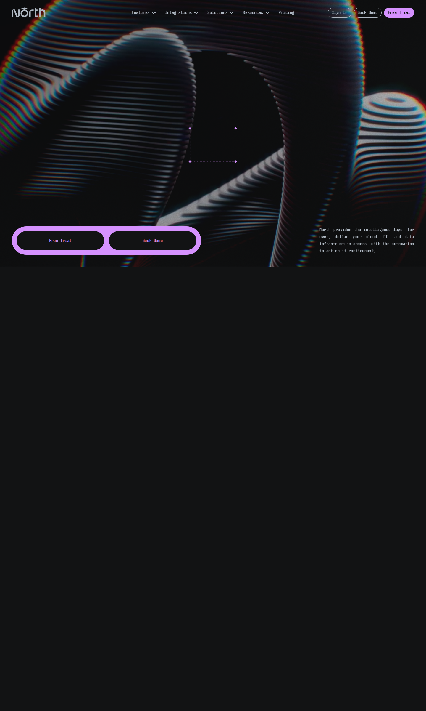

# UI Design System & Master Generation Blueprint: north-cloud

> **North - Take control of your cloud costs with AI-powered FinOps - North** (https://north.cloud) — Manage and optimize cloud, AI, and data spend in one platform. Gain full visibility, automate savings, and eliminate manual FinOps work.



---

## 1. Executive Visual Persona & Design Archetype

- **Brand Essence & Persona**: **North - Take control of your cloud costs with AI-powered FinOps - North** (`https://north.cloud`). Manage and optimize cloud, AI, and data spend in one platform. Gain full visibility, automate savings, and eliminate manual FinOps work.
- **Visual Archetype**: **Dark-Substrate WebGL / Canvas Interactive Experience (`#121314` / `#f8fcfd`)**.
- **Anti-AI-Slop Differentiators**:
  - **Source-Grounded Chromatic Polarity**: Anchors the viewport in `#121314` (`var(--form-inline-submit-bg)` in `:root`) paired with `#f8fcfd` primary typography and `#f8fcfd` accents.
  - **Extracted Typographic Hierarchy**: Pairs `Untitled Sans` for display copy (`Contact`) with `Degrad Mono` and `Degrad Mono`.
  - **Calibrated Spatial Grid & Motion**: Combines `749px` container bounds (`gap: .8rem`, padding `1.6rem`) with `cubic-bezier(.4,0,.2,1)` easing and Lenis Smooth Scroll (`data-lenis`), Three.js / WebGL Canvas Pipeline.

---

## 2. Spatial Architecture & Modular Grid Mathematics


### Viewport Allocation & Container Geometry
- **Captured Viewport Dimensions**: Desktop `1440×21285px` (`assets/desktop.png`, full-page scroll capture), Mobile `390×2400px` (`assets/mobile.png`, capped at 2400px multi-section capture).
- **Master Container Bounds**: `749px` extracted from `north-cloud` stylesheet.
- **Canvas Lateral Padding & Spacing**: `1.6rem` lateral canvas padding with `.8rem` grid gap.
- **Border Radius Scale**: `8rem`, `4rem`, `.4rem`, `1.6rem`.

### Responsive Breakpoint Architecture
- **Desktop Layout**: Multi-column CSS Grid / Flexbox layout at `1440px` (`max-width: 749px`, `gap: .8rem`).
- **Mobile Layout**: Single-column vertical stack at `390px` viewport width with `1.6rem` horizontal padding.
- **Extracted CSS Media Queries**: `@media screen and (min-width:750px)`, `@media screen and (max-width:749px)`, `@media (max-width:749px)`, `@media (min-width:750px)`.

---

## 3. Color System, Materiality & Atmospheric Lighting

### Semantic Palette & Source Grounding
| Semantic Role | Ground-Truth Value | Extracted CSS Source / Selector |
|---|---|---|
| **Primary Canvas Substrate** | `#121314` | `var(--form-inline-submit-bg)` in `:root` |
| **Primary Typography Ink** | `#000` | `var(--color-black)` in `:root` |
| **Elevated Surface / Card Substrate** | `#afb8c2` | `var(--cc-primary-color)` in `:root` |
| **Interactive Accent / Highlight** | `#f8fcfd` | `var(--cc-toggle-on-bg)` in `:root` |
| **Secondary / Muted Copy** | `#d591fe` | `var(--form-error-color)` in `:root` |
| **Structural Hairline Border** | `#f92e21` | `var(--red)` in `:root` |

### Sanitized Root CSS Variables (`ui-ux.md` Ground Truth)
| Variable Name | Extracted Value | Semantic Role |
|---|---|---|
| `--form-inline-field-bg` | `transparent` | Canvas / Surface Token |
| `--form-inline-field-border` | `1px solid #121314` | Elevation / Border Token |
| `--form-inline-submit-bg` | `#121314` | Canvas / Surface Token |
| `--form-inline-submit-color` | `var(--subscribe-accent, #d591fe)` | Brand / Palette Token |
| `--form-inline-h` | `4.8rem` | Dimension / Scale Token |
| `--form-inline-radius` | `8rem` | Elevation / Border Token |
| `--form-inline-pad-x` | `2.4rem` | Layout / Spatial Grid Token |
| `--form-inline-submit-w` | `100%` | Dimension / Scale Token |
| `--form-inline-gap` | `.8rem` | Layout / Spatial Grid Token |
| `--logowall-gap` | `2.4rem` | Layout / Spatial Grid Token |
| `--color-black` | `#000` | Canvas / Surface Token |
| `--default-transition-duration` | `.15s` | Motion / Easing Token |
| `--default-transition-timing-function` | `cubic-bezier(.4, 0, .2, 1)` | Motion / Easing Token |
| `--spacing-0` | `0` | Layout / Spatial Grid Token |
| `--spacing-4` | `.4rem` | Layout / Spatial Grid Token |
| `--spacing-15` | `1.5rem` | Layout / Spatial Grid Token |

---

## 4. Typographic Scale & Editorial Hierarchy

### Font Family Stacks
- **Display Typography**: `Untitled Sans`.
- **Primary Body Stack**: `Degrad Mono`.
- **Technical / Metadata Stack**: `Degrad Mono`.

### Typographic Scale & Rules (Extracted from Stylesheet & Variables)
- **Hero Display (`H1`)**: not explicitly declared on tag in static CSS (stylesheet font-size ladder: `1.6rem`, `9.6rem`, `100%`, `6.4rem`, `12rem`).
- **Section Heading (`H2`)**: not explicitly declared on tag in static CSS (stylesheet font-size ladder: `1.6rem`, `9.6rem`, `100%`, `6.4rem`, `12rem`).
- **Body Copy**: not explicitly declared on tag in static CSS (stylesheet font-size ladder: `1.6rem`, `9.6rem`, `100%`, `6.4rem`, `12rem`).
- **Metadata & Navigation Labels**: CSS variables `--form-label-opacity: .6`.

---

## 5. Choreographed Motion & Interaction Physics

### Primary Easing Curves
- **Extracted Timing Functions**: `cubic-bezier(.4,0,.2,1)`.

### Per-Element Transition & Choreography Rules
- **Selector `.image[data-astro-cid-ljxroaa4]`**: `transition: opacity .35s ease-in-out` extracted from `north-cloud` stylesheet.
- **Selector `d-ljxroaa4] .image[data-astro-cid...`**: `transition: none` extracted from `north-cloud` stylesheet.
- **Selector `me[data-astro-cid-ndoubqpd] .butt...`**: `transition: all .4s ease-in-out` extracted from `north-cloud` stylesheet.
- **Extracted Easing Curve (`cubic-bezier(.4,0,.2,1)`)**: Governs interactive state transitions across `<header.header>` and `<section.c-logoWall>`.
- **Runtime Interaction Engine**: Integrates Lenis Smooth Scroll (`data-lenis`), Three.js / WebGL Canvas Pipeline, Lottie Vector Animation Player with `prefers-reduced-motion: reduce` fallback guards.

---

## 6. Component Wireframe & Structural DOM Map

### Visual Layout Schematic (Grounded in `dom.html` — `1440px` Desktop & `390px` Mobile Reflow)
```
┌────────────────────────────────────────────────────────────────────────┐
│ DESKTOP VIEWPORT (1440px) — North - Take control of your cloud costs w │
│ ====================================================================== │
│ [ <header.header>          | Features · Manage · AI Agent · Coststr ]  │
│ ---------------------------------------------------------------------- │
│ | HERO STAGE: <section.c-heroHome>                                 |   │
│ | H1: Contact                                                      |   │
│ | Substrate: #121314    | Ink: #f8fcfd    | Accent: #f8fcfd        |   │
│ ---------------------------------------------------------------------- │
│ | SHOWCASE GRID (<section.c-logoWall>      ) max-w: 749px          |   │
│ | +------------------------------+  +------------------------------+ | │
│ | | North                        |  | T h e F i n a n c i a l O p  | | │
│ | +------------------------------+  +------------------------------+ | │
│ ---------------------------------------------------------------------- │
│ | MOBILE VIEWPORT REFLOW (390px) — Single-Column Stack (gap: .8rem ) | │
│ | [<header.header>] -> [<section.c-heroHom] -> [<section.c-logoWal] |  │
│ ---------------------------------------------------------------------- │
│ [ FOOTER (<footer.c-footer>     ) | https://north.cloud                │
└────────────────────────────────────────────────────────────────────────┘
```

### Granular DOM Region Breakdown
1. **Brand Header & Navigation Bar (<header.header> — `north-cloud`)**:
   - Landmark `<header class="header">` hosting `North - Take control of your cloud c` navigation (`Features · Manage · AI Agent · Coststreams · Analyze`), DOM attributes (`data-theme="black"`, `data-header`, `data-astro-cid-gxxacloy`, `data-dom="desktop-menu"`), and stylesheet rule `before { display:block }`.
2. **Hero Stage & Focal Lead (<section.c-heroHome> — `Contact`)**:
   - Landmark `<section class="c-heroHome heroHome">` presenting display lead `Contact` and copy excerpt *"Features Manage AI Agent Coststreams Analyze Anomalies GreenOps O"* over `#121314` canvas and `#f8fcfd` ink.
3. **Primary Showcase & Content Grid (<section.c-logoWall> — `North`)**:
   - Landmark `<section class="c-logoWall logoWall">` rendering section `North` with copy *"Manage AI Agent Coststreams Analyze Anomalies GreenOps"*, asset references (`untitled-sans-regular.woff2`, `untitled-sans-medium.woff2`, `favicon.ico`, `favicon-180x180.png`), and grid rule `last-of-type { padding-bottom:1.6rem }`.
4. **Interactive Detail & Feature Matrix (<section.c-layer> — `T h e F i n a n c i a l O p e r a `)**:
   - Landmark `<section class="c-layer layer">` framing `T h e F i n a n c i a l O p e r a t i n g S y s t...` and `I n t e l l i g e n c e L a y e r` (*"Optimize Coverage Rightsize Tokenflow"*) with `#afb8c2` surface cards, `#f8fcfd` accents, and `.loaded { background-image:none!important }`.
5. **Colophon & Global Directory Footer (<footer.c-footer> — `https://north.cloud`)**:
   - Landmark `<footer class="c-footer footer">` anchoring `North - Take control of your clo` footer links (`Features · Manage · AI Agent · Coststreams · Analyze`), copy *"Integrations AWS GCP Azure All Integrations"*, and `#f92e21` structural dividers.

---

## 7. Master Zero-Shot AI Generation Prompt

```markdown
# Master Zero-Shot Frontend Generation Prompt: north-cloud (North - Take control of your cloud costs with AI-powered FinOps - North)

You are a principal frontend architect and design systems engineer. Build a complete, production-ready web application replicating the exact design system, DOM landmarks, typographic hierarchy, color tokens, and motion physics of `north-cloud` (**North - Take control of your cloud costs with AI-powered FinOps - North** — `https://north.cloud`).

### 1. Visual Archetype & Anti-AI-Slop Mandates
- **Archetype**: Dark-Substrate WebGL / Canvas Interactive Experience (`#121314` / `#f8fcfd`).
- **Identity & Domain Context**: Manage and optimize cloud, AI, and data spend in one platform. Gain full visibility, automate savings, and eliminate manual FinOps work.
- **Primary Substrate**: `#121314` (`var(--form-inline-submit-bg)` in `:root`), **Primary Ink**: `#f8fcfd`, **Accent / Highlight**: `#f8fcfd`.
- **Site-Specific Differentiators**:
  - **Source-Grounded Chromatic Polarity**: Anchors the viewport in `#121314` (`var(--form-inline-submit-bg)` in `:root`) paired with `#f8fcfd` primary typography and `#f8fcfd` accents.
  - **Extracted Typographic Hierarchy**: Pairs `Untitled Sans` for display copy (`Contact`) with `Degrad Mono` and `Degrad Mono`.
  - **Calibrated Spatial Grid & Motion**: Combines `749px` container bounds (`gap: .8rem`, padding `1.6rem`) with `cubic-bezier(.4,0,.2,1)` easing and Lenis Smooth Scroll (`data-lenis`), Three.js / WebGL Canvas Pipeline.

### 2. Ground-Truth CSS Variables (`:root` Token Contract)
Declare and consume these exact custom properties extracted from `north-cloud` in your global stylesheet:

:root {
  /* North - Take control of your cloud costs with AI-powered FinOps - North (north-cloud) — Ground-Truth Extracted CSS Variables */
  --form-inline-field-bg: transparent; /* Canvas / Surface Token (north-cloud) */
  --form-inline-field-border: 1px solid #121314; /* Elevation / Border Token (north-cloud) */
  --form-inline-submit-bg: #121314; /* Canvas / Surface Token (north-cloud) */
  --form-inline-submit-color: var(--subscribe-accent, #d591fe); /* Brand / Palette Token (north-cloud) */
  --form-inline-h: 4.8rem; /* Dimension / Scale Token (north-cloud) */
  --form-inline-radius: 8rem; /* Elevation / Border Token (north-cloud) */
  --form-inline-pad-x: 2.4rem; /* Layout / Spatial Grid Token (north-cloud) */
  --form-inline-submit-w: 100%; /* Dimension / Scale Token (north-cloud) */
  --form-inline-gap: .8rem; /* Layout / Spatial Grid Token (north-cloud) */
  --logowall-gap: 2.4rem; /* Layout / Spatial Grid Token (north-cloud) */
  --color-black: #000; /* Canvas / Surface Token (north-cloud) */
  --default-transition-duration: .15s; /* Motion / Easing Token (north-cloud) */
  --default-transition-timing-function: cubic-bezier(.4, 0, .2, 1); /* Motion / Easing Token (north-cloud) */
  --spacing-0: 0; /* Layout / Spatial Grid Token (north-cloud) */
  --spacing-4: .4rem; /* Layout / Spatial Grid Token (north-cloud) */
  --spacing-15: 1.5rem; /* Layout / Spatial Grid Token (north-cloud) */
}

### 3. Semantic Color & Materiality Contract
Map every surface, ink, and border strictly to these source-grounded tokens:
- **Primary Canvas Substrate**: `#121314` — grounded in `var(--form-inline-submit-bg)` in `:root`
- **Primary Typography Ink**: `#000` — grounded in `var(--color-black)` in `:root`
- **Elevated Surface / Card Substrate**: `#afb8c2` — grounded in `var(--cc-primary-color)` in `:root`
- **Interactive Accent / Highlight**: `#f8fcfd` — grounded in `var(--cc-toggle-on-bg)` in `:root`
- **Secondary / Muted Copy**: `#d591fe` — grounded in `var(--form-error-color)` in `:root`
- **Structural Hairline Border**: `#f92e21` — grounded in `var(--red)` in `:root`

### 4. Spatial Grid, Container Bounds & Responsive Breakpoints
- **Desktop Viewport Reference**: `1440×21285px` (full-page scroll capture, `1440px` standard desktop width).
- **Mobile Viewport Reference**: `390×2400px` (capped at 2400px multi-section capture, `390px` standard mobile width).
- **Container Max-Width**: `749px` extracted from `north-cloud` stylesheet
- **Padding & Gutters**: `1.6rem` lateral canvas padding with `.8rem` grid gap
- **Desktop Grid**: Multi-column CSS Grid / Flexbox layout at `1440px` (`max-width: 749px`, `gap: .8rem`)
- **Mobile Adaptation**: Single-column vertical stack at `390px` viewport width with `1.6rem` horizontal padding
- **Media Queries**: `@media screen and (min-width:750px)`, `@media screen and (max-width:749px)`, `@media (max-width:749px)`, `@media (min-width:750px)`
- **Corner Radii**: `8rem`, `4rem`, `.4rem`, `1.6rem`

### 5. Typography & Editorial Scale Contract
- **Display Font Stack**: `Untitled Sans`
- **Body Font Stack**: `Degrad Mono`
- **Monospace / Technical Font Stack**: `Degrad Mono`
- **H1 Display Rule**: not explicitly declared on tag in static CSS (stylesheet font-size ladder: `1.6rem`, `9.6rem`, `100%`, `6.4rem`, `12rem`)
- **H2 Section Rule**: not explicitly declared on tag in static CSS (stylesheet font-size ladder: `1.6rem`, `9.6rem`, `100%`, `6.4rem`, `12rem`)
- **Body Copy Rule**: not explicitly declared on tag in static CSS (stylesheet font-size ladder: `1.6rem`, `9.6rem`, `100%`, `6.4rem`, `12rem`)
- **Metadata & Index Rule**: CSS variables `--form-label-opacity: .6`

### 6. Component Hierarchy, Verbatim Copy & Real DOM Landmarks
Scaffold `north-cloud` (`North - Take control of your cloud costs with AI-powered FinOps - North`) with these exact structural regions, extracted copy, and CSS rules from `dom.html`:
1. **Brand Header & Navigation Bar (<header.header> — `north-cloud`)**:
   - DOM & Selectors: Landmark `<header class="header">` hosting `North - Take control of your cloud c` navigation (`Features · Manage · AI Agent · Coststreams · Analyze`), DOM attributes (`data-theme="black"`, `data-header`, `data-astro-cid-gxxacloy`, `data-dom="desktop-menu"`), and stylesheet rule `before { display:block }`.
   - Responsive Contract: Header `Brand Header & Navigation Bar (<header.header> — `north-cloud`)` (`north-cloud`) adapts across `@media screen and (min-width:750px)`, `@media screen and (max-width:749px)`, `@media (max-width:749px)`, `@media (min-width:750px)` with `cubic-bezier(.4,0,.2,1)` transitions and links `Features · Manage · AI Agent · Coststreams · Analyze`.
2. **Hero Stage & Focal Lead (<section.c-heroHome> — `Contact`)**:
   - DOM & Selectors: Landmark `<section class="c-heroHome heroHome">` presenting display lead `Contact` and copy excerpt *"Features Manage AI Agent Coststreams Analyze Anomalies GreenOps O"* over `#121314` canvas and `#f8fcfd` ink.
   - Responsive Contract: Hero stage (`1440×21285px` desktop / `390×2400px` mobile) sets `#121314` background with `#f8fcfd` headline `Contact`.
3. **Primary Showcase & Content Grid (<section.c-logoWall> — `North`)**:
   - DOM & Selectors: Landmark `<section class="c-logoWall logoWall">` rendering section `North` with copy *"Manage AI Agent Coststreams Analyze Anomalies GreenOps"*, asset references (`untitled-sans-regular.woff2`, `untitled-sans-medium.woff2`, `favicon.ico`, `favicon-180x180.png`), and grid rule `last-of-type { padding-bottom:1.6rem }`.
   - Responsive Contract: Showcase grid `Primary Showcase & Content Grid (<section.c-logoWall> — `North`)` applies Multi-column CSS Grid / Flexbox layout at `1440px` (`max-width: 749px`, `gap: .8rem`) on desktop and Single-column vertical stack at `390px` viewport width with `1.6rem` horizontal padding on mobile.
4. **Interactive Detail & Feature Matrix (<section.c-layer> — `T h e F i n a n c i a l O p e r a `)**:
   - DOM & Selectors: Landmark `<section class="c-layer layer">` framing `T h e F i n a n c i a l O p e r a t i n g S y s t...` and `I n t e l l i g e n c e L a y e r` (*"Optimize Coverage Rightsize Tokenflow"*) with `#afb8c2` surface cards, `#f8fcfd` accents, and `.loaded { background-image:none!important }`.
   - Responsive Contract: Detail module `Interactive Detail & Feature Matrix (<section.c-layer> — `T h e F i n a n c i a l O p e r a `)` uses `8rem`, `4rem`, `.4rem`, `1.6rem` radii, `#f8fcfd` highlights, and assets (untitled-sans-regular.woff2, untitled-sans-medium.woff2, favicon.ico).
5. **Colophon & Global Directory Footer (<footer.c-footer> — `https://north.cloud`)**:
   - DOM & Selectors: Landmark `<footer class="c-footer footer">` anchoring `North - Take control of your clo` footer links (`Features · Manage · AI Agent · Coststreams · Analyze`), copy *"Integrations AWS GCP Azure All Integrations"*, and `#f92e21` structural dividers.
   - Responsive Contract: Footer `Colophon & Global Directory Footer (<footer.c-footer> — `https://north.cloud`)` aligns to `749px` extracted from `north-cloud` stylesheet with `1.6rem` lateral canvas padding with `.8rem` grid gap and attributes (data-theme="black", data-header, data-astro-cid-gxxacloy).

#### Verbatim DOM Copy Excerpts (`dom.html`)
- Copy Excerpt 1: *"Features Manage AI Agent Coststreams Analyze Anomalies GreenOps Optimize Coverage..."*
- Copy Excerpt 2: *"Manage AI Agent Coststreams Analyze Anomalies GreenOps"*
- Copy Excerpt 3: *"Optimize Coverage Rightsize Tokenflow"*
- Copy Excerpt 4: *"Integrations AWS GCP Azure All Integrations"*

### 7. Motion, Extracted Stylesheet Rules & Interaction Choreography
- **Primary Easing Functions**: `cubic-bezier(.4,0,.2,1)`
- **Extracted Stylesheet Rules (`north-cloud`)**:
- `before { display:block }`
- `last-of-type { padding-bottom:1.6rem }`
- `.loaded { background-image:none!important }`
- `.-contain { object-fit:contain }`
- `.line-mask { overflow-x:visible;overflow-y:clip;padding-block:.15em;margin-block:-.15em }`
- **Per-Selector Transition Rules**:
- **Selector `.image[data-astro-cid-ljxroaa4]`**: `transition: opacity .35s ease-in-out` extracted from `north-cloud` stylesheet.
- **Selector `d-ljxroaa4] .image[data-astro-cid...`**: `transition: none` extracted from `north-cloud` stylesheet.
- **Selector `me[data-astro-cid-ndoubqpd] .butt...`**: `transition: all .4s ease-in-out` extracted from `north-cloud` stylesheet.
- **Extracted Easing Curve (`cubic-bezier(.4,0,.2,1)`)**: Governs interactive state transitions across `<header.header>` and `<section.c-logoWall>`.
- **Runtime Interaction Engine**: Integrates Lenis Smooth Scroll (`data-lenis`), Three.js / WebGL Canvas Pipeline, Lottie Vector Animation Player with `prefers-reduced-motion: reduce` fallback guards.

### 8. Technical Deliverables
- Implement in Next.js (App Router) with TypeScript and Tailwind CSS consuming the `:root` custom properties defined above for `north-cloud`.
- Reproduce both the `1440px` desktop architecture and `390px` mobile breakpoint transitions, preserving semantic HTML5 landmarks (`<header>`, `<nav>`, `<main>`, `<section>`, `<footer>`) and `prefers-reduced-motion` accessibility guards.
```
