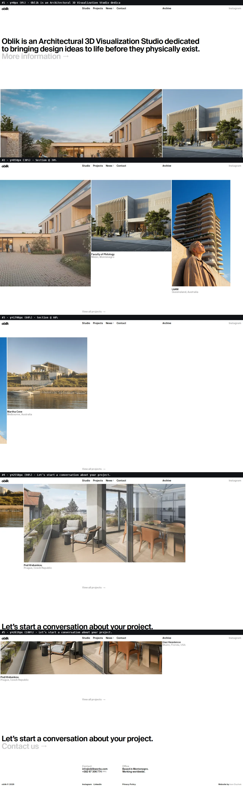
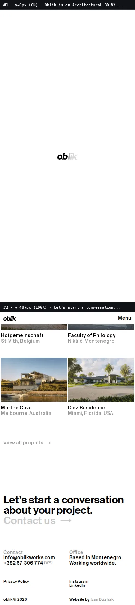

# UI Design System & Master Generation Blueprint: oblikworks-com

> **oblikworks · Architectural Visualization & 3D Rendering Studio** (https://oblikworks.com/) — oblikworks is an architectural visualization studio creating photorealistic 3D renderings, architectural imagery, and visual storytelling...





---

## 1. Executive Visual Persona & Design Archetype

- **Brand Essence & Persona**: **oblikworks · Architectural Visualization & 3D Rendering Studio** (`https://oblikworks.com/`). oblikworks is an architectural visualization studio creating photorealistic 3D renderings, architectural imagery, and visual storytelling...
- **Capture Provenance**: Live browser capture (`tier1_fast`, HTTP `200`, captured `2026-11-24`).
- **Visual Archetype**: **Light-Substrate Editorial & Modular Grid System (`#ffffff` canvas, `#000000` ink, `#0082f3` accent)**.
- **Anti-AI-Slop Differentiators**:
  - **Live-Computed Chromatic Polarity**: Anchors the viewport in `#ffffff` (live computed `body` `background-color` (`computed_styles.json`)) paired with `#000000` primary typography and `#0082f3` accents.
  - **Grounded Typographic Hierarchy**: Uses `Suisseintl` across display (`Oblik is an Architectural 3D Visuali`) and body copy.
  - **Calibrated Spatial Grid & Motion**: Combines `1900px` container bounds (`gap: 16px`, padding `9px`) with `cubic-bezier(.625,.05,0,1)` easing and Lenis Smooth Scroll (`data-lenis`), GSAP Timeline & ScrollTrigger.

---

## 2. Spatial Architecture & Modular Grid Mathematics

### Viewport Allocation & Container Geometry
- **Captured Journey Filmstrips**: Desktop `1280×4140px` (`assets/desktop-journey.webp`, `5` keyframes up to `y=2819px` / doc `3719px`), Mobile `390×1744px` (`assets/mobile-journey.webp`, `2` keyframes).
- **Master Container Bounds**: `1900px` (non-`@media` desktop container stylesheet rule).
- **Canvas Lateral Padding & Spacing**: `9px` lateral canvas padding with `16px` grid gap.
- **Border Radius Scale**: `3px`, `100%`, `50%`, `555px`.

### Responsive Breakpoint Architecture
- **Desktop Layout**: Multi-column CSS Grid / Flexbox layout at `1440px` (`max-width: 1900px`, `gap: 16px`).
- **Mobile Layout**: Single-column vertical stack at `390px` viewport width with `9px` horizontal padding.
- **Extracted CSS Media Queries**: `@media screen and (max-width: 991px)`, `@media screen and (max-width: 767px)`, `@media screen and (max-width: 479px)`, `@media (min-width: 768px)`.

---

## 3. Color System, Materiality & Atmospheric Lighting

### Semantic Palette & Source Grounding
| Semantic Role | Ground-Truth Value | Extracted Live / CSS Source |
|---|---|---|
| **Primary Canvas Substrate** | `#ffffff` | live computed `body` `background-color` (`computed_styles.json`) |
| **Primary Typography Ink** | `#000000` | live computed `h1` `color` (`computed_styles.json`) |
| **Elevated Surface / Card Substrate** | `#ffff00` | `mark { background: #ffff00 }` |
| **Interactive Accent / Highlight** | `#0082f3` | `.w-dropdown-link.w--current { color: #0082f3 }` |
| **Secondary / Muted Copy** | `#0000ee` | live computed `a` `color` (`computed_styles.json`) |
| **Structural Hairline Border** | `#eeeeee` | `var(--_colors---line-color)` in `:root` |
| **Variable Token (`--_colors---button-grey`)** | `#f0f0f0` | `var(--_colors---button-grey)` in `:root` |

### Sanitized Root CSS Variables (`ui-ux.md` Ground Truth)
| Variable Name | Extracted Value | Semantic Role |
|---|---|---|
| `--_font-sizes---p16` | `clamp(14px, 1vw, 16px)` | Typography / Scale Token |
| `--_colors---line-color` | `#eee` | Brand / Palette Token |
| `--_colors---button-grey` | `#f0f0f0` | Brand / Palette Token |
| `--cases-width` | `calc(220vw + 25px)` | Layout / Spatial Grid Token |
| `--w-backdrop-animation` | `initial` | Motion / Easing Token |
| `--oblikworks-com-bg` | `#ffffff` | Canvas Substrate (from live computed `body` `background-color` (`computed_styles.json`)) |
| `--oblikworks-com-ink` | `#000000` | Primary Typography Ink (computed-derived) |
| `--oblikworks-com-surface` | `#ffff00` | Surface Substrate (computed-derived) |
| `--oblikworks-com-accent` | `#0082f3` | Interactive Accent (computed-derived) |
| `--oblikworks-com-muted` | `#0000ee` | Secondary Ink (computed-derived) |
| `--oblikworks-com-border` | `#eeeeee` | Structural Border (computed-derived) |
| `--oblikworks-com-container` | `1900px` | Container Bound (computed-derived) |
| `--oblikworks-com-gap` | `16px` | Grid Gutter (computed-derived) |
| `--oblikworks-com-pad` | `9px` | Lateral Padding (computed-derived) |
| `--oblikworks-com-ease` | `cubic-bezier(.625,.05,0,1)` | Primary Easing Function |
| `--oblikworks-com-radius` | `3px` | Corner Radius (computed-derived) |

---

## 4. Typographic Scale & Editorial Hierarchy

### Font Family Stacks
- **Display Typography**: `Suisseintl`.
- **Primary Body Stack**: `Suisseintl`.
- **Technical / Metadata Stack**: not declared in live computed styles (uses primary stack / `ui-monospace`).

### Typographic Scale & Rules (Live Computed & Stylesheet Grounded)
- **Hero Display (`H1`)**: live computed `h1` (`font-size: 44.64px`, `line-height: 44.64px`, `font-weight: 600`, `letter-spacing: -0.8928px`); rule `h1` (`font-size: 2em`).
- **Section Heading (`H2`)**: live computed `h2` (`font-size: 44.64px`, `line-height: 44.64px`, `font-weight: 600`, `letter-spacing: -0.8928px`); rule `h2` (`font-size: 32px`, `line-height: 36px`).
- **Body Copy**: live computed `body` (`font-size: 16px`, `line-height: 16px`, `font-weight: 400`); rule `body` (`font-size: 14px`, `line-height: 20px`).
- **Metadata & Navigation Labels**: live computed `nav/a` (`font-size: 16px`, `line-height: 16px`, `font-weight: 400`); rule `small` (`font-size: 80%`).

---

## 5. Choreographed Motion & Interaction Physics

### Primary Easing Curves
- **Extracted Timing Functions**: `cubic-bezier(.625,.05,0,1)`.

### Per-Element Transition & Choreography Rules
- **Selector `.w-webflow-badge > img`**: `transition: unset` extracted from `oblikworks-com` stylesheet.
- **Selector `.w-slider-dot`**: `transition: background-color .1s, color .1s` extracted from `oblikworks-com` stylesheet.
- **Selector `.w-lightbox-control`**: `transition: all .3s` extracted from `oblikworks-com` stylesheet.
- **Extracted Easing Curve (`cubic-bezier(.625,.05,0,1)`)**: Governs interactive state transitions across `<header.w-mod-js>` and `<div.preloader:nth(2)>`.
- **Runtime Interaction Engine**: Integrates Lenis Smooth Scroll (`data-lenis`), GSAP Timeline & ScrollTrigger, Barba.js Page Transition Router with `prefers-reduced-motion: reduce` fallback guards.
### Measured Runtime Scroll & Interaction Telemetry (`behavioral_journey_v2`)
- **Scroll Driver Mode**: `native` (max document height `3719px`, deepest scrollY reached `2819px` across `5` desktop keyframes).
- **Detected Scroll / Motion Libraries**: `Lenis`, `GSAP/ScrollTrigger`.

---

## 6. Component Wireframe & Structural DOM Map

### Visual Layout Schematic — Desktop (`1440px`, Grounded in `dom.html` & Landmark Bounding Boxes)
```
┌────────────────────────────────────────────────────────────────────────┐
│ DESKTOP VIEWPORT (1440px) — oblikworks · Architectural Visualization & │
│ ====================================================================== │
│ [ <header.w-mod-js> (1440px)          | Studio · Projects · News 3 · ] │
│ ---------------------------------------------------------------------- │
│ | HERO STAGE: <div.preloader> (w=1440px)                             | │
│ | H1: Oblik is an Architectural 3D Visualization Studio...           | │
│ | Substrate: #ffffff | Ink: #000000 | Accent: #0082f3                | │
│ ---------------------------------------------------------------------- │
│ | SHOWCASE GRID (<div.preloader:nth(2)>) max-w: 1900px               | │
│ | +------------------------------+  +------------------------------+ | │
│ | | info@oblikworks.com          |  | New work: Faculty of Philolo | | │
│ | +------------------------------+  +------------------------------+ | │
│ ---------------------------------------------------------------------- │
│ | DETAIL MODULE (<div.preloader:nth(3)>) — In the Press: Our Vis     | │
│ ---------------------------------------------------------------------- │
│ [ FOOTER (<footer.body>       ) | https://oblikworks.com/              │
└────────────────────────────────────────────────────────────────────────┘
```

### Visual Layout Schematic — Mobile Reflow (`390px`)
```
┌────────────────────────────────────────────────────────────────────────┐
│ MOBILE VIEWPORT REFLOW (390px) — Single-Column Stack (gap: 16px)       │
│ ====================================================================== │
│ [ HEADER BAR (<header.w-mod-js>       ) | Compact Menu (390px)         │
│ ---------------------------------------------------------------------- │
│ | HERO STAGE (<div.preloader>) — 390px Vertical Lead                 | │
│ | H1: Oblik is an Architectural 3D Visualization Studio...           | │
│ ---------------------------------------------------------------------- │
│ | SHOWCASE STACK (<div.preloader:nth(2)>) — 1-Col Stack              | │
│ | [ Item 1: info@oblikworks.com                                    ] | │
│ | [ Item 2: New work: Faculty of Philology is now published        ] | │
│ ---------------------------------------------------------------------- │
│ | DETAIL STACK (<div.preloader:nth(3)>) — 1-Col (In the Press: Our ) | │
│ ---------------------------------------------------------------------- │
│ [ FOOTER (<footer.body>       ) | Stacked 390px Colophon               │
└────────────────────────────────────────────────────────────────────────┘
```

### Granular DOM Region Breakdown
1. **Brand Header & Navigation Bar (<header.w-mod-js> — `oblikworks-com`)**:
   - Landmark `<header class="w-mod-js">` (`1440px`) hosting `oblikworks · Architectural Visualiza` navigation (`Studio · Projects · News 3 · Contact · Archive`), DOM attributes (`data-wf-domain="oblikworks.com"`, `data-wf-page="69c2caad0ee663f0795cd0bb"`, `data-wf-site="69c2caab0ee663f0795ccce3"`, `data-wf-ignore`), and stylesheet rule `html { -webkit-text-size-adjust: 100%; -ms-text-size-adjust: 100%; font-family:... }`.
2. **Hero Stage & Focal Lead (<div.preloader> — `Oblik is an Architectural 3D Visua`)**:
   - Landmark `<div class="preloader">` presenting display lead `Oblik is an Architectural 3D Visualization Studio...` and copy excerpt *"info@oblikworks.com"* over `#ffffff` canvas and `#000000` ink.
3. **Primary Showcase & Content Grid (<div.preloader:nth(2)> — `info@oblikworks.com`)**:
   - Landmark `<div class="preloader">` rendering section `info@oblikworks.com` with copy *"New work: Faculty of Philology is now published on our website."*, asset references (`cdn.prod.website-files.com`, `oblik-studio.webflow.shared.30697...`, `1135743295497216`, `fbevents.js`), and grid rule `body { margin: 0; }`.
4. **Interactive Detail & Feature Matrix (<div.preloader:nth(3)> — `New work: Faculty of Philology is `)**:
   - Landmark `<div class="preloader">` framing `New work: Faculty of Philology is now published ` and `In the Press: Our Visualizations of The Alfred f` (*"In the Press: Our Visualizations of The Alfred featured in Urban "*) with `#ffff00` surface cards, `#0082f3` accents, and `summary { display: block; }`.
5. **Colophon & Global Directory Footer (<footer.body> — `https://oblikworks.com/`)**:
   - Landmark `<footer class="body">` anchoring `oblikworks · Architectural Visua` footer links (`Studio · Projects · News 3 · Contact · Archive`), copy *"We're integrating AI into our 3D Design pipeline."*, and `#eeeeee` structural dividers.
### Full Vertical Scroll Sequence (Desktop `1440×900` Keyframes)
- **Step 01** (`y=0px`, `0%`): Active landmark `Oblik is an Architectural 3D Visualization Studio...` · sticky/fixed elements: `3`
- **Step 02** (`y=850px`, `30%`): Active landmark `Section @ 30%` · sticky/fixed elements: `3`
- **Step 03** (`y=1700px`, `60%`): Active landmark `Section @ 60%` · sticky/fixed elements: `3`
- **Step 04** (`y=2550px`, `90%`): Active landmark `Let’s start a conversation about your project.` · sticky/fixed elements: `3`
- **Step 05** (`y=2819px`, `100%`): Active landmark `Let’s start a conversation about your project.` · sticky/fixed elements: `3`

---

## 7. Master Zero-Shot AI Generation Prompt

```markdown
# Master Zero-Shot Frontend Generation Prompt: oblikworks-com (oblikworks · Architectural Visualization & 3D Rendering Studio)

You are a principal frontend architect and design systems engineer. Build a complete, production-ready web application replicating the exact design system, DOM landmarks, typographic hierarchy, color tokens, and motion physics of `oblikworks-com` (**oblikworks · Architectural Visualization & 3D Rendering Studio** — `https://oblikworks.com/`).

### 1. Visual Archetype & Anti-AI-Slop Mandates
- **Archetype**: Light-Substrate Editorial & Modular Grid System (`#ffffff` canvas, `#000000` ink, `#0082f3` accent).
- **Identity & Domain Context**: oblikworks is an architectural visualization studio creating photorealistic 3D renderings, architectural imagery, and visual storytelling...
- **Primary Substrate**: `#ffffff` (live computed `body` `background-color` (`computed_styles.json`)), **Primary Ink**: `#000000`, **Accent / Highlight**: `#0082f3`.
- **Site-Specific Differentiators**:
  - **Live-Computed Chromatic Polarity**: Anchors the viewport in `#ffffff` (live computed `body` `background-color` (`computed_styles.json`)) paired with `#000000` primary typography and `#0082f3` accents.
  - **Grounded Typographic Hierarchy**: Uses `Suisseintl` across display (`Oblik is an Architectural 3D Visuali`) and body copy.
  - **Calibrated Spatial Grid & Motion**: Combines `1900px` container bounds (`gap: 16px`, padding `9px`) with `cubic-bezier(.625,.05,0,1)` easing and Lenis Smooth Scroll (`data-lenis`), GSAP Timeline & ScrollTrigger.

### 2. Ground-Truth CSS Variables (`:root` Token Contract)
Declare and consume these exact custom properties extracted from `oblikworks-com` in your global stylesheet:

:root {
  /* oblikworks · Architectural Visualization & 3D Rendering Studio (oblikworks-com) — Live-Grounded CSS Variables */
  --_font-sizes---p16: clamp(14px, 1vw, 16px); /* Typography / Scale Token (oblikworks-com) */
  --_colors---line-color: #eee; /* Brand / Palette Token (oblikworks-com) */
  --_colors---button-grey: #f0f0f0; /* Brand / Palette Token (oblikworks-com) */
  --cases-width: calc(220vw + 25px); /* Layout / Spatial Grid Token (oblikworks-com) */
  --w-backdrop-animation: initial; /* Motion / Easing Token (oblikworks-com) */
  --oblikworks-com-bg: #ffffff; /* Canvas Substrate (from live computed `body` `background-color` (`computed_styles.json`)) (oblikworks-com) */
  --oblikworks-com-ink: #000000; /* Primary Typography Ink (computed-derived) (oblikworks-com) */
  --oblikworks-com-surface: #ffff00; /* Surface Substrate (computed-derived) (oblikworks-com) */
  --oblikworks-com-accent: #0082f3; /* Interactive Accent (computed-derived) (oblikworks-com) */
  --oblikworks-com-muted: #0000ee; /* Secondary Ink (computed-derived) (oblikworks-com) */
  --oblikworks-com-border: #eeeeee; /* Structural Border (computed-derived) (oblikworks-com) */
  --oblikworks-com-container: 1900px; /* Container Bound (computed-derived) (oblikworks-com) */
  --oblikworks-com-gap: 16px; /* Grid Gutter (computed-derived) (oblikworks-com) */
  --oblikworks-com-pad: 9px; /* Lateral Padding (computed-derived) (oblikworks-com) */
  --oblikworks-com-ease: cubic-bezier(.625,.05,0,1); /* Primary Easing Function (oblikworks-com) */
  --oblikworks-com-radius: 3px; /* Corner Radius (computed-derived) (oblikworks-com) */
}

### 3. Semantic Color & Materiality Contract
Map every surface, ink, and border strictly to these source-grounded tokens:
- **Primary Canvas Substrate**: `#ffffff` — grounded in live computed `body` `background-color` (`computed_styles.json`)
- **Primary Typography Ink**: `#000000` — grounded in live computed `h1` `color` (`computed_styles.json`)
- **Elevated Surface / Card Substrate**: `#ffff00` — grounded in `mark { background: #ffff00 }`
- **Interactive Accent / Highlight**: `#0082f3` — grounded in `.w-dropdown-link.w--current { color: #0082f3 }`
- **Secondary / Muted Copy**: `#0000ee` — grounded in live computed `a` `color` (`computed_styles.json`)
- **Structural Hairline Border**: `#eeeeee` — grounded in `var(--_colors---line-color)` in `:root`
- **Variable Token (`--_colors---button-grey`)**: `#f0f0f0` — grounded in `var(--_colors---button-grey)` in `:root`

### 4. Spatial Grid, Container Bounds & Responsive Breakpoints
- **Desktop Viewport Reference**: `1280×4140px` (multi-frame vertical journey filmstrip (4140px), `1440px` standard desktop width).
- **Mobile Viewport Reference**: `390×1744px` (full-page live capture (1744px), `390px` standard mobile width).
- **Container Max-Width**: `1900px` (non-`@media` desktop container stylesheet rule)
- **Padding & Gutters**: `9px` lateral canvas padding with `16px` grid gap
- **Desktop Grid**: Multi-column CSS Grid / Flexbox layout at `1440px` (`max-width: 1900px`, `gap: 16px`)
- **Mobile Adaptation**: Single-column vertical stack at `390px` viewport width with `9px` horizontal padding
- **Media Queries**: `@media screen and (max-width: 991px)`, `@media screen and (max-width: 767px)`, `@media screen and (max-width: 479px)`, `@media (min-width: 768px)`
- **Corner Radii**: `3px`, `100%`, `50%`, `555px`

### 5. Typography & Editorial Scale Contract
- **Display Font Stack**: `Suisseintl`
- **Body Font Stack**: `Suisseintl`
- **Monospace / Technical Font Stack**: not declared in live computed styles (uses primary stack / `ui-monospace`)
- **H1 Display Rule**: live computed `h1` (`font-size: 44.64px`, `line-height: 44.64px`, `font-weight: 600`, `letter-spacing: -0.8928px`); rule `h1` (`font-size: 2em`)
- **H2 Section Rule**: live computed `h2` (`font-size: 44.64px`, `line-height: 44.64px`, `font-weight: 600`, `letter-spacing: -0.8928px`); rule `h2` (`font-size: 32px`, `line-height: 36px`)
- **Body Copy Rule**: live computed `body` (`font-size: 16px`, `line-height: 16px`, `font-weight: 400`); rule `body` (`font-size: 14px`, `line-height: 20px`)
- **Metadata & Index Rule**: live computed `nav/a` (`font-size: 16px`, `line-height: 16px`, `font-weight: 400`); rule `small` (`font-size: 80%`)

### 6. Component Hierarchy, Verbatim Copy & Real DOM Landmarks
Scaffold `oblikworks-com` (`oblikworks · Architectural Visualization & 3D Rendering Studio`) with these exact structural regions, extracted copy, and CSS rules from `dom.html`:
1. **Brand Header & Navigation Bar (<header.w-mod-js> — `oblikworks-com`)**:
   - DOM & Selectors: Landmark `<header class="w-mod-js">` (`1440px`) hosting `oblikworks · Architectural Visualiza` navigation (`Studio · Projects · News 3 · Contact · Archive`), DOM attributes (`data-wf-domain="oblikworks.com"`, `data-wf-page="69c2caad0ee663f0795cd0bb"`, `data-wf-site="69c2caab0ee663f0795ccce3"`, `data-wf-ignore`), and stylesheet rule `html { -webkit-text-size-adjust: 100%; -ms-text-size-adjust: 100%; font-family:... }`.
   - Responsive Contract: Header `Brand Header & Navigation Bar (<header.w-mod-js> — `oblikworks-com`)` (`oblikworks-com`) adapts across `@media screen and (max-width: 991px)`, `@media screen and (max-width: 767px)`, `@media screen and (max-width: 479px)`, `@media (min-width: 768px)` with `cubic-bezier(.625,.05,0,1)` transitions and links `Studio · Projects · News 3 · Contact · Archive`.
2. **Hero Stage & Focal Lead (<div.preloader> — `Oblik is an Architectural 3D Visua`)**:
   - DOM & Selectors: Landmark `<div class="preloader">` presenting display lead `Oblik is an Architectural 3D Visualization Studio...` and copy excerpt *"info@oblikworks.com"* over `#ffffff` canvas and `#000000` ink.
   - Responsive Contract: Hero stage (`1280×4140px` desktop / `390×1744px` mobile) sets `#ffffff` background with `#000000` headline `Oblik is an Architectural 3D Visualization Studio...`.
3. **Primary Showcase & Content Grid (<div.preloader:nth(2)> — `info@oblikworks.com`)**:
   - DOM & Selectors: Landmark `<div class="preloader">` rendering section `info@oblikworks.com` with copy *"New work: Faculty of Philology is now published on our website."*, asset references (`cdn.prod.website-files.com`, `oblik-studio.webflow.shared.30697...`, `1135743295497216`, `fbevents.js`), and grid rule `body { margin: 0; }`.
   - Responsive Contract: Showcase grid `Primary Showcase & Content Grid (<div.preloader:nth(2)> — `info@oblikworks.com`)` applies Multi-column CSS Grid / Flexbox layout at `1440px` (`max-width: 1900px`, `gap: 16px`) on desktop and Single-column vertical stack at `390px` viewport width with `9px` horizontal padding on mobile.
4. **Interactive Detail & Feature Matrix (<div.preloader:nth(3)> — `New work: Faculty of Philology is `)**:
   - DOM & Selectors: Landmark `<div class="preloader">` framing `New work: Faculty of Philology is now published ` and `In the Press: Our Visualizations of The Alfred f` (*"In the Press: Our Visualizations of The Alfred featured in Urban "*) with `#ffff00` surface cards, `#0082f3` accents, and `summary { display: block; }`.
   - Responsive Contract: Detail module `Interactive Detail & Feature Matrix (<div.preloader:nth(3)> — `New work: Faculty of Philology is `)` uses `3px`, `100%`, `50%`, `555px` radii, `#0082f3` highlights, and assets (cdn.prod.website-files.com, oblik-studio.webflow.shared.30697..., 1135743295497216).
5. **Colophon & Global Directory Footer (<footer.body> — `https://oblikworks.com/`)**:
   - DOM & Selectors: Landmark `<footer class="body">` anchoring `oblikworks · Architectural Visua` footer links (`Studio · Projects · News 3 · Contact · Archive`), copy *"We're integrating AI into our 3D Design pipeline."*, and `#eeeeee` structural dividers.
   - Responsive Contract: Footer `Colophon & Global Directory Footer (<footer.body> — `https://oblikworks.com/`)` aligns to `1900px` (non-`@media` desktop container stylesheet rule) with `9px` lateral canvas padding with `16px` grid gap and attributes (data-wf-domain="oblikworks.com", data-wf-page="69c2caad0ee663f0795cd0bb", data-wf-site="69c2caab0ee663f0795ccce3").

#### Verbatim DOM Copy Excerpts (`dom.html`)
- Copy Excerpt 1: *"info@oblikworks.com"*
- Copy Excerpt 2: *"New work: Faculty of Philology is now published on our website."*
- Copy Excerpt 3: *"In the Press: Our Visualizations of The Alfred featured in Urban List."*
- Copy Excerpt 4: *"We're integrating AI into our 3D Design pipeline."*

### 7. Motion, Extracted Stylesheet Rules & Interaction Choreography
- **Primary Easing Functions**: `cubic-bezier(.625,.05,0,1)`
- **Extracted Stylesheet Rules (`oblikworks-com`)**:
- `html { -webkit-text-size-adjust: 100%; -ms-text-size-adjust: 100%; font-family:... }`
- `body { margin: 0; }`
- `summary { display: block; }`
- `video { vertical-align: baseline; display: inline-block; }`
- `template { display: none; }`
- **Per-Selector Transition Rules**:
- **Selector `.w-webflow-badge > img`**: `transition: unset` extracted from `oblikworks-com` stylesheet.
- **Selector `.w-slider-dot`**: `transition: background-color .1s, color .1s` extracted from `oblikworks-com` stylesheet.
- **Selector `.w-lightbox-control`**: `transition: all .3s` extracted from `oblikworks-com` stylesheet.
- **Extracted Easing Curve (`cubic-bezier(.625,.05,0,1)`)**: Governs interactive state transitions across `<header.w-mod-js>` and `<div.preloader:nth(2)>`.
- **Runtime Interaction Engine**: Integrates Lenis Smooth Scroll (`data-lenis`), GSAP Timeline & ScrollTrigger, Barba.js Page Transition Router with `prefers-reduced-motion: reduce` fallback guards.
### 7b. Full-Page Scroll Choreography, Interactive States & Multi-Page Routes
- **Scroll Mechanics**: Implement `native` vertical progression up to `3719px` across 5 distinct viewport chapters using Lenis, GSAP/ScrollTrigger.
- **Vertical Chapter Sequence**: Oblik is an Architectural 3... (0%) -> Section @ 30% (30%) -> Section @ 60% (60%) -> Let’s start a conversation... (90%) -> Let’s start a conversation... (100%).

### 8. Technical Deliverables
- Implement in Next.js (App Router) with TypeScript and Tailwind CSS consuming the `:root` custom properties defined above for `oblikworks-com`.
- Reproduce both the `1440px` desktop architecture and `390px` mobile breakpoint transitions, preserving semantic HTML5 landmarks (`<header>`, `<nav>`, `<main>`, `<section>`, `<footer>`) and `prefers-reduced-motion` accessibility guards.
```
---

## 8. Full-Page Scroll Journey, Interactive States & Subpage Inventory

### Desktop Scroll Keyframes (`1440×900` WebP)
| Step | Scroll Y | Progress | Active Landmark / Section | Sticky/Fixed | Visual Asset |
| :---: | :---: | :---: | :--- | :---: | :--- |
| `#01` | `0px` | `0%` | Oblik is an Architectural 3D Visualization St... | `3` | [desktop-step-01.webp](assets/desktop-step-01.webp) |
| `#02` | `850px` | `30%` | Section @ 30% | `3` | [desktop-step-02.webp](assets/desktop-step-02.webp) |
| `#03` | `1700px` | `60%` | Section @ 60% | `3` | [desktop-step-03.webp](assets/desktop-step-03.webp) |
| `#04` | `2550px` | `90%` | Let’s start a conversation about your project. | `3` | [desktop-step-04.webp](assets/desktop-step-04.webp) |
| `#05` | `2819px` | `100%` | Let’s start a conversation about your project. | `3` | [desktop-step-05.webp](assets/desktop-step-05.webp) |

### Mobile Condensed Keyframes (`390×844` WebP)
| Step | Scroll Y | Progress | Active Landmark | Visual Asset |
| :---: | :---: | :---: | :--- | :--- |
| `#01` | `0px` | `0%` | Oblik is an Architectural 3D Visualizatio... | [mobile-step-01.webp](assets/mobile-step-01.webp) |
| `#02` | `487px` | `100%` | Let’s start a conversation about your pro... | [mobile-step-02.webp](assets/mobile-step-02.webp) |

