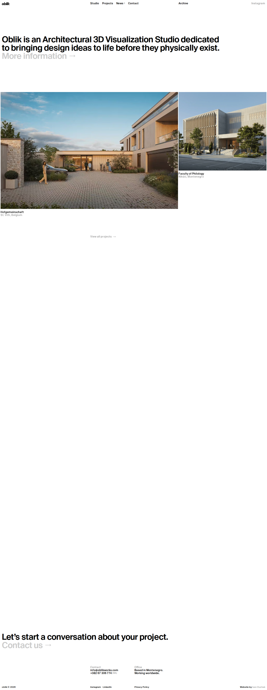
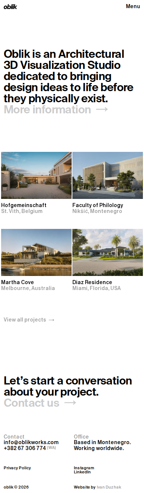

# UI Design System & Master Generation Blueprint: oblikworks-com

> **oblikworks · Architectural Visualization & 3D Rendering Studio** (https://oblikworks.com/) — oblikworks is an architectural visualization studio creating photorealistic 3D renderings, architectural imagery, and visual storytelling...



---

## 1. Executive Visual Persona & Design Archetype

- **Brand Essence & Persona**: **oblikworks · Architectural Visualization & 3D Rendering Studio** (`https://oblikworks.com/`). oblikworks is an architectural visualization studio creating photorealistic 3D renderings, architectural imagery, and visual storytelling...
- **Visual Archetype**: **Light-Substrate Editorial & Modular Grid System (`#eee` canvas, `#000` ink, `#000` accent)**.
- **Anti-AI-Slop Differentiators**:
  - **Source-Grounded Chromatic Polarity**: Anchors the viewport in `#eee` (`var(--_colors---line-color)` in `:root`) paired with `#000` primary typography and `#000` accents.
  - **Extracted Typographic Hierarchy**: Pairs `Antique Legacy` for display copy (`Oblik is an Architectural 3D Visuali`) with `Suisseintl` and not declared in static CSS (uses primary stack / `ui-monospace`).
  - **Calibrated Spatial Grid & Motion**: Combines `940px` container bounds (`gap: 16px`, padding `9px`) with `cubic-bezier(.625,.05,0,1)` easing and Lenis Smooth Scroll (`data-lenis`), GSAP Timeline & ScrollTrigger.

---

## 2. Spatial Architecture & Modular Grid Mathematics



### Viewport Allocation & Container Geometry
- **Captured Viewport Dimensions**: Desktop `1440×3719px` (`assets/desktop.png`, full-page scroll capture), Mobile `390×2400px` (`assets/mobile.png`, capped at 2400px multi-section capture).
- **Master Container Bounds**: `940px` extracted from `oblikworks-com` stylesheet.
- **Canvas Lateral Padding & Spacing**: `9px` lateral canvas padding with `16px` grid gap.
- **Border Radius Scale**: `3px`, `100%`, `50%`, `555px`.

### Responsive Breakpoint Architecture
- **Desktop Layout**: Multi-column CSS Grid / Flexbox layout at `1440px` (`max-width: 940px`, `gap: 16px`).
- **Mobile Layout**: Single-column vertical stack at `390px` viewport width with `9px` horizontal padding.
- **Extracted CSS Media Queries**: `@media screen and (max-width: 991px)`, `@media screen and (max-width: 767px)`, `@media screen and (max-width: 479px)`, `@media (min-width: 768px)`.

---

## 3. Color System, Materiality & Atmospheric Lighting

### Semantic Palette & Source Grounding
| Semantic Role | Ground-Truth Value | Extracted CSS Source / Selector |
|---|---|---|
| **Primary Canvas Substrate** | `#eee` | `var(--_colors---line-color)` in `:root` |
| **Primary Typography Ink** | `#f0f0f0` | `var(--_colors---button-grey)` in `:root` |
| **Elevated Surface / Card Substrate** | `#0000` | `a { background-color: #0000 }` |
| **Interactive Accent / Highlight** | `#000` | `mark { color: #000 }` |
| **Secondary / Muted Copy** | `#ff0` | `mark { background: #ff0 }` |
| **Structural Hairline Border** | `#333` | `body { color: #333 }` |

### Sanitized Root CSS Variables (`ui-ux.md` Ground Truth)
| Variable Name | Extracted Value | Semantic Role |
|---|---|---|
| `--w-backdrop-animation` | `initial` | Motion / Easing Token |
| `--_font-sizes---p16` | `clamp(14px, 1vw, 16px)` | Typography / Scale Token |
| `--_colors---line-color` | `#eee` | Brand / Palette Token |
| `--_colors---button-grey` | `#f0f0f0` | Brand / Palette Token |
| `--cases-width` | `calc(220vw + 25px)` | Layout / Spatial Grid Token |
| `--oblikworks-com-bg` | `#eee` | Canvas Substrate (from `var(--_colors---line-color)` in `:root`) |
| `--oblikworks-com-ink` | `#000` | Primary Typography Ink (stylesheet-derived) |
| `--oblikworks-com-surface` | `#0000` | Surface Substrate (stylesheet-derived) |
| `--oblikworks-com-accent` | `#000` | Interactive Accent (stylesheet-derived) |
| `--oblikworks-com-muted` | `#ff0` | Secondary Ink (stylesheet-derived) |
| `--oblikworks-com-border` | `#333` | Structural Border (stylesheet-derived) |
| `--oblikworks-com-container` | `940px` | Container Bound (stylesheet-derived) |
| `--oblikworks-com-gap` | `16px` | Grid Gutter (stylesheet-derived) |
| `--oblikworks-com-pad` | `9px` | Lateral Padding (stylesheet-derived) |
| `--oblikworks-com-ease` | `cubic-bezier(.625,.05,0,1)` | Primary Easing Function |
| `--oblikworks-com-radius` | `3px` | Corner Radius (stylesheet-derived) |

---

## 4. Typographic Scale & Editorial Hierarchy

### Font Family Stacks
- **Display Typography**: `Antique Legacy`.
- **Primary Body Stack**: `Suisseintl`.
- **Technical / Metadata Stack**: not declared in static CSS (uses primary stack / `ui-monospace`).

### Typographic Scale & Rules (Extracted from Stylesheet & Variables)
- **Hero Display (`H1`)**: rule `h1` (`font-size: 2em`).
- **Section Heading (`H2`)**: rule `h2` (`font-size: 32px`, `line-height: 36px`).
- **Body Copy**: rule `body` (`font-size: 14px`, `line-height: 20px`).
- **Metadata & Navigation Labels**: rule `small` (`font-size: 80%`).

---

## 5. Choreographed Motion & Interaction Physics

### Primary Easing Curves
- **Extracted Timing Functions**: `cubic-bezier(.625,.05,0,1)`.

### Per-Element Transition & Choreography Rules
- **Selector `.w-webflow-badge > img`**: `transition: unset` extracted from `oblikworks-com` stylesheet.
- **Selector `.w-slider-dot`**: `transition: background-color .1s, color .1s` extracted from `oblikworks-com` stylesheet.
- **Selector `.w-lightbox-control`**: `transition: all .3s` extracted from `oblikworks-com` stylesheet.
- **Extracted Easing Curve (`cubic-bezier(.625,.05,0,1)`)**: Governs interactive state transitions across `<header.w-mod-js>` and `<div.preloader>`.
- **Runtime Interaction Engine**: Integrates Lenis Smooth Scroll (`data-lenis`), GSAP Timeline & ScrollTrigger, Barba.js Page Transition Router with `prefers-reduced-motion: reduce` fallback guards.

---

## 6. Component Wireframe & Structural DOM Map

### Visual Layout Schematic (Grounded in `dom.html` — `1440px` Desktop & `390px` Mobile Reflow)
```
┌────────────────────────────────────────────────────────────────────────┐
│ DESKTOP VIEWPORT (1440px) — oblikworks · Architectural Visualization & │
│ ====================================================================== │
│ [ <header.w-mod-js>        | Studio · Projects · News 3 · Contact · ]  │
│ ---------------------------------------------------------------------- │
│ | HERO STAGE: <div.preloader>                                      |   │
│ | H1: Oblik is an Architectural 3D Visualization Studio...         |   │
│ | Substrate: #eee       | Ink: #000       | Accent: #000           |   │
│ ---------------------------------------------------------------------- │
│ | SHOWCASE GRID (<div.preloader>           ) max-w: 940px          |   │
│ | +------------------------------+  +------------------------------+ | │
│ | | More information             |  | Let’s start a conversation a | | │
│ | +------------------------------+  +------------------------------+ | │
│ ---------------------------------------------------------------------- │
│ | MOBILE VIEWPORT REFLOW (390px) — Single-Column Stack (gap: 16px  ) | │
│ | [<header.w-mod-js>] -> [<div.preloader>] -> [<div.preloader>] |      │
│ ---------------------------------------------------------------------- │
│ [ FOOTER (<footer.body>         ) | https://oblikworks.com/            │
└────────────────────────────────────────────────────────────────────────┘
```

### Granular DOM Region Breakdown
1. **Brand Header & Navigation Bar (<header.w-mod-js> — `oblikworks-com`)**:
   - Landmark `<header class="w-mod-js">` hosting `oblikworks · Architectural Visualiza` navigation (`Studio · Projects · News 3 · Contact · Archive`), DOM attributes (`data-wf-domain="oblikworks.com"`, `data-wf-page="69c2caad0ee663f0795cd0bb"`, `data-wf-site="69c2caab0ee663f0795ccce3"`, `data-wf-ignore`), and stylesheet rule `html.lenis body { height:auto }`.
2. **Hero Stage & Focal Lead (<div.preloader> — `Oblik is an Architectural 3D Visua`)**:
   - Landmark `<div class="preloader">` presenting display lead `Oblik is an Architectural 3D Visualization Studio...` and copy excerpt *"info@oblikworks.com"* over `#eee` canvas and `#000` ink.
3. **Primary Showcase & Content Grid (<div.preloader> — `More information`)**:
   - Landmark `<div class="preloader">` rendering section `More information` with copy *"August 8, 2026 New work: Faculty of Philology is now published on"*, asset references (`cdn.prod.website-files.com`, `oblik-studio.webflow.shared.30697...`, `1135743295497216`, `fbevents.js`), and grid rule `.lenis.lenis-stopped { overflow:clip }`.
4. **Interactive Detail & Feature Matrix (<div.preloader> — `Let’s start a conversation about y`)**:
   - Landmark `<div class="preloader">` framing `Let’s start a conversation about your project.` and `Contact us` (*"New work: Faculty of Philology is now published on our website."*) with `#0000` surface cards, `#000` accents, and `.lenis.lenis-smooth iframe { pointer-events:none }`.
5. **Colophon & Global Directory Footer (<footer.body> — `https://oblikworks.com/`)**:
   - Landmark `<footer class="body">` anchoring `oblikworks · Architectural Visua` footer links (`Studio · Projects · News 3 · Contact · Archive`), copy *"June 24, 2026 In the Press: Our Visualizations of The Alfred"*, and `#333` structural dividers.

---

## 7. Master Zero-Shot AI Generation Prompt

```markdown
# Master Zero-Shot Frontend Generation Prompt: oblikworks-com (oblikworks · Architectural Visualization & 3D Rendering Studio)

You are a principal frontend architect and design systems engineer. Build a complete, production-ready web application replicating the exact design system, DOM landmarks, typographic hierarchy, color tokens, and motion physics of `oblikworks-com` (**oblikworks · Architectural Visualization & 3D Rendering Studio** — `https://oblikworks.com/`).

### 1. Visual Archetype & Anti-AI-Slop Mandates
- **Archetype**: Light-Substrate Editorial & Modular Grid System (`#eee` canvas, `#000` ink, `#000` accent).
- **Identity & Domain Context**: oblikworks is an architectural visualization studio creating photorealistic 3D renderings, architectural imagery, and visual storytelling...
- **Primary Substrate**: `#eee` (`var(--_colors---line-color)` in `:root`), **Primary Ink**: `#000`, **Accent / Highlight**: `#000`.
- **Site-Specific Differentiators**:
  - **Source-Grounded Chromatic Polarity**: Anchors the viewport in `#eee` (`var(--_colors---line-color)` in `:root`) paired with `#000` primary typography and `#000` accents.
  - **Extracted Typographic Hierarchy**: Pairs `Antique Legacy` for display copy (`Oblik is an Architectural 3D Visuali`) with `Suisseintl` and not declared in static CSS (uses primary stack / `ui-monospace`).
  - **Calibrated Spatial Grid & Motion**: Combines `940px` container bounds (`gap: 16px`, padding `9px`) with `cubic-bezier(.625,.05,0,1)` easing and Lenis Smooth Scroll (`data-lenis`), GSAP Timeline & ScrollTrigger.

### 2. Ground-Truth CSS Variables (`:root` Token Contract)
Declare and consume these exact custom properties extracted from `oblikworks-com` in your global stylesheet:

:root {
  /* oblikworks · Architectural Visualization & 3D Rendering Studio (oblikworks-com) — Ground-Truth Extracted CSS Variables */
  --w-backdrop-animation: initial; /* Motion / Easing Token (oblikworks-com) */
  --_font-sizes---p16: clamp(14px, 1vw, 16px); /* Typography / Scale Token (oblikworks-com) */
  --_colors---line-color: #eee; /* Brand / Palette Token (oblikworks-com) */
  --_colors---button-grey: #f0f0f0; /* Brand / Palette Token (oblikworks-com) */
  --cases-width: calc(220vw + 25px); /* Layout / Spatial Grid Token (oblikworks-com) */
  --oblikworks-com-bg: #eee; /* Canvas Substrate (from `var(--_colors---line-color)` in `:root`) (oblikworks-com) */
  --oblikworks-com-ink: #000; /* Primary Typography Ink (stylesheet-derived) (oblikworks-com) */
  --oblikworks-com-surface: #0000; /* Surface Substrate (stylesheet-derived) (oblikworks-com) */
  --oblikworks-com-accent: #000; /* Interactive Accent (stylesheet-derived) (oblikworks-com) */
  --oblikworks-com-muted: #ff0; /* Secondary Ink (stylesheet-derived) (oblikworks-com) */
  --oblikworks-com-border: #333; /* Structural Border (stylesheet-derived) (oblikworks-com) */
  --oblikworks-com-container: 940px; /* Container Bound (stylesheet-derived) (oblikworks-com) */
  --oblikworks-com-gap: 16px; /* Grid Gutter (stylesheet-derived) (oblikworks-com) */
  --oblikworks-com-pad: 9px; /* Lateral Padding (stylesheet-derived) (oblikworks-com) */
  --oblikworks-com-ease: cubic-bezier(.625,.05,0,1); /* Primary Easing Function (oblikworks-com) */
  --oblikworks-com-radius: 3px; /* Corner Radius (stylesheet-derived) (oblikworks-com) */
}

### 3. Semantic Color & Materiality Contract
Map every surface, ink, and border strictly to these source-grounded tokens:
- **Primary Canvas Substrate**: `#eee` — grounded in `var(--_colors---line-color)` in `:root`
- **Primary Typography Ink**: `#f0f0f0` — grounded in `var(--_colors---button-grey)` in `:root`
- **Elevated Surface / Card Substrate**: `#0000` — grounded in `a { background-color: #0000 }`
- **Interactive Accent / Highlight**: `#000` — grounded in `mark { color: #000 }`
- **Secondary / Muted Copy**: `#ff0` — grounded in `mark { background: #ff0 }`
- **Structural Hairline Border**: `#333` — grounded in `body { color: #333 }`

### 4. Spatial Grid, Container Bounds & Responsive Breakpoints
- **Desktop Viewport Reference**: `1440×3719px` (full-page scroll capture, `1440px` standard desktop width).
- **Mobile Viewport Reference**: `390×2400px` (capped at 2400px multi-section capture, `390px` standard mobile width).
- **Container Max-Width**: `940px` extracted from `oblikworks-com` stylesheet
- **Padding & Gutters**: `9px` lateral canvas padding with `16px` grid gap
- **Desktop Grid**: Multi-column CSS Grid / Flexbox layout at `1440px` (`max-width: 940px`, `gap: 16px`)
- **Mobile Adaptation**: Single-column vertical stack at `390px` viewport width with `9px` horizontal padding
- **Media Queries**: `@media screen and (max-width: 991px)`, `@media screen and (max-width: 767px)`, `@media screen and (max-width: 479px)`, `@media (min-width: 768px)`
- **Corner Radii**: `3px`, `100%`, `50%`, `555px`

### 5. Typography & Editorial Scale Contract
- **Display Font Stack**: `Antique Legacy`
- **Body Font Stack**: `Suisseintl`
- **Monospace / Technical Font Stack**: not declared in static CSS (uses primary stack / `ui-monospace`)
- **H1 Display Rule**: rule `h1` (`font-size: 2em`)
- **H2 Section Rule**: rule `h2` (`font-size: 32px`, `line-height: 36px`)
- **Body Copy Rule**: rule `body` (`font-size: 14px`, `line-height: 20px`)
- **Metadata & Index Rule**: rule `small` (`font-size: 80%`)

### 6. Component Hierarchy, Verbatim Copy & Real DOM Landmarks
Scaffold `oblikworks-com` (`oblikworks · Architectural Visualization & 3D Rendering Studio`) with these exact structural regions, extracted copy, and CSS rules from `dom.html`:
1. **Brand Header & Navigation Bar (<header.w-mod-js> — `oblikworks-com`)**:
   - DOM & Selectors: Landmark `<header class="w-mod-js">` hosting `oblikworks · Architectural Visualiza` navigation (`Studio · Projects · News 3 · Contact · Archive`), DOM attributes (`data-wf-domain="oblikworks.com"`, `data-wf-page="69c2caad0ee663f0795cd0bb"`, `data-wf-site="69c2caab0ee663f0795ccce3"`, `data-wf-ignore`), and stylesheet rule `html.lenis body { height:auto }`.
   - Responsive Contract: Header `Brand Header & Navigation Bar (<header.w-mod-js> — `oblikworks-com`)` (`oblikworks-com`) adapts across `@media screen and (max-width: 991px)`, `@media screen and (max-width: 767px)`, `@media screen and (max-width: 479px)`, `@media (min-width: 768px)` with `cubic-bezier(.625,.05,0,1)` transitions and links `Studio · Projects · News 3 · Contact · Archive`.
2. **Hero Stage & Focal Lead (<div.preloader> — `Oblik is an Architectural 3D Visua`)**:
   - DOM & Selectors: Landmark `<div class="preloader">` presenting display lead `Oblik is an Architectural 3D Visualization Studio...` and copy excerpt *"info@oblikworks.com"* over `#eee` canvas and `#000` ink.
   - Responsive Contract: Hero stage (`1440×3719px` desktop / `390×2400px` mobile) sets `#eee` background with `#000` headline `Oblik is an Architectural 3D Visualization Studio...`.
3. **Primary Showcase & Content Grid (<div.preloader> — `More information`)**:
   - DOM & Selectors: Landmark `<div class="preloader">` rendering section `More information` with copy *"August 8, 2026 New work: Faculty of Philology is now published on"*, asset references (`cdn.prod.website-files.com`, `oblik-studio.webflow.shared.30697...`, `1135743295497216`, `fbevents.js`), and grid rule `.lenis.lenis-stopped { overflow:clip }`.
   - Responsive Contract: Showcase grid `Primary Showcase & Content Grid (<div.preloader> — `More information`)` applies Multi-column CSS Grid / Flexbox layout at `1440px` (`max-width: 940px`, `gap: 16px`) on desktop and Single-column vertical stack at `390px` viewport width with `9px` horizontal padding on mobile.
4. **Interactive Detail & Feature Matrix (<div.preloader> — `Let’s start a conversation about y`)**:
   - DOM & Selectors: Landmark `<div class="preloader">` framing `Let’s start a conversation about your project.` and `Contact us` (*"New work: Faculty of Philology is now published on our website."*) with `#0000` surface cards, `#000` accents, and `.lenis.lenis-smooth iframe { pointer-events:none }`.
   - Responsive Contract: Detail module `Interactive Detail & Feature Matrix (<div.preloader> — `Let’s start a conversation about y`)` uses `3px`, `100%`, `50%`, `555px` radii, `#000` highlights, and assets (cdn.prod.website-files.com, oblik-studio.webflow.shared.30697..., 1135743295497216).
5. **Colophon & Global Directory Footer (<footer.body> — `https://oblikworks.com/`)**:
   - DOM & Selectors: Landmark `<footer class="body">` anchoring `oblikworks · Architectural Visua` footer links (`Studio · Projects · News 3 · Contact · Archive`), copy *"June 24, 2026 In the Press: Our Visualizations of The Alfred"*, and `#333` structural dividers.
   - Responsive Contract: Footer `Colophon & Global Directory Footer (<footer.body> — `https://oblikworks.com/`)` aligns to `940px` extracted from `oblikworks-com` stylesheet with `9px` lateral canvas padding with `16px` grid gap and attributes (data-wf-domain="oblikworks.com", data-wf-page="69c2caad0ee663f0795cd0bb", data-wf-site="69c2caab0ee663f0795ccce3").

#### Verbatim DOM Copy Excerpts (`dom.html`)
- Copy Excerpt 1: *"info@oblikworks.com"*
- Copy Excerpt 2: *"August 8, 2026 New work: Faculty of Philology is now published on our website."*
- Copy Excerpt 3: *"New work: Faculty of Philology is now published on our website."*
- Copy Excerpt 4: *"June 24, 2026 In the Press: Our Visualizations of The Alfred featured in Urban List."*

### 7. Motion, Extracted Stylesheet Rules & Interaction Choreography
- **Primary Easing Functions**: `cubic-bezier(.625,.05,0,1)`
- **Extracted Stylesheet Rules (`oblikworks-com`)**:
- `html.lenis body { height:auto }`
- `.lenis.lenis-stopped { overflow:clip }`
- `.lenis.lenis-smooth iframe { pointer-events:none }`
- `html { -webkit-text-size-adjust: 100%; -ms-text-size-adjust: 100%; font-family:... }`
- `body { margin: 0; }`
- **Per-Selector Transition Rules**:
- **Selector `.w-webflow-badge > img`**: `transition: unset` extracted from `oblikworks-com` stylesheet.
- **Selector `.w-slider-dot`**: `transition: background-color .1s, color .1s` extracted from `oblikworks-com` stylesheet.
- **Selector `.w-lightbox-control`**: `transition: all .3s` extracted from `oblikworks-com` stylesheet.
- **Extracted Easing Curve (`cubic-bezier(.625,.05,0,1)`)**: Governs interactive state transitions across `<header.w-mod-js>` and `<div.preloader>`.
- **Runtime Interaction Engine**: Integrates Lenis Smooth Scroll (`data-lenis`), GSAP Timeline & ScrollTrigger, Barba.js Page Transition Router with `prefers-reduced-motion: reduce` fallback guards.

### 8. Technical Deliverables
- Implement in Next.js (App Router) with TypeScript and Tailwind CSS consuming the `:root` custom properties defined above for `oblikworks-com`.
- Reproduce both the `1440px` desktop architecture and `390px` mobile breakpoint transitions, preserving semantic HTML5 landmarks (`<header>`, `<nav>`, `<main>`, `<section>`, `<footer>`) and `prefers-reduced-motion` accessibility guards.
```
