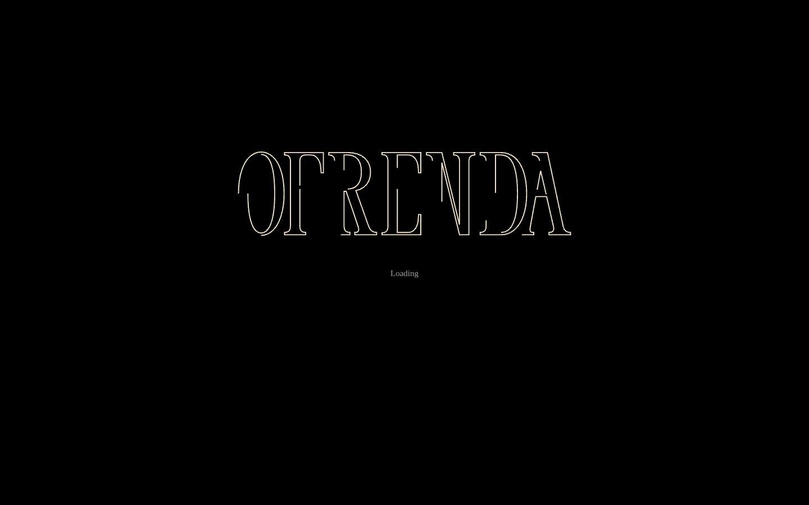

# UI Design System & Master Generation Blueprint: ofrenda-davidlangarica-dev

> **OFRENDA — Create a personal Día de Muertos altar** (https://ofrenda.davidlangarica.dev) — Create a personal Día de Muertos ofrenda with a photograph, flowers, candles, and meaningful offerings. A quiet place to remember someone...



---

## 1. Executive Visual Persona & Design Archetype

- **Brand Essence & Persona**: **OFRENDA — Create a personal Día de Muertos altar** (`https://ofrenda.davidlangarica.dev`). Create a personal Día de Muertos ofrenda with a photograph, flowers, candles, and meaningful offerings. A quiet place to remember someone...
- **Capture Provenance**: Live browser capture (`tier2_webgl`, HTTP `200`, captured `2026-11-23`).
- **Visual Archetype**: **Dark-Substrate WebGL / Canvas Interactive Experience (`#20201f` / `#e4b687`)**.
- **Anti-AI-Slop Differentiators**:
  - **Live-Computed Chromatic Polarity**: Anchors the viewport in `#20201f` (live computed `html` `background-color` (`computed_styles.json`)) paired with `#ffffff` primary typography and `#e4b687` accents.
  - **Grounded Typographic Hierarchy**: Pairs `Marqen` for display copy (`OFRENDA`) with `Georgia` and not declared in live computed styles (uses primary stack / `ui-monospace`).
  - **Calibrated Spatial Grid & Motion**: Combines `1440px` container bounds (`gap: 8px`, padding `6px`) with `cubic-bezier(.22,.68,.2,1)` easing and Lenis Smooth Scroll (`data-lenis`), Three.js / WebGL Canvas Pipeline.

---

## 2. Spatial Architecture & Modular Grid Mathematics


### Viewport Allocation & Container Geometry
- **Captured Viewport Dimensions**: Desktop `1440×900px` (`assets/desktop.png`, single-viewport 100vh live capture (900px)), Mobile `390×844px` (`assets/mobile.png`, single-viewport 100vh live capture (844px)).
- **Master Container Bounds**: `1440px` (full-bleed `100%` viewport stage).
- **Canvas Lateral Padding & Spacing**: `6px` lateral canvas padding with `8px` grid gap.
- **Border Radius Scale**: `10px`, `50%`, `4px`, `5px`.

### Responsive Breakpoint Architecture
- **Desktop Layout**: Multi-column CSS Grid / Flexbox layout at `1440px` (`max-width: 1440px`, `gap: 8px`).
- **Mobile Layout**: Single-column vertical stack at `390px` viewport width with `6px` horizontal padding.
- **Extracted CSS Media Queries**: `@media (max-width:600px)`, `@media (max-height:500px)and (min-aspect-ratio:1.15/1)`, `@media (max-height:700px)`, `@media (prefers-reduced-motion:reduce)`.

---

## 3. Color System, Materiality & Atmospheric Lighting

### Semantic Palette & Source Grounding
| Semantic Role | Ground-Truth Value | Extracted Live / CSS Source |
|---|---|---|
| **Primary Canvas Substrate** | `#20201f` | live computed `html` `background-color` (`computed_styles.json`) |
| **Primary Typography Ink** | `#ffffff` | live computed `main` `color` (`computed_styles.json`) |
| **Elevated Surface / Card Substrate** | `#000000` | `.app-shell { background: #000000 }` |
| **Interactive Accent / Highlight** | `#e4b687` | `.primary-button { background: #e4b687 }` |
| **Secondary / Muted Copy** | `#ef893b` | `var(--ui-heading)` in `:root` |
| **Structural Hairline Border** | `#79756f` | `.recenter-button { border: #79756f }` |
| **Variable Token (`--ui-text`)** | `#f4e6cf` | `var(--ui-text)` in `:root` |
| **Variable Token (`--ui-muted`)** | `#d5c4a9` | `var(--ui-muted)` in `:root` |
| **Variable Token (`--ui-home-heading`)** | `#f3e3c7` | `var(--ui-home-heading)` in `:root` |
| **Variable Token (`--ui-focus`)** | `#efd6a4` | `var(--ui-focus)` in `:root` |

### Sanitized Root CSS Variables (`ui-ux.md` Ground Truth)
| Variable Name | Extracted Value | Semantic Role |
|---|---|---|
| `--ui-font-heading` | `"Marqen", Georgia, "Times New Roman", serif` | Typography Ink Token |
| `--ui-font-body` | `Georgia, "Times New Roman", serif` | Typography / Scale Token |
| `--ui-text-shadow` | `0 2px 14px #000` | Typography Ink Token |
| `--ui-backdrop` | `#000` | Color / Atmospheric Token |
| `--ui-text` | `#f4e6cf` | Typography Ink Token |
| `--ui-muted` | `#d5c4a9` | Color / Atmospheric Token |
| `--ui-heading` | `#ef893b` | Typography Ink Token |
| `--ui-home-heading` | `#f3e3c7` | Typography Ink Token |
| `--ui-amber-rgb` | `189 149 91` | Design System Custom Token |
| `--ui-amber` | `rgb(var(--ui-amber-rgb))` | Color / Atmospheric Token |
| `--ui-surface-rgb` | `70 39 17` | Canvas / Surface Token |
| `--ui-surface` | `rgb(var(--ui-surface-rgb) / .18)` | Canvas / Surface Token |
| `--ui-surface-hover` | `rgb(160 110 49 / .2)` | Canvas / Surface Token |
| `--ui-surface-pressed` | `rgb(184 133 67 / .28)` | Canvas / Surface Token |
| `--ui-border` | `rgb(var(--ui-amber-rgb) / .74)` | Elevation / Border Token |
| `--ui-focus` | `#efd6a4` | Color / Atmospheric Token |

---

## 4. Typographic Scale & Editorial Hierarchy

### Font Family Stacks
- **Display Typography**: `Marqen`.
- **Primary Body Stack**: `Georgia`.
- **Technical / Metadata Stack**: not declared in live computed styles (uses primary stack / `ui-monospace`).

### Typographic Scale & Rules (Live Computed & Stylesheet Grounded)
- **Hero Display (`H1`)**: live computed `h1` (`font-size: 210px`, `line-height: 180.6px`, `font-weight: 400`); rule `h1` (`font-size: clamp(44px,12vw,72px)`, `line-height: 1.08`, `font-weight: 400`).
- **Section Heading (`H2`)**: rule `h2` (`font-size: 30px`, `line-height: 1.1`).
- **Body Copy**: live computed `body` (`font-size: 16px`, `line-height: normal`, `font-weight: 400`); CSS variables `--ui-font-body: Georgia, "Times New Roman", serif`, `--ui-body-size: clamp(16px, 1.5vw, 19px)`, `--ui-body-line-height: 1.55`; rule `p` (`font-size: 16px`, `line-height: 1.4`).
- **Metadata & Navigation Labels**: live computed `nav/a` (`font-size: 14px`, `line-height: 23.1px`, `font-weight: 400`).

---

## 5. Choreographed Motion & Interaction Physics

### Primary Easing Curves
- **Extracted Timing Functions**: `cubic-bezier(.22,.68,.2,1)`.

### Per-Element Transition & Choreography Rules
- **Selector `.lenis.lenis-autoToggle`**: `transition: 1ms` extracted from `ofrenda-davidlangarica-dev` stylesheet.
- **Selector `.canvas-layer`**: `transition: bottom .32s ease` extracted from `ofrenda-davidlangarica-dev` stylesheet.
- **Selector `media(prefers-reduced-motion:reduce)`**: `transition: .08s` extracted from `ofrenda-davidlangarica-dev` stylesheet.
- **Extracted Easing Curve (`cubic-bezier(.22,.68,.2,1)`)**: Governs interactive state transitions across `<header.experience-chrome>` and `<section.floating-menu:nth(2)>`.
- **Runtime Interaction Engine**: Integrates Lenis Smooth Scroll (`data-lenis`), Three.js / WebGL Canvas Pipeline with `prefers-reduced-motion: reduce` fallback guards.

---

## 6. Component Wireframe & Structural DOM Map

### Visual Layout Schematic — Desktop (`1440px`, Grounded in `dom.html` & Landmark Bounding Boxes)
```
┌────────────────────────────────────────────────────────────────────────┐
│ DESKTOP VIEWPORT (1440px) — OFRENDA — Create a personal Día de Muertos │
│ ====================================================================== │
│ [ <header.experience-chr (1440x900px) | David Langarica              ] │
│ ---------------------------------------------------------------------- │
│ | HERO STAGE: <section.floating-menu> (w=880px)                      | │
│ | H1: OFRENDA                                                        | │
│ | Substrate: #20201f | Ink: #ffffff | Accent: #e4b687                | │
│ ---------------------------------------------------------------------- │
│ | SHOWCASE GRID (<section.floating-menu:nth) max-w: 1440px           | │
│ | +------------------------------+  +------------------------------+ | │
│ | | For you, who still have a pl |  | Language Choose English or S | | │
│ | +------------------------------+  +------------------------------+ | │
│ ---------------------------------------------------------------------- │
│ | DETAIL MODULE (<section.floating-menu:nth) — Sound Music and ambie | │
│ ---------------------------------------------------------------------- │
│ [ FOOTER (<footer.menu-footer>) | https://ofrenda.davidlangarica.dev   │
└────────────────────────────────────────────────────────────────────────┘
```

### Visual Layout Schematic — Mobile Reflow (`390px`)
```
┌────────────────────────────────────────────────────────────────────────┐
│ MOBILE VIEWPORT REFLOW (390px) — Single-Column Stack (gap: 8px)        │
│ ====================================================================== │
│ [ HEADER BAR (<header.experience-chrom) | Compact Menu (390px)         │
│ ---------------------------------------------------------------------- │
│ | HERO STAGE (<section.floating-menu>) — 390px Vertical Lead         | │
│ | H1: OFRENDA                                                        | │
│ ---------------------------------------------------------------------- │
│ | SHOWCASE STACK (<section.floating-menu) — 1-Col Stack              | │
│ | [ Item 1: For you, who still have a place here.                  ] | │
│ | [ Item 2: Language Choose English or Spanish.                    ] | │
│ ---------------------------------------------------------------------- │
│ | DETAIL STACK (<section.floating-menu:n) — 1-Col (Sound Music and am) │
│ ---------------------------------------------------------------------- │
│ [ FOOTER (<footer.menu-footer>) | Stacked 390px Colophon               │
└────────────────────────────────────────────────────────────────────────┘
```

### Granular DOM Region Breakdown
1. **Brand Header & Navigation Bar (<header.experience-chrome> — `ofrenda-davidlangarica-dev`)**:
   - Landmark `<header class="experience-chrome">` (`1440x900px`) hosting `OFRENDA — Create a personal Día de M` navigation (`David Langarica`), DOM attributes (`data-cf-beacon="("token":"e723bd39f9d..."`, `data-engine="three.js r180 webgpu"`, `data-on="true"`, `data-loading-progress="0.7500000000000001"`), and stylesheet rule `html.lenis body { height:auto }`.
2. **Hero Stage & Focal Lead (<section.floating-menu> — `OFRENDA`)**:
   - Landmark `<section class="floating-menu">` presenting display lead `OFRENDA` and copy excerpt *"For you, who still have a place here."* over `#20201f` canvas and `#ffffff` ink.
3. **Primary Showcase & Content Grid (<section.floating-menu:nth(2)> — `For you, who still have a place he`)**:
   - Landmark `<section class="floating-menu">` rendering section `For you, who still have a place here.` with copy *"Language Choose English or Spanish."*, asset references (`favicon.ico`, `Marqen.woff2`, `index-CUtJAqPO.js`, `index-BRkV915_.css`), and grid rule `.lenis-stopped { overflow:clip }`.
4. **Interactive Detail & Feature Matrix (<section.floating-menu:nth(3)> — `Language Choose English or Spanish`)**:
   - Landmark `<section class="floating-menu">` framing `Language Choose English or Spanish.` and `Sound Music and ambience.` (*"Sound Music and ambience."*) with `#000000` surface cards, `#e4b687` accents, and `.lenis.lenis-smooth iframe { pointer-events:none }`.
5. **Colophon & Global Directory Footer (<footer.menu-footer> — `https://ofrenda.davidlangarica.dev`)**:
   - Landmark `<footer class="menu-footer">` anchoring `OFRENDA — Create a personal Día ` footer links (`David Langarica`), copy *"Graphics Available after the water and salt."*, and `#79756f` structural dividers.

---

## 7. Master Zero-Shot AI Generation Prompt

```markdown
# Master Zero-Shot Frontend Generation Prompt: ofrenda-davidlangarica-dev (OFRENDA — Create a personal Día de Muertos altar)

You are a principal frontend architect and design systems engineer. Build a complete, production-ready web application replicating the exact design system, DOM landmarks, typographic hierarchy, color tokens, and motion physics of `ofrenda-davidlangarica-dev` (**OFRENDA — Create a personal Día de Muertos altar** — `https://ofrenda.davidlangarica.dev`).

### 1. Visual Archetype & Anti-AI-Slop Mandates
- **Archetype**: Dark-Substrate WebGL / Canvas Interactive Experience (`#20201f` / `#e4b687`).
- **Identity & Domain Context**: Create a personal Día de Muertos ofrenda with a photograph, flowers, candles, and meaningful offerings. A quiet place to remember someone...
- **Primary Substrate**: `#20201f` (live computed `html` `background-color` (`computed_styles.json`)), **Primary Ink**: `#ffffff`, **Accent / Highlight**: `#e4b687`.
- **Site-Specific Differentiators**:
  - **Live-Computed Chromatic Polarity**: Anchors the viewport in `#20201f` (live computed `html` `background-color` (`computed_styles.json`)) paired with `#ffffff` primary typography and `#e4b687` accents.
  - **Grounded Typographic Hierarchy**: Pairs `Marqen` for display copy (`OFRENDA`) with `Georgia` and not declared in live computed styles (uses primary stack / `ui-monospace`).
  - **Calibrated Spatial Grid & Motion**: Combines `1440px` container bounds (`gap: 8px`, padding `6px`) with `cubic-bezier(.22,.68,.2,1)` easing and Lenis Smooth Scroll (`data-lenis`), Three.js / WebGL Canvas Pipeline.

### 2. Ground-Truth CSS Variables (`:root` Token Contract)
Declare and consume these exact custom properties extracted from `ofrenda-davidlangarica-dev` in your global stylesheet:

:root {
  /* OFRENDA — Create a personal Día de Muertos altar (ofrenda-davidlangarica-dev) — Live-Grounded CSS Variables */
  --ui-font-heading: "Marqen", Georgia, "Times New Roman", serif; /* Typography Ink Token (ofrenda-davidlangarica-dev) */
  --ui-font-body: Georgia, "Times New Roman", serif; /* Typography / Scale Token (ofrenda-davidlangarica-dev) */
  --ui-text-shadow: 0 2px 14px #000; /* Typography Ink Token (ofrenda-davidlangarica-dev) */
  --ui-backdrop: #000; /* Color / Atmospheric Token (ofrenda-davidlangarica-dev) */
  --ui-text: #f4e6cf; /* Typography Ink Token (ofrenda-davidlangarica-dev) */
  --ui-muted: #d5c4a9; /* Color / Atmospheric Token (ofrenda-davidlangarica-dev) */
  --ui-heading: #ef893b; /* Typography Ink Token (ofrenda-davidlangarica-dev) */
  --ui-home-heading: #f3e3c7; /* Typography Ink Token (ofrenda-davidlangarica-dev) */
  --ui-amber-rgb: 189 149 91; /* Design System Custom Token (ofrenda-davidlangarica-dev) */
  --ui-amber: rgb(var(--ui-amber-rgb)); /* Color / Atmospheric Token (ofrenda-davidlangarica-dev) */
  --ui-surface-rgb: 70 39 17; /* Canvas / Surface Token (ofrenda-davidlangarica-dev) */
  --ui-surface: rgb(var(--ui-surface-rgb) / .18); /* Canvas / Surface Token (ofrenda-davidlangarica-dev) */
  --ui-surface-hover: rgb(160 110 49 / .2); /* Canvas / Surface Token (ofrenda-davidlangarica-dev) */
  --ui-surface-pressed: rgb(184 133 67 / .28); /* Canvas / Surface Token (ofrenda-davidlangarica-dev) */
  --ui-border: rgb(var(--ui-amber-rgb) / .74); /* Elevation / Border Token (ofrenda-davidlangarica-dev) */
  --ui-focus: #efd6a4; /* Color / Atmospheric Token (ofrenda-davidlangarica-dev) */
}

### 3. Semantic Color & Materiality Contract
Map every surface, ink, and border strictly to these source-grounded tokens:
- **Primary Canvas Substrate**: `#20201f` — grounded in live computed `html` `background-color` (`computed_styles.json`)
- **Primary Typography Ink**: `#ffffff` — grounded in live computed `main` `color` (`computed_styles.json`)
- **Elevated Surface / Card Substrate**: `#000000` — grounded in `.app-shell { background: #000000 }`
- **Interactive Accent / Highlight**: `#e4b687` — grounded in `.primary-button { background: #e4b687 }`
- **Secondary / Muted Copy**: `#ef893b` — grounded in `var(--ui-heading)` in `:root`
- **Structural Hairline Border**: `#79756f` — grounded in `.recenter-button { border: #79756f }`
- **Variable Token (`--ui-text`)**: `#f4e6cf` — grounded in `var(--ui-text)` in `:root`
- **Variable Token (`--ui-muted`)**: `#d5c4a9` — grounded in `var(--ui-muted)` in `:root`
- **Variable Token (`--ui-home-heading`)**: `#f3e3c7` — grounded in `var(--ui-home-heading)` in `:root`
- **Variable Token (`--ui-focus`)**: `#efd6a4` — grounded in `var(--ui-focus)` in `:root`

### 4. Spatial Grid, Container Bounds & Responsive Breakpoints
- **Desktop Viewport Reference**: `1440×900px` (single-viewport 100vh live capture (900px), `1440px` standard desktop width).
- **Mobile Viewport Reference**: `390×844px` (single-viewport 100vh live capture (844px), `390px` standard mobile width).
- **Container Max-Width**: `1440px` (full-bleed `100%` viewport stage)
- **Padding & Gutters**: `6px` lateral canvas padding with `8px` grid gap
- **Desktop Grid**: Multi-column CSS Grid / Flexbox layout at `1440px` (`max-width: 1440px`, `gap: 8px`)
- **Mobile Adaptation**: Single-column vertical stack at `390px` viewport width with `6px` horizontal padding
- **Media Queries**: `@media (max-width:600px)`, `@media (max-height:500px)and (min-aspect-ratio:1.15/1)`, `@media (max-height:700px)`, `@media (prefers-reduced-motion:reduce)`
- **Corner Radii**: `10px`, `50%`, `4px`, `5px`

### 5. Typography & Editorial Scale Contract
- **Display Font Stack**: `Marqen`
- **Body Font Stack**: `Georgia`
- **Monospace / Technical Font Stack**: not declared in live computed styles (uses primary stack / `ui-monospace`)
- **H1 Display Rule**: live computed `h1` (`font-size: 210px`, `line-height: 180.6px`, `font-weight: 400`); rule `h1` (`font-size: clamp(44px,12vw,72px)`, `line-height: 1.08`, `font-weight: 400`)
- **H2 Section Rule**: rule `h2` (`font-size: 30px`, `line-height: 1.1`)
- **Body Copy Rule**: live computed `body` (`font-size: 16px`, `line-height: normal`, `font-weight: 400`); CSS variables `--ui-font-body: Georgia, "Times New Roman", serif`, `--ui-body-size: clamp(16px, 1.5vw, 19px)`, `--ui-body-line-height: 1.55`; rule `p` (`font-size: 16px`, `line-height: 1.4`)
- **Metadata & Index Rule**: live computed `nav/a` (`font-size: 14px`, `line-height: 23.1px`, `font-weight: 400`)

### 6. Component Hierarchy, Verbatim Copy & Real DOM Landmarks
Scaffold `ofrenda-davidlangarica-dev` (`OFRENDA — Create a personal Día de Muertos altar`) with these exact structural regions, extracted copy, and CSS rules from `dom.html`:
1. **Brand Header & Navigation Bar (<header.experience-chrome> — `ofrenda-davidlangarica-dev`)**:
   - DOM & Selectors: Landmark `<header class="experience-chrome">` (`1440x900px`) hosting `OFRENDA — Create a personal Día de M` navigation (`David Langarica`), DOM attributes (`data-cf-beacon="("token":"e723bd39f9d..."`, `data-engine="three.js r180 webgpu"`, `data-on="true"`, `data-loading-progress="0.7500000000000001"`), and stylesheet rule `html.lenis body { height:auto }`.
   - Responsive Contract: Header `Brand Header & Navigation Bar (<header.experience-chrome> — `ofrenda-davidlangarica-dev`)` (`ofrenda-davidlangarica-dev`) adapts across `@media (max-width:600px)`, `@media (max-height:500px)and (min-aspect-ratio:1.15/1)`, `@media (max-height:700px)`, `@media (prefers-reduced-motion:reduce)` with `cubic-bezier(.22,.68,.2,1)` transitions and links `David Langarica`.
2. **Hero Stage & Focal Lead (<section.floating-menu> — `OFRENDA`)**:
   - DOM & Selectors: Landmark `<section class="floating-menu">` presenting display lead `OFRENDA` and copy excerpt *"For you, who still have a place here."* over `#20201f` canvas and `#ffffff` ink.
   - Responsive Contract: Hero stage (`1440×900px` desktop / `390×844px` mobile) sets `#20201f` background with `#ffffff` headline `OFRENDA`.
3. **Primary Showcase & Content Grid (<section.floating-menu:nth(2)> — `For you, who still have a place he`)**:
   - DOM & Selectors: Landmark `<section class="floating-menu">` rendering section `For you, who still have a place here.` with copy *"Language Choose English or Spanish."*, asset references (`favicon.ico`, `Marqen.woff2`, `index-CUtJAqPO.js`, `index-BRkV915_.css`), and grid rule `.lenis-stopped { overflow:clip }`.
   - Responsive Contract: Showcase grid `Primary Showcase & Content Grid (<section.floating-menu:nth(2)> — `For you, who still have a place he`)` applies Multi-column CSS Grid / Flexbox layout at `1440px` (`max-width: 1440px`, `gap: 8px`) on desktop and Single-column vertical stack at `390px` viewport width with `6px` horizontal padding on mobile.
4. **Interactive Detail & Feature Matrix (<section.floating-menu:nth(3)> — `Language Choose English or Spanish`)**:
   - DOM & Selectors: Landmark `<section class="floating-menu">` framing `Language Choose English or Spanish.` and `Sound Music and ambience.` (*"Sound Music and ambience."*) with `#000000` surface cards, `#e4b687` accents, and `.lenis.lenis-smooth iframe { pointer-events:none }`.
   - Responsive Contract: Detail module `Interactive Detail & Feature Matrix (<section.floating-menu:nth(3)> — `Language Choose English or Spanish`)` uses `10px`, `50%`, `4px`, `5px` radii, `#e4b687` highlights, and assets (favicon.ico, Marqen.woff2, index-CUtJAqPO.js).
5. **Colophon & Global Directory Footer (<footer.menu-footer> — `https://ofrenda.davidlangarica.dev`)**:
   - DOM & Selectors: Landmark `<footer class="menu-footer">` anchoring `OFRENDA — Create a personal Día ` footer links (`David Langarica`), copy *"Graphics Available after the water and salt."*, and `#79756f` structural dividers.
   - Responsive Contract: Footer `Colophon & Global Directory Footer (<footer.menu-footer> — `https://ofrenda.davidlangarica.dev`)` aligns to `1440px` (full-bleed `100%` viewport stage) with `6px` lateral canvas padding with `8px` grid gap and attributes (data-cf-beacon="("token":"e723bd39f9d...", data-engine="three.js r180 webgpu", data-on="true").

#### Verbatim DOM Copy Excerpts (`dom.html`)
- Copy Excerpt 1: *"For you, who still have a place here."*
- Copy Excerpt 2: *"Language Choose English or Spanish."*
- Copy Excerpt 3: *"Sound Music and ambience."*
- Copy Excerpt 4: *"Graphics Available after the water and salt."*

### 7. Motion, Extracted Stylesheet Rules & Interaction Choreography
- **Primary Easing Functions**: `cubic-bezier(.22,.68,.2,1)`
- **Extracted Stylesheet Rules (`ofrenda-davidlangarica-dev`)**:
- `html.lenis body { height:auto }`
- `.lenis-stopped { overflow:clip }`
- `.lenis.lenis-smooth iframe { pointer-events:none }`
- `.lenis.lenis-autoToggle { transition-property:overflow;transition-duration:1ms;transition-behavior... }`
- `.candle-tutorial { position:fixed;inset:0;z-index:80;pointer-events:none;opacity:0;overflow... }`
- **Per-Selector Transition Rules**:
- **Selector `.lenis.lenis-autoToggle`**: `transition: 1ms` extracted from `ofrenda-davidlangarica-dev` stylesheet.
- **Selector `.canvas-layer`**: `transition: bottom .32s ease` extracted from `ofrenda-davidlangarica-dev` stylesheet.
- **Selector `media(prefers-reduced-motion:reduce)`**: `transition: .08s` extracted from `ofrenda-davidlangarica-dev` stylesheet.
- **Extracted Easing Curve (`cubic-bezier(.22,.68,.2,1)`)**: Governs interactive state transitions across `<header.experience-chrome>` and `<section.floating-menu:nth(2)>`.
- **Runtime Interaction Engine**: Integrates Lenis Smooth Scroll (`data-lenis`), Three.js / WebGL Canvas Pipeline with `prefers-reduced-motion: reduce` fallback guards.

### 8. Technical Deliverables
- Implement in Next.js (App Router) with TypeScript and Tailwind CSS consuming the `:root` custom properties defined above for `ofrenda-davidlangarica-dev`.
- Reproduce both the `1440px` desktop architecture and `390px` mobile breakpoint transitions, preserving semantic HTML5 landmarks (`<header>`, `<nav>`, `<main>`, `<section>`, `<footer>`) and `prefers-reduced-motion` accessibility guards.
```
