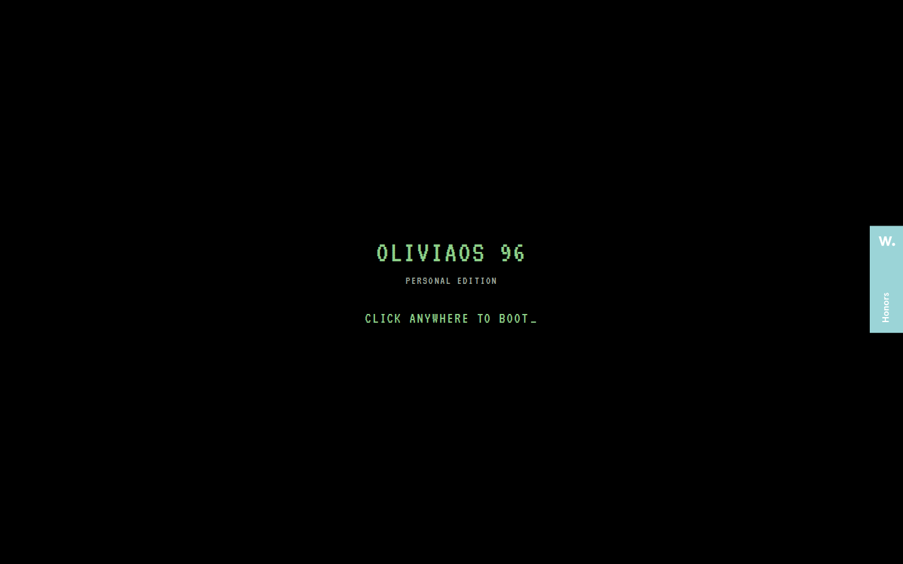

# UI Design System & Master Generation Blueprint: oliviaarents-com

> **OliviaOS 96 — Personal Edition** (https://oliviaarents.com/) — OliviaOS 96 — Personal Edition. Olivia's personal portfolio, imagined as a late-1990s desktop operating system.



---

## 1. Executive Visual Persona & Design Archetype

- **Brand Essence & Persona**: **OliviaOS 96 — Personal Edition** (`https://oliviaarents.com/`). OliviaOS 96 — Personal Edition. Olivia's personal portfolio, imagined as a late-1990s desktop operating system.
- **Capture Provenance**: Live browser capture (`tier1_fast`, HTTP `200`, captured `2026-11-23`).
- **Visual Archetype**: **High-Contrast Obsidian / Atmospheric Design System (`#000000` canvas, `#fffde5` ink, `#9e9eff` accent)**.
- **Anti-AI-Slop Differentiators**:
  - **Live-Computed Chromatic Polarity**: Anchors the viewport in `#000000` (live computed `html` `background-color` (`computed_styles.json`)) paired with `#fffde5` primary typography and `#9e9eff` accents.
  - **Grounded Typographic Hierarchy**: Pairs `VT323` for display copy (`OLIVIAOS 96`) with `Tahoma` and not declared in live computed styles (uses primary stack / `ui-monospace`).
  - **Calibrated Spatial Grid & Motion**: Combines `1440px` container bounds (`gap: 8px`, padding `8px`) with `cubic-bezier(0.25,0.1,0.25,1)` easing.

---

## 2. Spatial Architecture & Modular Grid Mathematics


### Viewport Allocation & Container Geometry
- **Captured Viewport Dimensions**: Desktop `1440×900px` (`assets/desktop.png`, single-viewport 100vh live capture (900px)), Mobile `390×844px` (`assets/mobile.png`, single-viewport 100vh live capture (844px)).
- **Master Container Bounds**: `1440px` (full-bleed `100%` desktop stage measured on `1440px` viewport).
- **Canvas Lateral Padding & Spacing**: `8px` lateral canvas padding with `8px` grid gap.
- **Border Radius Scale**: `3px`, `4px`, `2px`, `50%`.

### Responsive Breakpoint Architecture
- **Desktop Layout**: Multi-column CSS Grid / Flexbox layout at `1440px` (`max-width: 1440px`, `gap: 8px`).
- **Mobile Layout**: Single-column vertical stack at `390px` viewport width with `8px` horizontal padding.
- **Extracted CSS Media Queries**: `@media (prefers-reduced-motion:reduce)`, `@media (width<=400px)`, `@media (width>=600px)`.

---

## 3. Color System, Materiality & Atmospheric Lighting

### Semantic Palette & Source Grounding
| Semantic Role | Ground-Truth Value | Extracted Live / CSS Source |
|---|---|---|
| **Primary Canvas Substrate** | `#000000` | live computed `html` `background-color` (`computed_styles.json`) |
| **Primary Typography Ink** | `#fffde5` | live computed `button` `color` (`computed_styles.json`) |
| **Elevated Surface / Card Substrate** | `#163e2e` | live computed `main` `background-color` (`computed_styles.json`) |
| **Interactive Accent / Highlight** | `#9e9eff` | live computed `a` `color` (`computed_styles.json`) |
| **Secondary / Muted Copy** | `#9e9eff` | live computed `a` `color` (`computed_styles.json`) |
| **Structural Hairline Border** | `#548b59` | `.boot-screen__progress { border: #548b59 }` |

### Sanitized Root CSS Variables (`ui-ux.md` Ground Truth)
| Variable Name | Extracted Value | Semantic Role |
|---|---|---|
| `--lightningcss-dark` | `initial` | Canvas / Surface Token |
| `--lightningcss-light` | `initial` | Canvas / Surface Token |
| `--touch-dock-height` | `calc(70px + env(safe-area-inset-bottom,0px))` | Layout / Spatial Grid Token |
| `--taskbar-height` | `48px` | Layout / Spatial Grid Token |
| `--desktop-icon-width` | `94px` | Layout / Spatial Grid Token |
| `--desktop-icon-height` | `88px` | Layout / Spatial Grid Token |
| `--boot-fade-duration` | `450ms` | Motion / Easing Token |
| `--oliviaarents-com-bg` | `#000000` | Canvas Substrate (from live computed `html` `background-color` (`computed_styles.json`)) |
| `--oliviaarents-com-ink` | `#fffde5` | Primary Typography Ink (computed-derived) |
| `--oliviaarents-com-surface` | `#163e2e` | Surface Substrate (computed-derived) |
| `--oliviaarents-com-accent` | `#9e9eff` | Interactive Accent (computed-derived) |
| `--oliviaarents-com-muted` | `#9e9eff` | Secondary Ink (computed-derived) |
| `--oliviaarents-com-border` | `#548b59` | Structural Border (computed-derived) |
| `--oliviaarents-com-container` | `1440px` | Container Bound (computed-derived) |
| `--oliviaarents-com-gap` | `8px` | Grid Gutter (computed-derived) |
| `--oliviaarents-com-pad` | `8px` | Lateral Padding (computed-derived) |

---

## 4. Typographic Scale & Editorial Hierarchy

### Font Family Stacks
- **Display Typography**: `VT323`.
- **Primary Body Stack**: `Tahoma`.
- **Technical / Metadata Stack**: not declared in live computed styles (uses primary stack / `ui-monospace`).

### Typographic Scale & Rules (Live Computed & Stylesheet Grounded)
- **Hero Display (`H1`)**: live computed `h1` (`font-size: 48px`, `line-height: 57.6px`, `font-weight: 400`, `letter-spacing: 2.88px`); rule `h1` (`letter-spacing: 1px`).
- **Section Heading (`H2`)**: rule `h2` (`font-size: 17px`).
- **Body Copy**: live computed `body` (`font-size: 16px`, `line-height: 24px`, `font-weight: 400`); rule `p` (`font-size: 11px`).
- **Metadata & Navigation Labels**: live computed `nav/a` (`font-size: 16px`, `line-height: 24px`, `font-weight: 400`).

---

## 5. Choreographed Motion & Interaction Physics

### Primary Easing Curves
- **Extracted Timing Functions**: `cubic-bezier(0.25,0.1,0.25,1)`.

### Per-Element Transition & Choreography Rules
- **Selector `.boot-screen`**: `transition: opacity var(--boot-fade-duration) ease-out` extracted from `oliviaarents-com` stylesheet.
- **Selector `media (prefers-reduced-motion:red...`**: `transition: none` extracted from `oliviaarents-com` stylesheet.
- **Selector `.cat-stack__cat`**: `transition: left .22s ease-out,bottom .22s ease-out` extracted from `oliviaarents-com` stylesheet.
- **Standard CSS Easing (`cubic-bezier(0.25,0.1,0.25,1)`)**: Default timing curve (no custom `cubic-bezier()` declared in captured CSS).
- **State & Hover Choreography**: Opacity and transform transitions on `<main.desktop>` and `<main.desktop:nth(2)>` interactive targets.

---

## 6. Component Wireframe & Structural DOM Map

### Visual Layout Schematic — Desktop (`1440px`, Grounded in `dom.html` & Landmark Bounding Boxes)
```
┌────────────────────────────────────────────────────────────────────────┐
│ DESKTOP VIEWPORT (1440px) — OliviaOS 96 — Personal Edition             │
│ ====================================================================== │
│ [ <header.desktop> (1440px)           | Overview · Index · Archive · ] │
│ ---------------------------------------------------------------------- │
│ | HERO STAGE: <main.desktop> (w=1440px)                              | │
│ | H1: OLIVIAOS 96                                                    | │
│ | Substrate: #000000 | Ink: #fffde5 | Accent: #9e9eff                | │
│ ---------------------------------------------------------------------- │
│ | SHOWCASE GRID (<main.desktop:nth(2)>) max-w: 1440px                | │
│ | +------------------------------+  +------------------------------+ | │
│ | | Drag an icon or use arrow ke |  | Click anywhere to boot _     | | │
│ | +------------------------------+  +------------------------------+ | │
│ ---------------------------------------------------------------------- │
│ | DETAIL MODULE (<main.desktop:nth(3)>) — oliviaarents-com Arch      | │
│ ---------------------------------------------------------------------- │
│ [ FOOTER (<footer.taskbar>    ) | https://oliviaarents.com/            │
└────────────────────────────────────────────────────────────────────────┘
```

### Visual Layout Schematic — Mobile Reflow (`390px`)
```
┌────────────────────────────────────────────────────────────────────────┐
│ MOBILE VIEWPORT REFLOW (390px) — Single-Column Stack (gap: 8px)        │
│ ====================================================================== │
│ [ HEADER BAR (<header.desktop>        ) | Compact Menu (390px)         │
│ ---------------------------------------------------------------------- │
│ | HERO STAGE (<main.desktop>) — 390px Vertical Lead                  | │
│ | H1: OLIVIAOS 96                                                    | │
│ ---------------------------------------------------------------------- │
│ | SHOWCASE STACK (<main.desktop:nth(2)>) — 1-Col Stack               | │
│ | [ Item 1: Drag an icon or use arrow keys to move it. Hold        ] | │
│ | [ Item 2: Click anywhere to boot _                               ] | │
│ ---------------------------------------------------------------------- │
│ | DETAIL STACK (<main.desktop:nth(3)>) — 1-Col (oliviaarents-com A)  | │
│ ---------------------------------------------------------------------- │
│ [ FOOTER (<footer.taskbar>    ) | Stacked 390px Colophon               │
└────────────────────────────────────────────────────────────────────────┘
```

### Granular DOM Region Breakdown
1. **Brand Header & Navigation Bar (<header.desktop> — `oliviaarents-com`)**:
   - Landmark `<header class="desktop">` (`1440px`) hosting `OliviaOS 96 — Personal Edition` navigation (`Overview · Index · Archive · About · Contact`), DOM attributes (`data-sdkn="@vercel/analytics/react"`, `data-sdkv="2.0.1"`, `data-dragging="false"`, `data-dragging="false"`), and stylesheet rule `after { box-sizing:border-box }`.
2. **Hero Stage & Focal Lead (<main.desktop> — `OLIVIAOS 96`)**:
   - Landmark `<main class="desktop">` presenting display lead `OLIVIAOS 96` and copy excerpt *"Drag an icon or use arrow keys to move it. Hold Shift for smaller"* over `#000000` canvas and `#fffde5` ink.
3. **Primary Showcase & Content Grid (<main.desktop:nth(2)> — `Drag an icon or use arrow keys to `)**:
   - Landmark `<main class="desktop">` rendering section `Drag an icon or use arrow keys to move it. Hold ` with copy *"Click anywhere to boot _"*, asset references (`favicon.svg`, `index-DfR-XKA5.js`, `index-BnFyCq9P.css`, `script.js`), and grid rule `body { overscroll-behavior:none;width:100%;height:100%;overflow:hidden }`.
4. **Interactive Detail & Feature Matrix (<main.desktop:nth(3)> — `Click anywhere to boot _`)**:
   - Landmark `<main class="desktop">` framing `Click anywhere to boot _` and `oliviaarents-com Archive & Directory` (*"Drag an icon or use arrow keys to move it. Hold "*) with `#163e2e` surface cards, `#9e9eff` accents, and `root { height:100dvh;overflow:hidden }`.
5. **Colophon & Global Directory Footer (<footer.taskbar> — `https://oliviaarents.com/`)**:
   - Landmark `<footer class="taskbar">` anchoring `OliviaOS 96 — Personal Edition` footer links (`Overview · Index · Archive · About · Contact`), copy *"Click anywhere to boot _"*, and `#548b59` structural dividers.

---

## 7. Master Zero-Shot AI Generation Prompt

```markdown
# Master Zero-Shot Frontend Generation Prompt: oliviaarents-com (OliviaOS 96 — Personal Edition)

You are a principal frontend architect and design systems engineer. Build a complete, production-ready web application replicating the exact design system, DOM landmarks, typographic hierarchy, color tokens, and motion physics of `oliviaarents-com` (**OliviaOS 96 — Personal Edition** — `https://oliviaarents.com/`).

### 1. Visual Archetype & Anti-AI-Slop Mandates
- **Archetype**: High-Contrast Obsidian / Atmospheric Design System (`#000000` canvas, `#fffde5` ink, `#9e9eff` accent).
- **Identity & Domain Context**: OliviaOS 96 — Personal Edition. Olivia's personal portfolio, imagined as a late-1990s desktop operating system.
- **Primary Substrate**: `#000000` (live computed `html` `background-color` (`computed_styles.json`)), **Primary Ink**: `#fffde5`, **Accent / Highlight**: `#9e9eff`.
- **Site-Specific Differentiators**:
  - **Live-Computed Chromatic Polarity**: Anchors the viewport in `#000000` (live computed `html` `background-color` (`computed_styles.json`)) paired with `#fffde5` primary typography and `#9e9eff` accents.
  - **Grounded Typographic Hierarchy**: Pairs `VT323` for display copy (`OLIVIAOS 96`) with `Tahoma` and not declared in live computed styles (uses primary stack / `ui-monospace`).
  - **Calibrated Spatial Grid & Motion**: Combines `1440px` container bounds (`gap: 8px`, padding `8px`) with `cubic-bezier(0.25,0.1,0.25,1)` easing.

### 2. Ground-Truth CSS Variables (`:root` Token Contract)
Declare and consume these exact custom properties extracted from `oliviaarents-com` in your global stylesheet:

:root {
  /* OliviaOS 96 — Personal Edition (oliviaarents-com) — Live-Grounded CSS Variables */
  --lightningcss-dark: initial; /* Canvas / Surface Token (oliviaarents-com) */
  --lightningcss-light: initial; /* Canvas / Surface Token (oliviaarents-com) */
  --touch-dock-height: calc(70px + env(safe-area-inset-bottom,0px)); /* Layout / Spatial Grid Token (oliviaarents-com) */
  --taskbar-height: 48px; /* Layout / Spatial Grid Token (oliviaarents-com) */
  --desktop-icon-width: 94px; /* Layout / Spatial Grid Token (oliviaarents-com) */
  --desktop-icon-height: 88px; /* Layout / Spatial Grid Token (oliviaarents-com) */
  --boot-fade-duration: 450ms; /* Motion / Easing Token (oliviaarents-com) */
  --oliviaarents-com-bg: #000000; /* Canvas Substrate (from live computed `html` `background-color` (`computed_styles.json`)) (oliviaarents-com) */
  --oliviaarents-com-ink: #fffde5; /* Primary Typography Ink (computed-derived) (oliviaarents-com) */
  --oliviaarents-com-surface: #163e2e; /* Surface Substrate (computed-derived) (oliviaarents-com) */
  --oliviaarents-com-accent: #9e9eff; /* Interactive Accent (computed-derived) (oliviaarents-com) */
  --oliviaarents-com-muted: #9e9eff; /* Secondary Ink (computed-derived) (oliviaarents-com) */
  --oliviaarents-com-border: #548b59; /* Structural Border (computed-derived) (oliviaarents-com) */
  --oliviaarents-com-container: 1440px; /* Container Bound (computed-derived) (oliviaarents-com) */
  --oliviaarents-com-gap: 8px; /* Grid Gutter (computed-derived) (oliviaarents-com) */
  --oliviaarents-com-pad: 8px; /* Lateral Padding (computed-derived) (oliviaarents-com) */
}

### 3. Semantic Color & Materiality Contract
Map every surface, ink, and border strictly to these source-grounded tokens:
- **Primary Canvas Substrate**: `#000000` — grounded in live computed `html` `background-color` (`computed_styles.json`)
- **Primary Typography Ink**: `#fffde5` — grounded in live computed `button` `color` (`computed_styles.json`)
- **Elevated Surface / Card Substrate**: `#163e2e` — grounded in live computed `main` `background-color` (`computed_styles.json`)
- **Interactive Accent / Highlight**: `#9e9eff` — grounded in live computed `a` `color` (`computed_styles.json`)
- **Secondary / Muted Copy**: `#9e9eff` — grounded in live computed `a` `color` (`computed_styles.json`)
- **Structural Hairline Border**: `#548b59` — grounded in `.boot-screen__progress { border: #548b59 }`

### 4. Spatial Grid, Container Bounds & Responsive Breakpoints
- **Desktop Viewport Reference**: `1440×900px` (single-viewport 100vh live capture (900px), `1440px` standard desktop width).
- **Mobile Viewport Reference**: `390×844px` (single-viewport 100vh live capture (844px), `390px` standard mobile width).
- **Container Max-Width**: `1440px` (full-bleed `100%` desktop stage measured on `1440px` viewport)
- **Padding & Gutters**: `8px` lateral canvas padding with `8px` grid gap
- **Desktop Grid**: Multi-column CSS Grid / Flexbox layout at `1440px` (`max-width: 1440px`, `gap: 8px`)
- **Mobile Adaptation**: Single-column vertical stack at `390px` viewport width with `8px` horizontal padding
- **Media Queries**: `@media (prefers-reduced-motion:reduce)`, `@media (width<=400px)`, `@media (width>=600px)`
- **Corner Radii**: `3px`, `4px`, `2px`, `50%`

### 5. Typography & Editorial Scale Contract
- **Display Font Stack**: `VT323`
- **Body Font Stack**: `Tahoma`
- **Monospace / Technical Font Stack**: not declared in live computed styles (uses primary stack / `ui-monospace`)
- **H1 Display Rule**: live computed `h1` (`font-size: 48px`, `line-height: 57.6px`, `font-weight: 400`, `letter-spacing: 2.88px`); rule `h1` (`letter-spacing: 1px`)
- **H2 Section Rule**: rule `h2` (`font-size: 17px`)
- **Body Copy Rule**: live computed `body` (`font-size: 16px`, `line-height: 24px`, `font-weight: 400`); rule `p` (`font-size: 11px`)
- **Metadata & Index Rule**: live computed `nav/a` (`font-size: 16px`, `line-height: 24px`, `font-weight: 400`)

### 6. Component Hierarchy, Verbatim Copy & Real DOM Landmarks
Scaffold `oliviaarents-com` (`OliviaOS 96 — Personal Edition`) with these exact structural regions, extracted copy, and CSS rules from `dom.html`:
1. **Brand Header & Navigation Bar (<header.desktop> — `oliviaarents-com`)**:
   - DOM & Selectors: Landmark `<header class="desktop">` (`1440px`) hosting `OliviaOS 96 — Personal Edition` navigation (`Overview · Index · Archive · About · Contact`), DOM attributes (`data-sdkn="@vercel/analytics/react"`, `data-sdkv="2.0.1"`, `data-dragging="false"`, `data-dragging="false"`), and stylesheet rule `after { box-sizing:border-box }`.
   - Responsive Contract: Header `Brand Header & Navigation Bar (<header.desktop> — `oliviaarents-com`)` (`oliviaarents-com`) adapts across `@media (prefers-reduced-motion:reduce)`, `@media (width<=400px)`, `@media (width>=600px)` with `cubic-bezier(0.25,0.1,0.25,1)` transitions and links `Overview · Index · Archive · About · Contact`.
2. **Hero Stage & Focal Lead (<main.desktop> — `OLIVIAOS 96`)**:
   - DOM & Selectors: Landmark `<main class="desktop">` presenting display lead `OLIVIAOS 96` and copy excerpt *"Drag an icon or use arrow keys to move it. Hold Shift for smaller"* over `#000000` canvas and `#fffde5` ink.
   - Responsive Contract: Hero stage (`1440×900px` desktop / `390×844px` mobile) sets `#000000` background with `#fffde5` headline `OLIVIAOS 96`.
3. **Primary Showcase & Content Grid (<main.desktop:nth(2)> — `Drag an icon or use arrow keys to `)**:
   - DOM & Selectors: Landmark `<main class="desktop">` rendering section `Drag an icon or use arrow keys to move it. Hold ` with copy *"Click anywhere to boot _"*, asset references (`favicon.svg`, `index-DfR-XKA5.js`, `index-BnFyCq9P.css`, `script.js`), and grid rule `body { overscroll-behavior:none;width:100%;height:100%;overflow:hidden }`.
   - Responsive Contract: Showcase grid `Primary Showcase & Content Grid (<main.desktop:nth(2)> — `Drag an icon or use arrow keys to `)` applies Multi-column CSS Grid / Flexbox layout at `1440px` (`max-width: 1440px`, `gap: 8px`) on desktop and Single-column vertical stack at `390px` viewport width with `8px` horizontal padding on mobile.
4. **Interactive Detail & Feature Matrix (<main.desktop:nth(3)> — `Click anywhere to boot _`)**:
   - DOM & Selectors: Landmark `<main class="desktop">` framing `Click anywhere to boot _` and `oliviaarents-com Archive & Directory` (*"Drag an icon or use arrow keys to move it. Hold "*) with `#163e2e` surface cards, `#9e9eff` accents, and `root { height:100dvh;overflow:hidden }`.
   - Responsive Contract: Detail module `Interactive Detail & Feature Matrix (<main.desktop:nth(3)> — `Click anywhere to boot _`)` uses `3px`, `4px`, `2px`, `50%` radii, `#9e9eff` highlights, and assets (favicon.svg, index-DfR-XKA5.js, index-BnFyCq9P.css).
5. **Colophon & Global Directory Footer (<footer.taskbar> — `https://oliviaarents.com/`)**:
   - DOM & Selectors: Landmark `<footer class="taskbar">` anchoring `OliviaOS 96 — Personal Edition` footer links (`Overview · Index · Archive · About · Contact`), copy *"Click anywhere to boot _"*, and `#548b59` structural dividers.
   - Responsive Contract: Footer `Colophon & Global Directory Footer (<footer.taskbar> — `https://oliviaarents.com/`)` aligns to `1440px` (full-bleed `100%` desktop stage measured on `1440px` viewport) with `8px` lateral canvas padding with `8px` grid gap and attributes (data-sdkn="@vercel/analytics/react", data-sdkv="2.0.1", data-dragging="false").

#### Verbatim DOM Copy Excerpts (`dom.html`)
- Copy Excerpt 1: *"Drag an icon or use arrow keys to move it. Hold Shift for smaller steps. Double-cl..."*
- Copy Excerpt 2: *"Click anywhere to boot _"*

### 7. Motion, Extracted Stylesheet Rules & Interaction Choreography
- **Primary Easing Functions**: `cubic-bezier(0.25,0.1,0.25,1)`
- **Extracted Stylesheet Rules (`oliviaarents-com`)**:
- `after { box-sizing:border-box }`
- `body { overscroll-behavior:none;width:100%;height:100%;overflow:hidden }`
- `root { height:100dvh;overflow:hidden }`
- `.sr-only { clip-path:inset(50%);white-space:nowrap;border:0;width:1px;height:1px;pa... }`
- `.boot-screen__content { text-align:center;width:100%;max-width:48rem }`
- **Per-Selector Transition Rules**:
- **Selector `.boot-screen`**: `transition: opacity var(--boot-fade-duration) ease-out` extracted from `oliviaarents-com` stylesheet.
- **Selector `media (prefers-reduced-motion:red...`**: `transition: none` extracted from `oliviaarents-com` stylesheet.
- **Selector `.cat-stack__cat`**: `transition: left .22s ease-out,bottom .22s ease-out` extracted from `oliviaarents-com` stylesheet.
- **Standard CSS Easing (`cubic-bezier(0.25,0.1,0.25,1)`)**: Default timing curve (no custom `cubic-bezier()` declared in captured CSS).
- **State & Hover Choreography**: Opacity and transform transitions on `<main.desktop>` and `<main.desktop:nth(2)>` interactive targets.

### 8. Technical Deliverables
- Implement in Next.js (App Router) with TypeScript and Tailwind CSS consuming the `:root` custom properties defined above for `oliviaarents-com`.
- Reproduce both the `1440px` desktop architecture and `390px` mobile breakpoint transitions, preserving semantic HTML5 landmarks (`<header>`, `<nav>`, `<main>`, `<section>`, `<footer>`) and `prefers-reduced-motion` accessibility guards.
```
