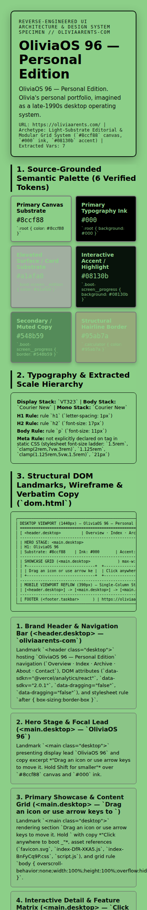

# UI Design System & Master Generation Blueprint: oliviaarents-com

> **OliviaOS 96 — Personal Edition** (https://oliviaarents.com/) — OliviaOS 96 — Personal Edition. Olivia's personal portfolio, imagined as a late-1990s desktop operating system.


---

## 1. Executive Visual Persona & Design Archetype

- **Brand Essence & Persona**: **OliviaOS 96 — Personal Edition** (`https://oliviaarents.com/`). OliviaOS 96 — Personal Edition. Olivia's personal portfolio, imagined as a late-1990s desktop operating system.
- **Visual Archetype**: **Light-Substrate Editorial & Modular Grid System (`#8ccf88` canvas, `#000` ink, `#08130b` accent)**.
- **Anti-AI-Slop Differentiators**:
  - **Source-Grounded Chromatic Polarity**: Anchors the viewport in `#8ccf88` (`:root { color: #8ccf88 }`) paired with `#000` primary typography and `#08130b` accents.
  - **Extracted Typographic Hierarchy**: Pairs `VT323` for display copy (`OliviaOS 96`) with `Courier New` and `Courier New`.
  - **Calibrated Spatial Grid & Motion**: Combines `48rem` container bounds (`gap: .75rem`, padding `2rem`) with `cubic-bezier(0.25,0.1,0.25,1)` easing.

---

## 2. Spatial Architecture & Modular Grid Mathematics



### Viewport Allocation & Container Geometry
- **Captured Viewport Dimensions**: Desktop `1440×2400px` (`assets/desktop.png`, capped at 2400px multi-section capture), Mobile `390×2400px` (`assets/mobile.png`, capped at 2400px multi-section capture).
- **Master Container Bounds**: `48rem` extracted from `oliviaarents-com` stylesheet.
- **Canvas Lateral Padding & Spacing**: `2rem` lateral canvas padding with `.75rem` grid gap.
- **Border Radius Scale**: `3px`, `4px`, `2px`, `50%`.

### Responsive Breakpoint Architecture
- **Desktop Layout**: Multi-column CSS Grid / Flexbox layout at `1440px` (`max-width: 48rem`, `gap: .75rem`).
- **Mobile Layout**: Single-column vertical stack at `390px` viewport width with `2rem` horizontal padding.
- **Extracted CSS Media Queries**: `@media (prefers-reduced-motion:reduce)`, `@media (width<=400px)`, `@media (width>=600px)`.

---

## 3. Color System, Materiality & Atmospheric Lighting

### Semantic Palette & Source Grounding
| Semantic Role | Ground-Truth Value | Extracted CSS Source / Selector |
|---|---|---|
| **Primary Canvas Substrate** | `#8ccf88` | `:root { color: #8ccf88 }` |
| **Primary Typography Ink** | `#000` | `:root { background: #000 }` |
| **Elevated Surface / Card Substrate** | `#a1afa0` | `.boot-screen__edition { color: #a1afa0 }` |
| **Interactive Accent / Highlight** | `#08130b` | `.boot-screen__progress { background: #08130b }` |
| **Secondary / Muted Copy** | `#548b59` | `.boot-screen__progress { border: #548b59 }` |
| **Structural Hairline Border** | `#95ab7a` | `.calculator { color: #95ab7a }` |

### Sanitized Root CSS Variables (`ui-ux.md` Ground Truth)
| Variable Name | Extracted Value | Semantic Role |
|---|---|---|
| `--lightningcss-dark` | `initial` | Canvas / Surface Token |
| `--lightningcss-light` | `initial` | Canvas / Surface Token |
| `--touch-dock-height` | `calc(70px + env(safe-area-inset-bottom,0px))` | Layout / Spatial Grid Token |
| `--taskbar-height` | `48px` | Layout / Spatial Grid Token |
| `--desktop-icon-width` | `94px` | Layout / Spatial Grid Token |
| `--desktop-icon-height` | `88px` | Layout / Spatial Grid Token |
| `--boot-fade-duration` | `450ms` | Motion / Easing Token |
| `--oliviaarents-com-bg` | `#8ccf88` | Canvas Substrate (from `:root { color: #8ccf88 }`) |
| `--oliviaarents-com-ink` | `#000` | Primary Typography Ink (stylesheet-derived) |
| `--oliviaarents-com-surface` | `#a1afa0` | Surface Substrate (stylesheet-derived) |
| `--oliviaarents-com-accent` | `#08130b` | Interactive Accent (stylesheet-derived) |
| `--oliviaarents-com-muted` | `#548b59` | Secondary Ink (stylesheet-derived) |
| `--oliviaarents-com-border` | `#95ab7a` | Structural Border (stylesheet-derived) |
| `--oliviaarents-com-container` | `48rem` | Container Bound (stylesheet-derived) |
| `--oliviaarents-com-gap` | `.75rem` | Grid Gutter (stylesheet-derived) |
| `--oliviaarents-com-pad` | `2rem` | Lateral Padding (stylesheet-derived) |

---

## 4. Typographic Scale & Editorial Hierarchy

### Font Family Stacks
- **Display Typography**: `VT323`.
- **Primary Body Stack**: `Courier New`.
- **Technical / Metadata Stack**: `Courier New`.

### Typographic Scale & Rules (Extracted from Stylesheet & Variables)
- **Hero Display (`H1`)**: rule `h1` (`letter-spacing: 1px`).
- **Section Heading (`H2`)**: rule `h2` (`font-size: 17px`).
- **Body Copy**: rule `p` (`font-size: 11px`).
- **Metadata & Navigation Labels**: not explicitly declared on tag in static CSS (stylesheet font-size ladder: `1.5rem`, `clamp(2rem,7vw,3rem)`, `1.125rem`, `clamp(1.125rem,5vw,1.5rem)`, `21px`).

---

## 5. Choreographed Motion & Interaction Physics

### Primary Easing Curves
- **Extracted Timing Functions**: `cubic-bezier(0.25,0.1,0.25,1)`.

### Per-Element Transition & Choreography Rules
- **Selector `.boot-screen`**: `transition: opacity var(--boot-fade-duration) ease-out` extracted from `oliviaarents-com` stylesheet.
- **Selector `media (prefers-reduced-motion:red...`**: `transition: none` extracted from `oliviaarents-com` stylesheet.
- **Selector `.cat-stack__cat`**: `transition: left .22s ease-out,bottom .22s ease-out` extracted from `oliviaarents-com` stylesheet.
- **Standard CSS Easing (`cubic-bezier(0.25,0.1,0.25,1)`)**: Default timing curve (no custom `cubic-bezier()` declared in static CSS).
- **State & Hover Choreography**: Opacity and transform transitions on `<main.desktop>` and `<main.desktop>` interactive targets.

---

## 6. Component Wireframe & Structural DOM Map

### Visual Layout Schematic (Grounded in `dom.html` — `1440px` Desktop & `390px` Mobile Reflow)
```
┌────────────────────────────────────────────────────────────────────────┐
│ DESKTOP VIEWPORT (1440px) — OliviaOS 96 — Personal Edition             │
│ ====================================================================== │
│ [ <header.desktop>         | Overview · Index · Archive · About · C ]  │
│ ---------------------------------------------------------------------- │
│ | HERO STAGE: <main.desktop>                                       |   │
│ | H1: OliviaOS 96                                                  |   │
│ | Substrate: #8ccf88    | Ink: #000       | Accent: #08130b        |   │
│ ---------------------------------------------------------------------- │
│ | SHOWCASE GRID (<main.desktop>            ) max-w: 48rem          |   │
│ | +------------------------------+  +------------------------------+ | │
│ | | Drag an icon or use arrow ke |  | Click anywhere to boot _     | | │
│ | +------------------------------+  +------------------------------+ | │
│ ---------------------------------------------------------------------- │
│ | MOBILE VIEWPORT REFLOW (390px) — Single-Column Stack (gap: .75rem) | │
│ | [<header.desktop>] -> [<main.desktop>] -> [<main.desktop>] |         │
│ ---------------------------------------------------------------------- │
│ [ FOOTER (<footer.taskbar>      ) | https://oliviaarents.com/          │
└────────────────────────────────────────────────────────────────────────┘
```

### Granular DOM Region Breakdown
1. **Brand Header & Navigation Bar (<header.desktop> — `oliviaarents-com`)**:
   - Landmark `<header class="desktop">` hosting `OliviaOS 96 — Personal Edition` navigation (`Overview · Index · Archive · About · Contact`), DOM attributes (`data-sdkn="@vercel/analytics/react"`, `data-sdkv="2.0.1"`, `data-dragging="false"`, `data-dragging="false"`), and stylesheet rule `after { box-sizing:border-box }`.
2. **Hero Stage & Focal Lead (<main.desktop> — `OliviaOS 96`)**:
   - Landmark `<main class="desktop">` presenting display lead `OliviaOS 96` and copy excerpt *"Drag an icon or use arrow keys to move it. Hold Shift for smaller"* over `#8ccf88` canvas and `#000` ink.
3. **Primary Showcase & Content Grid (<main.desktop> — `Drag an icon or use arrow keys to `)**:
   - Landmark `<main class="desktop">` rendering section `Drag an icon or use arrow keys to move it. Hold ` with copy *"Click anywhere to boot _"*, asset references (`favicon.svg`, `index-DfR-XKA5.js`, `index-BnFyCq9P.css`, `script.js`), and grid rule `body { overscroll-behavior:none;width:100%;height:100%;overflow:hidden }`.
4. **Interactive Detail & Feature Matrix (<main.desktop> — `Click anywhere to boot _`)**:
   - Landmark `<main class="desktop">` framing `Click anywhere to boot _` and `oliviaarents-com Archive & Directory` (*"Drag an icon or use arrow keys to move it. Hold "*) with `#a1afa0` surface cards, `#08130b` accents, and `root { height:100dvh;overflow:hidden }`.
5. **Colophon & Global Directory Footer (<footer.taskbar> — `https://oliviaarents.com/`)**:
   - Landmark `<footer class="taskbar">` anchoring `OliviaOS 96 — Personal Edition` footer links (`Overview · Index · Archive · About · Contact`), copy *"Click anywhere to boot _"*, and `#95ab7a` structural dividers.

---

## 7. Master Zero-Shot AI Generation Prompt

```markdown
# Master Zero-Shot Frontend Generation Prompt: oliviaarents-com (OliviaOS 96 — Personal Edition)

You are a principal frontend architect and design systems engineer. Build a complete, production-ready web application replicating the exact design system, DOM landmarks, typographic hierarchy, color tokens, and motion physics of `oliviaarents-com` (**OliviaOS 96 — Personal Edition** — `https://oliviaarents.com/`).

### 1. Visual Archetype & Anti-AI-Slop Mandates
- **Archetype**: Light-Substrate Editorial & Modular Grid System (`#8ccf88` canvas, `#000` ink, `#08130b` accent).
- **Identity & Domain Context**: OliviaOS 96 — Personal Edition. Olivia's personal portfolio, imagined as a late-1990s desktop operating system.
- **Primary Substrate**: `#8ccf88` (`:root { color: #8ccf88 }`), **Primary Ink**: `#000`, **Accent / Highlight**: `#08130b`.
- **Site-Specific Differentiators**:
  - **Source-Grounded Chromatic Polarity**: Anchors the viewport in `#8ccf88` (`:root { color: #8ccf88 }`) paired with `#000` primary typography and `#08130b` accents.
  - **Extracted Typographic Hierarchy**: Pairs `VT323` for display copy (`OliviaOS 96`) with `Courier New` and `Courier New`.
  - **Calibrated Spatial Grid & Motion**: Combines `48rem` container bounds (`gap: .75rem`, padding `2rem`) with `cubic-bezier(0.25,0.1,0.25,1)` easing.

### 2. Ground-Truth CSS Variables (`:root` Token Contract)
Declare and consume these exact custom properties extracted from `oliviaarents-com` in your global stylesheet:

:root {
  /* OliviaOS 96 — Personal Edition (oliviaarents-com) — Ground-Truth Extracted CSS Variables */
  --lightningcss-dark: initial; /* Canvas / Surface Token (oliviaarents-com) */
  --lightningcss-light: initial; /* Canvas / Surface Token (oliviaarents-com) */
  --touch-dock-height: calc(70px + env(safe-area-inset-bottom,0px)); /* Layout / Spatial Grid Token (oliviaarents-com) */
  --taskbar-height: 48px; /* Layout / Spatial Grid Token (oliviaarents-com) */
  --desktop-icon-width: 94px; /* Layout / Spatial Grid Token (oliviaarents-com) */
  --desktop-icon-height: 88px; /* Layout / Spatial Grid Token (oliviaarents-com) */
  --boot-fade-duration: 450ms; /* Motion / Easing Token (oliviaarents-com) */
  --oliviaarents-com-bg: #8ccf88; /* Canvas Substrate (from `:root { color: #8ccf88 }`) (oliviaarents-com) */
  --oliviaarents-com-ink: #000; /* Primary Typography Ink (stylesheet-derived) (oliviaarents-com) */
  --oliviaarents-com-surface: #a1afa0; /* Surface Substrate (stylesheet-derived) (oliviaarents-com) */
  --oliviaarents-com-accent: #08130b; /* Interactive Accent (stylesheet-derived) (oliviaarents-com) */
  --oliviaarents-com-muted: #548b59; /* Secondary Ink (stylesheet-derived) (oliviaarents-com) */
  --oliviaarents-com-border: #95ab7a; /* Structural Border (stylesheet-derived) (oliviaarents-com) */
  --oliviaarents-com-container: 48rem; /* Container Bound (stylesheet-derived) (oliviaarents-com) */
  --oliviaarents-com-gap: .75rem; /* Grid Gutter (stylesheet-derived) (oliviaarents-com) */
  --oliviaarents-com-pad: 2rem; /* Lateral Padding (stylesheet-derived) (oliviaarents-com) */
}

### 3. Semantic Color & Materiality Contract
Map every surface, ink, and border strictly to these source-grounded tokens:
- **Primary Canvas Substrate**: `#8ccf88` — grounded in `:root { color: #8ccf88 }`
- **Primary Typography Ink**: `#000` — grounded in `:root { background: #000 }`
- **Elevated Surface / Card Substrate**: `#a1afa0` — grounded in `.boot-screen__edition { color: #a1afa0 }`
- **Interactive Accent / Highlight**: `#08130b` — grounded in `.boot-screen__progress { background: #08130b }`
- **Secondary / Muted Copy**: `#548b59` — grounded in `.boot-screen__progress { border: #548b59 }`
- **Structural Hairline Border**: `#95ab7a` — grounded in `.calculator { color: #95ab7a }`

### 4. Spatial Grid, Container Bounds & Responsive Breakpoints
- **Desktop Viewport Reference**: `1440×2400px` (capped at 2400px multi-section capture, `1440px` standard desktop width).
- **Mobile Viewport Reference**: `390×2400px` (capped at 2400px multi-section capture, `390px` standard mobile width).
- **Container Max-Width**: `48rem` extracted from `oliviaarents-com` stylesheet
- **Padding & Gutters**: `2rem` lateral canvas padding with `.75rem` grid gap
- **Desktop Grid**: Multi-column CSS Grid / Flexbox layout at `1440px` (`max-width: 48rem`, `gap: .75rem`)
- **Mobile Adaptation**: Single-column vertical stack at `390px` viewport width with `2rem` horizontal padding
- **Media Queries**: `@media (prefers-reduced-motion:reduce)`, `@media (width<=400px)`, `@media (width>=600px)`
- **Corner Radii**: `3px`, `4px`, `2px`, `50%`

### 5. Typography & Editorial Scale Contract
- **Display Font Stack**: `VT323`
- **Body Font Stack**: `Courier New`
- **Monospace / Technical Font Stack**: `Courier New`
- **H1 Display Rule**: rule `h1` (`letter-spacing: 1px`)
- **H2 Section Rule**: rule `h2` (`font-size: 17px`)
- **Body Copy Rule**: rule `p` (`font-size: 11px`)
- **Metadata & Index Rule**: not explicitly declared on tag in static CSS (stylesheet font-size ladder: `1.5rem`, `clamp(2rem,7vw,3rem)`, `1.125rem`, `clamp(1.125rem,5vw,1.5rem)`, `21px`)

### 6. Component Hierarchy, Verbatim Copy & Real DOM Landmarks
Scaffold `oliviaarents-com` (`OliviaOS 96 — Personal Edition`) with these exact structural regions, extracted copy, and CSS rules from `dom.html`:
1. **Brand Header & Navigation Bar (<header.desktop> — `oliviaarents-com`)**:
   - DOM & Selectors: Landmark `<header class="desktop">` hosting `OliviaOS 96 — Personal Edition` navigation (`Overview · Index · Archive · About · Contact`), DOM attributes (`data-sdkn="@vercel/analytics/react"`, `data-sdkv="2.0.1"`, `data-dragging="false"`, `data-dragging="false"`), and stylesheet rule `after { box-sizing:border-box }`.
   - Responsive Contract: Header `Brand Header & Navigation Bar (<header.desktop> — `oliviaarents-com`)` (`oliviaarents-com`) adapts across `@media (prefers-reduced-motion:reduce)`, `@media (width<=400px)`, `@media (width>=600px)` with `cubic-bezier(0.25,0.1,0.25,1)` transitions and links `Overview · Index · Archive · About · Contact`.
2. **Hero Stage & Focal Lead (<main.desktop> — `OliviaOS 96`)**:
   - DOM & Selectors: Landmark `<main class="desktop">` presenting display lead `OliviaOS 96` and copy excerpt *"Drag an icon or use arrow keys to move it. Hold Shift for smaller"* over `#8ccf88` canvas and `#000` ink.
   - Responsive Contract: Hero stage (`1440×2400px` desktop / `390×2400px` mobile) sets `#8ccf88` background with `#000` headline `OliviaOS 96`.
3. **Primary Showcase & Content Grid (<main.desktop> — `Drag an icon or use arrow keys to `)**:
   - DOM & Selectors: Landmark `<main class="desktop">` rendering section `Drag an icon or use arrow keys to move it. Hold ` with copy *"Click anywhere to boot _"*, asset references (`favicon.svg`, `index-DfR-XKA5.js`, `index-BnFyCq9P.css`, `script.js`), and grid rule `body { overscroll-behavior:none;width:100%;height:100%;overflow:hidden }`.
   - Responsive Contract: Showcase grid `Primary Showcase & Content Grid (<main.desktop> — `Drag an icon or use arrow keys to `)` applies Multi-column CSS Grid / Flexbox layout at `1440px` (`max-width: 48rem`, `gap: .75rem`) on desktop and Single-column vertical stack at `390px` viewport width with `2rem` horizontal padding on mobile.
4. **Interactive Detail & Feature Matrix (<main.desktop> — `Click anywhere to boot _`)**:
   - DOM & Selectors: Landmark `<main class="desktop">` framing `Click anywhere to boot _` and `oliviaarents-com Archive & Directory` (*"Drag an icon or use arrow keys to move it. Hold "*) with `#a1afa0` surface cards, `#08130b` accents, and `root { height:100dvh;overflow:hidden }`.
   - Responsive Contract: Detail module `Interactive Detail & Feature Matrix (<main.desktop> — `Click anywhere to boot _`)` uses `3px`, `4px`, `2px`, `50%` radii, `#08130b` highlights, and assets (favicon.svg, index-DfR-XKA5.js, index-BnFyCq9P.css).
5. **Colophon & Global Directory Footer (<footer.taskbar> — `https://oliviaarents.com/`)**:
   - DOM & Selectors: Landmark `<footer class="taskbar">` anchoring `OliviaOS 96 — Personal Edition` footer links (`Overview · Index · Archive · About · Contact`), copy *"Click anywhere to boot _"*, and `#95ab7a` structural dividers.
   - Responsive Contract: Footer `Colophon & Global Directory Footer (<footer.taskbar> — `https://oliviaarents.com/`)` aligns to `48rem` extracted from `oliviaarents-com` stylesheet with `2rem` lateral canvas padding with `.75rem` grid gap and attributes (data-sdkn="@vercel/analytics/react", data-sdkv="2.0.1", data-dragging="false").

#### Verbatim DOM Copy Excerpts (`dom.html`)
- Copy Excerpt 1: *"Drag an icon or use arrow keys to move it. Hold Shift for smaller steps. Double-cl..."*
- Copy Excerpt 2: *"Click anywhere to boot _"*

### 7. Motion, Extracted Stylesheet Rules & Interaction Choreography
- **Primary Easing Functions**: `cubic-bezier(0.25,0.1,0.25,1)`
- **Extracted Stylesheet Rules (`oliviaarents-com`)**:
- `after { box-sizing:border-box }`
- `body { overscroll-behavior:none;width:100%;height:100%;overflow:hidden }`
- `root { height:100dvh;overflow:hidden }`
- `.sr-only { clip-path:inset(50%);white-space:nowrap;border:0;width:1px;height:1px;pa... }`
- `.boot-screen__content { text-align:center;width:100%;max-width:48rem }`
- **Per-Selector Transition Rules**:
- **Selector `.boot-screen`**: `transition: opacity var(--boot-fade-duration) ease-out` extracted from `oliviaarents-com` stylesheet.
- **Selector `media (prefers-reduced-motion:red...`**: `transition: none` extracted from `oliviaarents-com` stylesheet.
- **Selector `.cat-stack__cat`**: `transition: left .22s ease-out,bottom .22s ease-out` extracted from `oliviaarents-com` stylesheet.
- **Standard CSS Easing (`cubic-bezier(0.25,0.1,0.25,1)`)**: Default timing curve (no custom `cubic-bezier()` declared in static CSS).
- **State & Hover Choreography**: Opacity and transform transitions on `<main.desktop>` and `<main.desktop>` interactive targets.

### 8. Technical Deliverables
- Implement in Next.js (App Router) with TypeScript and Tailwind CSS consuming the `:root` custom properties defined above for `oliviaarents-com`.
- Reproduce both the `1440px` desktop architecture and `390px` mobile breakpoint transitions, preserving semantic HTML5 landmarks (`<header>`, `<nav>`, `<main>`, `<section>`, `<footer>`) and `prefers-reduced-motion` accessibility guards.
```
