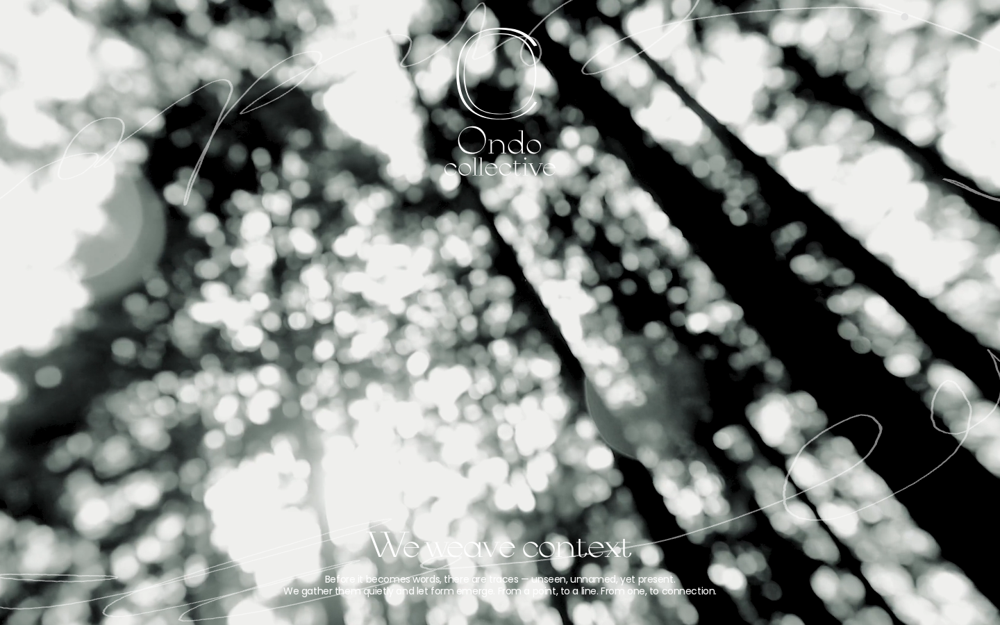

# UI Design System & Master Generation Blueprint: ondocollective-jp

> **Ondo Collective** (https://ondocollective.jp/) — Ondo Collectiveは、ブランドの背景にある文脈を読み解き、理念やコンセプトの言語化からロゴ・キービジュアル・Webまでを一貫して手がけるクリエイティブ・コレクティブです。東京を拠点に、ブランドの世界観づくりを支援します。



---

## 1. Executive Visual Persona & Design Archetype

- **Brand Essence & Persona**: **Ondo Collective** (`https://ondocollective.jp/`). Ondo Collectiveは、ブランドの背景にある文脈を読み解き、理念やコンセプトの言語化からロゴ・キービジュアル・Webまでを一貫して手がけるクリエイティブ・コレクティブです。東京を拠点に、ブランドの世界観づくりを支援します。
- **Capture Provenance**: Live browser capture (`tier1_fast`, HTTP `200`, captured `2026-11-23`).
- **Visual Archetype**: **Light-Gallery WebGL / Canvas Interactive Experience (`#f3e5de` / `#008000`)**.
- **Anti-AI-Slop Differentiators**:
  - **Live-Computed Chromatic Polarity**: Anchors the viewport in `#f3e5de` (live computed `body` `background-color` (`computed_styles.json`)) paired with `#003c26` primary typography and `#008000` accents.
  - **Grounded Typographic Hierarchy**: Pairs `Ondo-96e094e12386a431` for display copy (`We weave context`) with `Gen Interface JP-aa1df9adf44a6d02` and not declared in live computed styles (uses primary stack / `ui-monospace`).
  - **Calibrated Spatial Grid & Motion**: Combines `1440px` container bounds (`gap: 20rem`, padding `24rem`) with `cubic-bezier(.22,1,.36,1)` easing and Lenis Smooth Scroll (`data-lenis`), Three.js / WebGL Canvas Pipeline.

---

## 2. Spatial Architecture & Modular Grid Mathematics


### Viewport Allocation & Container Geometry
- **Captured Viewport Dimensions**: Desktop `1440×900px` (`assets/desktop.png`, single-viewport 100vh live capture (900px)), Mobile `390×2400px` (`assets/mobile.png`, clamped at 2400px live multi-section capture).
- **Master Container Bounds**: `1440px` (full-bleed `100%` desktop stage measured on `1440px` viewport).
- **Canvas Lateral Padding & Spacing**: `24rem` lateral canvas padding with `20rem` grid gap.
- **Border Radius Scale**: `4rem`.

### Responsive Breakpoint Architecture
- **Desktop Layout**: Multi-column CSS Grid / Flexbox layout at `1440px` (`max-width: 1440px`, `gap: 20rem`).
- **Mobile Layout**: Single-column vertical stack at `390px` viewport width with `24rem` horizontal padding.
- **Extracted CSS Media Queries**: `@media (width<=767px)`, `@media (width>=768px)`, `@media (width<=400px) and (height<=674px)`, `@media (width<=420px) and (height<=720px)`.

---

## 3. Color System, Materiality & Atmospheric Lighting

### Semantic Palette & Source Grounding
| Semantic Role | Ground-Truth Value | Extracted Live / CSS Source |
|---|---|---|
| **Primary Canvas Substrate** | `#f3e5de` | live computed `body` `background-color` (`computed_styles.json`) |
| **Primary Typography Ink** | `#003c26` | live computed `main` `color` (`computed_styles.json`) |
| **Elevated Surface / Card Substrate** | `#ffffff` | `.l-footer { background: white }` (`#ffffff`) |
| **Interactive Accent / Highlight** | `#008000` | `.c-copy-button__label { background: green }` (`#008000`) |
| **Secondary / Muted Copy** | `#ffffff` | live computed `p` `color` (`computed_styles.json`) |
| **Structural Hairline Border** | `#d5cac4` | `var(--color-border-gray)` in `:root` |
| **Variable Token (`--color-deep-green`)** | `#002c1c` | `var(--color-deep-green)` in `:root` |
| **Variable Token (`--color-error`)** | `#a3402c` | `var(--color-error)` in `:root` |
| **Variable Token (`--color-filter-black`)** | `#0009` | `var(--color-filter-black)` in `:root` |

### Sanitized Root CSS Variables (`ui-ux.md` Ground Truth)
| Variable Name | Extracted Value | Semantic Role |
|---|---|---|
| `--col-gap` | `20rem` | Layout / Spatial Grid Token |
| `--grid-padding` | `24rem` | Layout / Spatial Grid Token |
| `--grid-repeat` | `12` | Layout / Spatial Grid Token |
| `--poppins` | `var(--font-poppins)` | Design System Custom Token |
| `--ondo` | `var(--font-ondo)` | Design System Custom Token |
| `--gen-interface` | `var(--font-gen-interface)` | Design System Custom Token |
| `--shippori-mincho` | `var(--font-shippori-mincho)` | Dimension / Scale Token |
| `--letter-spacing-base` | `.03em` | Typography / Scale Token |
| `--line-height-base` | `1.85` | Typography / Scale Token |
| `--color-text-white` | `#fff` | Canvas / Surface Token |
| `--color-bg-white` | `#f3e5de` | Canvas / Surface Token |
| `--color-green` | `#003c26` | Brand / Palette Token |
| `--color-deep-green` | `#002c1c` | Brand / Palette Token |
| `--color-border-gray` | `#d5cac4` | Brand / Palette Token |
| `--color-error` | `#a3402c` | Brand / Palette Token |
| `--color-filter-black` | `#0009` | Canvas / Surface Token |

---

## 4. Typographic Scale & Editorial Hierarchy

### Font Family Stacks
- **Display Typography**: `Ondo-96e094e12386a431`.
- **Primary Body Stack**: `Gen Interface JP-aa1df9adf44a6d02`.
- **Technical / Metadata Stack**: not declared in live computed styles (uses primary stack / `ui-monospace`).

### Typographic Scale & Rules (Live Computed & Stylesheet Grounded)
- **Hero Display (`H1`)**: live computed `h1` (`font-size: 48px`, `line-height: 57.6px`, `font-weight: 400`, `letter-spacing: -0.96px`); rule `.title` (`font-size: var(--title-font-size)`, `line-height: 1.2`, `letter-spacing: -.02em`, `font-weight: 400`).
- **Section Heading (`H2`)**: live computed `h3 (primary section heading)` (`font-size: 59.6572px`, `line-height: 71.5886px`, `font-weight: 400`, `letter-spacing: -1.19314px`).
- **Body Copy**: live computed `body` (`font-size: 14.4px`, `line-height: 16.56px`, `font-weight: 400`).
- **Metadata & Navigation Labels**: live computed `nav/a` (`font-size: 14.4px`, `line-height: 16.56px`, `font-weight: 400`); CSS variables `--letter-spacing-base: .03em`; rule `.label` (`font-size: 14rem`, `line-height: 1.2`).

---

## 5. Choreographed Motion & Interaction Physics

### Primary Easing Curves
- **Extracted Timing Functions**: `cubic-bezier(.22,1,.36,1)`, `cubic-bezier(.33,1,.68,1)`, `cubic-bezier(.25,1,.5,1)`.

### Per-Element Transition & Choreography Rules
- **Selector `data-hover=fade]`**: `transition: opacity var(--hover-duration) var(--hover-ease)` extracted from `ondocollective-jp` stylesheet.
- **Selector `data-mask-out]`**: `transition: -webkit-mask-position var(--mask-out-duration) var(--mask-out-...` extracted from `ondocollective-jp` stylesheet.
- **Selector `data-lqip] img`**: `transition: opacity var(--lqip-duration) var(--lqip-ease)` extracted from `ondocollective-jp` stylesheet.
- **Extracted Easing Curve (`cubic-bezier(.22,1,.36,1)`)**: Governs interactive state transitions across `<header.l-header>` and `<section.p-home-philosophy>`.
- **Runtime Interaction Engine**: Integrates Lenis Smooth Scroll (`data-lenis`), Three.js / WebGL Canvas Pipeline, Barba.js Page Transition Router with `prefers-reduced-motion: reduce` fallback guards.

---

## 6. Component Wireframe & Structural DOM Map

### Visual Layout Schematic — Desktop (`1440px`, Grounded in `dom.html` & Landmark Bounding Boxes)
```
┌────────────────────────────────────────────────────────────────────────┐
│ DESKTOP VIEWPORT (1440px) — Ondo Collective                            │
│ ====================================================================== │
│ [ <header.l-header> (1440x131px)      | Home Home · Projects Project ] │
│ ---------------------------------------------------------------------- │
│ | HERO STAGE: <section.p-home-mv> (w=1440px)                         | │
│ | H1: We weave context                                               | │
│ | Substrate: #f3e5de | Ink: #003c26 | Accent: #008000                | │
│ ---------------------------------------------------------------------- │
│ | SHOWCASE GRID (<section.p-home-philosophy) max-w: 1440px           | │
│ | +------------------------------+  +------------------------------+ | │
│ | | Before it becomes words      |  | Introduction                 | | │
│ | +------------------------------+  +------------------------------+ | │
│ ---------------------------------------------------------------------- │
│ | DETAIL MODULE (<section.p-home-introducti) — About Ondo Collective | │
│ ---------------------------------------------------------------------- │
│ [ FOOTER (<footer.l-footer>   ) | https://ondocollective.jp/           │
└────────────────────────────────────────────────────────────────────────┘
```

### Visual Layout Schematic — Mobile Reflow (`390px`)
```
┌────────────────────────────────────────────────────────────────────────┐
│ MOBILE VIEWPORT REFLOW (390px) — Single-Column Stack (gap: 20rem)      │
│ ====================================================================== │
│ [ HEADER BAR (<header.l-header>       ) | Compact Menu (390px)         │
│ ---------------------------------------------------------------------- │
│ | HERO STAGE (<section.p-home-mv>) — 390px Vertical Lead             | │
│ | H1: We weave context                                               | │
│ ---------------------------------------------------------------------- │
│ | SHOWCASE STACK (<section.p-home-philos) — 1-Col Stack              | │
│ | [ Item 1: Before it becomes words                                ] | │
│ | [ Item 2: Introduction                                           ] | │
│ ---------------------------------------------------------------------- │
│ | DETAIL STACK (<section.p-home-introduc) — 1-Col (About Ondo Collect) │
│ ---------------------------------------------------------------------- │
│ [ FOOTER (<footer.l-footer>   ) | Stacked 390px Colophon               │
└────────────────────────────────────────────────────────────────────────┘
```

### Granular DOM Region Breakdown
1. **Brand Header & Navigation Bar (<header.l-header> — `ondocollective-jp`)**:
   - Landmark `<header class="l-header">` (`1440x131px`) hosting `Ondo Collective` navigation (`Home Home · Projects Projects · Visuals Visuals · Contact Contact`), DOM attributes (`data-color="white"`, `data-visible="false"`, `data-menu="closed"`, `data-hover="fade"`), and stylesheet rule `after { box-sizing:inherit }`.
2. **Hero Stage & Focal Lead (<section.p-home-mv> — `We weave context`)**:
   - Landmark `<section class="p-home-mv">` presenting display lead `We weave context` and copy excerpt *"Before it becomes words, there are traces — unseen, unnamed, yet "* over `#f3e5de` canvas and `#003c26` ink.
3. **Primary Showcase & Content Grid (<section.p-home-philosophy> — `Before it becomes words`)**:
   - Landmark `<section class="p-home-philosophy">` rendering section `Before it becomes words` with copy *"事業の背景、歴史、温度。 まだ言葉になっていない違和感や、 静かに漂う気配。 私たちは、そのかけらを拾い集め、 ひとつの文脈へと編"*, asset references (`gtm.js`, `favicon.ico`, `icon-96x96.png`, `icon-32x32.png`), and grid rule `html { -webkit-text-size-adjust:100%;-webkit-tap-highlight-color:transparent;li... }`.
4. **Interactive Detail & Feature Matrix (<section.p-home-introduction> — `Introduction`)**:
   - Landmark `<section class="p-home-introduction">` framing `Introduction` and `About Ondo Collective` (*"文脈から、ブランドの世界観を立ち上げる クリエイティブ・コレクティブ"*) with `#ffffff` surface cards, `#008000` accents, and `main { display:block }`.
5. **Colophon & Global Directory Footer (<footer.l-footer> — `https://ondocollective.jp/`)**:
   - Landmark `<footer class="l-footer">` anchoring `Ondo Collective` footer links (`Home Home · Projects Projects · Visuals Visuals · Contact Contact`), copy *"想いや価値観、これまでの歩み、関わってきた人たちとのつながり。 そうしたひとつひとつの積み重ねが、ブランドらしさを形づく"*, and `#d5cac4` structural dividers.

---

## 7. Master Zero-Shot AI Generation Prompt

```markdown
# Master Zero-Shot Frontend Generation Prompt: ondocollective-jp (Ondo Collective)

You are a principal frontend architect and design systems engineer. Build a complete, production-ready web application replicating the exact design system, DOM landmarks, typographic hierarchy, color tokens, and motion physics of `ondocollective-jp` (**Ondo Collective** — `https://ondocollective.jp/`).

### 1. Visual Archetype & Anti-AI-Slop Mandates
- **Archetype**: Light-Gallery WebGL / Canvas Interactive Experience (`#f3e5de` / `#008000`).
- **Identity & Domain Context**: Ondo Collectiveは、ブランドの背景にある文脈を読み解き、理念やコンセプトの言語化からロゴ・キービジュアル・Webまでを一貫して手がけるクリエイティブ・コレクティブです。東京を拠点に、ブランドの世界観づくりを支援します。
- **Primary Substrate**: `#f3e5de` (live computed `body` `background-color` (`computed_styles.json`)), **Primary Ink**: `#003c26`, **Accent / Highlight**: `#008000`.
- **Site-Specific Differentiators**:
  - **Live-Computed Chromatic Polarity**: Anchors the viewport in `#f3e5de` (live computed `body` `background-color` (`computed_styles.json`)) paired with `#003c26` primary typography and `#008000` accents.
  - **Grounded Typographic Hierarchy**: Pairs `Ondo-96e094e12386a431` for display copy (`We weave context`) with `Gen Interface JP-aa1df9adf44a6d02` and not declared in live computed styles (uses primary stack / `ui-monospace`).
  - **Calibrated Spatial Grid & Motion**: Combines `1440px` container bounds (`gap: 20rem`, padding `24rem`) with `cubic-bezier(.22,1,.36,1)` easing and Lenis Smooth Scroll (`data-lenis`), Three.js / WebGL Canvas Pipeline.

### 2. Ground-Truth CSS Variables (`:root` Token Contract)
Declare and consume these exact custom properties extracted from `ondocollective-jp` in your global stylesheet:

:root {
  /* Ondo Collective (ondocollective-jp) — Live-Grounded CSS Variables */
  --col-gap: 20rem; /* Layout / Spatial Grid Token (ondocollective-jp) */
  --grid-padding: 24rem; /* Layout / Spatial Grid Token (ondocollective-jp) */
  --grid-repeat: 12; /* Layout / Spatial Grid Token (ondocollective-jp) */
  --poppins: var(--font-poppins); /* Design System Custom Token (ondocollective-jp) */
  --ondo: var(--font-ondo); /* Design System Custom Token (ondocollective-jp) */
  --gen-interface: var(--font-gen-interface); /* Design System Custom Token (ondocollective-jp) */
  --shippori-mincho: var(--font-shippori-mincho); /* Dimension / Scale Token (ondocollective-jp) */
  --letter-spacing-base: .03em; /* Typography / Scale Token (ondocollective-jp) */
  --line-height-base: 1.85; /* Typography / Scale Token (ondocollective-jp) */
  --color-text-white: #fff; /* Canvas / Surface Token (ondocollective-jp) */
  --color-bg-white: #f3e5de; /* Canvas / Surface Token (ondocollective-jp) */
  --color-green: #003c26; /* Brand / Palette Token (ondocollective-jp) */
  --color-deep-green: #002c1c; /* Brand / Palette Token (ondocollective-jp) */
  --color-border-gray: #d5cac4; /* Brand / Palette Token (ondocollective-jp) */
  --color-error: #a3402c; /* Brand / Palette Token (ondocollective-jp) */
  --color-filter-black: #0009; /* Canvas / Surface Token (ondocollective-jp) */
}

### 3. Semantic Color & Materiality Contract
Map every surface, ink, and border strictly to these source-grounded tokens:
- **Primary Canvas Substrate**: `#f3e5de` — grounded in live computed `body` `background-color` (`computed_styles.json`)
- **Primary Typography Ink**: `#003c26` — grounded in live computed `main` `color` (`computed_styles.json`)
- **Elevated Surface / Card Substrate**: `#ffffff` — grounded in `.l-footer { background: white }` (`#ffffff`)
- **Interactive Accent / Highlight**: `#008000` — grounded in `.c-copy-button__label { background: green }` (`#008000`)
- **Secondary / Muted Copy**: `#ffffff` — grounded in live computed `p` `color` (`computed_styles.json`)
- **Structural Hairline Border**: `#d5cac4` — grounded in `var(--color-border-gray)` in `:root`
- **Variable Token (`--color-deep-green`)**: `#002c1c` — grounded in `var(--color-deep-green)` in `:root`
- **Variable Token (`--color-error`)**: `#a3402c` — grounded in `var(--color-error)` in `:root`
- **Variable Token (`--color-filter-black`)**: `#0009` — grounded in `var(--color-filter-black)` in `:root`

### 4. Spatial Grid, Container Bounds & Responsive Breakpoints
- **Desktop Viewport Reference**: `1440×900px` (single-viewport 100vh live capture (900px), `1440px` standard desktop width).
- **Mobile Viewport Reference**: `390×2400px` (clamped at 2400px live multi-section capture, `390px` standard mobile width).
- **Container Max-Width**: `1440px` (full-bleed `100%` desktop stage measured on `1440px` viewport)
- **Padding & Gutters**: `24rem` lateral canvas padding with `20rem` grid gap
- **Desktop Grid**: Multi-column CSS Grid / Flexbox layout at `1440px` (`max-width: 1440px`, `gap: 20rem`)
- **Mobile Adaptation**: Single-column vertical stack at `390px` viewport width with `24rem` horizontal padding
- **Media Queries**: `@media (width<=767px)`, `@media (width>=768px)`, `@media (width<=400px) and (height<=674px)`, `@media (width<=420px) and (height<=720px)`
- **Corner Radii**: `4rem`

### 5. Typography & Editorial Scale Contract
- **Display Font Stack**: `Ondo-96e094e12386a431`
- **Body Font Stack**: `Gen Interface JP-aa1df9adf44a6d02`
- **Monospace / Technical Font Stack**: not declared in live computed styles (uses primary stack / `ui-monospace`)
- **H1 Display Rule**: live computed `h1` (`font-size: 48px`, `line-height: 57.6px`, `font-weight: 400`, `letter-spacing: -0.96px`); rule `.title` (`font-size: var(--title-font-size)`, `line-height: 1.2`, `letter-spacing: -.02em`, `font-weight: 400`)
- **H2 Section Rule**: live computed `h3 (primary section heading)` (`font-size: 59.6572px`, `line-height: 71.5886px`, `font-weight: 400`, `letter-spacing: -1.19314px`)
- **Body Copy Rule**: live computed `body` (`font-size: 14.4px`, `line-height: 16.56px`, `font-weight: 400`)
- **Metadata & Index Rule**: live computed `nav/a` (`font-size: 14.4px`, `line-height: 16.56px`, `font-weight: 400`); CSS variables `--letter-spacing-base: .03em`; rule `.label` (`font-size: 14rem`, `line-height: 1.2`)

### 6. Component Hierarchy, Verbatim Copy & Real DOM Landmarks
Scaffold `ondocollective-jp` (`Ondo Collective`) with these exact structural regions, extracted copy, and CSS rules from `dom.html`:
1. **Brand Header & Navigation Bar (<header.l-header> — `ondocollective-jp`)**:
   - DOM & Selectors: Landmark `<header class="l-header">` (`1440x131px`) hosting `Ondo Collective` navigation (`Home Home · Projects Projects · Visuals Visuals · Contact Contact`), DOM attributes (`data-color="white"`, `data-visible="false"`, `data-menu="closed"`, `data-hover="fade"`), and stylesheet rule `after { box-sizing:inherit }`.
   - Responsive Contract: Header `Brand Header & Navigation Bar (<header.l-header> — `ondocollective-jp`)` (`ondocollective-jp`) adapts across `@media (width<=767px)`, `@media (width>=768px)`, `@media (width<=400px) and (height<=674px)`, `@media (width<=420px) and (height<=720px)` with `cubic-bezier(.22,1,.36,1)`, `cubic-bezier(.33,1,.68,1)`, `cubic-bezier(.25,1,.5,1)` transitions and links `Home Home · Projects Projects · Visuals Visuals · Contact Contact`.
2. **Hero Stage & Focal Lead (<section.p-home-mv> — `We weave context`)**:
   - DOM & Selectors: Landmark `<section class="p-home-mv">` presenting display lead `We weave context` and copy excerpt *"Before it becomes words, there are traces — unseen, unnamed, yet "* over `#f3e5de` canvas and `#003c26` ink.
   - Responsive Contract: Hero stage (`1440×900px` desktop / `390×2400px` mobile) sets `#f3e5de` background with `#003c26` headline `We weave context`.
3. **Primary Showcase & Content Grid (<section.p-home-philosophy> — `Before it becomes words`)**:
   - DOM & Selectors: Landmark `<section class="p-home-philosophy">` rendering section `Before it becomes words` with copy *"事業の背景、歴史、温度。 まだ言葉になっていない違和感や、 静かに漂う気配。 私たちは、そのかけらを拾い集め、 ひとつの文脈へと編"*, asset references (`gtm.js`, `favicon.ico`, `icon-96x96.png`, `icon-32x32.png`), and grid rule `html { -webkit-text-size-adjust:100%;-webkit-tap-highlight-color:transparent;li... }`.
   - Responsive Contract: Showcase grid `Primary Showcase & Content Grid (<section.p-home-philosophy> — `Before it becomes words`)` applies Multi-column CSS Grid / Flexbox layout at `1440px` (`max-width: 1440px`, `gap: 20rem`) on desktop and Single-column vertical stack at `390px` viewport width with `24rem` horizontal padding on mobile.
4. **Interactive Detail & Feature Matrix (<section.p-home-introduction> — `Introduction`)**:
   - DOM & Selectors: Landmark `<section class="p-home-introduction">` framing `Introduction` and `About Ondo Collective` (*"文脈から、ブランドの世界観を立ち上げる クリエイティブ・コレクティブ"*) with `#ffffff` surface cards, `#008000` accents, and `main { display:block }`.
   - Responsive Contract: Detail module `Interactive Detail & Feature Matrix (<section.p-home-introduction> — `Introduction`)` uses `4rem` radii, `#008000` highlights, and assets (gtm.js, favicon.ico, icon-96x96.png).
5. **Colophon & Global Directory Footer (<footer.l-footer> — `https://ondocollective.jp/`)**:
   - DOM & Selectors: Landmark `<footer class="l-footer">` anchoring `Ondo Collective` footer links (`Home Home · Projects Projects · Visuals Visuals · Contact Contact`), copy *"想いや価値観、これまでの歩み、関わってきた人たちとのつながり。 そうしたひとつひとつの積み重ねが、ブランドらしさを形づく"*, and `#d5cac4` structural dividers.
   - Responsive Contract: Footer `Colophon & Global Directory Footer (<footer.l-footer> — `https://ondocollective.jp/`)` aligns to `1440px` (full-bleed `100%` desktop stage measured on `1440px` viewport) with `24rem` lateral canvas padding with `20rem` grid gap and attributes (data-color="white", data-visible="false", data-menu="closed").

#### Verbatim DOM Copy Excerpts (`dom.html`)
- Copy Excerpt 1: *"Before it becomes words, there are traces — unseen, unnamed, yet present. We gathe..."*
- Copy Excerpt 2: *"事業の背景、歴史、温度。 まだ言葉になっていない違和感や、 静かに漂う気配。 私たちは、そのかけらを拾い集め、 ひとつの文脈へと編み直す。 点から、線へ。個から、関..."*
- Copy Excerpt 3: *"文脈から、ブランドの世界観を立ち上げる クリエイティブ・コレクティブ"*
- Copy Excerpt 4: *"想いや価値観、これまでの歩み、関わってきた人たちとのつながり。 そうしたひとつひとつの積み重ねが、ブランドらしさを形づくります。 私たち、Ondo Collecti..."*

### 7. Motion, Extracted Stylesheet Rules & Interaction Choreography
- **Primary Easing Functions**: `cubic-bezier(.22,1,.36,1)`, `cubic-bezier(.33,1,.68,1)`, `cubic-bezier(.25,1,.5,1)`
- **Extracted Stylesheet Rules (`ondocollective-jp`)**:
- `after { box-sizing:inherit }`
- `html { -webkit-text-size-adjust:100%;-webkit-tap-highlight-color:transparent;li... }`
- `main { display:block }`
- `pre { font-family:monospace;font-size:inherit }`
- `address { font-style:inherit }`
- **Per-Selector Transition Rules**:
- **Selector `data-hover=fade]`**: `transition: opacity var(--hover-duration) var(--hover-ease)` extracted from `ondocollective-jp` stylesheet.
- **Selector `data-mask-out]`**: `transition: -webkit-mask-position var(--mask-out-duration) var(--mask-out-...` extracted from `ondocollective-jp` stylesheet.
- **Selector `data-lqip] img`**: `transition: opacity var(--lqip-duration) var(--lqip-ease)` extracted from `ondocollective-jp` stylesheet.
- **Extracted Easing Curve (`cubic-bezier(.22,1,.36,1)`)**: Governs interactive state transitions across `<header.l-header>` and `<section.p-home-philosophy>`.
- **Runtime Interaction Engine**: Integrates Lenis Smooth Scroll (`data-lenis`), Three.js / WebGL Canvas Pipeline, Barba.js Page Transition Router with `prefers-reduced-motion: reduce` fallback guards.

### 8. Technical Deliverables
- Implement in Next.js (App Router) with TypeScript and Tailwind CSS consuming the `:root` custom properties defined above for `ondocollective-jp`.
- Reproduce both the `1440px` desktop architecture and `390px` mobile breakpoint transitions, preserving semantic HTML5 landmarks (`<header>`, `<nav>`, `<main>`, `<section>`, `<footer>`) and `prefers-reduced-motion` accessibility guards.
```
