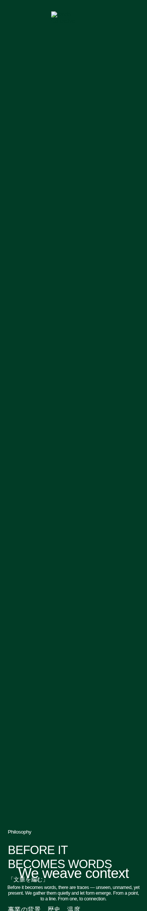

# UI Design System & Master Generation Blueprint: ondocollective-jp

> **Ondo Collective** (https://ondocollective.jp/) — Ondo Collectiveは、ブランドの背景にある文脈を読み解き、理念やコンセプトの言語化からロゴ・キービジュアル・Webまでを一貫して手がけるクリエイティブ・コレクティブです。東京を拠点に、ブランドの世界観づくりを支援します。


---

## 1. Executive Visual Persona & Design Archetype

- **Brand Essence & Persona**: **Ondo Collective** (`https://ondocollective.jp/`). Ondo Collectiveは、ブランドの背景にある文脈を読み解き、理念やコンセプトの言語化からロゴ・キービジュアル・Webまでを一貫して手がけるクリエイティブ・コレクティブです。東京を拠点に、ブランドの世界観づくりを支援します。
- **Visual Archetype**: **Light-Gallery WebGL / Canvas Interactive Experience (`#fff` / `#002c1c`)**.
- **Anti-AI-Slop Differentiators**:
  - **Source-Grounded Chromatic Polarity**: Anchors the viewport in `#fff` (`var(--color-text-white)` in `:root`) paired with `#002c1c` primary typography and `#002c1c` accents.
  - **Extracted Typographic Hierarchy**: Pairs `Gen Interface JP-aa1df9adf44a6d02` for display copy (`We weave context`) with `Shippori Mincho-fd992fb70b84b1db` and not declared in static CSS (uses primary stack / `ui-monospace`).
  - **Calibrated Spatial Grid & Motion**: Combines `1252rem` container bounds (`gap: 20rem`, padding `24rem`) with `cubic-bezier(.22,1,.36,1)` easing and Lenis Smooth Scroll (`data-lenis`), Three.js / WebGL Canvas Pipeline.

---

## 2. Spatial Architecture & Modular Grid Mathematics



### Viewport Allocation & Container Geometry
- **Captured Viewport Dimensions**: Desktop `1440×2400px` (`assets/desktop.png`, capped at 2400px multi-section capture), Mobile `390×2400px` (`assets/mobile.png`, capped at 2400px multi-section capture).
- **Master Container Bounds**: `1252rem` extracted from `ondocollective-jp` stylesheet.
- **Canvas Lateral Padding & Spacing**: `24rem` lateral canvas padding with `20rem` grid gap.
- **Border Radius Scale**: `4rem`.

### Responsive Breakpoint Architecture
- **Desktop Layout**: Multi-column CSS Grid / Flexbox layout at `1440px` (`max-width: 1252rem`, `gap: 20rem`).
- **Mobile Layout**: Single-column vertical stack at `390px` viewport width with `24rem` horizontal padding.
- **Extracted CSS Media Queries**: `@media (width<=767px)`, `@media (width>=768px)`, `@media (width<=400px) and (height<=674px)`, `@media (width<=420px) and (height<=720px)`.

---

## 3. Color System, Materiality & Atmospheric Lighting

### Semantic Palette & Source Grounding
| Semantic Role | Ground-Truth Value | Extracted CSS Source / Selector |
|---|---|---|
| **Primary Canvas Substrate** | `#fff` | `var(--color-text-white)` in `:root` |
| **Primary Typography Ink** | `#f3e5de` | `var(--color-bg-white)` in `:root` |
| **Elevated Surface / Card Substrate** | `#003c26` | `var(--color-green)` in `:root` |
| **Interactive Accent / Highlight** | `#002c1c` | `var(--color-deep-green)` in `:root` |
| **Secondary / Muted Copy** | `#d5cac4` | `var(--color-border-gray)` in `:root` |
| **Structural Hairline Border** | `#a3402c` | `var(--color-error)` in `:root` |
| **Variable Token (`--color-filter-black`)** | `#0009` | `var(--color-filter-black)` in `:root` |

### Sanitized Root CSS Variables (`ui-ux.md` Ground Truth)
| Variable Name | Extracted Value | Semantic Role |
|---|---|---|
| `--col-gap` | `20rem` | Layout / Spatial Grid Token |
| `--grid-padding` | `24rem` | Layout / Spatial Grid Token |
| `--grid-repeat` | `12` | Layout / Spatial Grid Token |
| `--poppins` | `var(--font-poppins)` | Design System Custom Token |
| `--ondo` | `var(--font-ondo)` | Design System Custom Token |
| `--gen-interface` | `var(--font-gen-interface)` | Design System Custom Token |
| `--shippori-mincho` | `var(--font-shippori-mincho)` | Dimension / Scale Token |
| `--letter-spacing-base` | `.03em` | Typography / Scale Token |
| `--line-height-base` | `1.85` | Typography / Scale Token |
| `--color-text-white` | `#fff` | Canvas / Surface Token |
| `--color-bg-white` | `#f3e5de` | Canvas / Surface Token |
| `--color-green` | `#003c26` | Brand / Palette Token |
| `--color-deep-green` | `#002c1c` | Brand / Palette Token |
| `--color-border-gray` | `#d5cac4` | Brand / Palette Token |
| `--color-error` | `#a3402c` | Brand / Palette Token |
| `--color-filter-black` | `#0009` | Canvas / Surface Token |

---

## 4. Typographic Scale & Editorial Hierarchy

### Font Family Stacks
- **Display Typography**: `Gen Interface JP-aa1df9adf44a6d02`.
- **Primary Body Stack**: `Shippori Mincho-fd992fb70b84b1db`.
- **Technical / Metadata Stack**: not declared in static CSS (uses primary stack / `ui-monospace`).

### Typographic Scale & Rules (Extracted from Stylesheet & Variables)
- **Hero Display (`H1`)**: rule `.title` (`font-size: var(--title-font-size)`, `line-height: 1.2`, `letter-spacing: -.02em`, `font-weight: 400`).
- **Section Heading (`H2`)**: not explicitly declared on tag in static CSS (stylesheet font-size ladder: `80%`, `75%`, `.0714286vw`, `.266667vw`, `14rem`).
- **Body Copy**: not explicitly declared on tag in static CSS (stylesheet font-size ladder: `80%`, `75%`, `.0714286vw`, `.266667vw`, `14rem`).
- **Metadata & Navigation Labels**: CSS variables `--letter-spacing-base: .03em`; rule `.label` (`font-size: 14rem`, `line-height: 1.2`).

---

## 5. Choreographed Motion & Interaction Physics

### Primary Easing Curves
- **Extracted Timing Functions**: `cubic-bezier(.22,1,.36,1)`, `cubic-bezier(.33,1,.68,1)`, `cubic-bezier(.25,1,.5,1)`.

### Per-Element Transition & Choreography Rules
- **Selector `data-hover=fade]`**: `transition: opacity var(--hover-duration) var(--hover-ease)` extracted from `ondocollective-jp` stylesheet.
- **Selector `data-mask-out]`**: `transition: -webkit-mask-position var(--mask-out-duration) var(--mask-out-...` extracted from `ondocollective-jp` stylesheet.
- **Selector `data-lqip] img`**: `transition: opacity var(--lqip-duration) var(--lqip-ease)` extracted from `ondocollective-jp` stylesheet.
- **Extracted Easing Curve (`cubic-bezier(.22,1,.36,1)`)**: Governs interactive state transitions across `<header.l-header>` and `<section.p-home-philosophy>`.
- **Runtime Interaction Engine**: Integrates Lenis Smooth Scroll (`data-lenis`), Three.js / WebGL Canvas Pipeline, Barba.js Page Transition Router with `prefers-reduced-motion: reduce` fallback guards.

---

## 6. Component Wireframe & Structural DOM Map

### Visual Layout Schematic (Grounded in `dom.html` — `1440px` Desktop & `390px` Mobile Reflow)
```
┌────────────────────────────────────────────────────────────────────────┐
│ DESKTOP VIEWPORT (1440px) — Ondo Collective                            │
│ ====================================================================== │
│ [ <header.l-header>        | Home Home · Projects Projects · Visual ]  │
│ ---------------------------------------------------------------------- │
│ | HERO STAGE: <section.p-home-mv>                                  |   │
│ | H1: We weave context                                             |   │
│ | Substrate: #fff       | Ink: #002c1c    | Accent: #002c1c        |   │
│ ---------------------------------------------------------------------- │
│ | SHOWCASE GRID (<section.p-home-philosophy) max-w: 1252rem        |   │
│ | +------------------------------+  +------------------------------+ | │
│ | | Philosophy                   |  | Before it becomes words      | | │
│ | +------------------------------+  +------------------------------+ | │
│ ---------------------------------------------------------------------- │
│ | MOBILE VIEWPORT REFLOW (390px) — Single-Column Stack (gap: 20rem ) | │
│ | [<header.l-header>] -> [<section.p-home-mv] -> [<section.p-home-ph]  │
│ ---------------------------------------------------------------------- │
│ [ FOOTER (<footer.l-footer>     ) | https://ondocollective.jp/         │
└────────────────────────────────────────────────────────────────────────┘
```

### Granular DOM Region Breakdown
1. **Brand Header & Navigation Bar (<header.l-header> — `ondocollective-jp`)**:
   - Landmark `<header class="l-header">` hosting `Ondo Collective` navigation (`Home Home · Projects Projects · Visuals Visuals · Contact Contact`), DOM attributes (`data-color="white"`, `data-visible="false"`, `data-menu="closed"`, `data-hover="fade"`), and stylesheet rule `after { box-sizing:inherit }`.
2. **Hero Stage & Focal Lead (<section.p-home-mv> — `We weave context`)**:
   - Landmark `<section class="p-home-mv">` presenting display lead `We weave context` and copy excerpt *"Founded by Wakako Ishido"* over `#fff` canvas and `#002c1c` ink.
3. **Primary Showcase & Content Grid (<section.p-home-philosophy> — `Philosophy`)**:
   - Landmark `<section class="p-home-philosophy">` rendering section `Philosophy` with copy *"Brand Context Designer"*, asset references (`gtm.js`, `favicon.ico`, `icon-96x96.png`, `icon-32x32.png`), and grid rule `html { -webkit-text-size-adjust:100%;-webkit-tap-highlight-color:transparent;li... }`.
4. **Interactive Detail & Feature Matrix (<section.p-home-introduction> — `Before it becomes words`)**:
   - Landmark `<section class="p-home-introduction">` framing `Before it becomes words` and `Introduction` (*"ishido@ondocollective.jp ishido@ondocollective.jp Copy Copied"*) with `#003c26` surface cards, `#002c1c` accents, and `main { display:block }`.
5. **Colophon & Global Directory Footer (<footer.l-footer> — `https://ondocollective.jp/`)**:
   - Landmark `<footer class="l-footer">` anchoring `Ondo Collective` footer links (`Home Home · Projects Projects · Visuals Visuals · Contact Contact`), copy *"ishido@ondocollective.jp ishido@ondocollective.jp"*, and `#a3402c` structural dividers.

---

## 7. Master Zero-Shot AI Generation Prompt

```markdown
# Master Zero-Shot Frontend Generation Prompt: ondocollective-jp (Ondo Collective)

You are a principal frontend architect and design systems engineer. Build a complete, production-ready web application replicating the exact design system, DOM landmarks, typographic hierarchy, color tokens, and motion physics of `ondocollective-jp` (**Ondo Collective** — `https://ondocollective.jp/`).

### 1. Visual Archetype & Anti-AI-Slop Mandates
- **Archetype**: Light-Gallery WebGL / Canvas Interactive Experience (`#fff` / `#002c1c`).
- **Identity & Domain Context**: Ondo Collectiveは、ブランドの背景にある文脈を読み解き、理念やコンセプトの言語化からロゴ・キービジュアル・Webまでを一貫して手がけるクリエイティブ・コレクティブです。東京を拠点に、ブランドの世界観づくりを支援します。
- **Primary Substrate**: `#fff` (`var(--color-text-white)` in `:root`), **Primary Ink**: `#002c1c`, **Accent / Highlight**: `#002c1c`.
- **Site-Specific Differentiators**:
  - **Source-Grounded Chromatic Polarity**: Anchors the viewport in `#fff` (`var(--color-text-white)` in `:root`) paired with `#002c1c` primary typography and `#002c1c` accents.
  - **Extracted Typographic Hierarchy**: Pairs `Gen Interface JP-aa1df9adf44a6d02` for display copy (`We weave context`) with `Shippori Mincho-fd992fb70b84b1db` and not declared in static CSS (uses primary stack / `ui-monospace`).
  - **Calibrated Spatial Grid & Motion**: Combines `1252rem` container bounds (`gap: 20rem`, padding `24rem`) with `cubic-bezier(.22,1,.36,1)` easing and Lenis Smooth Scroll (`data-lenis`), Three.js / WebGL Canvas Pipeline.

### 2. Ground-Truth CSS Variables (`:root` Token Contract)
Declare and consume these exact custom properties extracted from `ondocollective-jp` in your global stylesheet:

:root {
  /* Ondo Collective (ondocollective-jp) — Ground-Truth Extracted CSS Variables */
  --col-gap: 20rem; /* Layout / Spatial Grid Token (ondocollective-jp) */
  --grid-padding: 24rem; /* Layout / Spatial Grid Token (ondocollective-jp) */
  --grid-repeat: 12; /* Layout / Spatial Grid Token (ondocollective-jp) */
  --poppins: var(--font-poppins); /* Design System Custom Token (ondocollective-jp) */
  --ondo: var(--font-ondo); /* Design System Custom Token (ondocollective-jp) */
  --gen-interface: var(--font-gen-interface); /* Design System Custom Token (ondocollective-jp) */
  --shippori-mincho: var(--font-shippori-mincho); /* Dimension / Scale Token (ondocollective-jp) */
  --letter-spacing-base: .03em; /* Typography / Scale Token (ondocollective-jp) */
  --line-height-base: 1.85; /* Typography / Scale Token (ondocollective-jp) */
  --color-text-white: #fff; /* Canvas / Surface Token (ondocollective-jp) */
  --color-bg-white: #f3e5de; /* Canvas / Surface Token (ondocollective-jp) */
  --color-green: #003c26; /* Brand / Palette Token (ondocollective-jp) */
  --color-deep-green: #002c1c; /* Brand / Palette Token (ondocollective-jp) */
  --color-border-gray: #d5cac4; /* Brand / Palette Token (ondocollective-jp) */
  --color-error: #a3402c; /* Brand / Palette Token (ondocollective-jp) */
  --color-filter-black: #0009; /* Canvas / Surface Token (ondocollective-jp) */
}

### 3. Semantic Color & Materiality Contract
Map every surface, ink, and border strictly to these source-grounded tokens:
- **Primary Canvas Substrate**: `#fff` — grounded in `var(--color-text-white)` in `:root`
- **Primary Typography Ink**: `#f3e5de` — grounded in `var(--color-bg-white)` in `:root`
- **Elevated Surface / Card Substrate**: `#003c26` — grounded in `var(--color-green)` in `:root`
- **Interactive Accent / Highlight**: `#002c1c` — grounded in `var(--color-deep-green)` in `:root`
- **Secondary / Muted Copy**: `#d5cac4` — grounded in `var(--color-border-gray)` in `:root`
- **Structural Hairline Border**: `#a3402c` — grounded in `var(--color-error)` in `:root`
- **Variable Token (`--color-filter-black`)**: `#0009` — grounded in `var(--color-filter-black)` in `:root`

### 4. Spatial Grid, Container Bounds & Responsive Breakpoints
- **Desktop Viewport Reference**: `1440×2400px` (capped at 2400px multi-section capture, `1440px` standard desktop width).
- **Mobile Viewport Reference**: `390×2400px` (capped at 2400px multi-section capture, `390px` standard mobile width).
- **Container Max-Width**: `1252rem` extracted from `ondocollective-jp` stylesheet
- **Padding & Gutters**: `24rem` lateral canvas padding with `20rem` grid gap
- **Desktop Grid**: Multi-column CSS Grid / Flexbox layout at `1440px` (`max-width: 1252rem`, `gap: 20rem`)
- **Mobile Adaptation**: Single-column vertical stack at `390px` viewport width with `24rem` horizontal padding
- **Media Queries**: `@media (width<=767px)`, `@media (width>=768px)`, `@media (width<=400px) and (height<=674px)`, `@media (width<=420px) and (height<=720px)`
- **Corner Radii**: `4rem`

### 5. Typography & Editorial Scale Contract
- **Display Font Stack**: `Gen Interface JP-aa1df9adf44a6d02`
- **Body Font Stack**: `Shippori Mincho-fd992fb70b84b1db`
- **Monospace / Technical Font Stack**: not declared in static CSS (uses primary stack / `ui-monospace`)
- **H1 Display Rule**: rule `.title` (`font-size: var(--title-font-size)`, `line-height: 1.2`, `letter-spacing: -.02em`, `font-weight: 400`)
- **H2 Section Rule**: not explicitly declared on tag in static CSS (stylesheet font-size ladder: `80%`, `75%`, `.0714286vw`, `.266667vw`, `14rem`)
- **Body Copy Rule**: not explicitly declared on tag in static CSS (stylesheet font-size ladder: `80%`, `75%`, `.0714286vw`, `.266667vw`, `14rem`)
- **Metadata & Index Rule**: CSS variables `--letter-spacing-base: .03em`; rule `.label` (`font-size: 14rem`, `line-height: 1.2`)

### 6. Component Hierarchy, Verbatim Copy & Real DOM Landmarks
Scaffold `ondocollective-jp` (`Ondo Collective`) with these exact structural regions, extracted copy, and CSS rules from `dom.html`:
1. **Brand Header & Navigation Bar (<header.l-header> — `ondocollective-jp`)**:
   - DOM & Selectors: Landmark `<header class="l-header">` hosting `Ondo Collective` navigation (`Home Home · Projects Projects · Visuals Visuals · Contact Contact`), DOM attributes (`data-color="white"`, `data-visible="false"`, `data-menu="closed"`, `data-hover="fade"`), and stylesheet rule `after { box-sizing:inherit }`.
   - Responsive Contract: Header `Brand Header & Navigation Bar (<header.l-header> — `ondocollective-jp`)` (`ondocollective-jp`) adapts across `@media (width<=767px)`, `@media (width>=768px)`, `@media (width<=400px) and (height<=674px)`, `@media (width<=420px) and (height<=720px)` with `cubic-bezier(.22,1,.36,1)`, `cubic-bezier(.33,1,.68,1)`, `cubic-bezier(.25,1,.5,1)` transitions and links `Home Home · Projects Projects · Visuals Visuals · Contact Contact`.
2. **Hero Stage & Focal Lead (<section.p-home-mv> — `We weave context`)**:
   - DOM & Selectors: Landmark `<section class="p-home-mv">` presenting display lead `We weave context` and copy excerpt *"Founded by Wakako Ishido"* over `#fff` canvas and `#002c1c` ink.
   - Responsive Contract: Hero stage (`1440×2400px` desktop / `390×2400px` mobile) sets `#fff` background with `#002c1c` headline `We weave context`.
3. **Primary Showcase & Content Grid (<section.p-home-philosophy> — `Philosophy`)**:
   - DOM & Selectors: Landmark `<section class="p-home-philosophy">` rendering section `Philosophy` with copy *"Brand Context Designer"*, asset references (`gtm.js`, `favicon.ico`, `icon-96x96.png`, `icon-32x32.png`), and grid rule `html { -webkit-text-size-adjust:100%;-webkit-tap-highlight-color:transparent;li... }`.
   - Responsive Contract: Showcase grid `Primary Showcase & Content Grid (<section.p-home-philosophy> — `Philosophy`)` applies Multi-column CSS Grid / Flexbox layout at `1440px` (`max-width: 1252rem`, `gap: 20rem`) on desktop and Single-column vertical stack at `390px` viewport width with `24rem` horizontal padding on mobile.
4. **Interactive Detail & Feature Matrix (<section.p-home-introduction> — `Before it becomes words`)**:
   - DOM & Selectors: Landmark `<section class="p-home-introduction">` framing `Before it becomes words` and `Introduction` (*"ishido@ondocollective.jp ishido@ondocollective.jp Copy Copied"*) with `#003c26` surface cards, `#002c1c` accents, and `main { display:block }`.
   - Responsive Contract: Detail module `Interactive Detail & Feature Matrix (<section.p-home-introduction> — `Before it becomes words`)` uses `4rem` radii, `#002c1c` highlights, and assets (gtm.js, favicon.ico, icon-96x96.png).
5. **Colophon & Global Directory Footer (<footer.l-footer> — `https://ondocollective.jp/`)**:
   - DOM & Selectors: Landmark `<footer class="l-footer">` anchoring `Ondo Collective` footer links (`Home Home · Projects Projects · Visuals Visuals · Contact Contact`), copy *"ishido@ondocollective.jp ishido@ondocollective.jp"*, and `#a3402c` structural dividers.
   - Responsive Contract: Footer `Colophon & Global Directory Footer (<footer.l-footer> — `https://ondocollective.jp/`)` aligns to `1252rem` extracted from `ondocollective-jp` stylesheet with `24rem` lateral canvas padding with `20rem` grid gap and attributes (data-color="white", data-visible="false", data-menu="closed").

#### Verbatim DOM Copy Excerpts (`dom.html`)
- Copy Excerpt 1: *"Founded by Wakako Ishido"*
- Copy Excerpt 2: *"Brand Context Designer"*
- Copy Excerpt 3: *"ishido@ondocollective.jp ishido@ondocollective.jp Copy Copied"*
- Copy Excerpt 4: *"ishido@ondocollective.jp ishido@ondocollective.jp"*

### 7. Motion, Extracted Stylesheet Rules & Interaction Choreography
- **Primary Easing Functions**: `cubic-bezier(.22,1,.36,1)`, `cubic-bezier(.33,1,.68,1)`, `cubic-bezier(.25,1,.5,1)`
- **Extracted Stylesheet Rules (`ondocollective-jp`)**:
- `after { box-sizing:inherit }`
- `html { -webkit-text-size-adjust:100%;-webkit-tap-highlight-color:transparent;li... }`
- `main { display:block }`
- `pre { font-family:monospace;font-size:inherit }`
- `address { font-style:inherit }`
- **Per-Selector Transition Rules**:
- **Selector `data-hover=fade]`**: `transition: opacity var(--hover-duration) var(--hover-ease)` extracted from `ondocollective-jp` stylesheet.
- **Selector `data-mask-out]`**: `transition: -webkit-mask-position var(--mask-out-duration) var(--mask-out-...` extracted from `ondocollective-jp` stylesheet.
- **Selector `data-lqip] img`**: `transition: opacity var(--lqip-duration) var(--lqip-ease)` extracted from `ondocollective-jp` stylesheet.
- **Extracted Easing Curve (`cubic-bezier(.22,1,.36,1)`)**: Governs interactive state transitions across `<header.l-header>` and `<section.p-home-philosophy>`.
- **Runtime Interaction Engine**: Integrates Lenis Smooth Scroll (`data-lenis`), Three.js / WebGL Canvas Pipeline, Barba.js Page Transition Router with `prefers-reduced-motion: reduce` fallback guards.

### 8. Technical Deliverables
- Implement in Next.js (App Router) with TypeScript and Tailwind CSS consuming the `:root` custom properties defined above for `ondocollective-jp`.
- Reproduce both the `1440px` desktop architecture and `390px` mobile breakpoint transitions, preserving semantic HTML5 landmarks (`<header>`, `<nav>`, `<main>`, `<section>`, `<footer>`) and `prefers-reduced-motion` accessibility guards.
```
