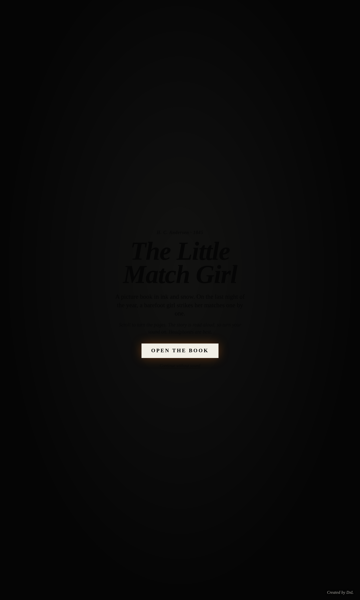

# UI Design System & Master Generation Blueprint: onecoldnight-com

> **The Little Match Girl** (https://onecoldnight.com/) — Andersen's Little Match Girl as a scroll-through noir picture book: open the pages, step into the snow, and strike the matches one by one.



---

## 1. Executive Visual Persona & Design Archetype

- **Brand Essence & Persona**: **The Little Match Girl** (`https://onecoldnight.com/`). Andersen's Little Match Girl as a scroll-through noir picture book: open the pages, step into the snow, and strike the matches one by one.
- **Visual Archetype**: **Light-Gallery WebGL / Canvas Interactive Experience (`#f2efe6` / `#fff`)**.
- **Anti-AI-Slop Differentiators**:
  - **Source-Grounded Chromatic Polarity**: Anchors the viewport in `#f2efe6` (`var(--dxl-mark-fg)` in `:root`) paired with `#050505` primary typography and `#fff` accents.
  - **Extracted Typographic Hierarchy**: Pairs `Cormorant Garamond` for display copy (`The Little Match Girl`) with `italic 500 16px/1 "Cormorant Garamond` and not declared in static CSS (uses primary stack / `ui-monospace`).
  - **Calibrated Spatial Grid & Motion**: Combines `34rem` container bounds (`gap: 0px (flush layout)`, padding `6px`) with `cubic-bezier(.7,0,.15,1)` easing and Three.js / WebGL Canvas Pipeline.

---

## 2. Spatial Architecture & Modular Grid Mathematics


### Viewport Allocation & Container Geometry
- **Captured Viewport Dimensions**: Desktop `1440×2400px` (`assets/desktop.png`, capped at 2400px multi-section capture), Mobile `390×2400px` (`assets/mobile.png`, capped at 2400px multi-section capture).
- **Master Container Bounds**: `34rem` extracted from `onecoldnight-com` stylesheet.
- **Canvas Lateral Padding & Spacing**: `6px` lateral canvas padding with `0px (flush layout)` grid gap.
- **Border Radius Scale**: `28px`, `50%`, `2px`, `1px`.

### Responsive Breakpoint Architecture
- **Desktop Layout**: Multi-column CSS Grid / Flexbox layout at `1440px` (`max-width: 34rem`, `gap: 0px (flush layout)`).
- **Mobile Layout**: Single-column vertical stack at `390px` viewport width with `6px` horizontal padding.
- **Extracted CSS Media Queries**: `@media (prefers-reduced-motion:reduce)`, `@media (max-width:640px)`.

---

## 3. Color System, Materiality & Atmospheric Lighting

### Semantic Palette & Source Grounding
| Semantic Role | Ground-Truth Value | Extracted CSS Source / Selector |
|---|---|---|
| **Primary Canvas Substrate** | `#f2efe6` | `var(--dxl-mark-fg)` in `:root` |
| **Primary Typography Ink** | `#050505` | `var(--dxlBg)` in `:root` |
| **Elevated Surface / Card Substrate** | `#ff7a1a` | `var(--dxlAccent)` in `:root` |
| **Interactive Accent / Highlight** | `#fff` | `.cap.speech { background: #fff }` |
| **Secondary / Muted Copy** | `#6b5a4c` | `.burn .flecks i { background: #6b5a4c }` |
| **Structural Hairline Border** | `#1a0d06` | `.burn .stick { background: #1a0d06 }` |

### Sanitized Root CSS Variables (`ui-ux.md` Ground Truth)
| Variable Name | Extracted Value | Semantic Role |
|---|---|---|
| `--dxl-mark-font` | `italic 500 16px/1 "Cormorant Garamond", Georgia, serif` | Typography / Scale Token |
| `--dxl-mark-tracking` | `.02em` | Typography / Scale Token |
| `--dxl-mark-fg` | `#f2efe6` | Typography Ink Token |
| `--dxl-mark-bg` | `transparent` | Canvas / Surface Token |
| `--dxl-mark-opacity` | `.7` | Design System Custom Token |
| `--dx` | `-9px` | Dimension / Scale Token |
| `--fs` | `1.1` | Design System Custom Token |
| `--dxl-bg` | `var(--dxlBg)` | Canvas / Surface Token |
| `--dxl-fg` | `var(--dxlFg)` | Typography Ink Token |
| `--dxl-accent` | `var(--dxlAccent)` | Brand / Palette Token |
| `--dxlBg` | `#050505` | Canvas / Surface Token |
| `--dxlFg` | `#f2efe6` | Typography Ink Token |
| `--dxlAccent` | `#ff7a1a` | Brand / Palette Token |
| `--head` | `1.000` | Design System Custom Token |
| `--onecoldnight-com-bg` | `#f2efe6` | Canvas Substrate (from `var(--dxl-mark-fg)` in `:root`) |
| `--onecoldnight-com-ink` | `#050505` | Primary Typography Ink (stylesheet-derived) |

---

## 4. Typographic Scale & Editorial Hierarchy

### Font Family Stacks
- **Display Typography**: `Cormorant Garamond`.
- **Primary Body Stack**: `italic 500 16px/1 "Cormorant Garamond`.
- **Technical / Metadata Stack**: not declared in static CSS (uses primary stack / `ui-monospace`).

### Typographic Scale & Rules (Extracted from Stylesheet & Variables)
- **Hero Display (`H1`)**: rule `h1` (`letter-spacing: -.02em`).
- **Section Heading (`H2`)**: not explicitly declared on tag in static CSS (stylesheet font-size ladder: `21px`, `17px`).
- **Body Copy**: not explicitly declared on tag in static CSS (stylesheet font-size ladder: `21px`, `17px`).
- **Metadata & Navigation Labels**: not explicitly declared on tag in static CSS (stylesheet font-size ladder: `21px`, `17px`).

---

## 5. Choreographed Motion & Interaction Physics

### Primary Easing Curves
- **Extracted Timing Functions**: `cubic-bezier(.7,0,.15,1)`, `cubic-bezier(.6,0,.3,1)`.

### Per-Element Transition & Choreography Rules
- **Selector `.dxl-mark[data-astro-cid-n6wkilw4]`**: `transition: opacity .2s` extracted from `onecoldnight-com` stylesheet.
- **Selector `a[data-dxl-mark]`**: `transition: opacity .3s,text-shadow .3s` extracted from `onecoldnight-com` stylesheet.
- **Selector `.gate`**: `transition: opacity 1.4s ease,visibility 0s linear 1.4s` extracted from `onecoldnight-com` stylesheet.
- **Extracted Easing Curve (`cubic-bezier(.7,0,.15,1)`)**: Governs interactive state transitions across `<header.locked>` and `<article.story>`.
- **Runtime Interaction Engine**: Integrates Three.js / WebGL Canvas Pipeline with `prefers-reduced-motion: reduce` fallback guards.

---

## 6. Component Wireframe & Structural DOM Map

### Visual Layout Schematic (Grounded in `dom.html` — `1440px` Desktop & `390px` Mobile Reflow)
```
┌────────────────────────────────────────────────────────────────────────┐
│ DESKTOP VIEWPORT (1440px) — The Little Match Girl                      │
│ ====================================================================== │
│ [ <header.locked>          | Created by DxL                         ]  │
│ ---------------------------------------------------------------------- │
│ | HERO STAGE: <section.gate>                                       |   │
│ | H1: The Little Match Girl                                        |   │
│ | Substrate: #f2efe6    | Ink: #050505    | Accent: #fff           |   │
│ ---------------------------------------------------------------------- │
│ | SHOWCASE GRID (<article.story>           ) max-w: 34rem          |   │
│ | +------------------------------+  +------------------------------+ | │
│ | | The story                    |  | A picture book in ink and sn | | │
│ | +------------------------------+  +------------------------------+ | │
│ ---------------------------------------------------------------------- │
│ | MOBILE VIEWPORT REFLOW (390px) — Single-Column Stack (gap: 0px (f) | │
│ | [<header.locked>] -> [<section.gate>] -> [<article.story>] |         │
│ ---------------------------------------------------------------------- │
│ [ FOOTER (<footer.gate>         ) | https://onecoldnight.com/          │
└────────────────────────────────────────────────────────────────────────┘
```

### Granular DOM Region Breakdown
1. **Brand Header & Navigation Bar (<header.locked> — `onecoldnight-com`)**:
   - Landmark `<header class="locked">` hosting `The Little Match Girl` navigation (`Created by DxL`), DOM attributes (`data-engine="three.js r180"`, `data-dxl-mark`, `data-astro-cid-n6wkilw4`), and stylesheet rule `focus-visible { text-shadow:0 0 6px 050505,0 0 18px rgba(255,122,26,.6) }`.
2. **Hero Stage & Focal Lead (<section.gate> — `The Little Match Girl`)**:
   - Landmark `<section class="gate">` presenting display lead `The Little Match Girl` and copy excerpt *"H. C. Andersen · 1845"* over `#f2efe6` canvas and `#050505` ink.
3. **Primary Showcase & Content Grid (<article.story> — `The story`)**:
   - Landmark `<article class="story">` rendering section `The story` with copy *"A picture book in ink and snow. On the last night of the year, a "*, asset references (`favicon.svg`, `apple-touch-icon.png`, `sitemap-index.xml`, `script.js`), and grid rule `.dot { display:none }`.
4. **Interactive Detail & Feature Matrix (<article.story> — `A picture book in ink and snow. On`)**:
   - Landmark `<article class="story">` framing `A picture book in ink and snow. On the last nigh` and `Scroll to turn the pages. The story is read alou` (*"Scroll to turn the pages. The story is read aloud, so turn your s"*) with `#ff7a1a` surface cards, `#fff` accents, and `html { background:050505 }`.
5. **Colophon & Global Directory Footer (<footer.gate> — `https://onecoldnight.com/`)**:
   - Landmark `<footer class="gate">` anchoring `The Little Match Girl` footer links (`Created by DxL`), copy *"Continue without sound"*, and `#1a0d06` structural dividers.

---

## 7. Master Zero-Shot AI Generation Prompt

```markdown
# Master Zero-Shot Frontend Generation Prompt: onecoldnight-com (The Little Match Girl)

You are a principal frontend architect and design systems engineer. Build a complete, production-ready web application replicating the exact design system, DOM landmarks, typographic hierarchy, color tokens, and motion physics of `onecoldnight-com` (**The Little Match Girl** — `https://onecoldnight.com/`).

### 1. Visual Archetype & Anti-AI-Slop Mandates
- **Archetype**: Light-Gallery WebGL / Canvas Interactive Experience (`#f2efe6` / `#fff`).
- **Identity & Domain Context**: Andersen's Little Match Girl as a scroll-through noir picture book: open the pages, step into the snow, and strike the matches one by one.
- **Primary Substrate**: `#f2efe6` (`var(--dxl-mark-fg)` in `:root`), **Primary Ink**: `#050505`, **Accent / Highlight**: `#fff`.
- **Site-Specific Differentiators**:
  - **Source-Grounded Chromatic Polarity**: Anchors the viewport in `#f2efe6` (`var(--dxl-mark-fg)` in `:root`) paired with `#050505` primary typography and `#fff` accents.
  - **Extracted Typographic Hierarchy**: Pairs `Cormorant Garamond` for display copy (`The Little Match Girl`) with `italic 500 16px/1 "Cormorant Garamond` and not declared in static CSS (uses primary stack / `ui-monospace`).
  - **Calibrated Spatial Grid & Motion**: Combines `34rem` container bounds (`gap: 0px (flush layout)`, padding `6px`) with `cubic-bezier(.7,0,.15,1)` easing and Three.js / WebGL Canvas Pipeline.

### 2. Ground-Truth CSS Variables (`:root` Token Contract)
Declare and consume these exact custom properties extracted from `onecoldnight-com` in your global stylesheet:

:root {
  /* The Little Match Girl (onecoldnight-com) — Ground-Truth Extracted CSS Variables */
  --dxl-mark-font: italic 500 16px/1 "Cormorant Garamond", Georgia, serif; /* Typography / Scale Token (onecoldnight-com) */
  --dxl-mark-tracking: .02em; /* Typography / Scale Token (onecoldnight-com) */
  --dxl-mark-fg: #f2efe6; /* Typography Ink Token (onecoldnight-com) */
  --dxl-mark-bg: transparent; /* Canvas / Surface Token (onecoldnight-com) */
  --dxl-mark-opacity: .7; /* Design System Custom Token (onecoldnight-com) */
  --dx: -9px; /* Dimension / Scale Token (onecoldnight-com) */
  --fs: 1.1; /* Design System Custom Token (onecoldnight-com) */
  --dxl-bg: var(--dxlBg); /* Canvas / Surface Token (onecoldnight-com) */
  --dxl-fg: var(--dxlFg); /* Typography Ink Token (onecoldnight-com) */
  --dxl-accent: var(--dxlAccent); /* Brand / Palette Token (onecoldnight-com) */
  --dxlBg: #050505; /* Canvas / Surface Token (onecoldnight-com) */
  --dxlFg: #f2efe6; /* Typography Ink Token (onecoldnight-com) */
  --dxlAccent: #ff7a1a; /* Brand / Palette Token (onecoldnight-com) */
  --head: 1.000; /* Design System Custom Token (onecoldnight-com) */
  --onecoldnight-com-bg: #f2efe6; /* Canvas Substrate (from `var(--dxl-mark-fg)` in `:root`) (onecoldnight-com) */
  --onecoldnight-com-ink: #050505; /* Primary Typography Ink (stylesheet-derived) (onecoldnight-com) */
}

### 3. Semantic Color & Materiality Contract
Map every surface, ink, and border strictly to these source-grounded tokens:
- **Primary Canvas Substrate**: `#f2efe6` — grounded in `var(--dxl-mark-fg)` in `:root`
- **Primary Typography Ink**: `#050505` — grounded in `var(--dxlBg)` in `:root`
- **Elevated Surface / Card Substrate**: `#ff7a1a` — grounded in `var(--dxlAccent)` in `:root`
- **Interactive Accent / Highlight**: `#fff` — grounded in `.cap.speech { background: #fff }`
- **Secondary / Muted Copy**: `#6b5a4c` — grounded in `.burn .flecks i { background: #6b5a4c }`
- **Structural Hairline Border**: `#1a0d06` — grounded in `.burn .stick { background: #1a0d06 }`

### 4. Spatial Grid, Container Bounds & Responsive Breakpoints
- **Desktop Viewport Reference**: `1440×2400px` (capped at 2400px multi-section capture, `1440px` standard desktop width).
- **Mobile Viewport Reference**: `390×2400px` (capped at 2400px multi-section capture, `390px` standard mobile width).
- **Container Max-Width**: `34rem` extracted from `onecoldnight-com` stylesheet
- **Padding & Gutters**: `6px` lateral canvas padding with `0px (flush layout)` grid gap
- **Desktop Grid**: Multi-column CSS Grid / Flexbox layout at `1440px` (`max-width: 34rem`, `gap: 0px (flush layout)`)
- **Mobile Adaptation**: Single-column vertical stack at `390px` viewport width with `6px` horizontal padding
- **Media Queries**: `@media (prefers-reduced-motion:reduce)`, `@media (max-width:640px)`
- **Corner Radii**: `28px`, `50%`, `2px`, `1px`

### 5. Typography & Editorial Scale Contract
- **Display Font Stack**: `Cormorant Garamond`
- **Body Font Stack**: `italic 500 16px/1 "Cormorant Garamond`
- **Monospace / Technical Font Stack**: not declared in static CSS (uses primary stack / `ui-monospace`)
- **H1 Display Rule**: rule `h1` (`letter-spacing: -.02em`)
- **H2 Section Rule**: not explicitly declared on tag in static CSS (stylesheet font-size ladder: `21px`, `17px`)
- **Body Copy Rule**: not explicitly declared on tag in static CSS (stylesheet font-size ladder: `21px`, `17px`)
- **Metadata & Index Rule**: not explicitly declared on tag in static CSS (stylesheet font-size ladder: `21px`, `17px`)

### 6. Component Hierarchy, Verbatim Copy & Real DOM Landmarks
Scaffold `onecoldnight-com` (`The Little Match Girl`) with these exact structural regions, extracted copy, and CSS rules from `dom.html`:
1. **Brand Header & Navigation Bar (<header.locked> — `onecoldnight-com`)**:
   - DOM & Selectors: Landmark `<header class="locked">` hosting `The Little Match Girl` navigation (`Created by DxL`), DOM attributes (`data-engine="three.js r180"`, `data-dxl-mark`, `data-astro-cid-n6wkilw4`), and stylesheet rule `focus-visible { text-shadow:0 0 6px 050505,0 0 18px rgba(255,122,26,.6) }`.
   - Responsive Contract: Header `Brand Header & Navigation Bar (<header.locked> — `onecoldnight-com`)` (`onecoldnight-com`) adapts across `@media (prefers-reduced-motion:reduce)`, `@media (max-width:640px)` with `cubic-bezier(.7,0,.15,1)`, `cubic-bezier(.6,0,.3,1)` transitions and links `Created by DxL`.
2. **Hero Stage & Focal Lead (<section.gate> — `The Little Match Girl`)**:
   - DOM & Selectors: Landmark `<section class="gate">` presenting display lead `The Little Match Girl` and copy excerpt *"H. C. Andersen · 1845"* over `#f2efe6` canvas and `#050505` ink.
   - Responsive Contract: Hero stage (`1440×2400px` desktop / `390×2400px` mobile) sets `#f2efe6` background with `#050505` headline `The Little Match Girl`.
3. **Primary Showcase & Content Grid (<article.story> — `The story`)**:
   - DOM & Selectors: Landmark `<article class="story">` rendering section `The story` with copy *"A picture book in ink and snow. On the last night of the year, a "*, asset references (`favicon.svg`, `apple-touch-icon.png`, `sitemap-index.xml`, `script.js`), and grid rule `.dot { display:none }`.
   - Responsive Contract: Showcase grid `Primary Showcase & Content Grid (<article.story> — `The story`)` applies Multi-column CSS Grid / Flexbox layout at `1440px` (`max-width: 34rem`, `gap: 0px (flush layout)`) on desktop and Single-column vertical stack at `390px` viewport width with `6px` horizontal padding on mobile.
4. **Interactive Detail & Feature Matrix (<article.story> — `A picture book in ink and snow. On`)**:
   - DOM & Selectors: Landmark `<article class="story">` framing `A picture book in ink and snow. On the last nigh` and `Scroll to turn the pages. The story is read alou` (*"Scroll to turn the pages. The story is read aloud, so turn your s"*) with `#ff7a1a` surface cards, `#fff` accents, and `html { background:050505 }`.
   - Responsive Contract: Detail module `Interactive Detail & Feature Matrix (<article.story> — `A picture book in ink and snow. On`)` uses `28px`, `50%`, `2px`, `1px` radii, `#fff` highlights, and assets (favicon.svg, apple-touch-icon.png, sitemap-index.xml).
5. **Colophon & Global Directory Footer (<footer.gate> — `https://onecoldnight.com/`)**:
   - DOM & Selectors: Landmark `<footer class="gate">` anchoring `The Little Match Girl` footer links (`Created by DxL`), copy *"Continue without sound"*, and `#1a0d06` structural dividers.
   - Responsive Contract: Footer `Colophon & Global Directory Footer (<footer.gate> — `https://onecoldnight.com/`)` aligns to `34rem` extracted from `onecoldnight-com` stylesheet with `6px` lateral canvas padding with `0px (flush layout)` grid gap and attributes (data-engine="three.js r180", data-dxl-mark, data-astro-cid-n6wkilw4).

#### Verbatim DOM Copy Excerpts (`dom.html`)
- Copy Excerpt 1: *"H. C. Andersen · 1845"*
- Copy Excerpt 2: *"A picture book in ink and snow. On the last night of the year, a barefoot girl str..."*
- Copy Excerpt 3: *"Scroll to turn the pages. The story is read aloud, so turn your sound on. Headphon..."*
- Copy Excerpt 4: *"Continue without sound"*

### 7. Motion, Extracted Stylesheet Rules & Interaction Choreography
- **Primary Easing Functions**: `cubic-bezier(.7,0,.15,1)`, `cubic-bezier(.6,0,.3,1)`
- **Extracted Stylesheet Rules (`onecoldnight-com`)**:
- `focus-visible { text-shadow:0 0 6px 050505,0 0 18px rgba(255,122,26,.6) }`
- `.dot { display:none }`
- `html { background:050505 }`
- `body { color:f2efe6;font-family:Cormorant Garamond,Georgia,serif;-webkit-tap-hi... }`
- `view { position:fixed;top:0;left:0;width:100%;height:100vh;height:100lvh;displa... }`
- **Per-Selector Transition Rules**:
- **Selector `.dxl-mark[data-astro-cid-n6wkilw4]`**: `transition: opacity .2s` extracted from `onecoldnight-com` stylesheet.
- **Selector `a[data-dxl-mark]`**: `transition: opacity .3s,text-shadow .3s` extracted from `onecoldnight-com` stylesheet.
- **Selector `.gate`**: `transition: opacity 1.4s ease,visibility 0s linear 1.4s` extracted from `onecoldnight-com` stylesheet.
- **Extracted Easing Curve (`cubic-bezier(.7,0,.15,1)`)**: Governs interactive state transitions across `<header.locked>` and `<article.story>`.
- **Runtime Interaction Engine**: Integrates Three.js / WebGL Canvas Pipeline with `prefers-reduced-motion: reduce` fallback guards.

### 8. Technical Deliverables
- Implement in Next.js (App Router) with TypeScript and Tailwind CSS consuming the `:root` custom properties defined above for `onecoldnight-com`.
- Reproduce both the `1440px` desktop architecture and `390px` mobile breakpoint transitions, preserving semantic HTML5 landmarks (`<header>`, `<nav>`, `<main>`, `<section>`, `<footer>`) and `prefers-reduced-motion` accessibility guards.
```
