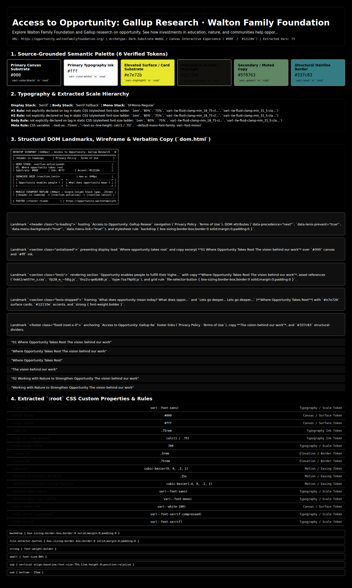
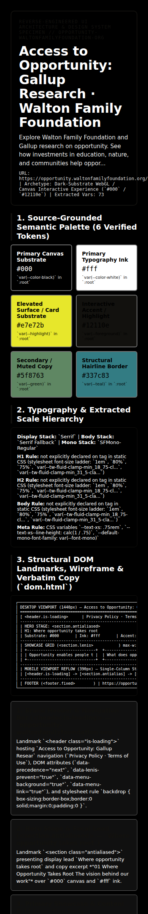

# UI Design System & Master Generation Blueprint: opportunity-waltonfamilyfoundation-org

> **Access to Opportunity: Gallup Research · Walton Family Foundation** (https://opportunity.waltonfamilyfoundation.org/) — Explore Walton Family Foundation and Gallup research on opportunity. See how investments in education, nature, and communities help oppor...



---

## 1. Executive Visual Persona & Design Archetype

- **Brand Essence & Persona**: **Access to Opportunity: Gallup Research · Walton Family Foundation** (`https://opportunity.waltonfamilyfoundation.org/`). Explore Walton Family Foundation and Gallup research on opportunity. See how investments in education, nature, and communities help oppor...
- **Visual Archetype**: **Dark-Substrate WebGL / Canvas Interactive Experience (`#000` / `#12110e`)**.
- **Anti-AI-Slop Differentiators**:
  - **Source-Grounded Chromatic Polarity**: Anchors the viewport in `#000` (`var(--color-black)` in `:root`) paired with `#fff` primary typography and `#12110e` accents.
  - **Extracted Typographic Hierarchy**: Pairs `Serrif` for display copy (`Where opportunity takes root`) with `Serrif Fallback` and `SFMono-Regular`.
  - **Calibrated Spatial Grid & Motion**: Combines `640px` container bounds (`gap: .25rem`, padding `.25rem`) with `cubic-bezier(0,0,.2,1)` easing and Lenis Smooth Scroll (`data-lenis`), Lottie Vector Animation Player.

---

## 2. Spatial Architecture & Modular Grid Mathematics



### Viewport Allocation & Container Geometry
- **Captured Viewport Dimensions**: Desktop `1440×2400px` (`assets/desktop.png`, capped at 2400px multi-section capture), Mobile `390×2400px` (`assets/mobile.png`, capped at 2400px multi-section capture).
- **Master Container Bounds**: `640px` extracted from `opportunity-waltonfamilyfoundation-org` stylesheet.
- **Canvas Lateral Padding & Spacing**: `.25rem` lateral canvas padding with `.25rem` grid gap.
- **Border Radius Scale**: `var(--radius-lg)`, `var(--radius-xl)`.

### Responsive Breakpoint Architecture
- **Desktop Layout**: Multi-column CSS Grid / Flexbox layout at `1440px` (`max-width: 640px`, `gap: .25rem`).
- **Mobile Layout**: Single-column vertical stack at `390px` viewport width with `.25rem` horizontal padding.
- **Extracted CSS Media Queries**: `@media (max-width:640px)`, `@media (min-width:320px)`, `@media (min-width:390px)`, `@media (min-width:1512px)`.

---

## 3. Color System, Materiality & Atmospheric Lighting

### Semantic Palette & Source Grounding
| Semantic Role | Ground-Truth Value | Extracted CSS Source / Selector |
|---|---|---|
| **Primary Canvas Substrate** | `#000` | `var(--color-black)` in `:root` |
| **Primary Typography Ink** | `#fff` | `var(--color-white)` in `:root` |
| **Elevated Surface / Card Substrate** | `#e7e72b` | `var(--highlight)` in `:root` |
| **Interactive Accent / Highlight** | `#12110e` | `var(--foreground)` in `:root` |
| **Secondary / Muted Copy** | `#5f8763` | `var(--green)` in `:root` |
| **Structural Hairline Border** | `#337c83` | `var(--teal)` in `:root` |

### Sanitized Root CSS Variables (`ui-ux.md` Ground Truth)
| Variable Name | Extracted Value | Semantic Role |
|---|---|---|
| `--font-sans` | `var(--font-sans)` | Typography / Scale Token |
| `--color-black` | `#000` | Canvas / Surface Token |
| `--color-white` | `#fff` | Canvas / Surface Token |
| `--text-xs` | `.75rem` | Typography Ink Token |
| `--text-xs--line-height` | `calc(1 / .75)` | Typography Ink Token |
| `--font-weight-bold` | `700` | Typography / Scale Token |
| `--radius-lg` | `.5rem` | Elevation / Border Token |
| `--radius-xl` | `.75rem` | Elevation / Border Token |
| `--ease-out` | `cubic-bezier(0, 0, .2, 1)` | Motion / Easing Token |
| `--default-transition-duration` | `.15s` | Motion / Easing Token |
| `--default-transition-timing-function` | `cubic-bezier(.4, 0, .2, 1)` | Motion / Easing Token |
| `--default-font-family` | `var(--font-sans)` | Typography / Scale Token |
| `--default-mono-font-family` | `var(--font-mono)` | Typography / Scale Token |
| `--color-white-100` | `var(--white-100)` | Canvas / Surface Token |
| `--font-serrif-compressed` | `var(--font-serrif-compressed)` | Typography / Scale Token |
| `--font-serrif` | `var(--font-serrif)` | Typography / Scale Token |

---

## 4. Typographic Scale & Editorial Hierarchy

### Font Family Stacks
- **Display Typography**: `Serrif`.
- **Primary Body Stack**: `Serrif Fallback`.
- **Technical / Metadata Stack**: `SFMono-Regular`.

### Typographic Scale & Rules (Extracted from Stylesheet & Variables)
- **Hero Display (`H1`)**: not explicitly declared on tag in static CSS (stylesheet font-size ladder: `1em`, `80%`, `75%`, `var(--tw-fluid-clamp-min_18_75-cl...`, `var(--tw-fluid-clamp-min_31_5-cla...`).
- **Section Heading (`H2`)**: not explicitly declared on tag in static CSS (stylesheet font-size ladder: `1em`, `80%`, `75%`, `var(--tw-fluid-clamp-min_18_75-cl...`, `var(--tw-fluid-clamp-min_31_5-cla...`).
- **Body Copy**: not explicitly declared on tag in static CSS (stylesheet font-size ladder: `1em`, `80%`, `75%`, `var(--tw-fluid-clamp-min_18_75-cl...`, `var(--tw-fluid-clamp-min_31_5-cla...`).
- **Metadata & Navigation Labels**: CSS variables `--text-xs: .75rem`, `--text-xs--line-height: calc(1 / .75)`, `--default-mono-font-family: var(--font-mono)`.

---

## 5. Choreographed Motion & Interaction Physics

### Primary Easing Curves
- **Extracted Timing Functions**: `cubic-bezier(0,0,.2,1)`, `cubic-bezier(.4,0,.2,1)`, `cubic-bezier(.34,1.56,.64,1)`.

### Per-Element Transition & Choreography Rules
- **Selector `layer theme`**: `transition: .15s` extracted from `opportunity-waltonfamilyfoundation-org` stylesheet.
- **Selector `.MenuButton`**: `transition: var(--tw-ease,var(--default-transition-timing-function))` extracted from `opportunity-waltonfamilyfoundation-org` stylesheet.
- **Selector `.MenuButton_Inner`**: `transition: var(--tw-ease,var(--default-transition-timing-function))` extracted from `opportunity-waltonfamilyfoundation-org` stylesheet.
- **Extracted Easing Curve (`cubic-bezier(0,0,.2,1)`)**: Governs interactive state transitions across `<header.is-loading>` and `<section.lenis>`.
- **Runtime Interaction Engine**: Integrates Lenis Smooth Scroll (`data-lenis`), Lottie Vector Animation Player, HTML5 `<canvas>` Interactive Viewport Surface with `prefers-reduced-motion: reduce` fallback guards.

---

## 6. Component Wireframe & Structural DOM Map

### Visual Layout Schematic (Grounded in `dom.html` — `1440px` Desktop & `390px` Mobile Reflow)
```
┌────────────────────────────────────────────────────────────────────────┐
│ DESKTOP VIEWPORT (1440px) — Access to Opportunity: Gallup Research · W │
│ ====================================================================== │
│ [ <header.is-loading>      | Privacy Policy · Terms of Use          ]  │
│ ---------------------------------------------------------------------- │
│ | HERO STAGE: <section.antialiased>                                |   │
│ | H1: Where opportunity takes root                                 |   │
│ | Substrate: #000       | Ink: #fff       | Accent: #12110e        |   │
│ ---------------------------------------------------------------------- │
│ | SHOWCASE GRID (<section.lenis>           ) max-w: 640px          |   │
│ | +------------------------------+  +------------------------------+ | │
│ | | Opportunity enables people t |  | What does opportunity mean t | | │
│ | +------------------------------+  +------------------------------+ | │
│ ---------------------------------------------------------------------- │
│ | MOBILE VIEWPORT REFLOW (390px) — Single-Column Stack (gap: .25rem) | │
│ | [<header.is-loading] -> [<section.antialias] -> [<section.lenis>] |  │
│ ---------------------------------------------------------------------- │
│ [ FOOTER (<footer.fixed>        ) | https://opportunity.waltonfamilyfo │
└────────────────────────────────────────────────────────────────────────┘
```

### Granular DOM Region Breakdown
1. **Brand Header & Navigation Bar (<header.is-loading> — `opportunity-waltonfamilyfoundation-org`)**:
   - Landmark `<header class="is-loading">` hosting `Access to Opportunity: Gallup Resear` navigation (`Privacy Policy · Terms of Use`), DOM attributes (`data-precedence="next"`, `data-lenis-prevent="true"`, `data-menu-background="true"`, `data-menu-link="true"`), and stylesheet rule `backdrop { box-sizing:border-box;border:0 solid;margin:0;padding:0 }`.
2. **Hero Stage & Focal Lead (<section.antialiased> — `Where opportunity takes root`)**:
   - Landmark `<section class="antialiased">` presenting display lead `Where opportunity takes root` and copy excerpt *"01 Where Opportunity Takes Root The vision behind our work"* over `#000` canvas and `#fff` ink.
3. **Primary Showcase & Content Grid (<section.lenis> — `Opportunity enables people to fulf`)**:
   - Landmark `<section class="lenis">` rendering section `Opportunity enables people to fulfill their highe...` with copy *"Where Opportunity Takes Root The vision behind our work"*, asset references (`0okt1rwt07m_z.css`, `0ji28_e_~fdtg.js`, `0nz2u-qe8z68i.js`, `0yjw-7sa79pfd.js`), and grid rule `file-selector-button { box-sizing:border-box;border:0 solid;margin:0;padding:0 }`.
4. **Interactive Detail & Feature Matrix (<section.lenis-stopped> — `What does opportunity mean today? `)**:
   - Landmark `<section class="lenis-stopped">` framing `What does opportunity mean today? What does oppor...` and `Lets go deeper... Lets go deeper...` (*"Where Opportunity Takes Root"*) with `#e7e72b` surface cards, `#12110e` accents, and `strong { font-weight:bolder }`.
5. **Colophon & Global Directory Footer (<footer.fixed> — `https://opportunity.waltonfamilyfoundation.org/`)**:
   - Landmark `<footer class="fixed inset-x-0">` anchoring `Access to Opportunity: Gallup Re` footer links (`Privacy Policy · Terms of Use`), copy *"The vision behind our work"*, and `#337c83` structural dividers.

---

## 7. Master Zero-Shot AI Generation Prompt

```markdown
# Master Zero-Shot Frontend Generation Prompt: opportunity-waltonfamilyfoundation-org (Access to Opportunity: Gallup Research · Walton Family Foundation)

You are a principal frontend architect and design systems engineer. Build a complete, production-ready web application replicating the exact design system, DOM landmarks, typographic hierarchy, color tokens, and motion physics of `opportunity-waltonfamilyfoundation-org` (**Access to Opportunity: Gallup Research · Walton Family Foundation** — `https://opportunity.waltonfamilyfoundation.org/`).

### 1. Visual Archetype & Anti-AI-Slop Mandates
- **Archetype**: Dark-Substrate WebGL / Canvas Interactive Experience (`#000` / `#12110e`).
- **Identity & Domain Context**: Explore Walton Family Foundation and Gallup research on opportunity. See how investments in education, nature, and communities help oppor...
- **Primary Substrate**: `#000` (`var(--color-black)` in `:root`), **Primary Ink**: `#fff`, **Accent / Highlight**: `#12110e`.
- **Site-Specific Differentiators**:
  - **Source-Grounded Chromatic Polarity**: Anchors the viewport in `#000` (`var(--color-black)` in `:root`) paired with `#fff` primary typography and `#12110e` accents.
  - **Extracted Typographic Hierarchy**: Pairs `Serrif` for display copy (`Where opportunity takes root`) with `Serrif Fallback` and `SFMono-Regular`.
  - **Calibrated Spatial Grid & Motion**: Combines `640px` container bounds (`gap: .25rem`, padding `.25rem`) with `cubic-bezier(0,0,.2,1)` easing and Lenis Smooth Scroll (`data-lenis`), Lottie Vector Animation Player.

### 2. Ground-Truth CSS Variables (`:root` Token Contract)
Declare and consume these exact custom properties extracted from `opportunity-waltonfamilyfoundation-org` in your global stylesheet:

:root {
  /* Access to Opportunity: Gallup Research · Walton Family Foundation (opportunity-waltonfamilyfoundation-org) — Ground-Truth Extracted CSS Variables */
  --font-sans: var(--font-sans); /* Typography / Scale Token (opportunity-waltonfamilyfoundation-org) */
  --color-black: #000; /* Canvas / Surface Token (opportunity-waltonfamilyfoundation-org) */
  --color-white: #fff; /* Canvas / Surface Token (opportunity-waltonfamilyfoundation-org) */
  --text-xs: .75rem; /* Typography Ink Token (opportunity-waltonfamilyfoundation-org) */
  --text-xs--line-height: calc(1 / .75); /* Typography Ink Token (opportunity-waltonfamilyfoundation-org) */
  --font-weight-bold: 700; /* Typography / Scale Token (opportunity-waltonfamilyfoundation-org) */
  --radius-lg: .5rem; /* Elevation / Border Token (opportunity-waltonfamilyfoundation-org) */
  --radius-xl: .75rem; /* Elevation / Border Token (opportunity-waltonfamilyfoundation-org) */
  --ease-out: cubic-bezier(0, 0, .2, 1); /* Motion / Easing Token (opportunity-waltonfamilyfoundation-org) */
  --default-transition-duration: .15s; /* Motion / Easing Token (opportunity-waltonfamilyfoundation-org) */
  --default-transition-timing-function: cubic-bezier(.4, 0, .2, 1); /* Motion / Easing Token (opportunity-waltonfamilyfoundation-org) */
  --default-font-family: var(--font-sans); /* Typography / Scale Token (opportunity-waltonfamilyfoundation-org) */
  --default-mono-font-family: var(--font-mono); /* Typography / Scale Token (opportunity-waltonfamilyfoundation-org) */
  --color-white-100: var(--white-100); /* Canvas / Surface Token (opportunity-waltonfamilyfoundation-org) */
  --font-serrif-compressed: var(--font-serrif-compressed); /* Typography / Scale Token (opportunity-waltonfamilyfoundation-org) */
  --font-serrif: var(--font-serrif); /* Typography / Scale Token (opportunity-waltonfamilyfoundation-org) */
}

### 3. Semantic Color & Materiality Contract
Map every surface, ink, and border strictly to these source-grounded tokens:
- **Primary Canvas Substrate**: `#000` — grounded in `var(--color-black)` in `:root`
- **Primary Typography Ink**: `#fff` — grounded in `var(--color-white)` in `:root`
- **Elevated Surface / Card Substrate**: `#e7e72b` — grounded in `var(--highlight)` in `:root`
- **Interactive Accent / Highlight**: `#12110e` — grounded in `var(--foreground)` in `:root`
- **Secondary / Muted Copy**: `#5f8763` — grounded in `var(--green)` in `:root`
- **Structural Hairline Border**: `#337c83` — grounded in `var(--teal)` in `:root`

### 4. Spatial Grid, Container Bounds & Responsive Breakpoints
- **Desktop Viewport Reference**: `1440×2400px` (capped at 2400px multi-section capture, `1440px` standard desktop width).
- **Mobile Viewport Reference**: `390×2400px` (capped at 2400px multi-section capture, `390px` standard mobile width).
- **Container Max-Width**: `640px` extracted from `opportunity-waltonfamilyfoundation-org` stylesheet
- **Padding & Gutters**: `.25rem` lateral canvas padding with `.25rem` grid gap
- **Desktop Grid**: Multi-column CSS Grid / Flexbox layout at `1440px` (`max-width: 640px`, `gap: .25rem`)
- **Mobile Adaptation**: Single-column vertical stack at `390px` viewport width with `.25rem` horizontal padding
- **Media Queries**: `@media (max-width:640px)`, `@media (min-width:320px)`, `@media (min-width:390px)`, `@media (min-width:1512px)`
- **Corner Radii**: `var(--radius-lg)`, `var(--radius-xl)`

### 5. Typography & Editorial Scale Contract
- **Display Font Stack**: `Serrif`
- **Body Font Stack**: `Serrif Fallback`
- **Monospace / Technical Font Stack**: `SFMono-Regular`
- **H1 Display Rule**: not explicitly declared on tag in static CSS (stylesheet font-size ladder: `1em`, `80%`, `75%`, `var(--tw-fluid-clamp-min_18_75-cl...`, `var(--tw-fluid-clamp-min_31_5-cla...`)
- **H2 Section Rule**: not explicitly declared on tag in static CSS (stylesheet font-size ladder: `1em`, `80%`, `75%`, `var(--tw-fluid-clamp-min_18_75-cl...`, `var(--tw-fluid-clamp-min_31_5-cla...`)
- **Body Copy Rule**: not explicitly declared on tag in static CSS (stylesheet font-size ladder: `1em`, `80%`, `75%`, `var(--tw-fluid-clamp-min_18_75-cl...`, `var(--tw-fluid-clamp-min_31_5-cla...`)
- **Metadata & Index Rule**: CSS variables `--text-xs: .75rem`, `--text-xs--line-height: calc(1 / .75)`, `--default-mono-font-family: var(--font-mono)`

### 6. Component Hierarchy, Verbatim Copy & Real DOM Landmarks
Scaffold `opportunity-waltonfamilyfoundation-org` (`Access to Opportunity: Gallup Research · Walton Family Foundation`) with these exact structural regions, extracted copy, and CSS rules from `dom.html`:
1. **Brand Header & Navigation Bar (<header.is-loading> — `opportunity-waltonfamilyfoundation-org`)**:
   - DOM & Selectors: Landmark `<header class="is-loading">` hosting `Access to Opportunity: Gallup Resear` navigation (`Privacy Policy · Terms of Use`), DOM attributes (`data-precedence="next"`, `data-lenis-prevent="true"`, `data-menu-background="true"`, `data-menu-link="true"`), and stylesheet rule `backdrop { box-sizing:border-box;border:0 solid;margin:0;padding:0 }`.
   - Responsive Contract: Header `Brand Header & Navigation Bar (<header.is-loading> — `opportunity-waltonfamilyfoundation-org`)` (`opportunity-waltonfamilyfoundation-org`) adapts across `@media (max-width:640px)`, `@media (min-width:320px)`, `@media (min-width:390px)`, `@media (min-width:1512px)` with `cubic-bezier(0,0,.2,1)`, `cubic-bezier(.4,0,.2,1)`, `cubic-bezier(.34,1.56,.64,1)` transitions and links `Privacy Policy · Terms of Use`.
2. **Hero Stage & Focal Lead (<section.antialiased> — `Where opportunity takes root`)**:
   - DOM & Selectors: Landmark `<section class="antialiased">` presenting display lead `Where opportunity takes root` and copy excerpt *"01 Where Opportunity Takes Root The vision behind our work"* over `#000` canvas and `#fff` ink.
   - Responsive Contract: Hero stage (`1440×2400px` desktop / `390×2400px` mobile) sets `#000` background with `#fff` headline `Where opportunity takes root`.
3. **Primary Showcase & Content Grid (<section.lenis> — `Opportunity enables people to fulf`)**:
   - DOM & Selectors: Landmark `<section class="lenis">` rendering section `Opportunity enables people to fulfill their highe...` with copy *"Where Opportunity Takes Root The vision behind our work"*, asset references (`0okt1rwt07m_z.css`, `0ji28_e_~fdtg.js`, `0nz2u-qe8z68i.js`, `0yjw-7sa79pfd.js`), and grid rule `file-selector-button { box-sizing:border-box;border:0 solid;margin:0;padding:0 }`.
   - Responsive Contract: Showcase grid `Primary Showcase & Content Grid (<section.lenis> — `Opportunity enables people to fulf`)` applies Multi-column CSS Grid / Flexbox layout at `1440px` (`max-width: 640px`, `gap: .25rem`) on desktop and Single-column vertical stack at `390px` viewport width with `.25rem` horizontal padding on mobile.
4. **Interactive Detail & Feature Matrix (<section.lenis-stopped> — `What does opportunity mean today? `)**:
   - DOM & Selectors: Landmark `<section class="lenis-stopped">` framing `What does opportunity mean today? What does oppor...` and `Lets go deeper... Lets go deeper...` (*"Where Opportunity Takes Root"*) with `#e7e72b` surface cards, `#12110e` accents, and `strong { font-weight:bolder }`.
   - Responsive Contract: Detail module `Interactive Detail & Feature Matrix (<section.lenis-stopped> — `What does opportunity mean today? `)` uses `var(--radius-lg)`, `var(--radius-xl)` radii, `#12110e` highlights, and assets (0okt1rwt07m_z.css, 0ji28_e_~fdtg.js, 0nz2u-qe8z68i.js).
5. **Colophon & Global Directory Footer (<footer.fixed> — `https://opportunity.waltonfamilyfoundation.org/`)**:
   - DOM & Selectors: Landmark `<footer class="fixed inset-x-0">` anchoring `Access to Opportunity: Gallup Re` footer links (`Privacy Policy · Terms of Use`), copy *"The vision behind our work"*, and `#337c83` structural dividers.
   - Responsive Contract: Footer `Colophon & Global Directory Footer (<footer.fixed> — `https://opportunity.waltonfamilyfoundation.org/`)` aligns to `640px` extracted from `opportunity-waltonfamilyfoundation-org` stylesheet with `.25rem` lateral canvas padding with `.25rem` grid gap and attributes (data-precedence="next", data-lenis-prevent="true", data-menu-background="true").

#### Verbatim DOM Copy Excerpts (`dom.html`)
- Copy Excerpt 1: *"01 Where Opportunity Takes Root The vision behind our work"*
- Copy Excerpt 2: *"Where Opportunity Takes Root The vision behind our work"*
- Copy Excerpt 3: *"Where Opportunity Takes Root"*
- Copy Excerpt 4: *"The vision behind our work"*

### 7. Motion, Extracted Stylesheet Rules & Interaction Choreography
- **Primary Easing Functions**: `cubic-bezier(0,0,.2,1)`, `cubic-bezier(.4,0,.2,1)`, `cubic-bezier(.34,1.56,.64,1)`
- **Extracted Stylesheet Rules (`opportunity-waltonfamilyfoundation-org`)**:
- `backdrop { box-sizing:border-box;border:0 solid;margin:0;padding:0 }`
- `file-selector-button { box-sizing:border-box;border:0 solid;margin:0;padding:0 }`
- `strong { font-weight:bolder }`
- `small { font-size:80% }`
- `sup { vertical-align:baseline;font-size:75%;line-height:0;position:relative }`
- **Per-Selector Transition Rules**:
- **Selector `layer theme`**: `transition: .15s` extracted from `opportunity-waltonfamilyfoundation-org` stylesheet.
- **Selector `.MenuButton`**: `transition: var(--tw-ease,var(--default-transition-timing-function))` extracted from `opportunity-waltonfamilyfoundation-org` stylesheet.
- **Selector `.MenuButton_Inner`**: `transition: var(--tw-ease,var(--default-transition-timing-function))` extracted from `opportunity-waltonfamilyfoundation-org` stylesheet.
- **Extracted Easing Curve (`cubic-bezier(0,0,.2,1)`)**: Governs interactive state transitions across `<header.is-loading>` and `<section.lenis>`.
- **Runtime Interaction Engine**: Integrates Lenis Smooth Scroll (`data-lenis`), Lottie Vector Animation Player, HTML5 `<canvas>` Interactive Viewport Surface with `prefers-reduced-motion: reduce` fallback guards.

### 8. Technical Deliverables
- Implement in Next.js (App Router) with TypeScript and Tailwind CSS consuming the `:root` custom properties defined above for `opportunity-waltonfamilyfoundation-org`.
- Reproduce both the `1440px` desktop architecture and `390px` mobile breakpoint transitions, preserving semantic HTML5 landmarks (`<header>`, `<nav>`, `<main>`, `<section>`, `<footer>`) and `prefers-reduced-motion` accessibility guards.
```
