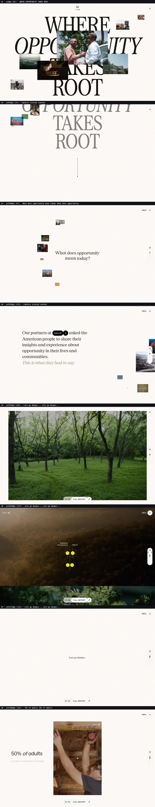
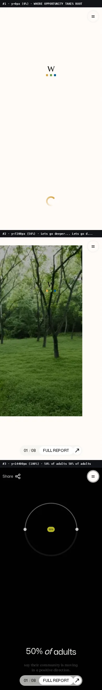

# UI Design System & Master Generation Blueprint: opportunity-waltonfamilyfoundation-org

> **Access to Opportunity: Gallup Research · Walton Family Foundation** (https://opportunity.waltonfamilyfoundation.org/) — Explore Walton Family Foundation and Gallup research on opportunity. See how investments in education, nature, and communities help oppor...





---

## 1. Executive Visual Persona & Design Archetype

- **Brand Essence & Persona**: **Access to Opportunity: Gallup Research · Walton Family Foundation** (`https://opportunity.waltonfamilyfoundation.org/`). Explore Walton Family Foundation and Gallup research on opportunity. See how investments in education, nature, and communities help oppor...
- **Capture Provenance**: Live browser capture (`tier1_fast`, HTTP `200`, captured `2026-11-24`).
- **Visual Archetype**: **Light-Gallery WebGL / Canvas Interactive Experience (`#ffffff` / `#e7e72b`)**.
- **Anti-AI-Slop Differentiators**:
  - **Live-Computed Chromatic Polarity**: Anchors the viewport in `#ffffff` (live computed `body` `background-color` (`computed_styles.json`)) paired with `#12110e` primary typography and `#e7e72b` accents.
  - **Grounded Typographic Hierarchy**: Pairs `SerrifCompressed` for display copy (`WHERE OPPORTUNITY TAKES ROOT`) with `Apple Color Emoji`.
  - **Calibrated Spatial Grid & Motion**: Combines `120rem` container bounds (`gap: .25rem`, padding `.25rem`) with `cubic-bezier(0,0,.2,1)` easing and Lenis Smooth Scroll (`data-lenis`), Lottie Vector Animation Player.

---

## 2. Spatial Architecture & Modular Grid Mathematics

### Viewport Allocation & Container Geometry
- **Captured Journey Filmstrips**: Desktop `1280×6624px` (`assets/desktop-journey.webp`, `8` keyframes up to `y=14400px` / doc `39291px`), Mobile `390×2616px` (`assets/mobile-journey.webp`, `3` keyframes).
- **Master Container Bounds**: `120rem` (non-`@media` desktop container stylesheet rule).
- **Canvas Lateral Padding & Spacing**: `.25rem` lateral canvas padding with `.25rem` grid gap.
- **Border Radius Scale**: `var(--radius-lg)`, `var(--radius-xl)`.

### Responsive Breakpoint Architecture
- **Desktop Layout**: Multi-column CSS Grid / Flexbox layout at `1440px` (`max-width: 120rem`, `gap: .25rem`).
- **Mobile Layout**: Single-column vertical stack at `390px` viewport width with `.25rem` horizontal padding.
- **Extracted CSS Media Queries**: `@media (max-width:640px)`, `@media (min-width:320px)`, `@media (min-width:390px)`, `@media (min-width:1512px)`.

---

## 3. Color System, Materiality & Atmospheric Lighting

### Semantic Palette & Source Grounding
| Semantic Role | Ground-Truth Value | Extracted Live / CSS Source |
|---|---|---|
| **Primary Canvas Substrate** | `#ffffff` | live computed `body` `background-color` (`computed_styles.json`) |
| **Primary Typography Ink** | `#12110e` | live computed `h1` `color` (`computed_styles.json`) |
| **Elevated Surface / Card Substrate** | `#ffff00` | `.bg-yellow { background-color: yellow }` (`#ffff00`) |
| **Interactive Accent / Highlight** | `#e7e72b` | `var(--highlight)` in `:root` |
| **Secondary / Muted Copy** | `#e7e72b` | live computed `h2` `color` (`computed_styles.json`) |
| **Structural Hairline Border** | `#ff7f7f` | `50 { border-color: #ff7f7f }` |
| **Variable Token (`--green`)** | `#5f8763` | `var(--green)` in `:root` |
| **Variable Token (`--teal`)** | `#337c83` | `var(--teal)` in `:root` |
| **Variable Token (`--blue`)** | `#5a7580` | `var(--blue)` in `:root` |
| **Variable Token (`--yellow`)** | `#cb9a56` | `var(--yellow)` in `:root` |

### Sanitized Root CSS Variables (`ui-ux.md` Ground Truth)
| Variable Name | Extracted Value | Semantic Role |
|---|---|---|
| `--z-footer` | `10` | Elevation / Border Token |
| `--z-main` | `20` | Elevation / Border Token |
| `--z-header` | `30` | Layout / Spatial Grid Token |
| `--z-context-cta` | `300` | Typography Ink Token |
| `--z-progress-bar` | `400` | Elevation / Border Token |
| `--z-menu-mask` | `500` | Elevation / Border Token |
| `--z-menu` | `600` | Elevation / Border Token |
| `--z-menu-button` | `700` | Elevation / Border Token |
| `--z-image-scatter` | `200` | Elevation / Border Token |
| `--z-cinematic-scroll` | `100` | Elevation / Border Token |
| `--background` | `#fff` | Canvas / Surface Token |
| `--foreground` | `#12110e` | Typography Ink Token |
| `--green` | `#5f8763` | Color / Atmospheric Token |
| `--teal` | `#337c83` | Color / Atmospheric Token |
| `--blue` | `#5a7580` | Color / Atmospheric Token |
| `--yellow` | `#cb9a56` | Color / Atmospheric Token |

---

## 4. Typographic Scale & Editorial Hierarchy

### Font Family Stacks
- **Display Typography**: `SerrifCompressed`.
- **Primary Body Stack**: `Apple Color Emoji`.
- **Technical / Metadata Stack**: not declared in live computed styles (uses primary stack / `ui-monospace`).

### Typographic Scale & Rules (Live Computed & Stylesheet Grounded)
- **Hero Display (`H1`)**: live computed `h1` (`font-size: 212.543px`, `line-height: 191.289px`, `font-weight: 400`, `letter-spacing: -3.825px`).
- **Section Heading (`H2`)**: live computed `h2` (`font-size: 50.5422px`, `line-height: 50.5422px`, `font-weight: 400`, `letter-spacing: -0.96px`).
- **Body Copy**: live computed `body` (`font-size: 16px`, `line-height: 24px`, `font-weight: 400`).
- **Metadata & Navigation Labels**: live computed `nav/a` (`font-size: 16px`, `line-height: 24px`, `font-weight: 400`); CSS variables `--text-xs: .75rem`, `--text-xs--line-height: calc(1 / .75)`, `--default-mono-font-family: var(--font-mono)`.

---

## 5. Choreographed Motion & Interaction Physics

### Primary Easing Curves
- **Extracted Timing Functions**: `cubic-bezier(0,0,.2,1)`, `cubic-bezier(.4,0,.2,1)`, `cubic-bezier(.34,1.56,.64,1)`.

### Per-Element Transition & Choreography Rules
- **Selector `layer theme`**: `transition: .15s` extracted from `opportunity-waltonfamilyfoundation-org` stylesheet.
- **Selector `.MenuButton`**: `transition: var(--tw-ease,var(--default-transition-timing-function))` extracted from `opportunity-waltonfamilyfoundation-org` stylesheet.
- **Selector `.MenuButton_Inner`**: `transition: var(--tw-ease,var(--default-transition-timing-function))` extracted from `opportunity-waltonfamilyfoundation-org` stylesheet.
- **Extracted Easing Curve (`cubic-bezier(0,0,.2,1)`)**: Governs interactive state transitions across `<header.antialiased>` and `<section.bg-background>`.
- **Runtime Interaction Engine**: Integrates Lenis Smooth Scroll (`data-lenis`), Lottie Vector Animation Player, HTML5 `<canvas>` Interactive Viewport Surface with `prefers-reduced-motion: reduce` fallback guards.
### Measured Runtime Scroll & Interaction Telemetry (`behavioral_journey_v2`)
- **Scroll Driver Mode**: `native` (max document height `39291px`, deepest scrollY reached `14400px` across `8` desktop keyframes).
- **Detected Scroll / Motion Libraries**: `Lenis`, `GSAP/ScrollTrigger`, `WebGL/Canvas`.
- **Nav / Drawer Probe (`Open menu`)**: Triggered visual change (pixel diff `22.83`, captured in `assets/state-nav.webp`); revealed links: 01 Where Opportunity..., 02 Working with Natur..., 03 Building Opportuni..., 04 Opportunity Grows..., Walton Family Foundat..., Privacy Policy.
- **Hover Physics (`primary_cta` · `FULL REPORT FULL REPORT`)**: Computed transition `0s` / `ease` (no static color/transform shift captured at rest).
- **Route Transition Architecture**: First internal navigation (`/working-with-nature-to-strengthen-opportunity`) measured as `direct` in `1052ms`.

---

## 6. Component Wireframe & Structural DOM Map

### Visual Layout Schematic — Desktop (`1440px`, Grounded in `dom.html` & Landmark Bounding Boxes)
```
┌────────────────────────────────────────────────────────────────────────┐
│ DESKTOP VIEWPORT (1440px) — Access to Opportunity: Gallup Research · W │
│ ====================================================================== │
│ [ <header.antialiased> (1440x0px)     | Privacy Policy · Terms of Us ] │
│ ---------------------------------------------------------------------- │
│ | HERO STAGE: <section.lenis> (w=1440px)                             | │
│ | H1: WHERE OPPORTUNITY TAKES ROOT                                   | │
│ | Substrate: #ffffff | Ink: #12110e | Accent: #e7e72b                | │
│ ---------------------------------------------------------------------- │
│ | SHOWCASE GRID (<section.bg-background>) max-w: 120rem              | │
│ | +------------------------------+  +------------------------------+ | │
│ | | Where opportunity takes root |  | Opportunity enables people t | | │
│ | +------------------------------+  +------------------------------+ | │
│ ---------------------------------------------------------------------- │
│ | DETAIL MODULE (<section.text-foreground>) — What does opportunity  | │
│ ---------------------------------------------------------------------- │
│ [ FOOTER (<footer.inset-x-0>  ) | https://opportunity.waltonfamilyfou  │
└────────────────────────────────────────────────────────────────────────┘
```

### Visual Layout Schematic — Mobile Reflow (`390px`)
```
┌────────────────────────────────────────────────────────────────────────┐
│ MOBILE VIEWPORT REFLOW (390px) — Single-Column Stack (gap: .25rem)     │
│ ====================================================================== │
│ [ HEADER BAR (<header.antialiased>    ) | Compact Menu (390px)         │
│ ---------------------------------------------------------------------- │
│ | HERO STAGE (<section.lenis>) — 390px Vertical Lead                 | │
│ | H1: WHERE OPPORTUNITY TAKES ROOT                                   | │
│ ---------------------------------------------------------------------- │
│ | SHOWCASE STACK (<section.bg-background) — 1-Col Stack              | │
│ | [ Item 1: Where opportunity takes root                           ] | │
│ | [ Item 2: Opportunity enables people to fulfill their highe...   ] | │
│ ---------------------------------------------------------------------- │
│ | DETAIL STACK (<section.text-foreground) — 1-Col (What does opportun) │
│ ---------------------------------------------------------------------- │
│ [ FOOTER (<footer.inset-x-0>  ) | Stacked 390px Colophon               │
└────────────────────────────────────────────────────────────────────────┘
```

### Granular DOM Region Breakdown
1. **Brand Header & Navigation Bar (<header.antialiased> — `opportunity-waltonfamilyfoundation-org`)**:
   - Landmark `<header class="antialiased">` (`1440x0px`) hosting `Access to Opportunity: Gallup Resear` navigation (`Privacy Policy · Terms of Use`), DOM attributes (`data-precedence="next"`, `data-lenis-prevent="true"`, `data-gtm-vis-polling-id252455071_20="69"`, `data-menu-background="true"`), and stylesheet rule `backdrop { box-sizing:border-box;border:0 solid;margin:0;padding:0 }`.
2. **Hero Stage & Focal Lead (<section.lenis> — `WHERE OPPORTUNITY TAKES ROOT`)**:
   - Landmark `<section class="lenis">` presenting display lead `WHERE OPPORTUNITY TAKES ROOT` and copy excerpt *"To build choice-filled lives. Our work helps create access to opp"* over `#ffffff` canvas and `#12110e` ink.
3. **Primary Showcase & Content Grid (<section.bg-background> — `Where opportunity takes root`)**:
   - Landmark `<section class="bg-background">` rendering section `Where opportunity takes root` with copy *"The conditions that shape opportunity change over time. So we ask"*, asset references (`03_wvljxzi0as.css`, `0ji28_e_~fdtg.js`, `0nz2u-qe8z68i.js`, `0yjw-7sa79pfd.js`), and grid rule `file-selector-button { box-sizing:border-box;border:0 solid;margin:0;padding:0 }`.
4. **Interactive Detail & Feature Matrix (<section.text-foreground> — `Opportunity enables people to fulf`)**:
   - Landmark `<section class="text-foreground">` framing `Opportunity enables people to fulfill their highe...` and `What does opportunity mean today? What does oppor...` (*"Our partners at Gallup asked the American people to share their i"*) with `#ffff00` surface cards, `#e7e72b` accents, and `strong { font-weight:bolder }`.
5. **Colophon & Global Directory Footer (<footer.inset-x-0> — `https://opportunity.waltonfamilyfoundation.org/`)**:
   - Landmark `<footer class="inset-x-0 bottom-0">` anchoring `Access to Opportunity: Gallup Re` footer links (`Privacy Policy · Terms of Use`), copy *"This is what they had to say."*, and `#ff7f7f` structural dividers.
### Full Vertical Scroll Sequence (Desktop `1440×900` Keyframes)
- **Step 01** (`y=0px`, `0%`): Active landmark `WHERE OPPORTUNITY TAKES ROOT` · sticky/fixed elements: `3`
- **Step 02** (`y=850px`, `2%`): Active landmark `Explore related content` · sticky/fixed elements: `1`
- **Step 03** (`y=3400px`, `9%`): Active landmark `What does opportunity mean today? What does oppor...` · sticky/fixed elements: `2`
- **Step 04** (`y=5950px`, `15%`): Active landmark `Explore related content` · sticky/fixed elements: `1`
- **Step 05** (`y=7650px`, `20%`): Active landmark `Lets go deeper... Lets go deeper...` · sticky/fixed elements: `2`
- **Step 06** (`y=10200px`, `27%`): Active landmark `Lets go deeper... Lets go deeper...` · sticky/fixed elements: `2`
- **Step 07** (`y=12750px`, `33%`): Active landmark `Lets go deeper... Lets go deeper...` · sticky/fixed elements: `2`
- **Step 08** (`y=14400px`, `38%`): Active landmark `50% of adults 50% of adults` · sticky/fixed elements: `1`

### Multi-Page Internal Route Map
- **Other Route (`/working-with-nature-to-strengthen-opportunity`)**: `https://opportunity.waltonfamilyfoundation.org/working-with-nature-to-strengthen-opportunity` — H1: `WORKING WITH NATURE TO STRENGTHEN OPPORTUNITY WOR...`, scrollHeight `28210px`, transition `direct` (`1052ms`)
- **Other Route (`/building-opportunity-through-stronger-communities`)**: `https://opportunity.waltonfamilyfoundation.org/building-opportunity-through-stronger-communities` — H1: `BUILDING OPPORTUNITY THROUGH STRONGER COMMUNITIES...`, scrollHeight `23365px`, transition `direct` (`1509ms`)
- **Other Route (`/opportunity-grows-when-people-can-shape-their-path`)**: `https://opportunity.waltonfamilyfoundation.org/opportunity-grows-when-people-can-shape-their-path` — H1: `OPPORTUNITY GROWS WHEN PEOPLE CAN SHAPE THEIR PAT...`, scrollHeight `22250px`, transition `direct` (`690ms`)

---

## 7. Master Zero-Shot AI Generation Prompt

```markdown
# Master Zero-Shot Frontend Generation Prompt: opportunity-waltonfamilyfoundation-org (Access to Opportunity: Gallup Research · Walton Family Foundation)

You are a principal frontend architect and design systems engineer. Build a complete, production-ready web application replicating the exact design system, DOM landmarks, typographic hierarchy, color tokens, and motion physics of `opportunity-waltonfamilyfoundation-org` (**Access to Opportunity: Gallup Research · Walton Family Foundation** — `https://opportunity.waltonfamilyfoundation.org/`).

### 1. Visual Archetype & Anti-AI-Slop Mandates
- **Archetype**: Light-Gallery WebGL / Canvas Interactive Experience (`#ffffff` / `#e7e72b`).
- **Identity & Domain Context**: Explore Walton Family Foundation and Gallup research on opportunity. See how investments in education, nature, and communities help oppor...
- **Primary Substrate**: `#ffffff` (live computed `body` `background-color` (`computed_styles.json`)), **Primary Ink**: `#12110e`, **Accent / Highlight**: `#e7e72b`.
- **Site-Specific Differentiators**:
  - **Live-Computed Chromatic Polarity**: Anchors the viewport in `#ffffff` (live computed `body` `background-color` (`computed_styles.json`)) paired with `#12110e` primary typography and `#e7e72b` accents.
  - **Grounded Typographic Hierarchy**: Pairs `SerrifCompressed` for display copy (`WHERE OPPORTUNITY TAKES ROOT`) with `Apple Color Emoji`.
  - **Calibrated Spatial Grid & Motion**: Combines `120rem` container bounds (`gap: .25rem`, padding `.25rem`) with `cubic-bezier(0,0,.2,1)` easing and Lenis Smooth Scroll (`data-lenis`), Lottie Vector Animation Player.

### 2. Ground-Truth CSS Variables (`:root` Token Contract)
Declare and consume these exact custom properties extracted from `opportunity-waltonfamilyfoundation-org` in your global stylesheet:

:root {
  /* Access to Opportunity: Gallup Research · Walton Family Foundation (opportunity-waltonfamilyfoundation-org) — Live-Grounded CSS Variables */
  --z-footer: 10; /* Elevation / Border Token (opportunity-waltonfamilyfoundation-org) */
  --z-main: 20; /* Elevation / Border Token (opportunity-waltonfamilyfoundation-org) */
  --z-header: 30; /* Layout / Spatial Grid Token (opportunity-waltonfamilyfoundation-org) */
  --z-context-cta: 300; /* Typography Ink Token (opportunity-waltonfamilyfoundation-org) */
  --z-progress-bar: 400; /* Elevation / Border Token (opportunity-waltonfamilyfoundation-org) */
  --z-menu-mask: 500; /* Elevation / Border Token (opportunity-waltonfamilyfoundation-org) */
  --z-menu: 600; /* Elevation / Border Token (opportunity-waltonfamilyfoundation-org) */
  --z-menu-button: 700; /* Elevation / Border Token (opportunity-waltonfamilyfoundation-org) */
  --z-image-scatter: 200; /* Elevation / Border Token (opportunity-waltonfamilyfoundation-org) */
  --z-cinematic-scroll: 100; /* Elevation / Border Token (opportunity-waltonfamilyfoundation-org) */
  --background: #fff; /* Canvas / Surface Token (opportunity-waltonfamilyfoundation-org) */
  --foreground: #12110e; /* Typography Ink Token (opportunity-waltonfamilyfoundation-org) */
  --green: #5f8763; /* Color / Atmospheric Token (opportunity-waltonfamilyfoundation-org) */
  --teal: #337c83; /* Color / Atmospheric Token (opportunity-waltonfamilyfoundation-org) */
  --blue: #5a7580; /* Color / Atmospheric Token (opportunity-waltonfamilyfoundation-org) */
  --yellow: #cb9a56; /* Color / Atmospheric Token (opportunity-waltonfamilyfoundation-org) */
}

### 3. Semantic Color & Materiality Contract
Map every surface, ink, and border strictly to these source-grounded tokens:
- **Primary Canvas Substrate**: `#ffffff` — grounded in live computed `body` `background-color` (`computed_styles.json`)
- **Primary Typography Ink**: `#12110e` — grounded in live computed `h1` `color` (`computed_styles.json`)
- **Elevated Surface / Card Substrate**: `#ffff00` — grounded in `.bg-yellow { background-color: yellow }` (`#ffff00`)
- **Interactive Accent / Highlight**: `#e7e72b` — grounded in `var(--highlight)` in `:root`
- **Secondary / Muted Copy**: `#e7e72b` — grounded in live computed `h2` `color` (`computed_styles.json`)
- **Structural Hairline Border**: `#ff7f7f` — grounded in `50 { border-color: #ff7f7f }`
- **Variable Token (`--green`)**: `#5f8763` — grounded in `var(--green)` in `:root`
- **Variable Token (`--teal`)**: `#337c83` — grounded in `var(--teal)` in `:root`
- **Variable Token (`--blue`)**: `#5a7580` — grounded in `var(--blue)` in `:root`
- **Variable Token (`--yellow`)**: `#cb9a56` — grounded in `var(--yellow)` in `:root`

### 4. Spatial Grid, Container Bounds & Responsive Breakpoints
- **Desktop Viewport Reference**: `1280×6624px` (multi-frame vertical journey filmstrip (6624px), `1440px` standard desktop width).
- **Mobile Viewport Reference**: `390×2616px` (multi-frame vertical journey filmstrip (2616px), `390px` standard mobile width).
- **Container Max-Width**: `120rem` (non-`@media` desktop container stylesheet rule)
- **Padding & Gutters**: `.25rem` lateral canvas padding with `.25rem` grid gap
- **Desktop Grid**: Multi-column CSS Grid / Flexbox layout at `1440px` (`max-width: 120rem`, `gap: .25rem`)
- **Mobile Adaptation**: Single-column vertical stack at `390px` viewport width with `.25rem` horizontal padding
- **Media Queries**: `@media (max-width:640px)`, `@media (min-width:320px)`, `@media (min-width:390px)`, `@media (min-width:1512px)`
- **Corner Radii**: `var(--radius-lg)`, `var(--radius-xl)`

### 5. Typography & Editorial Scale Contract
- **Display Font Stack**: `SerrifCompressed`
- **Body Font Stack**: `Apple Color Emoji`
- **Monospace / Technical Font Stack**: not declared in live computed styles (uses primary stack / `ui-monospace`)
- **H1 Display Rule**: live computed `h1` (`font-size: 212.543px`, `line-height: 191.289px`, `font-weight: 400`, `letter-spacing: -3.825px`)
- **H2 Section Rule**: live computed `h2` (`font-size: 50.5422px`, `line-height: 50.5422px`, `font-weight: 400`, `letter-spacing: -0.96px`)
- **Body Copy Rule**: live computed `body` (`font-size: 16px`, `line-height: 24px`, `font-weight: 400`)
- **Metadata & Index Rule**: live computed `nav/a` (`font-size: 16px`, `line-height: 24px`, `font-weight: 400`); CSS variables `--text-xs: .75rem`, `--text-xs--line-height: calc(1 / .75)`, `--default-mono-font-family: var(--font-mono)`

### 6. Component Hierarchy, Verbatim Copy & Real DOM Landmarks
Scaffold `opportunity-waltonfamilyfoundation-org` (`Access to Opportunity: Gallup Research · Walton Family Foundation`) with these exact structural regions, extracted copy, and CSS rules from `dom.html`:
1. **Brand Header & Navigation Bar (<header.antialiased> — `opportunity-waltonfamilyfoundation-org`)**:
   - DOM & Selectors: Landmark `<header class="antialiased">` (`1440x0px`) hosting `Access to Opportunity: Gallup Resear` navigation (`Privacy Policy · Terms of Use`), DOM attributes (`data-precedence="next"`, `data-lenis-prevent="true"`, `data-gtm-vis-polling-id252455071_20="69"`, `data-menu-background="true"`), and stylesheet rule `backdrop { box-sizing:border-box;border:0 solid;margin:0;padding:0 }`.
   - Responsive Contract: Header `Brand Header & Navigation Bar (<header.antialiased> — `opportunity-waltonfamilyfoundation-org`)` (`opportunity-waltonfamilyfoundation-org`) adapts across `@media (max-width:640px)`, `@media (min-width:320px)`, `@media (min-width:390px)`, `@media (min-width:1512px)` with `cubic-bezier(0,0,.2,1)`, `cubic-bezier(.4,0,.2,1)`, `cubic-bezier(.34,1.56,.64,1)` transitions and links `Privacy Policy · Terms of Use`.
2. **Hero Stage & Focal Lead (<section.lenis> — `WHERE OPPORTUNITY TAKES ROOT`)**:
   - DOM & Selectors: Landmark `<section class="lenis">` presenting display lead `WHERE OPPORTUNITY TAKES ROOT` and copy excerpt *"To build choice-filled lives. Our work helps create access to opp"* over `#ffffff` canvas and `#12110e` ink.
   - Responsive Contract: Hero stage (`1280×6624px` desktop / `390×2616px` mobile) sets `#ffffff` background with `#12110e` headline `WHERE OPPORTUNITY TAKES ROOT`.
3. **Primary Showcase & Content Grid (<section.bg-background> — `Where opportunity takes root`)**:
   - DOM & Selectors: Landmark `<section class="bg-background">` rendering section `Where opportunity takes root` with copy *"The conditions that shape opportunity change over time. So we ask"*, asset references (`03_wvljxzi0as.css`, `0ji28_e_~fdtg.js`, `0nz2u-qe8z68i.js`, `0yjw-7sa79pfd.js`), and grid rule `file-selector-button { box-sizing:border-box;border:0 solid;margin:0;padding:0 }`.
   - Responsive Contract: Showcase grid `Primary Showcase & Content Grid (<section.bg-background> — `Where opportunity takes root`)` applies Multi-column CSS Grid / Flexbox layout at `1440px` (`max-width: 120rem`, `gap: .25rem`) on desktop and Single-column vertical stack at `390px` viewport width with `.25rem` horizontal padding on mobile.
4. **Interactive Detail & Feature Matrix (<section.text-foreground> — `Opportunity enables people to fulf`)**:
   - DOM & Selectors: Landmark `<section class="text-foreground">` framing `Opportunity enables people to fulfill their highe...` and `What does opportunity mean today? What does oppor...` (*"Our partners at Gallup asked the American people to share their i"*) with `#ffff00` surface cards, `#e7e72b` accents, and `strong { font-weight:bolder }`.
   - Responsive Contract: Detail module `Interactive Detail & Feature Matrix (<section.text-foreground> — `Opportunity enables people to fulf`)` uses `var(--radius-lg)`, `var(--radius-xl)` radii, `#e7e72b` highlights, and assets (03_wvljxzi0as.css, 0ji28_e_~fdtg.js, 0nz2u-qe8z68i.js).
5. **Colophon & Global Directory Footer (<footer.inset-x-0> — `https://opportunity.waltonfamilyfoundation.org/`)**:
   - DOM & Selectors: Landmark `<footer class="inset-x-0 bottom-0">` anchoring `Access to Opportunity: Gallup Re` footer links (`Privacy Policy · Terms of Use`), copy *"This is what they had to say."*, and `#ff7f7f` structural dividers.
   - Responsive Contract: Footer `Colophon & Global Directory Footer (<footer.inset-x-0> — `https://opportunity.waltonfamilyfoundation.org/`)` aligns to `120rem` (non-`@media` desktop container stylesheet rule) with `.25rem` lateral canvas padding with `.25rem` grid gap and attributes (data-precedence="next", data-lenis-prevent="true", data-gtm-vis-polling-id252455071_20="69").

#### Verbatim DOM Copy Excerpts (`dom.html`)
- Copy Excerpt 1: *"To build choice-filled lives. Our work helps create access to opportunity so peopl..."*
- Copy Excerpt 2: *"The conditions that shape opportunity change over time. So we asked the question:"*
- Copy Excerpt 3: *"Our partners at Gallup asked the American people to share their insights and exper..."*
- Copy Excerpt 4: *"This is what they had to say."*

### 7. Motion, Extracted Stylesheet Rules & Interaction Choreography
- **Primary Easing Functions**: `cubic-bezier(0,0,.2,1)`, `cubic-bezier(.4,0,.2,1)`, `cubic-bezier(.34,1.56,.64,1)`
- **Extracted Stylesheet Rules (`opportunity-waltonfamilyfoundation-org`)**:
- `backdrop { box-sizing:border-box;border:0 solid;margin:0;padding:0 }`
- `file-selector-button { box-sizing:border-box;border:0 solid;margin:0;padding:0 }`
- `strong { font-weight:bolder }`
- `small { font-size:80% }`
- `sup { vertical-align:baseline;font-size:75%;line-height:0;position:relative }`
- **Per-Selector Transition Rules**:
- **Selector `layer theme`**: `transition: .15s` extracted from `opportunity-waltonfamilyfoundation-org` stylesheet.
- **Selector `.MenuButton`**: `transition: var(--tw-ease,var(--default-transition-timing-function))` extracted from `opportunity-waltonfamilyfoundation-org` stylesheet.
- **Selector `.MenuButton_Inner`**: `transition: var(--tw-ease,var(--default-transition-timing-function))` extracted from `opportunity-waltonfamilyfoundation-org` stylesheet.
- **Extracted Easing Curve (`cubic-bezier(0,0,.2,1)`)**: Governs interactive state transitions across `<header.antialiased>` and `<section.bg-background>`.
- **Runtime Interaction Engine**: Integrates Lenis Smooth Scroll (`data-lenis`), Lottie Vector Animation Player, HTML5 `<canvas>` Interactive Viewport Surface with `prefers-reduced-motion: reduce` fallback guards.
### 7b. Full-Page Scroll Choreography, Interactive States & Multi-Page Routes
- **Scroll Mechanics**: Implement `native` vertical progression up to `39291px` across 8 distinct viewport chapters using Lenis, GSAP/ScrollTrigger, WebGL/Canvas.
- **Vertical Chapter Sequence**: WHERE OPPORTUNITY TAKES ROOT (0%) -> Explore related content (2%) -> What does opportunity mean... (9%) -> Explore related content (15%) -> Lets go deeper... Lets go d... (20%) -> Lets go deeper... Lets go d... (27%) -> Lets go deeper... Lets go d... (33%) -> 50% of adults 50% of adults (38%).
- **Navigation Drawer / Menu State**: Replicate interactive menu toggle (`Open menu`) with Escape-to-close keyboard handling.
- **Multi-Page Routes**: Scaffold internal routes `/working-with-nature-to-strengthen-opportunity` (other, direct), `/building-opportunity-through-stronger-communities` (other, direct), `/opportunity-grows-when-people-can-shape-their-path` (other, direct) sharing the global header/footer shell and design tokens.

### 8. Technical Deliverables
- Implement in Next.js (App Router) with TypeScript and Tailwind CSS consuming the `:root` custom properties defined above for `opportunity-waltonfamilyfoundation-org`.
- Reproduce both the `1440px` desktop architecture and `390px` mobile breakpoint transitions, preserving semantic HTML5 landmarks (`<header>`, `<nav>`, `<main>`, `<section>`, `<footer>`) and `prefers-reduced-motion` accessibility guards.
```
---

## 8. Full-Page Scroll Journey, Interactive States & Subpage Inventory

### Desktop Scroll Keyframes (`1440×900` WebP)
| Step | Scroll Y | Progress | Active Landmark / Section | Sticky/Fixed | Visual Asset |
| :---: | :---: | :---: | :--- | :---: | :--- |
| `#01` | `0px` | `0%` | WHERE OPPORTUNITY TAKES ROOT | `3` | [desktop-step-01.webp](assets/desktop-step-01.webp) |
| `#02` | `850px` | `2%` | Explore related content | `1` | [desktop-step-02.webp](assets/desktop-step-02.webp) |
| `#03` | `3400px` | `9%` | What does opportunity mean today? What does o... | `2` | [desktop-step-03.webp](assets/desktop-step-03.webp) |
| `#04` | `5950px` | `15%` | Explore related content | `1` | [desktop-step-04.webp](assets/desktop-step-04.webp) |
| `#05` | `7650px` | `20%` | Lets go deeper... Lets go deeper... | `2` | [desktop-step-05.webp](assets/desktop-step-05.webp) |
| `#06` | `10200px` | `27%` | Lets go deeper... Lets go deeper... | `2` | [desktop-step-06.webp](assets/desktop-step-06.webp) |
| `#07` | `12750px` | `33%` | Lets go deeper... Lets go deeper... | `2` | [desktop-step-07.webp](assets/desktop-step-07.webp) |
| `#08` | `14400px` | `38%` | 50% of adults 50% of adults | `1` | [desktop-step-08.webp](assets/desktop-step-08.webp) |

### Mobile Condensed Keyframes (`390×844` WebP)
| Step | Scroll Y | Progress | Active Landmark | Visual Asset |
| :---: | :---: | :---: | :--- | :--- |
| `#01` | `0px` | `0%` | WHERE OPPORTUNITY TAKES ROOT | [mobile-step-01.webp](assets/mobile-step-01.webp) |
| `#02` | `7200px` | `50%` | Lets go deeper... Lets go deeper... | [mobile-step-02.webp](assets/mobile-step-02.webp) |
| `#03` | `14400px` | `100%` | 50% of adults 50% of adults | [mobile-step-03.webp](assets/mobile-step-03.webp) |

### Interactive UI State Captures (`1440×900` WebP)
| State Type | Trigger / Observation | Visual Asset |
| :--- | :--- | :--- |
| `nav_menu` | Nav/Menu opened (`Open menu`, diff `22.83`) | [state-nav.webp](assets/state-nav.webp) |

### Internal Subpage Filmstrips (`1080px` Wide WebP)
| # | Template | Route URL | H1 / Title | Scroll Height | Transition | Filmstrip Asset |
| :-: | :---: | :--- | :--- | :---: | :---: | :--- |
| `1` | `other` | `https://opportunity.waltonfamilyfoundation.org/working-with-nature-to-strengthen-opportunity` | WORKING WITH NATURE TO STRENGTHEN OPP... | `28210px` | `direct` (`1052ms`) | [subpage-01-working-with-nature-to-strengthen-op.webp](assets/subpage-01-working-with-nature-to-strengthen-op.webp) |
| `2` | `other` | `https://opportunity.waltonfamilyfoundation.org/building-opportunity-through-stronger-communities` | BUILDING OPPORTUNITY THROUGH STRONGER... | `23365px` | `direct` (`1509ms`) | [subpage-02-building-opportunity-through-stronge.webp](assets/subpage-02-building-opportunity-through-stronge.webp) |
| `3` | `other` | `https://opportunity.waltonfamilyfoundation.org/opportunity-grows-when-people-can-shape-their-path` | OPPORTUNITY GROWS WHEN PEOPLE CAN SHA... | `22250px` | `direct` (`690ms`) | [subpage-03-opportunity-grows-when-people-can-sh.webp](assets/subpage-03-opportunity-grows-when-people-can-sh.webp) |

