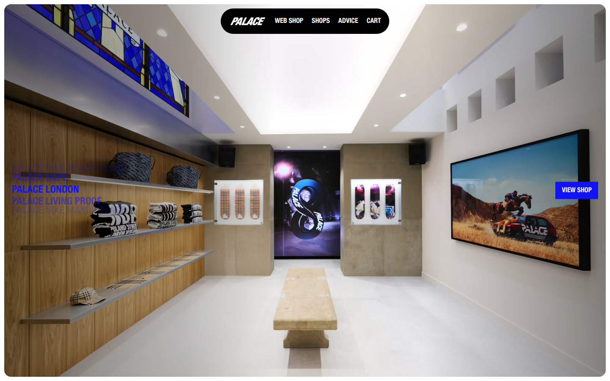
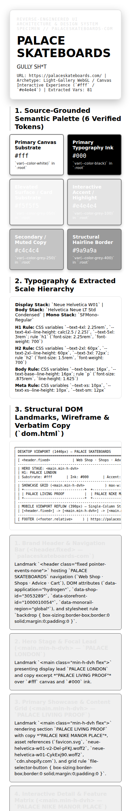

# UI Design System & Master Generation Blueprint: palaceskateboards-com

> **PALACE SKATEBOARDS** (https://palaceskateboards.com/) — GULLY SH*T



---

## 1. Executive Visual Persona & Design Archetype

- **Brand Essence & Persona**: **PALACE SKATEBOARDS** (`https://palaceskateboards.com/`). GULLY SH*T
- **Visual Archetype**: **Light-Gallery WebGL / Canvas Interactive Experience (`#fff` / `#e4e4e4`)**.
- **Anti-AI-Slop Differentiators**:
  - **Source-Grounded Chromatic Polarity**: Anchors the viewport in `#fff` (`var(--color-white)` in `:root`) paired with `#000` primary typography and `#e4e4e4` accents.
  - **Extracted Typographic Hierarchy**: Pairs `Neue Helvetica W01` for display copy (`PALACE LONDON`) with `Helvetica Neue LT Std Condensed` and `SFMono-Regular`.
  - **Calibrated Spatial Grid & Motion**: Combines `767px` container bounds (`gap: var(--spacing)`, padding `20px`) with `cubic-bezier(0,0,.2,1)` easing and Three.js / WebGL Canvas Pipeline.

---

## 2. Spatial Architecture & Modular Grid Mathematics



### Viewport Allocation & Container Geometry
- **Captured Viewport Dimensions**: Desktop `1440×1276px` (`assets/desktop.png`, capped at 2400px multi-section capture), Mobile `390×2400px` (`assets/mobile.png`, capped at 2400px multi-section capture).
- **Master Container Bounds**: `767px` extracted from `palaceskateboards-com` stylesheet.
- **Canvas Lateral Padding & Spacing**: `20px` lateral canvas padding with `var(--spacing)` grid gap.
- **Border Radius Scale**: `.25rem`, `var(--radius-4xl)`, `5px`, `10px`.

### Responsive Breakpoint Architecture
- **Desktop Layout**: Multi-column CSS Grid / Flexbox layout at `1440px` (`max-width: 767px`, `gap: var(--spacing)`).
- **Mobile Layout**: Single-column vertical stack at `390px` viewport width with `20px` horizontal padding.
- **Extracted CSS Media Queries**: `@media (width>=767px)`, `@media (width>=768px)`, `@media (width>=1024px)`, `@media (width>=1025px)`.

---

## 3. Color System, Materiality & Atmospheric Lighting

### Semantic Palette & Source Grounding
| Semantic Role | Ground-Truth Value | Extracted CSS Source / Selector |
|---|---|---|
| **Primary Canvas Substrate** | `#fff` | `var(--color-white)` in `:root` |
| **Primary Typography Ink** | `#000` | `var(--color-black)` in `:root` |
| **Elevated Surface / Card Substrate** | `#f5f5f5` | `var(--color-grey-050)` in `:root` |
| **Interactive Accent / Highlight** | `#e4e4e4` | `var(--color-grey-100)` in `:root` |
| **Secondary / Muted Copy** | `#c4c4c4` | `var(--color-grey-250)` in `:root` |
| **Structural Hairline Border** | `#9a9a9a` | `var(--color-grey-400)` in `:root` |

### Sanitized Root CSS Variables (`ui-ux.md` Ground Truth)
| Variable Name | Extracted Value | Semantic Role |
|---|---|---|
| `--spacing` | `.25rem` | Layout / Spatial Grid Token |
| `--container-lg` | `32rem` | Layout / Spatial Grid Token |
| `--container-2xl` | `42rem` | Layout / Spatial Grid Token |
| `--text-xs` | `10px` | Typography Ink Token |
| `--text-xs--line-height` | `10px` | Typography Ink Token |
| `--text-sm` | `12px` | Typography Ink Token |
| `--text-sm--line-height` | `12px` | Typography Ink Token |
| `--text-base` | `16px` | Typography Ink Token |
| `--text-base--line-height` | `16px` | Typography Ink Token |
| `--text-lg` | `32px` | Typography Ink Token |
| `--text-lg--line-height` | `32px` | Typography Ink Token |
| `--text-xl` | `45px` | Typography Ink Token |
| `--text-xl--line-height` | `45px` | Typography Ink Token |
| `--text-2xl` | `60px` | Typography Ink Token |
| `--text-2xl--line-height` | `60px` | Typography Ink Token |
| `--text-3xl` | `72px` | Typography Ink Token |

---

## 4. Typographic Scale & Editorial Hierarchy

### Font Family Stacks
- **Display Typography**: `Neue Helvetica W01`.
- **Primary Body Stack**: `Helvetica Neue LT Std Condensed`.
- **Technical / Metadata Stack**: `SFMono-Regular`.

### Typographic Scale & Rules (Extracted from Stylesheet & Variables)
- **Hero Display (`H1`)**: CSS variables `--text-4xl: 2.25rem`, `--text-4xl--line-height: calc(2.5 / 2.25)`, `--text-5xl: 3rem`; rule `h1` (`font-size: 2.25rem`, `font-weight: 700`).
- **Section Heading (`H2`)**: CSS variables `--text-2xl: 60px`, `--text-2xl--line-height: 60px`, `--text-3xl: 72px`; rule `h2` (`font-size: 1.5rem`, `font-weight: 700`).
- **Body Copy**: CSS variables `--text-base: 16px`, `--text-base--line-height: 16px`; rule `p` (`font-size: .875rem`, `line-height: 1.625`).
- **Metadata & Navigation Labels**: CSS variables `--text-xs: 10px`, `--text-xs--line-height: 10px`, `--text-sm: 12px`.

---

## 5. Choreographed Motion & Interaction Physics

### Primary Easing Curves
- **Extracted Timing Functions**: `cubic-bezier(0,0,.2,1)`, `cubic-bezier(.4,0,.2,1)`, `cubic-bezier(.65,0,.35,1)`.

### Per-Element Transition & Choreography Rules
- **Selector `layer theme`**: `transition: .15s` extracted from `palaceskateboards-com` stylesheet.
- **Selector `layer utilities`**: `transition: opacity .3s` extracted from `palaceskateboards-com` stylesheet.
- **Selector `.transition`**: `transition: var(--tw-ease,var(--default-transition-timing-function))` extracted from `palaceskateboards-com` stylesheet.
- **Extracted Easing Curve (`cubic-bezier(0,0,.2,1)`)**: Governs interactive state transitions across `<header.fixed>` and `<main.min-h-dvh>`.
- **Runtime Interaction Engine**: Integrates Three.js / WebGL Canvas Pipeline with `prefers-reduced-motion: reduce` fallback guards.

---

## 6. Component Wireframe & Structural DOM Map

### Visual Layout Schematic (Grounded in `dom.html` — `1440px` Desktop & `390px` Mobile Reflow)
```
┌────────────────────────────────────────────────────────────────────────┐
│ DESKTOP VIEWPORT (1440px) — PALACE SKATEBOARDS                         │
│ ====================================================================== │
│ [ <header.fixed>           | Web Shop · Shops · Advice · Cart       ]  │
│ ---------------------------------------------------------------------- │
│ | HERO STAGE: <main.min-h-dvh>                                     |   │
│ | H1: PALACE LONDON                                                |   │
│ | Substrate: #fff       | Ink: #000       | Accent: #e4e4e4        |   │
│ ---------------------------------------------------------------------- │
│ | SHOWCASE GRID (<main.min-h-dvh>          ) max-w: 767px          |   │
│ | +------------------------------+  +------------------------------+ | │
│ | | PALACE LIVING PROOF          |  | PALACE NIKE MANOR PLACE      | | │
│ | +------------------------------+  +------------------------------+ | │
│ ---------------------------------------------------------------------- │
│ | MOBILE VIEWPORT REFLOW (390px) — Single-Column Stack (gap: var(--) | │
│ | [<header.fixed>] -> [<main.min-h-dvh>] -> [<main.min-h-dvh>] |       │
│ ---------------------------------------------------------------------- │
│ [ FOOTER (<footer.relative>     ) | https://palaceskateboards.com/     │
└────────────────────────────────────────────────────────────────────────┘
```

### Granular DOM Region Breakdown
1. **Brand Header & Navigation Bar (<header.fixed> — `palaceskateboards-com`)**:
   - Landmark `<header class="fixed pointer-events-none">` hosting `PALACE SKATEBOARDS` navigation (`Web Shop · Shops · Advice · Cart`), DOM attributes (`data-application="hydrogen"`, `data-shop-id="3053289"`, `data-storefront-id="1000010054"`, `data-monorail-region="global"`), and stylesheet rule `backdrop { box-sizing:border-box;border:0 solid;margin:0;padding:0 }`.
2. **Hero Stage & Focal Lead (<main.min-h-dvh> — `PALACE LONDON`)**:
   - Landmark `<main class="min-h-dvh flex">` presenting display lead `PALACE LONDON` and copy excerpt *"PALACE LIVING PROOF"* over `#fff` canvas and `#000` ink.
3. **Primary Showcase & Content Grid (<main.min-h-dvh> — `PALACE LIVING PROOF`)**:
   - Landmark `<main class="min-h-dvh flex">` rendering section `PALACE LIVING PROOF` with copy *"PALACE NIKE MANOR PLACE"*, asset references (`favicon.svg`, `neue-helvetica-w01-v2-Del-pFKJ.woff2`, `neue-helvetica-w01-CykExj90.woff2`, `cdn.shopify.com`), and grid rule `file-selector-button { box-sizing:border-box;border:0 solid;margin:0;padding:0 }`.
4. **Interactive Detail & Feature Matrix (<main.min-h-dvh> — `PALACE NIKE MANOR PLACE`)**:
   - Landmark `<main class="min-h-dvh flex">` framing `PALACE NIKE MANOR PLACE` and `WINTER 2026 RANGE` (*"Delivery Information"*) with `#f5f5f5` surface cards, `#e4e4e4` accents, and `strong { font-weight:bolder }`.
5. **Colophon & Global Directory Footer (<footer.relative> — `https://palaceskateboards.com/`)**:
   - Landmark `<footer class="relative z-1">` anchoring `PALACE SKATEBOARDS` footer links (`Web Shop · Shops · Advice · Cart`), copy *"Returns Information"*, and `#9a9a9a` structural dividers.

---

## 7. Master Zero-Shot AI Generation Prompt

```markdown
# Master Zero-Shot Frontend Generation Prompt: palaceskateboards-com (PALACE SKATEBOARDS)

You are a principal frontend architect and design systems engineer. Build a complete, production-ready web application replicating the exact design system, DOM landmarks, typographic hierarchy, color tokens, and motion physics of `palaceskateboards-com` (**PALACE SKATEBOARDS** — `https://palaceskateboards.com/`).

### 1. Visual Archetype & Anti-AI-Slop Mandates
- **Archetype**: Light-Gallery WebGL / Canvas Interactive Experience (`#fff` / `#e4e4e4`).
- **Identity & Domain Context**: GULLY SH*T
- **Primary Substrate**: `#fff` (`var(--color-white)` in `:root`), **Primary Ink**: `#000`, **Accent / Highlight**: `#e4e4e4`.
- **Site-Specific Differentiators**:
  - **Source-Grounded Chromatic Polarity**: Anchors the viewport in `#fff` (`var(--color-white)` in `:root`) paired with `#000` primary typography and `#e4e4e4` accents.
  - **Extracted Typographic Hierarchy**: Pairs `Neue Helvetica W01` for display copy (`PALACE LONDON`) with `Helvetica Neue LT Std Condensed` and `SFMono-Regular`.
  - **Calibrated Spatial Grid & Motion**: Combines `767px` container bounds (`gap: var(--spacing)`, padding `20px`) with `cubic-bezier(0,0,.2,1)` easing and Three.js / WebGL Canvas Pipeline.

### 2. Ground-Truth CSS Variables (`:root` Token Contract)
Declare and consume these exact custom properties extracted from `palaceskateboards-com` in your global stylesheet:

:root {
  /* PALACE SKATEBOARDS (palaceskateboards-com) — Ground-Truth Extracted CSS Variables */
  --spacing: .25rem; /* Layout / Spatial Grid Token (palaceskateboards-com) */
  --container-lg: 32rem; /* Layout / Spatial Grid Token (palaceskateboards-com) */
  --container-2xl: 42rem; /* Layout / Spatial Grid Token (palaceskateboards-com) */
  --text-xs: 10px; /* Typography Ink Token (palaceskateboards-com) */
  --text-xs--line-height: 10px; /* Typography Ink Token (palaceskateboards-com) */
  --text-sm: 12px; /* Typography Ink Token (palaceskateboards-com) */
  --text-sm--line-height: 12px; /* Typography Ink Token (palaceskateboards-com) */
  --text-base: 16px; /* Typography Ink Token (palaceskateboards-com) */
  --text-base--line-height: 16px; /* Typography Ink Token (palaceskateboards-com) */
  --text-lg: 32px; /* Typography Ink Token (palaceskateboards-com) */
  --text-lg--line-height: 32px; /* Typography Ink Token (palaceskateboards-com) */
  --text-xl: 45px; /* Typography Ink Token (palaceskateboards-com) */
  --text-xl--line-height: 45px; /* Typography Ink Token (palaceskateboards-com) */
  --text-2xl: 60px; /* Typography Ink Token (palaceskateboards-com) */
  --text-2xl--line-height: 60px; /* Typography Ink Token (palaceskateboards-com) */
  --text-3xl: 72px; /* Typography Ink Token (palaceskateboards-com) */
}

### 3. Semantic Color & Materiality Contract
Map every surface, ink, and border strictly to these source-grounded tokens:
- **Primary Canvas Substrate**: `#fff` — grounded in `var(--color-white)` in `:root`
- **Primary Typography Ink**: `#000` — grounded in `var(--color-black)` in `:root`
- **Elevated Surface / Card Substrate**: `#f5f5f5` — grounded in `var(--color-grey-050)` in `:root`
- **Interactive Accent / Highlight**: `#e4e4e4` — grounded in `var(--color-grey-100)` in `:root`
- **Secondary / Muted Copy**: `#c4c4c4` — grounded in `var(--color-grey-250)` in `:root`
- **Structural Hairline Border**: `#9a9a9a` — grounded in `var(--color-grey-400)` in `:root`

### 4. Spatial Grid, Container Bounds & Responsive Breakpoints
- **Desktop Viewport Reference**: `1440×1276px` (capped at 2400px multi-section capture, `1440px` standard desktop width).
- **Mobile Viewport Reference**: `390×2400px` (capped at 2400px multi-section capture, `390px` standard mobile width).
- **Container Max-Width**: `767px` extracted from `palaceskateboards-com` stylesheet
- **Padding & Gutters**: `20px` lateral canvas padding with `var(--spacing)` grid gap
- **Desktop Grid**: Multi-column CSS Grid / Flexbox layout at `1440px` (`max-width: 767px`, `gap: var(--spacing)`)
- **Mobile Adaptation**: Single-column vertical stack at `390px` viewport width with `20px` horizontal padding
- **Media Queries**: `@media (width>=767px)`, `@media (width>=768px)`, `@media (width>=1024px)`, `@media (width>=1025px)`
- **Corner Radii**: `.25rem`, `var(--radius-4xl)`, `5px`, `10px`

### 5. Typography & Editorial Scale Contract
- **Display Font Stack**: `Neue Helvetica W01`
- **Body Font Stack**: `Helvetica Neue LT Std Condensed`
- **Monospace / Technical Font Stack**: `SFMono-Regular`
- **H1 Display Rule**: CSS variables `--text-4xl: 2.25rem`, `--text-4xl--line-height: calc(2.5 / 2.25)`, `--text-5xl: 3rem`; rule `h1` (`font-size: 2.25rem`, `font-weight: 700`)
- **H2 Section Rule**: CSS variables `--text-2xl: 60px`, `--text-2xl--line-height: 60px`, `--text-3xl: 72px`; rule `h2` (`font-size: 1.5rem`, `font-weight: 700`)
- **Body Copy Rule**: CSS variables `--text-base: 16px`, `--text-base--line-height: 16px`; rule `p` (`font-size: .875rem`, `line-height: 1.625`)
- **Metadata & Index Rule**: CSS variables `--text-xs: 10px`, `--text-xs--line-height: 10px`, `--text-sm: 12px`

### 6. Component Hierarchy, Verbatim Copy & Real DOM Landmarks
Scaffold `palaceskateboards-com` (`PALACE SKATEBOARDS`) with these exact structural regions, extracted copy, and CSS rules from `dom.html`:
1. **Brand Header & Navigation Bar (<header.fixed> — `palaceskateboards-com`)**:
   - DOM & Selectors: Landmark `<header class="fixed pointer-events-none">` hosting `PALACE SKATEBOARDS` navigation (`Web Shop · Shops · Advice · Cart`), DOM attributes (`data-application="hydrogen"`, `data-shop-id="3053289"`, `data-storefront-id="1000010054"`, `data-monorail-region="global"`), and stylesheet rule `backdrop { box-sizing:border-box;border:0 solid;margin:0;padding:0 }`.
   - Responsive Contract: Header `Brand Header & Navigation Bar (<header.fixed> — `palaceskateboards-com`)` (`palaceskateboards-com`) adapts across `@media (width>=767px)`, `@media (width>=768px)`, `@media (width>=1024px)`, `@media (width>=1025px)` with `cubic-bezier(0,0,.2,1)`, `cubic-bezier(.4,0,.2,1)`, `cubic-bezier(.65,0,.35,1)` transitions and links `Web Shop · Shops · Advice · Cart`.
2. **Hero Stage & Focal Lead (<main.min-h-dvh> — `PALACE LONDON`)**:
   - DOM & Selectors: Landmark `<main class="min-h-dvh flex">` presenting display lead `PALACE LONDON` and copy excerpt *"PALACE LIVING PROOF"* over `#fff` canvas and `#000` ink.
   - Responsive Contract: Hero stage (`1440×1276px` desktop / `390×2400px` mobile) sets `#fff` background with `#000` headline `PALACE LONDON`.
3. **Primary Showcase & Content Grid (<main.min-h-dvh> — `PALACE LIVING PROOF`)**:
   - DOM & Selectors: Landmark `<main class="min-h-dvh flex">` rendering section `PALACE LIVING PROOF` with copy *"PALACE NIKE MANOR PLACE"*, asset references (`favicon.svg`, `neue-helvetica-w01-v2-Del-pFKJ.woff2`, `neue-helvetica-w01-CykExj90.woff2`, `cdn.shopify.com`), and grid rule `file-selector-button { box-sizing:border-box;border:0 solid;margin:0;padding:0 }`.
   - Responsive Contract: Showcase grid `Primary Showcase & Content Grid (<main.min-h-dvh> — `PALACE LIVING PROOF`)` applies Multi-column CSS Grid / Flexbox layout at `1440px` (`max-width: 767px`, `gap: var(--spacing)`) on desktop and Single-column vertical stack at `390px` viewport width with `20px` horizontal padding on mobile.
4. **Interactive Detail & Feature Matrix (<main.min-h-dvh> — `PALACE NIKE MANOR PLACE`)**:
   - DOM & Selectors: Landmark `<main class="min-h-dvh flex">` framing `PALACE NIKE MANOR PLACE` and `WINTER 2026 RANGE` (*"Delivery Information"*) with `#f5f5f5` surface cards, `#e4e4e4` accents, and `strong { font-weight:bolder }`.
   - Responsive Contract: Detail module `Interactive Detail & Feature Matrix (<main.min-h-dvh> — `PALACE NIKE MANOR PLACE`)` uses `.25rem`, `var(--radius-4xl)`, `5px`, `10px` radii, `#e4e4e4` highlights, and assets (favicon.svg, neue-helvetica-w01-v2-Del-pFKJ.woff2, neue-helvetica-w01-CykExj90.woff2).
5. **Colophon & Global Directory Footer (<footer.relative> — `https://palaceskateboards.com/`)**:
   - DOM & Selectors: Landmark `<footer class="relative z-1">` anchoring `PALACE SKATEBOARDS` footer links (`Web Shop · Shops · Advice · Cart`), copy *"Returns Information"*, and `#9a9a9a` structural dividers.
   - Responsive Contract: Footer `Colophon & Global Directory Footer (<footer.relative> — `https://palaceskateboards.com/`)` aligns to `767px` extracted from `palaceskateboards-com` stylesheet with `20px` lateral canvas padding with `var(--spacing)` grid gap and attributes (data-application="hydrogen", data-shop-id="3053289", data-storefront-id="1000010054").

#### Verbatim DOM Copy Excerpts (`dom.html`)
- Copy Excerpt 1: *"PALACE LIVING PROOF"*
- Copy Excerpt 2: *"PALACE NIKE MANOR PLACE"*
- Copy Excerpt 3: *"Delivery Information"*
- Copy Excerpt 4: *"Returns Information"*

### 7. Motion, Extracted Stylesheet Rules & Interaction Choreography
- **Primary Easing Functions**: `cubic-bezier(0,0,.2,1)`, `cubic-bezier(.4,0,.2,1)`, `cubic-bezier(.65,0,.35,1)`
- **Extracted Stylesheet Rules (`palaceskateboards-com`)**:
- `backdrop { box-sizing:border-box;border:0 solid;margin:0;padding:0 }`
- `file-selector-button { box-sizing:border-box;border:0 solid;margin:0;padding:0 }`
- `strong { font-weight:bolder }`
- `small { font-size:80% }`
- `sup { vertical-align:baseline;font-size:75%;line-height:0;position:relative }`
- **Per-Selector Transition Rules**:
- **Selector `layer theme`**: `transition: .15s` extracted from `palaceskateboards-com` stylesheet.
- **Selector `layer utilities`**: `transition: opacity .3s` extracted from `palaceskateboards-com` stylesheet.
- **Selector `.transition`**: `transition: var(--tw-ease,var(--default-transition-timing-function))` extracted from `palaceskateboards-com` stylesheet.
- **Extracted Easing Curve (`cubic-bezier(0,0,.2,1)`)**: Governs interactive state transitions across `<header.fixed>` and `<main.min-h-dvh>`.
- **Runtime Interaction Engine**: Integrates Three.js / WebGL Canvas Pipeline with `prefers-reduced-motion: reduce` fallback guards.

### 8. Technical Deliverables
- Implement in Next.js (App Router) with TypeScript and Tailwind CSS consuming the `:root` custom properties defined above for `palaceskateboards-com`.
- Reproduce both the `1440px` desktop architecture and `390px` mobile breakpoint transitions, preserving semantic HTML5 landmarks (`<header>`, `<nav>`, `<main>`, `<section>`, `<footer>`) and `prefers-reduced-motion` accessibility guards.
```
