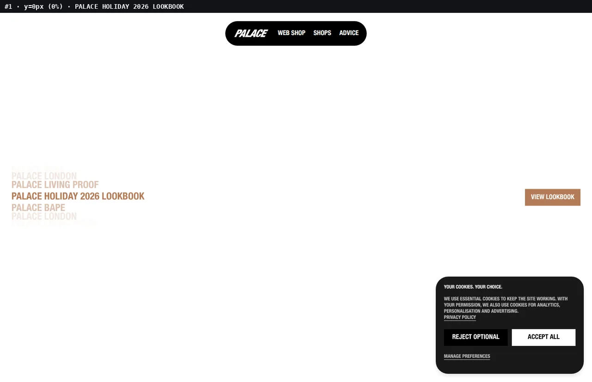
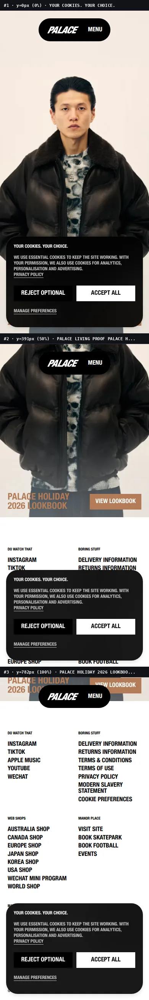

# UI Design System & Master Generation Blueprint: palaceskateboards-com

> **PALACE SKATEBOARDS** (https://palaceskateboards.com/) — GULLY SH*T





---

## 1. Executive Visual Persona & Design Archetype

- **Brand Essence & Persona**: **PALACE SKATEBOARDS** (`https://palaceskateboards.com/`). GULLY SH*T
- **Final Redirected URL**: [https://eu.palaceskateboards.com/](https://eu.palaceskateboards.com/)
- **Capture Provenance**: Live browser capture (`tier1_fast`, HTTP `200`, captured `2026-11-24`).
- **Visual Archetype**: **Light-Substrate Editorial & Modular Grid System (`#ffffff` canvas, `#000000` ink, `#b47c57` accent)**.
- **Anti-AI-Slop Differentiators**:
  - **Live-Computed Chromatic Polarity**: Anchors the viewport in `#ffffff` (live computed `browser-default` `background-color` (`computed_styles.json`)) paired with `#000000` primary typography and `#b47c57` accents.
  - **Grounded Typographic Hierarchy**: Uses `Neue Helvetica W01` across display (`PALACE LIVING PROOFPALACE HOLIDAY 20`) and body copy, paired with `SFMono-Regular` for monospace/code.
  - **Calibrated Spatial Grid & Motion**: Combines `96rem` container bounds (`gap: var(--spacing)`, padding `20px`) with `cubic-bezier(0,0,.2,1)` easing.

---

## 2. Spatial Architecture & Modular Grid Mathematics

### Viewport Allocation & Container Geometry
- **Captured Journey Filmstrips**: Desktop `1280×828px` (`assets/desktop-journey.webp`, `1` keyframes up to `y=0px` / doc `1276px`), Mobile `390×2616px` (`assets/mobile-journey.webp`, `3` keyframes).
- **Master Container Bounds**: `96rem` (non-`@media` desktop container stylesheet rule).
- **Canvas Lateral Padding & Spacing**: `20px` lateral canvas padding with `var(--spacing)` grid gap.
- **Border Radius Scale**: `.25rem`, `var(--radius-4xl)`, `5px`, `10px`.

### Responsive Breakpoint Architecture
- **Desktop Layout**: Multi-column CSS Grid / Flexbox layout at `1440px` (`max-width: 96rem`, `gap: var(--spacing)`).
- **Mobile Layout**: Single-column vertical stack at `390px` viewport width with `20px` horizontal padding.
- **Extracted CSS Media Queries**: `@media (width>=767px)`, `@media (width>=768px)`, `@media (width>=1024px)`, `@media (width>=1025px)`.

---

## 3. Color System, Materiality & Atmospheric Lighting

### Semantic Palette & Source Grounding
| Semantic Role | Ground-Truth Value | Extracted Live / CSS Source |
|---|---|---|
| **Primary Canvas Substrate** | `#ffffff` | live computed `browser-default` `background-color` (`computed_styles.json`) |
| **Primary Typography Ink** | `#000000` | live computed `h1` `color` (`computed_styles.json`) |
| **Elevated Surface / Card Substrate** | `#ffa500` | `.bg-orange { background-color: orange }` (`#ffa500`) |
| **Interactive Accent / Highlight** | `#b47c57` | live computed `button` `color` (`computed_styles.json`) |
| **Secondary / Muted Copy** | `#b47c57` | live computed `button` `color` (`computed_styles.json`) |
| **Structural Hairline Border** | `#808080` | `.border-grey-100 { border-color: #808080 }` |

### Sanitized Root CSS Variables (`ui-ux.md` Ground Truth)
| Variable Name | Extracted Value | Semantic Role |
|---|---|---|
| `--spacing` | `.25rem` | Layout / Spatial Grid Token |
| `--container-lg` | `32rem` | Layout / Spatial Grid Token |
| `--container-2xl` | `42rem` | Layout / Spatial Grid Token |
| `--text-xs` | `10px` | Typography Ink Token |
| `--text-xs--line-height` | `10px` | Typography Ink Token |
| `--text-sm` | `12px` | Typography Ink Token |
| `--text-sm--line-height` | `12px` | Typography Ink Token |
| `--text-base` | `16px` | Typography Ink Token |
| `--text-base--line-height` | `16px` | Typography Ink Token |
| `--text-lg` | `32px` | Typography Ink Token |
| `--text-lg--line-height` | `32px` | Typography Ink Token |
| `--text-xl` | `45px` | Typography Ink Token |
| `--text-xl--line-height` | `45px` | Typography Ink Token |
| `--text-2xl` | `60px` | Typography Ink Token |
| `--text-2xl--line-height` | `60px` | Typography Ink Token |
| `--text-3xl` | `72px` | Typography Ink Token |

---

## 4. Typographic Scale & Editorial Hierarchy

### Font Family Stacks
- **Display Typography**: `Neue Helvetica W01`.
- **Primary Body Stack**: `Neue Helvetica W01`.
- **Technical / Metadata Stack**: `SFMono-Regular`.

### Typographic Scale & Rules (Live Computed & Stylesheet Grounded)
- **Hero Display (`H1`)**: live computed `h1` (`font-size: 24px`, `line-height: 24px`, `font-weight: 700`); CSS variables `--text-4xl: 2.25rem`, `--text-4xl--line-height: calc(2.5 / 2.25)`, `--text-5xl: 3rem`; rule `h1` (`font-size: 2.25rem`, `font-weight: 700`).
- **Section Heading (`H2`)**: CSS variables `--text-2xl: 60px`, `--text-2xl--line-height: 60px`, `--text-3xl: 72px`; rule `h2` (`font-size: 1.5rem`, `font-weight: 700`).
- **Body Copy**: live computed `body` (`font-size: 16px`, `line-height: 24px`, `font-weight: 400`); CSS variables `--text-base: 16px`, `--text-base--line-height: 16px`; rule `p` (`font-size: .875rem`, `line-height: 1.625`).
- **Metadata & Navigation Labels**: live computed `nav/a` (`font-size: 16px`, `line-height: 24px`, `font-weight: 400`); CSS variables `--text-xs: 10px`, `--text-xs--line-height: 10px`, `--text-sm: 12px`.

---

## 5. Choreographed Motion & Interaction Physics

### Primary Easing Curves
- **Extracted Timing Functions**: `cubic-bezier(0,0,.2,1)`, `cubic-bezier(.4,0,.2,1)`, `cubic-bezier(.65,0,.35,1)`.

### Per-Element Transition & Choreography Rules
- **Selector `layer theme`**: `transition: .15s` extracted from `palaceskateboards-com` stylesheet.
- **Selector `layer utilities`**: `transition: opacity .3s` extracted from `palaceskateboards-com` stylesheet.
- **Selector `.transition`**: `transition: var(--tw-ease,var(--default-transition-timing-function))` extracted from `palaceskateboards-com` stylesheet.
- **Extracted Easing Curve (`cubic-bezier(0,0,.2,1)`)**: Governs interactive state transitions across `<header.pointer-events-none>` and `<main.flex>`.
- **State & Hover Choreography**: Opacity and transform transitions on `<main.min-h-dvh>` and `<main.flex>` interactive targets.
### Measured Runtime Scroll & Interaction Telemetry (`behavioral_journey_v2`)
- **Scroll Driver Mode**: `wheel` (max document height `1276px`, deepest scrollY reached `0px` across `1` desktop keyframes).
- **Detected Scroll / Motion Libraries**: `WebGL/Canvas`.
- **Hover Physics (`primary_cta` · `VIEW`)**: Computed transition `0s` / `ease` (no static color/transform shift captured at rest).
- **Route Transition Architecture**: First internal navigation (`/collections/all`) measured as `direct` in `3015ms`.

---

## 6. Component Wireframe & Structural DOM Map

### Visual Layout Schematic — Desktop (`1440px`, Grounded in `dom.html` & Landmark Bounding Boxes)
```
┌────────────────────────────────────────────────────────────────────────┐
│ DESKTOP VIEWPORT (1440px) — PALACE SKATEBOARDS                         │
│ ====================================================================== │
│ [ <header.pointer-events (1440x80px)  | Web Shop · Shops · Advice    ] │
│ ---------------------------------------------------------------------- │
│ | HERO STAGE: <main.min-h-dvh> (w=1440px)                            | │
│ | H1: PALACE LIVING PROOFPALACE HOLIDAY 2026 LOOKBOOKPA...           | │
│ | Substrate: #ffffff | Ink: #000000 | Accent: #b47c57                | │
│ ---------------------------------------------------------------------- │
│ | SHOWCASE GRID (<main.flex>) max-w: 96rem                           | │
│ | +------------------------------+  +------------------------------+ | │
│ | | PALACE HOLIDAY 2026 LOOKBOOK |  | PALACE LONDON                | | │
│ | +------------------------------+  +------------------------------+ | │
│ ---------------------------------------------------------------------- │
│ | DETAIL MODULE (<main.flex-col>) — PALACE LIVING PROOF              | │
│ ---------------------------------------------------------------------- │
│ [ FOOTER (<footer.z-1>        ) | https://palaceskateboards.com/       │
└────────────────────────────────────────────────────────────────────────┘
```

### Visual Layout Schematic — Mobile Reflow (`390px`)
```
┌────────────────────────────────────────────────────────────────────────┐
│ MOBILE VIEWPORT REFLOW (390px) — Single-Column Stack (gap: var(--sp)   │
│ ====================================================================== │
│ [ HEADER BAR (<header.pointer-events-n) | Compact Menu (390px)         │
│ ---------------------------------------------------------------------- │
│ | HERO STAGE (<main.min-h-dvh>) — 390px Vertical Lead                | │
│ | H1: PALACE LIVING PROOFPALACE HOLIDAY 2026 LOOKBOOKPA...           | │
│ ---------------------------------------------------------------------- │
│ | SHOWCASE STACK (<main.flex>) — 1-Col Stack                         | │
│ | [ Item 1: PALACE HOLIDAY 2026 LOOKBOOK                           ] | │
│ | [ Item 2: PALACE LONDON                                          ] | │
│ ---------------------------------------------------------------------- │
│ | DETAIL STACK (<main.flex-col>) — 1-Col (PALACE LIVING PROO)        | │
│ ---------------------------------------------------------------------- │
│ [ FOOTER (<footer.z-1>        ) | Stacked 390px Colophon               │
└────────────────────────────────────────────────────────────────────────┘
```

### Granular DOM Region Breakdown
1. **Brand Header & Navigation Bar (<header.pointer-events-none> — `palaceskateboards-com`)**:
   - Landmark `<header class="pointer-events-none left-0">` (`1440x80px`) hosting `PALACE SKATEBOARDS` navigation (`Web Shop · Shops · Advice`), DOM attributes (`data-application="hydrogen"`, `data-shop-id="26755399868"`, `data-storefront-id="2163011"`, `data-monorail-region="global"`), and stylesheet rule `backdrop { box-sizing:border-box;border:0 solid;margin:0;padding:0 }`.
2. **Hero Stage & Focal Lead (<main.min-h-dvh> — `PALACE LIVING PROOFPALACE HOLIDAY `)**:
   - Landmark `<main class="min-h-dvh flex">` presenting display lead `PALACE LIVING PROOFPALACE HOLIDAY 2026 LOOKBOOKPA...` and copy excerpt *"© PALACE SKATEBOARDS LIMITED 2026"* over `#ffffff` canvas and `#000000` ink.
3. **Primary Showcase & Content Grid (<main.flex> — `PALACE HOLIDAY 2026 LOOKBOOK`)**:
   - Landmark `<main class="min-h-dvh flex">` rendering section `PALACE HOLIDAY 2026 LOOKBOOK` with copy *"PALACE HOLIDAY 2026 LOOKBOOK"*, asset references (`favicon.svg`, `neue-helvetica-w01-v2-Del-pFKJ.woff2`, `neue-helvetica-w01-CykExj90.woff2`, `cdn.shopify.com`), and grid rule `file-selector-button { box-sizing:border-box;border:0 solid;margin:0;padding:0 }`.
4. **Interactive Detail & Feature Matrix (<main.flex-col> — `PALACE LONDON`)**:
   - Landmark `<main class="min-h-dvh flex">` framing `PALACE LONDON` and `PALACE LIVING PROOF` (*"PALACE LIVING PROOF"*) with `#ffa500` surface cards, `#b47c57` accents, and `strong { font-weight:bolder }`.
5. **Colophon & Global Directory Footer (<footer.z-1> — `https://palaceskateboards.com/`)**:
   - Landmark `<footer class="z-1 pt-20">` anchoring `PALACE SKATEBOARDS` footer links (`Web Shop · Shops · Advice`), copy *"Delivery Information"*, and `#808080` structural dividers.
### Full Vertical Scroll Sequence (Desktop `1440×900` Keyframes)
- **Step 01** (`y=0px`, `0%`): Active landmark `PALACE HOLIDAY 2026 LOOKBOOK` · sticky/fixed elements: `2`

### Multi-Page Internal Route Map
- **Detail Route (`/collections/all`)**: `https://eu.palaceskateboards.com/collections/all` — H1: `PASSWORD · PALACE SKATEBOARDS`, scrollHeight `1276px`, transition `direct` (`3015ms`)
- **Detail Route (`/advice/palace-bape`)**: `https://eu.palaceskateboards.com/advice/palace-bape` — H1: `PALACE BAPE`, scrollHeight `4148px`, transition `direct` (`4589ms`)
- **Detail Route (`/lookbooks/holiday-2026`)**: `https://eu.palaceskateboards.com/lookbooks/holiday-2026` — H1: `HOLIDAY 2026 LOOKBOOK`, scrollHeight `3655px`, transition `direct` (`2882ms`)

---

## 7. Master Zero-Shot AI Generation Prompt

```markdown
# Master Zero-Shot Frontend Generation Prompt: palaceskateboards-com (PALACE SKATEBOARDS)

You are a principal frontend architect and design systems engineer. Build a complete, production-ready web application replicating the exact design system, DOM landmarks, typographic hierarchy, color tokens, and motion physics of `palaceskateboards-com` (**PALACE SKATEBOARDS** — `https://palaceskateboards.com/`).

### 1. Visual Archetype & Anti-AI-Slop Mandates
- **Archetype**: Light-Substrate Editorial & Modular Grid System (`#ffffff` canvas, `#000000` ink, `#b47c57` accent).
- **Identity & Domain Context**: GULLY SH*T
- **Primary Substrate**: `#ffffff` (live computed `browser-default` `background-color` (`computed_styles.json`)), **Primary Ink**: `#000000`, **Accent / Highlight**: `#b47c57`.
- **Site-Specific Differentiators**:
  - **Live-Computed Chromatic Polarity**: Anchors the viewport in `#ffffff` (live computed `browser-default` `background-color` (`computed_styles.json`)) paired with `#000000` primary typography and `#b47c57` accents.
  - **Grounded Typographic Hierarchy**: Uses `Neue Helvetica W01` across display (`PALACE LIVING PROOFPALACE HOLIDAY 20`) and body copy, paired with `SFMono-Regular` for monospace/code.
  - **Calibrated Spatial Grid & Motion**: Combines `96rem` container bounds (`gap: var(--spacing)`, padding `20px`) with `cubic-bezier(0,0,.2,1)` easing.

### 2. Ground-Truth CSS Variables (`:root` Token Contract)
Declare and consume these exact custom properties extracted from `palaceskateboards-com` in your global stylesheet:

:root {
  /* PALACE SKATEBOARDS (palaceskateboards-com) — Live-Grounded CSS Variables */
  --spacing: .25rem; /* Layout / Spatial Grid Token (palaceskateboards-com) */
  --container-lg: 32rem; /* Layout / Spatial Grid Token (palaceskateboards-com) */
  --container-2xl: 42rem; /* Layout / Spatial Grid Token (palaceskateboards-com) */
  --text-xs: 10px; /* Typography Ink Token (palaceskateboards-com) */
  --text-xs--line-height: 10px; /* Typography Ink Token (palaceskateboards-com) */
  --text-sm: 12px; /* Typography Ink Token (palaceskateboards-com) */
  --text-sm--line-height: 12px; /* Typography Ink Token (palaceskateboards-com) */
  --text-base: 16px; /* Typography Ink Token (palaceskateboards-com) */
  --text-base--line-height: 16px; /* Typography Ink Token (palaceskateboards-com) */
  --text-lg: 32px; /* Typography Ink Token (palaceskateboards-com) */
  --text-lg--line-height: 32px; /* Typography Ink Token (palaceskateboards-com) */
  --text-xl: 45px; /* Typography Ink Token (palaceskateboards-com) */
  --text-xl--line-height: 45px; /* Typography Ink Token (palaceskateboards-com) */
  --text-2xl: 60px; /* Typography Ink Token (palaceskateboards-com) */
  --text-2xl--line-height: 60px; /* Typography Ink Token (palaceskateboards-com) */
  --text-3xl: 72px; /* Typography Ink Token (palaceskateboards-com) */
}

### 3. Semantic Color & Materiality Contract
Map every surface, ink, and border strictly to these source-grounded tokens:
- **Primary Canvas Substrate**: `#ffffff` — grounded in live computed `browser-default` `background-color` (`computed_styles.json`)
- **Primary Typography Ink**: `#000000` — grounded in live computed `h1` `color` (`computed_styles.json`)
- **Elevated Surface / Card Substrate**: `#ffa500` — grounded in `.bg-orange { background-color: orange }` (`#ffa500`)
- **Interactive Accent / Highlight**: `#b47c57` — grounded in live computed `button` `color` (`computed_styles.json`)
- **Secondary / Muted Copy**: `#b47c57` — grounded in live computed `button` `color` (`computed_styles.json`)
- **Structural Hairline Border**: `#808080` — grounded in `.border-grey-100 { border-color: #808080 }`

### 4. Spatial Grid, Container Bounds & Responsive Breakpoints
- **Desktop Viewport Reference**: `1280×828px` (single-viewport 100vh live capture (900px), `1440px` standard desktop width).
- **Mobile Viewport Reference**: `390×2616px` (multi-frame vertical journey filmstrip (2616px), `390px` standard mobile width).
- **Container Max-Width**: `96rem` (non-`@media` desktop container stylesheet rule)
- **Padding & Gutters**: `20px` lateral canvas padding with `var(--spacing)` grid gap
- **Desktop Grid**: Multi-column CSS Grid / Flexbox layout at `1440px` (`max-width: 96rem`, `gap: var(--spacing)`)
- **Mobile Adaptation**: Single-column vertical stack at `390px` viewport width with `20px` horizontal padding
- **Media Queries**: `@media (width>=767px)`, `@media (width>=768px)`, `@media (width>=1024px)`, `@media (width>=1025px)`
- **Corner Radii**: `.25rem`, `var(--radius-4xl)`, `5px`, `10px`

### 5. Typography & Editorial Scale Contract
- **Display Font Stack**: `Neue Helvetica W01`
- **Body Font Stack**: `Neue Helvetica W01`
- **Monospace / Technical Font Stack**: `SFMono-Regular`
- **H1 Display Rule**: live computed `h1` (`font-size: 24px`, `line-height: 24px`, `font-weight: 700`); CSS variables `--text-4xl: 2.25rem`, `--text-4xl--line-height: calc(2.5 / 2.25)`, `--text-5xl: 3rem`; rule `h1` (`font-size: 2.25rem`, `font-weight: 700`)
- **H2 Section Rule**: CSS variables `--text-2xl: 60px`, `--text-2xl--line-height: 60px`, `--text-3xl: 72px`; rule `h2` (`font-size: 1.5rem`, `font-weight: 700`)
- **Body Copy Rule**: live computed `body` (`font-size: 16px`, `line-height: 24px`, `font-weight: 400`); CSS variables `--text-base: 16px`, `--text-base--line-height: 16px`; rule `p` (`font-size: .875rem`, `line-height: 1.625`)
- **Metadata & Index Rule**: live computed `nav/a` (`font-size: 16px`, `line-height: 24px`, `font-weight: 400`); CSS variables `--text-xs: 10px`, `--text-xs--line-height: 10px`, `--text-sm: 12px`

### 6. Component Hierarchy, Verbatim Copy & Real DOM Landmarks
Scaffold `palaceskateboards-com` (`PALACE SKATEBOARDS`) with these exact structural regions, extracted copy, and CSS rules from `dom.html`:
1. **Brand Header & Navigation Bar (<header.pointer-events-none> — `palaceskateboards-com`)**:
   - DOM & Selectors: Landmark `<header class="pointer-events-none left-0">` (`1440x80px`) hosting `PALACE SKATEBOARDS` navigation (`Web Shop · Shops · Advice`), DOM attributes (`data-application="hydrogen"`, `data-shop-id="26755399868"`, `data-storefront-id="2163011"`, `data-monorail-region="global"`), and stylesheet rule `backdrop { box-sizing:border-box;border:0 solid;margin:0;padding:0 }`.
   - Responsive Contract: Header `Brand Header & Navigation Bar (<header.pointer-events-none> — `palaceskateboards-com`)` (`palaceskateboards-com`) adapts across `@media (width>=767px)`, `@media (width>=768px)`, `@media (width>=1024px)`, `@media (width>=1025px)` with `cubic-bezier(0,0,.2,1)`, `cubic-bezier(.4,0,.2,1)`, `cubic-bezier(.65,0,.35,1)` transitions and links `Web Shop · Shops · Advice`.
2. **Hero Stage & Focal Lead (<main.min-h-dvh> — `PALACE LIVING PROOFPALACE HOLIDAY `)**:
   - DOM & Selectors: Landmark `<main class="min-h-dvh flex">` presenting display lead `PALACE LIVING PROOFPALACE HOLIDAY 2026 LOOKBOOKPA...` and copy excerpt *"© PALACE SKATEBOARDS LIMITED 2026"* over `#ffffff` canvas and `#000000` ink.
   - Responsive Contract: Hero stage (`1280×828px` desktop / `390×2616px` mobile) sets `#ffffff` background with `#000000` headline `PALACE LIVING PROOFPALACE HOLIDAY 2026 LOOKBOOKPA...`.
3. **Primary Showcase & Content Grid (<main.flex> — `PALACE HOLIDAY 2026 LOOKBOOK`)**:
   - DOM & Selectors: Landmark `<main class="min-h-dvh flex">` rendering section `PALACE HOLIDAY 2026 LOOKBOOK` with copy *"PALACE HOLIDAY 2026 LOOKBOOK"*, asset references (`favicon.svg`, `neue-helvetica-w01-v2-Del-pFKJ.woff2`, `neue-helvetica-w01-CykExj90.woff2`, `cdn.shopify.com`), and grid rule `file-selector-button { box-sizing:border-box;border:0 solid;margin:0;padding:0 }`.
   - Responsive Contract: Showcase grid `Primary Showcase & Content Grid (<main.flex> — `PALACE HOLIDAY 2026 LOOKBOOK`)` applies Multi-column CSS Grid / Flexbox layout at `1440px` (`max-width: 96rem`, `gap: var(--spacing)`) on desktop and Single-column vertical stack at `390px` viewport width with `20px` horizontal padding on mobile.
4. **Interactive Detail & Feature Matrix (<main.flex-col> — `PALACE LONDON`)**:
   - DOM & Selectors: Landmark `<main class="min-h-dvh flex">` framing `PALACE LONDON` and `PALACE LIVING PROOF` (*"PALACE LIVING PROOF"*) with `#ffa500` surface cards, `#b47c57` accents, and `strong { font-weight:bolder }`.
   - Responsive Contract: Detail module `Interactive Detail & Feature Matrix (<main.flex-col> — `PALACE LONDON`)` uses `.25rem`, `var(--radius-4xl)`, `5px`, `10px` radii, `#b47c57` highlights, and assets (favicon.svg, neue-helvetica-w01-v2-Del-pFKJ.woff2, neue-helvetica-w01-CykExj90.woff2).
5. **Colophon & Global Directory Footer (<footer.z-1> — `https://palaceskateboards.com/`)**:
   - DOM & Selectors: Landmark `<footer class="z-1 pt-20">` anchoring `PALACE SKATEBOARDS` footer links (`Web Shop · Shops · Advice`), copy *"Delivery Information"*, and `#808080` structural dividers.
   - Responsive Contract: Footer `Colophon & Global Directory Footer (<footer.z-1> — `https://palaceskateboards.com/`)` aligns to `96rem` (non-`@media` desktop container stylesheet rule) with `20px` lateral canvas padding with `var(--spacing)` grid gap and attributes (data-application="hydrogen", data-shop-id="26755399868", data-storefront-id="2163011").

#### Verbatim DOM Copy Excerpts (`dom.html`)
- Copy Excerpt 1: *"© PALACE SKATEBOARDS LIMITED 2026"*
- Copy Excerpt 2: *"PALACE HOLIDAY 2026 LOOKBOOK"*
- Copy Excerpt 3: *"PALACE LIVING PROOF"*
- Copy Excerpt 4: *"Delivery Information"*

### 7. Motion, Extracted Stylesheet Rules & Interaction Choreography
- **Primary Easing Functions**: `cubic-bezier(0,0,.2,1)`, `cubic-bezier(.4,0,.2,1)`, `cubic-bezier(.65,0,.35,1)`
- **Extracted Stylesheet Rules (`palaceskateboards-com`)**:
- `backdrop { box-sizing:border-box;border:0 solid;margin:0;padding:0 }`
- `file-selector-button { box-sizing:border-box;border:0 solid;margin:0;padding:0 }`
- `strong { font-weight:bolder }`
- `small { font-size:80% }`
- `sup { vertical-align:baseline;font-size:75%;line-height:0;position:relative }`
- **Per-Selector Transition Rules**:
- **Selector `layer theme`**: `transition: .15s` extracted from `palaceskateboards-com` stylesheet.
- **Selector `layer utilities`**: `transition: opacity .3s` extracted from `palaceskateboards-com` stylesheet.
- **Selector `.transition`**: `transition: var(--tw-ease,var(--default-transition-timing-function))` extracted from `palaceskateboards-com` stylesheet.
- **Extracted Easing Curve (`cubic-bezier(0,0,.2,1)`)**: Governs interactive state transitions across `<header.pointer-events-none>` and `<main.flex>`.
- **State & Hover Choreography**: Opacity and transform transitions on `<main.min-h-dvh>` and `<main.flex>` interactive targets.
### 7b. Full-Page Scroll Choreography, Interactive States & Multi-Page Routes
- **Scroll Mechanics**: Implement `wheel` vertical progression up to `1276px` across 1 distinct viewport chapters using WebGL/Canvas.
- **Vertical Chapter Sequence**: PALACE HOLIDAY 2026 LOOKBOOK (0%).
- **Multi-Page Routes**: Scaffold internal routes `/collections/all` (detail, direct), `/advice/palace-bape` (detail, direct), `/lookbooks/holiday-2026` (detail, direct) sharing the global header/footer shell and design tokens.

### 8. Technical Deliverables
- Implement in Next.js (App Router) with TypeScript and Tailwind CSS consuming the `:root` custom properties defined above for `palaceskateboards-com`.
- Reproduce both the `1440px` desktop architecture and `390px` mobile breakpoint transitions, preserving semantic HTML5 landmarks (`<header>`, `<nav>`, `<main>`, `<section>`, `<footer>`) and `prefers-reduced-motion` accessibility guards.
```
---

## 8. Full-Page Scroll Journey, Interactive States & Subpage Inventory

### Desktop Scroll Keyframes (`1440×900` WebP)
| Step | Scroll Y | Progress | Active Landmark / Section | Sticky/Fixed | Visual Asset |
| :---: | :---: | :---: | :--- | :---: | :--- |
| `#01` | `0px` | `0%` | PALACE HOLIDAY 2026 LOOKBOOK | `2` | [desktop-step-01.webp](assets/desktop-step-01.webp) |

### Mobile Condensed Keyframes (`390×844` WebP)
| Step | Scroll Y | Progress | Active Landmark | Visual Asset |
| :---: | :---: | :---: | :--- | :--- |
| `#01` | `0px` | `0%` | YOUR COOKIES. YOUR CHOICE. | [mobile-step-01.webp](assets/mobile-step-01.webp) |
| `#02` | `391px` | `50%` | PALACE LIVING PROOF PALACE HOLIDAY 2026 L... | [mobile-step-02.webp](assets/mobile-step-02.webp) |
| `#03` | `782px` | `100%` | PALACE HOLIDAY 2026 LOOKBOOK PALACE BAPE... | [mobile-step-03.webp](assets/mobile-step-03.webp) |

### Internal Subpage Filmstrips (`1080px` Wide WebP)
| # | Template | Route URL | H1 / Title | Scroll Height | Transition | Filmstrip Asset |
| :-: | :---: | :--- | :--- | :---: | :---: | :--- |
| `1` | `detail` | `https://eu.palaceskateboards.com/collections/all` | PASSWORD · PALACE SKATEBOARDS | `1276px` | `direct` (`3015ms`) | [subpage-01-collections-all.webp](assets/subpage-01-collections-all.webp) |
| `2` | `detail` | `https://eu.palaceskateboards.com/advice/palace-bape` | PALACE BAPE | `4148px` | `direct` (`4589ms`) | [subpage-02-advice-palace-bape.webp](assets/subpage-02-advice-palace-bape.webp) |
| `3` | `detail` | `https://eu.palaceskateboards.com/lookbooks/holiday-2026` | HOLIDAY 2026 LOOKBOOK | `3655px` | `direct` (`2882ms`) | [subpage-03-lookbooks-holiday-2026.webp](assets/subpage-03-lookbooks-holiday-2026.webp) |

