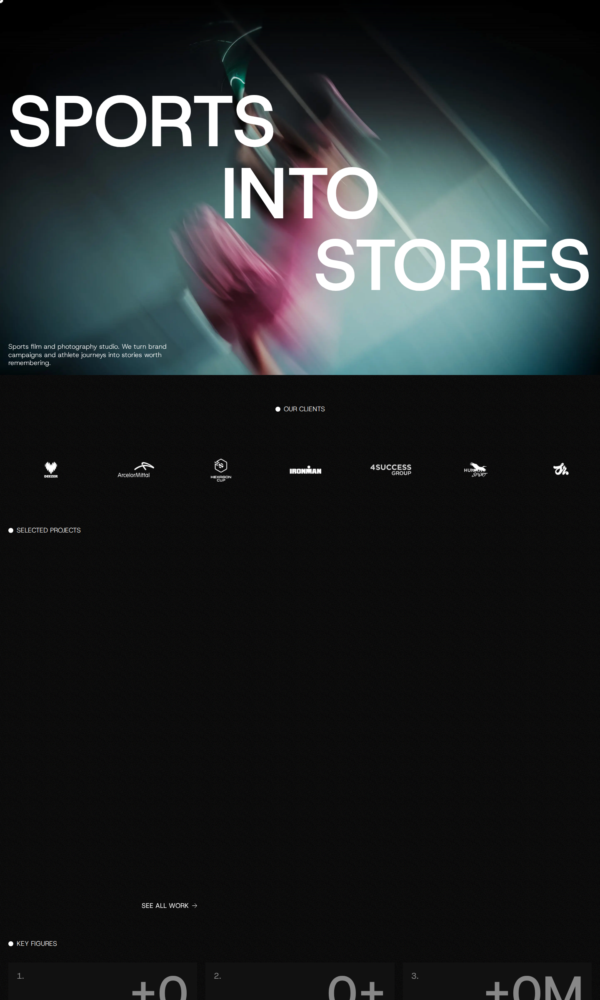
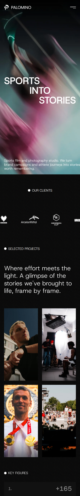

# UI Design System & Master Generation Blueprint: palominoprod-com

> **Palomino — Cinematic Sports & Brand Films** (https://palominoprod.com/) — Cinematic sports and branded films—from global campaigns to athlete documentaries and live events—with strategy, premium production & edi...



---

## 1. Executive Visual Persona & Design Archetype

- **Brand Essence & Persona**: **Palomino — Cinematic Sports & Brand Films** (`https://palominoprod.com/`). Cinematic sports and branded films—from global campaigns to athlete documentaries and live events—with strategy, premium production & edi...
- **Capture Provenance**: Live browser capture (`tier1_fast`, HTTP `200`, captured `2026-11-23`).
- **Visual Archetype**: **Dark-Substrate WebGL / Canvas Interactive Experience (`#000000` / `#ff0000`)**.
- **Anti-AI-Slop Differentiators**:
  - **Live-Computed Chromatic Polarity**: Anchors the viewport in `#000000` (live computed `body` `background-color` (`computed_styles.json`)) paired with `#ffffff` primary typography and `#ff0000` accents.
  - **Grounded Typographic Hierarchy**: Pairs `HostGrotesk` for display copy (`SPORTS INTO STORIES`) with `HostGrotesk` and `SFMono-Regular`.
  - **Calibrated Spatial Grid & Motion**: Combines `96rem` container bounds (`gap: var(--gap-x-default)`, padding `20px`) with `cubic-bezier(.4,0,.2,1)` easing and Lenis Smooth Scroll (`data-lenis`), Three.js / WebGL Canvas Pipeline.

---

## 2. Spatial Architecture & Modular Grid Mathematics



### Viewport Allocation & Container Geometry
- **Captured Viewport Dimensions**: Desktop `1440×2400px` (`assets/desktop.png`, clamped at 2400px live multi-section capture), Mobile `390×2400px` (`assets/mobile.png`, clamped at 2400px live multi-section capture).
- **Master Container Bounds**: `96rem` (non-`@media` desktop container stylesheet rule).
- **Canvas Lateral Padding & Spacing**: `20px` lateral canvas padding with `var(--gap-x-default)` grid gap.
- **Border Radius Scale**: `3px`, `var(--radius-lg)`.

### Responsive Breakpoint Architecture
- **Desktop Layout**: Multi-column CSS Grid / Flexbox layout at `1440px` (`max-width: 96rem`, `gap: var(--gap-x-default)`).
- **Mobile Layout**: Single-column vertical stack at `390px` viewport width with `20px` horizontal padding.
- **Extracted CSS Media Queries**: `@media (min-width:380px)`, `@media (min-width:40rem)`, `@media (min-width:48rem)`, `@media (min-width:64rem)`.

---

## 3. Color System, Materiality & Atmospheric Lighting

### Semantic Palette & Source Grounding
| Semantic Role | Ground-Truth Value | Extracted Live / CSS Source |
|---|---|---|
| **Primary Canvas Substrate** | `#000000` | live computed `body` `background-color` (`computed_styles.json`) |
| **Primary Typography Ink** | `#ffffff` | live computed `h1` `color` (`computed_styles.json`) |
| **Elevated Surface / Card Substrate** | `#008000` | `.bg-green-500 { background-color: green }` (`#008000`) |
| **Interactive Accent / Highlight** | `#ff0000` | `.bg-red-500 { background-color: red }` (`#ff0000`) |
| **Secondary / Muted Copy** | `#008000` | `.text-green-400 { color: green }` (`#008000`) |
| **Structural Hairline Border** | `#080748` | `30 { border-color: #080748 }` |
| **Variable Token (`--color-red-400`)** | `#ff6568` | `var(--color-red-400)` in `:root` |
| **Variable Token (`--color-red-500`)** | `#fb2c36` | `var(--color-red-500)` in `:root` |
| **Variable Token (`--color-orange-400`)** | `#ff8b1a` | `var(--color-orange-400)` in `:root` |

### Sanitized Root CSS Variables (`ui-ux.md` Ground Truth)
| Variable Name | Extracted Value | Semantic Role |
|---|---|---|
| `--x-double-default` | `calc(var(--x-default) * 2)` | Design System Custom Token |
| `--y-double-default` | `calc(var(--y-default) * 2)` | Design System Custom Token |
| `--x-default` | `20px` | Dimension / Scale Token |
| `--y-default` | `clamp(20px, 8svh, 100px)` | Dimension / Scale Token |
| `--x-half-default` | `calc(var(--x-default) / 2)` | Design System Custom Token |
| `--y-half-default` | `calc(var(--y-default) / 2)` | Design System Custom Token |
| `--font-host-grotesk` | `"HostGrotesk", sans-serif` | Typography / Scale Token |
| `--color-black` | `#000` | Canvas / Surface Token |
| `--color-white` | `#fff` | Canvas / Surface Token |
| `--screen-loader-burst` | `0px` | Dimension / Scale Token |
| `--media-control-background` | `transparent` | Canvas / Surface Token |
| `--media-control-hover-background` | `transparent` | Canvas / Surface Token |
| `--media-button-icon-width` | `100%` | Layout / Spatial Grid Token |
| `--color-red-400` | `#ff6568` | Brand / Palette Token |
| `--color-red-500` | `#fb2c36` | Brand / Palette Token |
| `--color-orange-400` | `#ff8b1a` | Brand / Palette Token |

---

## 4. Typographic Scale & Editorial Hierarchy

### Font Family Stacks
- **Display Typography**: `HostGrotesk`.
- **Primary Body Stack**: `HostGrotesk`.
- **Technical / Metadata Stack**: `SFMono-Regular`.

### Typographic Scale & Rules (Live Computed & Stylesheet Grounded)
- **Hero Display (`H1`)**: live computed `h1` (`font-size: 172.8px`, `line-height: 172.8px`, `font-weight: 600`); rule `,h1` (`font-size: clamp(38px,5vw,101px)`, `line-height: 1.2`, `font-weight: 600`).
- **Section Heading (`H2`)**: live computed `h3 (primary section heading)` (`font-size: 20px`, `line-height: 24px`, `font-weight: 400`); CSS variables `--text-3xl: 1.875rem`, `--text-3xl--line-height: calc(2.25 / 1.875)`; rule `,h2` (`font-size: clamp(26px,3vw,50px)`, `line-height: 1.2`, `font-weight: 600`).
- **Body Copy**: live computed `body` (`font-size: 16px`, `line-height: 24px`, `font-weight: 400`).
- **Metadata & Navigation Labels**: live computed `nav/a` (`font-size: 16px`, `line-height: 24px`, `font-weight: 400`); CSS variables `--text-xs: .75rem`, `--text-xs--line-height: calc(1 / .75)`, `--text-sm: .875rem`.

---

## 5. Choreographed Motion & Interaction Physics

### Primary Easing Curves
- **Extracted Timing Functions**: `cubic-bezier(.4,0,.2,1)`, `cubic-bezier(.3,1,.7,1)`, `cubic-bezier(.83,0,.17,1)`.

### Per-Element Transition & Choreography Rules
- **Selector `.mux-full-player::part(pre-play)`**: `transition: transform .2s` extracted from `palominoprod-com` stylesheet.
- **Selector `layer theme`**: `transition: .15s` extracted from `palominoprod-com` stylesheet.
- **Selector `.transition`**: `transition: var(--tw-ease,var(--default-transition-timing-function))` extracted from `palominoprod-com` stylesheet.
- **Extracted Easing Curve (`cubic-bezier(.4,0,.2,1)`)**: Governs interactive state transitions across `<header.px-x-default>` and `<section.pt-y-default>`.
- **Runtime Interaction Engine**: Integrates Lenis Smooth Scroll (`data-lenis`), Three.js / WebGL Canvas Pipeline with `prefers-reduced-motion: reduce` fallback guards.

---

## 6. Component Wireframe & Structural DOM Map

### Visual Layout Schematic — Desktop (`1440px`, Grounded in `dom.html` & Landmark Bounding Boxes)
```
┌────────────────────────────────────────────────────────────────────────┐
│ DESKTOP VIEWPORT (1440px) — Palomino — Cinematic Sports & Brand Films  │
│ ====================================================================== │
│ [ <header.px-x-default> (1440x75px)   | W O R K W O R K · A B O U T  ] │
│ ---------------------------------------------------------------------- │
│ | HERO STAGE: <section.top-0> (w=1440px)                             | │
│ | H1: SPORTS INTO STORIES                                            | │
│ | Substrate: #000000 | Ink: #ffffff | Accent: #ff0000                | │
│ ---------------------------------------------------------------------- │
│ | SHOWCASE GRID (<section.pt-y-default>) max-w: 96rem                | │
│ | +------------------------------+  +------------------------------+ | │
│ | | SELECTED PROJECTS            |  | Running FW26 × Decathlon     | | │
│ | +------------------------------+  +------------------------------+ | │
│ ---------------------------------------------------------------------- │
│ | DETAIL MODULE (<section.px-x-default>) — Mennen TV Spot            | │
│ ---------------------------------------------------------------------- │
│ [ FOOTER (<footer.select-none>) | https://palominoprod.com/            │
└────────────────────────────────────────────────────────────────────────┘
```

### Visual Layout Schematic — Mobile Reflow (`390px`)
```
┌────────────────────────────────────────────────────────────────────────┐
│ MOBILE VIEWPORT REFLOW (390px) — Single-Column Stack (gap: var(--ga)   │
│ ====================================================================== │
│ [ HEADER BAR (<header.px-x-default>   ) | Compact Menu (390px)         │
│ ---------------------------------------------------------------------- │
│ | HERO STAGE (<section.top-0>) — 390px Vertical Lead                 | │
│ | H1: SPORTS INTO STORIES                                            | │
│ ---------------------------------------------------------------------- │
│ | SHOWCASE STACK (<section.pt-y-default>) — 1-Col Stack              | │
│ | [ Item 1: SELECTED PROJECTS                                      ] | │
│ | [ Item 2: Running FW26 × Decathlon                               ] | │
│ ---------------------------------------------------------------------- │
│ | DETAIL STACK (<section.px-x-default>) — 1-Col (Mennen TV Spot)     | │
│ ---------------------------------------------------------------------- │
│ [ FOOTER (<footer.select-none>) | Stacked 390px Colophon               │
└────────────────────────────────────────────────────────────────────────┘
```

### Granular DOM Region Breakdown
1. **Brand Header & Navigation Bar (<header.px-x-default> — `palominoprod-com`)**:
   - Landmark `<header class="px-x-default top-0">` (`1440x75px`) hosting `Palomino — Cinematic Sports & Brand ` navigation (`W O R K W O R K · A B O U T A B O U T`), DOM attributes (`data-next-head`, `data-n-g`, `data-n-css`, `data-nimg="1"`), and stylesheet rule `.animation-sample { will-change:transform;animation:6s ease-in-out infinite sample }`.
2. **Hero Stage & Focal Lead (<section.top-0> — `SPORTS INTO STORIES`)**:
   - Landmark `<section class="top-0 min-h-fit">` presenting display lead `SPORTS INTO STORIES` and copy excerpt *"Sports film and photography studio. We turn brand campaigns and a"* over `#000000` canvas and `#ffffff` ink.
3. **Primary Showcase & Content Grid (<section.pt-y-default> — `SELECTED PROJECTS`)**:
   - Landmark `<section class="pt-y-default noise-overlay">` rendering section `SELECTED PROJECTS` with copy *"Where effort meets the light. A glimpse of the stories we've brou"*, asset references (`favicon.ico`, `HostGrotesk-Variable.woff2`, `0d_rtsbnnnoar.css`, `0eydbtu3qzciz.js`), and grid rule `html { scrollbar-width:none;-ms-overflow-style:none }`.
4. **Interactive Detail & Feature Matrix (<section.px-x-default> — `Running FW26 × Decathlon`)**:
   - Landmark `<section class="px-x-default pt-y-default">` framing `Running FW26 × Decathlon` and `Mennen TV Spot` (*"S E E A L L W O R K S E E A L L W O R K"*) with `#008000` surface cards, `#ff0000` accents, and `html ::selection { background:var(--color-black);color:var(--color-white) }`.
5. **Colophon & Global Directory Footer (<footer.select-none> — `https://palominoprod.com/`)**:
   - Landmark `<footer class="select-none bottom-0">` anchoring `Palomino — Cinematic Sports & Br` footer links (`W O R K W O R K · A B O U T A B O U T`), copy *"S E E A L L W O R K"*, and `#080748` structural dividers.

---

## 7. Master Zero-Shot AI Generation Prompt

```markdown
# Master Zero-Shot Frontend Generation Prompt: palominoprod-com (Palomino — Cinematic Sports & Brand Films)

You are a principal frontend architect and design systems engineer. Build a complete, production-ready web application replicating the exact design system, DOM landmarks, typographic hierarchy, color tokens, and motion physics of `palominoprod-com` (**Palomino — Cinematic Sports & Brand Films** — `https://palominoprod.com/`).

### 1. Visual Archetype & Anti-AI-Slop Mandates
- **Archetype**: Dark-Substrate WebGL / Canvas Interactive Experience (`#000000` / `#ff0000`).
- **Identity & Domain Context**: Cinematic sports and branded films—from global campaigns to athlete documentaries and live events—with strategy, premium production & edi...
- **Primary Substrate**: `#000000` (live computed `body` `background-color` (`computed_styles.json`)), **Primary Ink**: `#ffffff`, **Accent / Highlight**: `#ff0000`.
- **Site-Specific Differentiators**:
  - **Live-Computed Chromatic Polarity**: Anchors the viewport in `#000000` (live computed `body` `background-color` (`computed_styles.json`)) paired with `#ffffff` primary typography and `#ff0000` accents.
  - **Grounded Typographic Hierarchy**: Pairs `HostGrotesk` for display copy (`SPORTS INTO STORIES`) with `HostGrotesk` and `SFMono-Regular`.
  - **Calibrated Spatial Grid & Motion**: Combines `96rem` container bounds (`gap: var(--gap-x-default)`, padding `20px`) with `cubic-bezier(.4,0,.2,1)` easing and Lenis Smooth Scroll (`data-lenis`), Three.js / WebGL Canvas Pipeline.

### 2. Ground-Truth CSS Variables (`:root` Token Contract)
Declare and consume these exact custom properties extracted from `palominoprod-com` in your global stylesheet:

:root {
  /* Palomino — Cinematic Sports & Brand Films (palominoprod-com) — Live-Grounded CSS Variables */
  --x-double-default: calc(var(--x-default) * 2); /* Design System Custom Token (palominoprod-com) */
  --y-double-default: calc(var(--y-default) * 2); /* Design System Custom Token (palominoprod-com) */
  --x-default: 20px; /* Dimension / Scale Token (palominoprod-com) */
  --y-default: clamp(20px, 8svh, 100px); /* Dimension / Scale Token (palominoprod-com) */
  --x-half-default: calc(var(--x-default) / 2); /* Design System Custom Token (palominoprod-com) */
  --y-half-default: calc(var(--y-default) / 2); /* Design System Custom Token (palominoprod-com) */
  --font-host-grotesk: "HostGrotesk", sans-serif; /* Typography / Scale Token (palominoprod-com) */
  --color-black: #000; /* Canvas / Surface Token (palominoprod-com) */
  --color-white: #fff; /* Canvas / Surface Token (palominoprod-com) */
  --screen-loader-burst: 0px; /* Dimension / Scale Token (palominoprod-com) */
  --media-control-background: transparent; /* Canvas / Surface Token (palominoprod-com) */
  --media-control-hover-background: transparent; /* Canvas / Surface Token (palominoprod-com) */
  --media-button-icon-width: 100%; /* Layout / Spatial Grid Token (palominoprod-com) */
  --color-red-400: #ff6568; /* Brand / Palette Token (palominoprod-com) */
  --color-red-500: #fb2c36; /* Brand / Palette Token (palominoprod-com) */
  --color-orange-400: #ff8b1a; /* Brand / Palette Token (palominoprod-com) */
}

### 3. Semantic Color & Materiality Contract
Map every surface, ink, and border strictly to these source-grounded tokens:
- **Primary Canvas Substrate**: `#000000` — grounded in live computed `body` `background-color` (`computed_styles.json`)
- **Primary Typography Ink**: `#ffffff` — grounded in live computed `h1` `color` (`computed_styles.json`)
- **Elevated Surface / Card Substrate**: `#008000` — grounded in `.bg-green-500 { background-color: green }` (`#008000`)
- **Interactive Accent / Highlight**: `#ff0000` — grounded in `.bg-red-500 { background-color: red }` (`#ff0000`)
- **Secondary / Muted Copy**: `#008000` — grounded in `.text-green-400 { color: green }` (`#008000`)
- **Structural Hairline Border**: `#080748` — grounded in `30 { border-color: #080748 }`
- **Variable Token (`--color-red-400`)**: `#ff6568` — grounded in `var(--color-red-400)` in `:root`
- **Variable Token (`--color-red-500`)**: `#fb2c36` — grounded in `var(--color-red-500)` in `:root`
- **Variable Token (`--color-orange-400`)**: `#ff8b1a` — grounded in `var(--color-orange-400)` in `:root`

### 4. Spatial Grid, Container Bounds & Responsive Breakpoints
- **Desktop Viewport Reference**: `1440×2400px` (clamped at 2400px live multi-section capture, `1440px` standard desktop width).
- **Mobile Viewport Reference**: `390×2400px` (clamped at 2400px live multi-section capture, `390px` standard mobile width).
- **Container Max-Width**: `96rem` (non-`@media` desktop container stylesheet rule)
- **Padding & Gutters**: `20px` lateral canvas padding with `var(--gap-x-default)` grid gap
- **Desktop Grid**: Multi-column CSS Grid / Flexbox layout at `1440px` (`max-width: 96rem`, `gap: var(--gap-x-default)`)
- **Mobile Adaptation**: Single-column vertical stack at `390px` viewport width with `20px` horizontal padding
- **Media Queries**: `@media (min-width:380px)`, `@media (min-width:40rem)`, `@media (min-width:48rem)`, `@media (min-width:64rem)`
- **Corner Radii**: `3px`, `var(--radius-lg)`

### 5. Typography & Editorial Scale Contract
- **Display Font Stack**: `HostGrotesk`
- **Body Font Stack**: `HostGrotesk`
- **Monospace / Technical Font Stack**: `SFMono-Regular`
- **H1 Display Rule**: live computed `h1` (`font-size: 172.8px`, `line-height: 172.8px`, `font-weight: 600`); rule `,h1` (`font-size: clamp(38px,5vw,101px)`, `line-height: 1.2`, `font-weight: 600`)
- **H2 Section Rule**: live computed `h3 (primary section heading)` (`font-size: 20px`, `line-height: 24px`, `font-weight: 400`); CSS variables `--text-3xl: 1.875rem`, `--text-3xl--line-height: calc(2.25 / 1.875)`; rule `,h2` (`font-size: clamp(26px,3vw,50px)`, `line-height: 1.2`, `font-weight: 600`)
- **Body Copy Rule**: live computed `body` (`font-size: 16px`, `line-height: 24px`, `font-weight: 400`)
- **Metadata & Index Rule**: live computed `nav/a` (`font-size: 16px`, `line-height: 24px`, `font-weight: 400`); CSS variables `--text-xs: .75rem`, `--text-xs--line-height: calc(1 / .75)`, `--text-sm: .875rem`

### 6. Component Hierarchy, Verbatim Copy & Real DOM Landmarks
Scaffold `palominoprod-com` (`Palomino — Cinematic Sports & Brand Films`) with these exact structural regions, extracted copy, and CSS rules from `dom.html`:
1. **Brand Header & Navigation Bar (<header.px-x-default> — `palominoprod-com`)**:
   - DOM & Selectors: Landmark `<header class="px-x-default top-0">` (`1440x75px`) hosting `Palomino — Cinematic Sports & Brand ` navigation (`W O R K W O R K · A B O U T A B O U T`), DOM attributes (`data-next-head`, `data-n-g`, `data-n-css`, `data-nimg="1"`), and stylesheet rule `.animation-sample { will-change:transform;animation:6s ease-in-out infinite sample }`.
   - Responsive Contract: Header `Brand Header & Navigation Bar (<header.px-x-default> — `palominoprod-com`)` (`palominoprod-com`) adapts across `@media (min-width:380px)`, `@media (min-width:40rem)`, `@media (min-width:48rem)`, `@media (min-width:64rem)` with `cubic-bezier(.4,0,.2,1)`, `cubic-bezier(.3,1,.7,1)`, `cubic-bezier(.83,0,.17,1)` transitions and links `W O R K W O R K · A B O U T A B O U T`.
2. **Hero Stage & Focal Lead (<section.top-0> — `SPORTS INTO STORIES`)**:
   - DOM & Selectors: Landmark `<section class="top-0 min-h-fit">` presenting display lead `SPORTS INTO STORIES` and copy excerpt *"Sports film and photography studio. We turn brand campaigns and a"* over `#000000` canvas and `#ffffff` ink.
   - Responsive Contract: Hero stage (`1440×2400px` desktop / `390×2400px` mobile) sets `#000000` background with `#ffffff` headline `SPORTS INTO STORIES`.
3. **Primary Showcase & Content Grid (<section.pt-y-default> — `SELECTED PROJECTS`)**:
   - DOM & Selectors: Landmark `<section class="pt-y-default noise-overlay">` rendering section `SELECTED PROJECTS` with copy *"Where effort meets the light. A glimpse of the stories we've brou"*, asset references (`favicon.ico`, `HostGrotesk-Variable.woff2`, `0d_rtsbnnnoar.css`, `0eydbtu3qzciz.js`), and grid rule `html { scrollbar-width:none;-ms-overflow-style:none }`.
   - Responsive Contract: Showcase grid `Primary Showcase & Content Grid (<section.pt-y-default> — `SELECTED PROJECTS`)` applies Multi-column CSS Grid / Flexbox layout at `1440px` (`max-width: 96rem`, `gap: var(--gap-x-default)`) on desktop and Single-column vertical stack at `390px` viewport width with `20px` horizontal padding on mobile.
4. **Interactive Detail & Feature Matrix (<section.px-x-default> — `Running FW26 × Decathlon`)**:
   - DOM & Selectors: Landmark `<section class="px-x-default pt-y-default">` framing `Running FW26 × Decathlon` and `Mennen TV Spot` (*"S E E A L L W O R K S E E A L L W O R K"*) with `#008000` surface cards, `#ff0000` accents, and `html ::selection { background:var(--color-black);color:var(--color-white) }`.
   - Responsive Contract: Detail module `Interactive Detail & Feature Matrix (<section.px-x-default> — `Running FW26 × Decathlon`)` uses `3px`, `var(--radius-lg)` radii, `#ff0000` highlights, and assets (favicon.ico, HostGrotesk-Variable.woff2, 0d_rtsbnnnoar.css).
5. **Colophon & Global Directory Footer (<footer.select-none> — `https://palominoprod.com/`)**:
   - DOM & Selectors: Landmark `<footer class="select-none bottom-0">` anchoring `Palomino — Cinematic Sports & Br` footer links (`W O R K W O R K · A B O U T A B O U T`), copy *"S E E A L L W O R K"*, and `#080748` structural dividers.
   - Responsive Contract: Footer `Colophon & Global Directory Footer (<footer.select-none> — `https://palominoprod.com/`)` aligns to `96rem` (non-`@media` desktop container stylesheet rule) with `20px` lateral canvas padding with `var(--gap-x-default)` grid gap and attributes (data-next-head, data-n-g, data-n-css).

#### Verbatim DOM Copy Excerpts (`dom.html`)
- Copy Excerpt 1: *"Sports film and photography studio. We turn brand campaigns and athlete journeys i..."*
- Copy Excerpt 2: *"Where effort meets the light. A glimpse of the stories we've brought to life, fram..."*
- Copy Excerpt 3: *"S E E A L L W O R K S E E A L L W O R K"*
- Copy Excerpt 4: *"S E E A L L W O R K"*

### 7. Motion, Extracted Stylesheet Rules & Interaction Choreography
- **Primary Easing Functions**: `cubic-bezier(.4,0,.2,1)`, `cubic-bezier(.3,1,.7,1)`, `cubic-bezier(.83,0,.17,1)`
- **Extracted Stylesheet Rules (`palominoprod-com`)**:
- `.animation-sample { will-change:transform;animation:6s ease-in-out infinite sample }`
- `html { scrollbar-width:none;-ms-overflow-style:none }`
- `html ::selection { background:var(--color-black);color:var(--color-white) }`
- `html::-webkit-scrollbar { display:none }`
- `.no-scrollbar { scrollbar-width:none;-ms-overflow-style:none }`
- **Per-Selector Transition Rules**:
- **Selector `.mux-full-player::part(pre-play)`**: `transition: transform .2s` extracted from `palominoprod-com` stylesheet.
- **Selector `layer theme`**: `transition: .15s` extracted from `palominoprod-com` stylesheet.
- **Selector `.transition`**: `transition: var(--tw-ease,var(--default-transition-timing-function))` extracted from `palominoprod-com` stylesheet.
- **Extracted Easing Curve (`cubic-bezier(.4,0,.2,1)`)**: Governs interactive state transitions across `<header.px-x-default>` and `<section.pt-y-default>`.
- **Runtime Interaction Engine**: Integrates Lenis Smooth Scroll (`data-lenis`), Three.js / WebGL Canvas Pipeline with `prefers-reduced-motion: reduce` fallback guards.

### 8. Technical Deliverables
- Implement in Next.js (App Router) with TypeScript and Tailwind CSS consuming the `:root` custom properties defined above for `palominoprod-com`.
- Reproduce both the `1440px` desktop architecture and `390px` mobile breakpoint transitions, preserving semantic HTML5 landmarks (`<header>`, `<nav>`, `<main>`, `<section>`, `<footer>`) and `prefers-reduced-motion` accessibility guards.
```
