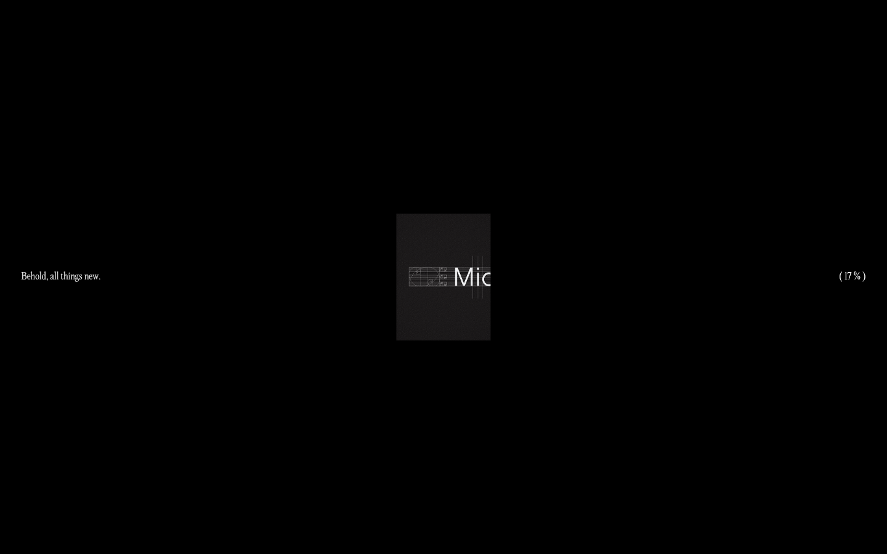
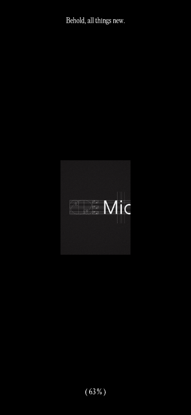

# UI Design System & Master Generation Blueprint: patmos-studio

> **Patmos · Wahr, Gut, Schön** (https://patmos.studio/) — A Gestalting™ practice at the intersection of business and art. Across strategy, organization, branding, design, marketing, product, arch...



---

## 1. Executive Visual Persona & Design Archetype

- **Brand Essence & Persona**: **Patmos · Wahr, Gut, Schön** (`https://patmos.studio/`). A Gestalting™ practice at the intersection of business and art. Across strategy, organization, branding, design, marketing, product, arch...
- **Capture Provenance**: Live browser capture (`tier2_webgl`, HTTP `200`, captured `2026-11-23`).
- **Visual Archetype**: **High-Contrast Obsidian / Atmospheric Design System (`#000000` canvas, `#e0e0e0` ink, `#ffffff` accent)**.
- **Anti-AI-Slop Differentiators**:
  - **Live-Computed Chromatic Polarity**: Anchors the viewport in `#000000` (live computed `body` `background-color` (`computed_styles.json`)) paired with `#e0e0e0` primary typography and `#ffffff` accents.
  - **Grounded Typographic Hierarchy**: Pairs `Patmos Serif` for display copy (`( Patmos ) Wahr, Gut, Schön`) with `Patmos Serif` and not declared in live computed styles (uses primary stack / `ui-monospace`).
  - **Calibrated Spatial Grid & Motion**: Combines `1371px` container bounds (`gap: var(--spacing-20-24)`, padding `var(--spacing-30-40)`) with `cubic-bezier(.55,.085,.68,.53)` easing and Lenis Smooth Scroll (`data-lenis`).

---

## 2. Spatial Architecture & Modular Grid Mathematics



### Viewport Allocation & Container Geometry
- **Captured Viewport Dimensions**: Desktop `1440×900px` (`assets/desktop.png`, single-viewport 100vh live capture (900px)), Mobile `390×844px` (`assets/mobile.png`, single-viewport 100vh live capture (844px)).
- **Master Container Bounds**: `1371px` (measured `<main>` bounding box width within `1440px` desktop viewport).
- **Canvas Lateral Padding & Spacing**: `var(--spacing-30-40)` lateral canvas padding with `var(--spacing-20-24)` grid gap.
- **Border Radius Scale**: `0px` (sharp unrounded corners).

### Responsive Breakpoint Architecture
- **Desktop Layout**: Multi-column CSS Grid / Flexbox layout at `1440px` (`max-width: 1371px`, `gap: var(--spacing-20-24)`).
- **Mobile Layout**: Single-column vertical stack at `390px` viewport width with `var(--spacing-30-40)` horizontal padding.
- **Extracted CSS Media Queries**: `@media (min-width:25em)`, `@media (min-width:37.5em)`, `@media (min-width:50em)`, `@media (min-width:62.5em)`.

---

## 3. Color System, Materiality & Atmospheric Lighting

### Semantic Palette & Source Grounding
| Semantic Role | Ground-Truth Value | Extracted Live / CSS Source |
|---|---|---|
| **Primary Canvas Substrate** | `#000000` | live computed `body` `background-color` (`computed_styles.json`) |
| **Primary Typography Ink** | `#e0e0e0` | live computed `h1` `color` (`computed_styles.json`) |
| **Elevated Surface / Card Substrate** | `#777777` | `#intro .line { background-color: #777777 }` |
| **Interactive Accent / Highlight** | `#ffffff` | `main.top .hero .dom-plane-conta... { color: #ffffff }` |
| **Secondary / Muted Copy** | `#8f8f8f` | `var(--color-fg-muted)` in `:root` |
| **Structural Hairline Border** | `#f2f2f2` | `var(--color-border)` in `:root` |

### Sanitized Root CSS Variables (`ui-ux.md` Ground Truth)
| Variable Name | Extracted Value | Semantic Role |
|---|---|---|
| `--spacing` | `.0625rem` | Layout / Spatial Grid Token |
| `--spacing-base` | `.9375rem` | Layout / Spatial Grid Token |
| `--spacing-10-11` | `clamp(.625rem,.6016rem + .0935vw,.6875rem)` | Layout / Spatial Grid Token |
| `--spacing-12-13` | `clamp(.75rem,.7266rem + .0935vw,.8125rem)` | Layout / Spatial Grid Token |
| `--spacing-14-16` | `clamp(.875rem,.8283rem + .1869vw,1rem)` | Layout / Spatial Grid Token |
| `--spacing-14-17` | `clamp(.875rem,.8049rem + .2831vw,1.0625rem)` | Layout / Spatial Grid Token |
| `--spacing-15-16` | `clamp(.9375rem,.9141rem + .0935vw,1rem)` | Layout / Spatial Grid Token |
| `--spacing-16-17` | `clamp(1rem,.9765rem + .0935vw,1.0625rem)` | Layout / Spatial Grid Token |
| `--spacing-16-18` | `clamp(1rem,.9533rem + .1869vw,1.125rem)` | Layout / Spatial Grid Token |
| `--spacing-16-19` | `clamp(1rem,.9299rem + .2804vw,1.1875rem)` | Layout / Spatial Grid Token |
| `--spacing-16-20` | `clamp(1rem,.374vw + .907rem,1.25rem)` | Layout / Spatial Grid Token |
| `--spacing-18-20` | `clamp(1.125rem,1.0783rem + .1869vw,1.25rem)` | Layout / Spatial Grid Token |
| `--spacing-20-24` | `clamp(1.25rem,1.1565rem + .3738vw,1.5rem)` | Layout / Spatial Grid Token |
| `--spacing-20-25` | `clamp(1.25rem,1.1332rem + .4673vw,1.5625rem)` | Layout / Spatial Grid Token |
| `--spacing-20-35` | `clamp(1.25rem,.8995rem + 1.4019vw,2.1875rem)` | Layout / Spatial Grid Token |
| `--spacing-25-32` | `clamp(1.5625rem,1.3989rem + .6542vw,2rem)` | Layout / Spatial Grid Token |

---

## 4. Typographic Scale & Editorial Hierarchy

### Font Family Stacks
- **Display Typography**: `Patmos Serif`.
- **Primary Body Stack**: `Patmos Serif`.
- **Technical / Metadata Stack**: not declared in live computed styles (uses primary stack / `ui-monospace`).

### Typographic Scale & Rules (Live Computed & Stylesheet Grounded)
- **Hero Display (`H1`)**: live computed `h1` (`font-size: 15px`, `line-height: 28.5px`, `font-weight: 400`); rule `h1` (`font-weight: 300`).
- **Section Heading (`H2`)**: rule `h2` (`line-height: 1.6`).
- **Body Copy**: live computed `body` (`font-size: 15px`, `line-height: 28.5px`, `font-weight: 400`).
- **Metadata & Navigation Labels**: live computed `nav/a` (`font-size: 15px`, `line-height: 28.5px`, `font-weight: 400`).

---

## 5. Choreographed Motion & Interaction Physics

### Primary Easing Curves
- **Extracted Timing Functions**: `cubic-bezier(.55,.085,.68,.53)`, `cubic-bezier(.165,.84,.44,1)`, `cubic-bezier(.455,.03,.515,.955)`.

### Per-Element Transition & Choreography Rules
- **Selector `.transition`**: `transition: var(--tw-ease,var(--default-transition-timing-function))` extracted from `patmos-studio` stylesheet.
- **Selector `.transition-\[gap\]`**: `transition: var(--tw-ease,var(--default-transition-timing-function))` extracted from `patmos-studio` stylesheet.
- **Selector `opacity\]`**: `transition: var(--tw-ease,var(--default-transition-timing-function))` extracted from `patmos-studio` stylesheet.
- **Extracted Easing Curve (`cubic-bezier(.55,.085,.68,.53)`)**: Governs interactive state transitions across `<nav.visible>` and `<main.row-span-full:nth(2)>`.
- **Runtime Interaction Engine**: Integrates Lenis Smooth Scroll (`data-lenis`) with `prefers-reduced-motion: reduce` fallback guards.

---

## 6. Component Wireframe & Structural DOM Map

### Visual Layout Schematic — Desktop (`1440px`, Grounded in `dom.html` & Landmark Bounding Boxes)
```
┌────────────────────────────────────────────────────────────────────────┐
│ DESKTOP VIEWPORT (1440px) — Patmos · Wahr, Gut, Schön                  │
│ ====================================================================== │
│ [ <nav.visible> (1440x900px)          | Home · Prologue · Episode ·  ] │
│ ---------------------------------------------------------------------- │
│ | HERO STAGE: <main.row-span-full> (w=1371px)                        | │
│ | H1: ( Patmos ) Wahr, Gut, Schön                                    | │
│ | Substrate: #000000 | Ink: #e0e0e0 | Accent: #ffffff                | │
│ ---------------------------------------------------------------------- │
│ | SHOWCASE GRID (<main.row-span-full:nth(2)) max-w: 1371px           | │
│ | +------------------------------+  +------------------------------+ | │
│ | | Behold, all things new.      |  | ( Das Wahre, Gute, Schöne )  | | │
│ | +------------------------------+  +------------------------------+ | │
│ ---------------------------------------------------------------------- │
│ | DETAIL MODULE (<main.row-span-full:nth(3)) — patmos-studio Archive | │
│ ---------------------------------------------------------------------- │
│ [ FOOTER (<footer.wf-garamond-) | https://patmos.studio/               │
└────────────────────────────────────────────────────────────────────────┘
```

### Visual Layout Schematic — Mobile Reflow (`390px`)
```
┌────────────────────────────────────────────────────────────────────────┐
│ MOBILE VIEWPORT REFLOW (390px) — Single-Column Stack (gap: var(--sp)   │
│ ====================================================================== │
│ [ HEADER BAR (<nav.visible>           ) | Compact Menu (390px)         │
│ ---------------------------------------------------------------------- │
│ | HERO STAGE (<main.row-span-full>) — 390px Vertical Lead            | │
│ | H1: ( Patmos ) Wahr, Gut, Schön                                    | │
│ ---------------------------------------------------------------------- │
│ | SHOWCASE STACK (<main.row-span-full:nt) — 1-Col Stack              | │
│ | [ Item 1: Behold, all things new.                                ] | │
│ | [ Item 2: ( Das Wahre, Gute, Schöne )                            ] | │
│ ---------------------------------------------------------------------- │
│ | DETAIL STACK (<main.row-span-full:nth() — 1-Col (patmos-studio Arch) │
│ ---------------------------------------------------------------------- │
│ [ FOOTER (<footer.wf-garamond-) | Stacked 390px Colophon               │
└────────────────────────────────────────────────────────────────────────┘
```

### Granular DOM Region Breakdown
1. **Brand Header & Navigation Bar (<nav.visible> — `patmos-studio`)**:
   - Landmark `<nav class="visible inset-0">` (`1440x900px`) hosting `Patmos · Wahr, Gut, Schön` navigation (`Home · Prologue · Episode · Scene · Epilogue`), DOM attributes (`data-typeface="serif"`, `data-path="/contact/"`, `data-path="/"`, `data-path="/prologue/"`), and stylesheet rule `backdrop { box-sizing:border-box;border:0 solid;margin:0;padding:0 }`.
2. **Hero Stage & Focal Lead (<main.row-span-full> — `( Patmos ) Wahr, Gut, Schön`)**:
   - Landmark `<main class="row-span-full">` presenting display lead `( Patmos ) Wahr, Gut, Schön` and copy excerpt *"Behold, all things new."* over `#000000` canvas and `#e0e0e0` ink.
3. **Primary Showcase & Content Grid (<main.row-span-full:nth(2)> — `Behold, all things new.`)**:
   - Landmark `<main class="row-span-full">` rendering section `Behold, all things new.` with copy *"( Das Wahre, Gute, Schöne )"*, asset references (`dlr2ezd.js`, `favicon.svg`, `apple-touch-icon.png`, `fonts.googleapis.com`), and grid rule `file-selector-button { box-sizing:border-box;border:0 solid;margin:0;padding:0 }`.
4. **Interactive Detail & Feature Matrix (<main.row-span-full:nth(3)> — `( Das Wahre, Gute, Schöne )`)**:
   - Landmark `<main class="row-span-full">` framing `( Das Wahre, Gute, Schöne )` and `patmos-studio Archive & Directory` (*"Behold, all things new."*) with `#777777` surface cards, `#ffffff` accents, and `strong { font-weight:bolder }`.
5. **Colophon & Global Directory Footer (<footer.wf-garamond-premier-pro-n7-active> — `https://patmos.studio/`)**:
   - Landmark `<footer class="wf-garamond-premier-pro-n7-active">` anchoring `Patmos · Wahr, Gut, Schön` footer links (`Home · Prologue · Episode · Scene · Epilogue`), copy *"( Das Wahre, Gute, Schöne )"*, and `#f2f2f2` structural dividers.

---

## 7. Master Zero-Shot AI Generation Prompt

```markdown
# Master Zero-Shot Frontend Generation Prompt: patmos-studio (Patmos · Wahr, Gut, Schön)

You are a principal frontend architect and design systems engineer. Build a complete, production-ready web application replicating the exact design system, DOM landmarks, typographic hierarchy, color tokens, and motion physics of `patmos-studio` (**Patmos · Wahr, Gut, Schön** — `https://patmos.studio/`).

### 1. Visual Archetype & Anti-AI-Slop Mandates
- **Archetype**: High-Contrast Obsidian / Atmospheric Design System (`#000000` canvas, `#e0e0e0` ink, `#ffffff` accent).
- **Identity & Domain Context**: A Gestalting™ practice at the intersection of business and art. Across strategy, organization, branding, design, marketing, product, arch...
- **Primary Substrate**: `#000000` (live computed `body` `background-color` (`computed_styles.json`)), **Primary Ink**: `#e0e0e0`, **Accent / Highlight**: `#ffffff`.
- **Site-Specific Differentiators**:
  - **Live-Computed Chromatic Polarity**: Anchors the viewport in `#000000` (live computed `body` `background-color` (`computed_styles.json`)) paired with `#e0e0e0` primary typography and `#ffffff` accents.
  - **Grounded Typographic Hierarchy**: Pairs `Patmos Serif` for display copy (`( Patmos ) Wahr, Gut, Schön`) with `Patmos Serif` and not declared in live computed styles (uses primary stack / `ui-monospace`).
  - **Calibrated Spatial Grid & Motion**: Combines `1371px` container bounds (`gap: var(--spacing-20-24)`, padding `var(--spacing-30-40)`) with `cubic-bezier(.55,.085,.68,.53)` easing and Lenis Smooth Scroll (`data-lenis`).

### 2. Ground-Truth CSS Variables (`:root` Token Contract)
Declare and consume these exact custom properties extracted from `patmos-studio` in your global stylesheet:

:root {
  /* Patmos · Wahr, Gut, Schön (patmos-studio) — Live-Grounded CSS Variables */
  --spacing: .0625rem; /* Layout / Spatial Grid Token (patmos-studio) */
  --spacing-base: .9375rem; /* Layout / Spatial Grid Token (patmos-studio) */
  --spacing-10-11: clamp(.625rem,.6016rem + .0935vw,.6875rem); /* Layout / Spatial Grid Token (patmos-studio) */
  --spacing-12-13: clamp(.75rem,.7266rem + .0935vw,.8125rem); /* Layout / Spatial Grid Token (patmos-studio) */
  --spacing-14-16: clamp(.875rem,.8283rem + .1869vw,1rem); /* Layout / Spatial Grid Token (patmos-studio) */
  --spacing-14-17: clamp(.875rem,.8049rem + .2831vw,1.0625rem); /* Layout / Spatial Grid Token (patmos-studio) */
  --spacing-15-16: clamp(.9375rem,.9141rem + .0935vw,1rem); /* Layout / Spatial Grid Token (patmos-studio) */
  --spacing-16-17: clamp(1rem,.9765rem + .0935vw,1.0625rem); /* Layout / Spatial Grid Token (patmos-studio) */
  --spacing-16-18: clamp(1rem,.9533rem + .1869vw,1.125rem); /* Layout / Spatial Grid Token (patmos-studio) */
  --spacing-16-19: clamp(1rem,.9299rem + .2804vw,1.1875rem); /* Layout / Spatial Grid Token (patmos-studio) */
  --spacing-16-20: clamp(1rem,.374vw + .907rem,1.25rem); /* Layout / Spatial Grid Token (patmos-studio) */
  --spacing-18-20: clamp(1.125rem,1.0783rem + .1869vw,1.25rem); /* Layout / Spatial Grid Token (patmos-studio) */
  --spacing-20-24: clamp(1.25rem,1.1565rem + .3738vw,1.5rem); /* Layout / Spatial Grid Token (patmos-studio) */
  --spacing-20-25: clamp(1.25rem,1.1332rem + .4673vw,1.5625rem); /* Layout / Spatial Grid Token (patmos-studio) */
  --spacing-20-35: clamp(1.25rem,.8995rem + 1.4019vw,2.1875rem); /* Layout / Spatial Grid Token (patmos-studio) */
  --spacing-25-32: clamp(1.5625rem,1.3989rem + .6542vw,2rem); /* Layout / Spatial Grid Token (patmos-studio) */
}

### 3. Semantic Color & Materiality Contract
Map every surface, ink, and border strictly to these source-grounded tokens:
- **Primary Canvas Substrate**: `#000000` — grounded in live computed `body` `background-color` (`computed_styles.json`)
- **Primary Typography Ink**: `#e0e0e0` — grounded in live computed `h1` `color` (`computed_styles.json`)
- **Elevated Surface / Card Substrate**: `#777777` — grounded in `#intro .line { background-color: #777777 }`
- **Interactive Accent / Highlight**: `#ffffff` — grounded in `main.top .hero .dom-plane-conta... { color: #ffffff }`
- **Secondary / Muted Copy**: `#8f8f8f` — grounded in `var(--color-fg-muted)` in `:root`
- **Structural Hairline Border**: `#f2f2f2` — grounded in `var(--color-border)` in `:root`

### 4. Spatial Grid, Container Bounds & Responsive Breakpoints
- **Desktop Viewport Reference**: `1440×900px` (single-viewport 100vh live capture (900px), `1440px` standard desktop width).
- **Mobile Viewport Reference**: `390×844px` (single-viewport 100vh live capture (844px), `390px` standard mobile width).
- **Container Max-Width**: `1371px` (measured `<main>` bounding box width within `1440px` desktop viewport)
- **Padding & Gutters**: `var(--spacing-30-40)` lateral canvas padding with `var(--spacing-20-24)` grid gap
- **Desktop Grid**: Multi-column CSS Grid / Flexbox layout at `1440px` (`max-width: 1371px`, `gap: var(--spacing-20-24)`)
- **Mobile Adaptation**: Single-column vertical stack at `390px` viewport width with `var(--spacing-30-40)` horizontal padding
- **Media Queries**: `@media (min-width:25em)`, `@media (min-width:37.5em)`, `@media (min-width:50em)`, `@media (min-width:62.5em)`
- **Corner Radii**: `0px` (sharp unrounded corners)

### 5. Typography & Editorial Scale Contract
- **Display Font Stack**: `Patmos Serif`
- **Body Font Stack**: `Patmos Serif`
- **Monospace / Technical Font Stack**: not declared in live computed styles (uses primary stack / `ui-monospace`)
- **H1 Display Rule**: live computed `h1` (`font-size: 15px`, `line-height: 28.5px`, `font-weight: 400`); rule `h1` (`font-weight: 300`)
- **H2 Section Rule**: rule `h2` (`line-height: 1.6`)
- **Body Copy Rule**: live computed `body` (`font-size: 15px`, `line-height: 28.5px`, `font-weight: 400`)
- **Metadata & Index Rule**: live computed `nav/a` (`font-size: 15px`, `line-height: 28.5px`, `font-weight: 400`)

### 6. Component Hierarchy, Verbatim Copy & Real DOM Landmarks
Scaffold `patmos-studio` (`Patmos · Wahr, Gut, Schön`) with these exact structural regions, extracted copy, and CSS rules from `dom.html`:
1. **Brand Header & Navigation Bar (<nav.visible> — `patmos-studio`)**:
   - DOM & Selectors: Landmark `<nav class="visible inset-0">` (`1440x900px`) hosting `Patmos · Wahr, Gut, Schön` navigation (`Home · Prologue · Episode · Scene · Epilogue`), DOM attributes (`data-typeface="serif"`, `data-path="/contact/"`, `data-path="/"`, `data-path="/prologue/"`), and stylesheet rule `backdrop { box-sizing:border-box;border:0 solid;margin:0;padding:0 }`.
   - Responsive Contract: Header `Brand Header & Navigation Bar (<nav.visible> — `patmos-studio`)` (`patmos-studio`) adapts across `@media (min-width:25em)`, `@media (min-width:37.5em)`, `@media (min-width:50em)`, `@media (min-width:62.5em)` with `cubic-bezier(.55,.085,.68,.53)`, `cubic-bezier(.165,.84,.44,1)`, `cubic-bezier(.455,.03,.515,.955)` transitions and links `Home · Prologue · Episode · Scene · Epilogue`.
2. **Hero Stage & Focal Lead (<main.row-span-full> — `( Patmos ) Wahr, Gut, Schön`)**:
   - DOM & Selectors: Landmark `<main class="row-span-full">` presenting display lead `( Patmos ) Wahr, Gut, Schön` and copy excerpt *"Behold, all things new."* over `#000000` canvas and `#e0e0e0` ink.
   - Responsive Contract: Hero stage (`1440×900px` desktop / `390×844px` mobile) sets `#000000` background with `#e0e0e0` headline `( Patmos ) Wahr, Gut, Schön`.
3. **Primary Showcase & Content Grid (<main.row-span-full:nth(2)> — `Behold, all things new.`)**:
   - DOM & Selectors: Landmark `<main class="row-span-full">` rendering section `Behold, all things new.` with copy *"( Das Wahre, Gute, Schöne )"*, asset references (`dlr2ezd.js`, `favicon.svg`, `apple-touch-icon.png`, `fonts.googleapis.com`), and grid rule `file-selector-button { box-sizing:border-box;border:0 solid;margin:0;padding:0 }`.
   - Responsive Contract: Showcase grid `Primary Showcase & Content Grid (<main.row-span-full:nth(2)> — `Behold, all things new.`)` applies Multi-column CSS Grid / Flexbox layout at `1440px` (`max-width: 1371px`, `gap: var(--spacing-20-24)`) on desktop and Single-column vertical stack at `390px` viewport width with `var(--spacing-30-40)` horizontal padding on mobile.
4. **Interactive Detail & Feature Matrix (<main.row-span-full:nth(3)> — `( Das Wahre, Gute, Schöne )`)**:
   - DOM & Selectors: Landmark `<main class="row-span-full">` framing `( Das Wahre, Gute, Schöne )` and `patmos-studio Archive & Directory` (*"Behold, all things new."*) with `#777777` surface cards, `#ffffff` accents, and `strong { font-weight:bolder }`.
   - Responsive Contract: Detail module `Interactive Detail & Feature Matrix (<main.row-span-full:nth(3)> — `( Das Wahre, Gute, Schöne )`)` uses `0px` (sharp unrounded corners) radii, `#ffffff` highlights, and assets (dlr2ezd.js, favicon.svg, apple-touch-icon.png).
5. **Colophon & Global Directory Footer (<footer.wf-garamond-premier-pro-n7-active> — `https://patmos.studio/`)**:
   - DOM & Selectors: Landmark `<footer class="wf-garamond-premier-pro-n7-active">` anchoring `Patmos · Wahr, Gut, Schön` footer links (`Home · Prologue · Episode · Scene · Epilogue`), copy *"( Das Wahre, Gute, Schöne )"*, and `#f2f2f2` structural dividers.
   - Responsive Contract: Footer `Colophon & Global Directory Footer (<footer.wf-garamond-premier-pro-n7-active> — `https://patmos.studio/`)` aligns to `1371px` (measured `<main>` bounding box width within `1440px` desktop viewport) with `var(--spacing-30-40)` lateral canvas padding with `var(--spacing-20-24)` grid gap and attributes (data-typeface="serif", data-path="/contact/", data-path="/").

#### Verbatim DOM Copy Excerpts (`dom.html`)
- Copy Excerpt 1: *"Behold, all things new."*
- Copy Excerpt 2: *"( Das Wahre, Gute, Schöne )"*

### 7. Motion, Extracted Stylesheet Rules & Interaction Choreography
- **Primary Easing Functions**: `cubic-bezier(.55,.085,.68,.53)`, `cubic-bezier(.165,.84,.44,1)`, `cubic-bezier(.455,.03,.515,.955)`
- **Extracted Stylesheet Rules (`patmos-studio`)**:
- `backdrop { box-sizing:border-box;border:0 solid;margin:0;padding:0 }`
- `file-selector-button { box-sizing:border-box;border:0 solid;margin:0;padding:0 }`
- `strong { font-weight:bolder }`
- `small { font-size:80% }`
- `sup { vertical-align:baseline;font-size:75%;line-height:0;position:relative }`
- **Per-Selector Transition Rules**:
- **Selector `.transition`**: `transition: var(--tw-ease,var(--default-transition-timing-function))` extracted from `patmos-studio` stylesheet.
- **Selector `.transition-\[gap\]`**: `transition: var(--tw-ease,var(--default-transition-timing-function))` extracted from `patmos-studio` stylesheet.
- **Selector `opacity\]`**: `transition: var(--tw-ease,var(--default-transition-timing-function))` extracted from `patmos-studio` stylesheet.
- **Extracted Easing Curve (`cubic-bezier(.55,.085,.68,.53)`)**: Governs interactive state transitions across `<nav.visible>` and `<main.row-span-full:nth(2)>`.
- **Runtime Interaction Engine**: Integrates Lenis Smooth Scroll (`data-lenis`) with `prefers-reduced-motion: reduce` fallback guards.

### 8. Technical Deliverables
- Implement in Next.js (App Router) with TypeScript and Tailwind CSS consuming the `:root` custom properties defined above for `patmos-studio`.
- Reproduce both the `1440px` desktop architecture and `390px` mobile breakpoint transitions, preserving semantic HTML5 landmarks (`<header>`, `<nav>`, `<main>`, `<section>`, `<footer>`) and `prefers-reduced-motion` accessibility guards.
```
