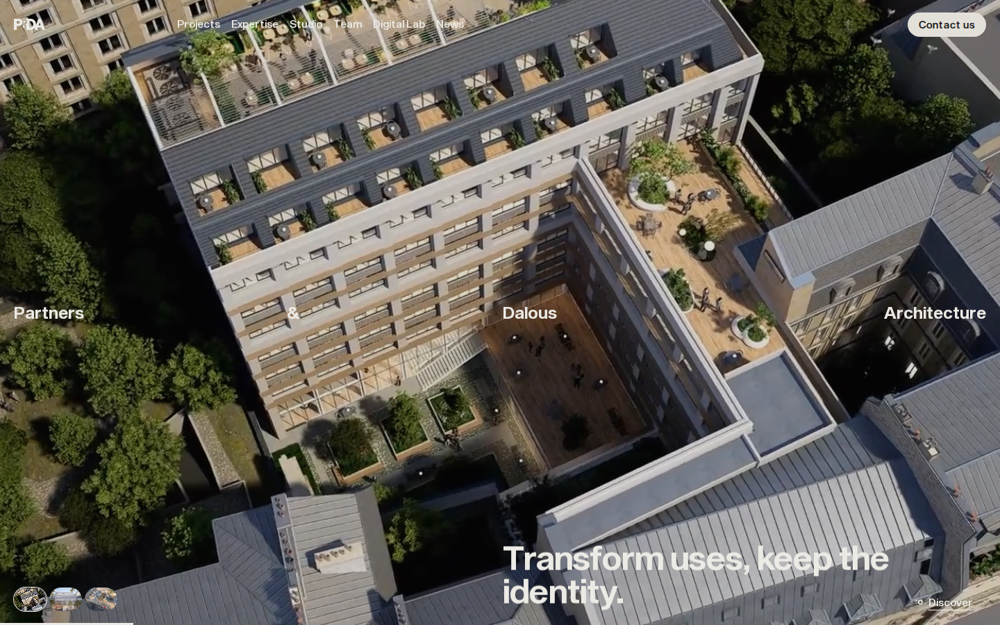
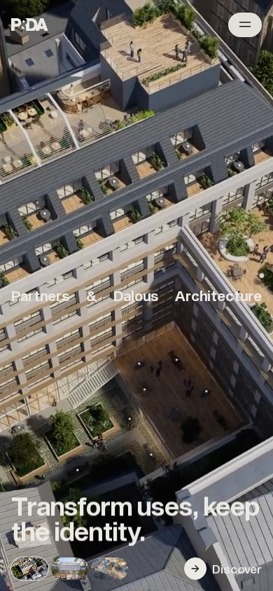

# UI Design System & Master Generation Blueprint: pda-archi_en

> **Architecture firm in Paris: renovation, refurbishment — PDA** (https://pda.archi/en) — PDA, Partners & Dalous Architecture, transforms office, hospitality and residential buildings in Paris: renovation, refurbishment, vertic...



---

## 1. Executive Visual Persona & Design Archetype

- **Brand Essence & Persona**: **Architecture firm in Paris: renovation, refurbishment — PDA** (`https://pda.archi/en`). PDA, Partners & Dalous Architecture, transforms office, hospitality and residential buildings in Paris: renovation, refurbishment, vertic...
- **Visual Archetype**: **Light-Substrate Editorial & Modular Grid System (`#fff` canvas, `#000` ink, `#30363c` accent)**.
- **Anti-AI-Slop Differentiators**:
  - **Source-Grounded Chromatic Polarity**: Anchors the viewport in `#fff` (`var(--cc-bg)` in `:root`) paired with `#000` primary typography and `#30363c` accents.
  - **Extracted Typographic Hierarchy**: Pairs `SequelSans` for display copy (`PDA, Partners & Dalous Architecture,`) with `Segoe UI` and `SFMono-Regular`.
  - **Calibrated Spatial Grid & Motion**: Combines `24rem` container bounds (`gap: var(--spacing-gutter)`, padding `1rem`) with `cubic-bezier(.23,1,.32,1)` easing and Lenis Smooth Scroll (`data-lenis`).

---

## 2. Spatial Architecture & Modular Grid Mathematics



### Viewport Allocation & Container Geometry
- **Captured Viewport Dimensions**: Desktop `1440×2400px` (`assets/desktop.png`, capped at 2400px multi-section capture), Mobile `390×2400px` (`assets/mobile.png`, capped at 2400px multi-section capture).
- **Master Container Bounds**: `24rem` extracted from `pda-archi_en` stylesheet.
- **Canvas Lateral Padding & Spacing**: `1rem` lateral canvas padding with `var(--spacing-gutter)` grid gap.
- **Border Radius Scale**: `.5rem`, `.4rem`, `1rem`, `var(--cc-modal-border-radius)`.

### Responsive Breakpoint Architecture
- **Desktop Layout**: Multi-column CSS Grid / Flexbox layout at `1440px` (`max-width: 24rem`, `gap: var(--spacing-gutter)`).
- **Mobile Layout**: Single-column vertical stack at `390px` viewport width with `1rem` horizontal padding.
- **Extracted CSS Media Queries**: `@media screen and (min-width:640px)`, `@media (prefers-reduced-motion)`, `@media screen and (max-width:640px)`, `@media (min-width:40rem)`.

---

## 3. Color System, Materiality & Atmospheric Lighting

### Semantic Palette & Source Grounding
| Semantic Role | Ground-Truth Value | Extracted CSS Source / Selector |
|---|---|---|
| **Primary Canvas Substrate** | `#fff` | `var(--cc-bg)` in `:root` |
| **Primary Typography Ink** | `#2c2f31` | `var(--cc-primary-color)` in `:root` |
| **Elevated Surface / Card Substrate** | `#5e6266` | `var(--cc-secondary-color)` in `:root` |
| **Interactive Accent / Highlight** | `#30363c` | `var(--cc-btn-primary-bg)` in `:root` |
| **Secondary / Muted Copy** | `#000` | `var(--cc-btn-primary-hover-bg)` in `:root` |
| **Structural Hairline Border** | `#eaeff2` | `var(--cc-btn-secondary-bg)` in `:root` |

### Sanitized Root CSS Variables (`ui-ux.md` Ground Truth)
| Variable Name | Extracted Value | Semantic Role |
|---|---|---|
| `--cc-modal-border-radius` | `.5rem` | Elevation / Border Token |
| `--cc-btn-border-radius` | `.4rem` | Elevation / Border Token |
| `--cc-modal-transition-duration` | `.25s` | Motion / Easing Token |
| `--cc-link-color` | `var(--cc-btn-primary-bg)` | Typography Ink Token |
| `--cc-modal-margin` | `1rem` | Layout / Spatial Grid Token |
| `--cc-z-index` | `2147483647` | Elevation / Border Token |
| `--cc-bg` | `#fff` | Canvas / Surface Token |
| `--cc-primary-color` | `#2c2f31` | Brand / Palette Token |
| `--cc-secondary-color` | `#5e6266` | Brand / Palette Token |
| `--cc-btn-primary-bg` | `#30363c` | Canvas / Surface Token |
| `--cc-btn-primary-color` | `#fff` | Brand / Palette Token |
| `--cc-btn-primary-border-color` | `var(--cc-btn-primary-bg)` | Brand / Palette Token |
| `--cc-btn-primary-hover-bg` | `#000` | Canvas / Surface Token |
| `--cc-btn-primary-hover-color` | `#fff` | Brand / Palette Token |
| `--cc-btn-primary-hover-border-color` | `var(--cc-btn-primary-hover-bg)` | Brand / Palette Token |
| `--cc-btn-secondary-bg` | `#eaeff2` | Canvas / Surface Token |

---

## 4. Typographic Scale & Editorial Hierarchy

### Font Family Stacks
- **Display Typography**: `SequelSans`.
- **Primary Body Stack**: `Segoe UI`.
- **Technical / Metadata Stack**: `SFMono-Regular`.

### Typographic Scale & Rules (Extracted from Stylesheet & Variables)
- **Hero Display (`H1`)**: not explicitly declared on tag in static CSS (stylesheet font-size ladder: `16px`, `100%`, `1.05em`, `.9em`, `.82em`).
- **Section Heading (`H2`)**: rule `h2` (`font-size: var(--text-24)`, `line-height: var(--spacing-full)`, `font-weight: var(--font-we...`).
- **Body Copy**: CSS variables `--font-body: "SequelSans",sans-serif`; rule `p` (`font-size: var(--text-17)`, `line-height: 110%`, `font-weight: var(--font-we...`).
- **Metadata & Navigation Labels**: CSS variables `--text-xs: .75rem`, `--text-xs--line-height: 1.33333`, `--text-sm: .875rem`.

---

## 5. Choreographed Motion & Interaction Physics

### Primary Easing Curves
- **Extracted Timing Functions**: `cubic-bezier(.23,1,.32,1)`, `cubic-bezier(.4,0,.2,1)`, `cubic-bezier(.25,.46,.45,.9)`.

### Per-Element Transition & Choreography Rules
- **Selector `:root`**: `transition: .25s` extracted from `pda-archi_en` stylesheet.
- **Selector `#cc-main a`**: `transition: background-size .25s,color .25s ease` extracted from `pda-archi_en` stylesheet.
- **Selector `media(prefers-reduced-motion)`**: `transition: 0s` extracted from `pda-archi_en` stylesheet.
- **Extracted Easing Curve (`cubic-bezier(.23,1,.32,1)`)**: Governs interactive state transitions across `<header.header>` and `<section.relative>`.
- **Runtime Interaction Engine**: Integrates Lenis Smooth Scroll (`data-lenis`) with `prefers-reduced-motion: reduce` fallback guards.

---

## 6. Component Wireframe & Structural DOM Map

### Visual Layout Schematic (Grounded in `dom.html` — `1440px` Desktop & `390px` Mobile Reflow)
```
┌────────────────────────────────────────────────────────────────────────┐
│ DESKTOP VIEWPORT (1440px) — Architecture firm in Paris: renovation, re │
│ ====================================================================== │
│ [ <header.header>          | Projects · Expertise · Studio · Team · ]  │
│ ---------------------------------------------------------------------- │
│ | HERO STAGE: <section.relative>                                   |   │
│ | H1: PDA, Partners & Dalous Architecture, an architect...         |   │
│ | Substrate: #fff       | Ink: #000       | Accent: #30363c        |   │
│ ---------------------------------------------------------------------- │
│ | SHOWCASE GRID (<section.relative>        ) max-w: 24rem          |   │
│ | +------------------------------+  +------------------------------+ | │
│ | | 49 Champs-Élysées            |  | 68 Faubourg Saint-Honoré     | | │
│ | +------------------------------+  +------------------------------+ | │
│ ---------------------------------------------------------------------- │
│ | MOBILE VIEWPORT REFLOW (390px) — Single-Column Stack (gap: var(--) | │
│ | [<header.header>] -> [<section.relative>] -> [<section.relative>] |  │
│ ---------------------------------------------------------------------- │
│ [ FOOTER (<footer.footer>       ) | https://pda.archi/en               │
└────────────────────────────────────────────────────────────────────────┘
```

### Granular DOM Region Breakdown
1. **Brand Header & Navigation Bar (<header.header> — `pda-archi_en`)**:
   - Landmark `<header class="header fixed">` hosting `Architecture firm in Paris: renovati` navigation (`Projects · Expertise · Studio · Team · Digital Lab`), DOM attributes (`data-dark`, `data-block="aboutBlock"`, `data-src="https://pub-4eb76b4c2..."`, `data-block="featuredProjectsBlock"`), and stylesheet rule `cc-main span { all:unset;box-sizing:border-box }`.
2. **Hero Stage & Focal Lead (<section.relative> — `PDA, Partners & Dalous Architectur`)**:
   - Landmark `<section class="relative w-full">` presenting display lead `PDA, Partners & Dalous Architecture, an architect...` and copy excerpt *"Refurbish rather than"* over `#fff` canvas and `#000` ink.
3. **Primary Showcase & Content Grid (<section.relative> — `49 Champs-Élysées`)**:
   - Landmark `<section class="relative grid-w">` rendering section `49 Champs-Élysées` with copy *"Transform uses, keep the"*, asset references (`DmkCsKWL.js`, `DlrsJN3k.js`, `BEzBqhAX.js`, `C3NQ9IW_.js`), and grid rule `cc-main button { all:initial;box-sizing:border-box;color:unset;visibility:unset }`.
4. **Interactive Detail & Feature Matrix (<section.relative> — `68 Faubourg Saint-Honoré`)**:
   - Landmark `<section class="relative mt-68">` framing `68 Faubourg Saint-Honoré` and `118 Champs-Élysées` (*"Build where the city is"*) with `#5e6266` surface cards, `#30363c` accents, and `cc-main tr { all:revert;color:inherit;font-family:inherit;font-size:inherit;font-weig... }`.
5. **Colophon & Global Directory Footer (<footer.footer> — `https://pda.archi/en`)**:
   - Landmark `<footer class="footer bg-black">` anchoring `Architecture firm in Paris: reno` footer links (`Projects · Expertise · Studio · Team · Digital Lab`), copy *"5 avenue de l'Opéra 75001 Paris"*, and `#eaeff2` structural dividers.

---

## 7. Master Zero-Shot AI Generation Prompt

```markdown
# Master Zero-Shot Frontend Generation Prompt: pda-archi_en (Architecture firm in Paris: renovation, refurbishment — PDA)

You are a principal frontend architect and design systems engineer. Build a complete, production-ready web application replicating the exact design system, DOM landmarks, typographic hierarchy, color tokens, and motion physics of `pda-archi_en` (**Architecture firm in Paris: renovation, refurbishment — PDA** — `https://pda.archi/en`).

### 1. Visual Archetype & Anti-AI-Slop Mandates
- **Archetype**: Light-Substrate Editorial & Modular Grid System (`#fff` canvas, `#000` ink, `#30363c` accent).
- **Identity & Domain Context**: PDA, Partners & Dalous Architecture, transforms office, hospitality and residential buildings in Paris: renovation, refurbishment, vertic...
- **Primary Substrate**: `#fff` (`var(--cc-bg)` in `:root`), **Primary Ink**: `#000`, **Accent / Highlight**: `#30363c`.
- **Site-Specific Differentiators**:
  - **Source-Grounded Chromatic Polarity**: Anchors the viewport in `#fff` (`var(--cc-bg)` in `:root`) paired with `#000` primary typography and `#30363c` accents.
  - **Extracted Typographic Hierarchy**: Pairs `SequelSans` for display copy (`PDA, Partners & Dalous Architecture,`) with `Segoe UI` and `SFMono-Regular`.
  - **Calibrated Spatial Grid & Motion**: Combines `24rem` container bounds (`gap: var(--spacing-gutter)`, padding `1rem`) with `cubic-bezier(.23,1,.32,1)` easing and Lenis Smooth Scroll (`data-lenis`).

### 2. Ground-Truth CSS Variables (`:root` Token Contract)
Declare and consume these exact custom properties extracted from `pda-archi_en` in your global stylesheet:

:root {
  /* Architecture firm in Paris: renovation, refurbishment — PDA (pda-archi_en) — Ground-Truth Extracted CSS Variables */
  --cc-modal-border-radius: .5rem; /* Elevation / Border Token (pda-archi_en) */
  --cc-btn-border-radius: .4rem; /* Elevation / Border Token (pda-archi_en) */
  --cc-modal-transition-duration: .25s; /* Motion / Easing Token (pda-archi_en) */
  --cc-link-color: var(--cc-btn-primary-bg); /* Typography Ink Token (pda-archi_en) */
  --cc-modal-margin: 1rem; /* Layout / Spatial Grid Token (pda-archi_en) */
  --cc-z-index: 2147483647; /* Elevation / Border Token (pda-archi_en) */
  --cc-bg: #fff; /* Canvas / Surface Token (pda-archi_en) */
  --cc-primary-color: #2c2f31; /* Brand / Palette Token (pda-archi_en) */
  --cc-secondary-color: #5e6266; /* Brand / Palette Token (pda-archi_en) */
  --cc-btn-primary-bg: #30363c; /* Canvas / Surface Token (pda-archi_en) */
  --cc-btn-primary-color: #fff; /* Brand / Palette Token (pda-archi_en) */
  --cc-btn-primary-border-color: var(--cc-btn-primary-bg); /* Brand / Palette Token (pda-archi_en) */
  --cc-btn-primary-hover-bg: #000; /* Canvas / Surface Token (pda-archi_en) */
  --cc-btn-primary-hover-color: #fff; /* Brand / Palette Token (pda-archi_en) */
  --cc-btn-primary-hover-border-color: var(--cc-btn-primary-hover-bg); /* Brand / Palette Token (pda-archi_en) */
  --cc-btn-secondary-bg: #eaeff2; /* Canvas / Surface Token (pda-archi_en) */
}

### 3. Semantic Color & Materiality Contract
Map every surface, ink, and border strictly to these source-grounded tokens:
- **Primary Canvas Substrate**: `#fff` — grounded in `var(--cc-bg)` in `:root`
- **Primary Typography Ink**: `#2c2f31` — grounded in `var(--cc-primary-color)` in `:root`
- **Elevated Surface / Card Substrate**: `#5e6266` — grounded in `var(--cc-secondary-color)` in `:root`
- **Interactive Accent / Highlight**: `#30363c` — grounded in `var(--cc-btn-primary-bg)` in `:root`
- **Secondary / Muted Copy**: `#000` — grounded in `var(--cc-btn-primary-hover-bg)` in `:root`
- **Structural Hairline Border**: `#eaeff2` — grounded in `var(--cc-btn-secondary-bg)` in `:root`

### 4. Spatial Grid, Container Bounds & Responsive Breakpoints
- **Desktop Viewport Reference**: `1440×2400px` (capped at 2400px multi-section capture, `1440px` standard desktop width).
- **Mobile Viewport Reference**: `390×2400px` (capped at 2400px multi-section capture, `390px` standard mobile width).
- **Container Max-Width**: `24rem` extracted from `pda-archi_en` stylesheet
- **Padding & Gutters**: `1rem` lateral canvas padding with `var(--spacing-gutter)` grid gap
- **Desktop Grid**: Multi-column CSS Grid / Flexbox layout at `1440px` (`max-width: 24rem`, `gap: var(--spacing-gutter)`)
- **Mobile Adaptation**: Single-column vertical stack at `390px` viewport width with `1rem` horizontal padding
- **Media Queries**: `@media screen and (min-width:640px)`, `@media (prefers-reduced-motion)`, `@media screen and (max-width:640px)`, `@media (min-width:40rem)`
- **Corner Radii**: `.5rem`, `.4rem`, `1rem`, `var(--cc-modal-border-radius)`

### 5. Typography & Editorial Scale Contract
- **Display Font Stack**: `SequelSans`
- **Body Font Stack**: `Segoe UI`
- **Monospace / Technical Font Stack**: `SFMono-Regular`
- **H1 Display Rule**: not explicitly declared on tag in static CSS (stylesheet font-size ladder: `16px`, `100%`, `1.05em`, `.9em`, `.82em`)
- **H2 Section Rule**: rule `h2` (`font-size: var(--text-24)`, `line-height: var(--spacing-full)`, `font-weight: var(--font-we...`)
- **Body Copy Rule**: CSS variables `--font-body: "SequelSans",sans-serif`; rule `p` (`font-size: var(--text-17)`, `line-height: 110%`, `font-weight: var(--font-we...`)
- **Metadata & Index Rule**: CSS variables `--text-xs: .75rem`, `--text-xs--line-height: 1.33333`, `--text-sm: .875rem`

### 6. Component Hierarchy, Verbatim Copy & Real DOM Landmarks
Scaffold `pda-archi_en` (`Architecture firm in Paris: renovation, refurbishment — PDA`) with these exact structural regions, extracted copy, and CSS rules from `dom.html`:
1. **Brand Header & Navigation Bar (<header.header> — `pda-archi_en`)**:
   - DOM & Selectors: Landmark `<header class="header fixed">` hosting `Architecture firm in Paris: renovati` navigation (`Projects · Expertise · Studio · Team · Digital Lab`), DOM attributes (`data-dark`, `data-block="aboutBlock"`, `data-src="https://pub-4eb76b4c2..."`, `data-block="featuredProjectsBlock"`), and stylesheet rule `cc-main span { all:unset;box-sizing:border-box }`.
   - Responsive Contract: Header `Brand Header & Navigation Bar (<header.header> — `pda-archi_en`)` (`pda-archi_en`) adapts across `@media screen and (min-width:640px)`, `@media (prefers-reduced-motion)`, `@media screen and (max-width:640px)`, `@media (min-width:40rem)` with `cubic-bezier(.23,1,.32,1)`, `cubic-bezier(.4,0,.2,1)`, `cubic-bezier(.25,.46,.45,.9)` transitions and links `Projects · Expertise · Studio · Team · Digital Lab`.
2. **Hero Stage & Focal Lead (<section.relative> — `PDA, Partners & Dalous Architectur`)**:
   - DOM & Selectors: Landmark `<section class="relative w-full">` presenting display lead `PDA, Partners & Dalous Architecture, an architect...` and copy excerpt *"Refurbish rather than"* over `#fff` canvas and `#000` ink.
   - Responsive Contract: Hero stage (`1440×2400px` desktop / `390×2400px` mobile) sets `#fff` background with `#000` headline `PDA, Partners & Dalous Architecture, an architect...`.
3. **Primary Showcase & Content Grid (<section.relative> — `49 Champs-Élysées`)**:
   - DOM & Selectors: Landmark `<section class="relative grid-w">` rendering section `49 Champs-Élysées` with copy *"Transform uses, keep the"*, asset references (`DmkCsKWL.js`, `DlrsJN3k.js`, `BEzBqhAX.js`, `C3NQ9IW_.js`), and grid rule `cc-main button { all:initial;box-sizing:border-box;color:unset;visibility:unset }`.
   - Responsive Contract: Showcase grid `Primary Showcase & Content Grid (<section.relative> — `49 Champs-Élysées`)` applies Multi-column CSS Grid / Flexbox layout at `1440px` (`max-width: 24rem`, `gap: var(--spacing-gutter)`) on desktop and Single-column vertical stack at `390px` viewport width with `1rem` horizontal padding on mobile.
4. **Interactive Detail & Feature Matrix (<section.relative> — `68 Faubourg Saint-Honoré`)**:
   - DOM & Selectors: Landmark `<section class="relative mt-68">` framing `68 Faubourg Saint-Honoré` and `118 Champs-Élysées` (*"Build where the city is"*) with `#5e6266` surface cards, `#30363c` accents, and `cc-main tr { all:revert;color:inherit;font-family:inherit;font-size:inherit;font-weig... }`.
   - Responsive Contract: Detail module `Interactive Detail & Feature Matrix (<section.relative> — `68 Faubourg Saint-Honoré`)` uses `.5rem`, `.4rem`, `1rem`, `var(--cc-modal-border-radius)` radii, `#30363c` highlights, and assets (DmkCsKWL.js, DlrsJN3k.js, BEzBqhAX.js).
5. **Colophon & Global Directory Footer (<footer.footer> — `https://pda.archi/en`)**:
   - DOM & Selectors: Landmark `<footer class="footer bg-black">` anchoring `Architecture firm in Paris: reno` footer links (`Projects · Expertise · Studio · Team · Digital Lab`), copy *"5 avenue de l'Opéra 75001 Paris"*, and `#eaeff2` structural dividers.
   - Responsive Contract: Footer `Colophon & Global Directory Footer (<footer.footer> — `https://pda.archi/en`)` aligns to `24rem` extracted from `pda-archi_en` stylesheet with `1rem` lateral canvas padding with `var(--spacing-gutter)` grid gap and attributes (data-dark, data-block="aboutBlock", data-src="https://pub-4eb76b4c2...").

#### Verbatim DOM Copy Excerpts (`dom.html`)
- Copy Excerpt 1: *"Refurbish rather than"*
- Copy Excerpt 2: *"Transform uses, keep the"*
- Copy Excerpt 3: *"Build where the city is"*
- Copy Excerpt 4: *"5 avenue de l'Opéra 75001 Paris"*

### 7. Motion, Extracted Stylesheet Rules & Interaction Choreography
- **Primary Easing Functions**: `cubic-bezier(.23,1,.32,1)`, `cubic-bezier(.4,0,.2,1)`, `cubic-bezier(.25,.46,.45,.9)`
- **Extracted Stylesheet Rules (`pda-archi_en`)**:
- `cc-main span { all:unset;box-sizing:border-box }`
- `cc-main button { all:initial;box-sizing:border-box;color:unset;visibility:unset }`
- `cc-main tr { all:revert;color:inherit;font-family:inherit;font-size:inherit;font-weig... }`
- `cc-main.cc--rtl { direction:rtl }`
- `cc-main strong { font-weight:600 }`
- **Per-Selector Transition Rules**:
- **Selector `:root`**: `transition: .25s` extracted from `pda-archi_en` stylesheet.
- **Selector `#cc-main a`**: `transition: background-size .25s,color .25s ease` extracted from `pda-archi_en` stylesheet.
- **Selector `media(prefers-reduced-motion)`**: `transition: 0s` extracted from `pda-archi_en` stylesheet.
- **Extracted Easing Curve (`cubic-bezier(.23,1,.32,1)`)**: Governs interactive state transitions across `<header.header>` and `<section.relative>`.
- **Runtime Interaction Engine**: Integrates Lenis Smooth Scroll (`data-lenis`) with `prefers-reduced-motion: reduce` fallback guards.

### 8. Technical Deliverables
- Implement in Next.js (App Router) with TypeScript and Tailwind CSS consuming the `:root` custom properties defined above for `pda-archi_en`.
- Reproduce both the `1440px` desktop architecture and `390px` mobile breakpoint transitions, preserving semantic HTML5 landmarks (`<header>`, `<nav>`, `<main>`, `<section>`, `<footer>`) and `prefers-reduced-motion` accessibility guards.
```
