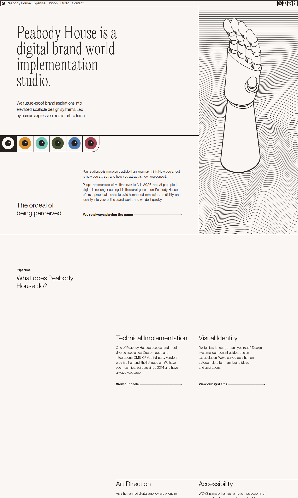
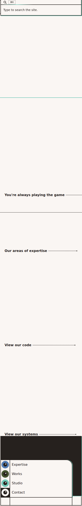

# UI Design System & Master Generation Blueprint: peabodyhouse-com

> **Peabody House • Digital Brand World Implementation Studio** (https://peabodyhouse.com) — Peabody House is a Milwaukee-based digital studio that turns brand aspirations into elevated, scalable design systems. Led by human expre...



---

## 1. Executive Visual Persona & Design Archetype

- **Brand Essence & Persona**: **Peabody House • Digital Brand World Implementation Studio** (`https://peabodyhouse.com`). Peabody House is a Milwaukee-based digital studio that turns brand aspirations into elevated, scalable design systems. Led by human expre...
- **Visual Archetype**: **Dark-Substrate WebGL / Canvas Interactive Experience (`#26211E` / `#517BB3`)**.
- **Anti-AI-Slop Differentiators**:
  - **Source-Grounded Chromatic Polarity**: Anchors the viewport in `#26211E` (`var(--color-primary)` in `:root`) paired with `#FAF6F3` primary typography and `#517BB3` accents.
  - **Extracted Typographic Hierarchy**: Pairs `Peabody House` for display copy (`Peabody House is a digital brand wor`) with `DSEG7 Classic` and not declared in static CSS (uses primary stack / `ui-monospace`).
  - **Calibrated Spatial Grid & Motion**: Combines `28rem` container bounds (`gap: .5rem`, padding `.25rem`) with `cubic-bezier(.45,0,.55,1)` easing and Lenis Smooth Scroll (`data-lenis`), HTML5 `<canvas>` Interactive Viewport Surface.

---

## 2. Spatial Architecture & Modular Grid Mathematics



### Viewport Allocation & Container Geometry
- **Captured Viewport Dimensions**: Desktop `1440×6542px` (`assets/desktop.png`, full-page scroll capture), Mobile `390×2400px` (`assets/mobile.png`, capped at 2400px multi-section capture).
- **Master Container Bounds**: `28rem` extracted from `peabodyhouse-com` stylesheet.
- **Canvas Lateral Padding & Spacing**: `.25rem` lateral canvas padding with `.5rem` grid gap.
- **Border Radius Scale**: `1px`, `50%`, `99px`.

### Responsive Breakpoint Architecture
- **Desktop Layout**: Multi-column CSS Grid / Flexbox layout at `1440px` (`max-width: 28rem`, `gap: .5rem`).
- **Mobile Layout**: Single-column vertical stack at `390px` viewport width with `.25rem` horizontal padding.
- **Extracted CSS Media Queries**: `@media (min-width: 48rem)`, `@media (prefers-reduced-motion: reduce)`, `@media (min-width: 64rem)`, `@media (max-width: 63.99rem)`.

---

## 3. Color System, Materiality & Atmospheric Lighting

### Semantic Palette & Source Grounding
| Semantic Role | Ground-Truth Value | Extracted CSS Source / Selector |
|---|---|---|
| **Primary Canvas Substrate** | `#26211E` | `var(--color-primary)` in `:root` |
| **Primary Typography Ink** | `#FAF6F3` | `var(--color-secondary)` in `:root` |
| **Elevated Surface / Card Substrate** | `#DC942F` | `var(--color-accent)` in `:root` |
| **Interactive Accent / Highlight** | `#517BB3` | `var(--color-blue)` in `:root` |
| **Secondary / Muted Copy** | `#71C7B7` | `var(--color-teal)` in `:root` |
| **Structural Hairline Border** | `#A24250` | `var(--color-red)` in `:root` |
| **Variable Token (`--color-green`)** | `#455330` | `var(--color-green)` in `:root` |

### Sanitized Root CSS Variables (`ui-ux.md` Ground Truth)
| Variable Name | Extracted Value | Semantic Role |
|---|---|---|
| `--color-primary` | `#26211E` | Brand / Palette Token |
| `--color-secondary` | `#FAF6F3` | Brand / Palette Token |
| `--color-accent` | `#DC942F` | Brand / Palette Token |
| `--color-background` | `#FAF6F3` | Canvas / Surface Token |
| `--color-text` | `#26211E` | Typography Ink Token |
| `--color-white` | `#FAF6F3` | Canvas / Surface Token |
| `--color-black` | `#26211E` | Canvas / Surface Token |
| `--color-black-20` | `rgba(38, 33, 30, .2)` | Canvas / Surface Token |
| `--color-orange` | `#DC942F` | Brand / Palette Token |
| `--color-blue` | `#517BB3` | Brand / Palette Token |
| `--color-teal` | `#71C7B7` | Brand / Palette Token |
| `--color-red` | `#A24250` | Brand / Palette Token |
| `--color-green` | `#455330` | Brand / Palette Token |
| `--font-heading` | `"Peabody House", sans-serif` | Typography Ink Token |
| `--font-body` | `"PP Neue Montreal", sans-serif` | Typography / Scale Token |
| `--font-size-base` | `16px` | Typography / Scale Token |

---

## 4. Typographic Scale & Editorial Hierarchy

### Font Family Stacks
- **Display Typography**: `Peabody House`.
- **Primary Body Stack**: `DSEG7 Classic`.
- **Technical / Metadata Stack**: not declared in static CSS (uses primary stack / `ui-monospace`).

### Typographic Scale & Rules (Extracted from Stylesheet & Variables)
- **Hero Display (`H1`)**: not explicitly declared on tag in static CSS (stylesheet font-size ladder: `1rem`, `.6875rem`, `.8125rem`, `.75rem`, `.875rem`).
- **Section Heading (`H2`)**: rule `,.h2` (`font-size: clamp(2.0257rem,1.4626rem + 2...`, `line-height: 1.125`).
- **Body Copy**: CSS variables `--font-body: "PP Neue Montreal", sans-serif`, `--font-size-base: 16px`.
- **Metadata & Navigation Labels**: not explicitly declared on tag in static CSS (stylesheet font-size ladder: `1rem`, `.6875rem`, `.8125rem`, `.75rem`, `.875rem`).

---

## 5. Choreographed Motion & Interaction Physics

### Primary Easing Curves
- **Extracted Timing Functions**: `cubic-bezier(.45,0,.55,1)`, `cubic-bezier(.65,.05,.36,1)`, `cubic-bezier(.22,1,.36,1)`.

### Per-Element Transition & Choreography Rules
- **Selector `.search-panel.svelte-1w6by2l`**: `transition: opacity .15s ease,transform .15s ease,visibility .15s ease` extracted from `peabodyhouse-com` stylesheet.
- **Selector `.search-panel.is-dragging.svelte-...`**: `transition: none` extracted from `peabodyhouse-com` stylesheet.
- **Selector `media (prefers-reduced-motion: re...`**: `transition: opacity .15s ease,visibility .15s ease` extracted from `peabodyhouse-com` stylesheet.
- **Extracted Easing Curve (`cubic-bezier(.45,0,.55,1)`)**: Governs interactive state transitions across `<header.svelte-126o6dr>` and `<section.subhero>`.
- **Runtime Interaction Engine**: Integrates Lenis Smooth Scroll (`data-lenis`), HTML5 `<canvas>` Interactive Viewport Surface with `prefers-reduced-motion: reduce` fallback guards.

---

## 6. Component Wireframe & Structural DOM Map

### Visual Layout Schematic (Grounded in `dom.html` — `1440px` Desktop & `390px` Mobile Reflow)
```
┌────────────────────────────────────────────────────────────────────────┐
│ DESKTOP VIEWPORT (1440px) — Peabody House • Digital Brand World Implem │
│ ====================================================================== │
│ [ <header.svelte-126o6dr>  | Expertise Expertise · Works Works · St ]  │
│ ---------------------------------------------------------------------- │
│ | HERO STAGE: <section.hero>                                       |   │
│ | H1: Peabody House is a digital brand world implementa...         |   │
│ | Substrate: #26211E    | Ink: #FAF6F3    | Accent: #517BB3        |   │
│ ---------------------------------------------------------------------- │
│ | SHOWCASE GRID (<section.subhero>         ) max-w: 28rem          |   │
│ | +------------------------------+  +------------------------------+ | │
│ | | The ordeal of being perceive |  | What does Peabody House do?  | | │
│ | +------------------------------+  +------------------------------+ | │
│ ---------------------------------------------------------------------- │
│ | MOBILE VIEWPORT REFLOW (390px) — Single-Column Stack (gap: .5rem ) | │
│ | [<header.svelte-126] -> [<section.hero>] -> [<section.subhero>] |    │
│ ---------------------------------------------------------------------- │
│ [ FOOTER (<footer.grid>         ) | https://peabodyhouse.com           │
└────────────────────────────────────────────────────────────────────────┘
```

### Granular DOM Region Breakdown
1. **Brand Header & Navigation Bar (<header.svelte-126o6dr> — `peabodyhouse-com`)**:
   - Landmark `<header class="svelte-126o6dr">` hosting `Peabody House • Digital Brand World ` navigation (`Expertise Expertise · Works Works · Studio Studio · Contact Contact · Expertise`), DOM attributes (`data-sveltekit-preload-data="hover"`, `data-text="Peabody House"`, `data-text="Expertise"`, `data-text="Works"`), and stylesheet rule `.search.svelte-1w6by2l { position:relative;display:inline-flex;align-items:center }`.
2. **Hero Stage & Focal Lead (<section.hero> — `Peabody House is a digital brand w`)**:
   - Landmark `<section class="hero svelte-x35jl1">` presenting display lead `Peabody House is a digital brand world implementa...` and copy excerpt *"Peabody House Peabody House"* over `#26211E` canvas and `#FAF6F3` ink.
3. **Primary Showcase & Content Grid (<section.subhero> — `The ordeal of being perceived.`)**:
   - Landmark `<section class="subhero svelte-x35jl1">` rendering section `The ordeal of being perceived.` with copy *"Expertise Expertise"*, asset references (`favicon.ico`, `favicon.svg`, `apple-touch-icon.png`, `site.webmanifest`), and grid rule `.search-panel.is-open.svelte-1w6by2l { opacity:1;visibility:visible;pointer-events:auto;transform:none }`.
4. **Interactive Detail & Feature Matrix (<section.grid> — `What does Peabody House do?`)**:
   - Landmark `<section class="grid service-cards">` framing `What does Peabody House do?` and `Technical Implementation` (*"Type to search the site."*) with `#DC942F` surface cards, `#517BB3` accents, and `arch-panel.is-positioned.svelte-1... { position:fixed;top:var(--panel-y);left:var(--panel-x);right:auto }`.
5. **Colophon & Global Directory Footer (<footer.grid> — `https://peabodyhouse.com`)**:
   - Landmark `<footer class="grid js-line-displacement">` anchoring `Peabody House • Digital Brand Wo` footer links (`Expertise Expertise · Works Works · Studio Studio · Contact Contact · Expertise`), copy *"hello@peabodyhouse.com copied to clipboard."*, and `#A24250` structural dividers.

---

## 7. Master Zero-Shot AI Generation Prompt

```markdown
# Master Zero-Shot Frontend Generation Prompt: peabodyhouse-com (Peabody House • Digital Brand World Implementation Studio)

You are a principal frontend architect and design systems engineer. Build a complete, production-ready web application replicating the exact design system, DOM landmarks, typographic hierarchy, color tokens, and motion physics of `peabodyhouse-com` (**Peabody House • Digital Brand World Implementation Studio** — `https://peabodyhouse.com`).

### 1. Visual Archetype & Anti-AI-Slop Mandates
- **Archetype**: Dark-Substrate WebGL / Canvas Interactive Experience (`#26211E` / `#517BB3`).
- **Identity & Domain Context**: Peabody House is a Milwaukee-based digital studio that turns brand aspirations into elevated, scalable design systems. Led by human expre...
- **Primary Substrate**: `#26211E` (`var(--color-primary)` in `:root`), **Primary Ink**: `#FAF6F3`, **Accent / Highlight**: `#517BB3`.
- **Site-Specific Differentiators**:
  - **Source-Grounded Chromatic Polarity**: Anchors the viewport in `#26211E` (`var(--color-primary)` in `:root`) paired with `#FAF6F3` primary typography and `#517BB3` accents.
  - **Extracted Typographic Hierarchy**: Pairs `Peabody House` for display copy (`Peabody House is a digital brand wor`) with `DSEG7 Classic` and not declared in static CSS (uses primary stack / `ui-monospace`).
  - **Calibrated Spatial Grid & Motion**: Combines `28rem` container bounds (`gap: .5rem`, padding `.25rem`) with `cubic-bezier(.45,0,.55,1)` easing and Lenis Smooth Scroll (`data-lenis`), HTML5 `<canvas>` Interactive Viewport Surface.

### 2. Ground-Truth CSS Variables (`:root` Token Contract)
Declare and consume these exact custom properties extracted from `peabodyhouse-com` in your global stylesheet:

:root {
  /* Peabody House • Digital Brand World Implementation Studio (peabodyhouse-com) — Ground-Truth Extracted CSS Variables */
  --color-primary: #26211E; /* Brand / Palette Token (peabodyhouse-com) */
  --color-secondary: #FAF6F3; /* Brand / Palette Token (peabodyhouse-com) */
  --color-accent: #DC942F; /* Brand / Palette Token (peabodyhouse-com) */
  --color-background: #FAF6F3; /* Canvas / Surface Token (peabodyhouse-com) */
  --color-text: #26211E; /* Typography Ink Token (peabodyhouse-com) */
  --color-white: #FAF6F3; /* Canvas / Surface Token (peabodyhouse-com) */
  --color-black: #26211E; /* Canvas / Surface Token (peabodyhouse-com) */
  --color-black-20: rgba(38, 33, 30, .2); /* Canvas / Surface Token (peabodyhouse-com) */
  --color-orange: #DC942F; /* Brand / Palette Token (peabodyhouse-com) */
  --color-blue: #517BB3; /* Brand / Palette Token (peabodyhouse-com) */
  --color-teal: #71C7B7; /* Brand / Palette Token (peabodyhouse-com) */
  --color-red: #A24250; /* Brand / Palette Token (peabodyhouse-com) */
  --color-green: #455330; /* Brand / Palette Token (peabodyhouse-com) */
  --font-heading: "Peabody House", sans-serif; /* Typography Ink Token (peabodyhouse-com) */
  --font-body: "PP Neue Montreal", sans-serif; /* Typography / Scale Token (peabodyhouse-com) */
  --font-size-base: 16px; /* Typography / Scale Token (peabodyhouse-com) */
}

### 3. Semantic Color & Materiality Contract
Map every surface, ink, and border strictly to these source-grounded tokens:
- **Primary Canvas Substrate**: `#26211E` — grounded in `var(--color-primary)` in `:root`
- **Primary Typography Ink**: `#FAF6F3` — grounded in `var(--color-secondary)` in `:root`
- **Elevated Surface / Card Substrate**: `#DC942F` — grounded in `var(--color-accent)` in `:root`
- **Interactive Accent / Highlight**: `#517BB3` — grounded in `var(--color-blue)` in `:root`
- **Secondary / Muted Copy**: `#71C7B7` — grounded in `var(--color-teal)` in `:root`
- **Structural Hairline Border**: `#A24250` — grounded in `var(--color-red)` in `:root`
- **Variable Token (`--color-green`)**: `#455330` — grounded in `var(--color-green)` in `:root`

### 4. Spatial Grid, Container Bounds & Responsive Breakpoints
- **Desktop Viewport Reference**: `1440×6542px` (full-page scroll capture, `1440px` standard desktop width).
- **Mobile Viewport Reference**: `390×2400px` (capped at 2400px multi-section capture, `390px` standard mobile width).
- **Container Max-Width**: `28rem` extracted from `peabodyhouse-com` stylesheet
- **Padding & Gutters**: `.25rem` lateral canvas padding with `.5rem` grid gap
- **Desktop Grid**: Multi-column CSS Grid / Flexbox layout at `1440px` (`max-width: 28rem`, `gap: .5rem`)
- **Mobile Adaptation**: Single-column vertical stack at `390px` viewport width with `.25rem` horizontal padding
- **Media Queries**: `@media (min-width: 48rem)`, `@media (prefers-reduced-motion: reduce)`, `@media (min-width: 64rem)`, `@media (max-width: 63.99rem)`
- **Corner Radii**: `1px`, `50%`, `99px`

### 5. Typography & Editorial Scale Contract
- **Display Font Stack**: `Peabody House`
- **Body Font Stack**: `DSEG7 Classic`
- **Monospace / Technical Font Stack**: not declared in static CSS (uses primary stack / `ui-monospace`)
- **H1 Display Rule**: not explicitly declared on tag in static CSS (stylesheet font-size ladder: `1rem`, `.6875rem`, `.8125rem`, `.75rem`, `.875rem`)
- **H2 Section Rule**: rule `,.h2` (`font-size: clamp(2.0257rem,1.4626rem + 2...`, `line-height: 1.125`)
- **Body Copy Rule**: CSS variables `--font-body: "PP Neue Montreal", sans-serif`, `--font-size-base: 16px`
- **Metadata & Index Rule**: not explicitly declared on tag in static CSS (stylesheet font-size ladder: `1rem`, `.6875rem`, `.8125rem`, `.75rem`, `.875rem`)

### 6. Component Hierarchy, Verbatim Copy & Real DOM Landmarks
Scaffold `peabodyhouse-com` (`Peabody House • Digital Brand World Implementation Studio`) with these exact structural regions, extracted copy, and CSS rules from `dom.html`:
1. **Brand Header & Navigation Bar (<header.svelte-126o6dr> — `peabodyhouse-com`)**:
   - DOM & Selectors: Landmark `<header class="svelte-126o6dr">` hosting `Peabody House • Digital Brand World ` navigation (`Expertise Expertise · Works Works · Studio Studio · Contact Contact · Expertise`), DOM attributes (`data-sveltekit-preload-data="hover"`, `data-text="Peabody House"`, `data-text="Expertise"`, `data-text="Works"`), and stylesheet rule `.search.svelte-1w6by2l { position:relative;display:inline-flex;align-items:center }`.
   - Responsive Contract: Header `Brand Header & Navigation Bar (<header.svelte-126o6dr> — `peabodyhouse-com`)` (`peabodyhouse-com`) adapts across `@media (min-width: 48rem)`, `@media (prefers-reduced-motion: reduce)`, `@media (min-width: 64rem)`, `@media (max-width: 63.99rem)` with `cubic-bezier(.45,0,.55,1)`, `cubic-bezier(.65,.05,.36,1)`, `cubic-bezier(.22,1,.36,1)` transitions and links `Expertise Expertise · Works Works · Studio Studio · Contact Contact · Expertise`.
2. **Hero Stage & Focal Lead (<section.hero> — `Peabody House is a digital brand w`)**:
   - DOM & Selectors: Landmark `<section class="hero svelte-x35jl1">` presenting display lead `Peabody House is a digital brand world implementa...` and copy excerpt *"Peabody House Peabody House"* over `#26211E` canvas and `#FAF6F3` ink.
   - Responsive Contract: Hero stage (`1440×6542px` desktop / `390×2400px` mobile) sets `#26211E` background with `#FAF6F3` headline `Peabody House is a digital brand world implementa...`.
3. **Primary Showcase & Content Grid (<section.subhero> — `The ordeal of being perceived.`)**:
   - DOM & Selectors: Landmark `<section class="subhero svelte-x35jl1">` rendering section `The ordeal of being perceived.` with copy *"Expertise Expertise"*, asset references (`favicon.ico`, `favicon.svg`, `apple-touch-icon.png`, `site.webmanifest`), and grid rule `.search-panel.is-open.svelte-1w6by2l { opacity:1;visibility:visible;pointer-events:auto;transform:none }`.
   - Responsive Contract: Showcase grid `Primary Showcase & Content Grid (<section.subhero> — `The ordeal of being perceived.`)` applies Multi-column CSS Grid / Flexbox layout at `1440px` (`max-width: 28rem`, `gap: .5rem`) on desktop and Single-column vertical stack at `390px` viewport width with `.25rem` horizontal padding on mobile.
4. **Interactive Detail & Feature Matrix (<section.grid> — `What does Peabody House do?`)**:
   - DOM & Selectors: Landmark `<section class="grid service-cards">` framing `What does Peabody House do?` and `Technical Implementation` (*"Type to search the site."*) with `#DC942F` surface cards, `#517BB3` accents, and `arch-panel.is-positioned.svelte-1... { position:fixed;top:var(--panel-y);left:var(--panel-x);right:auto }`.
   - Responsive Contract: Detail module `Interactive Detail & Feature Matrix (<section.grid> — `What does Peabody House do?`)` uses `1px`, `50%`, `99px` radii, `#517BB3` highlights, and assets (favicon.ico, favicon.svg, apple-touch-icon.png).
5. **Colophon & Global Directory Footer (<footer.grid> — `https://peabodyhouse.com`)**:
   - DOM & Selectors: Landmark `<footer class="grid js-line-displacement">` anchoring `Peabody House • Digital Brand Wo` footer links (`Expertise Expertise · Works Works · Studio Studio · Contact Contact · Expertise`), copy *"hello@peabodyhouse.com copied to clipboard."*, and `#A24250` structural dividers.
   - Responsive Contract: Footer `Colophon & Global Directory Footer (<footer.grid> — `https://peabodyhouse.com`)` aligns to `28rem` extracted from `peabodyhouse-com` stylesheet with `.25rem` lateral canvas padding with `.5rem` grid gap and attributes (data-sveltekit-preload-data="hover", data-text="Peabody House", data-text="Expertise").

#### Verbatim DOM Copy Excerpts (`dom.html`)
- Copy Excerpt 1: *"Peabody House Peabody House"*
- Copy Excerpt 2: *"Expertise Expertise"*
- Copy Excerpt 3: *"Type to search the site."*
- Copy Excerpt 4: *"hello@peabodyhouse.com copied to clipboard."*

### 7. Motion, Extracted Stylesheet Rules & Interaction Choreography
- **Primary Easing Functions**: `cubic-bezier(.45,0,.55,1)`, `cubic-bezier(.65,.05,.36,1)`, `cubic-bezier(.22,1,.36,1)`
- **Extracted Stylesheet Rules (`peabodyhouse-com`)**:
- `.search.svelte-1w6by2l { position:relative;display:inline-flex;align-items:center }`
- `.search-panel.is-open.svelte-1w6by2l { opacity:1;visibility:visible;pointer-events:auto;transform:none }`
- `arch-panel.is-positioned.svelte-1... { position:fixed;top:var(--panel-y);left:var(--panel-x);right:auto }`
- `search-panel.is-dragging.svelte-1... { transition:none;-webkit-user-select:none;user-select:none;cursor:grabbing }`
- `.search-field__icon.svelte-1w6by2l { flex:0 0 auto;color:var(--color-black);opacity:.55 }`
- **Per-Selector Transition Rules**:
- **Selector `.search-panel.svelte-1w6by2l`**: `transition: opacity .15s ease,transform .15s ease,visibility .15s ease` extracted from `peabodyhouse-com` stylesheet.
- **Selector `.search-panel.is-dragging.svelte-...`**: `transition: none` extracted from `peabodyhouse-com` stylesheet.
- **Selector `media (prefers-reduced-motion: re...`**: `transition: opacity .15s ease,visibility .15s ease` extracted from `peabodyhouse-com` stylesheet.
- **Extracted Easing Curve (`cubic-bezier(.45,0,.55,1)`)**: Governs interactive state transitions across `<header.svelte-126o6dr>` and `<section.subhero>`.
- **Runtime Interaction Engine**: Integrates Lenis Smooth Scroll (`data-lenis`), HTML5 `<canvas>` Interactive Viewport Surface with `prefers-reduced-motion: reduce` fallback guards.

### 8. Technical Deliverables
- Implement in Next.js (App Router) with TypeScript and Tailwind CSS consuming the `:root` custom properties defined above for `peabodyhouse-com`.
- Reproduce both the `1440px` desktop architecture and `390px` mobile breakpoint transitions, preserving semantic HTML5 landmarks (`<header>`, `<nav>`, `<main>`, `<section>`, `<footer>`) and `prefers-reduced-motion` accessibility guards.
```
