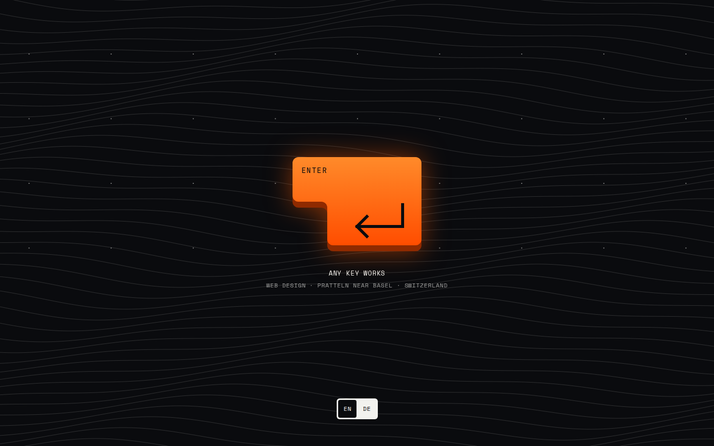

# UI Design System & Master Generation Blueprint: peaches-world

> **Peaches – Webdesign Pratteln, Basel · Websites worth pressing Enter for** (https://peaches.world/) — Peaches is a web design studio in Pratteln near Basel, Switzerland. Custom-designed, animated websites that feel like a game and stay in...



---

## 1. Executive Visual Persona & Design Archetype

- **Brand Essence & Persona**: **Peaches – Webdesign Pratteln, Basel · Websites worth pressing Enter for** (`https://peaches.world/`). Peaches is a web design studio in Pratteln near Basel, Switzerland. Custom-designed, animated websites that feel like a game and stay in...
- **Visual Archetype**: **Light-Gallery WebGL / Canvas Interactive Experience (`#ff5a00` / `#fff`)**.
- **Anti-AI-Slop Differentiators**:
  - **Source-Grounded Chromatic Polarity**: Anchors the viewport in `#ff5a00` (`html legend em { color: #ff5a00 }`) paired with `#fff` primary typography and `#fff` accents.
  - **Extracted Typographic Hierarchy**: Pairs `Space Mono` for display copy (`Peaches – Webdesign Pratteln, Basel `) with `JetBrains Mono` and `Space Mono`.
  - **Calibrated Spatial Grid & Motion**: Combines `90vw` container bounds (`gap: 14px`, padding `9px`) with `cubic-bezier(0.25,0.1,0.25,1)` easing and HTML5 `<canvas>` Interactive Viewport Surface.

---

## 2. Spatial Architecture & Modular Grid Mathematics


### Viewport Allocation & Container Geometry
- **Captured Viewport Dimensions**: Desktop `1440×2400px` (`assets/desktop.png`, capped at 2400px multi-section capture), Mobile `390×2400px` (`assets/mobile.png`, capped at 2400px multi-section capture).
- **Master Container Bounds**: `90vw` extracted from `peaches-world` stylesheet.
- **Canvas Lateral Padding & Spacing**: `9px` lateral canvas padding with `14px` grid gap.
- **Border Radius Scale**: `8px`, `6px`, `4px`, `9px`.

### Responsive Breakpoint Architecture
- **Desktop Layout**: Multi-column CSS Grid / Flexbox layout at `1440px` (`max-width: 90vw`, `gap: 14px`).
- **Mobile Layout**: Single-column vertical stack at `390px` viewport width with `9px` horizontal padding.
- **Extracted CSS Media Queries**: `@media (max-height:460px)`, `@media (max-width:600px)`, `@media (prefers-reduced-motion:reduce)`.

---

## 3. Color System, Materiality & Atmospheric Lighting

### Semantic Palette & Source Grounding
| Semantic Role | Ground-Truth Value | Extracted CSS Source / Selector |
|---|---|---|
| **Primary Canvas Substrate** | `#ff5a00` | `html legend em { color: #ff5a00 }` |
| **Primary Typography Ink** | `#f2f2ee` | `:hover { color: #f2f2ee }` |
| **Elevated Surface / Card Substrate** | `#0a0b0e` | `body { background: #0a0b0e }` |
| **Interactive Accent / Highlight** | `#fff` | `.t { color: #fff }` |
| **Secondary / Muted Copy** | `#05070b` | `<meta name="theme-color" content="#05070b">` in `dom.html` |
| **Structural Hairline Border** | `#ff8a2a` | SVG/DOM `stop-color="#ff8a2a"` attribute in `dom.html` |

### Sanitized Root CSS Variables (`ui-ux.md` Ground Truth)
| Variable Name | Extracted Value | Semantic Role |
|---|---|---|
| `--peaches-world-bg` | `#ff5a00` | Canvas Substrate (from `html legend em { color: #ff5a00 }`) |
| `--peaches-world-ink` | `#fff` | Primary Typography Ink (stylesheet-derived) |
| `--peaches-world-surface` | `#0a0b0e` | Surface Substrate (stylesheet-derived) |
| `--peaches-world-accent` | `#fff` | Interactive Accent (stylesheet-derived) |
| `--peaches-world-muted` | `#05070b` | Secondary Ink (stylesheet-derived) |
| `--peaches-world-border` | `#ff8a2a` | Structural Border (stylesheet-derived) |
| `--peaches-world-container` | `90vw` | Container Bound (stylesheet-derived) |
| `--peaches-world-gap` | `14px` | Grid Gutter (stylesheet-derived) |
| `--peaches-world-pad` | `9px` | Lateral Padding (stylesheet-derived) |
| `--peaches-world-ease` | `cubic-bezier(0.25,0.1,0.25,1)` | Primary Easing Function |
| `--peaches-world-radius` | `8px` | Corner Radius (stylesheet-derived) |
| `--peaches-world-fs-base` | `clamp(16px,1.25vw,18px)` | Observed Font Size Token |

---

## 4. Typographic Scale & Editorial Hierarchy

### Font Family Stacks
- **Display Typography**: `Space Mono`.
- **Primary Body Stack**: `JetBrains Mono`.
- **Technical / Metadata Stack**: `Space Mono`.

### Typographic Scale & Rules (Extracted from Stylesheet & Variables)
- **Hero Display (`H1`)**: not explicitly declared on tag in static CSS (stylesheet font-size ladder: `clamp(16px,1.25vw,18px)`, `15px`, `12px`, `13px`).
- **Section Heading (`H2`)**: not explicitly declared on tag in static CSS (stylesheet font-size ladder: `clamp(16px,1.25vw,18px)`, `15px`, `12px`, `13px`).
- **Body Copy**: not explicitly declared on tag in static CSS (stylesheet font-size ladder: `clamp(16px,1.25vw,18px)`, `15px`, `12px`, `13px`).
- **Metadata & Navigation Labels**: not explicitly declared on tag in static CSS (stylesheet font-size ladder: `clamp(16px,1.25vw,18px)`, `15px`, `12px`, `13px`).

---

## 5. Choreographed Motion & Interaction Physics

### Primary Easing Curves
- **Extracted Timing Functions**: `cubic-bezier(0.25,0.1,0.25,1)`.

### Per-Element Transition & Choreography Rules
- **Selector `html #weiter`**: `transition: background-color .15s,color .15s,border-color .15s,box-shadow...` extracted from `peaches-world` stylesheet.
- **Selector `.t`**: `transition: opacity .4s,background .5s,border-color .5s,padding .3s,box-sh...` extracted from `peaches-world` stylesheet.
- **Selector `#zurueck`**: `transition: transform .14s,box-shadow .14s,opacity .4s` extracted from `peaches-world` stylesheet.
- **Standard CSS Easing (`cubic-bezier(0.25,0.1,0.25,1)`)**: Default timing curve (no custom `cubic-bezier()` declared in static CSS).
- **Runtime Interaction Engine**: Integrates HTML5 `<canvas>` Interactive Viewport Surface with `prefers-reduced-motion: reduce` fallback guards.

---

## 6. Component Wireframe & Structural DOM Map

### Visual Layout Schematic (Grounded in `dom.html` — `1440px` Desktop & `390px` Mobile Reflow)
```
┌────────────────────────────────────────────────────────────────────────┐
│ DESKTOP VIEWPORT (1440px) — Peaches – Webdesign Pratteln, Basel · Webs │
│ ====================================================================== │
│ [ <nav.sr>                 | Home · Who is talking · Work · Referen ]  │
│ ---------------------------------------------------------------------- │
│ | HERO STAGE: <div.sr>                                             |   │
│ | H1: Peaches – Webdesign Pratteln, Basel · Websites w             |   │
│ | Substrate: #ff5a00    | Ink: #fff       | Accent: #fff           |   │
│ ---------------------------------------------------------------------- │
│ | SHOWCASE GRID (<div.schild>              ) max-w: 90vw           |   │
│ | +------------------------------+  +------------------------------+ | │
│ | | Featured Work & Interactive  |  | Technical Architecture & Nar | | │
│ | +------------------------------+  +------------------------------+ | │
│ ---------------------------------------------------------------------- │
│ | MOBILE VIEWPORT REFLOW (390px) — Single-Column Stack (gap: 14px  ) | │
│ | [<nav.sr>] -> [<div.sr>] -> [<div.schild>] |                         │
│ ---------------------------------------------------------------------- │
│ [ FOOTER (<footer>              ) | https://peaches.world/             │
└────────────────────────────────────────────────────────────────────────┘
```

### Granular DOM Region Breakdown
1. **Brand Header & Navigation Bar (<nav.sr> — `peaches-world`)**:
   - Landmark `<nav class="sr">` hosting `Peaches – Webdesign Pratteln, Basel ` navigation (`Home · Who is talking · Work · References`), DOM attributes (`data-s="Chapter 01 / Home"`, `data-s="Pratteln 47.52 N 7.69 E"`, `data-s="Peaches"`, `data-s="Websites worth pressi..."`), and stylesheet rule `html body { font-family:var(--f-text) }`.
2. **Hero Stage & Focal Lead (<div.sr> — `Peaches – Webdesign Pratteln, Base`)**:
   - Landmark `<div class="sr">` presenting display lead `Peaches – Webdesign Pratteln, Basel · Websites w` and copy excerpt *"Web design · Pratteln near Basel · Switzerland"* over `#ff5a00` canvas and `#fff` ink.
3. **Primary Showcase & Content Grid (<div.schild> — `Featured Work & Interactive Showca`)**:
   - Landmark `<div class="schild">` rendering section `Featured Work & Interactive Showcase` with copy *"Peaches – Webdesign Pratteln, Basel · Websites w"*, asset references (`logo.svg`, `favicon-192.png`, `favicon-48.png`, `apple-touch-icon.png`), and grid rule `oede a { font-family:var(--f-titel) }`.
4. **Interactive Detail & Feature Matrix (<div#kopf> — `Technical Architecture & Narrative`)**:
   - Landmark `<div id="kopf">` framing `Technical Architecture & Narrative` and `Global Directory & Contact` (*"Featured Work & Interactive Showcase"*) with `#0a0b0e` surface cards, `#fff` accents, and `runter { font-family:var(--f-titel) }`.
5. **Colophon & Global Directory Footer (<footer> — `https://peaches.world/`)**:
   - Landmark `<footer>` landmark anchoring `Peaches – Webdesign Pratteln, Ba` footer links (`Home · Who is talking · Work · References`), copy *"Technical Architecture & Narrative"*, and `#ff8a2a` structural dividers.

---

## 7. Master Zero-Shot AI Generation Prompt

```markdown
# Master Zero-Shot Frontend Generation Prompt: peaches-world (Peaches – Webdesign Pratteln, Basel · Websites worth pressing Enter for)

You are a principal frontend architect and design systems engineer. Build a complete, production-ready web application replicating the exact design system, DOM landmarks, typographic hierarchy, color tokens, and motion physics of `peaches-world` (**Peaches – Webdesign Pratteln, Basel · Websites worth pressing Enter for** — `https://peaches.world/`).

### 1. Visual Archetype & Anti-AI-Slop Mandates
- **Archetype**: Light-Gallery WebGL / Canvas Interactive Experience (`#ff5a00` / `#fff`).
- **Identity & Domain Context**: Peaches is a web design studio in Pratteln near Basel, Switzerland. Custom-designed, animated websites that feel like a game and stay in...
- **Primary Substrate**: `#ff5a00` (`html legend em { color: #ff5a00 }`), **Primary Ink**: `#fff`, **Accent / Highlight**: `#fff`.
- **Site-Specific Differentiators**:
  - **Source-Grounded Chromatic Polarity**: Anchors the viewport in `#ff5a00` (`html legend em { color: #ff5a00 }`) paired with `#fff` primary typography and `#fff` accents.
  - **Extracted Typographic Hierarchy**: Pairs `Space Mono` for display copy (`Peaches – Webdesign Pratteln, Basel `) with `JetBrains Mono` and `Space Mono`.
  - **Calibrated Spatial Grid & Motion**: Combines `90vw` container bounds (`gap: 14px`, padding `9px`) with `cubic-bezier(0.25,0.1,0.25,1)` easing and HTML5 `<canvas>` Interactive Viewport Surface.

### 2. Ground-Truth CSS Variables (`:root` Token Contract)
Declare and consume these exact custom properties extracted from `peaches-world` in your global stylesheet:

:root {
  /* Peaches – Webdesign Pratteln, Basel · Websites worth pressing Enter for (peaches-world) — Ground-Truth Extracted CSS Variables */
  --peaches-world-bg: #ff5a00; /* Canvas Substrate (from `html legend em { color: #ff5a00 }`) (peaches-world) */
  --peaches-world-ink: #fff; /* Primary Typography Ink (stylesheet-derived) (peaches-world) */
  --peaches-world-surface: #0a0b0e; /* Surface Substrate (stylesheet-derived) (peaches-world) */
  --peaches-world-accent: #fff; /* Interactive Accent (stylesheet-derived) (peaches-world) */
  --peaches-world-muted: #05070b; /* Secondary Ink (stylesheet-derived) (peaches-world) */
  --peaches-world-border: #ff8a2a; /* Structural Border (stylesheet-derived) (peaches-world) */
  --peaches-world-container: 90vw; /* Container Bound (stylesheet-derived) (peaches-world) */
  --peaches-world-gap: 14px; /* Grid Gutter (stylesheet-derived) (peaches-world) */
  --peaches-world-pad: 9px; /* Lateral Padding (stylesheet-derived) (peaches-world) */
  --peaches-world-ease: cubic-bezier(0.25,0.1,0.25,1); /* Primary Easing Function (peaches-world) */
  --peaches-world-radius: 8px; /* Corner Radius (stylesheet-derived) (peaches-world) */
  --peaches-world-fs-base: clamp(16px,1.25vw,18px); /* Observed Font Size Token (peaches-world) */
}

### 3. Semantic Color & Materiality Contract
Map every surface, ink, and border strictly to these source-grounded tokens:
- **Primary Canvas Substrate**: `#ff5a00` — grounded in `html legend em { color: #ff5a00 }`
- **Primary Typography Ink**: `#f2f2ee` — grounded in `:hover { color: #f2f2ee }`
- **Elevated Surface / Card Substrate**: `#0a0b0e` — grounded in `body { background: #0a0b0e }`
- **Interactive Accent / Highlight**: `#fff` — grounded in `.t { color: #fff }`
- **Secondary / Muted Copy**: `#05070b` — grounded in `<meta name="theme-color" content="#05070b">` in `dom.html`
- **Structural Hairline Border**: `#ff8a2a` — grounded in SVG/DOM `stop-color="#ff8a2a"` attribute in `dom.html`

### 4. Spatial Grid, Container Bounds & Responsive Breakpoints
- **Desktop Viewport Reference**: `1440×2400px` (capped at 2400px multi-section capture, `1440px` standard desktop width).
- **Mobile Viewport Reference**: `390×2400px` (capped at 2400px multi-section capture, `390px` standard mobile width).
- **Container Max-Width**: `90vw` extracted from `peaches-world` stylesheet
- **Padding & Gutters**: `9px` lateral canvas padding with `14px` grid gap
- **Desktop Grid**: Multi-column CSS Grid / Flexbox layout at `1440px` (`max-width: 90vw`, `gap: 14px`)
- **Mobile Adaptation**: Single-column vertical stack at `390px` viewport width with `9px` horizontal padding
- **Media Queries**: `@media (max-height:460px)`, `@media (max-width:600px)`, `@media (prefers-reduced-motion:reduce)`
- **Corner Radii**: `8px`, `6px`, `4px`, `9px`

### 5. Typography & Editorial Scale Contract
- **Display Font Stack**: `Space Mono`
- **Body Font Stack**: `JetBrains Mono`
- **Monospace / Technical Font Stack**: `Space Mono`
- **H1 Display Rule**: not explicitly declared on tag in static CSS (stylesheet font-size ladder: `clamp(16px,1.25vw,18px)`, `15px`, `12px`, `13px`)
- **H2 Section Rule**: not explicitly declared on tag in static CSS (stylesheet font-size ladder: `clamp(16px,1.25vw,18px)`, `15px`, `12px`, `13px`)
- **Body Copy Rule**: not explicitly declared on tag in static CSS (stylesheet font-size ladder: `clamp(16px,1.25vw,18px)`, `15px`, `12px`, `13px`)
- **Metadata & Index Rule**: not explicitly declared on tag in static CSS (stylesheet font-size ladder: `clamp(16px,1.25vw,18px)`, `15px`, `12px`, `13px`)

### 6. Component Hierarchy, Verbatim Copy & Real DOM Landmarks
Scaffold `peaches-world` (`Peaches – Webdesign Pratteln, Basel · Websites worth pressing Enter for`) with these exact structural regions, extracted copy, and CSS rules from `dom.html`:
1. **Brand Header & Navigation Bar (<nav.sr> — `peaches-world`)**:
   - DOM & Selectors: Landmark `<nav class="sr">` hosting `Peaches – Webdesign Pratteln, Basel ` navigation (`Home · Who is talking · Work · References`), DOM attributes (`data-s="Chapter 01 / Home"`, `data-s="Pratteln 47.52 N 7.69 E"`, `data-s="Peaches"`, `data-s="Websites worth pressi..."`), and stylesheet rule `html body { font-family:var(--f-text) }`.
   - Responsive Contract: Header `Brand Header & Navigation Bar (<nav.sr> — `peaches-world`)` (`peaches-world`) adapts across `@media (max-height:460px)`, `@media (max-width:600px)`, `@media (prefers-reduced-motion:reduce)` with `cubic-bezier(0.25,0.1,0.25,1)` transitions and links `Home · Who is talking · Work · References`.
2. **Hero Stage & Focal Lead (<div.sr> — `Peaches – Webdesign Pratteln, Base`)**:
   - DOM & Selectors: Landmark `<div class="sr">` presenting display lead `Peaches – Webdesign Pratteln, Basel · Websites w` and copy excerpt *"Web design · Pratteln near Basel · Switzerland"* over `#ff5a00` canvas and `#fff` ink.
   - Responsive Contract: Hero stage (`1440×2400px` desktop / `390×2400px` mobile) sets `#ff5a00` background with `#fff` headline `Peaches – Webdesign Pratteln, Basel · Websites w`.
3. **Primary Showcase & Content Grid (<div.schild> — `Featured Work & Interactive Showca`)**:
   - DOM & Selectors: Landmark `<div class="schild">` rendering section `Featured Work & Interactive Showcase` with copy *"Peaches – Webdesign Pratteln, Basel · Websites w"*, asset references (`logo.svg`, `favicon-192.png`, `favicon-48.png`, `apple-touch-icon.png`), and grid rule `oede a { font-family:var(--f-titel) }`.
   - Responsive Contract: Showcase grid `Primary Showcase & Content Grid (<div.schild> — `Featured Work & Interactive Showca`)` applies Multi-column CSS Grid / Flexbox layout at `1440px` (`max-width: 90vw`, `gap: 14px`) on desktop and Single-column vertical stack at `390px` viewport width with `9px` horizontal padding on mobile.
4. **Interactive Detail & Feature Matrix (<div#kopf> — `Technical Architecture & Narrative`)**:
   - DOM & Selectors: Landmark `<div id="kopf">` framing `Technical Architecture & Narrative` and `Global Directory & Contact` (*"Featured Work & Interactive Showcase"*) with `#0a0b0e` surface cards, `#fff` accents, and `runter { font-family:var(--f-titel) }`.
   - Responsive Contract: Detail module `Interactive Detail & Feature Matrix (<div#kopf> — `Technical Architecture & Narrative`)` uses `8px`, `6px`, `4px`, `9px` radii, `#fff` highlights, and assets (logo.svg, favicon-192.png, favicon-48.png).
5. **Colophon & Global Directory Footer (<footer> — `https://peaches.world/`)**:
   - DOM & Selectors: Landmark `<footer>` landmark anchoring `Peaches – Webdesign Pratteln, Ba` footer links (`Home · Who is talking · Work · References`), copy *"Technical Architecture & Narrative"*, and `#ff8a2a` structural dividers.
   - Responsive Contract: Footer `Colophon & Global Directory Footer (<footer> — `https://peaches.world/`)` aligns to `90vw` extracted from `peaches-world` stylesheet with `9px` lateral canvas padding with `14px` grid gap and attributes (data-s="Chapter 01 / Home", data-s="Pratteln 47.52 N 7.69 E", data-s="Peaches").

#### Verbatim DOM Copy Excerpts (`dom.html`)
- Copy Excerpt 1: *"Web design · Pratteln near Basel · Switzerland"*

### 7. Motion, Extracted Stylesheet Rules & Interaction Choreography
- **Primary Easing Functions**: `cubic-bezier(0.25,0.1,0.25,1)`
- **Extracted Stylesheet Rules (`peaches-world`)**:
- `html body { font-family:var(--f-text) }`
- `oede a { font-family:var(--f-titel) }`
- `runter { font-family:var(--f-titel) }`
- `sozial p { font-family:var(--f-text) }`
- `html .strahl span { font-size:clamp(16px,1.25vw,18px);line-height:1.6 }`
- **Per-Selector Transition Rules**:
- **Selector `html #weiter`**: `transition: background-color .15s,color .15s,border-color .15s,box-shadow...` extracted from `peaches-world` stylesheet.
- **Selector `.t`**: `transition: opacity .4s,background .5s,border-color .5s,padding .3s,box-sh...` extracted from `peaches-world` stylesheet.
- **Selector `#zurueck`**: `transition: transform .14s,box-shadow .14s,opacity .4s` extracted from `peaches-world` stylesheet.
- **Standard CSS Easing (`cubic-bezier(0.25,0.1,0.25,1)`)**: Default timing curve (no custom `cubic-bezier()` declared in static CSS).
- **Runtime Interaction Engine**: Integrates HTML5 `<canvas>` Interactive Viewport Surface with `prefers-reduced-motion: reduce` fallback guards.

### 8. Technical Deliverables
- Implement in Next.js (App Router) with TypeScript and Tailwind CSS consuming the `:root` custom properties defined above for `peaches-world`.
- Reproduce both the `1440px` desktop architecture and `390px` mobile breakpoint transitions, preserving semantic HTML5 landmarks (`<header>`, `<nav>`, `<main>`, `<section>`, `<footer>`) and `prefers-reduced-motion` accessibility guards.
```
